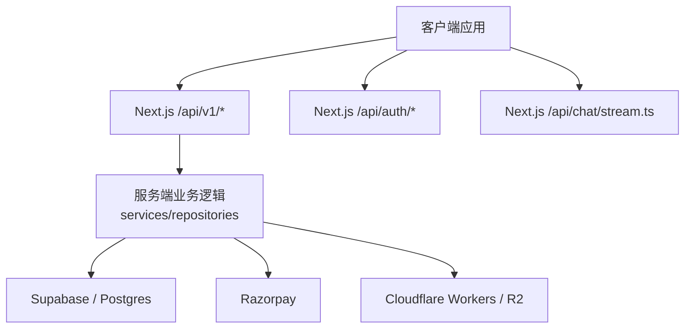
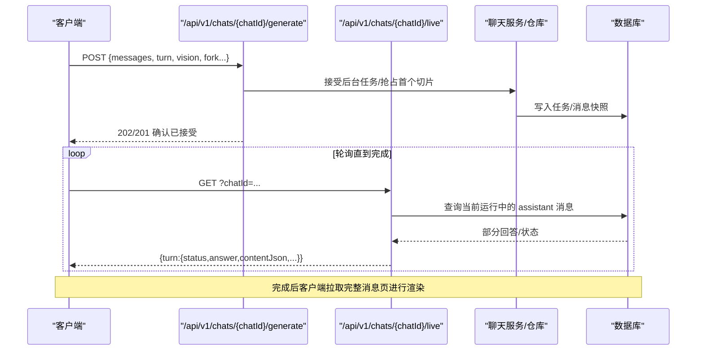
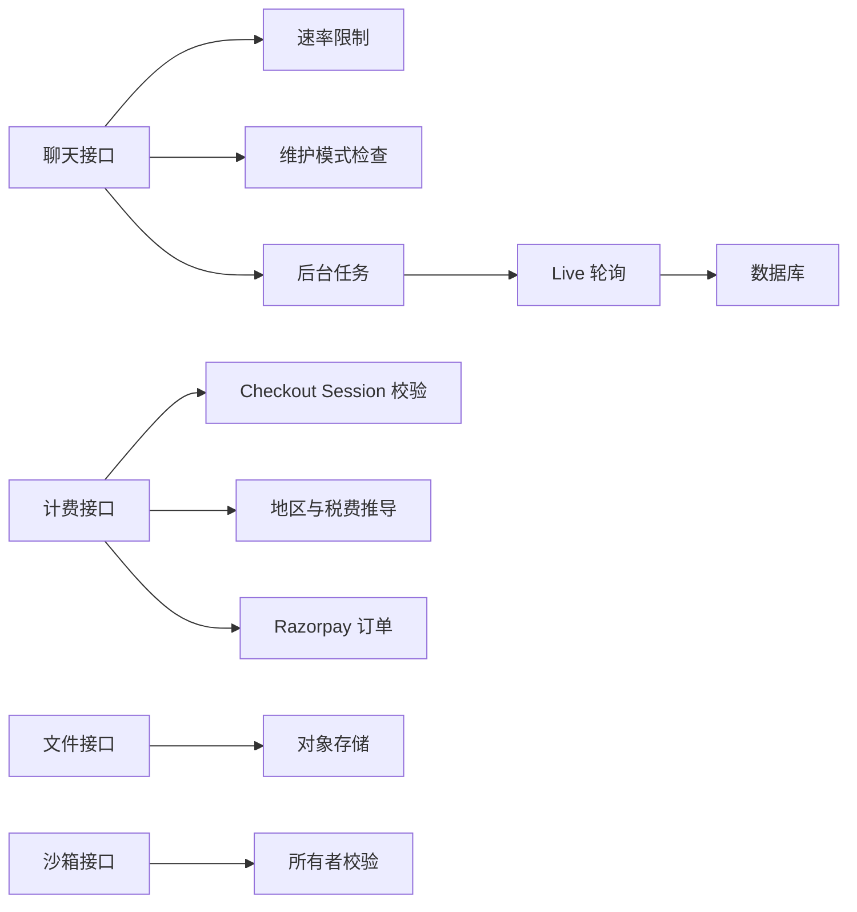

# API 参考

<cite>
**本文引用的文件**   
- [README.md](file://README.md)
- [src/app/api/chat/stream.ts](file://src/app/api/chat/stream.ts)
- [src/app/api/auth/login/route.ts](file://src/app/api/auth/login/route.ts)
- [src/app/api/auth/register/route.ts](file://src/app/api/auth/register/route.ts)
- [src/app/api/v1/chats/route.ts](file://src/app/api/v1/chats/route.ts)
- [src/app/api/v1/chats/[chatId]/route.ts](file://src/app/api/v1/chats/[chatId]/route.ts)
- [src/app/api/v1/chats/[chatId]/generate/route.ts](file://src/app/api/v1/chats/[chatId]/generate/route.ts)
- [src/app/api/v1/chats/[chatId]/live/route.ts](file://src/app/api/v1/chats/[chatId]/live/route.ts)
- [src/app/api/v1/chats/[chatId]/messages/route.ts](file://src/app/api/v1/chats/[chatId]/messages/route.ts)
- [src/app/api/v1/chats/search/route.ts](file://src/app/api/v1/chats/search/route.ts)
- [src/app/api/v1/chats/generating/route.ts](file://src/app/api/v1/chats/generating/route.ts)
- [src/app/api/v1/billing/subscription/route.ts](file://src/app/api/v1/billing/subscription/route.ts)
- [src/app/api/v1/billing/plans/route.ts](file://src/app/api/v1/billing/plans/route.ts)
- [src/app/api/v1/billing/orders/route.ts](file://src/app/api/v1/billing/orders/route.ts)
- [src/app/api/v1/billing/invoices/route.ts](file://src/app/api/v1/billing/invoices/route.ts)
- [src/app/api/v1/billing/payment-methods/route.ts](file://src/app/api/v1/billing/payment-methods/route.ts)
- [src/app/api/v1/files/presign/route.ts](file://src/app/api/v1/files/presign/route.ts)
- [src/app/api/v1/files/[fileId]/content/route.ts](file://src/app/api/v1/files/[fileId]/content/route.ts)
- [src/app/api/v1/sandbox/route.ts](file://src/app/api/v1/sandbox/route.ts)
- [src/app/api/v1/sandbox/[sandboxId]/route.ts](file://src/app/api/v1/sandbox/[sandboxId]/route.ts)
- [src/app/api/v1/plugins/oauth-client/route.ts](file://src/app/api/v1/plugins/oauth-client/route.ts)
</cite>

## 目录
1. [简介](#简介)
2. [项目结构](#项目结构)
3. [核心组件](#核心组件)
4. [架构总览](#架构总览)
5. [详细端点说明](#详细端点说明)
6. [依赖关系分析](#依赖关系分析)
7. [性能与容量特性](#性能与容量特性)
8. [故障排查指南](#故障排查指南)
9. [结论](#结论)
10. [附录：客户端集成与最佳实践](#附录客户端集成与最佳实践)

## 简介
本 API 参考文档面向外部与内部客户端，系统化描述 Clauxen Web App 暴露的 RESTful 接口、流式 SSE 协议、认证与权限模型、错误处理约定以及版本策略。代码采用 Next.js App Router 路由组织，后端通过 Node 运行时调用 Supabase 数据库、Razorpay 支付、Cloudflare Workers 等基础设施；前端使用 React 与 Zustand/React Query 消费这些接口。

该项目同时提供：
- 聊天与会话管理（REST + SSE）
- 计费与订阅（Razorpay）
- 文件上传与下载
- 沙箱执行环境
- 插件 OAuth 客户端元数据

**章节来源**
- [README.md:1-89](file://README.md#L1-L89)

## 项目结构
API 入口集中在 `src/app` 下：
- `/api/*`：通用或内部接口，如登录注册、聊天流、OAuth 回调。
- `/api/v1/*`：对外稳定版本 REST API。
- `/app/api/chat/stream.ts`：聊天流式 SSE 工厂。
- `/workers/*`：Cloudflare Workers 侧车服务（不在本文 REST/SSE 范围内）。

**图表来源**
- [src/app/api/chat/stream.ts:1-40](file://src/app/api/chat/stream.ts#L1-L40)
- [src/app/api/v1/chats/route.ts:1-49](file://src/app/api/v1/chats/route.ts#L1-L49)
- [src/app/api/v1/billing/orders/route.ts:1-172](file://src/app/api/v1/billing/orders/route.ts#L1-L172)

**章节来源**
- [README.md:1-89](file://README.md#L1-L89)

## 核心组件
- 会话与聊天：创建、查询、分页、搜索、删除、消息追加、生成控制、实时状态轮询。
- 认证：邮箱密码注册/登录，返回用户信息与服务端 token。
- 计费：订阅概览、套餐列表、订单创建、发票列表、支付方式列表。
- 文件：预签名上传、按 ID 读取内容。
- 沙箱：创建、查询、销毁与子资源。
- 插件：OAuth 客户端元数据文档。
- 聊天流：SSE 事件流，承载推理、叙述、工具执行、产物卡片与结束信号。

**章节来源**
- [src/app/api/v1/chats/route.ts:1-49](file://src/app/api/v1/chats/route.ts#L1-L49)
- [src/app/api/auth/login/route.ts:1-41](file://src/app/api/auth/login/route.ts#L1-L41)
- [src/app/api/auth/register/route.ts:1-40](file://src/app/api/auth/register/route.ts#L1-L40)
- [src/app/api/v1/billing/plans/route.ts:1-11](file://src/app/api/v1/billing/plans/route.ts#L1-L11)
- [src/app/api/v1/files/presign/route.ts:1-39](file://src/app/api/v1/files/presign/route.ts#L1-L39)
- [src/app/api/v1/sandbox/route.ts:1-58](file://src/app/api/v1/sandbox/route.ts#L1-L58)
- [src/app/api/v1/plugins/oauth-client/route.ts:1-27](file://src/app/api/v1/plugins/oauth-client/route.ts#L1-L27)

## 架构总览
以下序列图展示一次“发送消息并流式生成”的典型流程：客户端先 POST 触发后台作业，随后 GET 轮询 live 接口获取运行态；服务端在生成完成后写入持久化消息，最终由客户端渲染。

**图表来源**
- [src/app/api/v1/chats/[chatId]/generate/route.ts:1-200](file://src/app/api/v1/chats/[chatId]/generate/route.ts#L1-L200)
- [src/app/api/v1/chats/[chatId]/live/route.ts:1-125](file://src/app/api/v1/chats/[chatId]/live/route.ts#L1-L125)

## 详细端点说明

### 通用约定
- 基础路径：`/api/v1`（除特殊说明外）。
- 成功响应统一包裹为 JSON 对象，包含 `data` 字段。
- 认证方式：基于会话的服务端鉴权；受保护接口要求有效会话，否则返回 401。
- 错误格式：错误响应通过统一的 `jsonError` 封装，通常包含 `error` 字段与 HTTP 状态码。
- 版本策略：对外 API 使用 `/api/v1` 前缀；未带版本前缀的路径可能为内部或实验性接口。
- 向后兼容：新增字段保持可选，删除字段需废弃周期；破坏性变更应引入新路径或新版本。
- 速率限制：部分端点内置速率限制（例如生成长时任务），超限返回 429 或业务错误。

**章节来源**
- [src/app/api/v1/chats/[chatId]/generate/route.ts:1-60](file://src/app/api/v1/chats/[chatId]/generate/route.ts#L1-L60)
- [src/app/api/auth/login/route.ts:1-41](file://src/app/api/auth/login/route.ts#L1-L41)

---

### 认证接口

#### 注册
- 方法：POST
- URL：`/api/auth/register`
- 请求体：
  - `email`：字符串，邮箱格式。
  - `password`：字符串，长度 8~128。
- 成功响应：201，返回 `{ user, token }`。
- 失败：
  - 400：无效 JSON、参数校验失败、账号已存在。
  - 500：服务器内部错误。

**章节来源**
- [src/app/api/auth/register/route.ts:1-40](file://src/app/api/auth/register/route.ts#L1-L40)

#### 登录
- 方法：POST
- URL：`/api/auth/login`
- 请求体：
  - `email`：字符串，邮箱格式。
  - `password`：非空字符串。
- 成功响应：200，返回 `{ user, token }`。
- 失败：
  - 400：无效 JSON、参数校验失败。
  - 401：邮箱或密码无效。
  - 500：服务器内部错误。

**章节来源**
- [src/app/api/auth/login/route.ts:1-41](file://src/app/api/auth/login/route.ts#L1-L41)

---

### 聊天接口

#### 列出/创建聊天
- 方法：GET / POST
- URL：`/api/v1/chats`
- GET 查询参数：
  - `q`：搜索关键词（可选）。
  - `limit`：数量上限（可选）。
- POST 请求体：
  - `id`：可选，聊天 ID。
  - `title`：可选，标题。
  - `projectId`：可选，关联项目。
- 成功响应：
  - GET：`{ chats }`。
  - POST：201，`{ chat }`。
- 权限：需要会话且具备聊天访问权限。

**章节来源**
- [src/app/api/v1/chats/route.ts:1-49](file://src/app/api/v1/chats/route.ts#L1-L49)

#### 获取聊天详情（最新一页消息）
- 方法：GET / PATCH / DELETE
- URL：`/api/v1/chats/{chatId}`
- GET 成功响应：`{ chat, messages, nextCursor, hasMore }`。
- PATCH 请求体：
  - `title`：可选。
  - `starred`：可选布尔值。
- DELETE：软删除并归档，返回 `{ ok: true }`。
- 权限：需要会话且具备该聊天所有权。

**章节来源**
- [src/app/api/v1/chats/[chatId]/route.ts:1-79](file://src/app/api/v1/chats/[chatId]/route.ts#L1-L79)

#### 追加消息
- 方法：POST
- URL：`/api/v1/chats/{chatId}/messages`
- 请求体：
  - `content`：可选字符串，最大 256KB。
  - `fileIds`：可选字符串数组。
- 成功响应：201，`{ message }`。
- 失败：
  - 400：类型校验失败。
  - 413：消息内容过长。

**章节来源**
- [src/app/api/v1/chats/[chatId]/messages/route.ts:1-77](file://src/app/api/v1/chats/[chatId]/messages/route.ts#L1-L77)

#### 发起生成（后台长任务 + 轮询）
- 方法：POST
- URL：`/api/v1/chats/{chatId}/generate`
- 请求体关键字段：
  - `messages`：数组，历史消息（必填）。
  - `turn.content`：用户本轮文本。
  - `turn.modelContent`：可选模型上下文。
  - `turn.fileIds` / `images`：可选视觉附件。
  - `turn.userClientId` / `assistantClientId`：客户端追踪 ID。
  - `fork.kind`：`edit` 或 `regenerate`，配合对应消息 ID。
  - `vision.fileIds` / `images`：可选视觉输入。
  - `chatModel`、`homerReasoningEffort`、`extendedThinking`、`clientTimezone`、`generateChatTitle` 等可选。
- 行为：
  - 校验消息与客户端 ID。
  - 维护模式拦截返回 503。
  - 速率限制：用户级与 IP 级每分钟限额。
  - 提交后台任务后返回确认（通常为 201/202）。
- 失败：
  - 400：缺少消息、ID 不合法、维护模式外的校验失败。
  - 429：速率限制。
  - 503：维护模式。

**章节来源**
- [src/app/api/v1/chats/[chatId]/generate/route.ts:1-200](file://src/app/api/v1/chats/[chatId]/generate/route.ts#L1-L200)

#### 轮询实时状态
- 方法：GET
- URL：`/api/v1/chats/{chatId}/live`
- 成功响应：`{ turn }`，包含：
  - `status`：running/completed/failed/cancelled 等。
  - `answer`：逐步累积的回答文本。
  - `contentJson`：结构化 agent trace（thinking、tools、segments 等）。
  - 身份标识：`userMessageId`、`assistantClientId`、`assistantId`。
- 无活跃任务时返回 `null`。

**章节来源**
- [src/app/api/v1/chats/[chatId]/live/route.ts:1-125](file://src/app/api/v1/chats/[chatId]/live/route.ts#L1-L125)

#### 消息分页
- 方法：GET
- URL：`/api/v1/chats/{chatId}/messages`
- 查询参数：
  - `limit`：1~500，默认 500。
  - `cursor_depth`：可选深度游标。
- 成功响应：`{ messages, nextCursor, hasMore }`。

**章节来源**
- [src/app/api/v1/chats/[chatId]/messages/route.ts:1-77](file://src/app/api/v1/chats/[chatId]/messages/route.ts#L1-L77)

#### 聊天搜索
- 方法：GET
- URL：`/api/v1/chats/search`
- 查询参数：
  - `q`：必填，最长 500 字符。
  - `limit`：可选，默认 20。
- 成功响应：`{ results }`，每项包含消息摘要、所属聊天与排名。

**章节来源**
- [src/app/api/v1/chats/search/route.ts:1-38](file://src/app/api/v1/chats/search/route.ts#L1-L38)

#### 正在生成的聊天列表
- 方法：GET
- URL：`/api/v1/chats/generating`
- 成功响应：`{ ids }`，当前用户仍在运行的聊天 ID 列表。

**章节来源**
- [src/app/api/v1/chats/generating/route.ts:1-17](file://src/app/api/v1/chats/generating/route.ts#L1-L17)

#### 聊天 SSE 流
- 方法：GET
- URL：`/api/chat/stream`
- 协议：SSE（Server-Sent Events），事件包括：
  - `start`：回合开始。
  - `segment_start/end`：thinking/narration 阶段标记。
  - `thinking_start/delta/end`：推理阶段。
  - `narration_delta`：用户可见叙述增量。
  - `tool_start/output_delta/data`：工具生命周期与输出。
  - `tool_end`：工具结束。
  - `artifact_upsert`：产物卡片更新。
  - `chat_title` / `error` / `done`：收尾事件。
- 用途：构建 UI 的 Agent Trace 与实时体验。

**章节来源**
- [src/app/api/chat/stream.ts:1-40](file://src/app/api/chat/stream.ts#L1-L40)

---

### 计费接口

#### 订阅概览
- 方法：GET
- URL：`/api/v1/billing/subscription`
- 权限：需要会话。
- 成功响应：用户订阅概览对象。

**章节来源**
- [src/app/api/v1/billing/subscription/route.ts:1-20](file://src/app/api/v1/billing/subscription/route.ts#L1-L20)

#### 套餐列表
- 方法：GET
- URL：`/api/v1/billing/plans`
- 成功响应：`{ plans }`。

**章节来源**
- [src/app/api/v1/billing/plans/route.ts:1-11](file://src/app/api/v1/billing/plans/route.ts#L1-L11)

#### 创建订单
- 方法：POST
- URL：`/api/v1/billing/orders`
- 请求体关键字段：
  - `checkoutSessionId`：必填，用于校验购买上下文。
  - `planId` / `planName` / `billingCycle` / `maxTier` / `seatBreakdown` / `organizationSeatCount`：可选，用于计划与定价。
  - `billingDetails`：可选，最小账单信息。
  - `currency`：可选，服务端会重新推导货币。
- 行为：
  - 校验 checkout session 归属与声明一致性。
  - 根据地区推导货币与税费（印度 INR+GST，其他地区 USD 零税率）。
  - 支持礼品购买复用既有 Razorpay 订单。
  - 返回 Razorpay 订单信息与价格明细。
- 成功响应：201，包含订单、位置、价格等信息。

**章节来源**
- [src/app/api/v1/billing/orders/route.ts:1-172](file://src/app/api/v1/billing/orders/route.ts#L1-L172)

#### 发票列表
- 方法：GET
- URL：`/api/v1/billing/invoices`
- 权限：需要会话。
- 成功响应：`{ invoices }`。

**章节来源**
- [src/app/api/v1/billing/invoices/route.ts:1-16](file://src/app/api/v1/billing/invoices/route.ts#L1-L16)

#### 支付方式列表
- 方法：GET
- URL：`/api/v1/billing/payment-methods`
- 权限：需要会话。
- 成功响应：`{ paymentMethods }`。

**章节来源**
- [src/app/api/v1/billing/payment-methods/route.ts:1-16](file://src/app/api/v1/billing/payment-methods/route.ts#L1-L16)

---

### 文件接口

#### 预签名上传
- 方法：POST
- URL：`/api/v1/files/presign`
- 权限：需要会话。
- 请求体关键字段：
  - `originalName` / `mimeType` / `sizeBytes`：可选。
  - `workspaceId` / `folderId`：可选存储域。
  - `purpose`：`avatar` | `library` | `chat-attachment` | `project-source`。
  - `chatId` / `projectId` / `sourceKind`：可选上下文。
- 成功响应：201，返回预签名上传所需信息。

**章节来源**
- [src/app/api/v1/files/presign/route.ts:1-39](file://src/app/api/v1/files/presign/route.ts#L1-L39)

#### 读取文件内容
- 方法：GET
- URL：`/api/v1/files/{fileId}/content`
- 查询参数：
  - `download=1`：强制下载。
- 成功响应：二进制流，设置正确的 `content-type`、`content-disposition` 与缓存头。

**章节来源**
- [src/app/api/v1/files/[fileId]/content/route.ts:1-32](file://src/app/api/v1/files/[fileId]/content/route.ts#L1-L32)

---

### 沙箱接口

#### 列表与创建沙箱
- 方法：GET / POST
- URL：`/api/v1/sandbox`
- GET 查询参数：
  - `state`：逗号分隔的运行中/暂停状态过滤。
- POST 请求体：
  - `timeoutMs` / `autoPause` / `autoResume` / `idleTimeoutSeconds` / `conversationId` / `metadata`：可选。
  - `metadata.userId` 会被服务端移除以加固所有权。
- 成功响应：沙箱信息对象。

**章节来源**
- [src/app/api/v1/sandbox/route.ts:1-58](file://src/app/api/v1/sandbox/route.ts#L1-L58)

#### 查询与销毁沙箱
- 方法：GET / DELETE
- URL：`/api/v1/sandbox/{sandboxId}`
- 权限：需要会话且具备沙箱所有权。
- 成功响应：GET 返回沙箱信息，DELETE 返回销毁结果。

**章节来源**
- [src/app/api/v1/sandbox/[sandboxId]/route.ts:1-29](file://src/app/api/v1/sandbox/[sandboxId]/route.ts#L1-L29)

---

### 插件接口

#### OAuth 客户端元数据
- 方法：GET
- URL：`/api/v1/plugins/oauth-client`
- 用途：供支持动态注册的授权服务器获取 Clauxen 作为 OAuth 客户端的元数据。
- 成功响应：包含 `client_id`、`redirect_uris`、`grant_types`、`response_types` 等字段。

**章节来源**
- [src/app/api/v1/plugins/oauth-client/route.ts:1-27](file://src/app/api/v1/plugins/oauth-client/route.ts#L1-L27)

## 依赖关系分析
- 聊天生成链路依赖：
  - 会话鉴权 → 速率限制 → 维护模式检查 → 消息清洗与校验 → 后台任务提交 → 轮询 live 接口 → 持久化完成。
- 计费链路依赖：
  - 会话鉴权 → checkout session 校验 → 地区与税费推导 → Razorpay 客户与订单创建 → 返回支付上下文。
- 文件链路依赖：
  - 会话鉴权 → 预签名生成 → 直传存储 → 安全读取。
- 沙箱链路依赖：
  - 会话鉴权 → 所有者校验 → 生命周期管理。

**图表来源**
- [src/app/api/v1/chats/[chatId]/generate/route.ts:1-120](file://src/app/api/v1/chats/[chatId]/generate/route.ts#L1-L120)
- [src/app/api/v1/billing/orders/route.ts:1-172](file://src/app/api/v1/billing/orders/route.ts#L1-L172)
- [src/app/api/v1/files/presign/route.ts:1-39](file://src/app/api/v1/files/presign/route.ts#L1-L39)
- [src/app/api/v1/sandbox/[sandboxId]/route.ts:1-29](file://src/app/api/v1/sandbox/[sandboxId]/route.ts#L1-L29)

**章节来源**
- [src/app/api/v1/chats/[chatId]/generate/route.ts:1-200](file://src/app/api/v1/chats/[chatId]/generate/route.ts#L1-L200)
- [src/app/api/v1/billing/orders/route.ts:1-172](file://src/app/api/v1/billing/orders/route.ts#L1-L172)

## 性能与容量特性
- 首字节延迟优化：聊天流在个人化与 MCP 工具加载期间异步并行准备，避免阻塞首次响应。
- 消息大小限制：单条消息内容上限 256KB，防止列插入滥用。
- 分页上限：消息分页默认 500，可配置但限制最大 500。
- 长任务超时：生成相关接口允许较长执行时间（如 300 秒），适合后台调度。
- 缓存策略：文件读取使用私有缓存头，减少重复传输。

**章节来源**
- [src/app/api/chat/stream.ts:40-120](file://src/app/api/chat/stream.ts#L40-L120)
- [src/app/api/v1/chats/[chatId]/messages/route.ts:1-77](file://src/app/api/v1/chats/[chatId]/messages/route.ts#L1-L77)
- [src/app/api/v1/sandbox/route.ts:1-58](file://src/app/api/v1/sandbox/route.ts#L1-L58)
- [src/app/api/v1/files/[fileId]/content/route.ts:1-32](file://src/app/api/v1/files/[fileId]/content/route.ts#L1-L32)

## 故障排查指南
常见错误与定位建议：
- 400 参数校验失败：检查 JSON 结构与字段类型，尤其是 `email`、`password`、`messages`、`turn` 字段。
- 401 未认证：确认会话是否有效，受保护接口均需会话。
- 403/404 权限或资源不存在：检查聊天/沙箱/文件是否属于当前用户。
- 413 负载过大：消息内容超过 256KB，需分片或压缩。
- 429 速率限制：等待一段时间重试，降低请求频率。
- 500 服务器错误：查看服务端日志；若频繁出现，检查数据库连接与第三方服务可用性。
- 503 维护模式：服务端处于维护期，稍后再试。

**章节来源**
- [src/app/api/auth/login/route.ts:1-41](file://src/app/api/auth/login/route.ts#L1-L41)
- [src/app/api/auth/register/route.ts:1-40](file://src/app/api/auth/register/route.ts#L1-L40)
- [src/app/api/v1/chats/[chatId]/messages/route.ts:1-77](file://src/app/api/v1/chats/[chatId]/messages/route.ts#L1-L77)
- [src/app/api/v1/chats/[chatId]/generate/route.ts:1-120](file://src/app/api/v1/chats/[chatId]/generate/route.ts#L1-L120)

## 结论
本项目提供了覆盖聊天、计费、文件、沙箱与插件的完整 API 集合，并通过 Next.js App Router 与 Node 运行时提供服务。对外稳定版本统一位于 `/api/v1`，所有受保护接口均要求会话鉴权。聊天场景采用后台任务 + 轮询 live 接口的方式实现高可靠生成；同时提供 `/api/chat/stream` 的 SSE 协议用于更丰富的实时交互。计费链路整合 Razorpay，结合地区与税费推导保证合规与准确性。

[无需来源：本节为总结性内容]

## 附录：客户端集成与最佳实践

### 认证集成
- 优先使用 `/api/auth/register` 与 `/api/auth/login` 获取用户与 token。
- 后续请求携带会话（例如 Cookie 或 Authorization Header，依部署配置而定）。
- 对 401 响应进行会话刷新或引导重新登录。

**章节来源**
- [src/app/api/auth/register/route.ts:1-40](file://src/app/api/auth/register/route.ts#L1-L40)
- [src/app/api/auth/login/route.ts:1-41](file://src/app/api/auth/login/route.ts#L1-L41)

### 聊天集成
- 创建聊天后调用 `/api/v1/chats/{chatId}/messages` 追加用户消息。
- 调用 `/api/v1/chats/{chatId}/generate` 启动生成，并在返回后轮询 `/api/v1/chats/{chatId}/live`。
- 如需更丰富的事件流，可使用 `/api/chat/stream` 的 SSE 协议。
- 注意维护模式（503）与速率限制（429）的错误处理。

**章节来源**
- [src/app/api/v1/chats/[chatId]/messages/route.ts:1-77](file://src/app/api/v1/chats/[chatId]/messages/route.ts#L1-L77)
- [src/app/api/v1/chats/[chatId]/generate/route.ts:1-200](file://src/app/api/v1/chats/[chatId]/generate/route.ts#L1-L200)
- [src/app/api/v1/chats/[chatId]/live/route.ts:1-125](file://src/app/api/v1/chats/[chatId]/live/route.ts#L1-L125)
- [src/app/api/chat/stream.ts:1-40](file://src/app/api/chat/stream.ts#L1-L40)

### 计费集成
- 调用 `/api/v1/billing/plans` 获取可用套餐。
- 使用 `/api/v1/billing/subscription` 获取当前订阅概览。
- 调用 `/api/v1/billing/orders` 创建订单，传入有效的 `checkoutSessionId`。
- 使用 `/api/v1/billing/invoices` 与 `/api/v1/billing/payment-methods` 查询发票与支付方式。

**章节来源**
- [src/app/api/v1/billing/plans/route.ts:1-11](file://src/app/api/v1/billing/plans/route.ts#L1-L11)
- [src/app/api/v1/billing/subscription/route.ts:1-20](file://src/app/api/v1/billing/subscription/route.ts#L1-L20)
- [src/app/api/v1/billing/orders/route.ts:1-172](file://src/app/api/v1/billing/orders/route.ts#L1-L172)
- [src/app/api/v1/billing/invoices/route.ts:1-16](file://src/app/api/v1/billing/invoices/route.ts#L1-L16)
- [src/app/api/v1/billing/payment-methods/route.ts:1-16](file://src/app/api/v1/billing/payment-methods/route.ts#L1-L16)

### 文件集成
- 通过 `/api/v1/files/presign` 获取预签名上传信息。
- 将文件直传到对象存储（根据预签名返回的地址）。
- 通过 `/api/v1/files/{fileId}/content` 读取文件内容，必要时添加 `download=1`。

**章节来源**
- [src/app/api/v1/files/presign/route.ts:1-39](file://src/app/api/v1/files/presign/route.ts#L1-L39)
- [src/app/api/v1/files/[fileId]/content/route.ts:1-32](file://src/app/api/v1/files/[fileId]/content/route.ts#L1-L32)

### 沙箱集成
- 使用 `/api/v1/sandbox` 创建或查询沙箱。
- 通过 `/api/v1/sandbox/{sandboxId}` 查询与销毁沙箱。
- 注意服务端会清理敏感元数据（如 `userId`），不要信任客户端传递的所有权字段。

**章节来源**
- [src/app/api/v1/sandbox/route.ts:1-58](file://src/app/api/v1/sandbox/route.ts#L1-L58)
- [src/app/api/v1/sandbox/[sandboxId]/route.ts:1-29](file://src/app/api/v1/sandbox/[sandboxId]/route.ts#L1-L29)

### 插件集成
- 使用 `/api/v1/plugins/oauth-client` 获取 OAuth 客户端元数据，便于授权服务器发现。

**章节来源**
- [src/app/api/v1/plugins/oauth-client/route.ts:1-27](file://src/app/api/v1/plugins/oauth-client/route.ts#L1-L27)