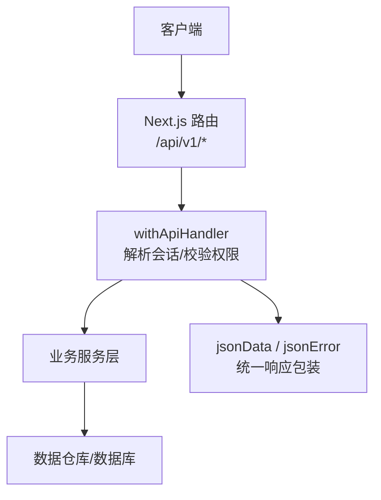
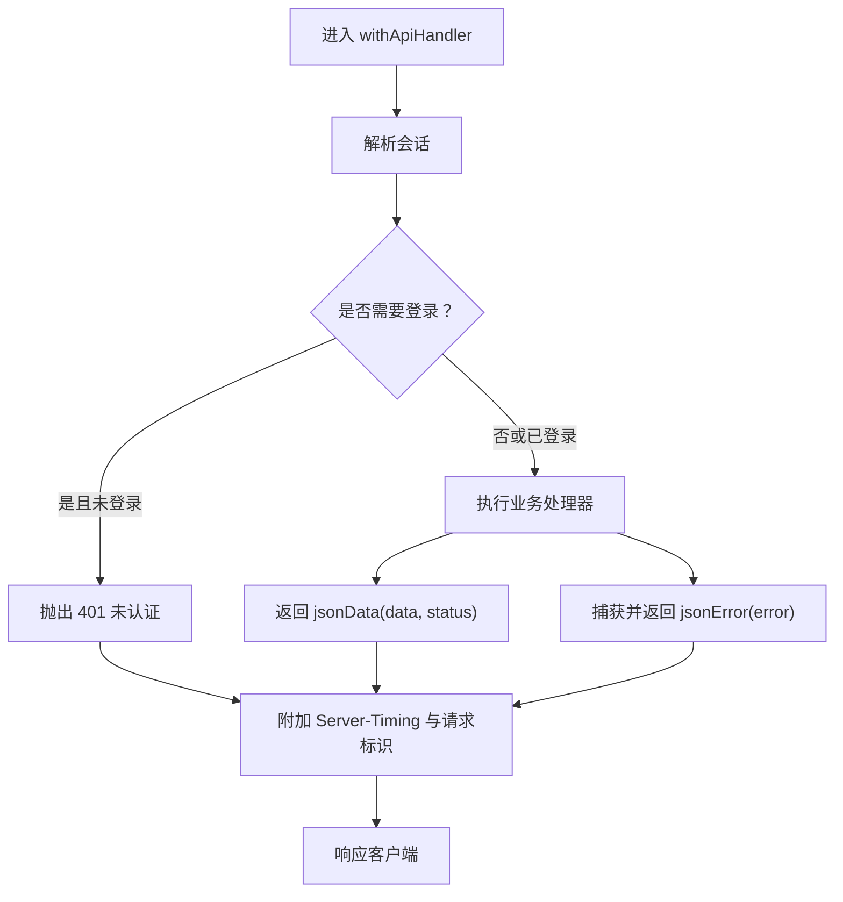
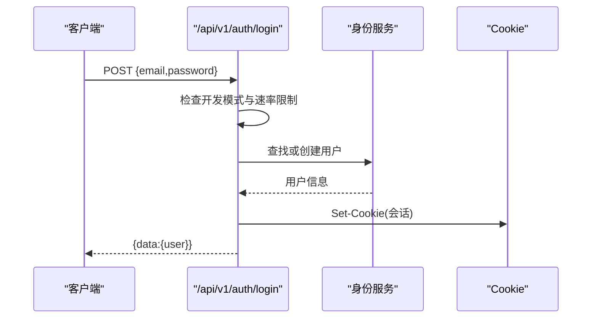
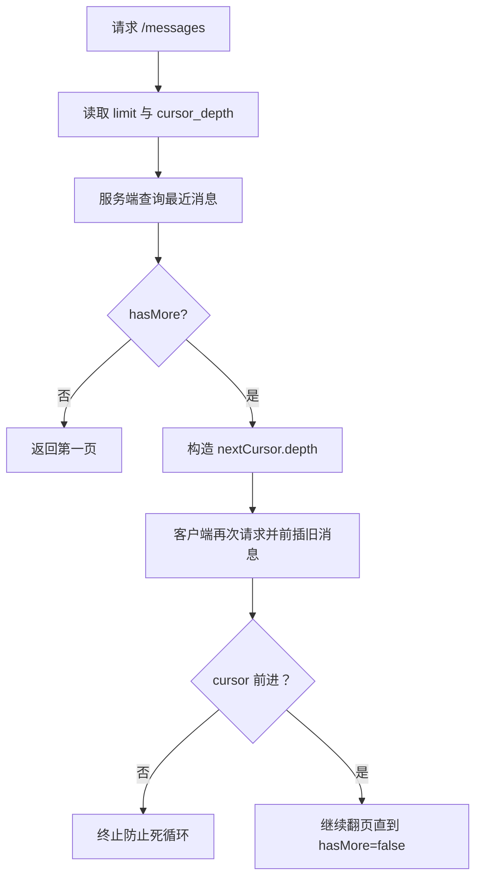
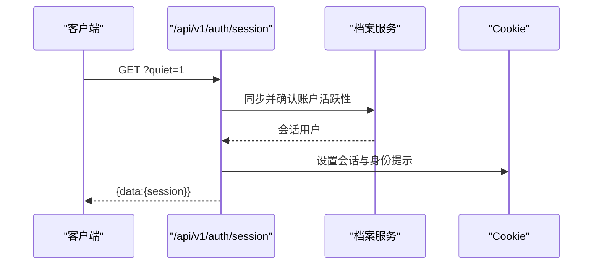
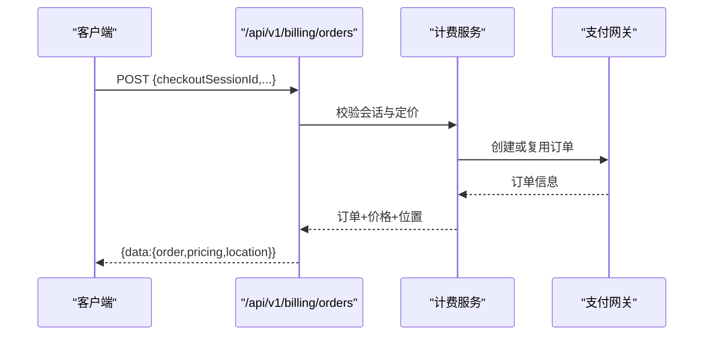
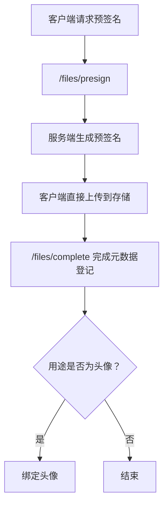
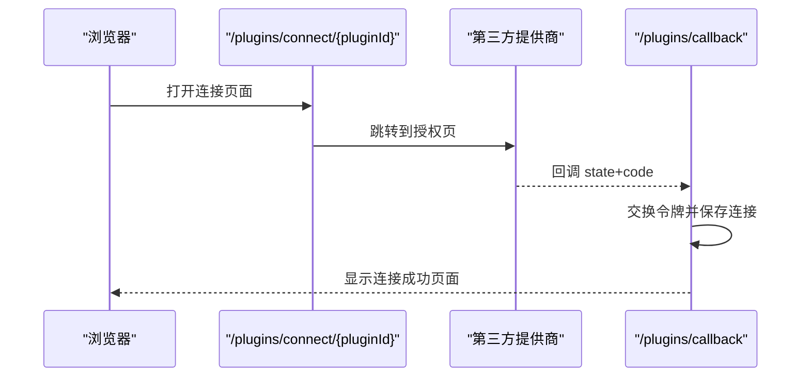
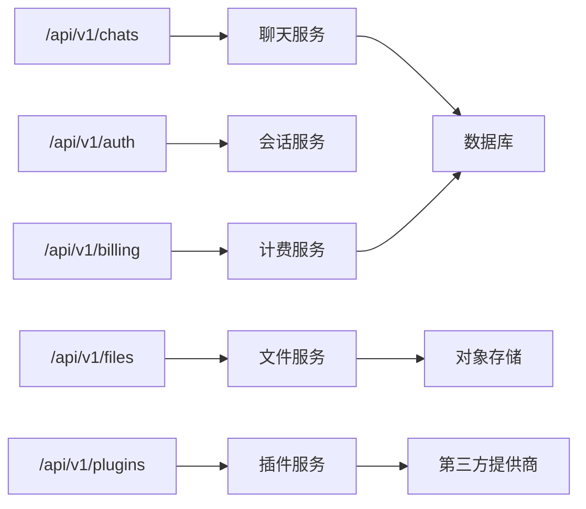
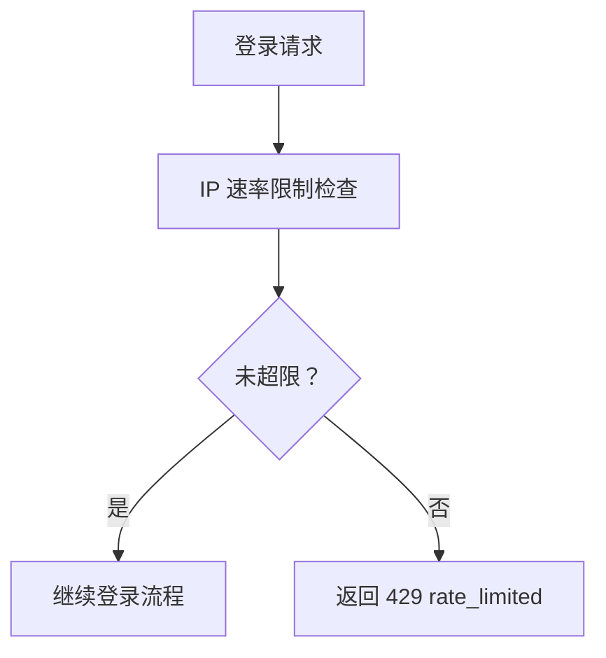

# RESTful API

<cite>
**本文引用的文件**   
- [src/app/api/v1/chats/route.ts](file://src/app/api/v1/chats/route.ts)
- [src/app/api/v1/chats/[chatId]/route.ts](file://src/app/api/v1/chats/[chatId]/route.ts)
- [src/app/api/v1/chats/[chatId]/messages/route.ts](file://src/app/api/v1/chats/[chatId]/messages/route.ts)
- [src/app/api/v1/chats/search/route.ts](file://src/app/api/v1/chats/search/route.ts)
- [src/app/api/v1/auth/login/route.ts](file://src/app/api/v1/auth/login/route.ts)
- [src/app/api/v1/auth/register/route.ts](file://src/app/api/v1/auth/register/route.ts)
- [src/app/api/v1/auth/session/route.ts](file://src/app/api/v1/auth/session/route.ts)
- [src/app/api/v1/billing/plans/route.ts](file://src/app/api/v1/billing/plans/route.ts)
- [src/app/api/v1/billing/subscription/route.ts](file://src/app/api/v1/billing/subscription/route.ts)
- [src/app/api/v1/billing/orders/route.ts](file://src/app/api/v1/billing/orders/route.ts)
- [src/app/api/v1/billing/payment-methods/route.ts](file://src/app/api/v1/billing/payment-methods/route.ts)
- [src/app/api/v1/files/presign/route.ts](file://src/app/api/v1/files/presign/route.ts)
- [src/app/api/v1/files/complete/route.ts](file://src/app/api/v1/files/complete/route.ts)
- [src/app/api/v1/plugins/connect/[pluginId]/route.ts](file://src/app/api/v1/plugins/connect/[pluginId]/route.ts)
- [src/app/api/v1/plugins/callback/route.ts](file://src/app/api/v1/plugins/callback/route.ts)
- [src/app/api/v1/plugins/connections/route.ts](file://src/app/api/v1/plugins/connections/route.ts)
- [src/server/http/api-handler.ts](file://src/server/http/api-handler.ts)
- [src/server/http/api-response.ts](file://src/server/http/api-response.ts)
- [src/shared/lib/api/chats.ts](file://src/shared/lib/api/chats.ts)
</cite>

## 目录
1. [简介](#简介)
2. [API 约定](#api-约定)
3. [统一响应格式与错误模型](#统一响应格式与错误模型)
4. [认证与会话机制](#认证与会话机制)
5. [聊天 API（/chats）](#聊天-apichats)
6. [用户认证 API（/auth）](#用户认证-apiauth)
7. [计费 API（/billing）](#计费-apibilling)
8. [文件 API（/files）](#文件-apifiles)
9. [插件 API（/plugins）](#插件-apiplugins)
10. [依赖关系与架构总览](#依赖关系与架构总览)
11. [性能与速率限制](#性能与速率限制)
12. [常见问题排查](#常见问题排查)
13. [结论](#结论)

## 简介
本文件面向外部集成方，系统化记录 `/api/v1/*` 下已实现的 RESTful 端点。当前代码库基于 Next.js App Router，所有业务路由集中在 `src/app/api/v1`；通用鉴权、错误包装和成功响应封装位于 `src/server/http`。文档按功能模块划分：聊天、认证、计费、文件、插件等。

## API 约定
- 基础路径：`/api/v1`
- 数据体格式：JSON
- 分页方式：键集分页（keyset pagination），通过查询参数控制深度游标和页大小
- 时间字段：使用 ISO 字符串
- 身份验证：多数接口需要有效会话 Cookie 或授权头；部分公开接口允许匿名访问
- 请求追踪：服务端会在响应中注入请求标识和计时信息

**图表来源**
- [src/server/http/api-handler.ts:1-66](file://src/server/http/api-handler.ts#L1-L66)
- [src/server/http/api-response.ts:1-39](file://src/server/http/api-response.ts#L1-L39)

**章节来源**
- [src/server/http/api-handler.ts:1-66](file://src/server/http/api-handler.ts#L1-L66)
- [src/server/http/api-response.ts:1-39](file://src/server/http/api-response.ts#L1-L39)

## 统一响应格式与错误模型
### 成功响应
所有成功响应均被 `jsonData` 包装为 `{ data }` 结构：
- `data`：具体业务对象或数组
- HTTP 状态码由调用方指定，默认 `200`

### 错误响应
异常会被 `jsonError` 转换为标准错误结构：
- `error.message`：对外可见的错误消息
- `error.code`：机器可读的错误码
- HTTP 状态码取自底层 `AppError` 或默认 `500`

生产环境会隐藏内部细节，数据库错误可能返回更通用的消息。

### 公共响应头
- `Server-Timing`：包含认证阶段和应用处理耗时
- 自定义请求标识头：用于日志关联

**图表来源**
- [src/server/http/api-handler.ts:1-66](file://src/server/http/api-handler.ts#L1-L66)
- [src/server/http/api-response.ts:1-39](file://src/server/http/api-response.ts#L1-L39)

**章节来源**
- [src/server/http/api-response.ts:1-39](file://src/server/http/api-response.ts#L1-L39)
- [src/server/http/api-handler.ts:1-66](file://src/server/http/api-handler.ts#L1-L66)

## 认证与会话机制
### 会话来源
- 浏览器 Cookie 中的会话 Cookie
- Supabase JWT 声明（由请求携带）
- `Authorization` 头（某些场景用于检测会话是否需续期）

### 会话端点
- `GET /api/v1/auth/session`
  - 支持查询参数 `quiet=1`，用于安静模式：仅在存在会话令牌时检查续期，不主动抛错
  - 成功返回 `{ data: { session: SessionUser | null } }`
  - 未激活账户会返回 `account_deleted` 错误
  - 响应设置会话 Cookie 和身份提示 Cookie

### 开发模式登录
- `POST /api/v1/auth/login`
  - 仅当开发配置启用时才可用
  - 请求体包含邮箱和密码
  - 成功后返回用户信息并通过 `Set-Cookie` 下发会话
  - 实现基于 IP 的登录频率限制

### 注册
- `POST /api/v1/auth/register`
  - 仅开发模式可用
  - 校验邮箱格式、长度、禁用邮箱列表及密码长度
  - 重复邮箱返回冲突错误
  - 成功后返回用户信息并设置会话 Cookie

**图表来源**
- [src/app/api/v1/auth/login/route.ts:1-128](file://src/app/api/v1/auth/login/route.ts#L1-L128)
- [src/app/api/v1/auth/register/route.ts:1-93](file://src/app/api/v1/auth/register/route.ts#L1-L93)
- [src/app/api/v1/auth/session/route.ts:1-182](file://src/app/api/v1/auth/session/route.ts#L1-L182)

**章节来源**
- [src/app/api/v1/auth/login/route.ts:1-128](file://src/app/api/v1/auth/login/route.ts#L1-L128)
- [src/app/api/v1/auth/register/route.ts:1-93](file://src/app/api/v1/auth/register/route.ts#L1-L93)
- [src/app/api/v1/auth/session/route.ts:1-182](file://src/app/api/v1/auth/session/route.ts#L1-L182)

## 聊天 API（/chats）
### 能力概览
- 列出、搜索、创建聊天
- 获取聊天摘要、更新标题、置顶、归档、取消归档、删除
- 消息分页、追加消息、生成状态、实时轮次、转录、分支管理
- 搜索聊天标题

### 端点清单

#### 列出聊天
- 方法：`GET`
- URL：`/api/v1/chats`
- 认证：需要会话
- 查询参数：
  - `q`：搜索关键词
  - `limit`：返回数量上限
- 响应：`{ data: { chats: ApiChat[] } }`

#### 创建聊天
- 方法：`POST`
- URL：`/api/v1/chats`
- 认证：需要会话
- 请求体：
  - `id`：可选聊天 ID
  - `title`：可选标题
  - `projectId`：可选项目 ID
- 响应：`{ data: { chat: { id, title } } }`，状态码 `201`

#### 获取聊天详情
- 方法：`GET`
- URL：`/api/v1/chats/{chatId}`
- 认证：需要会话，且必须拥有该聊天权限
- 响应：`{ data: { chat, messages, nextCursor, hasMore } }`

#### 更新聊天
- 方法：`PATCH`
- URL：`/api/v1/chats/{chatId}`
- 认证：需要会话，且必须拥有该聊天权限
- 请求体：
  - `title`：新标题
  - `starred`：星标状态
- 响应：`{ data: { chat } }`

#### 删除聊天
- 方法：`DELETE`
- URL：`/api/v1/chats/{chatId}`
- 认证：需要会话，且必须拥有该聊天权限
- 行为：先快照归档，再软删除，并清理后续消息
- 响应：`{ data: { ok: true } }`

#### 列出消息
- 方法：`GET`
- URL：`/api/v1/chats/{chatId}/messages`
- 认证：需要会话，且必须拥有该聊天权限
- 查询参数：
  - `limit`：每页消息数
  - `cursor_depth`：键集分页深度
- 响应：`{ data: MessagesPage }`
  - `MessagesPage.messages`：消息数组
  - `MessagesPage.nextCursor`：下一页游标
  - `MessagesPage.hasMore`：是否还有更多

#### 追加消息
- 方法：`POST`
- URL：`/api/v1/chats/{chatId}/messages`
- 认证：需要会话，且必须拥有该聊天权限
- 请求体：
  - `content`：消息内容
  - `fileIds`：可选附件文件 ID 列表
- 响应：`{ data: { message: ApiMessage } }`

#### 搜索聊天
- 方法：`GET`
- URL：`/api/v1/chats/search`
- 认证：需要会话
- 查询参数：`q`、`limit`
- 响应：`{ data: { chats: ApiChat[] } }`

#### 其他聊天相关端点
- `GET /api/v1/chats/generating`：正在生成的聊天 ID 列表
- `GET /api/v1/chats/{chatId}/generate/status`：生成状态
- `GET /api/v1/chats/{chatId}/live`：实时轮次
- `GET /api/v1/chats/{chatId}/transcript`：对话转录
- `POST /api/v1/chats/{chatId}/branches`：创建分支
- `POST /api/v1/chats/{chatId}/pin` / `DELETE /api/v1/chats/{chatId}/pin`：置顶与取消置顶
- `POST /api/v1/chats/{chatId}/archive` / `POST /api/v1/chats/{chatId}/unarchive`：归档与取消归档
- `POST /api/v1/chats/{chatId}/generate/stop`：停止生成
- `GET /api/v1/chats/{chatId}/project`：获取所属项目
- `GET /api/v1/chats/{chatId}/share` / `POST /api/v1/chats/{chatId}/share`：分享链接管理
- `GET /api/v1/chats/{chatId}/research/{toolId}` / `POST ...`：研究工具查询与执行
- `GET /api/v1/chats/{chatId}/research/{toolId}/report`：研究报告
- `POST /api/v1/chats/{chatId}/title`：修改标题

### 消息分页机制
消息采用键集分页，核心逻辑如下：
- 首次加载最新一批消息
- 若存在 `nextCursor`，则继续向前翻页
- 游标以 `depth` 表示层级深度，避免重复绘制
- 前端可自动合并多页结果并去重

**图表来源**
- [src/shared/lib/api/chats.ts:1-200](file://src/shared/lib/api/chats.ts#L1-L200)

**章节来源**
- [src/app/api/v1/chats/route.ts:1-49](file://src/app/api/v1/chats/route.ts#L1-L49)
- [src/app/api/v1/chats/[chatId]/route.ts:1-79](file://src/app/api/v1/chats/[chatId]/route.ts#L1-L79)
- [src/app/api/v1/chats/[chatId]/messages/route.ts:19-47](file://src/app/api/v1/chats/[chatId]/messages/route.ts#L19-L47)
- [src/app/api/v1/chats/search/route.ts:10-10](file://src/app/api/v1/chats/search/route.ts#L10-L10)
- [src/shared/lib/api/chats.ts:1-200](file://src/shared/lib/api/chats.ts#L1-L200)

## 用户认证 API（/auth）
### 端点清单

#### 获取会话
- 方法：`GET`
- URL：`/api/v1/auth/session`
- 查询参数：
  - `quiet=1`：安静模式，不强制续期
- 响应：`{ data: { session: SessionUser | null } }`
- 说明：
  - 已删除账户返回 `account_deleted`
  - 未提供有效凭证但存在令牌时会要求续期
  - 响应设置会话 Cookie 与身份提示 Cookie

#### 登录
- 方法：`POST`
- URL：`/api/v1/auth/login`
- 条件：仅开发模式启用
- 请求体：
  - `email`：邮箱
  - `password`：密码
- 响应：`{ data: { user } }`，并设置会话 Cookie
- 错误：
  - `rate_limited`：登录尝试过多
  - `invalid_credentials`：凭据无效
  - `auth_unavailable`：开发模式未启用

#### 注册
- 方法：`POST`
- URL：`/api/v1/auth/register`
- 条件：仅开发模式启用
- 请求体：
  - `email`：必填
  - `password`：必填
  - `displayName`：可选
- 响应：`{ data: { user } }`，并设置会话 Cookie
- 错误：
  - `invalid_email`：邮箱无效
  - `invalid_password`：密码过长
  - `email_exists`：邮箱已存在
  - `auth_unavailable`：注册未启用

#### 退出登录
- 方法：`POST`
- URL：`/api/v1/auth/logout`
- 认证：需要会话
- 行为：清除会话 Cookie

#### 其他认证相关端点
- `POST /api/v1/auth/email-status`：邮件状态查询
- `POST /api/v1/auth/magic/request`：魔法链接请求
- `POST /api/v1/auth/magic/inspect`：魔法链接检查
- `POST /api/v1/auth/magic/complete`：完成魔法链接登录
- `POST /api/v1/auth/signup/request-otp`：注册发送一次性验证码
- `POST /api/v1/auth/signup/verify`：验证一次性验证码
- `POST /api/v1/auth/validate-email`：邮箱有效性校验

**图表来源**
- [src/app/api/v1/auth/session/route.ts:1-182](file://src/app/api/v1/auth/session/route.ts#L1-L182)

**章节来源**
- [src/app/api/v1/auth/session/route.ts:1-182](file://src/app/api/v1/auth/session/route.ts#L1-L182)
- [src/app/api/v1/auth/login/route.ts:1-128](file://src/app/api/v1/auth/login/route.ts#L1-L128)
- [src/app/api/v1/auth/register/route.ts:1-93](file://src/app/api/v1/auth/register/route.ts#L1-L93)

## 计费 API（/billing）
### 端点清单

#### 查询套餐
- 方法：`GET`
- URL：`/api/v1/billing/plans`
- 认证：无需会话
- 响应：`{ data: { plans } }`

#### 查询订阅概况
- 方法：`GET`
- URL：`/api/v1/billing/subscription`
- 认证：需要会话
- 响应：`{ data: BillingOverview }`

#### 创建订单
- 方法：`POST`
- URL：`/api/v1/billing/orders`
- 认证：需要会话
- 请求体关键字段：
  - `checkoutSessionId`：结账会话 ID（必填）
  - `planId`、`planName`、`billingCycle`、`maxTier`
  - `seatBreakdown`、`organizationSeatCount`
  - `billingDetails`：最小账单信息
  - `currency`：货币（服务端会重新推导）
- 响应：`{ data: CheckoutOrderWithLocationAndPricing }`，状态码 `201`
- 说明：
  - 根据客户端输入与服务端会话声明进行一致性校验
  - 根据国家与 IP 判断税费
  - 礼品购买复用已有支付订单

#### 查询支付方式
- 方法：`GET`
- URL：`/api/v1/billing/payment-methods`
- 认证：需要会话
- 响应：`{ data: { paymentMethods } }`

#### 其他计费相关端点
- `GET /api/v1/billing/invoices`：发票列表
- `GET /api/v1/billing/invoices/{paymentId}`：单张发票
- `GET /api/v1/billing/invoices/{paymentId}/pdf`：发票 PDF
- `POST /api/v1/billing/checkout-sessions`：创建结账会话
- `POST /api/v1/billing/checkout-sessions/refresh`：刷新结账会话
- `POST /api/v1/billing/payment-methods/setup`：添加支付方式
- `POST /api/v1/billing/payment-methods/setup/verify`：验证支付方式
- `PATCH /api/v1/billing/payment-methods/{id}`：更新支付方式
- `DELETE /api/v1/billing/payment-methods/{id}`：删除支付方式
- `POST /api/v1/billing/subscription/cancel`：取消订阅
- `POST /api/v1/billing/subscription/resume`：恢复订阅
- `POST /api/v1/billing/address`：地址管理
- `PUT /api/v1/billing/address`：更新地址
- `POST /api/v1/billing/orders/upi`：UPI 支付
- `POST /api/v1/billing/orders/upi/poll`：轮询 UPI 支付状态
- `GET /api/v1/billing/orders/upi/qr/{qrId}/image`：二维码图片

**图表来源**
- [src/app/api/v1/billing/orders/route.ts:1-172](file://src/app/api/v1/billing/orders/route.ts#L1-L172)
- [src/app/api/v1/billing/subscription/route.ts:1-20](file://src/app/api/v1/billing/subscription/route.ts#L1-L20)
- [src/app/api/v1/billing/payment-methods/route.ts:1-16](file://src/app/api/v1/billing/payment-methods/route.ts#L1-L16)
- [src/app/api/v1/billing/plans/route.ts:1-11](file://src/app/api/v1/billing/plans/route.ts#L1-L11)

**章节来源**
- [src/app/api/v1/billing/plans/route.ts:1-11](file://src/app/api/v1/billing/plans/route.ts#L1-L11)
- [src/app/api/v1/billing/subscription/route.ts:1-20](file://src/app/api/v1/billing/subscription/route.ts#L1-L20)
- [src/app/api/v1/billing/orders/route.ts:1-172](file://src/app/api/v1/billing/orders/route.ts#L1-L172)
- [src/app/api/v1/billing/payment-methods/route.ts:1-16](file://src/app/api/v1/billing/payment-methods/route.ts#L1-L16)

## 文件 API（/files）
### 端点清单

#### 预签名上传
- 方法：`POST`
- URL：`/api/v1/files/presign`
- 认证：需要会话
- 请求体关键字段：
  - `originalName`：原始文件名
  - `mimeType`：MIME 类型
  - `sizeBytes`：文件大小
  - `workspaceId`、`folderId`：工作区与文件夹
  - `purpose`：用途，如头像、库、聊天附件、项目源码
  - `chatId`、`projectId`：上下文资源 ID
  - `sourceKind`：来源类别
- 响应：预签名上传信息，状态码 `201`

#### 完成上传
- 方法：`POST`
- URL：`/api/v1/files/complete`
- 认证：需要会话
- 请求体：
  - `fileId`：文件 ID
  - `contentHash`：内容哈希
  - `sizeBytes`：文件大小
- 响应：`{ data: { file } }`
- 特殊逻辑：若用途为头像，会自动绑定头像

#### 其他文件相关端点
- `GET /api/v1/files/{fileId}/url`：获取文件访问 URL
- `GET /api/v1/files/{fileId}/content`：获取文件内容
- `DELETE /api/v1/files/{fileId}`：删除文件

**图表来源**
- [src/app/api/v1/files/presign/route.ts:1-39](file://src/app/api/v1/files/presign/route.ts#L1-L39)
- [src/app/api/v1/files/complete/route.ts:1-40](file://src/app/api/v1/files/complete/route.ts#L1-L40)

**章节来源**
- [src/app/api/v1/files/presign/route.ts:1-39](file://src/app/api/v1/files/presign/route.ts#L1-L39)
- [src/app/api/v1/files/complete/route.ts:1-40](file://src/app/api/v1/files/complete/route.ts#L1-L40)

## 插件 API（/plugins）
### 端点清单

#### 开始连接插件
- 方法：`GET`
- URL：`/api/v1/plugins/connect/{pluginId}`
- 认证：不要求会话
- 行为：
  - 跨站点打开时返回引导页面
  - 无会话时返回登录引导
  - 支持 OAuth 直跳提供商同意页
  - 无需授权时直接返回连接成功页面
- 响应：HTTP 302 跳转或 HTML 连接结果页面

#### 插件回调
- 方法：`GET`
- URL：`/api/v1/plugins/callback`
- 认证：不要求会话
- 查询参数：
  - `state`：OAuth state
  - `code`：授权码
  - `error`：错误类型
- 行为：
  - 交换授权码并完成连接
  - 返回连接成功或失败页面
- 响应：HTML 连接结果页面

#### 查询已连接插件
- 方法：`GET`
- URL：`/api/v1/plugins/connections`
- 认证：不要求会话
- 行为：
  - 未登录返回空列表
  - 已登录返回用户已连接插件列表
- 响应：`{ data: { connections } }`

#### 其他插件相关端点
- `GET /api/v1/plugins/availability`：插件可用性
- `GET /api/v1/plugins/oauth-client`：OAuth 客户端信息
- `GET /api/v1/plugins/connections/{connectionId}`：查询连接详情
- `PATCH /api/v1/plugins/connections/{connectionId}`：更新连接
- `DELETE /api/v1/plugins/connections/{connectionId}`：断开连接
- `POST /api/v1/plugins/connections/{connectionId}/sync`：同步连接

**图表来源**
- [src/app/api/v1/plugins/connect/[pluginId]/route.ts:1-77](file://src/app/api/v1/plugins/connect/[pluginId]/route.ts#L1-L77)
- [src/app/api/v1/plugins/callback/route.ts:1-70](file://src/app/api/v1/plugins/callback/route.ts#L1-L70)
- [src/app/api/v1/plugins/connections/route.ts:1-17](file://src/app/api/v1/plugins/connections/route.ts#L1-L17)

**章节来源**
- [src/app/api/v1/plugins/connect/[pluginId]/route.ts:1-77](file://src/app/api/v1/plugins/connect/[pluginId]/route.ts#L1-L77)
- [src/app/api/v1/plugins/callback/route.ts:1-70](file://src/app/api/v1/plugins/callback/route.ts#L1-L70)
- [src/app/api/v1/plugins/connections/route.ts:1-17](file://src/app/api/v1/plugins/connections/route.ts#L1-L17)

## 依赖关系与架构总览
- 路由层：Next.js App Router 将 `/api/v1/*` 映射到各 `route.ts`
- 中间件：`withApiHandler` 负责会话解析、鉴权开关、错误包装、请求标识与计时
- 业务层：各模块服务（聊天、计费、文件、插件等）
- 数据层：仓库与数据库交互
- 响应层：`jsonData` 与 `jsonError` 保证统一输出

**图表来源**
- [src/app/api/v1/chats/route.ts:1-49](file://src/app/api/v1/chats/route.ts#L1-L49)
- [src/app/api/v1/auth/session/route.ts:1-182](file://src/app/api/v1/auth/session/route.ts#L1-L182)
- [src/app/api/v1/billing/orders/route.ts:1-172](file://src/app/api/v1/billing/orders/route.ts#L1-L172)
- [src/app/api/v1/files/presign/route.ts:1-39](file://src/app/api/v1/files/presign/route.ts#L1-L39)
- [src/app/api/v1/plugins/connect/[pluginId]/route.ts:1-77](file://src/app/api/v1/plugins/connect/[pluginId]/route.ts#L1-L77)

**章节来源**
- [src/server/http/api-handler.ts:1-66](file://src/server/http/api-handler.ts#L1-L66)
- [src/server/http/api-response.ts:1-39](file://src/server/http/api-response.ts#L1-L39)

## 性能与速率限制
- 会话解析与应用处理时间通过 `Server-Timing` 暴露，便于观测
- 登录接口实现基于内存 Map 的 IP 级速率限制，窗口内最大尝试次数超过阈值返回 `429 rate_limited`
- 聊天消息加载采用键集分页，避免全量拉取导致延迟
- 文件上传采用预签名直传，减少应用服务器带宽压力

**图表来源**
- [src/app/api/v1/auth/login/route.ts:1-128](file://src/app/api/v1/auth/login/route.ts#L1-L128)

**章节来源**
- [src/server/http/api-handler.ts:1-66](file://src/server/http/api-handler.ts#L1-L66)
- [src/app/api/v1/auth/login/route.ts:1-128](file://src/app/api/v1/auth/login/route.ts#L1-L128)

## 常见问题排查
- **401 未认证**：
  - 缺少会话 Cookie 或会话失效
  - 使用 `quiet=1` 查询会话时，若存在令牌但需续期也会返回 `unauthorized`
- **404 资源不存在**：
  - 聊天、订单、发票等资源 ID 不正确或无权访问
- **429 速率限制**：
  - 短时间内多次登录失败触发 IP 级限制
- **500 内部错误**：
  - 生产环境返回通用消息，建议结合 `Server-Timing` 与请求标识排查服务端日志

**章节来源**
- [src/server/http/api-response.ts:1-39](file://src/server/http/api-response.ts#L1-L39)
- [src/app/api/v1/auth/session/route.ts:1-182](file://src/app/api/v1/auth/session/route.ts#L1-L182)
- [src/app/api/v1/auth/login/route.ts:1-128](file://src/app/api/v1/auth/login/route.ts#L1-L128)

## 结论
本 API 体系围绕 Next.js App Router 构建，通过统一的处理器与响应包装器保障一致性。聊天、认证、计费、文件、插件五大模块各自职责清晰，并在关键路径上实现了鉴权、分页、速率限制与安全校验。集成时应优先关注会话建立、权限范围与错误码，并结合 `Server-Timing` 与请求标识进行监控与排障。