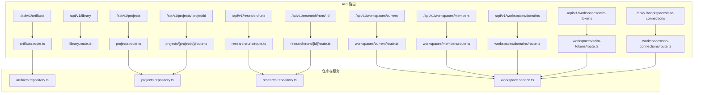
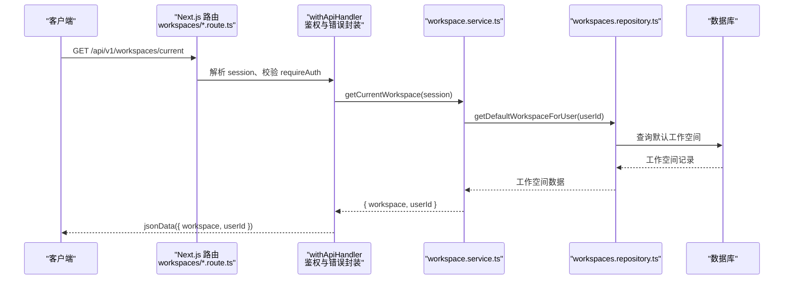
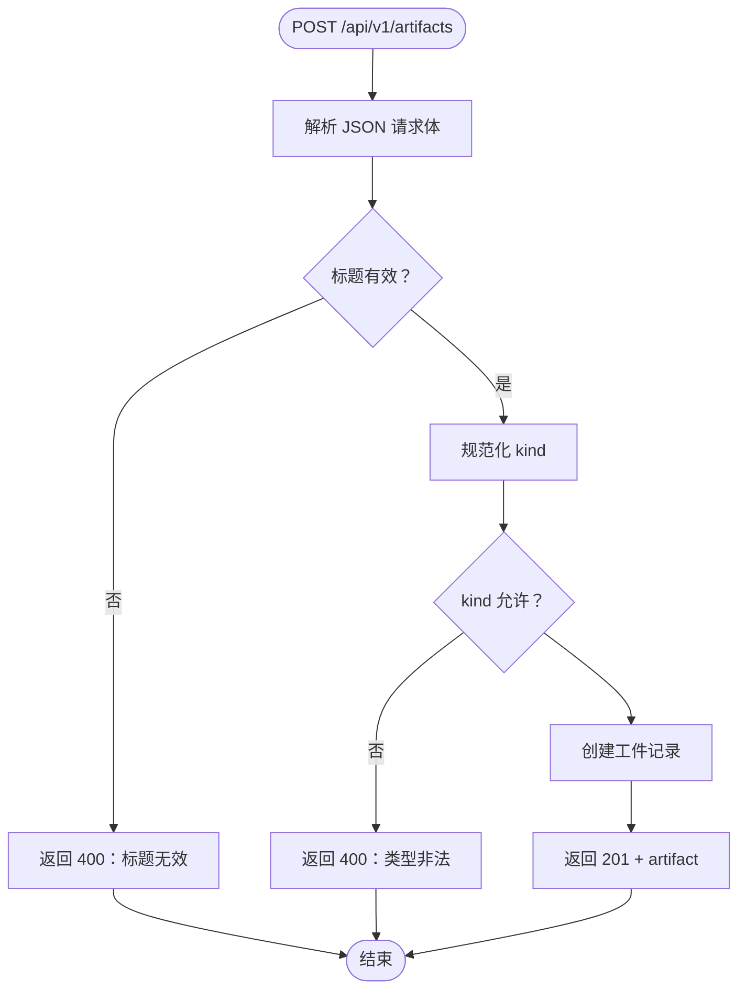
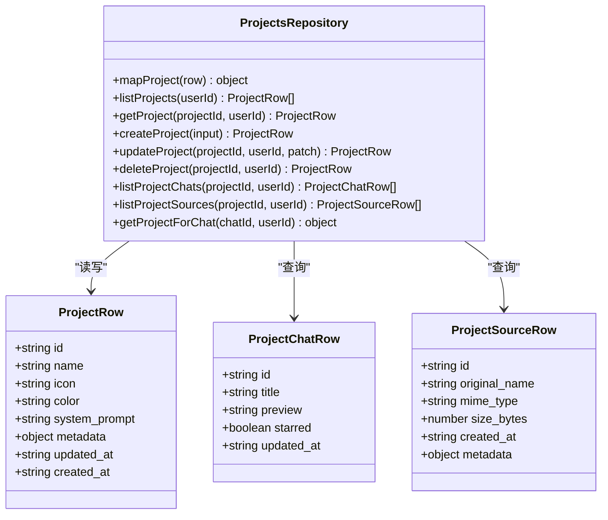
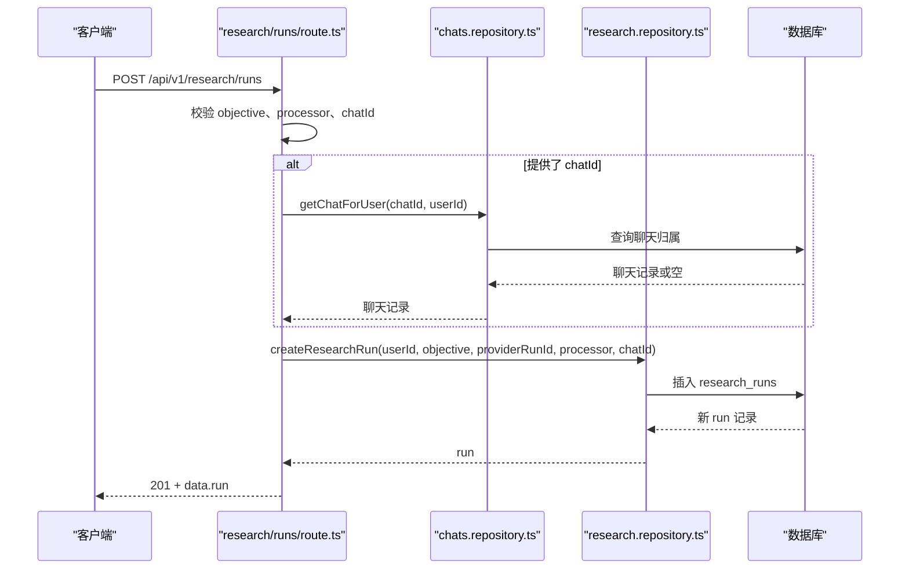
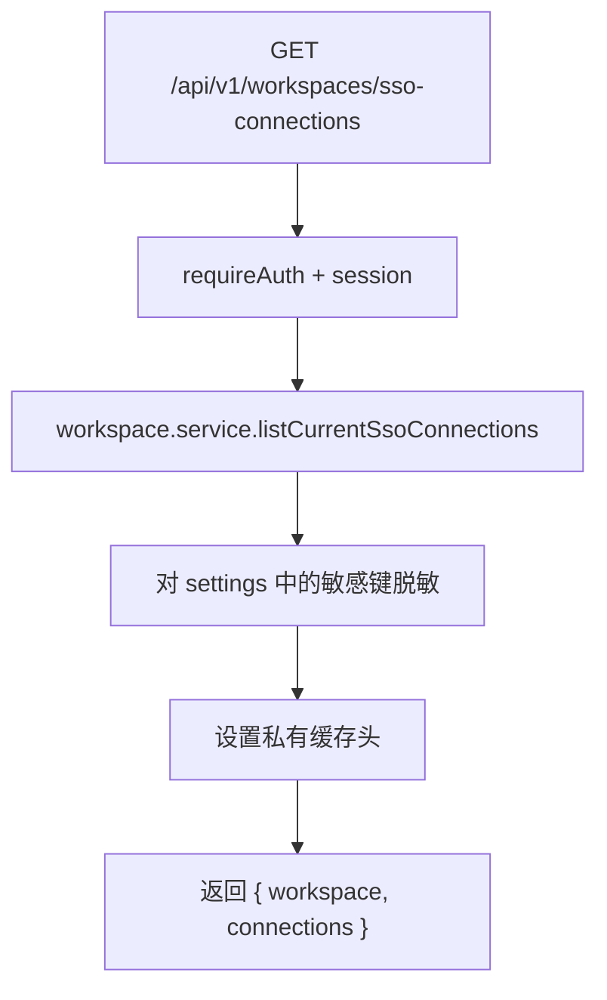
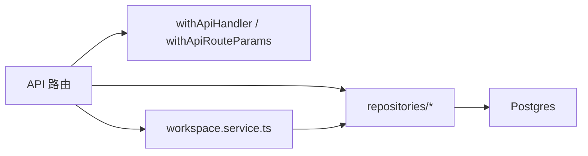

# 其他服务 API

<cite>
**本文引用的文件 **
- [src/app/api/v1/artifacts/route.ts](file://src/app/api/v1/artifacts/route.ts)
- [src/server/repositories/artifacts.repository.ts](file://src/server/repositories/artifacts.repository.ts)
- [src/app/api/v1/projects/route.ts](file://src/app/api/v1/projects/route.ts)
- [src/app/api/v1/projects/[projectId]/route.ts](file://src/app/api/v1/projects/[projectId]/route.ts)
- [src/server/repositories/projects.repository.ts](file://src/server/repositories/projects.repository.ts)
- [src/app/api/v1/library/route.ts](file://src/app/api/v1/library/route.ts)
- [src/app/api/v1/research/runs/route.ts](file://src/app/api/v1/research/runs/route.ts)
- [src/app/api/v1/research/runs/[id]/route.ts](file://src/app/api/v1/research/runs/[id]/route.ts)
- [src/server/repositories/research.repository.ts](file://src/server/repositories/research.repository.ts)
- [src/app/api/v1/workspaces/current/route.ts](file://src/app/api/v1/workspaces/current/route.ts)
- [src/app/api/v1/workspaces/members/route.ts](file://src/app/api/v1/workspaces/members/route.ts)
- [src/app/api/v1/workspaces/domains/route.ts](file://src/app/api/v1/workspaces/domains/route.ts)
- [src/app/api/v1/workspaces/scim-tokens/route.ts](file://src/app/api/v1/workspaces/scim-tokens/route.ts)
- [src/app/api/v1/workspaces/sso-connections/route.ts](file://src/app/api/v1/workspaces/sso-connections/route.ts)
- [src/server/services/workspace.service.ts](file://src/server/services/workspace.service.ts)
</cite>

## 目录
1. [引言](#引言)
2. [项目结构](#项目结构)
3. [核心组件](#核心组件)
4. [架构总览](#架构总览)
5. [详细组件分析](#详细组件分析)
6. [依赖关系分析](#依赖关系分析)
7. [性能与一致性](#性能与一致性)
8. [错误码与故障排查](#错误码与故障排查)
9. [典型使用场景与集成指南](#典型使用场景与集成指南)
10. [结论](#结论)

## 引言
本文件面向“其他服务”的 RESTful API，覆盖以下能力：
- 工件管理：列出与创建 Artifact。
- 知识库（Library）：文件夹式条目管理，支持新增、重命名、移动、删除。
- 项目管理：项目的增删改查，以及项目下的聊天列表与来源文件。
- 研究工作区：并行研究任务提交与状态查询。
- 工作空间管理：当前工作空间、成员、域名、SCIM Token、SSO 连接元数据读取。

这些接口统一位于 `/api/v1` 下，采用 Next.js App Router 的路由文件组织方式，并通过共享的 `withApiHandler`、`jsonData`、`requireSession` 等基础设施进行鉴权、错误封装与响应格式化。

## 项目结构
本节仅展示与本文档相关的 API 路由及其职责映射。

**图表来源**
- [src/app/api/v1/artifacts/route.ts:1-57](file://src/app/api/v1/artifacts/route.ts#L1-L57)
- [src/app/api/v1/library/route.ts:1-83](file://src/app/api/v1/library/route.ts#L1-L83)
- [src/app/api/v1/projects/route.ts:1-43](file://src/app/api/v1/projects/route.ts#L1-L43)
- [src/app/api/v1/projects/[projectId]/route.ts:1-83](file://src/app/api/v1/projects/[projectId]/route.ts#L1-L83)
- [src/app/api/v1/research/runs/route.ts:1-82](file://src/app/api/v1/research/runs/route.ts#L1-L82)
- [src/app/api/v1/research/runs/[id]/route.ts:1-33](file://src/app/api/v1/research/runs/[id]/route.ts#L1-L33)
- [src/app/api/v1/workspaces/current/route.ts:1-16](file://src/app/api/v1/workspaces/current/route.ts#L1-L16)
- [src/app/api/v1/workspaces/members/route.ts:1-16](file://src/app/api/v1/workspaces/members/route.ts#L1-L16)
- [src/app/api/v1/workspaces/domains/route.ts:1-19](file://src/app/api/v1/workspaces/domains/route.ts#L1-L19)
- [src/app/api/v1/workspaces/scim-tokens/route.ts:1-14](file://src/app/api/v1/workspaces/scim-tokens/route.ts#L1-L14)
- [src/app/api/v1/workspaces/sso-connections/route.ts:1-60](file://src/app/api/v1/workspaces/sso-connections/route.ts#L1-L60)
- [src/server/repositories/artifacts.repository.ts:1-44](file://src/server/repositories/artifacts.repository.ts#L1-L44)
- [src/server/repositories/projects.repository.ts:1-200](file://src/server/repositories/projects.repository.ts#L1-L200)
- [src/server/repositories/research.repository.ts:1-60](file://src/server/repositories/research.repository.ts#L1-L60)
- [src/server/services/workspace.service.ts:1-64](file://src/server/services/workspace.service.ts#L1-L64)

**章节来源**
- [src/app/api/v1/artifacts/route.ts:1-57](file://src/app/api/v1/artifacts/route.ts#L1-L57)
- [src/app/api/v1/library/route.ts:1-83](file://src/app/api/v1/library/route.ts#L1-L83)
- [src/app/api/v1/projects/route.ts:1-43](file://src/app/api/v1/projects/route.ts#L1-L43)
- [src/app/api/v1/projects/[projectId]/route.ts:1-83](file://src/app/api/v1/projects/[projectId]/route.ts#L1-L83)
- [src/app/api/v1/research/runs/route.ts:1-82](file://src/app/api/v1/research/runs/route.ts#L1-L82)
- [src/app/api/v1/research/runs/[id]/route.ts:1-33](file://src/app/api/v1/research/runs/[id]/route.ts#L1-L33)
- [src/app/api/v1/workspaces/current/route.ts:1-16](file://src/app/api/v1/workspaces/current/route.ts#L1-L16)
- [src/app/api/v1/workspaces/members/route.ts:1-16](file://src/app/api/v1/workspaces/members/route.ts#L1-L16)
- [src/app/api/v1/workspaces/domains/route.ts:1-19](file://src/app/api/v1/workspaces/domains/route.ts#L1-L19)
- [src/app/api/v1/workspaces/scim-tokens/route.ts:1-14](file://src/app/api/v1/workspaces/scim-tokens/route.ts#L1-L14)
- [src/app/api/v1/workspaces/sso-connections/route.ts:1-60](file://src/app/api/v1/workspaces/sso-connections/route.ts#L1-L60)

## 核心组件
- 认证与鉴权：所有受保护端点均通过 `requireAuth` 或显式 `requireSession` 校验登录态；未登录请求返回 401。
- 请求处理包装：`withApiHandler` / `withApiRouteParams` 统一注入 session、解析动态参数并捕获异常。
- 响应格式：`jsonData` 将业务对象包裹为统一成功信封 `{ data }`，并在创建类操作返回 201。
- 错误模型：`AppError` 携带 HTTP 状态码与可选业务错误码；`notFound` / `unauthorized` 提供常见语义化错误。
- 数据访问层：各 repository 使用参数化 SQL，避免 SQL 注入；按用户 ID 做资源隔离。
- 工作空间服务：`workspace.service.ts` 聚合默认工作空间、成员、域名、SSO、SCIM 等只读能力。

**章节来源**
- [src/app/api/v1/artifacts/route.ts:1-57](file://src/app/api/v1/artifacts/route.ts#L1-L57)
- [src/app/api/v1/library/route.ts:1-83](file://src/app/api/v1/library/route.ts#L1-L83)
- [src/app/api/v1/projects/route.ts:1-43](file://src/app/api/v1/projects/route.ts#L1-L43)
- [src/app/api/v1/projects/[projectId]/route.ts:1-83](file://src/app/api/v1/projects/[projectId]/route.ts#L1-L83)
- [src/server/repositories/artifacts.repository.ts:1-44](file://src/server/repositories/artifacts.repository.ts#L1-L44)
- [src/server/repositories/projects.repository.ts:1-200](file://src/server/repositories/projects.repository.ts#L1-L200)
- [src/server/repositories/research.repository.ts:1-60](file://src/server/repositories/research.repository.ts#L1-L60)
- [src/server/services/workspace.service.ts:1-64](file://src/server/services/workspace.service.ts#L1-L64)

## 架构总览
下图描述一次“创建工作空间相关数据”的典型调用链，体现从 Next.js 路由到服务层再到仓库层的分层协作。

**图表来源**
- [src/app/api/v1/workspaces/current/route.ts:1-16](file://src/app/api/v1/workspaces/current/route.ts#L1-L16)
- [src/server/services/workspace.service.ts:1-64](file://src/server/services/workspace.service.ts#L1-L64)

## 详细组件分析

### 工件管理 API：/api/v1/artifacts
- 权限控制：需要登录。
- GET /api/v1/artifacts
  - 作用：列出当前用户的活跃工件。
  - 响应字段：`data.artifacts[]`，包含 `id`、`title`、`kind`、`status`、`created_at`。
  - 服务端限制：最多返回 100 条，按创建时间倒序。
- POST /api/v1/artifacts
  - 请求体字段：
    - `title`：字符串，必填，最大长度 200。
    - `kind`：字符串，可选，默认 `document`；允许值包括 `app`、`document`、`spreadsheet`、`presentation`、`image`、`code`、`other`；传入 `template` 会被归一化为 `other`。
  - 响应：201，`data.artifact` 包含 `id`、`title`、`kind`。
  - 业务规则：创建时若附带 chatId，会校验该 chat 存在且未被删除。
- 错误码
  - 400：标题为空、过长、类型非法、JSON 无效。
  - 401：未登录。
  - 404：关联的聊天不存在（在创建逻辑中）。

**图表来源**
- [src/app/api/v1/artifacts/route.ts:20-57](file://src/app/api/v1/artifacts/route.ts#L20-L57)
- [src/server/repositories/artifacts.repository.ts:26-44](file://src/server/repositories/artifacts.repository.ts#L26-L44)

**章节来源**
- [src/app/api/v1/artifacts/route.ts:1-57](file://src/app/api/v1/artifacts/route.ts#L1-L57)
- [src/server/repositories/artifacts.repository.ts:1-44](file://src/server/repositories/artifacts.repository.ts#L1-L44)

### 知识库 API：/api/v1/library
- 权限控制：需要登录。
- GET /api/v1/library
  - 查询参数：`folderId`（可选），用于按父文件夹筛选。
  - 响应：`data` 由库服务返回，通常包含条目树或分页结果。
- POST /api/v1/library
  - 请求体字段：
    - `name`：字符串，可选，默认空。
    - `parentId`：字符串或 null，可选。
  - 响应：201，`data.folder`。
- PATCH /api/v1/library
  - 行为分支：
    - 当 `action === "rename"`：需同时提供 `id`、`kind`（`file` 或 `folder`）、`name`。
    - 否则执行批量移动：需提供 `items` 数组，每项为 `{ id, kind }`，以及目标 `folderId`。
  - 响应：`data.item` 或移动结果。
- DELETE /api/v1/library
  - 请求体字段：`items`，数组项为 `{ id, kind }`。
  - 响应：`data` 删除结果。

注意：`entryRefs` 会过滤掉非数组或缺少合法 `id`、`kind` 的项，避免脏数据进入后端。

**章节来源**
- [src/app/api/v1/library/route.ts:1-83](file://src/app/api/v1/library/route.ts#L1-L83)

### 项目管理 API：/api/v1/projects 与 /api/v1/projects/:projectId
- 权限控制：需要登录。
- GET /api/v1/projects
  - 响应：`data.projects[]`，每个项目包含 `id`、`name`、`icon`、`instructions`、`memory`、`libraryAccess`、`pinned`、`shared`、`updatedAt`、`createdAt`。
  - 服务端限制：最多返回 100 个项目，按更新时间倒序。
- POST /api/v1/projects
  - 请求体字段：
    - `name`：字符串，必填，截断至 120。
    - `iconId`：字符串，可选，默认 `folder`，截断至 40。
    - `color`：十六进制颜色，可选，非法则回退默认色。
    - `memory`：`default` 或 `project`，可选。
  - 响应：201，`data.project`。
- GET /api/v1/projects/:projectId
  - 响应：`data.project`，除基础项目信息外，还包含：
    - `chats[]`：项目内聊天列表，含 `id`、`title`、`preview`、`pinned`、`updatedAt`。
    - `sources[]`：项目来源文件列表，含 `id`、`name`、`kind`、`size`、`createdAt`。
- PATCH /api/v1/projects/:projectId
  - 可更新字段：`name`、`iconId`、`color`、`instructions`、`memory`、`libraryAccess`、`pinned`。
  - 校验规则：名称截断、颜色正则校验、指令文本上限 8000。
  - 响应：`data.project`。
- DELETE /api/v1/projects/:projectId
  - 行为：软删除，将状态改为 `deleted`。
  - 响应：`data.ok`。

**图表来源**
- [src/server/repositories/projects.repository.ts:1-200](file://src/server/repositories/projects.repository.ts#L1-L200)

**章节来源**
- [src/app/api/v1/projects/route.ts:1-43](file://src/app/api/v1/projects/route.ts#L1-L43)
- [src/app/api/v1/projects/[projectId]/route.ts:1-83](file://src/app/api/v1/projects/[projectId]/route.ts#L1-L83)
- [src/server/repositories/projects.repository.ts:1-200](file://src/server/repositories/projects.repository.ts#L1-L200)

### 研究工作区 API：/api/v1/research/runs 与 /api/v1/research/runs/:id
- 权限控制：需要登录。
- GET /api/v1/research/runs
  - 响应：`data.runs[]`，包含运行任务的 `id`、`user_id`、`provider`、`provider_run_id`、`objective`、`processor`、`status`、`result`、`error`、`created_at`、`updated_at`。
  - 服务端限制：默认最多返回 50 条，按创建时间倒序。
- POST /api/v1/research/runs
  - 请求体字段：
    - `objective`：字符串，必填，最大长度 16384。
    - `processor`：字符串，可选，默认 `base`；允许值通过正则白名单校验，例如 `lite`、`base`、`core`、`core2x`、`pro`、`ultra`、`ultra2x`、`ultra4x`、`ultra8x`，后缀 `-fast` 可选。
    - `chatId`：字符串，可选；如提供，必须为合法聊天 ID，并且属于当前用户。
  - 响应：201，`data.run`。
- GET /api/v1/research/runs/:id
  - 路径参数：`id` 必须是 UUID 格式。
  - 响应：`data.run`，详情同上。
- 安全要点：
  - objective 超长返回 413。
  - processor 不在白名单返回 400。
  - chatId 不合法或不属于当前用户返回 404。

**图表来源**
- [src/app/api/v1/research/runs/route.ts:20-82](file://src/app/api/v1/research/runs/route.ts#L20-L82)
- [src/server/repositories/research.repository.ts:39-60](file://src/server/repositories/research.repository.ts#L39-L60)

**章节来源**
- [src/app/api/v1/research/runs/route.ts:1-82](file://src/app/api/v1/research/runs/route.ts#L1-L82)
- [src/app/api/v1/research/runs/[id]/route.ts:1-33](file://src/app/api/v1/research/runs/[id]/route.ts#L1-L33)
- [src/server/repositories/research.repository.ts:1-60](file://src/server/repositories/research.repository.ts#L1-L60)

### 工作空间管理 API
- 权限控制：需要登录。
- GET /api/v1/workspaces/current
  - 响应：`data.workspace`、`data.userId`。
- GET /api/v1/workspaces/members
  - 响应：`data.workspace`、`data.members[]`；若无默认工作空间，members 为空数组。
- GET /api/v1/workspaces/domains
  - 响应：`data.domains[]`，包含主机名与验证状态。
- GET /api/v1/workspaces/scim-tokens
  - 响应：`data.workspace`、`data.tokens[]`、`data.stub=true`、`data.message`，表示 SCIM 功能尚未启用，仅提供只读元数据。
- GET /api/v1/workspaces/sso-connections
  - 响应：`data.workspace`、`data.connections[]`。
  - 敏感字段保护：settings 中与密钥相关的键会被替换为 `[redacted]`。
  - 缓存头：响应设置 `Cache-Control: no-store, private` 与 `Pragma: no-cache`。

**图表来源**
- [src/app/api/v1/workspaces/sso-connections/route.ts:1-60](file://src/app/api/v1/workspaces/sso-connections/route.ts#L1-L60)
- [src/server/services/workspace.service.ts:25-36](file://src/server/services/workspace.service.ts#L25-L36)

**章节来源**
- [src/app/api/v1/workspaces/current/route.ts:1-16](file://src/app/api/v1/workspaces/current/route.ts#L1-L16)
- [src/app/api/v1/workspaces/members/route.ts:1-16](file://src/app/api/v1/workspaces/members/route.ts#L1-L16)
- [src/app/api/v1/workspaces/domains/route.ts:1-19](file://src/app/api/v1/workspaces/domains/route.ts#L1-L19)
- [src/app/api/v1/workspaces/scim-tokens/route.ts:1-14](file://src/app/api/v1/workspaces/scim-tokens/route.ts#L1-L14)
- [src/app/api/v1/workspaces/sso-connections/route.ts:1-60](file://src/app/api/v1/workspaces/sso-connections/route.ts#L1-L60)
- [src/server/services/workspace.service.ts:1-64](file://src/server/services/workspace.service.ts#L1-L64)

## 依赖关系分析
- 路由层依赖：
  - `@/server/http/api-handler`：统一处理 session 注入、错误捕获与鉴权开关。
  - `@/server/http/api-response`：统一成功响应格式。
  - `@/server/auth/require-session`：强制会话存在。
  - `@/server/db/errors`：标准化错误抛出。
- 数据层依赖：
  - `@/server/repositories/*`：封装参数化 SQL 查询。
  - `@/server/services/*`：聚合业务逻辑，尤其是工作空间领域。
- 外部依赖：
  - Postgres：所有仓库最终落库。
  - 聊天仓库：研究任务创建时用于校验聊天归属。

**图表来源**
- [src/app/api/v1/artifacts/route.ts:1-57](file://src/app/api/v1/artifacts/route.ts#L1-L57)
- [src/server/repositories/artifacts.repository.ts:1-44](file://src/server/repositories/artifacts.repository.ts#L1-L44)
- [src/server/services/workspace.service.ts:1-64](file://src/server/services/workspace.service.ts#L1-L64)

**章节来源**
- [src/app/api/v1/artifacts/route.ts:1-57](file://src/app/api/v1/artifacts/route.ts#L1-L57)
- [src/server/repositories/artifacts.repository.ts:1-44](file://src/server/repositories/artifacts.repository.ts#L1-L44)
- [src/server/services/workspace.service.ts:1-64](file://src/server/services/workspace.service.ts#L1-L64)

## 性能与一致性
- 列表上限：
  - 工件列表最多 100 条。
  - 项目列表最多 100 条。
  - 研究任务列表最多 50 条。
- 动态渲染：所有路由声明 `dynamic = "force-dynamic"`，避免静态生成导致的数据陈旧。
- Node 运行时：涉及数据库、随机数生成的路由使用 `runtime = "nodejs"`。
- 数据一致性：
  - 项目软删除与状态过滤保证查询一致性。
  - 工件创建时对关联聊天的存在性与归属进行校验。
  - 研究任务创建时校验聊天归属，防止越权。

[本节为通用性能说明，无需具体代码引用]

## 错误码与故障排查
- 401 Unauthorized：未提供有效会话。
- 400 Bad Request：
  - 工件：标题缺失或过长、类型非法、JSON 解析失败。
  - 项目：名称为空。
  - 研究任务：objective 缺失、processor 不在白名单、chatId 不合法。
- 404 Not Found：
  - 项目不存在。
  - 关联聊天不存在。
  - 研究任务不存在或不属于当前用户。
- 413 Payload Too Large：研究任务 objective 超过 16384。
- 500 Internal Server Error：
  - 项目创建失败。

排查建议：
- 先确认是否携带有效会话。
- 检查请求体字段类型、长度与枚举值。
- 对于跨资源关联（如聊天、项目），确认当前用户拥有该资源。
- 对研究任务，检查 processor 是否在允许集合内。

**章节来源**
- [src/app/api/v1/artifacts/route.ts:20-57](file://src/app/api/v1/artifacts/route.ts#L20-L57)
- [src/app/api/v1/projects/route.ts:20-43](file://src/app/api/v1/projects/route.ts#L20-L43)
- [src/app/api/v1/projects/[projectId]/route.ts:20-83](file://src/app/api/v1/projects/[projectId]/route.ts#L20-L83)
- [src/app/api/v1/research/runs/route.ts:20-82](file://src/app/api/v1/research/runs/route.ts#L20-L82)
- [src/app/api/v1/research/runs/[id]/route.ts:1-33](file://src/app/api/v1/research/runs/[id]/route.ts#L1-L33)

## 典型使用场景与集成指南

### 场景一：创建一个工件并查看列表
- 步骤：
  1. 调用 POST /api/v1/artifacts，提供 `title` 和可选 `kind`。
  2. 调用 GET /api/v1/artifacts 获取工件列表。
- 注意事项：
  - 确保 `kind` 在允许集合内。
  - 如果后续要关联聊天，需要在创建工件时提供合法的 `chatId`。

**章节来源**
- [src/app/api/v1/artifacts/route.ts:20-57](file://src/app/api/v1/artifacts/route.ts#L20-L57)
- [src/server/repositories/artifacts.repository.ts:26-44](file://src/server/repositories/artifacts.repository.ts#L26-L44)

### 场景二：管理知识库文件夹
- 步骤：
  1. POST /api/v1/library 创建文件夹。
  2. PATCH /api/v1/library，使用 `action=rename` 重命名文件或文件夹。
  3. PATCH /api/v1/library，不提供 `action`，移动多个条目到目标文件夹。
  4. DELETE /api/v1/library 删除条目。
- 注意事项：
  - `items` 必须为 `{ id, kind }` 数组，否则会静默丢弃非法项。
  - 移动操作适用于文件和文件夹。

**章节来源**
- [src/app/api/v1/library/route.ts:20-83](file://src/app/api/v1/library/route.ts#L20-L83)

### 场景三：项目生命周期管理
- 步骤：
  1. POST /api/v1/projects 创建项目。
  2. GET /api/v1/projects 列出项目。
  3. GET /api/v1/projects/:projectId 查看项目详情，包括聊天与来源文件。
  4. PATCH /api/v1/projects/:projectId 更新项目配置。
  5. DELETE /api/v1/projects/:projectId 软删除项目。
- 注意事项：
  - 颜色字段需符合十六进制格式。
  - 更新 `instructions` 有 8000 字符上限。
  - 删除为软删除，不会立即物理移除。

**章节来源**
- [src/app/api/v1/projects/route.ts:20-43](file://src/app/api/v1/projects/route.ts#L20-L43)
- [src/app/api/v1/projects/[projectId]/route.ts:20-83](file://src/app/api/v1/projects/[projectId]/route.ts#L20-L83)
- [src/server/repositories/projects.repository.ts:59-192](file://src/server/repositories/projects.repository.ts#L59-L192)

### 场景四：发起并行研究任务并轮询状态
- 步骤：
  1. POST /api/v1/research/runs，提供 `objective`、可选 `processor`、可选 `chatId`。
  2. GET /api/v1/research/runs/:id 查询任务详情。
  3. GET /api/v1/research/runs 拉取任务列表，观察 `status` 变化。
- 注意事项：
  - `processor` 必须在白名单内。
  - `chatId` 必须属于当前用户。
  - `objective` 过长会返回 413。

**章节来源**
- [src/app/api/v1/research/runs/route.ts:20-82](file://src/app/api/v1/research/runs/route.ts#L20-L82)
- [src/app/api/v1/research/runs/[id]/route.ts:1-33](file://src/app/api/v1/research/runs/[id]/route.ts#L1-L33)
- [src/server/repositories/research.repository.ts:17-60](file://src/server/repositories/research.repository.ts#L17-L60)

### 场景五：读取工作空间与安全配置
- 步骤：
  1. GET /api/v1/workspaces/current 获取当前工作空间。
  2. GET /api/v1/workspaces/members 读取成员列表。
  3. GET /api/v1/workspaces/domains 读取已验证域名。
  4. GET /api/v1/workspaces/scim-tokens 读取 SCIM Token 元数据（只读提示）。
  5. GET /api/v1/workspaces/sso-connections 读取 SSO 连接元数据（敏感字段已脱敏）。
- 注意事项：
  - SSO 连接的 settings 中敏感键会被替换为 `[redacted]`。
  - SCIM 功能当前以 stub 形式返回，不代表完整可用。

**章节来源**
- [src/app/api/v1/workspaces/current/route.ts:1-16](file://src/app/api/v1/workspaces/current/route.ts#L1-L16)
- [src/app/api/v1/workspaces/members/route.ts:1-16](file://src/app/api/v1/workspaces/members/route.ts#L1-L16)
- [src/app/api/v1/workspaces/domains/route.ts:1-19](file://src/app/api/v1/workspaces/domains/route.ts#L1-L19)
- [src/app/api/v1/workspaces/scim-tokens/route.ts:1-14](file://src/app/api/v1/workspaces/scim-tokens/route.ts#L1-L14)
- [src/app/api/v1/workspaces/sso-connections/route.ts:1-60](file://src/app/api/v1/workspaces/sso-connections/route.ts#L1-L60)
- [src/server/services/workspace.service.ts:1-64](file://src/server/services/workspace.service.ts#L1-L64)

## 结论
本组“其他服务”API 围绕工件、知识库、项目、研究与工作空间展开，形成一套以用户为边界的资源管理体系。其共同特点是：
- 统一鉴权与错误模型。
- 明确的数据校验与边界约束。
- 以仓库层保障数据安全与一致性。
- 工作空间域提供企业级只读管理能力。

在实际集成中，应优先关注输入校验、会话有效性、资源归属校验，以及针对长文本、枚举值、UUID 格式的防御性处理。

[本节为总结性内容，无需具体代码引用]