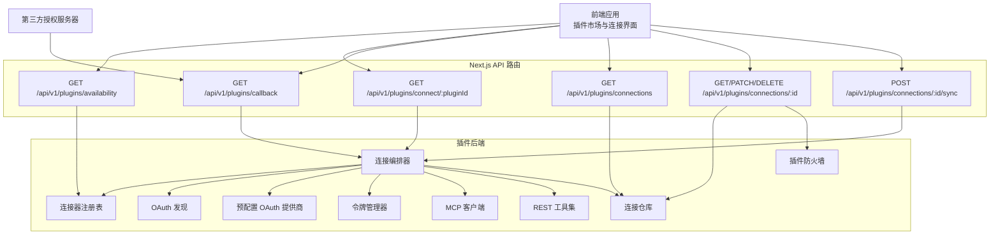
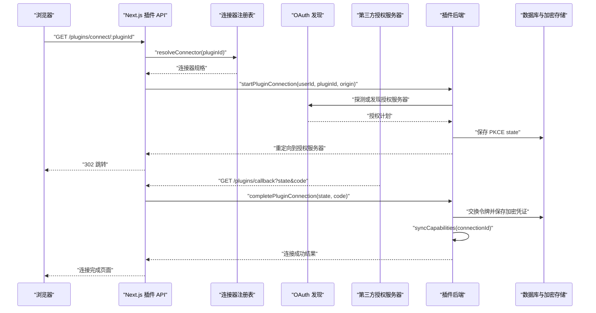
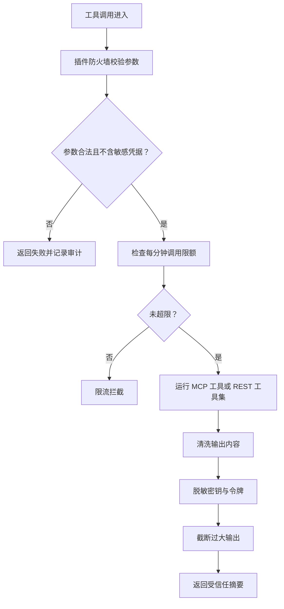
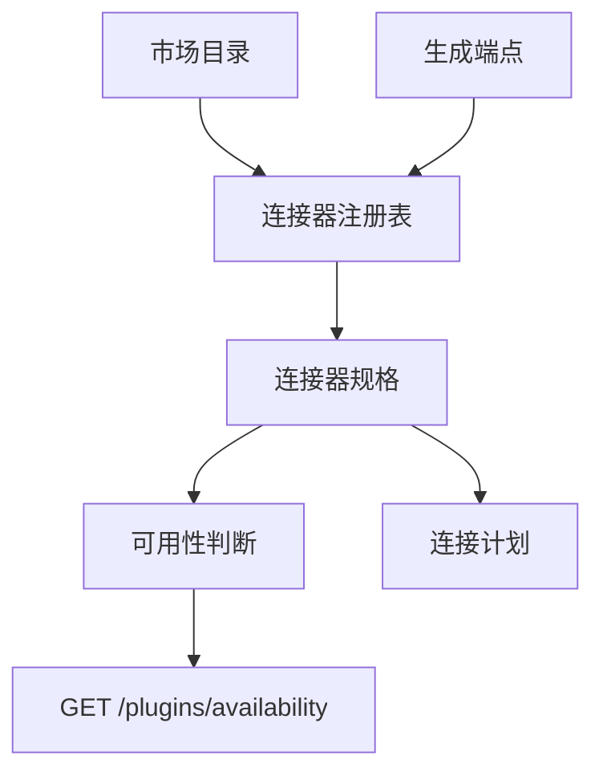
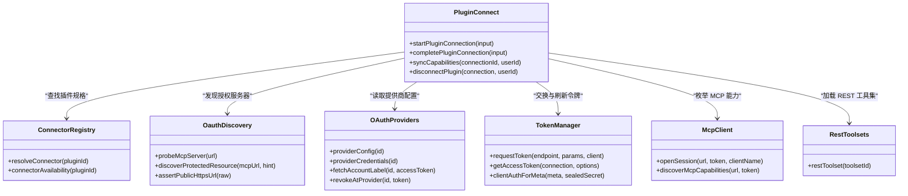
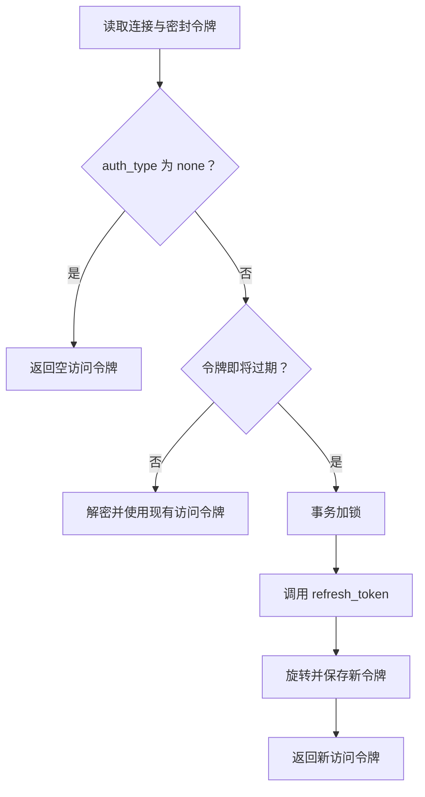

# 插件系统 API

<cite>
**本文引用的文件**   
- [availability/route.ts](file://src/app/api/v1/plugins/availability/route.ts)
- [connect/[pluginId]/route.ts](file://src/app/api/v1/plugins/connect/[pluginId]/route.ts)
- [callback/route.ts](file://src/app/api/v1/plugins/callback/route.ts)
- [oauth-client/route.ts](file://src/app/api/v1/plugins/oauth-client/route.ts)
- [connections/route.ts](file://src/app/api/v1/plugins/connections/route.ts)
- [connections/[connectionId]/route.ts](file://src/app/api/v1/plugins/connections/[connectionId]/route.ts)
- [connections/[connectionId]/sync/route.ts](file://src/app/api/v1/plugins/connections/[connectionId]/sync/route.ts)
- [plugin-connect.ts](file://src/server/plugins/plugin-connect.ts)
- [connector-registry.ts](file://src/server/plugins/connector-registry.ts)
- [oauth-providers.ts](file://src/server/plugins/oauth-providers.ts)
- [oauth-discovery.ts](file://src/server/plugins/oauth-discovery.ts)
- [mcp-client.ts](file://src/server/plugins/mcp-client.ts)
- [rest-toolsets.ts](file://src/server/plugins/rest-toolsets.ts)
- [plugin-firewall.ts](file://src/server/plugins/plugin-firewall.ts)
- [token-manager.ts](file://src/server/plugins/token-manager.ts)
- [connection-dto.ts](file://src/server/plugins/connection-dto.ts)
</cite>

## 目录

1. [简介](#简介)
2. [项目结构](#项目结构)
3. [核心组件](#核心组件)
4. [架构总览](#架构总览)
5. [详细端点文档](#详细端点文档)
6. [依赖关系分析](#依赖关系分析)
7. [性能与容量特性](#性能与容量特性)
8. [故障排除指南](#故障排除指南)
9. [结论](#结论)

## 简介

本文面向集成方、平台运维和高级用户，系统化说明 Clauxen 插件系统的 RESTful API。该体系通过 `/api/v1/plugins/*` 暴露插件可用性查询、连接发起、OAuth 回调、客户端元数据、连接列表与生命周期管理等功能；后端则根据插件类型分别走 MCP 协议或原生 OAuth + REST 工具集路径，并提供令牌刷新、安全隔离、能力同步与审计等机制。

插件分为两类：

- **MCP 插件**：远程模型上下文协议服务器。服务端通过 RFC 9728 受保护资源元数据与 RFC 8414/OpenID 授权服务器发现流程完成 OAuth 认证，随后以 JSON-RPC 2.0 Streamable HTTP 方式调用 `initialize`、`tools/list`、`tools/call` 等接口。
- **REST 插件**：没有可用远程 MCP 服务时，由 Clauxen 直接驱动提供商的 REST API，并通过内置工具集（如 Google Drive、Outlook、Teams、SharePoint）对外暴露工具。

所有敏感凭证（访问令牌、刷新令牌、动态注册客户端密钥）均以加密形式存储；运行时只向外部服务发送最小必要请求，并在输出侧进行脱敏、注入防护与大小限制。

## 项目结构

插件相关的前端 Next.js App Router 路由位于 `src/app/api/v1/plugins`，后端业务逻辑集中在 `src/server/plugins`。



**图表来源**
- [availability/route.ts:1-25](file://src/app/api/v1/plugins/availability/route.ts#L1-L25)
- [connect/[pluginId]/route.ts:1-77](file://src/app/api/v1/plugins/connect/[pluginId]/route.ts#L1-L77)
- [callback/route.ts:1-70](file://src/app/api/v1/plugins/callback/route.ts#L1-L70)
- [connections/route.ts:1-17](file://src/app/api/v1/plugins/connections/route.ts#L1-L17)
- [connections/[connectionId]/route.ts:1-107](file://src/app/api/v1/plugins/connections/[connectionId]/route.ts#L1-L107)
- [connections/[connectionId]/sync/route.ts:1-26](file://src/app/api/v1/plugins/connections/[connectionId]/sync/route.ts#L1-L26)

**章节来源**
- [availability/route.ts:1-25](file://src/app/api/v1/plugins/availability/route.ts#L1-L25)
- [connector-registry.ts:1-202](file://src/server/plugins/connector-registry.ts#L1-L202)

## 核心组件

| 组件 | 职责 | 关键行为 |
|---|---|---|
| 连接器注册表 | 声明每个插件是 MCP 还是 REST、其 URL、提供商、作用域与工具集 | 解析市场目录、生成连接计划、判断可用性 |
| 预配置 OAuth 提供商 | 维护 Google、GitHub、Slack、Microsoft 的静态配置 | 提供授权端点、令牌端点、身份作用域、撤销支持 |
| OAuth 发现 | 按 MCP OAuth 规范探测远端服务器 | 校验 HTTPS 与公网地址、读取受保护资源元数据、获取授权服务器 |
| 连接编排器 | 启动连接、交换令牌、保存连接、同步能力、断开连接 | 生成 PKCE state、处理重定向、写入加密令牌 |
| 令牌管理器 | 获取可使用的访问令牌并自动刷新 | 事务加锁、提前一分钟刷新、支持 none/oauth2/mcp_oauth2 |
| MCP 客户端 | 与服务端建立 MCP 会话并调用工具 | JSON-RPC 2.0、SSE 帧解析、超时、会话头 |
| REST 工具集 | 为不支持远程 MCP 的提供商封装工具 | 将 token 注入到内部 `RestApi`，不暴露给模型 |
| 插件防火墙 | 参数校验、速率限制、输入输出清洗 | 阻止凭据外泄、删除指令注入、脱敏敏感信息 |

**章节来源**
- [connector-registry.ts:1-202](file://src/server/plugins/connector-registry.ts#L1-L202)
- [oauth-providers.ts:1-215](file://src/server/plugins/oauth-providers.ts#L1-L215)
- [oauth-discovery.ts:1-360](file://src/server/plugins/oauth-discovery.ts#L1-L360)
- [plugin-connect.ts:1-524](file://src/server/plugins/plugin-connect.ts#L1-L524)
- [token-manager.ts:1-228](file://src/server/plugins/token-manager.ts#L1-L228)
- [mcp-client.ts:1-428](file://src/server/plugins/mcp-client.ts#L1-L428)
- [rest-toolsets.ts:1-845](file://src/server/plugins/rest-toolsets.ts#L1-L845)
- [plugin-firewall.ts:1-167](file://src/server/plugins/plugin-firewall.ts#L1-L167)

## 架构总览

### 连接与控制流



**图表来源**
- [connect/[pluginId]/route.ts:1-77](file://src/app/api/v1/plugins/connect/[pluginId]/route.ts#L1-L77)
- [plugin-connect.ts:201-524](file://src/server/plugins/plugin-connect.ts#L201-L524)
- [callback/route.ts:1-70](file://src/app/api/v1/plugins/callback/route.ts#L1-L70)

### 安全与隔离边界



**图表来源**
- [plugin-firewall.ts:1-167](file://src/server/plugins/plugin-firewall.ts#L1-L167)
- [rest-toolsets.ts:1-845](file://src/server/plugins/rest-toolsets.ts#L1-L845)
- [mcp-client.ts:1-428](file://src/server/plugins/mcp-client.ts#L1-L428)

## 详细端点文档

### 插件可用性检查

| 属性 | 值 |
|---|---|
| HTTP 方法 | `GET` |
| URL 模式 | `/api/v1/plugins/availability` |
| 认证要求 | 无需登录 |
| 响应体类型 | JSON |
| 用途 | 列出市场目录中每个插件当前是否可连接，以及不可连接原因 |

#### 请求

无请求体，无必需查询参数。

#### 响应字段

| 字段 | 类型 | 含义 |
|---|---|---|
| `availability` | 对象 | 键为 `pluginId`，值为可用性条目 |
| `availability[pluginId].available` | 布尔值 | 是否可在当前工作区连接 |
| `availability[pluginId].kind` | `"mcp"` \| `"rest"` \| `null` | 连接器类型 |
| `availability[pluginId].providerLabel` | 字符串或空 | 所需提供商名称，例如 Google、GitHub |
| `availability[pluginId].reason` | `"local_only"` \| `"provider_not_configured"` \| `null` | 不可连接原因 |

#### 错误码

| 状态码 | 含义 |
|---|---|
| `200` | 返回可用性映射 |
| `500` | 服务器内部错误 |

#### 示例响应

```json
{
  "availability": {
    "gmail": {
      "available": true,
      "kind": "mcp",
      "providerLabel": "Google",
      "reason": null
    },
    "github": {
      "available": false,
      "kind": "mcp",
      "providerLabel": "GitHub",
      "reason": "provider_not_configured"
    }
  }
}
```

**章节来源**
- [availability/route.ts:1-25](file://src/app/api/v1/plugins/availability/route.ts#L1-L25)
- [connector-registry.ts:1-202](file://src/server/plugins/connector-registry.ts#L1-L202)

### 启动插件连接

| 属性 | 值 |
|---|---|
| HTTP 方法 | `GET` |
| URL 模式 | `/api/v1/plugins/connect/:pluginId` |
| 路径参数 | `pluginId`：市场插件标识 |
| 认证要求 | 可选；若未登录会返回需要登录的连接结果页 |
| 典型入口 | 插件弹窗或连接按钮打开的浏览器窗口 |

#### 行为说明

- 如果请求来自跨站上下文，会返回引导提示，要求回到 Clauxen 内继续。
- 如果用户已登录，后端计算连接计划并跳转到第三方授权页面。
- 如果插件是无需认证的公开 MCP 服务器，可直接创建连接并返回“已连接”。
- 失败时返回连接结果页，显示错误或取消消息。

#### 成功响应

- 需要授权时：HTTP `302`，`Location` 指向第三方授权服务器。
- 不需要授权时：HTML 连接完成页面，包含插件名称与关闭提示。
- 失败时：HTML 连接失败页面，包含错误描述。

#### 错误场景

| 条件 | 表现 |
|---|---|
| 插件仅本地运行 | 连接结果页显示无法连接到 Clauxen |
| 未登录 | 连接结果页提示先登录 |
| 提供商未配置 | 连接结果页显示提供商不可用 |
| 第三方授权失败 | 连接结果页显示具体 OAuth 错误 |

**章节来源**
- [connect/[pluginId]/route.ts:1-77](file://src/app/api/v1/plugins/connect/[pluginId]/route.ts#L1-L77)
- [plugin-connect.ts:201-370](file://src/server/plugins/plugin-connect.ts#L201-L370)

### OAuth 回调

| 属性 | 值 |
|---|---|
| HTTP 方法 | `GET` |
| URL 模式 | `/api/v1/plugins/callback` |
| 查询参数 | `state`、`code`、可选 `error` |
| 认证要求 | 可选；但回调必须落入启动连接的同一次会话 |
| 用途 | 第三方授权服务器跳转回本端，完成授权码换取令牌 |

#### 参数说明

| 参数 | 必填 | 含义 |
|---|---:|---|
| `state` | 是 | PKCE 状态哈希，用于防重复使用与跨站验证 |
| `code` | 是 | 授权码 |
| `error` | 否 | 第三方拒绝授权时的错误码，例如 `access_denied` |

#### 成功流程

1. 消费一次性 state。
2. 校验回调会话与启动会话一致。
3. 使用 PKCE `code_verifier` 调用令牌端点。
4. 保存加密访问令牌与刷新令牌。
5. 尝试标注账户标签。
6. 创建活跃连接并同步能力。
7. 返回连接完成页面。

#### 失败场景

| 条件 | 表现 |
|---|---|
| 缺少 `state` 或 `code` | 连接失败页 |
| `error=access_denied` | 连接取消页 |
| state 已过期或已被使用 | 令牌交换失败 |
| 会话不一致 | 要求使用启动连接的账号重新登录 |
| 令牌交换失败 | 连接失败页 |

**章节来源**
- [callback/route.ts:1-70](file://src/app/api/v1/plugins/callback/route.ts#L1-L70)
- [plugin-connect.ts:370-470](file://src/server/plugins/plugin-connect.ts#L370-L470)

### OAuth 客户端元数据

| 属性 | 值 |
|---|---|
| HTTP 方法 | `GET` |
| URL 模式 | `/api/v1/plugins/oauth-client` |
| 认证要求 | 无需登录 |
| 用途 | 作为 RFC 9728 客户端 ID 元数据文档，供支持动态注册的授权服务器识别回调地址 |

#### 响应字段

| 字段 | 类型 | 含义 |
|---|---|---|
| `client_id` | 字符串 | 回调 URL 本身作为客户端标识 |
| `client_name` | 字符串 | 客户端名称 |
| `client_uri` | 字符串 | 应用主页 |
| `logo_uri` | 字符串 | 图标地址 |
| `redirect_uris` | 数组 | 唯一允许的回调地址 |
| `grant_types` | 数组 | 支持的授权类型 |
| `response_types` | 数组 | 支持的响应类型 |
| `token_endpoint_auth_method` | 字符串 | 令牌端点认证方法 |

#### 缓存策略

响应头设置公共缓存控制，最长 3600 秒。

**章节来源**
- [oauth-client/route.ts:1-27](file://src/app/api/v1/plugins/oauth-client/route.ts#L1-L27)
- [plugin-connect.ts:1-200](file://src/server/plugins/plugin-connect.ts#L1-L200)

### 获取用户已连接插件

| 属性 | 值 |
|---|---|
| HTTP 方法 | `GET` |
| URL 模式 | `/api/v1/plugins/connections` |
| 认证要求 | 可选；未登录返回空列表 |
| 用途 | 列出当前用户的所有活跃连接 |

#### 响应字段

| 字段 | 类型 | 含义 |
|---|---|---|
| `connections` | 数组 | 连接视图列表 |
| `connections[].id` | 字符串 | 连接标识 |
| `connections[].pluginId` | 字符串 | 插件标识 |
| `connections[].pluginName` | 字符串 | 插件名称 |
| `connections[].pluginIconUrl` | 字符串或空 | 插件图标 |
| `connections[].connectorKind` | `"mcp"` \| `"rest"` | 连接器类型 |
| `connections[].authType` | 字符串 | 认证类型 |
| `connections[].status` | 字符串 | 连接状态 |
| `connections[].permissionMode` | 字符串 | 权限模式 |
| `connections[].accountLabel` | 字符串或空 | 账户标签 |
| `connections[].grantedScopes` | 数组 | 已授予作用域 |
| `connections[].toolCount` | 数字或空 | 工具数量 |
| `connections[].connectedAt` | 字符串 | 连接时间 |
| `connections[].lastUsedAt` | 字符串或空 | 最近使用时间 |

#### 错误码

| 状态码 | 含义 |
|---|---|
| `200` | 返回连接列表 |
| `500` | 服务器内部错误 |

**章节来源**
- [connections/route.ts:1-17](file://src/app/api/v1/plugins/connections/route.ts#L1-L17)
- [connection-dto.ts:1-20](file://src/server/plugins/connection-dto.ts#L1-L20)

### 查看、修改或删除连接

| 属性 | 值 |
|---|---|
| URL 模式 | `/api/v1/plugins/connections/:connectionId` |
| 路径参数 | `connectionId`：连接标识 |
| 认证要求 | 需要登录 |
| 支持方法 | `GET`、`PATCH`、`DELETE` |

#### GET：查看连接详情

返回连接基本信息、工具列表、资源、提示词与近期调用活动。

##### 响应字段

| 字段 | 类型 | 含义 |
|---|---|---|
| `connection` | 对象 | 连接 DTO |
| `tools` | 数组 | 工具定义，含名称、标题、描述、风险等级与启用状态 |
| `resources` | 数组 | 资源型能力 |
| `prompts` | 数组 | 提示词型能力 |
| `activity` | 数组 | 最近最多 20 条工具调用记录 |
| `activity[].id` | 字符串 | 调用记录标识 |
| `activity[].tool` | 字符串 | 工具名 |
| `activity[].risk` | 字符串 | 风险等级 |
| `activity[].status` | 字符串 | 调用状态 |
| `activity[].detail` | 字符串或空 | 被拦截时的详细信息 |
| `activity[].durationMs` | 数字或空 | 耗时毫秒 |
| `activity[].at` | 字符串 | 调用时间 |

#### PATCH：修改连接配置

##### 请求体字段

| 字段 | 类型 | 是否必填 | 说明 |
|---|---|---:|---|
| `permissionMode` | `"read_only"` \| `"read_write"` | 否 | 修改权限模式 |
| `tools` | 对象 | 否 | 将已知工具名映射为布尔值以启用或禁用 |

##### 校验规则

- `permissionMode` 只能为 `read_only` 或 `read_write`。
- `tools` 必须是对象，不能是数组。
- 只有已知工具名才会被更新。
- 工具启用值必须为布尔值。

##### 响应

返回更新后的连接 DTO。

#### DELETE：断开连接

执行以下操作：

1. 尝试在提供商侧撤销令牌。
2. 若失败，仍继续删除本地连接。
3. 标记连接为已撤销。

##### 响应

| 字段 | 类型 | 含义 |
|---|---|---|
| `ok` | 布尔值 | 操作成功标志 |
| `connectionId` | 字符串 | 被删除的连接标识 |

#### 错误码

| 状态码 | 含义 |
|---|---|
| `200` | 成功 |
| `400` | 请求参数非法，例如 `permissionMode` 或 `tools` 格式错误 |
| `404` | 连接不存在或已撤销 |
| `401` | 未登录 |
| `500` | 服务器内部错误 |

**章节来源**
- [connections/[connectionId]/route.ts:1-107](file://src/app/api/v1/plugins/connections/[connectionId]/route.ts#L1-L107)
- [plugin-connect.ts:470-524](file://src/server/plugins/plugin-connect.ts#L470-L524)
- [connection-dto.ts:1-20](file://src/server/plugins/connection-dto.ts#L1-L20)

### 同步插件能力

| 属性 | 值 |
|---|---|
| HTTP 方法 | `POST` |
| URL 模式 | `/api/v1/plugins/connections/:connectionId/sync` |
| 路径参数 | `connectionId`：连接标识 |
| 认证要求 | 需要登录 |
| 用途 | 重新发现工具、资源和提示词 |

#### 请求

无请求体。

#### 响应

| 字段 | 类型 | 含义 |
|---|---|---|
| `toolCount` | 数字 | 同步后发现的工具数量 |

#### 错误码

| 状态码 | 含义 |
|---|---|
| `200` | 同步成功 |
| `401` | 未登录 |
| `409` | 同步失败，错误码 `sync_failed` |
| `500` | 服务器内部错误 |

常见同步失败原因包括：

- 插件需要重新授权。
- MCP 服务器不可达。
- 访问令牌无效。
- 工具枚举返回异常。

**章节来源**
- [connections/[connectionId]/sync/route.ts:1-26](file://src/app/api/v1/plugins/connections/[connectionId]/sync/route.ts#L1-L26)
- [plugin-connect.ts:470-524](file://src/server/plugins/plugin-connect.ts#L470-L524)

## 依赖关系分析

### 连接器注册与可用性

连接器注册表从生成的端点与市场目录构建插件连接计划。MCP 插件优先使用 HTTP 传输端点；REST 插件直接绑定提供商与工具集。可用性取决于：

- 是否存在连接器规格。
- MCP 插件是否有可用的远程 MCP URL。
- REST 插件是否配置了对应提供商的客户端凭证。



**图表来源**
- [connector-registry.ts:1-202](file://src/server/plugins/connector-registry.ts#L1-L202)
- [availability/route.ts:1-25](file://src/app/api/v1/plugins/availability/route.ts#L1-L25)

**章节来源**
- [connector-registry.ts:1-202](file://src/server/plugins/connector-registry.ts#L1-L202)

### OAuth 流程依赖



**图表来源**
- [plugin-connect.ts:1-524](file://src/server/plugins/plugin-connect.ts#L1-L524)
- [connector-registry.ts:1-202](file://src/server/plugins/connector-registry.ts#L1-L202)
- [oauth-providers.ts:1-215](file://src/server/plugins/oauth-providers.ts#L1-L215)
- [oauth-discovery.ts:1-360](file://src/server/plugins/oauth-discovery.ts#L1-L360)
- [token-manager.ts:1-228](file://src/server/plugins/token-manager.ts#L1-L228)
- [mcp-client.ts:1-428](file://src/server/plugins/mcp-client.ts#L1-L428)
- [rest-toolsets.ts:1-845](file://src/server/plugins/rest-toolsets.ts#L1-L845)

**章节来源**
- [plugin-connect.ts:1-524](file://src/server/plugins/plugin-connect.ts#L1-L524)

### 令牌管理与刷新

令牌管理器对刷新操作使用事务加锁，避免并发刷新造成竞争；同时提前一分钟刷新，降低模型运行中途令牌过期的概率。对于无需令牌的连接，直接返回空令牌。



**图表来源**
- [token-manager.ts:1-228](file://src/server/plugins/token-manager.ts#L1-L228)

**章节来源**
- [token-manager.ts:1-228](file://src/server/plugins/token-manager.ts#L1-L228)

## 性能与容量特性

| 维度 | 实现 |
|---|---|
| MCP 会话超时 | 单次 RPC 请求默认约 60 秒 |
| 令牌交换超时 | 默认约 15 秒 |
| 账号标签获取超时 | 默认约 8 秒 |
| 参数最大字节数 | 64,000 字节 |
| 插件输出最大字符数 | 24,000 字符 |
| 每分钟总调用上限 | 40 次 |
| 每分钟写操作上限 | 12 次 |
| 文本导出截断阈值 | 20,000 字符 |
| 客户端元数据缓存 | 最长 3600 秒 |

这些限制主要用于防止大体积参数泄露、无限输出、过度调用以及第三方服务延迟拖垮主流程。

**章节来源**
- [mcp-client.ts:1-428](file://src/server/plugins/mcp-client.ts#L1-L428)
- [token-manager.ts:1-228](file://src/server/plugins/token-manager.ts#L1-L228)
- [plugin-firewall.ts:1-167](file://src/server/plugins/plugin-firewall.ts#L1-L167)
- [rest-toolsets.ts:1-845](file://src/server/plugins/rest-toolsets.ts#L1-L845)
- [oauth-client/route.ts:1-27](file://src/app/api/v1/plugins/oauth-client/route.ts#L1-L27)

## 故障排除指南

### 插件显示“仅本地运行”

**现象**：`/api/v1/plugins/availability` 返回 `reason` 为 `local_only`。

**原因**：插件未注册远程 MCP 端点，仅支持本地 stdio 运行。

**处理**：

- 确认插件是否已在连接器注册表中注册。
- 如需云端连接，必须提供 HTTP 传输的 MCP URL。
- 否则只能在本地沙箱或开发环境中运行。

**章节来源**
- [connector-registry.ts:1-202](file://src/server/plugins/connector-registry.ts#L1-L202)

### 插件显示“提供商未配置”

**现象**：`reason` 为 `provider_not_configured`。

**原因**：REST 插件或预注册 MCP 提供商缺少 `CLIENT_ID` 与 `CLIENT_SECRET`。

**处理**：

- 为对应提供商设置环境变量前缀 `PLUGIN_OAUTH_<PROVIDER>_CLIENT_ID` 与 `PLUGIN_OAUTH_<PROVIDER>_CLIENT_SECRET`。
- 确保回调地址已注册为 `<应用域名>/api/v1/plugins/callback`。

**章节来源**
- [oauth-providers.ts:1-215](file://src/server/plugins/oauth-providers.ts#L1-L215)
- [connector-registry.ts:1-202](file://src/server/plugins/connector-registry.ts#L1-L202)

### 连接被第三方拒绝

**现象**：回调页面显示连接失败或已取消。

**常见原因**：

- 用户在第三方授权页面点击取消。
- 授权作用域不足。
- 提供商应用未正确配置。
- 回调地址不匹配。

**处理**：

- 重新打开 `/api/v1/plugins/connect/:pluginId`。
- 检查提供商控制台中的授权范围与回调地址。
- 如果是 GitHub，注意其可能返回表单编码响应；系统已兼容部分边缘情况。

**章节来源**
- [callback/route.ts:1-70](file://src/app/api/v1/plugins/callback/route.ts#L1-L70)
- [token-manager.ts:1-228](file://src/server/plugins/token-manager.ts#L1-L228)

### 同步失败或工具列表为空

**现象**：`POST /api/v1/plugins/connections/:id/sync` 返回 `409 sync_failed`。

**原因**：

- 插件需要重新授权。
- MCP 服务器不可达。
- 访问令牌已失效。
- 工具枚举失败。

**处理**：

- 调用 `DELETE /api/v1/plugins/connections/:id` 断开连接。
- 重新发起连接。
- 检查 MCP 服务器的网络可达性与认证配置。

**章节来源**
- [connections/[connectionId]/sync/route.ts:1-26](file://src/app/api/v1/plugins/connections/[connectionId]/sync/route.ts#L1-L26)
- [plugin-connect.ts:470-524](file://src/server/plugins/plugin-connect.ts#L470-L524)

### 连接被标记为需要重新授权

**现象**：连接状态变为需要重新授权，或工具调用返回认证错误。

**原因**：

- 刷新令牌失效。
- 提供商撤销了授权。
- 令牌过期且无法自动刷新。

**处理**：

- 重新连接插件。
- 如果是预注册提供商，检查提供商后台是否撤销了应用授权。
- 检查刷新令牌是否已过期或被轮换。

**章节来源**
- [token-manager.ts:1-228](file://src/server/plugins/token-manager.ts#L1-L228)
- [plugin-connect.ts:470-524](file://src/server/plugins/plugin-connect.ts#L470-L524)

### 工具调用被防火墙拦截

**现象**：连接详情中活动记录状态为 `blocked`，并带有拦截原因。

**常见原因**：

- 参数超过 64KB。
- 写操作中包含疑似密码、令牌或密钥。
- 超过每分钟调用或写操作限额。
- 输出中包含指令注入或敏感信息。

**处理**：

- 缩小请求参数。
- 避免让模型把密钥填入可写工具。
- 等待一段时间后再试。
- 检查插件返回内容是否包含敏感信息；系统会自动脱敏。

**章节来源**
- [plugin-firewall.ts:1-167](file://src/server/plugins/plugin-firewall.ts#L1-L167)

## 结论

`/api/v1/plugins/*` 是一套围绕“插件可用性 → 授权连接 → 能力同步 → 连接管理”的完整 REST API。它既支持基于 MCP 协议的现代远端工具链，也兼容传统 REST 提供商；既支持预注册提供商，也支持动态注册与公开 MCP 服务器。

集成时应遵循以下原则：

- 使用前先调用 `/api/v1/plugins/availability` 判断插件是否可连接。
- 通过 `/api/v1/plugins/connect/:pluginId` 发起连接，不要自行构造第三方授权 URL。
- 将 `/api/v1/plugins/callback` 注册为所有提供商应用的回调地址。
- 使用 `/api/v1/plugins/oauth-client` 作为客户端元数据。
- 通过 `/api/v1/plugins/connections` 与 `/api/v1/plugins/connections/:id` 管理连接、权限与工具开关。
- 在工具列表变化或连接异常时调用 `/api/v1/plugins/connections/:id/sync` 刷新能力。
- 不要试图绕过插件防火墙；敏感凭据与第三方输出均受到严格限制。