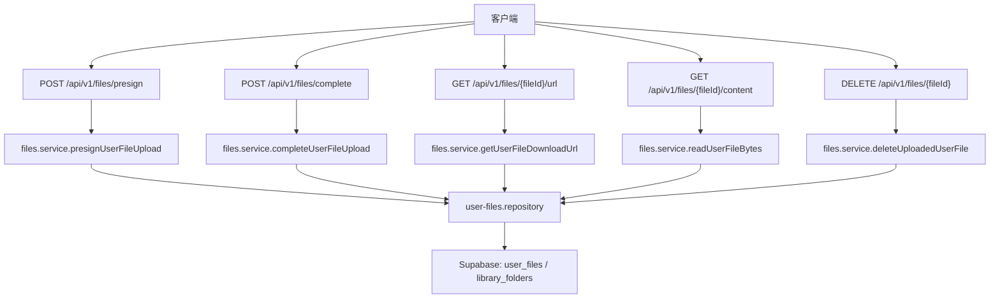
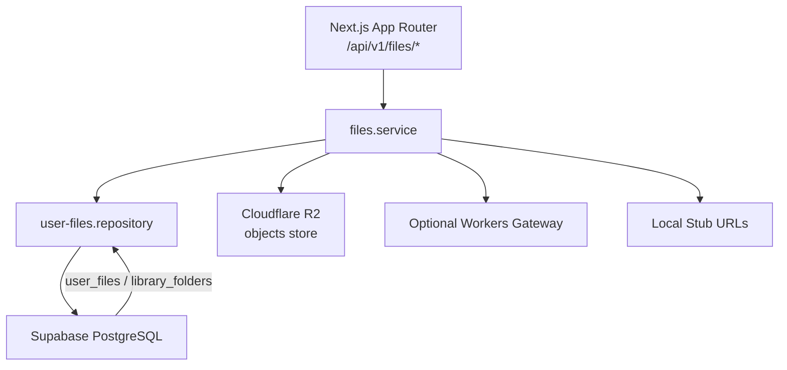
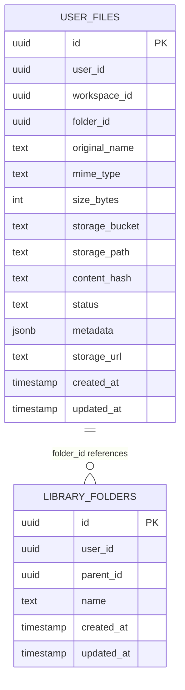
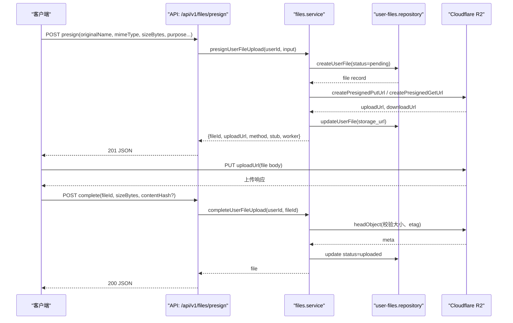
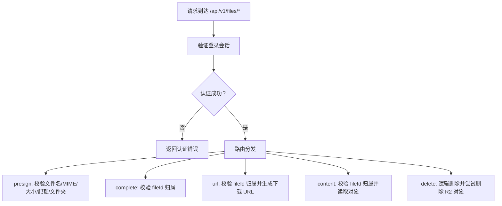
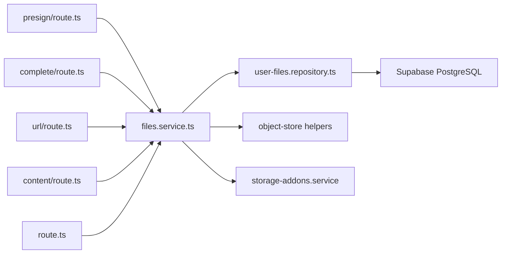

# 文件管理 API

<cite>
**本文引用的文件**   
- [presign/route.ts](file://src/app/api/v1/files/presign/route.ts)
- [complete/route.ts](file://src/app/api/v1/files/complete/route.ts)
- [url/route.ts](file://src/app/api/v1/files/[fileId]/url/route.ts)
- [content/route.ts](file://src/app/api/v1/files/[fileId]/content/route.ts)
- [route.ts](file://src/app/api/v1/files/[fileId]/route.ts)
- [files.service.ts](file://src/server/services/files.service.ts)
- [user-files.repository.ts](file://src/server/repositories/user-files.repository.ts)
- [files.ts](file://src/shared/lib/api/files.ts)
- [20260731113156_library_file_system.sql](file://supabase/migrations/20260731113156_library_file_system.sql)
- [20260911120000_user_files_storage_url.sql](file://supabase/migrations/20260911120000_user_files_storage_url.sql)
</cite>

## 目录
1. [简介](#简介)
2. [项目结构与入口](#项目结构与入口)
3. [核心端点总览](#核心端点总览)
4. [架构与存储模型](#架构与存储模型)
5. [详细端点说明](#详细端点说明)
6. [文件上传流程](#文件上传流程)
7. [安全与访问控制](#安全与访问控制)
8. [大文件与分块上传说明](#大文件与分块上传说明)
9. [错误码与异常处理](#错误码与异常处理)
10. [使用示例与场景](#使用示例与场景)
11. [依赖关系分析](#依赖关系分析)
12. [故障排查指南](#故障排查指南)
13. [结论](#结论)

## 简介
本文件管理 API 提供用户文件的预签名上传、完成上传、下载 URL 生成、内容流式读取以及逻辑删除等能力。后端采用 Next.js App Router 暴露 `/api/v1/files/*` 路由，业务逻辑集中在 `files.service.ts`，持久化通过 Supabase 的 `public.user_files` 表及可选的 `library_folders` 表维护元数据；二进制对象存储在 Cloudflare R2（或开发环境的 stub 模拟路径），并通过预签名 URL 或服务端代理方式访问。

该 API 主要面向浏览器和服务器端调用方：前端通过 `src/shared/lib/api/files.ts` 中的封装函数发起请求，服务端根据用户身份校验后返回预签名地址或直接读取并返回文件字节。

## 项目结构与入口
文件相关 API 位于 Next.js App Router 的 `src/app/api/v1/files/` 目录下，每个子路径对应一个 HTTP 端点：

| 路径 | 方法 | 职责 |
|---|---:|---|
| `/api/v1/files/presign` | POST | 创建待上传文件记录并返回预签名上传地址 |
| `/api/v1/files/complete` | POST | 确认上传完成，更新状态为已上传 |
| `/api/v1/files/{fileId}/url` | GET | 获取可下载的预签名 URL |
| `/api/v1/files/{fileId}/content` | GET | 直接读取并返回文件内容 |
| `/api/v1/files/{fileId}` | DELETE | 逻辑删除文件记录并尝试删除底层对象 |

**图表来源**
- [presign/route.ts:1-39](file://src/app/api/v1/files/presign/route.ts#L1-L39)
- [complete/route.ts:1-40](file://src/app/api/v1/files/complete/route.ts#L1-L40)
- [url/route.ts:1-24](file://src/app/api/v1/files/[fileId]/url/route.ts#L1-L24)
- [content/route.ts:1-32](file://src/app/api/v1/files/[fileId]/content/route.ts#L1-L32)
- [route.ts:1-16](file://src/app/api/v1/files/[fileId]/route.ts#L1-L16)
- [files.service.ts:194-424](file://src/server/services/files.service.ts#L194-L424)
- [user-files.repository.ts:1-200](file://src/server/repositories/user-files.repository.ts#L1-L200)

**章节来源**
- [presign/route.ts:1-39](file://src/app/api/v1/files/presign/route.ts#L1-L39)
- [complete/route.ts:1-40](file://src/app/api/v1/files/complete/route.ts#L1-L40)
- [url/route.ts:1-24](file://src/app/api/v1/files/[fileId]/url/route.ts#L1-L24)
- [content/route.ts:1-32](file://src/app/api/v1/files/[fileId]/content/route.ts#L1-L32)
- [route.ts:1-16](file://src/app/api/v1/files/[fileId]/route.ts#L1-L16)

## 核心端点总览
所有端点均要求认证，由 `requireSession` 中间件校验会话。未登录时统一返回认证错误。

### 通用响应格式
除特殊说明外，成功响应通常使用统一的 JSON 包装结构，包含业务数据字段。错误响应由 `AppError` 携带状态码、消息与错误码。

### 端点矩阵
| HTTP 方法 | URL 模式 | 主要参数 | 成功响应 | 典型用途 |
|---|---|---|---|---|
| POST | `/api/v1/files/presign` | 请求体见下文 | `{ fileId, uploadUrl, method, stub?, worker? }` | 申请上传令牌 |
| POST | `/api/v1/files/complete` | 请求体见下文 | `{ file }` | 完成上传流程 |
| GET | `/api/v1/files/{fileId}/url` | 查询参数 `redirect=1` 可选 | `{ fileId, url, expiresAt, mimeType, originalName, stub? }` | 获取下载链接 |
| GET | `/api/v1/files/{fileId}/content` | 查询参数 `download=1` 可选 | 二进制响应流 | 直接预览或下载 |
| DELETE | `/api/v1/files/{fileId}` | 无 | `{ id }` | 删除文件 |

**章节来源**
- [presign/route.ts:1-39](file://src/app/api/v1/files/presign/route.ts#L1-L39)
- [complete/route.ts:1-40](file://src/app/api/v1/files/complete/route.ts#L1-L40)
- [url/route.ts:1-24](file://src/app/api/v1/files/[fileId]/url/route.ts#L1-L24)
- [content/route.ts:1-32](file://src/app/api/v1/files/[fileId]/content/route.ts#L1-L32)
- [route.ts:1-16](file://src/app/api/v1/files/[fileId]/route.ts#L1-L16)

## 架构与存储模型

### 存储架构
- 二进制对象：Cloudflare R2。生产环境优先使用直连 R2 的预签名 URL；若配置了 `WORKER_URL`，则通过 Workers 网关代理上传与下载；本地开发环境使用 stub URL。
- 元数据：PostgreSQL 的 `public.user_files` 表保存文件名、MIME 类型、大小、R2 bucket、storage_path、状态、哈希、关联 workspace/folder/project 等信息。
- 库文件夹：`public.library_folders` 提供用户级虚拟文件夹树，`user_files.folder_id` 可指向某个文件夹。

**图表来源**
- [files.service.ts:194-424](file://src/server/services/files.service.ts#L194-L424)
- [user-files.repository.ts:1-200](file://src/server/repositories/user-files.repository.ts#L1-L200)
- [20260731113156_library_file_system.sql:1-76](file://supabase/migrations/20260731113156_library_file_system.sql#L1-L76)
- [20260911120000_user_files_storage_url.sql:1-11](file://supabase/migrations/20260911120000_user_files_storage_url.sql#L1-L11)

### 数据模型
- `user_files`：用户文件元数据，包括 `id`、`user_id`、`workspace_id`、`folder_id`、`original_name`、`mime_type`、`size_bytes`、`storage_bucket`、`storage_path`、`content_hash`、`status`、`metadata`、`storage_url`、`created_at`、`updated_at`。
- `library_folders`：用户库文件夹树，包括 `id`、`user_id`、`parent_id`、`name`、时间戳。

**图表来源**
- [user-files.repository.ts:1-200](file://src/server/repositories/user-files.repository.ts#L1-L200)
- [20260731113156_library_file_system.sql:1-76](file://supabase/migrations/20260731113156_library_file_system.sql#L1-L76)
- [20260911120000_user_files_storage_url.sql:1-11](file://supabase/migrations/20260911120000_user_files_storage_url.sql#L1-L11)

**章节来源**
- [files.service.ts:194-424](file://src/server/services/files.service.ts#L194-L424)
- [user-files.repository.ts:1-200](file://src/server/repositories/user-files.repository.ts#L1-L200)
- [20260731113156_library_file_system.sql:1-76](file://supabase/migrations/20260731113156_library_file_system.sql#L1-L76)
- [20260911120000_user_files.storage_url.sql:1-11](file://supabase/migrations/20260911120000_user_files_storage_url.sql#L1-L11)

## 详细端点说明

### POST `/api/v1/files/presign`
用于申请一次文件上传所需的元数据和预签名上传地址。

- **认证要求**：需要登录会话。
- **请求体字段**
  - `originalName`：原始文件名，必填。
  - `mimeType`：MIME 类型，可选。
  - `sizeBytes`：文件大小，可选。
  - `workspaceId`：工作区标识，可选。
  - `folderId`：库文件夹 ID，可选；会校验文件夹归属当前用户。
  - `purpose`：目的枚举，可选，支持 `avatar`、`library`、`chat-attachment`、`project-source`。
  - `chatId`：聊天上下文 ID，可选。
  - `projectId`：项目上下文 ID，可选。
  - `sourceKind`：项目来源类型，可选。
- **成功响应**
  - `fileId`：文件记录 ID。
  - `uploadUrl`：预签名上传地址。
  - `method`：HTTP 方法，通常为 `PUT`。
  - `stub`：是否使用本地 stub URL。
  - `worker`：是否通过 Workers 网关上传。
- **行为要点**
  - 头像必须为 PNG、JPEG、WebP 或 GIF，且不超过 2MB。
  - 普通文件最大 100MB。
  - 非头像文件会根据用户存储配额检查是否超限。
  - 根据 MIME 类型和 purpose 决定 R2 bucket 和 key 前缀。
  - 成功后创建 `pending` 状态的 `user_files` 记录，并写入 `storage_bucket`、`storage_path`、`storage_url` 等元数据。

**章节来源**
- [presign/route.ts:1-39](file://src/app/api/v1/files/presign/route.ts#L1-L39)
- [files.service.ts:194-280](file://src/server/services/files.service.ts#L194-L280)

### POST `/api/v1/files/complete`
用于确认客户端已完成预签名上传，并将文件状态标记为已上传。

- **认证要求**：需要登录会话。
- **请求体字段**
  - `fileId`：文件记录 ID，必填。
  - `contentHash`：内容哈希，可选。
  - `sizeBytes`：文件大小，可选。
- **成功响应**
  - `file`：完整的 `user_files` 行对象。
- **行为要点**
  - 如果配置了 R2，会通过 headObject 补充真实 `contentLength` 与 `etag`。
  - 若 purpose 为头像，还会调用头像服务将新上传文件关联到用户资料。
  - 超时限制为 300 秒，适合较大文件的收尾操作。

**章节来源**
- [complete/route.ts:1-40](file://src/app/api/v1/files/complete/route.ts#L1-L40)
- [files.service.ts:314-360](file://src/server/services/files.service.ts#L314-L360)

### GET `/api/v1/files/{fileId}/url`
用于获取临时下载 URL。

- **认证要求**：需要登录会话。
- **路径参数**
  - `fileId`：文件 ID。
- **查询参数**
  - `redirect=1`：返回 302 重定向到实际下载地址。
- **成功响应**
  - `fileId`
  - `url`：预签名下载 URL。
  - `expiresAt`：过期时间。
  - `mimeType`
  - `originalName`
  - `stub`：是否为 stub URL。
- **行为要点**
  - 不设置 `redirect=1` 时返回 JSON。
  - 设置 `redirect=1` 时直接 302 跳转。

**章节来源**
- [url/route.ts:1-24](file://src/app/api/v1/files/[fileId]/url/route.ts#L1-L24)
- [files.service.ts:373-400](file://src/server/services/files.service.ts#L373-L400)

### GET `/api/v1/files/{fileId}/content`
用于直接读取文件字节并返回响应体。

- **认证要求**：需要登录会话。
- **路径参数**
  - `fileId`：文件 ID。
- **查询参数**
  - `download=1`：强制作为附件下载。
- **响应头**
  - `content-type`：来自文件元数据。
  - `content-length`：字节长度。
  - `content-disposition`：图片视频默认 inline，其他默认 attachment；可被 `download=1` 覆盖。
  - `cache-control`：`private, max-age=3600`。
- **行为要点**
  - 从 R2 读取二进制数据并构造 Response。
  - 适用于预览图片和视频、导出附件等场景。

**章节来源**
- [content/route.ts:1-32](file://src/app/api/v1/files/[fileId]/content/route.ts#L1-L32)
- [files.service.ts:361-372](file://src/server/services/files.service.ts#L361-L372)

### DELETE `/api/v1/files/{fileId}`
用于删除用户文件。

- **认证要求**：需要登录会话。
- **路径参数**
  - `fileId`：文件 ID。
- **成功响应**
  - `id`：被删除的文件 ID。
- **行为要点**
  - 先逻辑删除数据库记录。
  - 再尝试删除 R2 对象；删除失败不会阻断响应，但会记录日志。

**章节来源**
- [route.ts:1-16](file://src/app/api/v1/files/[fileId]/route.ts#L1-L16)
- [files.service.ts:401-424](file://src/server/services/files.service.ts#L401-L424)

## 文件上传流程

### 完整上传序列

**图表来源**
- [presign/route.ts:1-39](file://src/app/api/v1/files/presign/route.ts#L1-L39)
- [complete/route.ts:1-40](file://src/app/api/v1/files/complete/route.ts#L1-L40)
- [files.service.ts:194-360](file://src/server/services/files.service.ts#L194-L360)

### 预签名上传策略
- 生产环境优先直连 Cloudflare R2 预签名 URL。
- 若未配置 R2 直连但配置了 `WORKER_URL`，则返回 Workers 网关上传地址。
- 非生产环境且无 workers 网关时使用 stub URL，便于本地调试。
- 预签名 TTL 固定为 900 秒。

**章节来源**
- [files.service.ts:194-280](file://src/server/services/files.service.ts#L194-L280)

## 安全与访问控制
- 所有文件 API 路由均使用 `requireSession`，未认证请求无法进入业务逻辑。
- 文件读取和删除均以 `userId` 过滤，确保用户只能访问自己的文件。
- 文件夹访问在 presign 阶段校验 `folderId` 是否属于当前用户。
- R2 对象本身是私有的；访问通过预签名 URL 或受鉴权的 `/api/v1/files/{fileId}/content` 路由进行。
- 头像上传额外限制 MIME 类型与大小，防止恶意类型和大图滥用。
- 普通文件上传前会检查用户存储配额，超额时拒绝。

**图表来源**
- [presign/route.ts:1-39](file://src/app/api/v1/files/presign/route.ts#L1-L39)
- [complete/route.ts:1-40](file://src/app/api/v1/files/complete/route.ts#L1-L40)
- [url/route.ts:1-24](file://src/app/api/v1/files/[fileId]/url/route.ts#L1-L24)
- [content/route.ts:1-32](file://src/app/api/v1/files/[fileId]/content/route.ts#L1-L32)
- [route.ts:1-16](file://src/app/api/v1/files/[fileId]/route.ts#L1-L16)
- [files.service.ts:194-424](file://src/server/services/files.service.ts#L194-L424)

**章节来源**
- [presign/route.ts:1-39](file://src/app/api/v1/files/presign/route.ts#L1-L39)
- [complete/route.ts:1-40](file://src/app/api/v1/files/complete/route.ts#L1-L40)
- [files.service.ts:194-424](file://src/server/services/files.service.ts#L194-L424)

## 大文件与分块上传说明
当前代码实现的是基于预签名 PUT 的单次上传流程，没有实现服务端侧的分片上传协调器。对于大文件建议：
- 客户端自行实现分片上传：按固定大小切分，依次对每个分片调用预签名上传。
- 合并策略：由于仓库中未提供分片合并端点，分片合并应交由 R2 生命周期规则、Workers 网关或外部对象存储服务处理；当前 API 更适合作为“单对象上传 + 元数据登记”的方案。
- 超大文件注意事项：
  - 普通文件上限为 100MB。
  - 头像上限为 2MB。
  - 超过配额时会返回存储配额错误。
  - 生产环境必须配置 R2 直连或 `WORKER_URL`，否则上传会被拒绝。

**章节来源**
- [files.service.ts:194-280](file://src/server/services/files.service.ts#L194-L280)
- [files.service.ts:314-360](file://src/server/services/files.service.ts#L314-L360)

## 错误码与异常处理
- 400 参数错误
  - 缺少 `originalName`。
  - 头像类型不在允许集合。
  - 头像超过 2MB。
  - 普通文件超过 100MB。
- 401/403 认证错误
  - 未登录或会话无效。
- 404 资源不存在
  - 文件记录不存在。
  - 指定文件夹不属于当前用户。
- 402 存储配额不足
  - 用户上传后会超出用户存储配额。
- 500 内部错误
  - 创建文件记录失败。
- 503 存储未配置
  - 生产环境未配置 R2 直连凭据且未配置 `WORKER_URL`。

错误由 `AppError` 携带状态码、消息和错误码，例如 `invalid_avatar_type`、`storage_quota_exceeded`、`storage_unconfigured`。

**章节来源**
- [files.service.ts:194-424](file://src/server/services/files.service.ts#L194-L424)

## 使用示例与场景

### 浏览器上传头像
1. 调用 `POST /api/v1/files/presign`，传入 `originalName`、`mimeType=image/png`、`sizeBytes`、`purpose=avatar`。
2. 使用返回的 `uploadUrl` 和 `method` 执行 PUT 上传。
3. 调用 `POST /api/v1/files/complete` 完成上传。
4. 头像会自动关联到用户资料。

### 上传聊天附件
1. 调用 `POST /api/v1/files/presign`，传入 `purpose=chat-attachment`、可选 `chatId`。
2. PUT 上传到预签名地址。
3. 调用 `POST /api/v1/files/complete`。
4. 使用 `GET /api/v1/files/{fileId}/content` 预览或下载。

### 上传项目源码
1. 调用 `POST /api/v1/files/presign`，传入 `purpose=project-source`、可选 `projectId`、`sourceKind`。
2. PUT 上传。
3. 完成上传并可在项目上下文中引用。

### 文件预览
- 直接访问 `GET /api/v1/files/{fileId}/content`，图片视频会以内联形式返回。
- 添加 `download=1` 强制下载。

### 获取临时下载链接
- 调用 `GET /api/v1/files/{fileId}/url`。
- 如需浏览器自动跳转，附加 `redirect=1`。

**章节来源**
- [files.ts:1-90](file://src/shared/lib/api/files.ts#L1-L90)
- [presign/route.ts:1-39](file://src/app/api/v1/files/presign/route.ts#L1-L39)
- [complete/route.ts:1-40](file://src/app/api/v1/files/complete/route.ts#L1-L40)
- [content/route.ts:1-32](file://src/app/api/v1/files/[fileId]/content/route.ts#L1-L32)
- [url/route.ts:1-24](file://src/app/api/v1/files/[fileId]/url/route.ts#L1-L24)

## 依赖关系分析

**图表来源**
- [presign/route.ts:1-39](file://src/app/api/v1/files/presign/route.ts#L1-L39)
- [complete/route.ts:1-40](file://src/app/api/v1/files/complete/route.ts#L1-L40)
- [url/route.ts:1-24](file://src/app/api/v1/files/[fileId]/url/route.ts#L1-L24)
- [content/route.ts:1-32](file://src/app/api/v1/files/[fileId]/content/route.ts#L1-L32)
- [route.ts:1-16](file://src/app/api/v1/files/[fileId]/route.ts#L1-L16)
- [files.service.ts:194-424](file://src/server/services/files.service.ts#L194-L424)
- [user-files.repository.ts:1-200](file://src/server/repositories/user-files.repository.ts#L1-L200)

**章节来源**
- [files.service.ts:194-424](file://src/server/services/files.service.ts#L194-L424)
- [user-files.repository.ts:1-200](file://src/server/repositories/user-files.repository.ts#L1-L200)

## 故障排查指南
- 上传返回 503
  - 生产环境未配置 R2 直连凭据或未设置 `WORKER_URL`。
  - 检查环境变量与部署配置。
- 上传被拒绝提示超过 100MB
  - 普通文件上限为 100MB；头像上限为 2MB。
- 上传被拒绝提示存储配额不足
  - 用户存储空间已满，需扩容或升级计划。
- 文件不存在
  - 检查 `fileId` 是否正确，确认当前登录用户拥有该文件。
- 头像类型不被接受
  - 仅支持 PNG、JPEG、WebP、GIF。
- 下载内容为空或损坏
  - 确认已完成 `complete` 步骤。
  - 如果是 stub 环境，确认本地 stub 上传已生效。
- 预览不是内联显示
  - 检查 MIME 类型是否为图片/视频，或是否传入了 `download=1`。

**章节来源**
- [files.service.ts:194-424](file://src/server/services/files.service.ts#L194-L424)

## 结论
该文件管理 API 以 `/api/v1/files/*` 为核心入口，围绕预签名上传、完成上传、下载 URL 和内容读取构建了一套简洁而安全的文件存取方案。其优势在于：
- 认证明确：所有端点依赖会话。
- 存储解耦：元数据落库，二进制对象存于 R2。
- 访问可控：通过预签名 URL 或鉴权路由访问对象。
- 扩展清晰：支持头像、聊天附件、项目源码、库文件等多种用途。

需要注意：
- 当前未提供服务端分片上传协调端点，大文件应由客户端分片并在外部层合并。
- 生产环境必须正确配置 R2 或 Workers 网关。
- 使用 `content` 端点时注意缓存头与会话有效期。