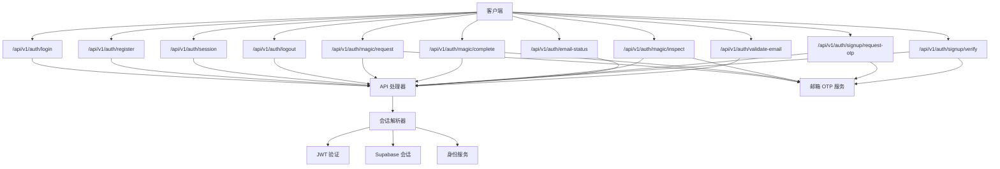
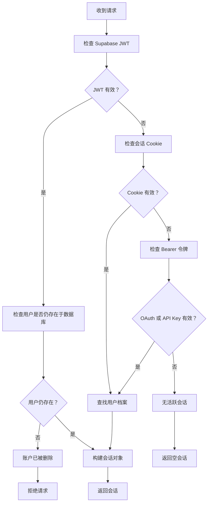
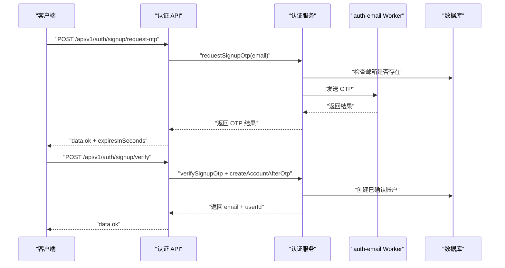
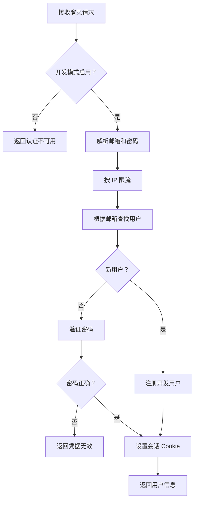
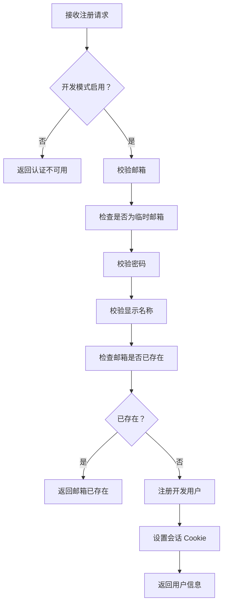
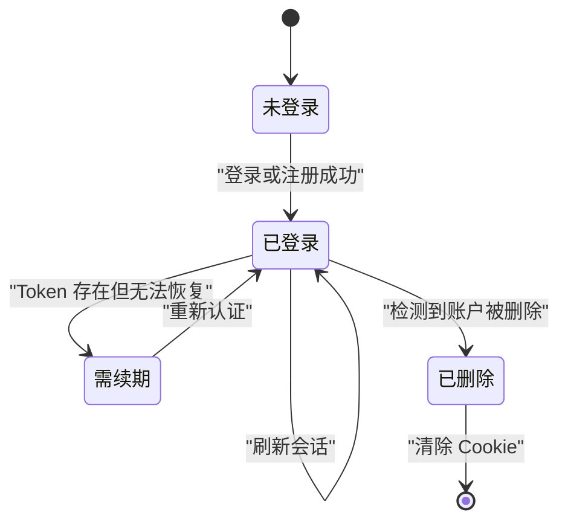
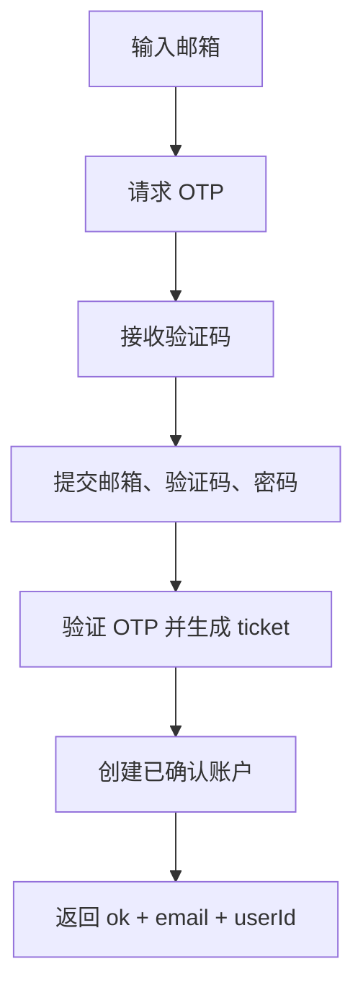
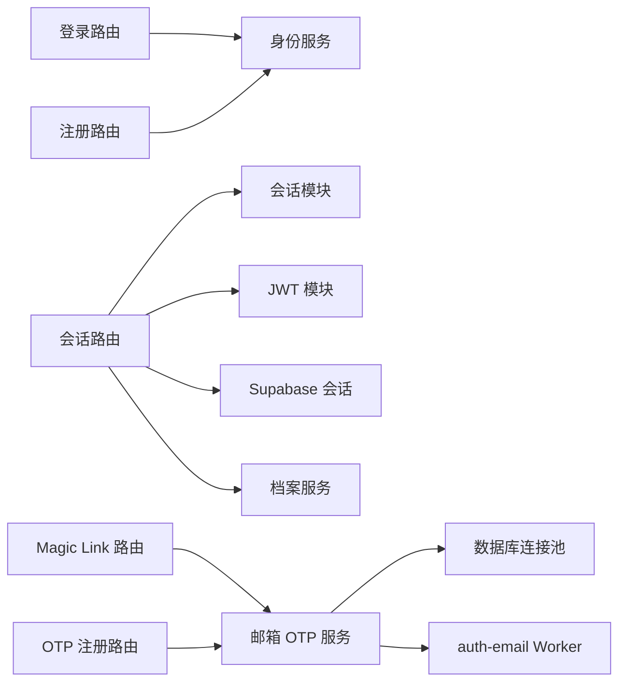

# 用户认证 API

<cite>
**本文引用的文件**   
- [src/app/api/v1/auth/login/route.ts](file://src/app/api/v1/auth/login/route.ts)
- [src/app/api/v1/auth/register/route.ts](file://src/app/api/v1/auth/register/route.ts)
- [src/app/api/v1/auth/session/route.ts](file://src/app/api/v1/auth/session/route.ts)
- [src/app/api/v1/auth/logout/route.ts](file://src/app/api/v1/auth/logout/route.ts)
- [src/app/api/v1/auth/magic/request/route.ts](file://src/app/api/v1/auth/magic/request/route.ts)
- [src/app/api/v1/auth/magic/complete/route.ts](file://src/app/api/v1/auth/magic/complete/route.ts)
- [src/app/api/v1/auth/magic/inspect/route.ts](file://src/app/api/v1/auth/magic/inspect/route.ts)
- [src/app/api/v1/auth/signup/request-otp/route.ts](file://src/app/api/v1/auth/signup/request-otp/route.ts)
- [src/app/api/v1/auth/signup/verify/route.ts](file://src/app/api/v1/auth/signup/verify/route.ts)
- [src/app/api/v1/auth/email-status/route.ts](file://src/app/api/v1/auth/email状态/route.ts)
- [src/app/api/v1/auth/validate-email/route.ts](file://src/app/api/v1/auth/validate-email/route.ts)
- [src/server/http/api-handler.ts](file://src/server/http/api-handler.ts)
- [src/server/http/api-response.ts](file://src/server/http/api-response.ts)
- [src/server/auth/session.ts](file://src/server/auth/session.ts)
- [src/server/auth/jwt.ts](file://src/server/auth/jwt.ts)
- [src/server/auth/supabase-session.ts](file://src/server/auth/supabase-session.ts)
- [src/server/services/auth-email-otp.service.ts](file://src/server/services/auth-email-otp.service.ts)
- [src/server/services/identity.service.ts](file://src/server/services/identity.service.ts)
- [tests/auth-session.test.mjs](file://tests/auth-session.test.mjs)
</cite>

## 目录

1. [简介](#简介)
2. [项目结构](#项目结构)
3. [核心组件](#核心组件)
4. [架构总览](#架构总览)
5. [端点详解](#端点详解)
6. [依赖关系分析](#依赖关系分析)
7. [性能与并发特性](#性能与并发特性)
8. [安全与最佳实践](#安全与最佳实践)
9. [故障排查指南](#故障排查指南)
10. [结论](#结论)

## 简介

本文件面向需要对接后端认证能力的客户端开发者，完整记录 `/api/v1/auth/*` 下的 RESTful 接口。系统支持以下认证方式：

- **邮箱密码登录与注册**：开发模式下启用，受 `AUTH_DEV_BYPASS` 控制。
- **Magic Link（魔法链接）注册流程**：通过邮件发送一次性链接，用于新账户创建。
- **OTP（短信或邮件验证码）注册流程**：调用 Cloudflare auth-email Worker 发送 6 位验证码。
- **Session 管理**：查询当前会话、静默查询会话、退出登录。
- **辅助校验**：邮箱是否已注册、邮箱格式与临时邮箱域名校验。

所有端点统一使用 Next.js App Router 的 Route Handler，并通过 `withApiHandler` 提供会话解析、错误包装和请求追踪。成功响应封装在 `{ data }` 中；失败响应封装在 `{ error: { message, code } }` 中。

## 项目结构

认证相关代码分布在应用层路由与服务层模块中：



**图表来源**
- [src/app/api/v1/auth/login/route.ts:1-128](file://src/app/api/v1/auth/login/route.ts#L1-L128)
- [src/app/api/v1/auth/register/route.ts:1-93](file://src/app/api/v1/auth/register/route.ts#L1-L93)
- [src/app/api/v1/auth/session/route.ts:1-182](file://src/app/api/v1/auth/session/route.ts#L1-L182)
- [src/app/api/v1/auth/logout/route.ts:1-20](file://src/app/api/v1/auth/logout/route.ts#L1-L20)
- [src/app/api/v1/auth/magic/request/route.ts:1-18](file://src/app/api/v1/auth/magic/request/route.ts#L1-L18)
- [src/app/api/v1/auth/magic/complete/route.ts:1-35](file://src/app/api/v1/auth/magic/complete/route.ts#L1-L35)
- [src/app/api/v1/auth/magic/inspect/route.ts:1-23](file://src/app/api/v1/auth/magic/inspect/route.ts#L1-L23)
- [src/app/api/v1/auth/signup/request-otp/route.ts:1-18](file://src/app/api/v1/auth/signup/request-otp/route.ts#L1-L18)
- [src/app/api/v1/auth/signup/verify/route.ts:1-46](file://src/app/api/v1/auth/signup/verify/route.ts#L1-L46)
- [src/app/api/v1/auth/email-status/route.ts:1-27](file://src/app/api/v1/auth/email-status/route.ts#L1-L27)
- [src/app/api/v1/auth/validate-email/route.ts:1-46](file://src/app/api/v1/auth/validate-email/route.ts#L1-L46)
- [src/server/http/api-handler.ts:1-66](file://src/server/http/api-handler.ts#L1-L66)
- [src/server/auth/session.ts:1-200](file://src/server/auth/session.ts#L1-L200)
- [src/server/auth/jwt.ts:1-200](file://src/server/auth/jwt.ts#L1-L200)
- [src/server/auth/supabase-session.ts:1-34](file://src/server/auth/supabase-session.ts#L1-L34)
- [src/server/services/auth-email-otp.service.ts:1-200](file://src/server/services/auth-email-otp.service.ts#L1-L200)

**章节来源**
- [src/app/api/v1/auth/login/route.ts:1-128](file://src/app/api/v1/auth/login/route.ts#L1-L128)
- [src/server/http/api-handler.ts:1-66](file://src/server/http/api-handler.ts#L1-L66)

## 核心组件

### API 统一处理器

所有认证端点都通过 `withApiHandler` 包裹。它负责：

- 解析数据库请求上下文。
- 解析当前用户会话。
- 可选强制鉴权。
- 注入 `requestId`。
- 添加 `Server-Timing` 与请求追踪头。
- 将业务异常转换为统一的 JSON 错误响应。

| 维度 | 行为 |
|---|---|
| 成功响应 | `{ data }` |
| 失败响应 | `{ error: { message, code } }` |
| 生产环境敏感信息 | 不暴露堆栈；数据库错误消息会被泛化 |
| 未处理异常 | 返回 500 并标记为 `internal_error` |

**章节来源**
- [src/server/http/api-handler.ts:1-66](file://src/server/http/api-handler.ts#L1-L66)
- [src/server/http/api-response.ts:1-39](file://src/server/http/api-response.ts#L1-L39)

### 会话解析器

会话解析顺序如下：

1. **Supabase JWT**：优先从 `Authorization: Bearer` 或 Supabase SSR cookie 中提取访问令牌。
2. **Cookie 会话**：回退到服务端会话 Cookie。
3. **Bearer 令牌扩展**：支持 OAuth access token 和用户 API key。
4. **用户存在性检查**：若用户被管理员删除，立即拒绝。



**图表来源**
- [src/server/auth/session.ts:1-200](file://src/server/auth/session.ts#L1-L200)
- [src/server/auth/jwt.ts:1-200](file://src/server/auth/jwt.ts#L1-L200)
- [src/server/auth/supabase-session.ts:1-34](file://src/server/auth/supabase-session.ts#L1-L34)

**章节来源**
- [src/server/auth/session.ts:1-200](file://src/server/auth/session.ts#L1-L200)
- [src/server/auth/jwt.ts:1-200](file://src/server/auth/jwt.ts#L1-L200)
- [src/server/auth/supabase-session.ts:1-34](file://src/server/auth/supabase-session.ts#L1-L34)

### 邮箱 OTP 服务

邮箱 OTP 服务承担两类职责：

- **业务校验**：邮箱格式、长度、临时邮箱域名、重复注册。
- **传输通道**：在生产模式调用 Cloudflare auth-email Worker；在开发模式使用内存存储模拟。

关键能力包括：

- 检查邮箱是否已注册。
- 发送注册 OTP。
- 验证 OTP 并生成一次性 ticket。
- 创建 OTP 注册后的账户。
- 发送并检查 Magic Link。

**章节来源**
- [src/server/services/auth-email-otp.service.ts:1-200](file://src/server/services/auth-email-otp.service.ts#L1-L200)

### 身份服务

身份服务维护应用内用户档案与开发模式账号逻辑：

- 确保用户档案、用户设置、余额、通知偏好、工作区等基础数据存在。
- 查找已有邮箱。
- 开发模式下注册用户。
- 记录安全事件。
- 开发模式下比对密码。

**章节来源**
- [src/server/services/identity.service.ts:1-168](file://src/server/services/identity.service.ts#L1-L168)

## 架构总览



**图表来源**
- [src/app/api/v1/auth/signup/request-otp/route.ts:1-18](file://src/app/api/v1/auth/signup/request-otp/route.ts#L1-L18)
- [src/app/api/v1/auth/signup/verify/route.ts:1-46](file://src/app/api/v1/auth/signup/verify/route.ts#L1-L46)
- [src/server/services/auth-email-otp.service.ts:1-200](file://src/server/services/auth-email-otp.service.ts#L1-L200)

## 端点详解

### 通用约定

| 项目 | 说明 |
|---|---|
| 基础路径 | `/api/v1/auth` |
| 成功响应格式 | `{ data }` |
| 失败响应格式 | `{ error: { message, code } }` |
| 典型状态码 | 200、400、401、409、429、503 |
| 错误码示例 | `invalid_email`、`invalid_request`、`email_exists`、`rate_limited`、`account_deleted`、`auth_unavailable` |
| 调试建议 | 关注响应中的 `code`，以及 `Server-Timing`、自定义请求追踪头 |

**章节来源**
- [src/server/http/api-response.ts:1-39](file://src/server/http/api-response.ts#L1-L39)
- [src/server/http/api-handler.ts:1-66](file://src/server/http/api-handler.ts#L1-L66)

### POST `/api/v1/auth/login`

#### 用途

开发模式下通过邮箱和密码登录。非开发模式下 GET 会返回不可用提示；POST 在非开发模式下也会返回不可用。

#### HTTP 方法

`GET`、`POST`

#### 请求参数

| 字段 | 类型 | 必填 | 说明 |
|---|---|---:|---|
| `email` | 字符串 | 否 | GET 不传；POST 时必填 |
| `password` | 字符串 | 否 | POST 时可为空，但后续凭据校验可能失败 |

#### 成功响应

```json
{
  "data": {
    "user": {
      "id": "用户 ID",
      "email": "邮箱地址",
      "displayName": "显示名称"
    }
  }
}
```

同时设置会话 Cookie。

#### 错误响应

| 状态码 | 错误码 | 含义 |
|---:|---|---|
| 400 | — | 缺少邮箱 |
| 401 | `invalid_credentials` | 凭据无效 |
| 429 | `rate_limited` | 同一 IP 短时间内尝试过多 |
| 503 | `auth_unavailable` | 开发登录未启用 |

#### 交互流程



**图表来源**
- [src/app/api/v1/auth/login/route.ts:1-128](file://src/app/api/v1/auth/login/route.ts#L1-L128)
- [src/server/services/identity.service.ts:1-168](file://src/server/services/identity.service.ts#L1-L168)

**章节来源**
- [src/app/api/v1/auth/login/route.ts:1-128](file://src/app/api/v1/auth/login/route.ts#L1-L128)
- [src/server/services/identity.service.ts:1-168](file://src/server/services/identity.service.ts#L1-L168)

### POST `/api/v1/auth/register`

#### 用途

开发模式下注册新账户。

#### HTTP 方法

`POST`

#### 请求参数

| 字段 | 类型 | 必填 | 说明 |
|---|---|---:|---|
| `email` | 字符串 | 是 | 邮箱地址 |
| `password` | 字符串 | 是 | 密码 |
| `displayName` | 字符串 | 否 | 显示名称 |

#### 成功响应

```json
{
  "data": {
    "user": {
      "id": "用户 ID",
      "email": "邮箱地址",
      "displayName": "显示名称或 null"
    }
  }
}
```

同时设置会话 Cookie。

#### 错误响应

| 状态码 | 错误码 | 含义 |
|---:|---|---|
| 400 | `invalid_email` | 邮箱为空或格式不合理 |
| 400 | `invalid_password` | 密码为空或过长 |
| 400 | `invalid_display_name` | 显示名称过长 |
| 409 | `email_exists` | 邮箱已存在 |
| 503 | `auth_unavailable` | 注册功能未启用 |

#### 流程图



**图表来源**
- [src/app/api/v1/auth/register/route.ts:1-93](file://src/app/api/v1/auth/register/route.ts#L1-L93)
- [src/server/services/identity.service.ts:1-168](file://src/server/services/identity.service.ts#L1-L168)

**章节来源**
- [src/app/api/v1/auth/register/route.ts:1-93](file://src/app/api/v1/auth/register/route.ts#L1-L93)
- [src/server/services/identity.service.ts:1-168](file://src/server/services/identity.service.ts#L1-L168)

### GET `/api/v1/auth/session`

#### 用途

获取当前用户会话。支持两种模式：

- **完整会话**：默认模式，解析 Supabase JWT，同步用户档案，检测账户删除。
- **静默会话**：传入 `?quiet=1`，仅返回当前会话而不因存在 Token 却无会话而直接报错。

#### HTTP 方法

`GET`

#### 查询参数

| 参数 | 类型 | 必填 | 说明 |
|---|---|---:|---|
| `quiet` | 字符串 | 否 | 值为 `1` 时进入静默模式 |

#### 成功响应

```json
{
  "data": {
    "session": {
      "id": "用户 ID 或 null",
      "email": "邮箱或 null",
      "displayName": "显示名称或 null",
      "preferredName": "首选名称或 null",
      "avatarUrl": "头像 URL 或 null"
    }
  }
}
```

#### 会话状态说明

| session 值 | 含义 |
|---|---|
| 对象 | 用户已登录 |
| `null` | 未登录或会话已失效 |

#### 错误响应

| 状态码 | 错误码 | 含义 |
|---:|---|---|
| 401 | `unauthorized` | 存在 Authorization 或访问 Token，但无法恢复会话 |
| 401 | `account_deleted` | 用户已被删除 |
| 503 | `auth_unavailable` | 会话验证暂时不可用 |

#### 会话生命周期



**图表来源**
- [src/app/api/v1/auth/session/route.ts:1-182](file://src/app/api/v1/auth/session/route.ts#L1-L182)
- [src/server/auth/session.ts:1-200](file://src/server/auth/session.ts#L1-L200)

**章节来源**
- [src/app/api/v1/auth/session/route.ts:1-182](file://src/app/api/v1/auth/session/route.ts#L1-L182)
- [src/server/auth/session.ts:1-200](file://src/server/auth/session.ts#L1-L200)
- [src/server/auth/jwt.ts:1-200](file://src/server/auth/jwt.ts#L1-L200)
- [src/server/auth/supabase-session.ts:1-34](file://src/server/auth/supabase-session.ts#L1-L34)

### POST `/api/v1/auth/logout`

#### 用途

退出登录，清除会话 Cookie 与身份提示 Cookie。

#### HTTP 方法

`POST`

#### 请求参数

无。

#### 成功响应

```json
{
  "data": {
    "ok": true
  }
}
```

#### 行为

- 清除会话 Cookie。
- 清除身份提示 Cookie。
- 客户端应随后跳转至登录页或首页。

**章节来源**
- [src/app/api/v1/auth/logout/route.ts:1-20](file://src/app/api/v1/auth/logout/route.ts#L1-L20)

### POST `/api/v1/auth/magic/request`

#### 用途

为新用户发送 Magic Link。该端点本身不创建账户，而是触发邮件发送流程。

#### HTTP 方法

`POST`

#### 请求参数

| 字段 | 类型 | 必填 | 说明 |
|---|---|---:|---|
| `email` | 字符串 | 是 | 接收魔法链接的邮箱 |

#### 成功响应

由 `auth-email-otp.service.ts` 决定，通常包含邮箱、过期时间等信息。

#### 错误响应

| 状态码 | 错误码 | 含义 |
|---:|---|---|
| 400 | `invalid_email` | 邮箱为空 |
| 503 | `auth_email_unconfigured` | 邮箱 Worker 未配置 |

**章节来源**
- [src/app/api/v1/auth/magic/request/route.ts:1-18](file://src/app/api/v1/auth/magic/request/route.ts#L1-L18)
- [src/server/services/auth-email-otp.service.ts:1-200](file://src/server/services/auth-email-otp.service.ts#L1-L200)

### POST `/api/v1/auth/magic/complete`

#### 用途

消费 Magic Link token，创建已确认的 Supabase 用户。客户端随后应使用邮箱密码登录。

#### HTTP 方法

`POST`

#### 请求参数

| 字段 | 类型 | 必填 | 说明 |
|---|---|---:|---|
| `token` | 字符串 | 是 | Magic Link token |
| `password` | 字符串 | 是 | 用户设置的密码 |

#### 成功响应

```json
{
  "data": {
    "ok": true,
    "email": "邮箱地址",
    "userId": "用户 ID"
  }
}
```

#### 错误响应

| 状态码 | 错误码 | 含义 |
|---:|---|---|
| 400 | `invalid_request` | 缺少 token 或密码 |

**章节来源**
- [src/app/api/v1/auth/magic/complete/route.ts:1-35](file://src/app/api/v1/auth/magic/complete/route.ts#L1-L35)
- [src/server/services/auth-email-otp.service.ts:1-200](file://src/server/services/auth-email-otp.service.ts#L1-L200)

### POST `/api/v1/auth/magic/inspect`

#### 用途

查看 Magic Link token 的元数据，不会消耗 token。适合前端在点击前做预检。

#### HTTP 方法

`POST`

#### 请求参数

| 字段 | 类型 | 必填 | 说明 |
|---|---|---:|---|
| `token` | 字符串 | 是 | Magic Link token |

#### 成功响应

```json
{
  "data": {
    "ok": true,
    "email": "邮箱地址",
    "purpose": "用途描述",
    "expiresInSeconds": "剩余有效期秒数"
  }
}
```

#### 错误响应

| 状态码 | 错误码 | 含义 |
|---:|---|---|
| 400 | `invalid_token` | 缺少 token |

**章节来源**
- [src/app/api/v1/auth/magic/inspect/route.ts:1-23](file://src/app/api/v1/auth/magic/inspect/route.ts#L1-L23)
- [src/server/services/auth-email-otp.service.ts:1-200](file://src/server/services/auth-email-otp.service.ts#L1-L200)

### POST `/api/v1/auth/signup/request-otp`

#### 用途

发送注册 OTP。生产模式下调用 Cloudflare auth-email Worker；开发模式下可本地模拟。

#### HTTP 方法

`POST`

#### 请求参数

| 字段 | 类型 | 必填 | 说明 |
|---|---|---:|---|
| `email` | 字符串 | 是 | 接收验证码的邮箱 |

#### 成功响应

```json
{
  "data": {
    "ok": true,
    "expiresInSeconds": "验证码有效期秒数",
    "delivered": "是否已投递",
    "simulated": "是否本地模拟",
    "debugCode": "开发模式调试验证码"
  }
}
```

#### 错误响应

| 状态码 | 错误码 | 含义 |
|---:|---|---|
| 400 | `invalid_email` | 邮箱为空 |
| 409 | `email_exists` | 邮箱已注册 |
| 503 | `auth_email_unconfigured` | 邮箱 Worker 未配置 |

**章节来源**
- [src/app/api/v1/auth/signup/request-otp/route.ts:1-18](file://src/app/api/v1/auth/signup/request-otp/route.ts#L1-L18)
- [src/server/services/auth-email-otp.service.ts:1-200](file://src/server/services/auth-email-otp.service.ts#L1-L200)

### POST `/api/v1/auth/signup/verify`

#### 用途

验证 OTP 并创建账户。

#### HTTP 方法

`POST`

#### 请求参数

| 字段 | 类型 | 必填 | 说明 |
|---|---|---:|---|
| `email` | 字符串 | 是 | 邮箱地址 |
| `code` | 字符串 | 是 | 6 位验证码 |
| `password` | 字符串 | 是 | 用户密码 |

#### 成功响应

```json
{
  "data": {
    "ok": true,
    "email": "邮箱地址",
    "userId": "用户 ID"
  }
}
```

#### 错误响应

| 状态码 | 错误码 | 含义 |
|---:|---|---|
| 400 | `invalid_request` | 缺少必要字段 |
| 400 | `invalid_code` | 验证码不是 6 位数字 |
| 503 | `auth_email_unconfigured` | 邮箱 Worker 未配置 |

#### OTP 注册流程



**图表来源**
- [src/app/api/v1/auth/signup/request-otp/route.ts:1-18](file://src/app/api/v1/auth/signup/request-otp/route.ts#L1-L18)
- [src/app/api/v1/auth/signup/verify/route.ts:1-46](file://src/app/api/v1/auth/signup/verify/route.ts#L1-L46)
- [src/server/services/auth-email-otp.service.ts:1-200](file://src/server/services/auth-email-otp.service.ts#L1-L200)

**章节来源**
- [src/app/api/v1/auth/signup/verify/route.ts:1-46](file://src/app/api/v1/auth/signup/verify/route.ts#L1-L46)
- [src/server/services/auth-email-otp.service.ts:1-200](file://src/server/services/auth-email-otp.service.ts#L1-L200)

### POST `/api/v1/auth/email-status`

#### 用途

判断邮箱是否已有账户，用于统一登录页面选择“登录”还是“创建账户”。

#### HTTP 方法

`POST`

#### 请求参数

| 字段 | 类型 | 必填 | 说明 |
|---|---|---:|---|
| `email` | 字符串 | 是 | 待检查邮箱 |

#### 成功响应

```json
{
  "data": {
    "email": "小写邮箱",
    "exists": true 或 false,
    "mode": "login" 或 "create"
  }
}
```

#### 错误响应

| 状态码 | 错误码 | 含义 |
|---:|---|---|
| 400 | `invalid_email` | 邮箱无效或缺少 @ |

**章节来源**
- [src/app/api/v1/auth/email-status/route.ts:1-27](file://src/app/api/v1/auth/email-status/route.ts#L1-L27)
- [src/server/services/auth-email-otp.service.ts:1-200](file://src/server/services/auth-email-otp.service.ts#L1-L200)

### POST `/api/v1/auth/validate-email`

#### 用途

服务端邮箱校验入口，用于拦截非法邮箱和临时邮箱域名。客户端 UI 校验仅供参考，服务端才是最终执行点。

#### HTTP 方法

`POST`

#### 请求参数

| 字段 | 类型 | 必填 | 说明 |
|---|---|---:|---|
| `email` | 字符串 | 是 | 待校验邮箱 |

#### 成功响应

```json
{
  "data": {
    "ok": true,
    "code": "allowed"
  }
}
```

#### 错误响应

| 状态码 | 错误码 | 含义 |
|---:|---|---|
| 400 | `invalid_email` | 邮箱为空、超长或格式无效 |
| 其他 | 临时邮箱相关错误 | 邮箱来自被禁止的临时域名 |

**章节来源**
- [src/app/api/v1/auth/validate-email/route.ts:1-46](file://src/app/api/v1/auth/validate-email/route.ts#L1-L46)

## 依赖关系分析



**图表来源**
- [src/app/api/v1/auth/login/route.ts:1-128](file://src/app/api/v1/auth/login/route.ts#L1-L128)
- [src/app/api/v1/auth/register/route.ts:1-93](file://src/app/api/v1/auth/register/route.ts#L1-L93)
- [src/app/api/v1/auth/session/route.ts:1-182](file://src/app/api/v1/auth/session/route.ts#L1-L182)
- [src/app/api/v1/auth/magic/request/route.ts:1-18](file://src/app/api/v1/auth/magic/request/route.ts#L1-L18)
- [src/app/api/v1/auth/magic/complete/route.ts:1-35](file://src/app/api/v1/auth/magic/complete/route.ts#L1-L35)
- [src/app/api/v1/auth/signup/request-otp/route.ts:1-18](file://src/app/api/v1/auth/signup/request-otp/route.ts#L1-L18)
- [src/app/api/v1/auth/signup/verify/route.ts:1-46](file://src/app/api/v1/auth/signup/verify/route.ts#L1-L46)
- [src/server/auth/session.ts:1-200](file://src/server/auth/session.ts#L1-L200)
- [src/server/auth/jwt.ts:1-200](file://src/server/auth/jwt.ts#L1-L200)
- [src/server/auth/supabase-session.ts:1-34](file://src/server/auth/supabase-session.ts#L1-L34)
- [src/server/services/auth-email-otp.service.ts:1-200](file://src/server/services/auth-email-otp.service.ts#L1-L200)
- [src/server/services/identity.service.ts:1-168](file://src/server/services/identity.service.ts#L1-L168)

**章节来源**
- [src/server/auth/session.ts:1-200](file://src/server/auth/session.ts#L1-L200)
- [src/server/services/auth-email-otp.service.ts:1-200](file://src/server/services/auth-email-otp.service.ts#L1-L200)
- [src/server/services/identity.service.ts:1-168](file://src/server/services/identity.service.ts#L1-L168)

## 性能与并发特性

### 会话与会话缓存

- 用户活跃度检查使用内存缓存，默认有效期约 15 秒，最多保留约 1000 条记录。
- 这样可以减少频繁查询 Supabase 用户表对数据库的压力。
- 注销或删除用户后应清理相应缓存。

### JWT 验证缓存

- 已验证的 Supabase access token 会在进程内缓存，避免重复签名校验。
- JWKS 远程密钥集合有独立缓存，降低网络请求频率。
- 当 JWKS 拉取失败时，可能返回 503 而非简单视为无效 token。

### 登录限流

- 登录端点按 IP 维护短期尝试次数。
- 超过阈值后返回 429，防止暴力破解。

### 会话 Cookie 与分片 Cookie

- Supabase access token 可能以分片 Cookie 形式存在。
- 测试覆盖了 base64 编码、分片合并、携带 PKCE verifier 的场景。

**章节来源**
- [src/server/auth/session.ts:1-200](file://src/server/auth/session.ts#L1-L200)
- [src/server/auth/jwt.ts:1-200](file://src/server/auth/jwt.ts#L1-L200)
- [tests/auth-session.test.mjs:1-200](file://tests/auth-session.test.mjs#L1-L200)

## 安全与最佳实践

### 推荐流程

| 场景 | 推荐端点序列 |
|---|---|
| 开发模式快速登录 | `POST /api/v1/auth/register` → `POST /api/v1/auth/login` |
| 邮箱验证码注册 | `POST /api/v1/auth/signup/request-otp` → `POST /api/v1/auth/signup/verify` → `POST /api/v1/auth/login` |
| 魔法链接注册 | `POST /api/v1/auth/magic/request` → 点击邮件链接 → `POST /api/v1/auth/magic/complete` → `POST /api/v1/auth/login` |
| 查询当前登录状态 | `GET /api/v1/auth/session` |
| 静默刷新登录态 | `GET /api/v1/auth/session?quiet=1` |
| 退出登录 | `POST /api/v1/auth/logout` |

### Cookie 处理建议

- 登录、注册成功后会设置会话 Cookie。
- 会话查询会主动写入会话 Cookie 与身份提示 Cookie。
- 退出登录后必须清除 Cookie。
- 不要自行读取或伪造会话 Cookie 值。
- 前端应处理 401 会话续期失败的情况，引导用户重新登录。

### 安全注意事项

- 所有认证端点都会检查邮箱是否为临时邮箱。
- 已删除账户的会话会被拒绝。
- 生产环境不会向客户端泄露内部错误细节。
- 开发模式密码验证基于用户设置中的开发密码，不应迁移到生产。
- OTP 和生产 OTP Worker 调用都需要配置环境变量。

### 错误处理建议

- 始终读取 `error.code`，而不是只比较消息文本。
- 对 `auth_unavailable` 做降级提示，例如“认证服务暂时不可用”。
- 对 `email_exists` 提示用户直接登录。
- 对 `account_deleted` 提示用户联系管理员或重新注册。
- 对 `rate_limited` 提示用户稍后再试。

**章节来源**
- [src/server/http/api-response.ts:1-39](file://src/server/http/api-response.ts#L1-L39)
- [src/app/api/v1/auth/session/route.ts:1-182](file://src/app/api/v1/auth/session/route.ts#L1-L182)
- [src/app/api/v1/auth/login/route.ts:1-128](file://src/app/api/v1/auth/login/route.ts#L1-L128)
- [src/app/api/v1/auth/register/route.ts:1-93](file://src/app/api/v1/auth/register/route.ts#L1-L93)
- [src/app/api/v1/auth/validate-email/route.ts:1-46](file://src/app/api/v1/auth/validate-email/route.ts#L1-L46)

## 故障排查指南

### 常见错误

| 现象 | 可能原因 | 处理方式 |
|---|---|---|
| 登录返回 503 `auth_unavailable` | 开发登录未启用 | 检查环境变量或改用 OTP/Magic Link |
| 注册返回 503 `auth_unavailable` | 开发注册未启用 | 检查环境变量 |
| 注册返回 409 `email_exists` | 邮箱已存在 | 引导用户登录 |
| 登录返回 429 `rate_limited` | 同一 IP 登录太频繁 | 延迟重试 |
| 会话返回 401 `unauthorized` | 存在 Token 但无法恢复会话 | 重新登录 |
| 会话返回 401 `account_deleted` | 账户被删除 | 清除 Cookie 并跳转登录 |
| OTP 返回 503 `auth_email_unconfigured` | 未配置 auth-email Worker | 检查 `AUTH_EMAIL_WORKER_URL` 和内部令牌 |
| 邮箱校验返回临时邮箱错误 | 使用了临时邮箱域名 | 更换正规邮箱 |

### 调试建议

1. 先调用 `POST /api/v1/auth/validate-email` 确认邮箱合法。
2. 再调用 `POST /api/v1/auth/email-status` 判断走登录还是注册。
3. 注册流程优先使用 OTP；Magic Link 适合无密码注册体验。
4. 登录成功后立即调用 `GET /api/v1/auth/session` 确认会话。
5. 退出后再次调用会话接口，确认返回空会话。
6. 若出现 JWT 相关问题，检查浏览器 Cookie 和 `Authorization` 头是否冲突。

**章节来源**
- [src/app/api/v1/auth/validate-email/route.ts:1-46](file://src/app/api/v1/auth/validate-email/route.ts#L1-L46)
- [src/app/api/v1/auth/email-status/route.ts:1-27](file://src/app/api/v1/auth/email-status/route.ts#L1-L27)
- [src/app/api/v1/auth/session/route.ts:1-182](file://src/app/api/v1/auth/session/route.ts#L1-L182)
- [src/app/api/v1/auth/logout/route.ts:1-20](file://src/app/api/v1/auth/logout/route.ts#L1-L20)

## 结论

本项目 `/api/v1/auth/*` 提供了覆盖开发模式、OTP、Magic Link、会话管理和邮箱校验的完整认证能力。其设计重点在于：

- 统一错误模型与响应结构。
- 多通道会话解析：Supabase JWT、Cookie、OAuth Token、API Key。
- 明确区分开发模式与生产模式行为。
- 通过 OTP 和 Magic Link 支持无密码或弱密码注册。
- 在会话层面及时识别被删除账户。
- 通过限流、临时邮箱拦截、JWKS 缓存和数据库去重提升安全性与性能。

对接方应优先实现 OTP 注册流程，并以 `/api/v1/auth/session` 作为会话权威来源；Magic Link 适合作为补充注册体验；开发模式登录仅用于本地调试。