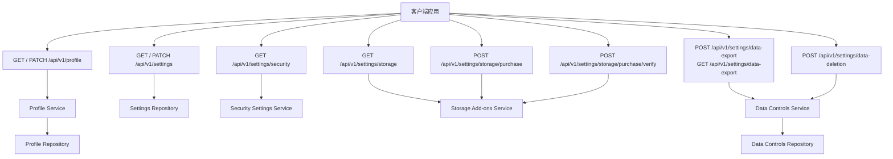
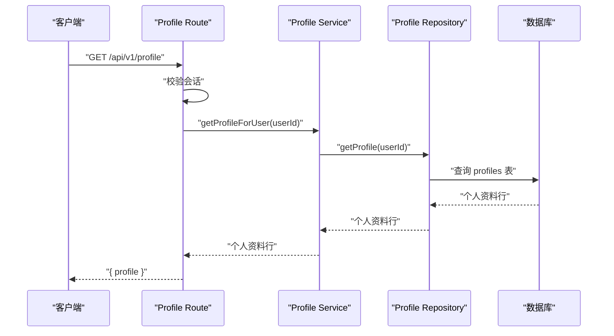
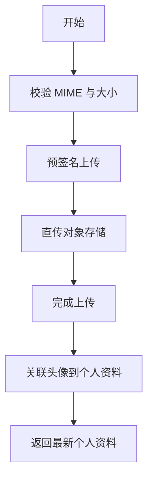
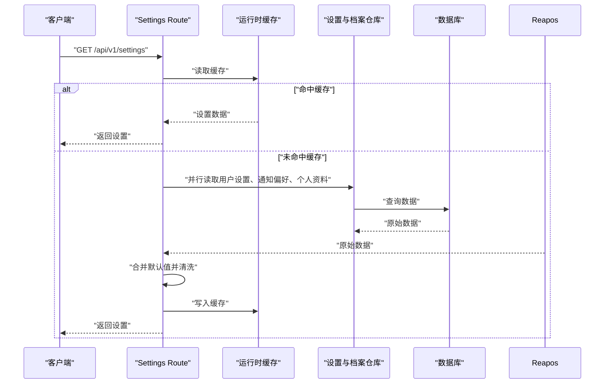
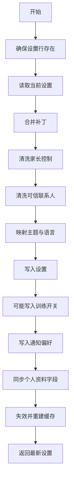
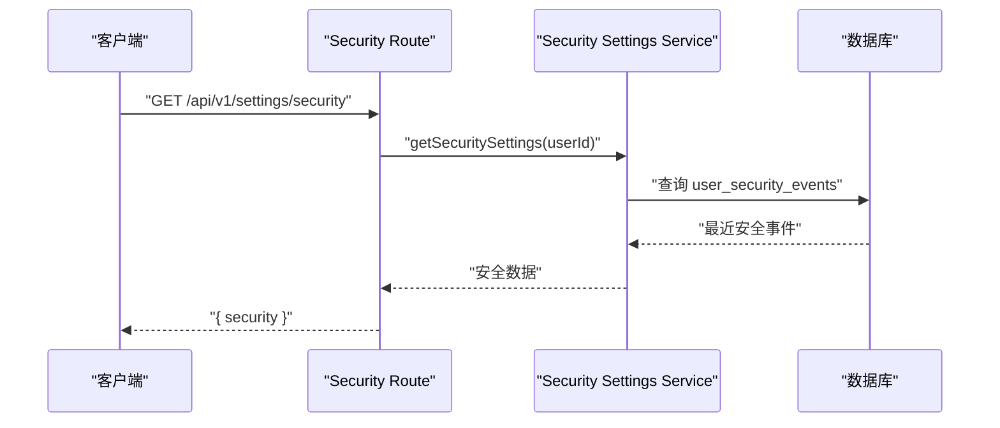
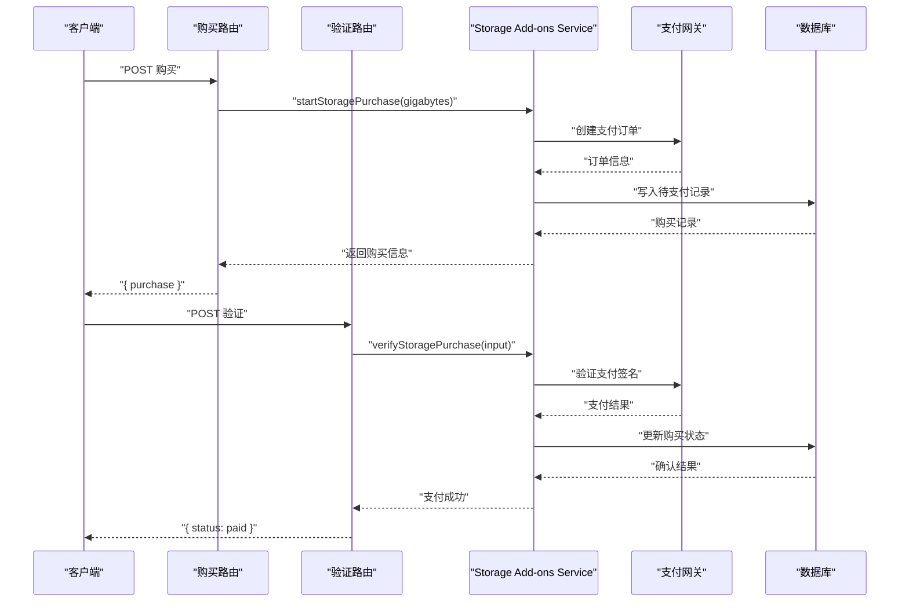
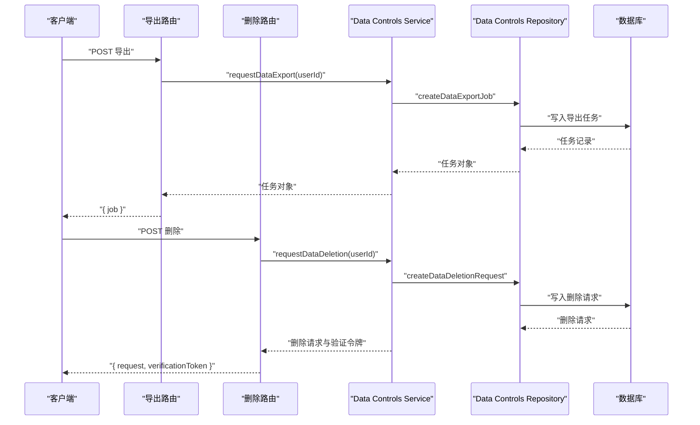
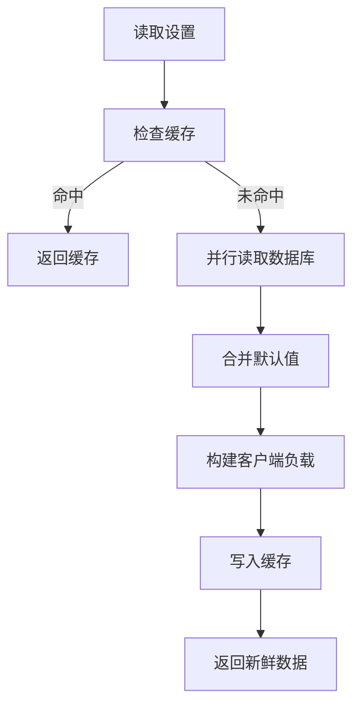

# 用户资料与设置 API

<cite>
**本文引用的文件**   
- [src/app/api/v1/profile/route.ts](file://src/app/api/v1/profile/route.ts)
- [src/shared/lib/api/profile.ts](file://src/shared/lib/api/profile.ts)
- [src/server/services/profile.service.ts](file://src/server/services/profile.service.ts)
- [src/server/repositories/profile.repository.ts](file://src/server/repositories/profile.repository.ts)
- [src/app/api/v1/settings/route.ts](file://src/app/api/v1/settings/route.ts)
- [src/shared/lib/api/settings.ts](file://src/shared/lib/api/settings.ts)
- [src/server/repositories/settings.repository.ts](file://src/server/repositories/settings.repository.ts)
- [src/app/api/v1/settings/security/route.ts](file://src/app/api/v1/settings/security/route.ts)
- [src/server/services/security-settings.service.ts](file://src/server/services/security-settings.service.ts)
- [src/shared/lib/api/settings-extended.ts](file://src/shared/lib/api/settings-extended.ts)
- [src/app/api/v1/settings/storage/route.ts](file://src/app/api/v1/settings/storage/route.ts)
- [src/app/api/v1/settings/storage/purchase/route.ts](file://src/app/api/v1/settings/storage/purchase/route.ts)
- [src/app/api/v1/settings/storage/purchase/verify/route.ts](file://src/app/api/v1/settings/storage/purchase/verify/route.ts)
- [src/server/services/storage-addons.service.ts](file://src/server/services/storage-addons.service.ts)
- [src/server/services/data-controls.service.ts](file://src/server/services/data-controls.service.ts)
- [src/server/repositories/data-controls.repository.ts](file://src/server/repositories/data-controls.repository.ts)
</cite>

## 目录

1. [简介](#简介)
2. [API 总览](#api-总览)
3. [认证与安全要求](#认证与安全要求)
4. [个人资料 API：`/api/v1/profile/*`](#个人资料-apiv1profile)
5. [通用设置 API：`/api/v1/settings`](#通用设置-apiv1settings)
6. [安全设置 API：`/api/v1/settings/security`](#安全设置-apiv1settingssecurity)
7. [存储扩展与购买 API：`/api/v1/settings/storage*`](#存储扩展与购买-apiv1settingsstorage)
8. [数据导出与删除 API：`/api/v1/settings/data-export`、`/api/v1/settings/data-deletion`](#数据导出与删除-apiv1settingsdataexport和apiv1settingsdatadeletion)
9. [隐私保护与 GDPR 合规性](#隐私保护与-gdpr-合规性)
10. [错误码与异常处理](#错误码与异常处理)
11. [完整调用示例](#完整调用示例)
12. [性能与缓存特性](#性能与缓存特性)
13. [故障排查](#故障排查)
14. [结论](#结论)

## 简介

本文档面向后端开发者、前端集成方与合规审计人员，系统化说明本项目的用户资料与设置相关 RESTful API。重点覆盖以下路径：

| 分组 | 基础路径 | 主要能力 |
|---|---|---|
| 个人资料 | `/api/v1/profile` | 查询与更新个人资料、头像上传、可见性开关 |
| 通用设置 | `/api/v1/settings` | 外观、个性化、通知、隐私、能力、时间与专注、反思、安全、家长控制、可信联系人等 |
| 安全设置 | `/api/v1/settings/security` | 查看登录会话与账户安全事件 |
| 存储扩展 | `/api/v1/settings/storage*` | 存储用量、购买扩容、支付验证 |
| 数据控制 | `/api/v1/settings/data-export`、`/api/v1/settings/data-deletion` | 异步数据导出、数据删除请求 |

这些接口统一通过 Next.js App Router 暴露，服务端使用数据库连接池访问 Supabase/PostgreSQL，并通过仓库层与服务层组织数据读写逻辑。

## API 总览



**图表来源**   
- [src/app/api/v1/profile/route.ts:1-91](file://src/app/api/v1/profile/route.ts#L1-L91)
- [src/app/api/v1/settings/route.ts:200-497](file://src/app/api/v1/settings/route.ts#L200-L497)
- [src/app/api/v1/settings/security/route.ts:1-16](file://src/app/api/v1/settings/security/route.ts#L1-L16)
- [src/server/services/profile.service.ts:1-200](file://src/server/services/profile.service.ts#L1-L200)
- [src/server/repositories/profile.repository.ts:1-113](file://src/server/repositories/profile.repository.ts#L1-L113)
- [src/server/repositories/settings.repository.ts:1-116](file://src/server/repositories/settings.repository.ts#L1-L116)
- [src/server/services/security-settings.service.ts:1-46](file://src/server/services/security-settings.service.ts#L1-L46)
- [src/server/services/storage-addons.service.ts:1-200](file://src/server/services/storage-addons.service.ts#L1-L200)
- [src/server/services/data-controls.service.ts:1-46](file://src/server/services/data-controls.service.ts#L1-L46)
- [src/server/repositories/data-controls.repository.ts:1-101](file://src/server/repositories/data-controls.repository.ts#L1-L101)

**章节来源**   
- [src/app/api/v1/profile/route.ts:1-91](file://src/app/api/v1/profile/route.ts#L1-L91)
- [src/app/api/v1/settings/route.ts:200-497](file://src/app/api/v1/settings/route.ts#L200-L497)

## 认证与安全要求

| 项目 | 行为 |
|---|---|
| 认证方式 | 所有 `/api/v1/profile/*` 与 `/api/v1/settings/*` 端点均要求已登录会话 |
| 会话校验 | 路由通过 `withApiHandler` 包装并启用 `requireAuth: true`，内部调用 `requireSession(session)` 提取当前用户 |
| 身份隔离 | 所有查询与写入均基于当前用户的 ID，不允许跨用户读取或修改 |
| 输入校验 | 用户名、头像形状、布尔字段、邮箱、内容过滤值、每日限额等均做类型与白名单校验 |
| 敏感数据 | 安全事件返回最近最多 25 条记录；删除请求会生成一次性验证令牌哈希 |
| 数据导出 | 以异步任务形式创建导出作业，支持按工作区与导出类型筛选 |
| 数据删除 | 创建删除请求后，会清理用户 Cookie 数据；验证令牌哈希持久化，原始令牌仅服务端流程中使用 |

需要特别注意：

- 所有写操作都依赖有效会话；未登录请求会被认证层拦截。
- 个人资料更新与设置更新都会触发必要的数据库写入与缓存失效。
- 头像上传先走预签名直传，再完成上传并关联到用户资料，避免将大文件直接经业务服务器转发。

**章节来源**   
- [src/app/api/v1/profile/route.ts:1-91](file://src/app/api/v1/profile/route.ts#L1-L91)
- [src/app/api/v1/settings/route.ts:200-497](file://src/app/api/v1/settings/route.ts#L200-L497)
- [src/app/api/v1/settings/security/route.ts:1-16](file://src/app/api/v1/settings/security/route.ts#L1-L16)
- [src/server/services/data-controls.service.ts:1-46](file://src/server/services/data-controls.service.ts#L1-L46)

## 个人资料 API：`/api/v1/profile/*`

### GET `/api/v1/profile`

获取当前登录用户的个人资料。

| 项目 | 说明 |
|---|---|
| HTTP 方法 | `GET` |
| URL | `/api/v1/profile` |
| 认证 | 必需 |
| 请求参数 | 无 |
| 成功响应 | `{ profile }` |
| 典型错误 | 未认证、服务异常 |

#### 响应字段

| 字段 | 类型 | 含义 |
|---|---|---|
| `profile.id` | `string | null` | 用户 ID |
| `profile.email` | `string | null` | 邮箱 |
| `profile.fullName` | `string | null` | 显示名称 |
| `profile.preferredName` | `string | null` | 偏好称呼 |
| `profile.username` | `string | null` | 公开用户名 |
| `profile.avatarUrl` | `string | null` | 头像地址 |
| `profile.avatarShape` | `string` | 头像形状，默认圆角 |
| `profile.visibility.usageStatistics` | `boolean` | 是否展示使用统计 |
| `profile.visibility.activityGraph` | `boolean` | 是否展示活动图 |
| `profile.visibility.topPlugins` | `boolean` | 是否展示热门插件 |
| `profile.visibility.insights` | `boolean` | 是否展示洞察 |

#### 业务流程



**图表来源**   
- [src/app/api/v1/profile/route.ts:24-41](file://src/app/api/v1/profile/route.ts#L24-L41)
- [src/server/services/profile.service.ts:15-22](file://src/server/services/profile.service.ts#L15-L22)
- [src/server/repositories/profile.repository.ts:27-34](file://src/server/repositories/profile.repository.ts#L27-L34)

### PATCH `/api/v1/profile`

更新个人资料与隐私可见性。

| 项目 | 说明 |
|---|---|
| HTTP 方法 | `PATCH` |
| URL | `/api/v1/profile` |
| 认证 | 必需 |
| 请求体 | 可选字段对象 |
| 成功响应 | `{ profile }` |
| 典型错误 | 用户名无效、用户名已被占用、头像形状无效、字段类型非法 |

#### 可更新字段

| 字段 | 类型 | 是否必填 | 约束 |
|---|---|---:|---|
| `fullName` | `string` | 否 | 修剪空白，同步到个性化设置 |
| `preferredName` | `string` | 否 | 修剪空白，作为昵称 |
| `occupation` | `string` | 否 | 职业信息 |
| `avatarFileId` | `string` | 否 | 上传完成的文件 ID |
| `username` | `string` | 否 | 小写字母、数字、下划线，长度 3–32 |
| `avatarShape` | `string` | 否 | 必须为支持的形状值 |
| `showUsageStatistics` | `boolean` | 否 | 使用统计可见性 |
| `showActivityGraph` | `boolean` | 否 | 活动图可见性 |
| `showTopPlugins` | `boolean` | 否 | 热门插件可见性 |
| `showInsights` | `boolean` | 否 | 洞察可见性 |

#### 字段校验规则

- 非字符串的 `username` 会返回 400 错误。
- 非字符串的 `avatarShape` 会返回 400 错误。
- 四个可见性布尔字段若传入，则必须是布尔类型。
- 用户名正则不匹配时抛出业务错误。
- 用户名冲突时返回 409 冲突错误。

#### 头像更新流程



**图表来源**   
- [src/shared/lib/api/profile.ts:25-98](file://src/shared/lib/api/profile.ts#L25-L98)
- [src/server/services/profile.service.ts:120-200](file://src/server/services/profile.service.ts#L120-L200)

**章节来源**   
- [src/app/api/v1/profile/route.ts:43-91](file://src/app/api/v1/profile/route.ts#L43-L91)
- [src/shared/lib/api/profile.ts:1-98](file://src/shared/lib/api/profile.ts#L1-L98)
- [src/server/services/profile.service.ts:100-200](file://src/server/services/profile.service.ts#L100-L200)
- [src/server/repositories/profile.repository.ts:36-113](file://src/server/repositories/profile.repository.ts#L36-L113)

## 通用设置 API：`/api/v1/settings`

### GET `/api/v1/settings`

获取当前用户的完整设置聚合数据。

| 项目 | 说明 |
|---|---|
| HTTP 方法 | `GET` |
| URL | `/api/v1/settings` |
| 认证 | 必需 |
| 请求参数 | 无 |
| 成功响应 | `AppSettings` |
| 典型错误 | 数据库读取失败时返回默认值，不会返回 500 |

#### 响应结构

| 顶层字段 | 类型 | 含义 |
|---|---|---|
| `general` | `GeneralSettings` | 外观、字体、语言、语音、侧边栏宽度等 |
| `personalization` | `PersonalizationSettings` | 人格、语气、自定义指令、个人描述、搜索与推理开关 |
| `notifications` | `NotificationSettings` | 桌面提醒、音效、消息通道 |
| `privacy` | `PrivacySettings` | 位置元数据、模型改进帮助 |
| `capabilities` | `CapabilitiesSettings` | 记忆生成、可视化、代码执行、网络出口等 |
| `timeAndFocus` | `TimeAndFocusSettings` | 休息提醒、安静时段、工作日开关 |
| `reflect` | `ReflectSettings` | 反思范围 |
| `safety` | `SafetySettings` | 敏感内容减少、MFA 状态 |
| `parentalControls` | `ParentalControlsSettings` | 家长控制 |
| `trustedContact` | `TrustedContactSettings` | 可信联系人 |
| `claw` | `{ deployments }` | 部署列表 |

#### 默认值合并策略

服务端对每个设置分区维护默认值，并将数据库中已保存的值合并进去。这样即使旧版本或空配置也能返回可用 UI。

#### 读取流程



**图表来源**   
- [src/app/api/v1/settings/route.ts:200-306](file://src/app/api/v1/settings/route.ts#L200-L306)
- [src/server/repositories/settings.repository.ts:33-65](file://src/server/repositories/settings.repository.ts#L33-L65)
- [src/server/repositories/profile.repository.ts:27-34](file://src/server/repositories/profile.repository.ts#L27-L34)

### PATCH `/api/v1/settings`

部分更新用户设置。

| 项目 | 说明 |
|---|---|
| HTTP 方法 | `PATCH` |
| URL | `/api/v1/settings` |
| 认证 | 必需 |
| 请求体 | 任意设置分区的部分更新对象 |
| 成功响应 | 最新 `AppSettings` |
| 典型错误 | 无效家长控制字段、无效可信联系人字段、支付环境不可用（在存储购买链路中） |

#### 支持更新的设置分区

| 分区 | 关键行为 |
|---|---|
| `general` | 自动限制侧边栏宽度，映射主题与语言 |
| `personalization` | 清洗自定义指令；姓名、昵称、职业会同步到个人资料 |
| `notifications` | 写入通知通道与桌面提醒开关 |
| `privacy` | 训练优化开关可能同步到底层列 |
| `capabilities` | 功能开关 |
| `timeAndFocus` | 时间管理与安静日 |
| `reflect` | 反思范围 |
| `safety` | 安全选项 |
| `parentalControls` | 白名单过滤、邮箱清洗、关系枚举校验 |
| `trustedContact` | 邮箱清洗、关系枚举校验 |
| `claw` | 部署配置 |

#### 写入流程



**图表来源**   
- [src/app/api/v1/settings/route.ts:308-497](file://src/app/api/v1/settings/route.ts#L308-L497)
- [src/server/repositories/settings.repository.ts:67-116](file://src/server/repositories/settings.repository.ts#L67-L116)

**章节来源**   
- [src/app/api/v1/settings/route.ts:1-497](file://src/app/api/v1/settings/route.ts#L1-L497)
- [src/shared/lib/api/settings.ts:1-158](file://src/shared/lib/api/settings.ts#L1-L158)
- [src/server/repositories/settings.repository.ts:1-116](file://src/server/repositories/settings.repository.ts#L1-L116)

## 安全设置 API：`/api/v1/settings/security`

### GET `/api/v1/settings/security`

获取当前用户的安全事件与活跃会话历史。

| 项目 | 说明 |
|---|---|
| HTTP 方法 | `GET` |
| URL | `/api/v1/settings/security` |
| 认证 | 必需 |
| 请求参数 | 无 |
| 成功响应 | `{ security }` |
| 典型错误 | 未认证、数据库查询失败 |

#### 响应字段

| 字段 | 类型 | 含义 |
|---|---|---|
| `security.sessions` | 数组 | 最近安全事件列表 |
| `sessions[].id` | `string` | 事件 ID |
| `sessions[].eventType` | `string` | 事件类型 |
| `sessions[].ipAddress` | `string \| null` | 客户端 IP |
| `sessions[].userAgent` | `string \| null` | 浏览器或客户端标识 |
| `sessions[].createdAt` | `string` | 创建时间 |

#### 实现要点

- 最多返回最近 25 条记录。
- IP 地址会通过主机解析函数处理。
- 元数据以 JSON 对象形式返回。
- 该接口只读，不改变任何用户状态。



**图表来源**   
- [src/app/api/v1/settings/security/route.ts:1-16](file://src/app/api/v1/settings/security/route.ts#L1-L16)
- [src/server/services/security-settings.service.ts:1-46](file://src/server/services/security-settings.service.ts#L1-L46)

**章节来源**   
- [src/app/api/v1/settings/security/route.ts:1-16](file://src/app/api/v1/settings/security/route.ts#L1-L16)
- [src/server/services/security-settings.service.ts:1-46](file://src/server/services/security-settings.service.ts#L1-L46)

## 存储扩展与购买 API：`/api/v1/settings/storage*`

### GET `/api/v1/settings/storage`

获取用户存储空间摘要。

| 项目 | 说明 |
|---|---|
| HTTP 方法 | `GET` |
| URL | `/api/v1/settings/storage` |
| 认证 | 必需 |
| 请求参数 | 无 |
| 成功响应 | `{ storage }` |
| 典型错误 | 订阅信息缺失、存储表不存在时降级 |

#### 响应字段

| 字段 | 类型 | 含义 |
|---|---|---|
| `storage.usedBytes` | `number` | 已使用字节数 |
| `storage.quotaBytes` | `number` | 配额字节数 |
| `storage.includedBytes` | `number` | 套餐包含字节数 |
| `storage.includedGb` | `number` | 套餐包含 GB |
| `storage.extraGb` | `number` | 额外购买 GB |
| `storage.planId` | `string` | 计划 ID |
| `storage.tier` | `string` | 套餐层级 |
| `storage.priceUsdPerGb` | `number` | 每 GB 美元价格 |
| `storage.usdInrRate` | `number` | 美元兑卢比汇率 |
| `storage.categories` | 数组 | 文件分类统计 |
| `storage.purchases` | 数组 | 历史购买记录 |

### POST `/api/v1/settings/storage/purchase`

发起存储扩容购买。

| 项目 | 说明 |
|---|---|
| HTTP 方法 | `POST` |
| URL | `/api/v1/settings/storage/purchase` |
| 认证 | 必需 |
| 请求体 | `{ gigabytes: number }` |
| 成功响应 | `{ purchase }` |
| 典型错误 | 数量无效、支付不可用、超出扩容上限、购买记录写入失败 |

#### 请求字段

| 字段 | 类型 | 必填 | 约束 |
|---|---|---:|---|
| `gigabytes` | `number` | 是 | 必须在允许范围内，且不超过账户累计上限 |

#### 响应字段

| 字段 | 类型 | 含义 |
|---|---|---|
| `purchase.id` | `string` | 购买单 ID |
| `purchase.gigabytes` | `number` | 购买的 GB |
| `purchase.amountPaise` | `number` | 金额单位 |
| `purchase.amountUsdMicros` | `number` | 美元微单位金额 |
| `purchase.currency` | `"INR"` | 货币 |
| `purchase.keyId` | `string` | 支付密钥 ID |
| `purchase.orderId` | `string` | 第三方支付订单 ID |
| `purchase.priceUsdPerGb` | `number` | 单价 |

### POST `/api/v1/settings/storage/purchase/verify`

验证存储购买结果。

| 项目 | 说明 |
|---|---|
| HTTP 方法 | `POST` |
| URL | `/api/v1/settings/storage/purchase/verify` |
| 认证 | 必需 |
| 请求体 | 支付回调所需字段 |
| 成功响应 | `{ status, extraGb, gigabytes }` |
| 典型错误 | 支付不可用、签名验证失败、购买记录不存在 |

#### 业务流程



**图表来源**   
- [src/app/api/v1/settings/storage/purchase/route.ts](file://src/app/api/v1/settings/storage/purchase/route.ts)
- [src/app/api/v1/settings/storage/purchase/verify/route.ts](file://src/app/api/v1/settings/storage/purchase/verify/route.ts)
- [src/server/services/storage-addons.service.ts:1-200](file://src/server/services/storage-addons.service.ts#L1-L200)

**章节来源**   
- [src/shared/lib/api/settings-extended.ts:1-107](file://src/shared/lib/api/settings-extended.ts#L1-L107)
- [src/app/api/v1/settings/storage/route.ts](file://src/app/api/v1/settings/storage/route.ts)
- [src/app/api/v1/settings/storage/purchase/route.ts](file://src/app/api/v1/settings/storage/purchase/route.ts)
- [src/app/api/v1/settings/storage/purchase/verify/route.ts](file://src/app/api/v1/settings/storage/purchase/verify/route.ts)
- [src/server/services/storage-addons.service.ts:1-200](file://src/server/services/storage-addons.service.ts#L1-L200)

## 数据导出与删除 API：`/api/v1/settings/data-export` 和 `/api/v1/settings/data-deletion`

### POST `/api/v1/settings/data-export`

申请导出数据。

| 项目 | 说明 |
|---|---|
| HTTP 方法 | `POST` |
| URL | `/api/v1/settings/data-export` |
| 认证 | 必需 |
| 请求体 | 通常为空或可选作用域字段 |
| 成功响应 | `{ job: { id, status } }` |
| 典型错误 | 队列创建失败 |

#### 行为说明

- 导出任务初始状态为排队。
- 支持按工作区和导出类型创建任务。
- 实际打包与下载由后台任务或后续接口处理。

### GET `/api/v1/settings/data-export`

列出当前用户的数据导出任务。

| 项目 | 说明 |
|---|---|
| HTTP 方法 | `GET` |
| URL | `/api/v1/settings/data-export` |
| 认证 | 必需 |
| 请求参数 | 无 |
| 成功响应 | `{ jobs: Array<{ id, status }> }` |
| 典型错误 | 未认证、数据库查询失败 |

### POST `/api/v1/settings/data-deletion`

申请删除数据。

| 项目 | 说明 |
|---|---|
| HTTP 方法 | `POST` |
| URL | `/api/v1/settings/data-deletion` |
| 认证 | 必需 |
| 请求体 | 可选作用域字段 |
| 成功响应 | `{ request: { id, status }, verificationToken }` |
| 典型错误 | 删除请求创建失败 |

#### 行为说明

- 删除请求会生成一次性验证令牌哈希。
- 创建成功后会清理用户 Cookie 数据。
- 当前开发流程会返回验证令牌供调试；生产环境中应通过邮件或安全流程完成验证。
- 删除请求持久化后可由后台流程执行最终删除。



**图表来源**   
- [src/server/services/data-controls.service.ts:1-46](file://src/server/services/data-controls.service.ts#L1-L46)
- [src/server/repositories/data-controls.repository.ts:1-101](file://src/server/repositories/data-controls.repository.ts#L1-L101)

**章节来源**   
- [src/shared/lib/api/settings-extended.ts:72-107](file://src/shared/lib/api/settings-extended.ts#L72-L107)
- [src/server/services/data-controls.service.ts:1-46](file://src/server/services/data-controls.service.ts#L1-L46)
- [src/server/repositories/data-controls.repository.ts:1-101](file://src/server/repositories/data-controls.repository.ts#L1-L101)

## 隐私保护与 GDPR 合规性

| 合规维度 | 实现情况 |
|---|---|
| 最小必要数据 | 个人资料只暴露必要字段；头像 URL 通过服务层统一解析 |
| 用户可控隐私 | 提供使用统计、活动图、热门插件、洞察等可见性开关 |
| 训练数据选择权 | 隐私设置中的“帮助改进模型”可影响底层训练开关列 |
| 数据导出权 | 支持异步导出，保留任务 ID、状态与作用域 |
| 数据删除权 | 支持删除请求，附带验证令牌哈希与工作区范围 |
| 会话透明性 | 提供最近安全事件查询，便于用户发现异常登录 |
| 输入净化 | 自定义指令、短文本、邮箱、枚举值均经过清洗 |
| 缓存一致性 | 设置变更后主动失效并重建缓存，避免长期不一致 |
| 错误容错 | 设置读取失败返回默认值，保证界面可用 |

GDPR 建议结合现有实现补充以下流程：

1. **导出下载接口**：目前导出任务已持久化，但文档中未发现直接的下载路由；应在后端增加按任务 ID 和用户 ID 鉴权的下载接口。
2. **删除执行接口**：删除请求已持久化，但未见直接执行删除的路由；应由后台任务根据状态机完成最终删除。
3. **撤销同意机制**：训练开关已有底层列支持，应提供明确的用户界面与审计日志。
4. **数据保留策略**：导出任务与删除请求应有过期清理策略，避免无限增长。
5. **第三方共享记录**：若头像、支付或安全事件涉及外部系统，应补充数据流转说明。

**章节来源**   
- [src/server/services/profile.service.ts:100-200](file://src/server/services/profile.service.ts#L100-L200)
- [src/app/api/v1/settings/route.ts:308-497](file://src/app/api/v1/settings/route.ts#L308-L497)
- [src/server/services/data-controls.service.ts:1-46](file://src/server/services/data-controls.service.ts#L1-L46)
- [src/server/repositories/data-controls.repository.ts:1-101](file://src/server/repositories/data-controls.repository.ts#L1-L101)

## 错误码与异常处理

### 通用错误模式

| 场景 | HTTP 状态码 | 错误语义 |
|---|---:|---|
| 字段类型非法 | 400 | 请求体字段类型不符合预期 |
| 用户名无效 | 400 | 用户名格式不合法 |
| 用户名已被占用 | 409 | 用户名冲突 |
| 头像形状无效 | 400 | 头像形状不在支持集合中 |
| 存储扩容数量无效 | 400 | 超出允许范围 |
| 存储扩容超限 | 400 | 超过账户累计扩容上限 |
| 支付不可用 | 503 | 支付网关或配置不可用 |
| 存储功能不可用 | 503 | 存储附加功能尚未就绪 |
| 导出队列失败 | 500 | 无法创建导出任务 |
| 删除请求失败 | 500 | 无法创建删除请求 |
| 数据库读取失败 | 200 | 设置读取失败时返回默认值，不中断 UI |

### 关键字段校验错误

| 字段 | 错误原因 | 处理方式 |
|---|---|---|
| `username` | 不是字符串 | 返回 400 |
| `username` | 不符合正则 | 返回 400 |
| `username` | 已被占用 | 返回 409 |
| `avatarShape` | 不是字符串 | 返回 400 |
| `avatarShape` | 不在白名单 | 返回 400 |
| `showUsageStatistics` | 不是布尔值 | 返回 400 |
| `showActivityGraph` | 不是布尔值 | 返回 400 |
| `showTopPlugins` | 不是布尔值 | 返回 400 |
| `showInsights` | 不是布尔值 | 返回 400 |
| `gigabytes` | 无效数值 | 返回 400 |
| `contentFilter` | 不在白名单 | 被忽略或返回校验错误 |
| `dailyLimit` | 不在白名单 | 被忽略或返回校验错误 |
| `relationship` | 不在白名单 | 被忽略或返回校验错误 |

### 头像上传错误

| 场景 | 错误来源 | 行为 |
|---|---|---|
| MIME 不支持 | 客户端 | 阻止上传 |
| 文件大小超过 2 MB | 客户端 | 阻止上传 |
| 直传失败 | 对象存储 | 返回上传失败 |
| 完成上传失败 | 后端 | 返回上传失败 |
| 关联头像失败 | 后端 | 由服务层抛出业务错误 |

**章节来源**   
- [src/app/api/v1/profile/route.ts:43-91](file://src/app/api/v1/profile/route.ts#L43-L91)
- [src/server/services/profile.service.ts:120-200](file://src/server/services/profile.service.ts#L120-L200)
- [src/shared/lib/api/profile.ts:25-98](file://src/shared/lib/api/profile.ts#L25-L98)
- [src/server/services/storage-addons.service.ts:120-200](file://src/server/services/storage-addons.service.ts#L120-L200)
- [src/server/services/data-controls.service.ts:1-46](file://src/server/services/data-controls.service.ts#L1-L46)

## 完整调用示例

### 示例一：获取个人资料

```http
GET /api/v1/profile
Authorization: Bearer <token>
```

响应示例：

```json
{
  "profile": {
    "id": "用户ID",
    "email": "用户邮箱",
    "fullName": "显示名称",
    "preferredName": "偏好称呼",
    "username": "公开用户名",
    "avatarUrl": "头像URL",
    "avatarShape": "circle",
    "visibility": {
      "usageStatistics": true,
      "activityGraph": true,
      "topPlugins": true,
      "insights": true
    }
  }
}
```

### 示例二：更新个人资料

```http
PATCH /api/v1/profile
Content-Type: application/json
Authorization: Bearer <token>

{
  "fullName": "新显示名称",
  "preferredName": "昵称",
  "occupation": "工程师",
  "username": "new_username",
  "avatarShape": "squircle",
  "showUsageStatistics": false,
  "showActivityGraph": true,
  "showTopPlugins": false,
  "showInsights": true
}
```

### 示例三：上传头像

```http
POST /api/v1/files/presign
Content-Type: application/json
Authorization: Bearer <token>

{
  "originalName": "avatar.png",
  "mimeType": "image/png",
  "sizeBytes": 102400,
  "purpose": "avatar"
}
```

然后按照预签名地址直传对象存储，完成后调用：

```http
POST /api/v1/files/complete
Content-Type: application/json
Authorization: Bearer <token>

{
  "fileId": "文件ID",
  "sizeBytes": 102400
}
```

最后重新拉取个人资料即可看到新头像。

### 示例四：获取设置

```http
GET /api/v1/settings
Authorization: Bearer <token>
```

### 示例五：更新个性化设置

```http
PATCH /api/v1/settings
Content-Type: application/json
Authorization: Bearer <token>

{
  "personalization": {
    "customInstructions": "你是一个专业的技术助手。",
    "fullName": "张三",
    "nickname": "小张",
    "occupation": "软件工程师",
    "webSearch": true,
    "extendedThinking": false
  },
  "general": {
    "appearancePreset": "Dark",
    "language": "zh-CN",
    "sidebarWidth": 300
  }
}
```

### 示例六：查询安全设置

```http
GET /api/v1/settings/security
Authorization: Bearer <token>
```

### 示例七：查询存储摘要

```http
GET /api/v1/settings/storage
Authorization: Bearer <token>
```

### 示例八：购买存储扩容

```http
POST /api/v1/settings/storage/purchase
Content-Type: application/json
Authorization: Bearer <token>

{
  "gigabytes": 10
}
```

### 示例九：验证支付

```http
POST /api/v1/settings/storage/purchase/verify
Content-Type: application/json
Authorization: Bearer <token>

{
  "purchaseId": "购买ID",
  "razorpayOrderId": "支付订单ID",
  "razorpayPaymentId": "支付ID",
  "razorpaySignature": "签名"
}
```

### 示例十：申请数据导出

```http
POST /api/v1/settings/data-export
Authorization: Bearer <token>
```

### 示例十一：列出数据导出任务

```http
GET /api/v1/settings/data-export
Authorization: Bearer <token>
```

### 示例十二：申请数据删除

```http
POST /api/v1/settings/data-deletion
Authorization: Bearer <token>
```

**章节来源**   
- [src/shared/lib/api/profile.ts:1-98](file://src/shared/lib/api/profile.ts#L1-L98)
- [src/shared/lib/api/settings.ts:1-158](file://src/shared/lib/api/settings.ts#L1-L158)
- [src/shared/lib/api/settings-extended.ts:1-107](file://src/shared/lib/api/settings-extended.ts#L1-L107)

## 性能与缓存特性

| 特性 | 说明 |
|---|---|
| 设置缓存 | 读取设置时会尝试从运行时缓存命中，避免每次请求都查库 |
| 写入后刷新 | 设置更新后会失效旧缓存并写入新缓存 |
| 并发读取 | 设置 GET 并行读取用户设置、通知偏好和个人资料 |
| 默认值回退 | 设置读取失败时返回默认值，保证 UI 可用性 |
| 头像解析集中化 | 头像 URL 通过服务层统一解析，避免重复逻辑 |
| 用户名规范化 | 用户名转换为小写并严格校验，降低索引与比对成本 |
| 侧边栏宽度限制 | 侧边栏宽度会被限制在合理区间 |
| 自定义指令清洗 | 自定义指令会进行安全清洗，防止注入风险 |



**图表来源**   
- [src/app/api/v1/settings/route.ts:200-306](file://src/app/api/v1/settings/route.ts#L200-L306)

**章节来源**   
- [src/app/api/v1/settings/route.ts:200-497](file://src/app/api/v1/settings/route.ts#L200-L497)
- [src/server/services/profile.service.ts:15-31](file://src/server/services/profile.service.ts#L15-L31)

## 故障排查

| 问题 | 可能原因 | 排查建议 |
|---|---|---|
| 个人资料更新后头像未变化 | 未完成预签名上传或未完成上传 | 检查预签名上传与完成上传流程 |
| 用户名更新失败 | 用户名格式错误或已被占用 | 检查用户名正则与冲突错误 |
| 头像形状无效 | 传入值不在支持集合中 | 只使用 `circle`、`squircle`、`rounded`、`oval`、`scallop` |
| 设置读取返回空 | 数据库读取失败 | 检查数据库连接与 `user_settings` 表 |
| 设置写入后仍显示旧值 | 缓存未失效 | 检查写入路径是否调用缓存失效 |
| 存储购买失败 | 支付未配置或密钥缺失 | 检查支付配置与公共密钥 |
| 存储购买验证失败 | 支付签名错误或订单不存在 | 核对支付回调参数 |
| 导出任务一直排队 | 后台任务未消费 | 检查调度器与导出队列消费者 |
| 删除请求无后续动作 | 生产环境验证与执行流程未接入 | 检查邮件验证与删除执行任务 |
| 安全事件为空 | 近期无安全事件 | 这是正常现象，不代表接口异常 |

**章节来源**   
- [src/app/api/v1/profile/route.ts:43-91](file://src/app/api/v1/profile/route.ts#L43-L91)
- [src/server/services/profile.service.ts:120-200](file://src/server/services/profile.service.ts#L120-L200)
- [src/app/api/v1/settings/route.ts:308-497](file://src/app/api/v1/settings/route.ts#L308-L497)
- [src/server/services/storage-addons.service.ts:120-200](file://src/server/services/storage-addons.service.ts#L120-L200)
- [src/server/services/data-controls.service.ts:1-46](file://src/server/services/data-controls.service.ts#L1-L46)

## 结论

本项目在用户资料与设置方面提供了较为完整的 API 体系：

- 个人资料支持基本信息、用户名、头像、可见性开关更新。
- 通用设置覆盖外观、个性化、通知、隐私、能力、时间管理、安全、家长控制与可信联系人。
- 安全设置提供最近安全事件查询。
- 存储扩展支持用量查询、购买与支付验证。
- 数据导出与删除具备任务化基础设施，适合对接后台处理与审计流程。

从合规角度，现有实现已具备数据导出、数据删除、隐私开关、会话审计与输入清洗的基础，但仍需完善：

1. 导出任务的下载接口。
2. 删除请求的执行接口。
3. 更明确的同意撤销与审计记录。
4. 导出与删除任务的过期清理。
5. 更详细的错误响应结构，以便客户端精确提示。

建议在后续迭代中优先补齐导出下载与删除执行两个端点，使“查看数据、导出数据、删除数据”的权利闭环完整落地。