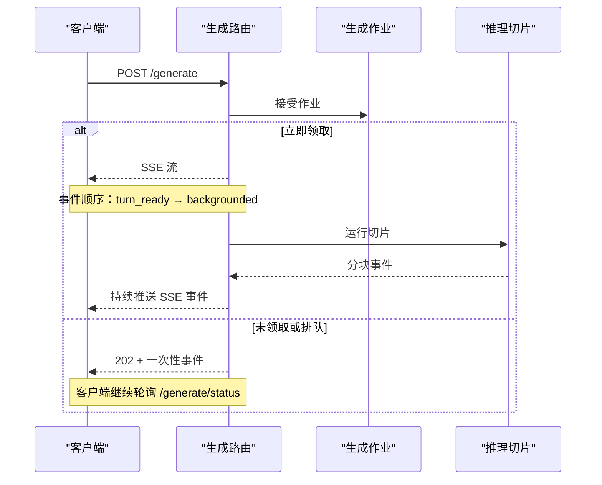

# 聊天 API

<cite>
**本文引用的文件**   
- [src/app/api/v1/chats/route.ts](file://src/app/api/v1/chats/route.ts)
- [src/app/api/v1/chats/[chatId]/route.ts](file://src/app/api/v1/chats/[chatId]/route.ts)
- [src/app/api/v1/chats/[chatId]/messages/route.ts](file://src/app/api/v1/chats/[chatId]/messages/route.ts)
- [src/app/api/v1/chats/[chatId]/generate/route.ts](file://src/app/api/v1/chats/[chatId]/generate/route.ts)
- [src/app/api/v1/chats/[chatId]/live/route.ts](file://src/app/api/v1/chats/[chatId]/live/route.ts)
- [src/app/api/v1/chats/search/route.ts](file://src/app/api/v1/chats/search/route.ts)
- [src/app/api/v1/chats/generating/route.ts](file://src/app/api/v1/chats/generating/route.ts)
- [src/app/api/v1/chats/[chatId]/generate/status/route.ts](file://src/app/api/v1/chats/[chatId]/generate/status/route.ts)
- [src/app/api/v1/chats/[chatId]/generate/stop/route.ts](file://src/app/api/v1/chats/[chatId]/generate/stop/route.ts)
- [src/app/api/v1/chats/[chatId]/branches/route.ts](file://src/app/api/v1/chats/[chatId]/branches/route.ts)
- [src/app/api/v1/chats/[chatId]/archive/route.ts](file://src/app/api/v1/chats/[chatId]/archive/route.ts)
- [src/app/api/v1/chats/[chatId]/unarchive/route.ts](file://src/app/api/v1/chats/[chatId]/unarchive/route.ts)
- [src/app/api/v1/chats/[chatId]/pin/route.ts](file://src/app/api/v1/chats/[chatId]/pin/route.ts)
- [src/app/api/v1/chats/[chatId]/share/route.ts](file://src/app/api/v1/chats/[chatId]/share/route.ts)
- [src/app/api/v1/chats/[chatId]/title/route.ts](file://src/app/api/v1/chats/[chatId]/title/route.ts)
- [src/app/api/v1/chats/[chatId]/transcript/route.ts](file://src/app/api/v1/chats/[chatId]/transcript/route.ts)
</cite>

## 目录
1. [简介](#简介)
2. [项目结构与路由总览](#项目结构与路由总览)
3. [通用约定](#通用约定)
4. [端点清单与详细文档](#端点清单与详细文档)
5. [流式 SSE 协议说明](#流式-sse-协议说明)
6. [分页机制](#分页机制)
7. [认证、权限与速率限制](#认证权限与速率限制)
8. [常见使用场景与 curl 示例](#常见使用场景与-curl-示例)
9. [错误码与故障排查](#错误码与故障排查)
10. [性能与可靠性建议](#性能与可靠性建议)
11. [结论](#结论)

## 简介
本文件面向调用方，系统化记录 `src/app/api/v1/chats` 下所有聊天相关 RESTful 接口。内容覆盖：
- 聊天会话管理：创建、查询、更新、归档、取消归档、删除、置顶、分享。
- 消息管理：发送用户消息、读取消息历史。
- 生成与实时通信：启动后台推理、轮询状态、停止生成、轮询活跃消息流。
- 分支聊天：切换可见分支。
- 搜索：按关键词检索消息并返回命中片段。
- 导出：以 JSONL 或结构化 JSON 导出对话转录。

这些接口基于 Next.js App Router 实现，统一通过 `withApiHandler` / `withApiRouteParams` 注入会话、校验身份、封装成功响应体 `{ data }`。

## 项目结构与路由总览

```mermaid
graph TB
  Root["/api/v1/chats"] --> ListCreate["GET/POST<br/>列表与创建会话"]
  Root --> Search["GET /search<br/>消息全文搜索"]
  Root --> Generating["GET /generating<br/>正在生成的会话 ID 列表"]
  Chat["/api/v1/chats/{chatId}"] --> GetPatchDelete["GET/PATCH/DELETE<br/>获取最近消息、更新元数据、删除"]
  Chat --> Messages["/messages<br/>消息分页 GET、发送 POST"]
  Chat --> Generate["/generate<br/>启动生成（SSE）"]
  Chat --> GenStatus["/generate/status<br/>生成状态轮询"]
  Chat --> GenStop["/generate/stop<br/>停止生成"]
  Chat --> Live["/live<br/>活跃消息流轮询"]
  Chat --> Branches["/branches<br/>切换分支"]
  Chat --> Archive["/archive<br/>归档"]
  Chat --> Unarchive["/unarchive<br/>取消归档"]
  Chat --> Pin["/pin<br/>置顶/取消置顶"]
  Chat --> Share["/share<br/>分享链接"]
  Chat --> Title["/title<br/>自动生成标题"]
  Chat --> Transcript["/transcript<br/>导出 JSONL/JSON"]
```


**图表来源**
- [src/app/api/v1/chats/route.ts:11-48](file://src/app/api/v1/chats/route.ts#L11-L48)
- [src/app/api/v1/chats/[chatId]/route.ts:15-78](file://src/app/api/v1/chats/[chatId]/route.ts#L15-L78)
- [src/app/api/v1/chats/[chatId]/messages/route.ts:19-76](file://src/app/api/v1/chats/[chatId]/messages/route.ts#L19-L76)
- [src/app/api/v1/chats/[chatId]/generate/route.ts:63-272](file://src/app/api/v1/chats/[chatId]/generate/route.ts#L63-L272)
- [src/app/api/v1/chats/[chatId]/live/route.ts:19-124](file://src/app/api/v1/chats/[chatId]/live/route.ts#L19-L124)
- [src/app/api/v1/chats/search/route.ts:10-37](file://src/app/api/v1/chats/search/route.ts#L10-L37)
- [src/app/api/v1/chats/generating/route.ts:10-16](file://src/app/api/v1/chats/generating/route.ts#L10-L16)

**章节来源**
- [src/app/api/v1/chats/route.ts:1-49](file://src/app/api/v1/chats/route.ts#L1-L49)
- [src/app/api/v1/chats/[chatId]/route.ts:1-79](file://src/app/api/v1/chats/[chatId]/route.ts#L1-L79)
- [src/app/api/v1/chats/[chatId]/messages/route.ts:1-77](file://src/app/api/v1/chats/[chatId]/messages/route.ts#L1-L77)

## 通用约定
- 基础路径：`/api/v1/chats`。
- 成功响应体：多数接口返回 `{ data }` 或 `{ chats | chat | messages | results | ids ... }` 结构；具体见各端点。
- 失败响应：未通过鉴权通常返回 401；业务校验失败返回 400；资源不存在返回 404；负载过大返回 413；维护模式返回 503。
- 会话要求：除部分仅需要认证的分享接口外，聊天相关写入接口均要求已登录用户，并通过 `requireSession` 解析用户标识。
- 会话级权限：大多数聊天写操作还通过 `requireChatAuth` 确保请求者拥有该聊天。
- 分页：消息历史采用基于游标的键集分页，不依赖偏移量。
- 流式：`/generate` 支持服务端事件流；其余接口为普通 HTTP。

## 端点清单与详细文档

### 聊天列表与创建
| 项 | 值 |
|---|---|
| 方法 | `GET`、`POST` |
| URL | `/api/v1/chats` |
| 认证 | 需要会话 |
| 描述 | 列出近期聊天；按关键词搜索聊天；创建新聊天 |

#### GET 聊天列表
- 查询参数：
  - `q`：可选字符串；非空时执行聊天搜索。
  - `limit`：可选数字；用于聊天搜索时的结果数量限制。
- 行为：
  - 有 `q`：调用聊天服务搜索当前用户的聊天。
  - 无 `q` 但有 `limit`：返回搜索结果但忽略关键词。
  - 无 `q` 且无 `limit`：返回最近聊天列表。
- 响应体：`{ chats }`。
- 典型用途：侧边栏聊天列表、聊天搜索页。

#### POST 创建聊天
- 请求体字段：
  - `id`：可选聊天 ID，需符合聊天 ID 校验规则。
  - `title`：可选初始标题。
  - `projectId`：可选项目 ID。
- 响应体：`{ chat }`，HTTP 状态 201。
- 失败：创建失败返回 500。

**章节来源**
- [src/app/api/v1/chats/route.ts:11-48](file://src/app/api/v1/chats/route.ts#L11-L48)

### 单个聊天元数据
| 项 | 值 |
|---|---|
| 方法 | `GET`、`PATCH`、`DELETE` |
| URL | `/api/v1/chats/{chatId}` |
| 认证 | 需要会话 + 聊天权限 |
| 描述 | 获取最近两条消息作为预览、更新标题或星标、删除聊天 |

#### GET 聊天详情
- 响应体：
  - `chat`：聊天对象。
  - `messages`：最新一页消息，默认限制为 2 条。
  - `nextCursor`：下一页游标。
  - `hasMore`：是否还有更多消息。
- 设计说明：该端点只返回“最新一页”，完整历史应使用 `/messages` 分页加载。

#### PATCH 更新聊天
- 请求体字段：
  - `title`：可选新标题。
  - `starred`：可选布尔值，控制星标。
- 响应体：`{ chat }`。
- 副作用：更新后刷新聊天历史缓存。

#### DELETE 删除聊天
- 行为：
  - 先快照到 R2 存储。
  - 软删除聊天行。
  - 清理归档后的消息。
  - 刷新历史缓存。
- 响应体：`{ ok: true }`。

**章节来源**
- [src/app/api/v1/chats/[chatId]/route.ts:15-78](file://src/app/api/v1/chats/[chatId]/route.ts#L15-L78)

### 消息历史与发送
| 项 | 值 |
|---|---|
| 方法 | `GET`、`POST` |
| URL | `/api/v1/chats/{chatId}/messages` |
| 认证 | 需要会话 + 聊天权限 |
| 描述 | 分页读取消息历史；发送用户消息 |

#### GET 消息历史
- 查询参数：
  - `limit`：可选数字；范围 1–500；默认 500。
  - `cursor_depth`：可选数字；用于控制线程深度游标。
- 响应体：
  - `messages`：消息数组。
  - `nextCursor`：下一页游标。
  - `hasMore`：是否仍有更多。
- 分页策略：键集分页；客户端根据 `nextCursor` 滚动加载。

#### POST 发送消息
- 请求体字段：
  - `content`：可选字符串；若存在必须为字符串类型。
  - `fileIds`：可选字符串数组；过滤非字符串元素。
- 校验：
  - 非字符串 content 返回 400。
  - 文本超过 256KB 返回 413。
- 响应体：`{ message }`，HTTP 状态 201。
- 副作用：插入消息、更新聊天更新时间。

**章节来源**
- [src/app/api/v1/chats/[chatId]/messages/route.ts:19-76](file://src/app/api/v1/chats/[chatId]/messages/route.ts#L19-L76)

### 生成与实时流
| 项 | 值 |
|---|---|
| 方法 | `POST` |
| URL | `/api/v1/chats/{chatId}/generate` |
| 认证 | 需要会话 + 聊天权限 |
| 描述 | 提交聊天轮次、启动推理；返回 SSE 事件流或一次性预检事件 |

核心能力：
- 接收消息数组、可选 turn 增量信息、vision 附件、分支意图。
- 维护模式检查。
- 用户维度与 IP 维度速率限制。
- 将任务持久化为生成作业。
- 尝试立即领取 slice；若成功则流式输出事件；否则返回预检事件并触发后续处理。

请求体关键字段：
- `messages`：必填；经模型安全清洗后的角色与内容数组。
- `turn.content`：可选字符串；本轮用户输入。
- `turn.modelContent`：可选字符串。
- `turn.fileIds`：可选文件 ID 列表。
- `turn.images`：可选图片附件。
- `turn.userClientId`、`turn.assistantClientId`：客户端消息标识，长度上限 160。
- `fork.kind`：可选，`edit` 或 `regenerate`，配合对应 UUID。
- `vision.fileIds`、`vision.images`：可选 vision 附件。
- `generateChatTitle`：可选布尔值，是否生成标题。
- `chatModel`、`homerReasoningEffort`、`extendedThinking`、`clientTimezone`：可选配置。

响应：
- 成功领取：HTTP 200 + SSE 流。
- 未领取：HTTP 202 + 一次性事件。
- 响应头包含：
  - `Server-Timing`：预检和 admission 耗时。
  - `X-Generation-Job-Id`：作业 ID。
  - `X-User-Message-Id`：用户消息 ID。
  - `X-Assistant-Message-Id`：助手消息 ID。

**章节来源**
- [src/app/api/v1/chats/[chatId]/generate/route.ts:63-272](file://src/app/api/v1/chats/[chatId]/generate/route.ts#L63-L272)

### 生成状态轮询
| 项 | 值 |
|---|---|
| 方法 | `GET` |
| URL | `/api/v1/chats/{chatId}/generate/status` |
| 认证 | 需要会话 + 聊天权限 |
| 描述 | 查询是否仍在生成、是否请求停止、作业 ID 等 |

响应体字段：
- `active`：是否仍在工作。
- `stopRequested`：是否请求停止。
- `backgrounded`：是否进入后台链。
- `jobId`：作业 ID。
- `assistantMessageId`：当前助手消息 ID。
- `jobStatus`：作业状态。

缓存头：`Cache-Control: no-store`。

**章节来源**
- [src/app/api/v1/chats/[chatId]/generate/status/route.ts:12-48](file://src/app/api/v1/chats/[chatId]/generate/status/route.ts#L12-L48)

### 停止生成
| 项 | 值 |
|---|---|
| 方法 | `POST` |
| URL | `/api/v1/chats/{chatId}/generate/stop` |
| 认证 | 需要会话 + 聊天权限 |
| 描述 | 取消进行中的生成，包括协调器标记和持久化作业 |

响应体：`{ aborted: boolean }`。  
副作用：刷新聊天历史缓存。

**章节来源**
- [src/app/api/v1/chats/[chatId]/generate/stop/route.ts:17-47](file://src/app/api/v1/chats/[chatId]/generate/stop/route.ts#L17-L47)

### 活跃消息流轮询
| 项 | 值 |
|---|---|
| 方法 | `GET` |
| URL | `/api/v1/chats/{chatId}/live` |
| 认证 | 需要会话 + 聊天权限 |
| 描述 | 轮询当前活跃的助手回复片段，适合与 SSE 流配合做兜底展示 |

响应体：`{ turn }` 或 `null`。  
当存在活跃作业或 streaming 消息时，返回包含：
- `chatId`、`userId`、`assistantId`。
- `status`：通常为 `running`。
- `answer`：当前回答文本。
- `contentJson`：结构化内容。
- `updatedAt`：更新时间戳。

**章节来源**
- [src/app/api/v1/chats/[chatId]/live/route.ts:19-124](file://src/app/api/v1/chats/[chatId]/live/route.ts#L19-L124)

### 分支聊天
| 项 | 值 |
|---|---|
| 方法 | `POST` |
| URL | `/api/v1/chats/{chatId}/branches` |
| 认证 | 需要会话 + 聊天权限 |
| 描述 | 切换聊天树中的可见分支，返回刷新后的活动路径页面 |

请求体字段：
- `messageId`：必填，最大 64 字符。
- `direction`：可选 `prev` 或 `next`。
- `targetIndex`：可选非负整数。
- `targetMessageId`：可选目标消息 ID。

响应体：由服务层返回的分支切换结果，通常包含新的活动路径消息。

**章节来源**
- [src/app/api/v1/chats/[chatId]/branches/route.ts:16-59](file://src/app/api/v1/chats/[chatId]/branches/route.ts#L16-L59)

### 归档与取消归档
| 项 | 值 |
|---|---|
| 方法 | `POST` |
| URL | `/api/v1/chats/{chatId}/archive`、`/api/v1/chats/{chatId}/unarchive` |
| 认证 | 需要会话 + 聊天权限 |
| 描述 | 归档聊天到对象存储并清理活跃消息；从归档恢复聊天 |

归档：
- 快照聊天到 R2。
- 标记归档。
- 清理归档后的消息。
- 刷新缓存。
- 响应：`{ ok: true }`。

取消归档：
- 从 R2 恢复聊天。
- 重新激活行。
- 刷新缓存。
- 响应：`{ ok: true }`。

**章节来源**
- [src/app/api/v1/chats/[chatId]/archive/route.ts:15-40](file://src/app/api/v1/chats/[chatId]/archive/route.ts#L15-L40)
- [src/app/api/v1/chats/[chatId]/unarchive/route.ts:12-30](file://src/app/api/v1/chats/[chatId]/unarchive/route.ts#L12-L30)

### 置顶聊天
| 项 | 值 |
|---|---|
| 方法 | `POST`、`DELETE` |
|  URL | `/api/v1/chats/{chatId}/pin` |
| 认证 | 需要会话 + 聊天权限 |
| 描述 | 置顶或删除置顶的聊天 |

- `POST`：置顶；返回 201 和置顶结果。
- `DELETE`：取消置顶；返回 `ok`。
- 副作用：刷新列表缓存。

**章节来源**
- [src/app/api/v1/chats/[chatId]/pin/route.ts:12-43](file://src/app/api/v1/chats/[chatId]/pin/route.ts#L12-L43)

### 分享聊天
| 项 | 值 |
|---|---|
| 方法 | `GET`、`POST` |
| URL | `/api/v1/chats/{chatId}/share` |
| 认证 | 需要会话；共享状态接口仅需认证 |
| 描述 | 查询分享状态；发布或撤销分享链接 |

- `GET`：返回分享状态。
- `POST`：
  - 请求体可含 `revoke`；为真则撤销分享。
  - 否则发布分享链接。
  - 创建成功返回 201，已有分享返回 200。
- 响应附加隐私头。

**章节来源**
- [src/app/api/v1/chats/[chatId]/share/route.ts:14-39](file://src/app/api/v1/chats/[chatId]/share/route.ts#L14-L39)

### 自动生成标题
| 项 | 值 |
|---|---|
| 方法 | `POST` |
| URL | `/api/v1/chats/{chatId}/title` |
| 认证 | 需要会话 + 聊天权限 |
| 描述 | 根据消息数组调用 LLM 生成聊天标题并持久化 |

请求体：
- `messages`：必填；清洗后的消息数组。

响应体：`{ title }`。

**章节来源**
- [src/app/api/v1/chats/[chatId]/title/route.ts:12-29](file://src/app/api/v1/chats/[chatId]/title/route.ts#L12-L29)

### 导出对话转录
| 项 | 值 |
|---|---|
| 方法 | `GET` |
| URL | `/api/v1/chats/{chatId}/transcript` |
| 认证 | 需要会话 + 聊天权限 |
| 描述 | 导出训练或检查用的对话转录 |

查询参数：
- `format`：可选 `jsonl` 或 `json`；默认 `jsonl`。

响应：
- `jsonl`：返回 NDJSON 文本，文件名 `chat-{chatId}.jsonl`。
- `json`：返回结构化对象，包含：
  - `chatId`、`title`、`lineCount`、`trainingEligible`、`schemaVersion`。
  - `messages`：消息数组。
  - `trainingMessages`：训练用消息。
  - `events`：全部转录事件。
  - `jsonl`：原始 JSONL。

**章节来源**
- [src/app/api/v1/chats/[chatId]/transcript/route.ts:37-74](file://src/app/api/v1/chats/[chatId]/transcript/route.ts#L37-L74)

### 聊天搜索
| 项 | 值 |
|---|---|
| 方法 | `GET` |
| URL | `/api/v1/chats/search` |
| 认证 | 需要会话 + 聊天权限 |
| 描述 | 在当前用户范围内搜索消息内容 |

查询参数：
- `q`：必填；去除首尾空格；长度不超过 500。
- `limit`：可选；默认 20。

响应体：
- `results`：每条包含 `messageId`、`chatId`、`chatTitle`、`role`、`content`、`createdAt`、`rank`。

**章节来源**
- [src/app/api/v1/chats/search/route.ts:10-37](file://src/app/api/v1/chats/search/route.ts#L10-L37)

### 正在生成的会话
| 项 | 值 |
|---|---|
| 方法 | `GET` |
| URL | `/api/v1/chats/generating` |
| 认证 | 需要会话 + 聊天权限 |
| 描述 | 返回当前用户仍有助手轮次运行的聊天 ID 列表 |

响应体：`{ ids }`。

**章节来源**
- [src/app/api/v1/chats/generating/route.ts:10-16](file://src/app/api/v1/chats/generating/route.ts#L10-L16)

## 流式 SSE 协议说明

### 总体流程


**图表来源**
- [src/app/api/v1/chats/[chatId]/generate/route.ts:200-272](file://src/app/api/v1/chats/[chatId]/generate/route.ts#L200-L272)
- [src/app/api/v1/chats/[chatId]/generate/status/route.ts:12-48](file://src/app/api/v1/chats/[chatId]/generate/status/route.ts#L12-L48)

### 事件语义
- `turn_ready`：表示本轮的用户消息和助手消息标识已经就绪。
- `backgrounded`：表示作业进入后台处理；客户端不应再次发起重复生成。
- 后续事件：由推理切片产生，携带模型输出的增量内容。

### 重要响应头
- `Server-Timing`：反映预检与 admission 耗时。
- `X-Generation-Job-Id`：作业 ID。
- `X-User-Message-Id`：本轮用户消息 ID。
- `X-Assistant-Message-Id`：本轮助手消息 ID。

### 客户端建议
- 收到 200 SSE 时，优先消费流事件。
- 收到 202 时，轮询 `/generate/status`，直到 `active` 变为 false。
- 如需中断，调用 `/generate/stop`。
- 对断线重连，可使用 `/live` 获取当前 assistant 消息片段作为兜底。

## 分页机制
消息历史采用键集分页，避免深层 offset 的性能问题。

- `/api/v1/chats/{chatId}/messages`：
  - `limit`：每页消息数，默认 500，上限 500。
  - `cursor_depth`：可选深度游标参数。
  - 返回 `nextCursor` 与 `hasMore`。
- `/api/v1/chats/{chatId}`：
  - 默认只返回最近 2 条消息，适合列表预览。
  - 完整历史仍需调用 `/messages`。

最佳实践：
- 首次加载使用 `/messages` 获取较大窗口。
- 滚动到底部时使用上一条响应的 `nextCursor`。
- 不要自行拼接消息 ID 构造 cursor，应使用服务端返回值。

**章节来源**
- [src/app/api/v1/chats/[chatId]/messages/route.ts:19-46](file://src/app/api/v1/chats/[chatId]/messages/route.ts#L19-L46)
- [src/app/api/v1/chats/[chatId]/route.ts:15-28](file://src/app/api/v1/chats/[chatId]/route.ts#L15-L28)

## 认证、权限与速率限制

### 认证
- 所有聊天相关接口都需要有效会话。
- 多数接口额外要求聊天权限，确保只能访问自己拥有的聊天。

### 权限控制
- 聊天列表：按当前用户过滤。
- 单聊操作：通过聊天 ID 和用户 ID 双重校验。
- 分享：仅允许所有者查看或修改分享状态。
- 归档/恢复/删除：仅对所属聊天生效。

### 速率限制
- `/generate`：
  - 用户维度：每分钟最多 45 次。
  - IP 维度：每分钟最多 90 次。
  - 超限返回 429 类错误，提示稍后再试。
- 其他接口：
  - 代码中未发现显式全局速率限制；但仍受网络层、数据库连接池及上游推理服务限制。

### 维护模式
- 生成接口在维护模式下直接拒绝，返回 503。

**章节来源**
- [src/app/api/v1/chats/[chatId]/generate/route.ts:68-84](file://src/app/api/v1/chats/[chatId]/generate/route.ts#L68-L84)
- [src/app/api/v1/chats/[chatId]/generate/route.ts:110-118](file://src/app/api/v1/chats/[chatId]/generate/route.ts#L110-L118)

## 常见使用场景与 curl 示例

以下示例为调用方式说明；实际运行时请替换 `YOUR_SESSION_COOKIE`、`YOUR_CHAT_ID`、`YOUR_MESSAGE_CONTENT` 等占位符。

### 创建对话
- 目的：新建一个聊天会话。
- 请求：
  ```text
  POST /api/v1/chats
  Cookie: YOUR_SESSION_COOKIE
  Content-Type: application/json

  {
    "title": "示例对话",
    "projectId": "可选项目ID"
  }
  ```
- 预期：201，返回 `{ chat }`。

### 列出或搜索聊天
- 目的：获取侧边栏聊天列表或按关键词搜索聊天。
- 请求：
  ```text
  GET /api/v1/chats?q=关键词&limit=40
  Cookie: YOUR_SESSION_COOKIE
  ```
- 预期：200，返回 `{ chats }`。

### 获取聊天最近消息
- 目的：快速预览某个聊天。
- 请求：
  ```text
  GET /api/v1/chats/YOUR_CHAT_ID
  Cookie: YOUR_SESSION_COOKIE
  ```
- 预期：200，返回 `{ chat, messages, nextCursor, hasMore }`。

### 分页加载历史消息
- 目的：从最新消息向前翻页。
- 请求：
  ```text
  GET /api/v1/chats/YOUR_CHAT_ID/messages?limit=100&cursor_depth=0
  Cookie: YOUR_SESSION_COOKIE
  ```
- 预期：200，返回 `{ messages, nextCursor, hasMore }`。

### 发送消息
- 目的：向聊天追加一条用户消息。
- 请求：
  ```text
  POST /api/v1/chats/YOUR_CHAT_ID/messages
  Cookie: YOUR_SESSION_COOKIE
  Content-Type: application/json

  {
    "content": "你好，请帮我解释这段代码。",
    "fileIds": ["file-1"]
  }
  ```
- 预期：201，返回 `{ message }`。

### 启动生成并消费 SSE
- 目的：让模型对消息进行处理并流式返回。
- 请求：
  ```text
  POST /api/v1/chats/YOUR_CHAT_ID/generate
  Cookie: YOUR_SESSION_COOKIE
  Content-Type: application/json

  {
    "messages": [
      {"role": "user", "content": "请总结上文"}
    ],
    "turn": {
      "content": "请总结上文",
      "userClientId": "client-msg-1",
      "assistantClientId": "assistant-msg-1"
    },
    "generateChatTitle": false
  }
  ```
- 预期：
  - 200 + SSE 流：依次收到 `turn_ready`、`backgrounded` 及后续模型事件。
  - 202 + 一次性事件：进入后台队列，需轮询状态。

### 轮询生成状态
- 目的：判断是否还在生成、是否已停止。
- 请求：
  ```text
  GET /api/v1/chats/YOUR_CHAT_ID/generate/status
  Cookie: YOUR_SESSION_COOKIE
  ```
- 预期：200，返回 `{ active, stopRequested, backgrounded, jobId, assistantMessageId, jobStatus }`。

### 停止生成
- 目的：主动终止后台生成。
- 请求：
  ```text
  POST /api/v1/chats/YOUR_CHAT_ID/generate/stop
  Cookie: YOUR_SESSION_COOKIE
  ```
- 预期：200，返回 `{ aborted }`。

### 切换分支
- 目的：在 fork 点后切换到上一个或下一个分支。
- 请求：
  ```text
  POST /api/v1/chats/YOUR_CHAT_ID/branches
  Cookie: YOUR_SESSION_COOKIE
  Content-Type: application/json

  {
    "messageId": "要切换的消息ID",
    "direction": "prev"
  }
  ```
- 预期：200，返回服务层定义的分支切换结果。

### 归档聊天
- 目的：把聊天归档并清理活跃消息。
- 请求：
  ```text
  POST /api/v1/chats/YOUR_CHAT_ID/archive
  Cookie: YOUR_SESSION_COOKIE
  ```
- 预期：200，返回 `{ ok: true }`。

### 取消归档
- 目的：从归档恢复聊天。
- 请求：
  ```text
  POST /api/v1/chats/YOUR_CHAT_ID/unarchive
  Cookie: YOUR_SESSION_COOKIE
  ```
- 预期：200，返回 `{ ok: true }`。

### 置顶聊天
- 目的：置顶或取消置顶。
- 请求：
  ```text
  POST /api/v1/chats/YOUR_CHAT_ID/pin
  Cookie: YOUR_SESSION_COOKIE
  ```
- 预期：201，返回 `{ pinned }`。

取消置顶：
```text
DELETE /api/v1/chats/YOUR_CHAT_ID/pin
Cookie: YOUR_SESSION_COOKIE
```
- 预期：200，返回 `{ ok: true }`。

### 发布分享链接
- 目的：为聊天生成公开分享链接。
- 请求：
  ```text
  POST /api/v1/chats/YOUR_CHAT_ID/share
  Cookie: YOUR_SESSION_COOKIE
  Content-Type: application/json

  {}
  ```
- 预期：201 或 200，返回分享状态。

撤销分享：
```text
POST /api/v1/chats/YOUR_CHAT_ID/share
Cookie: YOUR_SESSION_COOKIE
Content-Type: application/json

{
  "revoke": true
}
```
- 预期：返回更新后的分享状态。

### 自动生成标题
- 目的：根据消息生成标题。
- 请求：
  ```text
  POST /api/v1/chats/YOUR_CHAT_ID/title
  Cookie: YOUR_SESSION_COOKIE
  Content-Type: application/json

  {
    "messages": [
      {"role": "user", "content": "讨论 Python 异步编程"},
      {"role": "assistant", "content": "好的，我们开始。"}
    ]
  }
  ```
- 预期：200，返回 `{ title }`。

### 导出对话转录
- 目的：下载 JSONL 或使用结构化 JSON 分析。
- 请求 JSONL：
  ```text
  GET /api/v1/chats/YOUR_CHAT_ID/transcript?format=jsonl
  Cookie: YOUR_SESSION_COOKIE
  ```
- 请求 JSON：
  ```text
  GET /api/v1/chats/YOUR_CHAT_ID/transcript?format=json
  Cookie: YOUR_SESSION_COOKIE
  ```
- 预期：
  - JSONL：返回 NDJSON 文本。
  - JSON：返回结构化对话对象。

### 搜索消息
- 目的：在当前用户聊天中搜索消息内容。
- 请求：
  ```text
  GET /api/v1/chats/search?q=Python&limit=20
  Cookie: YOUR_SESSION_COOKIE
  ```
- 预期：200，返回 `{ results }`。

### 查看正在生成的聊天
- 目的：列出仍有后台生成的聊天。
- 请求：
  ```text
  GET /api/v1/chats/generating
  Cookie: YOUR_SESSION_COOKIE
  ```
- 预期：200，返回 `{ ids }`。

## 错误码与故障排查

### 常见 HTTP 状态
| 状态码 | 含义 | 常见原因 |
|---|---|---|
| 200 | 成功 | 普通查询、更新、流式流头。 |
| 201 | 已创建 | 创建聊天、置顶、发送消息、发布分享。 |
| 202 | 已接受 | 生成请求进入后台队列。 |
| 400 | 请求错误 | 缺少必填字段、非法 JSON、无效消息 ID、无效 turn 标识、搜索为空或过长。 |
| 401 | 未认证 | 缺失会话或会话失效。 |
| 404 | 未找到 | 聊天不存在、归档不存在、置顶记录不存在。 |
| 413 | 负载过大 | 消息内容超过 256KB。 |
| 429 | 频率过高 | 生成接口超出用户或 IP 速率限制。 |
| 503 | 服务不可用 | 系统处于维护模式。 |

### 常见业务错误
- `messages are required`：生成或标题生成未提供有效消息数组。
- `Invalid JSON body`：分支切换请求体不是合法 JSON。
- `messageId is required`：分支切换缺少或超长 messageId。
- `Invalid chat turn identifiers`：turn 缺少必要客户端标识或长度超标。
- `Query parameter q is required`：搜索接口缺少搜索词。
- `Search query is too long`：搜索词超过 500 字符。
- `Too many generations`：用户或 IP 生成频率超限。
- `Clauxen is temporarily under maintenance`：生成接口处于维护模式。

### 排查步骤
1. 确认 Cookie 中包含有效会话。
2. 确认聊天 ID 属于当前用户。
3. 对 `/generate`：
   - 先检查是否 202；若是，轮询 `/generate/status`。
   - 若频繁 429，降低请求频率。
   - 若 503，等待维护结束。
4. 对 `/messages`：
   - 确认 `limit` 不超过 500。
   - 使用 `nextCursor` 翻页，不要自行构造 cursor。
5. 对 `/branches`：
   - 确认 `messageId` 是短字符串且不超过 64 字符。
6. 对 `/transcript`：
   - 注意 `format=jsonl` 返回纯文本 NDJSON。
   - `format=json` 返回结构化对象，便于程序解析。

**章节来源**
- [src/app/api/v1/chats/[chatId]/messages/route.ts:49-76](file://src/app/api/v1/chats/[chatId]/messages/route.ts#L49-L76)
- [src/app/api/v1/chats/[chatId]/branches/route.ts:20-59](file://src/app/api/v1/chats/[chatId]/branches/route.ts#L20-L59)
- [src/app/api/v1/chats/search/route.ts:10-37](file://src/app/api/v1/chats/search/route.ts#L10-L37)
- [src/app/api/v1/chats/[chatId]/generate/route.ts:100-118](file://src/app/api/v1/chats/[chatId]/generate/route.ts#L100-L118)
- [src/app/api/v1/chats/[chatId]/generate/route.ts:68-84](file://src/app/api/v1/chats/[chatId]/generate/route.ts#L68-L84)

## 性能与可靠性建议

- 消息分页：
  - 初次加载使用较大 limit，减少往返次数。
  - 滚动加载严格使用 `nextCursor`。
- 生成接口：
  - 避免重复 POST `/generate`；使用一次请求加状态轮询。
  - 客户端断开后仍可依赖 `/generate/status` 和 `/live` 恢复状态。
- 大消息：
  - 单条消息内容控制在 256KB 以内。
- 搜索：
  - 合理设置 `limit`，避免单次返回过多命中。
  - 搜索词控制在 500 字符以内。
- 缓存与一致性：
  - 更新聊天元数据、归档、恢复、停止生成后会刷新聊天历史缓存。
  - 客户端应避免长时间缓存 `/generate/status`。
- 超时与重试：
  - SSE 流可能因网络波动中断；建议结合指数退避重连。
  - 对 429 和 503 做有限重试，避免雪崩。

## 结论
`/api/v1/chats` 提供了完整的聊天生命周期接口：从创建、历史浏览、消息发送，到后台推理、流式输出、状态轮询、停止、分支切换、归档恢复、置顶分享、标题生成和转录导出。客户端应优先使用 `/messages` 进行键集分页，使用 `/generate` 的 SSE 流进行实时渲染，并用 `/generate/status` 作为后台作业的状态来源。对于长连接和外部服务调用，务必遵循速率限制、维护模式和错误处理约定。