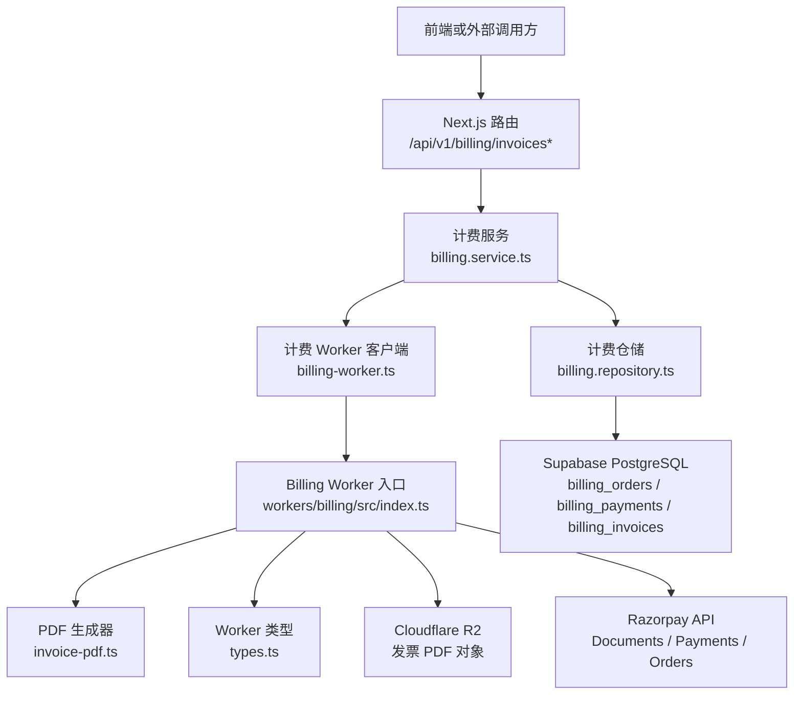
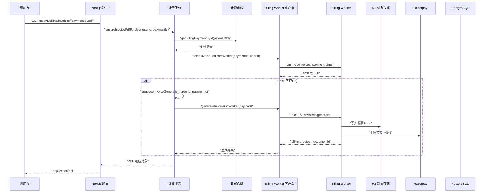
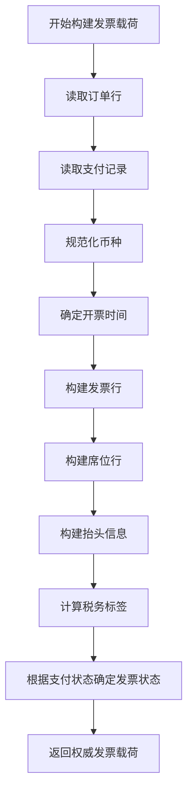
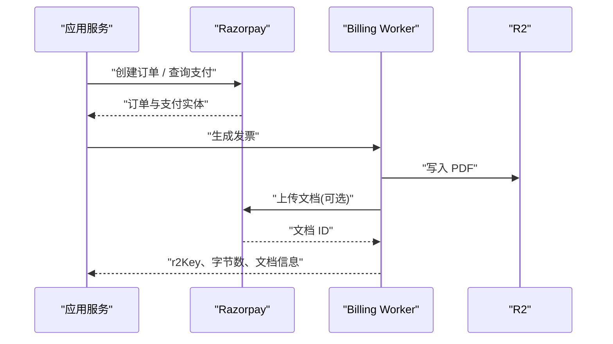
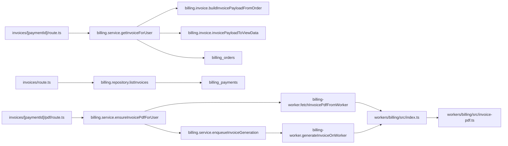

# 发票处理 API

<cite>
**本文引用的文件**   
- [src/app/api/v1/billing/invoices/route.ts](file://src/app/api/v1/billing/invoices/route.ts)
- [src/app/api/v1/billing/invoices/[paymentId]/route.ts](file://src/app/api/v1/billing/invoices/[paymentId]/route.ts)
- [src/app/api/v1/billing/invoices/[paymentId]/pdf/route.ts](file://src/app/api/v1/billing/invoices/[paymentId]/pdf/route.ts)
- [src/server/billing/invoice.ts](file://src/server/billing/invoice.ts)
- [src/server/services/billing.service.ts](file://src/server/services/billing.service.ts)
- [src/server/repositories/billing.repository.ts](file://src/server/repositories/billing.repository.ts)
- [src/server/billing/billing-worker.ts](file://src/server/billing/billing-worker.ts)
- [workers/billing/src/index.ts](file://workers/billing/src/index.ts)
- [workers/billing/src/types.ts](file://workers/billing/src/types.ts)
- [workers/billing/src/invoice-pdf.ts](file://workers/billing/src/invoice-pdf.ts)
- [supabase/migrations/20260910120000_billing_invoices.sql](file://supabase/migrations/20260910120000_billing_invoices.sql)
</cite>

## 目录

1. [简介](#简介)
2. [项目结构](#项目结构)
3. [核心组件](#核心组件)
4. [架构总览](#架构总览)
5. [详细组件分析](#详细组件分析)
6. [依赖关系分析](#依赖关系分析)
7. [性能与扩展性](#性能与扩展性)
8. [错误处理与故障排查](#错误处理与故障排查)
9. [结论](#结论)
10. [附录：数据模型与字段说明](#附录数据模型与字段说明)

## 简介

本文档面向调用方和内部开发者，系统性说明 Clauxen 的发票处理 RESTful API。重点覆盖以下路径：

- `GET /api/v1/billing/invoices`：获取当前用户的发票列表。
- `GET /api/v1/billing/invoices/{paymentId}`：获取单个发票详情。
- `GET /api/v1/billing/invoices/{paymentId}/pdf`：下载或预览发票 PDF。

发票数据来源以数据库中的订单、支付记录为主；PDF 生成逻辑位于独立的 Cloudflare Workers 计费 Worker 中，通过 R2 存储、Razorpay Documents 和邮件服务完成归档与交付。发票状态由 Razorpay 支付状态驱动，历史发票按用户隔离并索引，当前实现未提供批量导出端点，但可通过列表接口分页拉取后在客户端聚合导出。

## 项目结构

发票相关能力横跨应用路由层、服务层、仓储层、计费 Worker 以及数据库迁移脚本：

**图示来源**   
- [src/app/api/v1/billing/invoices/route.ts:1-16](file://src/app/api/v1/billing/invoices/route.ts#L1-L16)
- [src/app/api/v1/billing/invoices/[paymentId]/route.ts:1-23](file://src/app/api/v1/billing/invoices/[paymentId]/route.ts#L1-L23)
- [src/app/api/v1/billing/invoices/[paymentId]/pdf/route.ts:1-32](file://src/app/api/v1/billing/invoices/[paymentId]/pdf/route.ts#L1-L32)
- [src/server/services/billing.service.ts:1050-1120](file://src/server/services/billing.service.ts#L1050-L1120)
- [src/server/repositories/billing.repository.ts:456-475](file://src/server/repositories/billing.repository.ts#L456-L475)
- [src/server/billing/billing-worker.ts:105-243](file://src/server/billing/billing-worker.ts#L105-L243)
- [workers/billing/src/index.ts:1-40](file://workers/billing/src/index.ts#L1-L40)
- [workers/billing/src/invoice-pdf.ts:1-30](file://workers/billing/src/invoice-pdf.ts#L1-L30)
- [supabase/migrations/20260910120000_billing_invoices.sql:1-58](file://supabase/migrations/20260910120000_billing_invoices.sql#L1-L58)

**章节来源**   
- [src/app/api/v1/billing/invoices/route.ts:1-16](file://src/app/api/v1/billing/invoices/route.ts#L1-L16)
- [src/app/api/v1/billing/invoices/[paymentId]/route.ts:1-23](file://src/app/api/v1/billing/invoices/[paymentId]/route.ts#L1-L23)
- [src/app/api/v1/billing/invoices/[paymentId]/pdf/route.ts:1-32](file://src/app/api/v1/billing/invoices/[paymentId]/pdf/route.ts#L1-L32)
- [workers/billing/src/index.ts:1-40](file://workers/billing/src/index.ts#L1-L40)

## 核心组件

### 发票列表接口

`GET /api/v1/billing/invoices` 用于返回当前已登录用户最近最多 50 条支付记录，作为发票概览。它不直接查询 `billing_invoices` 表，而是读取 `billing_payments` 表中该用户的支付记录，并按创建时间倒序返回。

- **认证要求**：必须携带有效会话。
- **响应体**：包含 `invoices` 数组，每项至少包括内部 ID、关联订单 ID、金额（以 paise 为单位）、状态、创建时间。
- **限制**：当前实现固定返回最近 50 条，没有通用分页参数。
- **适用场景**：账单页展示最近交易、快速定位某笔支付对应的发票。

需要注意：这里的“发票列表”更准确说是“支付记录列表”，完整发票元数据需要通过单个发票接口获取。

**章节来源**   
- [src/app/api/v1/billing/invoices/route.ts:1-16](file://src/app/api/v1/billing/invoices/route.ts#L1-L16)
- [src/server/repositories/billing.repository.ts:456-475](file://src/server/repositories/billing.repository.ts#L456-L475)

### 单个发票详情接口

`GET /api/v1/billing/invoices/{paymentId}` 用于获取某个支付对应的发票视图数据。

请求约束：

- `paymentId` 必须符合正则 `pay_` 开头加 8 到 40 位字母数字。
- 调用方必须是支付所属用户。

处理流程：

1. 校验 `paymentId` 格式。
2. 验证会话。
3. 通过服务层查询支付和订单。
4. 构建服务端权威发票载荷。
5. 转换为 UI 友好视图数据。
6. 返回 `invoice` 与可选 `pdfKey`。

响应中的 `invoice` 是面向界面的快照，金额已经换算为货币主单位，而不是 paise。

**章节来源**   
- [src/app/api/v1/billing/invoices/[paymentId]/route.ts:1-23](file://src/app/api/v1/billing/invoices/[paymentId]/route.ts#L1-L23)
- [src/server/services/billing.service.ts:1617-1715](file://src/server/services/billing.service.ts#L1617-L1715)
- [src/server/billing/invoice.ts:1-212](file://src/server/billing/invoice.ts#L1-L212)

### 发票 PDF 下载接口

`GET /api/v1/billing/invoices/{paymentId}/pdf` 用于获取发票 PDF。

行为要点：

- 同样要求已登录且拥有该支付。
- 对 `paymentId` 做相同格式校验。
- 优先从计费 Worker 获取已有 PDF。
- 若 R2 中不存在，则触发按需生成。
- 返回 `application/pdf` 流。
- 设置内联显示和私有缓存头，文件名包含 `clauxen-invoice-{paymentId}.pdf`。

**章节来源**   
- [src/app/api/v1/billing/invoices/[paymentId]/pdf/route.ts:1-32](file://src/app/api/v1/billing/invoices/[paymentId]/pdf/route.ts#L1-L32)
- [src/server/services/billing.service.ts:1050-1120](file://src/server/services/billing.service.ts#L1050-L1120)
- [src/server/billing/billing-worker.ts:224-243](file://src/server/billing/billing-worker.ts#L224-L243)

## 架构总览

发票系统采用“Web 路由 + 服务层 + 仓储层 + 独立 Billing Worker + R2 + Razorpay”的分层架构。

**图示来源**   
- [src/app/api/v1/billing/invoices/[paymentId]/pdf/route.ts:1-32](file://src/app/api/v1/billing/invoices/[paymentId]/pdf/route.ts#L1-L32)
- [src/server/services/billing.service.ts:1050-1120](file://src/server/services/billing.service.ts#L1050-L1120)
- [src/server/billing/billing-worker.ts:105-243](file://src/server/billing/billing-worker.ts#L105-L243)
- [workers/billing/src/index.ts:1-40](file://workers/billing/src/index.ts#L1-L40)

## 详细组件分析

### 发票数据构造逻辑

服务端不会信任客户端提供的总金额。发票载荷由已完成的订单行和支付记录组合而成，核心逻辑位于服务器侧发票构建模块：

- 发票编号基于支付 ID 或订单 ID 生成，规则为去除非字母数字字符后取最后 12 位，前缀为 `INV-`。
- 币种根据订单币种规范化，USD 才使用 USD，否则回退到 INR。
- 开票时间优先使用支付捕获时间，其次为订单支付时间或完成时间。
- 税率标签根据税务元数据和是否含税决定：印度场景默认可能为 IGST 18%，非印度场景默认为 Tax。
- 订阅周期标签区分按月或按年。
- 发票行包含计划名称、层级、周期、单价、税额和总价。
- 团队或企业席位会作为额外行展示。
- 发票抬头信息来自账单详情、用户名或邮箱。
- 最终状态由支付状态决定：captured 为 paid，其他为 open。

**图示来源**   
- [src/server/billing/invoice.ts:1-189](file://src/server/billing/invoice.ts#L1-L189)

**章节来源**   
- [src/server/billing/invoice.ts:1-212](file://src/server/billing/invoice.ts#L1-L212)

### PDF 生成与模板定制

PDF 由 Cloudflare Billing Worker 使用 `pdf-lib` 在服务端生成，不依赖浏览器。

关键特征：

- 页面尺寸使用 A4。
- 字体使用 Helvetica 和 HelveticaBold。
- 支持嵌入品牌 Logo。
- 顶部左侧显示品牌名称、法律实体信息和地址。
- 顶部右侧显示发票标题、发票编号、开票日期、总金额、下一计费日期、订单号。
- 已支付时打印 PAID 标记。
- “BILLED TO”区域显示客户名称、邮箱、地址、GSTIN。
- 表格列包括描述、价格、税费、金额。
- 总额区显示不含税小计、税费、总计、已支付金额、应付金额。
- 自动续费行在启用时显示下次续费日期。
- 底部提示这是计算机生成的税务发票，并由 Razorpay 处理付款。

模板可配置项主要来自 Billing Worker 的环境变量：

| 配置键 | 用途 | 影响范围 |
|---|---|---|
| `INVOICE_ISSUER_NAME` | 发票开具方名称 | 页眉品牌名 |
| `INVOICE_ISSUER_LEGAL` | 法律实体名称 | 页眉法律信息 |
| `INVOICE_ISSUER_ADDRESS` | 地址 | 页眉地址 |
| `INVOICE_GSTIN` | GSTIN | 国内发票页眉 |
| `INVOICE_LUT_NUMBER` | LUT 编号 | 出口发票声明行 |

发票种类由请求中的 `invoiceKind` 控制：

- `domestic_gst`：国内 GST 发票。
- `export_lut`：零税率出口发票，带有 LUT 声明。
- `exempt_gstin`：凭有效 GSTIN 免税。

**章节来源**   
- [workers/billing/src/invoice-pdf.ts:1-475](file://workers/billing/src/invoice-pdf.ts#L1-L475)
- [workers/billing/src/types.ts:1-80](file://workers/billing/src/types.ts#L1-L80)
- [workers/billing/src/index.ts:60-120](file://workers/billing/src/index.ts#L60-L120)

### 与 Razorpay 的集成

发票系统与 Razorpay 的集成体现在三个层面：

1. **支付生命周期**：订单创建、支付查询、签名验证、收款确认、授权转收款等逻辑由 Razorpay 客户端封装。
2. **发票文档归档**：Billing Worker 可选择将 PDF 上传到 Razorpay Documents，用于平台侧收据和审计。
3. **发票下载鉴权**：Billing Worker 支持通过 Supabase JWT 验证用户身份，再返回对应支付路径下的 PDF。

Razorpay 相关的关键职责：

- 支付 ID 格式为 `pay_` 开头。
- 订单 ID 格式为 `order_` 开头。
- 签名必须服务端校验，防止篡改。
- 发票状态受支付状态影响，只有 captured 才视为已支付。
- 发票文档上传失败不应阻塞主要业务流程，代码中存在日志和降级路径。

**图示来源**   
- [src/server/billing/billing-worker.ts:105-243](file://src/server/billing/billing-worker.ts#L105-L243)
- [workers/billing/src/index.ts:1-40](file://workers/billing/src/index.ts#L1-L40)

**章节来源**   
- [src/server/services/billing.service.ts:1-120](file://src/server/services/billing.service.ts#L1-L120)
- [src/server/billing/billing-worker.ts:105-243](file://src/server/billing/billing-worker.ts#L105-L243)
- [workers/billing/src/index.ts:1-40](file://workers/billing/src/index.ts#L1-L40)

### 发票状态管理

发票状态不是独立业务枚举，而是由支付状态推导：

| 支付状态 | 发票状态 | 含义 |
|---|---|---|
| captured | paid | 资金已成功收取 |
| authorized | 通常后续转为 paid | 银行授权成功，需 capture |
| failed | open | 支付失败，发票保持待支付 |
| refunded | open | 退款后，现有发票状态仍为 open；系统未在构建逻辑中将退款映射为 refund 状态 |

UI 视图还会标注 `pdfAvailable` 和 `paymentId`，便于前端渲染下载按钮。

**章节来源**   
- [src/server/billing/invoice.ts:130-189](file://src/server/billing/invoice.ts#L130-L189)
- [src/server/services/billing.service.ts:1617-1715](file://src/server/services/billing.service.ts#L1617-L1715)

### 历史发票归档

发票归档策略如下：

- 每个付费支付对应一个发票。
- PDF 字节存储在 Cloudflare R2。
- `billing_invoices` 表只保存元数据、R2 key、R2 URL、Razorpay 文档 ID、位置证据和发送时间。
- `payment_id` 是唯一幂等键，保证同一 Razorpay 支付只生成一张发票。
- 表上按 `user_id`、`created_at`、`order_id`、`invoice_number` 建立索引，便于用户级查询和历史归档。
- 行级安全策略限制只有认证用户能查询自己的发票。

因此，“历史发票归档”在当前实现中是以“每支付一发票 + R2 持久化 + 数据库索引”的方式完成的，而不是把旧发票单独移动到另一个命名空间。

**章节来源**   
- [supabase/migrations/20260910120000_billing_invoices.sql:1-58](file://supabase/migrations/20260910120000_billing_invoices.sql#L1-L58)
- [src/server/repositories/billing.repository.ts:174-220](file://src/server/repositories/billing.repository.ts#L174-L220)

### 批量导出功能

当前仓库中没有专门的批量导出端点。可用方案包括：

1. 调用 `GET /api/v1/billing/invoices` 获取最近 50 条支付记录。
2. 对每条记录调用 `GET /api/v1/billing/invoices/{paymentId}` 获取发票详情。
3. 如需 PDF，调用 `GET /api/v1/billing/invoices/{paymentId}/pdf`。
4. 在客户端聚合为 CSV、JSON 或打包 ZIP。

如果需要服务端批量导出，应新增一个带分页、过滤和导出格式的端点，并在后端异步生成压缩包，避免一次性返回大量二进制流。

**章节来源**   
- [src/app/api/v1/billing/invoices/route.ts:1-16](file://src/app/api/v1/billing/invoices/route.ts#L1-L16)
- [src/server/repositories/billing.repository.ts:456-475](file://src/server/repositories/billing.repository.ts#L456-L475)

## 依赖关系分析

**图示来源**   
- [src/app/api/v1/billing/invoices/route.ts:1-16](file://src/app/api/v1/billing/invoices/route.ts#L1-L16)
- [src/app/api/v1/billing/invoices/[paymentId]/route.ts:1-23](file://src/app/api/v1/billing/invoices/[paymentId]/route.ts#L1-L23)
- [src/app/api/v1/billing/invoices/[paymentId]/pdf/route.ts:1-32](file://src/app/api/v1/billing/invoices/[paymentId]/pdf/route.ts#L1-L32)
- [src/server/billing/invoice.ts:1-212](file://src/server/billing/invoice.ts#L1-L212)
- [src/server/services/billing.service.ts:1050-1120](file://src/server/services/billing.service.ts#L1050-L1120)
- [src/server/billing/billing-worker.ts:105-243](file://src/server/billing/billing-worker.ts#L105-L243)
- [workers/billing/src/index.ts:1-40](file://workers/billing/src/index.ts#L1-L40)
- [workers/billing/src/invoice-pdf.ts:1-475](file://workers/billing/src/invoice-pdf.ts#L1-L475)

**章节来源**   
- [src/server/services/billing.service.ts:1050-1120](file://src/server/services/billing.service.ts#L1050-L1120)
- [src/server/billing/billing-worker.ts:105-243](file://src/server/billing/billing-worker.ts#L105-L243)

## 性能与扩展性

### 当前性能特征

- 发票列表查询限制为最近 50 条，适合账单页展示。
- 单个发票详情需要同时读取支付记录和订单详情，属于 O(1) 数据库查询。
- PDF 下载优先走缓存：如果 R2 已有 PDF，则直接返回，不重复生成。
- PDF 生成发生在独立 Worker，避免阻塞主应用线程。
- R2 和 Razorpay 调用失败时，代码倾向于记录日志并返回空结果或降级，而不是崩溃整个请求链。

### 潜在瓶颈

- 列表接口没有分页参数，未来用户量增长时需要改为游标或偏移分页。
- 首次生成 PDF 时会跨进程调用 Billing Worker，并可能访问 R2 和 Razorpay，延迟较高。
- 如果 Billing Worker 未配置，PDF 生成会跳过，可能导致 `pdfKey` 为空，需要前端提示或重试机制。

### 优化建议

1. 为列表接口增加 `limit`、`cursor` 或 `sinceCreatedAt` 参数。
2. 对频繁访问的 PDF 增加短期缓存，例如 ETag 或条件请求。
3. 对 PDF 生成增加幂等键，防止并发重复生成。
4. 对批量导出提供后台任务队列，避免同步大文件响应。
5. 对 R2 和 Razorpay 调用增加超时、重试和熔断策略。

[本节为通用性能讨论，不直接分析具体代码片段]

## 错误处理与故障排查

### 常见错误分类

| 场景 | 错误类型 | 原因 | 建议处理方式 |
|---|---|---|---|
| 未登录 | 认证错误 | 缺少会话或会话无效 | 引导用户重新登录 |
| 非法 `paymentId` | 400 bad_request | `paymentId` 不符合 `pay_[A-Za-z0-9]{8,40}` | 检查 URL 参数和来源 |
| 无权访问 | 404 not_found | 支付不属于当前用户 | 不要暴露资源是否存在，仅返回未找到 |
| 支付订单缺失 | 404 not_found | 支付记录存在但订单缺失 | 检查 Webhook 是否完成订单关联 |
| PDF 生成失败 | 502 invoice_pdf_error | Billing Worker 不可用、R2 写入失败或 Worker 返回异常 | 检查 `BILLING_WORKER_URL`、R2 bucket、网络 |
| Razorpay 配置缺失 | 503 billing_unavailable | 公共 Razorpay key 未配置 | 检查环境变量和部署配置 |
| 支付签名无效 | 400 invalid_signature | Razorpay 签名校验失败 | 检查服务端签名验证逻辑 |
| 金额不一致 | 400 amount_mismatch | 支付金额与订单金额不同 | 拒绝支付，防止篡改 |
| 币种不一致 | 400 currency_mismatch | 支付币种与订单币种不同 | 拒绝支付 |
| 支付未收款 | 400 payment_not_captured | 支付状态不是 captured | 等待 webhook 或重试 verify |

### 调试步骤

1. 确认调用方已携带有效会话。
2. 检查 `paymentId` 是否为 Razorpay 支付 ID。
3. 查看数据库中 `billing_payments` 是否包含该支付记录。
4. 检查 `provider_payload` 是否包含 `invoicePdfKey`。
5. 检查 Billing Worker 是否可访问，并确认 `/v1/invoices/{paymentId}/pdf` 是否返回 PDF。
6. 如果 PDF 不存在，检查 R2 bucket 是否写入成功。
7. 如果 Razorpay 文档上传失败，确认密钥和文档权限。
8. 对于 PDF 生成失败，优先恢复 R2 中的 PDF，而不是重新生成。

**章节来源**   
- [src/app/api/v1/billing/invoices/[paymentId]/route.ts:1-23](file://src/app/api/v1/billing/invoices/[paymentId]/route.ts#L1-L23)
- [src/app/api/v1/billing/invoices/[paymentId]/pdf/route.ts:1-32](file://src/app/api/v1/billing/invoices/[paymentId]/pdf/route.ts#L1-L32)
- [src/server/services/billing.service.ts:1050-1120](file://src/server/services/billing.service.ts#L1050-L1120)
- [src/server/services/billing.service.ts:1617-1715](file://src/server/services/billing.service.ts#L1617-L1715)
- [src/server/billing/billing-worker.ts:105-243](file://src/server/billing/billing-worker.ts#L105-L243)

## 结论

Clauxen 的发票 API 围绕 `/api/v1/billing/invoices` 及其子路径提供稳定的发票查询和 PDF 下载能力。其设计优点是：

- 发票金额和状态由服务端权威数据构建，不信任客户端。
- PDF 生成放在独立 Worker，避免阻塞主应用。
- PDF 持久化到 R2，并通过数据库索引支持历史归档。
- 与 Razorpay 的集成贯穿订单、支付、签名验证和文档归档。

需要补充的能力包括：

- 列表分页和高级筛选。
- 明确的批量导出端点。
- 更丰富的发票状态语义，例如退款、作废。
- 更完善的错误码分类和国际化消息。
- 对 PDF 生成的重试、幂等和监控指标。

这些改进可以在不破坏现有 API 的前提下，通过新增端点和增强 Worker 能力逐步实现。

[本节为总结内容，不直接分析具体代码片段]

## 附录：数据模型与字段说明

### 发票相关数据库表

`billing_invoices` 表定义如下：

| 字段 | 类型 | 说明 |
|---|---|---|
| `id` | uuid | 主键 |
| `user_id` | uuid | 用户 ID，引用 `auth.users` |
| `order_id` | text | 关联 `billing_orders.id` |
| `payment_id` | text | Razorpay 支付 ID，唯一幂等键 |
| `invoice_number` | text | 发票编号，唯一 |
| `kind` | text | 发票类型：`domestic_gst`、`export_lut`、`exempt_gstin` |
| `currency` | text | 币种：INR 或 USD |
| `subtotal_paise` | integer | 不含税小计，单位为 paise |
| `tax_paise` | integer | 税额，单位为 paise |
| `total_paise` | integer | 总金额，单位为 paise |
| `country` | text | 国家代码 |
| `r2_key` | text | R2 中 PDF 对象键 |
| `r2_url` | text | R2 可下载链接 |
| `razorpay_document_id` | text | Razorpay 文档 ID |
| `evidence` | jsonb | 位置证据快照 |
| `emailed_at` | timestamptz | 发票邮件发送时间 |
| `created_at` | timestamptz | 创建时间 |
| `updated_at` | timestamptz | 更新时间 |

**章节来源**   
- [supabase/migrations/20260910120000_billing_invoices.sql:1-58](file://supabase/migrations/20260910120000_billing_invoices.sql#L1-L58)

### 发票载荷类型

Billing Worker 使用的发票生成请求类型包含以下关键字段：

| 字段 | 类型 | 说明 |
|---|---|---|
| `invoiceNumber` | string | 发票编号 |
| `paymentId` | string | Razorpay 支付 ID |
| `orderId` | string | 订单 ID |
| `userId` | string | 用户 ID |
| `issuedAt` | string | 开票时间 |
| `nextBillingAt` | string \| null | 下次计费时间 |
| `currency` | "INR" \| "USD" | 币种 |
| `status` | "paid" \| "open" \| "draft" | 发票状态 |
| `invoiceKind` | "domestic_gst" \| "export_lut" \| "exempt_gstin" | 发票种类 |
| `lutNumber` | string \| null | LUT 编号 |
| `billedTo` | object | 发票抬头 |
| `planName` | string | 计划名称 |
| `billingCycle` | string | 计费周期 |
| `items` | array | 发票行 |
| `seats` | array | 席位行 |
| `subtotalPaise` | number | 不含税小计 |
| `tax` | object \| null | 税费 |
| `totalPaise` | number | 总金额 |
| `amountPaidPaise` | number | 已支付金额 |
| `paymentMethod` | string \| undefined | 支付方式 |
| `razorpayPaymentId` | string \| undefined | Razorpay 支付 ID |
| `autoRenew` | boolean | 是否自动续费 |

**章节来源**   
- [workers/billing/src/types.ts:1-80](file://workers/billing/src/types.ts#L1-L80)