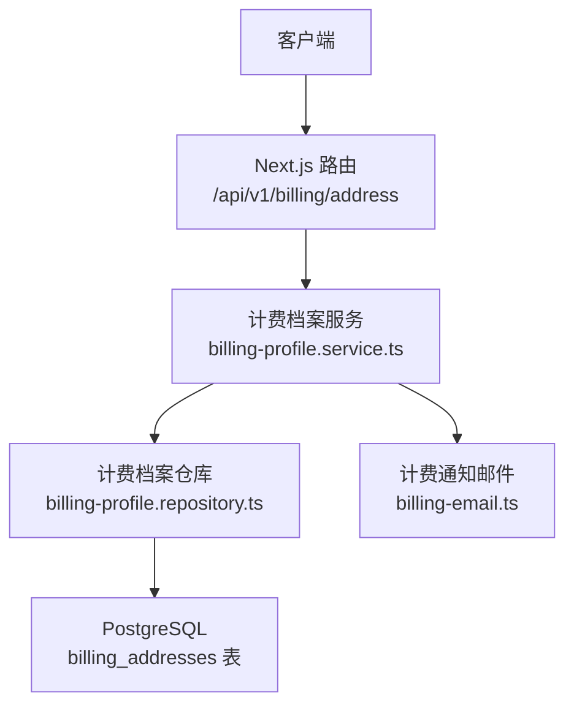
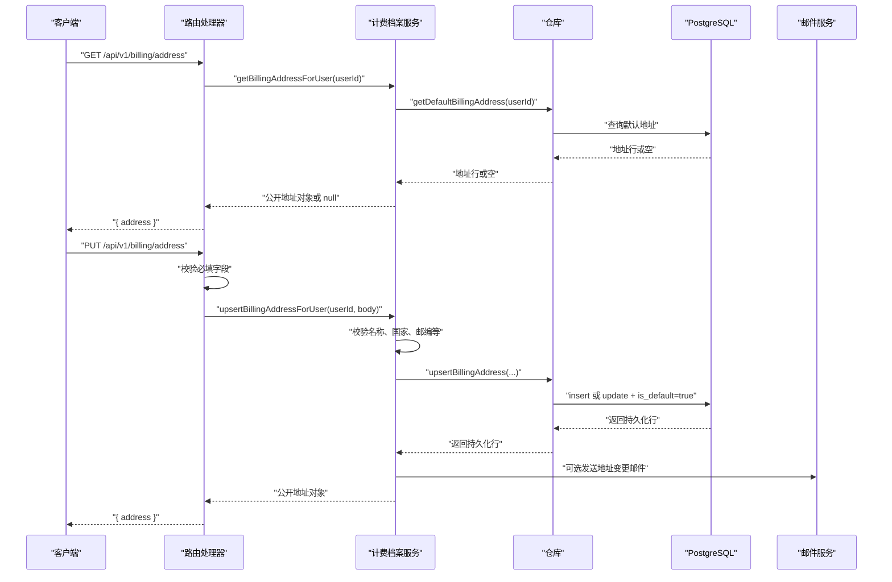
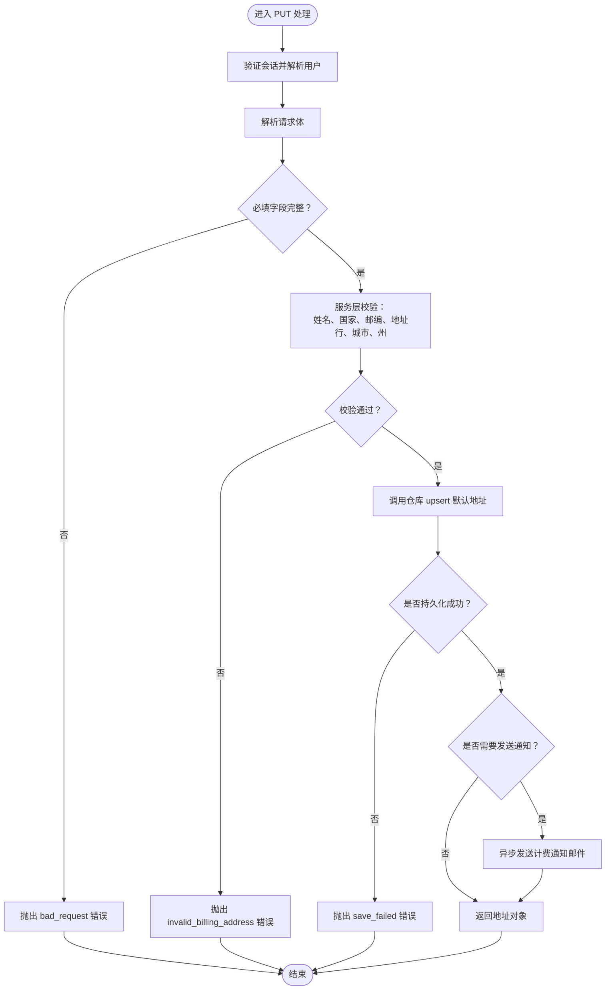
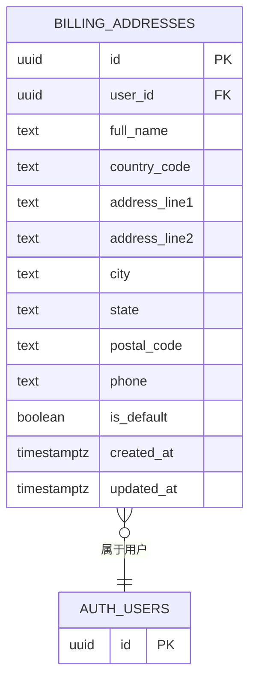
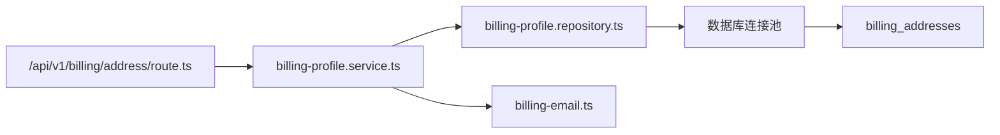

# 地址管理 API

<cite>
**本文引用的文件**
- [路由实现](file://src/app/api/v1/billing/address/route.ts)
- [计费档案服务](file://src/server/services/billing-profile.service.ts)
- [计费档案仓库](file://src/server/repositories/billing-profile.repository.ts)
- [数据库迁移：账单地址与支付方式](file://supabase/migrations/20260725143000_billing_addresses_payment_methods.sql)
- [平台加固迁移](file://supabase/migrations/20260806181805_platform_hardening.sql)
- [共享计费客户端接口](file://src/shared/lib/api/billing.ts)
- [数据库类型定义](file://src/shared/types/database.types.ts)
</cite>

## 目录
1. [简介](#简介)
2. [项目结构与职责边界](#项目结构与职责边界)
3. [核心组件](#核心组件)
4. [架构总览](#架构总览)
5. [详细端点说明](#详细端点说明)
6. [数据模型与校验规则](#数据模型与校验规则)
7. [依赖关系分析](#依赖关系分析)
8. [性能与一致性特征](#性能与一致性特征)
9. [故障排查指南](#故障排查指南)
10. [结论](#结论)

## 简介
本文件面向需要对接或维护地址管理能力的开发者，聚焦于 `/api/v1/billing/address` 端点。当前仓库实现了“按用户获取默认账单地址”和“创建或更新默认账单地址”两个操作；尚未暴露独立的删除、批量查询、多地址列表等地址管理接口。地址数据用于结账与发票场景，并与订阅、订单、发票等业务存在间接关联。

## 项目结构与职责边界
该功能由以下层次组成：
- 应用层路由：Next.js App Router 中 `src/app/api/v1/billing/address/route.ts` 暴露 REST 入口。
- 业务服务层：`src/server/services/billing-profile.service.ts` 负责输入校验、默认地址策略、通知邮件等逻辑。
- 数据访问层：`src/server/repositories/billing-profile.repository.ts` 封装 SQL，读写 Supabase Postgres。
- 数据库层：Supabase 迁移脚本定义 `billing_addresses` 表、行级安全策略、索引和约束。
- 前端共享客户端：`src/shared/lib/api/billing.ts` 提供前端调用计费接口的 TypeScript 封装（未直接包含地址方法）。
- 类型系统：`src/shared/types/database.types.ts` 由数据库 schema 生成，描述 `billing_addresses` 字段。

**图示来源**
- [路由实现:1-63](file://src/app/api/v1/billing/address/route.ts#L1-L63)
- [计费档案服务:1-214](file://src/server/services/billing-profile.service.ts#L1-L214)
- [计费档案仓库:43-109](file://src/server/repositories/billing-profile.repository.ts#L43-L109)
- [数据库迁移：账单地址与支付方式:15-56](file://supabase/migrations/20260725143000_billing_addresses_payment_methods.sql#L15-L56)

**章节来源**
- [路由实现:1-63](file://src/app/api/v1/billing/address/route.ts#L1-L63)
- [计费档案服务:1-214](file://src/server/services/billing-profile.service.ts#L1-L214)
- [计费档案仓库:43-109](file://src/server/repositories/billing-profile.repository.ts#L43-L109)
- [数据库迁移：账单地址与支付方式:15-56](file://supabase/migrations/20260725143000_billing_addresses_payment_methods.sql#L15-L56)

## 核心组件
- 路由处理器：统一鉴权、解析请求体、调用服务层并返回 JSON。
- 服务层：执行地址输入校验、国家限制、默认地址写入策略、可选通知邮件。
- 仓库层：读取默认地址、执行“不存在则插入、已存在则更新并标记为默认”的 upsert 逻辑。
- 数据库层：通过 RLS 策略保证用户只能访问自己的地址；唯一约束保证每个用户最多一个默认地址。

**章节来源**
- [路由实现:1-63](file://src/app/api/v1/billing/address/route.ts#L1-L63)
- [计费档案服务:1-214](file://src/server/services/billing-profile.service.ts#L1-L214)
- [计费档案仓库:43-109](file://src/server/repositories/billing-profile.repository.ts#L43-L109)
- [数据库迁移：账单地址与支付方式:15-56](file://supabase/migrations/20260725143000_billing_addresses_payment_methods.sql#L15-L56)

## 架构总览
地址管理的请求流程如下：

**图示来源**
- [路由实现:1-63](file://src/app/api/v1/billing/address/route.ts#L1-L63)
- [计费档案服务:150-214](file://src/server/services/billing-profile.service.ts#L150-L214)
- [计费档案仓库:43-109](file://src/server/repositories/billing-profile.repository.ts#L43-L109)

## 详细端点说明

### GET /api/v1/billing/address
- 作用：获取当前登录用户的默认账单地址。
- 认证：需要登录会话。
- 请求体：无。
- 成功响应：`{ address }`，其中 `address` 是公开地址对象，可能为 `null`。
- 失败响应：鉴权失败时由中间件返回；其他异常按统一错误格式返回。

典型成功响应字段：
- `id`：地址记录主键。
- `fullName`：收货人或开票抬头全名。
- `countryCode`：两位国家代码，当前仅支持印度。
- `addressLine1`：街道地址第一行。
- `addressLine2`：街道地址第二行，可为空。
- `city`：城市。
- `state`：州或省份。
- `postalCode`：邮政编码。
- `phone`：联系电话，可为空。
- `summary`：由地址行拼接而成的可读摘要。

**章节来源**
- [路由实现:1-23](file://src/app/api/v1/billing/address/route.ts#L1-L23)
- [计费档案服务:136-148](file://src/server/services/billing-profile.service.ts#L136-L148)

### PUT /api/v1/billing/address
- 作用：创建或更新当前用户的默认账单地址。若已有默认地址，则更新该记录并将其标记为默认。
- 认证：需要登录会话。
- 请求体字段：
  - `fullName`：必填。
  - `addressLine1`：必填。
  - `city`：必填。
  - `state`：必填。
  - `postalCode`：必填。
  - `countryCode`：可选；未提供时默认为印度。
  - `addressLine2`：可选。
  - `phone`：可选，可为空字符串或 `null`。
  - `notify`：可选布尔值；默认 `true`，控制是否发送地址保存或更新通知邮件。
- 成功响应：`{ address }`，返回持久化后的公开地址对象。
- 失败响应：
  - 缺少必填字段：返回 `400`，错误码标识为 `bad_request`。
  - 业务校验失败：例如国家不支持、姓名格式不合法、邮编不符合要求，返回 `400`，错误码标识为 `invalid_billing_address`。
  - 存储失败：返回 `500`，错误码标识为 `save_failed`。

**图示来源**
- [路由实现:25-63](file://src/app/api/v1/billing/address/route.ts#L25-L63)
- [计费档案服务:150-214](file://src/server/services/billing-profile.service.ts#L150-L214)
- [计费档案仓库:54-109](file://src/server/repositories/billing-profile.repository.ts#L54-L109)

**章节来源**
- [路由实现:25-63](file://src/app/api/v1/billing/address/route.ts#L25-L63)
- [计费档案服务:150-214](file://src/server/services/billing-profile.service.ts#L150-L214)

## 数据模型与校验规则

### 地址数据模型
数据库中的账单地址记录包含以下字段：

| 字段 | 类型 | 是否必填 | 默认值 | 约束与含义 |
|---|---|---:|---|---|
| `id` | UUID | 是 | 自动生成 | 主键 |
| `user_id` | UUID | 是 | 无 | 关联用户，支持级联删除 |
| `full_name` | TEXT | 是 | 无 | 姓名长度 2–120 |
| `country_code` | TEXT | 是 | `'IN'` | 必须为两位字符 |
| `address_line1` | TEXT | 是 | 无 | 地址行一长度 3–200 |
| `address_line2` | TEXT | 否 | `''` | 地址行二 |
| `city` | TEXT | 是 | 无 | 城市长度 2–100 |
| `state` | TEXT | 是 | 无 | 州或省份长度 2–100 |
| `postal_code` | TEXT | 是 | 无 | 邮编长度 4–16 |
| `phone` | TEXT | 否 | `null` | 电话号码，可空 |
| `is_default` | BOOLEAN | 是 | `true` | 是否为默认地址 |
| `created_at` | TIMESTAMPTZ | 是 | 当前时间 | 创建时间 |
| `updated_at` | TIMESTAMPTZ | 是 | 当前时间 | 更新时间，由触发器维护 |

公开响应对象还会包含 `summary`，它是地址行、城市、州、邮编拼接后的可读文本，便于前端展示。

**章节来源**
- [数据库迁移：账单地址与支付方式:15-56](file://supabase/migrations/20260725143000_billing_addresses_payment_methods.sql#L15-L56)
- [计费档案服务:60-93](file://src/server/services/billing-profile.service.ts#L60-L93)
- [数据库类型定义:635-665](file://src/shared/types/database.types.ts#L635-L665)

### 地址校验规则
服务端在写入前执行以下校验：
- 姓名必须符合允许字符集，且长度在 2–120 之间。
- 仅支持印度作为账单国家；其他国家会拒绝。
- 地址行一至少 3 个字符。
- 城市至少 2 个字符。
- 州至少 2 个字符。
- 邮编必须为 6 位数字。

这些规则同时体现在服务层正则表达式与数据库列约束中，形成双重保护。

**章节来源**
- [计费档案服务:23-59](file://src/server/services/billing-profile.service.ts#L23-L59)
- [数据库迁移：账单地址与支付方式:29-42](file://supabase/migrations/20260725143000_billing_addresses_payment_methods.sql#L29-L42)

### 默认地址策略
- 每个用户只允许存在一个默认地址。数据库通过部分唯一索引保证这一点。
- 新增地址时，若用户尚无默认地址，则新建记录并标记为默认。
- 更新地址时，若用户已有默认地址，则更新该记录并将 `is_default` 设为 `true`。
- 查询默认地址时，优先返回 `is_default = true` 的记录，再按更新时间倒序取第一条。

**图示来源**
- [数据库迁移：账单地址与支付方式:15-56](file://supabase/migrations/20260725143000_billing_addresses_payment_methods.sql#L15-L56)

**章节来源**
- [数据库迁移：账单地址与支付方式:47-52](file://supabase/migrations/20260725143000_billing_addresses_payment_methods.sql#L47-L52)
- [计费档案仓库:43-109](file://src/server/repositories/billing-profile.repository.ts#L43-L109)

### 地址与订单、发票的关系
当前地址 API 本身不直接管理订单或发票，但地址被描述为“结账和发票使用的用户账单地址”。计费订单创建、支付回调、发票生成等流程通常会在下单时携带或引用该地址信息。地址更多作为结算上下文的一部分，而不是订单实体的子资源。

**章节来源**
- [数据库迁移：账单地址与支付方式:154-162](file://supabase/migrations/20260725143000_billing_addresses_payment_methods.sql#L154-L162)
- [共享计费客户端接口:100-160](file://src/shared/lib/api/billing.ts#L100-L160)

## 依赖关系分析

**图示来源**
- [路由实现:1-12](file://src/app/api/v1/billing/address/route.ts#L1-L12)
- [计费档案服务:1-21](file://src/server/services/billing-profile.service.ts#L1-L21)
- [计费档案仓库:1-4](file://src/server/repositories/billing-profile.repository.ts#L1-L4)

### 耦合与内聚
- 路由层低耦合，仅做鉴权、参数校验和服务调用。
- 服务层集中了业务规则，包括国际化限制、通知开关、公开对象映射。
- 仓库层专注 SQL 访问，避免在业务层散落数据库细节。
- 数据库层通过 RLS 和约束承担最终一致性与安全性责任。

### 外部依赖
- 认证与会话：路由使用会话守卫。
- 邮件通知：地址保存或更新后可异步发送邮件。
- 数据库：Supabase Postgres，配合行级安全策略。

**章节来源**
- [路由实现:1-12](file://src/app/api/v1/billing/address/route.ts#L1-L12)
- [计费档案服务:150-214](file://src/server/services/billing-profile.service.ts#L150-L214)
- [计费档案仓库:43-109](file://src/server/repositories/billing-profile.repository.ts#L43-L109)
- [数据库迁移：账单地址与支付方式:59-87](file://supabase/migrations/20260725143000_billing_addresses_payment_methods.sql#L59-L87)

## 性能与一致性特征
- 默认地址查询使用按用户过滤、按默认标志和更新时间排序的限制查询，适合快速读取单个默认地址。
- 更新操作先查后写，确保将现有默认地址替换为新默认地址。
- 通知邮件采用异步发送，避免阻塞主要写入路径。
- 数据库层面使用触发器维护更新时间，减少应用层额外赋值成本。
- 唯一索引防止同一用户出现多个默认地址。

**章节来源**
- [计费档案仓库:43-109](file://src/server/repositories/billing-profile.repository.ts#L43-L109)
- [数据库迁移：账单地址与支付方式:47-56](file://supabase/migrations/20260725143000_billing_addresses_payment_methods.sql#L47-L56)

## 故障排查指南

### 常见错误
| 现象 | 可能原因 | 建议处理 |
|---|---|---|
| 返回 400，提示缺少必填字段 | 未传 `fullName`、`addressLine1`、`city`、`state`、`postalCode` 之一 | 检查前端表单校验和提交载荷 |
| 返回 400，错误码为 `invalid_billing_address` | 国家不是印度、姓名非法、邮编不是 6 位数字、地址过短 | 检查国家选择、姓名输入、邮编格式 |
| 返回 500，错误码为 `save_failed` | 数据库写入失败或服务层未收到有效行 | 查看数据库连接、事务、权限及日志 |
| 地址未更新 | 前端未调用 PUT，或 `notify=false` 导致没有通知邮件 | 确认调用方法和通知开关 |

### 安全注意事项
- 所有地址操作均受行级安全策略保护，普通用户只能访问自己的地址。
- 地址不会用于地理编码或地图坐标；当前实现仅做文本标准化和格式化。
- 当前实现限制国家为印度，不支持任意国家地址。

**章节来源**
- [路由实现:25-63](file://src/app/api/v1/billing/address/route.ts#L25-L63)
- [计费档案服务:23-59](file://src/server/services/billing-profile.service.ts#L23-L59)
- [数据库迁移：账单地址与支付方式:59-87](file://supabase/migrations/20260725143000_billing_addresses_payment_methods.sql#L59-L87)
- [平台加固迁移:9-28](file://supabase/migrations/20260806181805_platform_hardening.sql#L9-L28)

## 结论
当前 `/api/v1/billing/address` 提供了简洁而安全的默认账单地址管理能力：
- 支持获取和创建或更新默认地址。
- 通过多层校验确保地址质量。
- 通过数据库约束和行级安全保证数据正确性和隔离性。
- 支持可选的地址变更通知邮件。

尚未实现的功能包括：
- 独立删除地址端点。
- 多地址列表、分页和筛选。
- 显式设置某个地址为默认的多地址管理。
- 地理编码、经纬度、地图集成。
- 多国家地址支持与更丰富的国际化地址格式。

若未来扩展，建议保持“默认地址优先”的业务语义，同时引入多地址实体、明确删除语义、增强地址验证库，并在发票和订单中显式引用地址快照，以保证历史交易的可审计性。