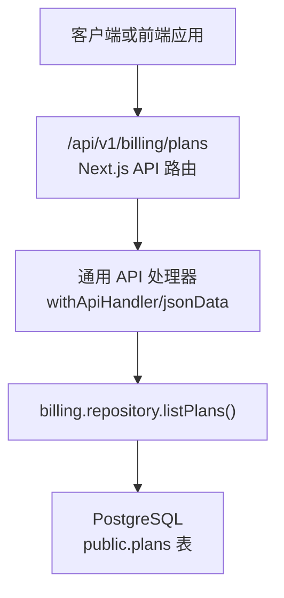
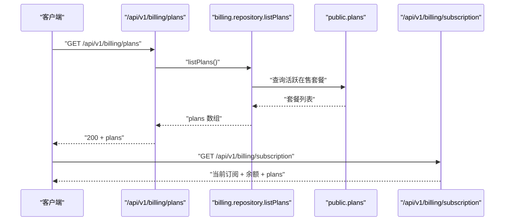
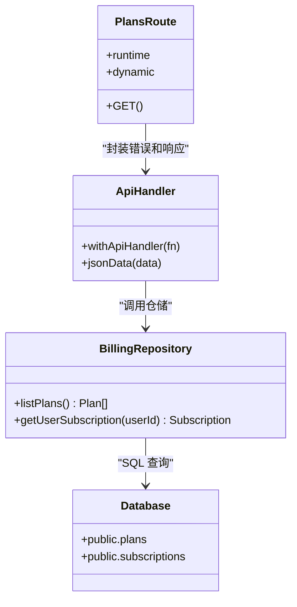
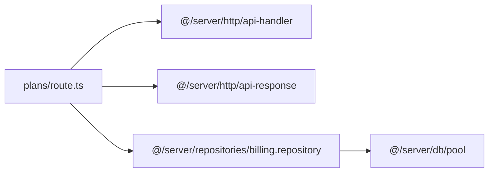

# 套餐查询 API

<cite>
**本文引用的文件**   
- [src/app/api/v1/billing/plans/route.ts](file://src/app/api/v1/billing/plans/route.ts)
- [src/server/repositories/billing.repository.ts](file://src/server/repositories/billing.repository.ts)
- [src/shared/lib/api/billing.ts](file://src/shared/lib/api/billing.ts)
- [src/shared/lib/plans-catalog.ts](file://src/shared/lib/plans-catalog.ts)
- [supabase/migrations/20260608120000_personal_plans_catalog.sql](file://supabase/migrations/20260608120000_personal_plans_catalog.sql)
- [supabase/migrations/20260922183000_pro_max_plans_only.sql](file://supabase/migrations/20260922183000_pro_max_plans_only.sql)
- [supabase/migrations/20260730120000_gift_claim_flow.sql](file://supabase/migrations/20260730120000_gift_claim_flow.sql)
</cite>

## 目录
1. [简介](#简介)
2. [项目结构与端点定位](#项目结构与端点定位)
3. [API 总览](#api-总览)
4. [请求规范](#请求规范)
5. [响应数据结构](#响应数据结构)
6. [套餐字段说明](#套餐字段说明)
7. [货币、周期与地区定价](#货币周期与地区定价)
8. [过滤、排序与分页](#过滤排序与分页)
9. [套餐与订阅的关系](#套餐与订阅的关系)
10. [试用套餐处理](#试用套餐处理)
11. [折扣码与应用机制](#折扣码与应用机制)
12. [完整请求响应示例](#完整请求响应示例)
13. [错误处理](#错误处理)
14. [依赖关系与架构](#依赖关系与架构)
15. [性能与实现要点](#性能与实现要点)
16. [常见问题排查](#常见问题排查)
17. [结论](#结论)

## 简介
本文件面向后端开发者、前端集成方和第三方审计人员，定义并解释 **套餐查询 RESTful API**：`GET /api/v1/billing/plans`。该接口返回当前可供购买的个人套餐目录，供结算页、升级入口、营销页面以及客户端计费逻辑使用。

根据代码仓库现状，该接口：
- 暴露为 HTTP GET；
- 不接收业务查询参数；
- 返回数据库中的活跃套餐列表；
- 套餐数据来源于 `public.plans` 表；
- 当前只允许返回 `pro`、`max`、`max5x`、`max20x` 等在售个人套餐；
- 货币单位为印度卢比，价格以“派萨”存储；
- 订阅、试用、礼品、折扣码等属于关联领域，但不在本接口的查询参数中直接体现。

## 项目结构与端点定位
该端点位于 Next.js App Router 的 API 路由中，由 Node.js 运行时执行，并通过通用 API 处理器封装错误和 JSON 响应。



**图表来源**
- [src/app/api/v1/billing/plans/route.ts:1-11](file://src/app/api/v1/billing/plans/route.ts#L1-L11)
- [src/server/repositories/billing.repository.ts:240-260](file://src/server/repositories/billing.repository.ts#L240-L260)

**章节来源**
- [src/app/api/v1/billing/plans/route.ts:1-11](file://src/app/api/v1/billing/plans/route.ts#L1-L11)

## API 总览
| 项目 | 值 |
|---|---|
| 方法 | `GET` |
| URL 模式 | `/api/v1/billing/plans` |
| 认证要求 | 当前实现未强制鉴权；调用方可按需在前端或网关层增加鉴权 |
| 内容类型 | `application/json` |
| 主要用途 | 获取可用于购买的活跃套餐目录 |
| 数据范围 | 仅返回 `is_active = true` 且 `id` 在白名单内的套餐 |
| 白名单套餐 | `pro`、`max`、`max5x`、`max20x` |
| 默认排序 | 按月度价格升序 |
| 过滤参数 | 无 |
| 排序参数 | 无 |
| 分页参数 | 无 |

该接口是纯读取型目录接口，适合在用户进入计费流程前一次性拉取，再由前端渲染套餐卡片、计算年付折扣、展示功能权限等。

**章节来源**
- [src/app/api/v1/billing/plans/route.ts:1-11](file://src/app/api/v1/billing/plans/route.ts#L1-L11)
- [src/server/repositories/billing.repository.ts:240-260](file://src/server/repositories/billing.repository.ts#L240-L260)

## 请求规范
### HTTP 请求
```text
GET /api/v1/billing/plans
Host: your-api-host
Accept: application/json
```

### 请求参数
当前实现没有查询参数解析逻辑，因此以下参数在当前版本中无效：
- `filter`
- `sort`
- `page`
- `limit`
- `currency`
- `region`
- `trial`
- `discount_code`

若未来扩展该接口，建议遵循 REST 风格：
- 查询参数用于过滤和排序；
- 路径参数用于资源标识；
- 请求体用于复杂写入操作；
- 所有新增参数应进行校验并在文档中明确是否向后兼容。

### 安全与访问控制
当前路由直接使用 `withApiHandler` 包装异步函数，并未显式检查用户身份。生产环境建议：
- 在中间件或网关层限制匿名访问；
- 对计费相关接口实施统一鉴权；
- 记录访问日志以便审计。

**章节来源**
- [src/app/api/v1/billing/plans/route.ts:1-11](file://src/app/api/v1/billing/plans/route.ts#L1-L11)

## 响应数据结构
### 成功响应
状态码：`200 OK`

响应体结构：
```json
{
  "plans": [
    {
      "id": "string",
      "name": "string",
      "display_name": "string",
      "price_paise_monthly": "number",
      "price_paise_yearly": "number",
      "currency": "string",
      "token_grant": "number",
      "features": "unknown"
    }
  ]
}
```

关键字段含义：
| 字段 | 类型 | 说明 |
|---|---|---|
| `plans` | 数组 | 套餐目录列表 |
| `id` | 字符串 | 套餐内部标识，例如 `pro`、`max`、`max5x`、`max20x` |
| `name` | 字符串 | 套餐显示名称，例如 “Pro plan” |
| `display_name` | 字符串 | 用于界面展示的简称，例如 “Pro” |
| `price_paise_monthly` | 数字 | 月费，单位为派萨（1 INR = 100 paise） |
| `price_paise_yearly` | 数字 | 年费，单位为派萨；不支持年付的套餐可能为 `0` |
| `currency` | 字符串 | 货币代码，当前目录为 `INR` |
| `token_grant` | 数字 | 套餐绑定的令牌配额 |
| `features` | 任意对象 | 套餐功能权限；当前查询未投影具体结构 |

注意：
- `features` 在 SQL 查询中被投影为 `unknown`，前端或上层服务可能需要单独映射或从其他来源补充结构化功能信息。
- 该接口不会返回 `free` 套餐，因为 `listPlans` 的白名单不包含它。

**章节来源**
- [src/app/api/v1/billing/plans/route.ts:1-11](file://src/app/api/v1/billing/plans/route.ts#L1-L11)
- [src/server/repositories/billing.repository.ts:240-260](file://src/server/repositories/billing.repository.ts#L240-L260)

## 套餐字段说明
### 基础字段
| 字段 | 用途 | 取值示例 | 备注 |
|---|---|---|---|
| `id` | 唯一标识套餐 | `pro`、`max`、`max5x`、`max20x` | 与订阅、订单、工作区外键关联 |
| `name` | 人类可读名称 | `Pro plan` | 常用于后台和管理界面 |
| `display_name` | 前台展示名 | `Pro` | 常用于 UI 套餐卡片 |
| `currency` | 货币代码 | `INR` | 当前目录固定为印度卢比 |
| `token_grant` | 令牌配额 | `1000000` | 表示套餐授予的令牌总量 |

### 价格字段
| 字段 | 单位 | 说明 |
|---|---|---|
| `price_paise_monthly` | 派萨 | 月付价格 |
| `price_paise_yearly` | 派萨 | 年付价格；年付折扣逻辑由迁移和 catalog 共同决定 |

价格换算规则：
- 前端通常将派萨除以 100 得到卢比；
- 年付折扣通过 `YEARLY_DISCOUNT` 常量及迁移中的 `yearlyDiscount` 元数据共同影响；
- 某些 Max 套餐可能仅支持月付，其 `price_paise_yearly` 为 `0`。

### 功能权限
`features` 字段当前以 `unknown` 类型返回，但数据库中存在结构化功能集合。历史迁移显示 `features` 曾以 JSONB 数组形式存储功能标识，例如聊天、制品、搜索、上传、语音、研究、图像生成、高级模型、优先通道、代码、项目、深度研究、批量任务等。

若需要精确功能枚举，建议：
- 在后端扩展 `listPlans` 的投影字段；
- 或在独立 catalog 模块中维护功能到套餐的映射；
- 避免把未验证的 `features` 直接作为权限判断依据。

**章节来源**
- [src/server/repositories/billing.repository.ts:240-260](file://src/server/repositories/billing.repository.ts#L240-L260)
- [supabase/migrations/20260608120000_personal_plans_catalog.sql:1-41](file://supabase/migrations/20260608120000_personal_plans_catalog.sql#L1-L41)
- [src/shared/lib/plans-catalog.ts:1-200](file://src/shared/lib/plans-catalog.ts#L1-L200)

## 货币、周期与地区定价
### 货币单位
- 数据库中价格字段为 `price_paise_monthly`、`price_paise_yearly`；
- 货币列 `currency` 当前目录为 `INR`；
- 客户端应将派萨转换为卢比后再展示；
- 其他支付流程中存在 USD 选项，但套餐目录接口未提供按地区切换货币的能力。

### 计费周期
| 周期 | 行为 |
|---|---|
| 月付 | 使用 `price_paise_monthly` |
| 年付 | 使用 `price_paise_yearly`；部分套餐可能为 `0`，表示不支持年付 |
| 不支持年付 | 典型为 Max 系列；前端不应为其显示年付切换 |

### 地区差异化定价
当前 `/api/v1/billing/plans` 不暴露地区参数，也不返回地区定价分支。地区与货币决策更多出现在结账会话、税务计算和 Razorpay 集成流程中。因此：
- 套餐目录是统一目录；
- 实际金额可能在结账阶段结合地区、税费、折扣码调整；
- 对外部消费者而言，不要假设套餐单价等于最终支付金额。

**章节来源**
- [src/server/repositories/billing.repository.ts:240-260](file://src/server/repositories/billing.repository.ts#L240-L260)
- [src/shared/lib/plans-catalog.ts:1-200](file://src/shared/lib/plans-catalog.ts#L1-L200)
- [src/shared/lib/api/billing.ts:1-200](file://src/shared/lib/api/billing.ts#L1-L200)

## 过滤、排序与分页
### 当前能力
- 过滤：无；
- 排序：后端按 `price_paise_monthly asc` 排序；
- 分页：无。

### 推荐扩展方案
如果未来需要支持筛选和分页，可考虑：
| 参数 | 类型 | 默认值 | 说明 |
|---|---|---|---|
| `currency` | 字符串 | 无 | 当前目录固定为 INR，可作为兼容性占位 |
| `billing_cycle` | 字符串 | 无 | `monthly` 或 `yearly`，用于选择展示对应价格 |
| `feature` | 字符串数组 | 无 | 按功能标签过滤套餐 |
| `sort_by` | 字符串 | `price_paise_monthly` | 支持 `price_paise_monthly`、`price_paise_yearly`、`sort_order` |
| `order` | 字符串 | `asc` | `asc` 或 `desc` |
| `page` | 整数 | `1` | 页码 |
| `limit` | 整数 | `20` | 每页数量，最大上限需限制 |

这些参数应在路由层或仓储层实现严格校验，防止 SQL 注入和过大分页。

**章节来源**
- [src/server/repositories/billing.repository.ts:240-260](file://src/server/repositories/billing.repository.ts#L240-L260)

## 套餐与订阅的关系
套餐目录与订阅是两个不同概念：
- 套餐：产品目录，描述可售卖的层级、价格、功能和配额；
- 订阅：用户或工作区的当前付费状态，包含计划、周期、起止时间、取消标志等。

`getBillingSubscription` 返回的订阅对象包含：
- `plan_id`：当前订阅对应的套餐 ID；
- `status`：订阅状态；
- `billing_cycle`：计费周期；
- `current_period_end`：当前计费周期结束时间；
- `cancel_at_period_end`：是否在周期结束时取消。

套餐与订阅的典型关系：
1. 用户通过 `/api/v1/billing/plans` 查看可用套餐；
2. 前端发起结账会话创建；
3. 支付成功后，系统创建或更新 `subscriptions`；
4. 订阅的 `plan_id` 指向 `public.plans.id`；
5. 工作区也可能继承组织或用户的套餐。



**图表来源**
- [src/app/api/v1/billing/plans/route.ts:1-11](file://src/app/api/v1/billing/plans/route.ts#L1-L11)
- [src/server/repositories/billing.repository.ts:240-260](file://src/server/repositories/billing.repository.ts#L240-L260)
- [src/shared/lib/api/billing.ts:1-200](file://src/shared/lib/api/billing.ts#L1-L200)

**章节来源**
- [src/shared/lib/api/billing.ts:1-200](file://src/shared/lib/api/billing.ts#L1-L200)
- [src/server/repositories/billing.repository.ts:240-275](file://src/server/repositories/billing.repository.ts#L240-L275)

## 试用套餐处理
当前代码中出现了 `trialing` 状态，表明订阅模型支持试用生命周期。但在 `/api/v1/billing/plans` 的实现中：
- 没有“试用套餐”专属字段；
- 没有试用过滤参数；
- 试用逻辑体现在订阅状态和工作流中，而不是套餐目录本身。

试用相关要点：
- 订阅状态可能包含 `trialing`；
- 计费完成流程会覆盖现有订阅，并将旧订阅标记为已替代；
- 试用、激活、过期、过去逾期等状态由订阅表和业务流程管理；
- 如需暴露试用套餐，应扩展套餐模型，增加试用时长、试用条件、是否可转正式订阅等字段。

**章节来源**
- [supabase/migrations/20260730120000_gift_claim_flow.sql:140-190](file://supabase/migrations/20260730120000_gift_claim_flow.sql#L140-L190)
- [src/server/repositories/billing.repository.ts:354-383](file://src/server/repositories/billing.repository.ts#L354-L383)

## 折扣码与应用机制
当前 `/api/v1/billing/plans` 不处理折扣码。折扣码、优惠券、促销逻辑不属于套餐目录接口职责，而更可能出现在：
- 结账会话创建；
- 订单计算；
- 发票或支付回调处理。

仓库中与折扣相关的线索包括：
- 套餐目录中的年付折扣常量；
- 迁移中 `billing_metadata.year_discount` 或类似元数据；
- 礼品码、礼品购买、礼品领取流程；
- 结账流程和 Razorpay 集成。

对于外部消费者：
- 不要在套餐目录接口传入 `discount_code`；
- 折扣应在结账或订单阶段验证和应用；
- 最终金额应以结账、订单或发票为准。

**章节来源**
- [src/shared/lib/plans-catalog.ts:1-200](file://src/shared/lib/plans-catalog.ts#L1-L200)
- [supabase/migrations/20260608120000_personal_plans_catalog.sql:1-41](file://supabase/migrations/20260608120000_personal_plans_catalog.sql#L1-L41)
- [supabase/migrations/20260922183000_pro_max_plans_only.sql:1-35](file://supabase/migrations/20260922183000_pro_max_plans_only.sql#L1-L35)

## 完整请求响应示例
### 请求示例
```http
GET /api/v1/billing/plans
```

### 成功响应示例
```json
{
  "plans": [
    {
      "id": "pro",
      "name": "Pro plan",
      "display_name": "Pro",
      "price_paise_monthly": 199900,
      "price_paise_yearly": 1919000,
      "currency": "INR",
      "token_grant": 1000000,
      "features": {}
    },
    {
      "id": "max",
      "name": "Max plan",
      "display_name": "Max",
      "price_paise_monthly": 199900,
      "price_paise_yearly": 0,
      "currency": "INR",
      "token_grant": 2000000,
      "features": {}
    },
    {
      "id": "max5x",
      "name": "Max 5x",
      "display_name": "Max 5x",
      "price_paise_monthly": 999900,
      "price_paise_yearly": 0,
      "currency": "INR",
      "token_grant": 10000000,
      "features": {}
    },
    {
      "id": "max20x",
      "name": "Max 20x",
      "display_name": "Max 20x",
      "price_paise_monthly": 1999900,
      "price_paise_yearly": 0,
      "currency": "INR",
      "token_grant": 40000000,
      "features": {}
    }
  ]
}
```

说明：
- 价格单位为派萨；
- 年付价格为 `0` 表示该套餐当前不支持年付；
- `features` 在当前查询中未展开为结构化字段；
- 列表按月度价格升序排列；
- 不会返回非在售或非活跃套餐。

**章节来源**
- [src/app/api/v1/billing/plans/route.ts:1-11](file://src/app/api/v1/billing/plans/route.ts#L1-L11)
- [src/server/repositories/billing.repository.ts:240-260](file://src/server/repositories/billing.repository.ts#L240-L260)
- [supabase/migrations/20260922183000_pro_max_plans_only.sql:1-35](file://supabase/migrations/20260922183000_pro_max_plans_only.sql#L1-L35)

## 错误处理
当前路由使用 `withApiHandler` 包裹异步函数，并由 `jsonData` 返回 JSON 响应。由于 `listPlans` 本身只做简单查询，常见异常来源包括：
- 数据库连接失败；
- 查询执行失败；
- 上游通用 API 处理器抛出的标准错误。

建议的错误语义：
| 场景 | 建议状态码 | 说明 |
|---|---|---|
| 数据库不可用 | `500` | 服务端基础设施错误 |
| 查询执行失败 | `500` | 后端内部错误 |
| 未来添加非法参数时 | `400` | 请求参数校验失败 |
| 接口下线或禁用 | `501` 或 `410` | 取决于策略 |

当前实现未定义明确的业务错误响应体结构。若对外暴露 API，建议统一错误格式，例如：
```json
{
  "error": {
    "code": "internal_error",
    "message": "数据库查询失败",
    "request_id": "可选追踪 ID"
  }
}
```

**章节来源**
- [src/app/api/v1/billing/plans/route.ts:1-11](file://src/app/api/v1/billing/plans/route.ts#L1-L11)

## 依赖关系与架构
### 组件关系图


**图表来源**
- [src/app/api/v1/billing/plans/route.ts:1-11](file://src/app/api/v1/billing/plans/route.ts#L1-L11)
- [src/server/repositories/billing.repository.ts:240-275](file://src/server/repositories/billing.repository.ts#L240-L275)

### 导入依赖图


**图表来源**
- [src/app/api/v1/billing/plans/route.ts:1-11](file://src/app/api/v1/billing/plans/route.ts#L1-L11)
- [src/server/repositories/billing.repository.ts:1-20](file://src/server/repositories/billing.repository.ts#L1-L20)

**章节来源**
- [src/app/api/v1/billing/plans/route.ts:1-11](file://src/app/api/v1/billing/plans/route.ts#L1-L11)
- [src/server/repositories/billing.repository.ts:1-20](file://src/server/repositories/billing.repository.ts#L1-L20)

## 性能与实现要点
### 查询复杂度
`listPlans` 使用固定白名单过滤：
```sql
select ... from public.plans
where is_active = true
  and id in ('pro', 'max', 'max5x', 'max20x')
order by price_paise_monthly asc
```

该查询特点：
- 结果集很小；
- 白名单限制了扫描范围；
- 按价格排序；
- 不涉及用户态数据；
- 适合缓存。

### 缓存建议
- 套餐目录变化频率低，可在 CDN 或边缘缓存层缓存较短时间；
- 前端可在首次加载后缓存套餐列表；
- 当套餐变更时应失效缓存；
- 不建议长期缓存，以免错过价格或功能变更。

### 可扩展性
若未来增加过滤、排序、分页：
- 应避免动态拼接 SQL；
- 使用参数化查询；
- 限制 `limit` 最大值；
- 对 `sort_by` 做白名单校验；
- 对 `feature` 过滤建立合适索引。

**章节来源**
- [src/server/repositories/billing.repository.ts:240-260](file://src/server/repositories/billing.repository.ts#L240-L260)

## 常见问题排查
### 为什么看不到 Free 套餐？
`listPlans` 的白名单只包含 `pro`、`max`、`max5x`、`max20x`。Free 套餐不在可购买目录中。

### 为什么年付价格有时为 0？
部分 Max 套餐仅支持月付，因此 `price_paise_yearly` 为 `0`。前端应据此隐藏年付选项。

### 为什么 features 是 unknown？
当前 SQL 查询投影了 `features`，但 TypeScript 类型声明为 `unknown`。若需要结构化功能字段，应扩展仓储查询或单独维护功能映射。

### 如何区分地区定价？
当前套餐目录不暴露地区定价。地区与货币决策发生在结账、税务和支付流程中。

### 如何判断试用套餐？
试用逻辑体现在订阅状态，而非套餐目录。若需要试用套餐，应扩展套餐模型并增加试用相关字段。

### 能否传折扣码过滤套餐？
不能。折扣码不在该接口支持范围内，应在结账或订单阶段处理。

**章节来源**
- [src/server/repositories/billing.repository.ts:240-260](file://src/server/repositories/billing.repository.ts#L240-L260)
- [src/shared/lib/api/billing.ts:1-200](file://src/shared/lib/api/billing.ts#L1-L200)
- [supabase/migrations/20260922183000_pro_max_plans_only.sql:1-35](file://supabase/migrations/20260922183000_pro_max_plans_only.sql#L1-L35)

## 结论
`GET /api/v1/billing/plans` 是一个简洁的套餐目录接口，负责返回当前活跃、在售的个人套餐。它不处理认证、过滤、排序、分页、地区货币切换或折扣码。真正计费细节应由结账会话、订单、支付和订阅接口承担。

对外集成时建议：
- 使用该接口展示套餐目录；
- 将派萨转换为本地货币展示；
- 根据 `price_paise_yearly` 决定是否支持年付；
- 将订阅状态、试用状态、折扣码、税费等放在其他计费接口中处理；
- 在生产环境中补充鉴权和统一错误响应格式。