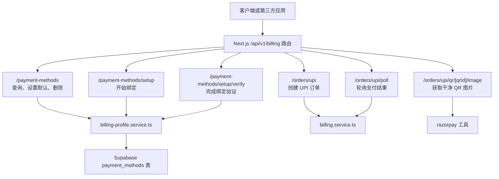
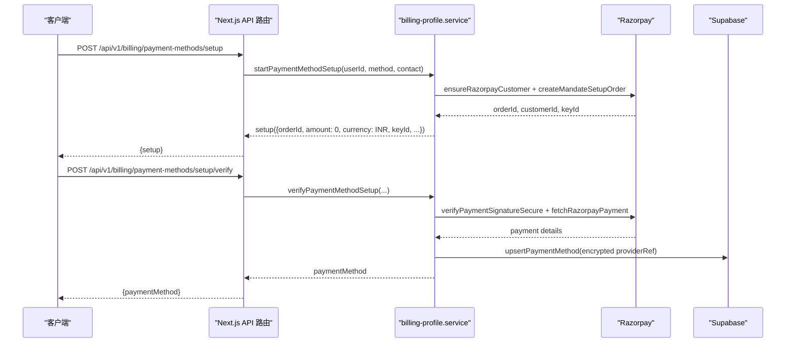
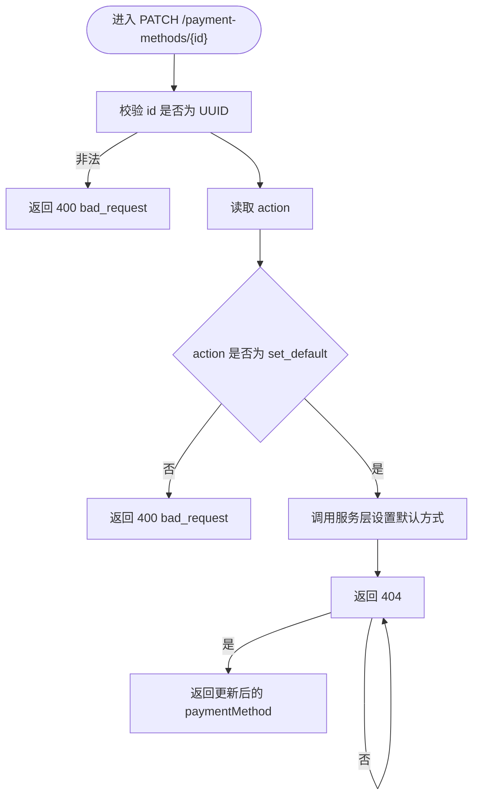
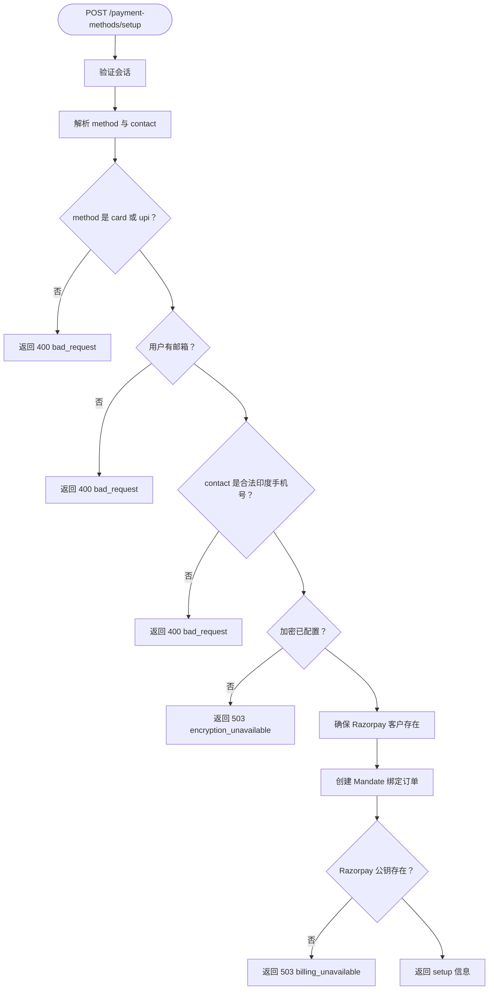
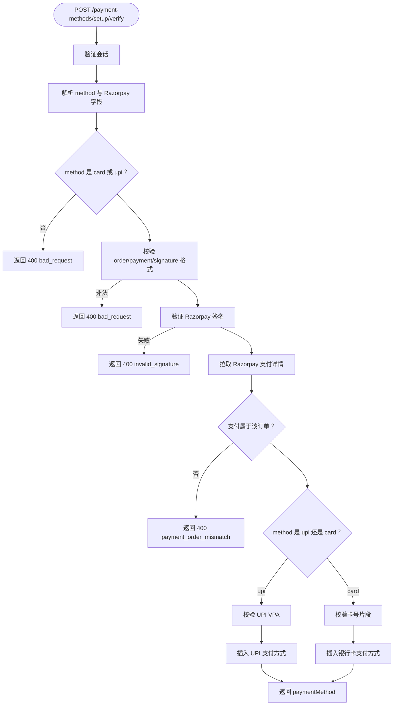
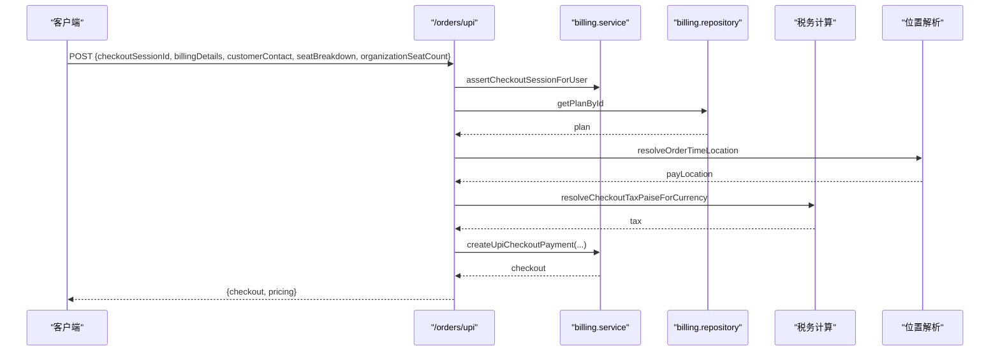
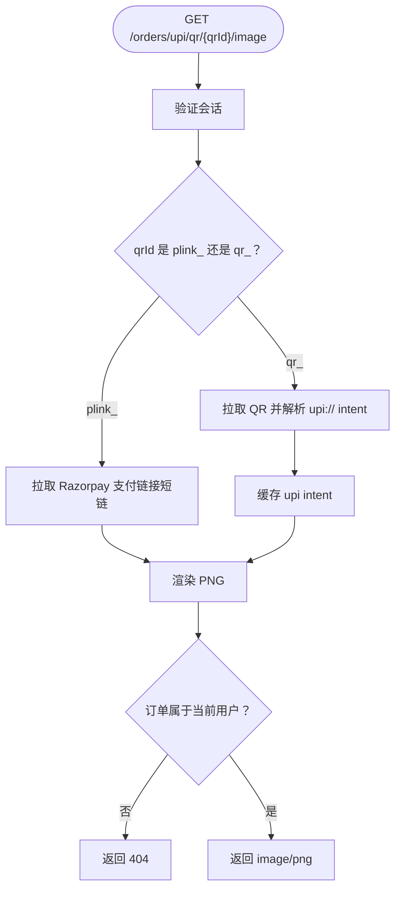
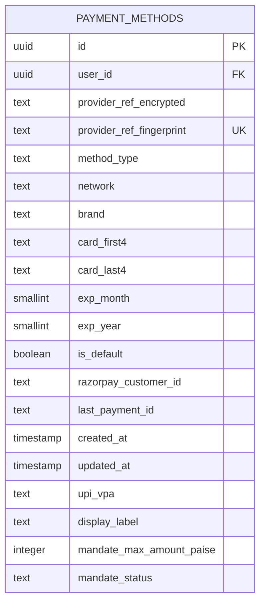
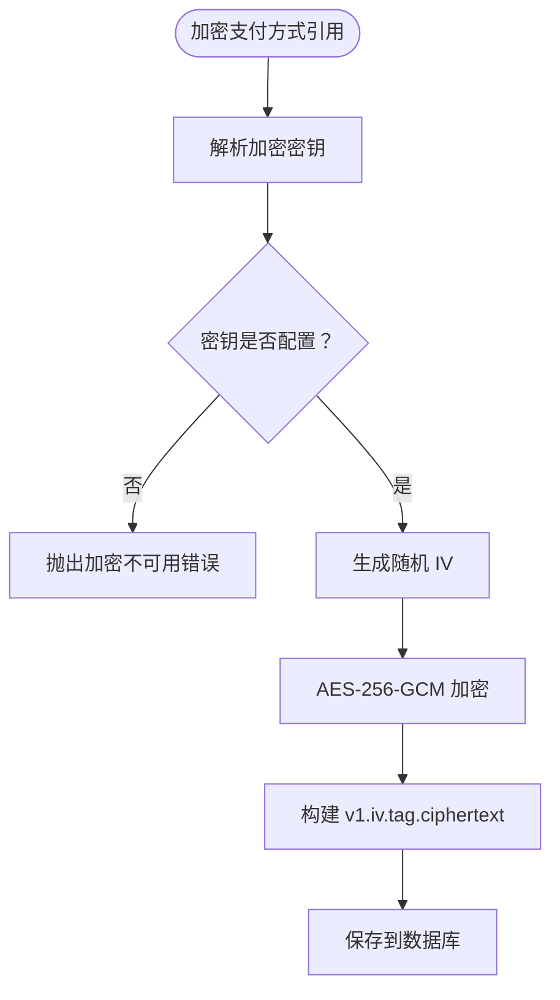

# 支付方式管理 API

<cite>
**本文引用的文件**   
- [src/app/api/v1/billing/payment-methods/route.ts](file://src/app/api/v1/billing/payment-methods/route.ts)
- [src/app/api/v1/billing/payment-methods/[id]/route.ts](file://src/app/api/v1/billing/payment-methods/[id]/route.ts)
- [src/app/api/v1/billing/payment-methods/setup/route.ts](file://src/app/api/v1/billing/payment-methods/setup/route.ts)
- [src/app/api/v1/billing/payment-methods/setup/verify/route.ts](file://src/app/api/v1/billing/payment-methods/setup/verify/route.ts)
- [src/app/api/v1/billing/orders/upi/route.ts](file://src/app/api/v1/billing/orders/upi/route.ts)
- [src/app/api/v1/billing/orders/upi/poll/route.ts](file://src/app/api/v1/billing/orders/upi/poll/route.ts)
- [src/app/api/v1/billing/orders/upi/qr/[qrId]/image/route.ts](file://src/app/api/v1/billing/orders/upi/qr/[qrId]/image/route.ts)
- [src/server/services/billing-profile.service.ts](file://src/server/services/billing-profile.service.ts)
- [src/server/billing/payment-method-crypto.ts](file://src/server/billing/payment-method-crypto.ts)
- [supabase/migrations/20260725143000_billing_addresses_payment_methods.sql](file://supabase/migrations/20260725143000_billing_addresses_payment_methods.sql)
- [supabase/migrations/20260725180000_payment_methods_upi_and_mandate.sql](file://supabase/migrations/20260725180000_payment_methods_upi_and_mandate.sql)
</cite>

## 目录
1. [简介](#简介)
2. [项目结构与路由范围](#项目结构与路由范围)
3. [核心组件与职责](#核心组件与职责)
4. [架构总览](#架构总览)
5. [支付方式管理 API](#支付方式管理-api)
6. [UPI 支付专用端点](#upi-支付专用端点)
7. [持久化存储模型](#持久化存储模型)
8. [加密与安全机制](#加密与安全机制)
9. [错误处理与状态码](#错误处理与状态码)
10. [性能与缓存特性](#性能与缓存特性)
11. [示例工作流](#示例工作流)
12. [安全最佳实践](#安全最佳实践)
13. [故障排查指南](#故障排查指南)
14. [结论](#结论)

## 简介
本文件面向后端开发者、集成方和安全审计人员，完整说明当前仓库中的支付方式管理 RESTful API。重点覆盖以下能力：
- 用户认证后的支付方式查询、设置默认方式、删除支付方式。
- 银行卡与 UPI 支付方式的绑定流程，包括 Razorpay Mandate 初始化与签名验证。
- UPI 支付场景下的 QR 码生成、轮询查询和结果获取。
- 支付方式的加密存储、PCI 安全约束、Row Level Security 访问控制。
- 支持类型：当前实现为 `card`（银行卡）和 `upi`（UPI），未实现钱包等其他类型。

## 项目结构与路由范围
支付方式相关 API 位于 Next.js App Router 的 `/api/v1/billing` 下；UPI 订单相关逻辑位于 `/api/v1/billing/orders/upi`。所有涉及敏感支付操作的接口均通过会话认证保护，并由服务端服务层与数据库迁移共同保障数据安全。

**图示来源**
- [src/app/api/v1/billing/payment-methods/route.ts:1-16](file://src/app/api/v1/billing/payment-methods/route.ts#L1-L16)
- [src/app/api/v1/billing/payment-methods/[id]/route.ts:1-44](file://src/app/api/v1/billing/payment-methods/[id]/route.ts#L1-L44)
- [src/app/api/v1/billing/payment-methods/setup/route.ts:1-49](file://src/app/api/v1/billing/payment-methods/setup/route.ts#L1-L49)
- [src/app/api/v1/billing/payment-methods/setup/verify/route.ts:1-56](file://src/app/api/v1/billing/payment-methods/setup/verify/route.ts#L1-L56)
- [src/app/api/v1/billing/orders/upi/route.ts:1-148](file://src/app/api/v1/billing/orders/upi/route.ts#L1-L148)
- [src/app/api/v1/billing/orders/upi/poll/route.ts:1-31](file://src/app/api/v1/billing/orders/upi/poll/route.ts#L1-L31)
- [src/app/api/v1/billing/orders/upi/qr/[qrId]/image/route.ts:1-99](file://src/app/api/v1/billing/orders/upi/qr/[qrId]/image/route.ts#L1-L99)

**章节来源**
- [src/app/api/v1/billing/payment-methods/route.ts:1-16](file://src/app/api/v1/billing/payment-methods/route.ts#L1-L16)
- [src/app/api/v1/billing/payment-methods/[id]/route.ts:1-44](file://src/app/api/v1/billing/payment-methods/[id]/route.ts#L1-L44)
- [src/app/api/v1/billing/payment-methods/setup/route.ts:1-49](file://src/app/api/v1/billing/payment-methods/setup/route.ts#L1-L49)
- [src/app/api/v1/billing/payment-methods/setup/verify/route.ts:1-56](file://src/app/api/v1/billing/payment-methods/setup/verify/route.ts#L1-L56)
- [src/app/api/v1/billing/orders/upi/route.ts:1-148](file://src/app/api/v1/billing/orders/upi/route.ts#L1-L148)
- [src/app/api/v1/billing/orders/upi/poll/route.ts:1-31](file://src/app/api/v1/billing/orders/upi/poll/route.ts#L1-L31)
- [src/app/api/v1/billing/orders/upi/qr/[qrId]/image/route.ts:1-99](file://src/app/api/v1/billing/orders/upi/qr/[qrId]/image/route.ts#L1-L99)

## 核心组件与职责
- **Next.js API 路由层**：负责参数校验、会话认证、请求路由到具体业务逻辑。
- **计费档案服务层**：封装支付方式列表、默认方式设置、删除、绑定初始化、绑定验证等核心流程。
- **加密模块**：使用 AES-256-GCM 对支付方式引用进行加密，并生成指纹用于去重与检索。
- **Razorpay 集成层**：负责 Mandate 绑定、支付链接、QR 码解析、签名校验、支付详情拉取。
- **Supabase 数据层**：提供 billing_addresses、payment_methods 表结构、RLS 策略、索引与约束。

**章节来源**
- [src/server/services/billing-profile.service.ts:1-200](file://src/server/services/billing-profile.service.ts#L1-L200)
- [src/server/billing/payment-method-crypto.ts:1-75](file://src/server/billing/payment-method-crypto.ts#L1-L75)
- [supabase/migrations/20260725143000_billing_addresses_payment_methods.sql:1-162](file://supabase/migrations/20260725143000_billing_addresses_payment_methods.sql#L1-L162)
- [supabase/migrations/20260725180000_payment_methods_upi_and_mandate.sql:1-31](file://supabase/migrations/20260725180000_payment_methods_upi_and_mandate.sql#L1-L31)

## 架构总览
支付方式管理遵循“前端不接触敏感凭据、服务端统一校验与落库”的架构模式。绑定流程依赖 Razorpay 的 Mandate 机制，支付流程则区分订阅结账与礼品结账两种路径，但都强制要求印度卢比和本地地理位置信息。

**图示来源**
- [src/app/api/v1/billing/payment-methods/setup/route.ts:1-49](file://src/app/api/v1/billing/payment-methods/setup/route.ts#L1-L49)
- [src/app/api/v1/billing/payment-methods/setup/verify/route.ts:1-56](file://src/app/api/v1/billing/payment-methods/setup/verify/route.ts#L1-L56)
- [src/server/services/billing-profile.service.ts:201-459](file://src/server/services/billing-profile.service.ts#L201-L459)

## 支付方式管理 API

### 通用说明
- 基础路径：`/api/v1/billing/payment-methods`
- 认证要求：全部需要有效会话。
- 响应格式：统一返回 JSON，包含 `paymentMethods`、`paymentMethod`、`ok` 等业务字段。
- 错误格式：使用 `AppError`，常见包含消息、HTTP 状态码和业务错误码。

#### 查询用户的支付方式
- **方法**：GET
- **路径**：`/api/v1/billing/payment-methods`
- **认证**：需要
- **行为**：返回当前用户的所有支付方式列表。
- **成功响应体字段**：
  - `paymentMethods`：数组，每项包含支付方式公开信息。
- **公开字段定义**：
  - `id`：支付方式主键。
  - `methodType`：`card` 或 `upi`。
  - `network`：卡组织网络，如 `visa`、`mastercard`、`amex`、`rupay`、`jcb`、`discover`、`upi`、`unknown`。
  - `brand`：品牌展示名称。
  - `cardFirst4`：仅显示前四位数字。
  - `cardLast4`：仅显示后四位数字。
  - `upiVpa`：UPI VPA，注意当前公开响应中会直接返回该字段，应谨慎暴露。
  - `maskedNumber`：UI 脱敏字符串，例如 `**** •••• •••• ••••` 或 UPI 脱敏形式。
  - `expMonth`：过期月份。
  - `expYear`：过期年份。
  - `isDefault`：是否默认。
  - `mandateMaxAmountPaise`：授权额度上限（单位为 Paise）。
  - `createdAt`：创建时间。

**章节来源**
- [src/app/api/v1/billing/payment-methods/route.ts:1-16](file://src/app/api/v1/billing/payment-methods/route.ts#L1-L16)
- [src/server/services/billing-profile.service.ts:1-200](file://src/server/services/billing-profile.service.ts#L1-L200)

#### 设置默认支付方式
- **方法**：PATCH
- **路径**：`/api/v1/billing/payment-methods/{id}`
- **认证**：需要
- **路径参数**：
  - `id`：UUID 格式的支付方式 ID，服务端会做严格正则校验。
- **请求体字段**：
  - `action`：固定值 `"set_default"`。
- **成功响应体字段**：
  - `paymentMethod`：更新后的支付方式对象。
- **失败情况**：
  - `id` 不是合法 UUID：返回 400，错误码 `bad_request`。
  - `action` 不支持：返回 400，错误码 `bad_request`。
  - 支付方式不存在：返回 404。

**图示来源**
- [src/app/api/v1/billing/payment-methods/[id]/route.ts:1-44](file://src/app/api/v1/billing/payment-methods/[id]/route.ts#L1-L44)
- [src/server/services/billing-profile.service.ts:201-240](file://src/server/services/billing-profile.service.ts#L201-L240)

**章节来源**
- [src/app/api/v1/billing/payment-methods/[id]/route.ts:1-44](file://src/app/api/v1/billing/payment-methods/[id]/route.ts#L1-L44)
- [src/server/services/billing-profile.service.ts:201-240](file://src/server/services/billing-profile.service.ts#L201-L240)

#### 删除支付方式
- **方法**：DELETE
- **路径**：`/api/v1/billing/payment-methods/{id}`
- **认证**：需要
- **路径参数**：
  - `id`：UUID 格式的支付方式 ID。
- **成功响应体字段**：
  - `ok`：布尔值，表示删除成功。
- **失败情况**：
  - `id` 非法：返回 400，错误码 `bad_request`。
  - 删除失败：由服务层或数据层抛出相应错误。

**章节来源**
- [src/app/api/v1/billing/payment-methods/[id]/route.ts:24-44](file://src/app/api/v1/billing/payment-methods/[id]/route.ts#L24-L44)
- [src/server/services/billing-profile.service.ts:241-250](file://src/server/services/billing-profile.service.ts#L241-L250)

#### 绑定支付方式
- **方法**：POST
- **路径**：`/api/v1/billing/payment-methods/setup`
- **认证**：需要
- **请求体字段**：
  - `method`：必须为 `"card"` 或 `"upi"`。
  - `contact`：可选，印度手机号码，必须以 `+91` 开头且长度为 10 位数字。
- **成功响应体字段**：
  - `setup`：包含 Razorpay 绑定所需信息，包括 `orderId`、`amount`、`currency`、`keyId`、`customerId`、`maxAmountPaise`、`method`，以及可选的 `contact`。
- **失败情况**：
  - `method` 不是 `card` 或 `upi`：返回 400。
  - 用户邮箱缺失：返回 400。
  - 联系方式无效：返回 400。
  - 加密配置缺失：返回 503，错误码 `encryption_unavailable`。
  - Razorpay 公共密钥缺失：返回 503，错误码 `billing_unavailable`。

**图示来源**
- [src/app/api/v1/billing/payment-methods/setup/route.ts:1-49](file://src/app/api/v1/billing/payment-methods/setup/route.ts#L1-L49)
- [src/server/services/billing-profile.service.ts:251-310](file://src/server/services/billing-profile.service.ts#L251-L310)

**章节来源**
- [src/app/api/v1/billing/payment-methods/setup/route.ts:1-49](file://src/app/api/v1/billing/payment-methods/setup/route.ts#L1-L49)
- [src/server/services/billing-profile.service.ts:251-310](file://src/server/services/billing-profile.service.ts#L251-L310)

#### 验证支付方式绑定
- **方法**：POST
- **路径**：`/api/v1/billing/payment-methods/setup/verify`
- **认证**：需要
- **请求体字段**：
  - `method`：必须为 `"card"` 或 `"upi"`。
  - `razorpayOrderId`：Razorpay 订单 ID，格式为 `order_` 加 8-40 位字母数字。
  - `razorpayPaymentId`：Razorpay 支付 ID，格式为 `pay_` 加 8-40 位字母数字。
  - `razorpaySignature`：64 位十六进制签名。
  - `cardFirst4`：可选，卡片前四位。
  - `upiVpa`：可选，UPI VPA。
  - `customerId`：可选，Razorpay 客户 ID。
- **成功响应体字段**：
  - `paymentMethod`：绑定成功的支付方式公开信息。
- **失败情况**：
  - `method` 非法：返回 400。
  - Razorpay 标识符格式错误或签名无效：返回 400，错误码 `invalid_signature`。
  - 支付不属于该订单：返回 400，错误码 `payment_order_mismatch`。
  - UPI VPA 格式非法：返回 400，错误码 `invalid_upi`。
  - 银行卡信息缺失：返回 400，错误码 `card_details_missing`。
  - 保存失败：返回 500，错误码 `save_failed`。

**图示来源**
- [src/app/api/v1/billing/payment-methods/setup/verify/route.ts:1-56](file://src/app/api/v1/billing/payment-methods/setup/verify/route.ts#L1-L56)
- [src/server/services/billing-profile.service.ts:311-459](file://src/server/services/billing-profile.service.ts#L311-L459)

**章节来源**
- [src/app/api/v1/billing/payment-methods/setup/verify/route.ts:1-56](file://src/app/api/v1/billing/payment-methods/setup/verify/route.ts#L1-L56)
- [src/server/services/billing-profile.service.ts:311-459](file://src/server/services/billing-profile.service.ts#L311-L459)

## UPI 支付专用端点

### 创建 UPI 支付订单
- **方法**：POST
- **路径**：`/api/v1/billing/orders/upi`
- **认证**：需要
- **请求体字段**：
  - `checkoutSessionId`：必填，关联的结账会话 ID。
  - `billingDetails`：可选，最小化账单信息。
  - `customerContact`：可选，用户提供的联系方式。
  - `seatBreakdown`：可选，席位拆分。
  - `organizationSeatCount`：可选，组织席位数量。
- **成功响应体字段**：
  - 返回 UPI 结账信息，包括定价摘要：
    - `pricing.subtotalPaise`
    - `pricing.taxPaise`
    - `pricing.totalPaise`
    - `pricing.taxLabel`
    - `pricing.gstExempt`
- **失败情况**：
  - 缺少 `checkoutSessionId`：返回 400。
  - 结账会话不属于当前用户：由服务层断言失败。
  - 计划不存在：返回 404。
  - 非印度卢比或非印度地区：返回 400，错误码 `invalid_currency`。

**图示来源**
- [src/app/api/v1/billing/orders/upi/route.ts:1-148](file://src/app/api/v1/billing/orders/upi/route.ts#L1-L148)

**章节来源**
- [src/app/api/v1/billing/orders/upi/route.ts:1-148](file://src/app/api/v1/billing/orders/upi/route.ts#L1-L148)

### UPI 支付轮询
- **方法**：POST
- **路径**：`/api/v1/billing/orders/upi/poll`
- **认证**：需要
- **请求体字段**：
  - `qrId`：必填，UPI QR 唯一 ID。
  - `billingOrderId`：必填，计费订单 ID。
- **成功响应体字段**：
  - 返回轮询结果，具体结构由 `billingService.pollUpiQrPayment` 决定。
- **失败情况**：
  - 缺少 `qrId` 或 `billingOrderId`：返回 400。

**章节来源**
- [src/app/api/v1/billing/orders/upi/poll/route.ts:1-31](file://src/app/api/v1/billing/orders/upi/poll/route.ts#L1-L31)

### UPI QR 码图片
- **方法**：GET
- **路径**：`/api/v1/billing/orders/upi/qr/{qrId}/image`
- **认证**：需要
- **路径参数**：
  - `qrId`：Razorpay QR ID，格式为 `qr_` 加 8-40 位字母数字；或支付链接 ID，格式为 `plink_` 加 8-40 位字母数字。
- **行为**：
  - 返回干净的 PNG QR 图片，Content-Type 为 `image/png`。
  - 禁止代理 Razorpay 的品牌营销卡片，始终从 `upi://` intent 或支付链接 URL 渲染原生方形 PNG。
  - 所有权校验：只有对应计费订单的用户才能获取该 QR 图片。
  - 缓存策略：
    - 支付链接首次获取时设为 `private, no-store`。
    - 正常 QR 使用 `private, max-age=120`。
  - 内部缓存：将解析到的 UPI intent 写入订单 metadata，后续轮询可跳过外部拉取。
- **失败情况**：
  - QR ID 格式非法：返回 400，错误码 `bad_request`。
  - 非订单所有者：返回 404。
  - 支付链接不可用：返回 502，错误码 `razorpay_error`。

**图示来源**
- [src/app/api/v1/billing/orders/upi/qr/[qrId]/image/route.ts:1-99](file://src/app/api/v1/billing/orders/upi/qr/[qrId]/image/route.ts#L1-L99)

**章节来源**
- [src/app/api/v1/billing/orders/upi/qr/[qrId]/image/route.ts:1-99](file://src/app/api/v1/billing/orders/upi/qr/[qrId]/image/route.ts#L1-L99)

## 持久化存储模型

### 支付方式表结构要点
- 表名：`payment_methods`
- 主要字段：
  - `id`：UUID 主键。
  - `user_id`：关联用户。
  - `provider_ref_encrypted`：加密后的 Razorpay 卡 ID 或 token ID。
  - `provider_ref_fingerprint`：加密引用指纹，用于去重。
  - `method_type`：`card` 或 `upi`。
  - `network`：卡组织网络。
  - `brand`：品牌。
  - `card_first4`、`card_last4`：仅显示前四、后四位数字。
  - `exp_month`、`exp_year`：过期月份与年份。
  - `is_default`：是否默认。
  - `razorpay_customer_id`：Razorpay 客户 ID。
  - `last_payment_id`：最后支付 ID。
  - `created_at`、`updated_at`：时间戳。
- UPI 扩展字段：
  - `upi_vpa`：UPI VPA。
  - `display_label`：显示标签。
  - `mandate_max_amount_paise`：授权额度上限。
  - `mandate_status`：授权状态。
- 约束与策略：
  - Row Level Security 启用，用户只能操作自己的记录。
  - 每个用户最多一个默认支付方式。
  - 银行卡行必须包含 `card_first4` 与 `card_last4`；UPI 行允许省略卡号字段。
  - 全量 PAN 永不存储。

**图示来源**
- [supabase/migrations/20260725143000_billing_addresses_payment_methods.sql:80-162](file://supabase/migrations/20260725143000_billing_addresses_payment_methods.sql#L80-L162)
- [supabase/migrations/20260725180000_payment_methods_upi_and_mandate.sql:1-31](file://supabase/migrations/20260725180000_payment_methods_upi_and_mandate.sql#L1-L31)

**章节来源**
- [supabase/migrations/20260725143000_billing_addresses_payment_methods.sql:1-162](file://supabase/migrations/20260725143000_billing_addresses_payment_methods.sql#L1-L162)
- [supabase/migrations/20260725180000_payment_methods_upi_and_mandate.sql:1-31](file://supabase/migrations/20260725180000_payment_methods_upi_and_mandate.sql#L1-L31)

## 加密与安全机制

### 加密方案
- 算法：AES-256-GCM。
- 输入：Razorpay 卡 ID、token ID 等 provider 引用，**绝不加密 PAN**。
- 输出：以 `v1.iv.tag.ciphertext` 形式拼接的 base64url 字符串。
- 密钥来源优先级：
  1. `PAYMENT_METHOD_ENCRYPTION_KEY`
  2. `RAZORPAY_KEY_SECRET`
  3. `JWT_SECRET`
- 密钥长度：接受 32 字节 hex 或任意口令，后者经 SHA-256 派生为 32 字节密钥。
- 指纹：对 provider 引用做 SHA-256，用于去重与索引。

### 安全要点
- 明文 PAN 永不进入系统。
- 仅存储前四、后四位数字用于 UI 脱敏。
- 绑定流程需验证 Razorpay 签名与支付归属。
- 所有敏感接口受会话认证保护。
- 数据库启用 RLS，限制用户只能访问自身数据。
- UPI VPA 在公开响应中仍可能暴露，建议前端只使用 `maskedNumber` 字段。

**图示来源**
- [src/server/billing/payment-method-crypto.ts:1-75](file://src/server/billing/payment-method-crypto.ts#L1-L75)

**章节来源**
- [src/server/billing/payment-method-crypto.ts:1-75](file://src/server/billing/payment-method-crypto.ts#L1-L75)
- [src/server/services/billing-profile.service.ts:311-459](file://src/server/services/billing-profile.service.ts#L311-L459)

## 错误处理与状态码
- 400：参数非法、方法不支持、签名无效、支付方式不匹配、货币或地区不合法。
- 404：支付方式不存在、QR 图片不存在。
- 502：Razorpay 外部错误。
- 503：加密不可用、Razorpay 公共密钥未配置。
- 错误码示例：
  - `bad_request`
  - `invalid_signature`
  - `payment_order_mismatch`
  - `invalid_upi`
  - `card_details_missing`
  - `save_failed`
  - `encryption_unavailable`
  - `billing_unavailable`
  - `invalid_currency`
  - `razorpay_error`

**章节来源**
- [src/app/api/v1/billing/payment-methods/[id]/route.ts:1-44](file://src/app/api/v1/billing/payment-methods/[id]/route.ts#L1-L44)
- [src/app/api/v1/billing/payment-methods/setup/route.ts:1-49](file://src/app/api/v1/billing/payment-methods/setup/route.ts#L1-L49)
- [src/app/api/v1/billing/payment-methods/setup/verify/route.ts:1-56](file://src/app/api/v1/billing/payment-methods/setup/verify/route.ts#L1-L56)
- [src/app/api/v1/billing/orders/upi/route.ts:1-148](file://src/app/api/v1/billing/orders/upi/route.ts#L1-L148)
- [src/app/api/v1/billing/orders/upi/qr/[qrId]/image/route.ts:1-99](file://src/app/api/v1/billing/orders/upi/qr/[qrId]/image/route.ts#L1-L99)

## 性能与缓存特性
- QR 图片缓存：
  - 首次支付链接 QR 使用 `private, no-store`。
  - 普通 QR 使用 `private, max-age=120`。
- UPI intent 缓存：
  - 将解析到的 `upi://` intent 写入订单 metadata，减少后续轮询对外部服务的重复调用。
- 支付方式列表：
  - 每次查询返回脱敏公开信息，避免传输敏感字段。
- 计费定价与税务：
  - 根据结账会话、计划、地区与货币计算子金额、税费与总价。

**章节来源**
- [src/app/api/v1/billing/orders/upi/qr/[qrId]/image/route.ts:1-99](file://src/app/api/v1/billing/orders/upi/qr/[qrId]/image/route.ts#L1-L99)
- [src/app/api/v1/billing/orders/upi/route.ts:1-148](file://src/app/api/v1/billing/orders/upi/route.ts#L1-L148)

## 示例工作流

### 绑定 UPI 支付方式
1. 客户端调用 `/api/v1/billing/payment-methods/setup`，传入 `method=upi` 与可选 `contact`。
2. 服务端创建 Razorpay Mandate 绑定订单并返回 `orderId`、`keyId` 等信息。
3. 客户端使用 Razorpay 客户端完成 UPI 授权。
4. 客户端调用 `/api/v1/billing/payment-methods/setup/verify`，传入 Razorpay 订单、支付、签名及 UPI VPA。
5. 服务端验证签名、拉取支付详情并保存加密后的 provider 引用。
6. 返回公开的支付方式信息，包含 `maskedNumber` 与 `mandateMaxAmountPaise`。

**章节来源**
- [src/app/api/v1/billing/payment-methods/setup/route.ts:1-49](file://src/app/api/v1/billing/payment-methods/setup/route.ts#L1-L49)
- [src/app/api/v1/billing/payment-methods/setup/verify/route.ts:1-56](file://src/app/api/v1/billing/payment-methods/setup/verify/route.ts#L1-L56)
- [src/server/services/billing-profile.service.ts:251-459](file://src/server/services/billing-profile.service.ts#L251-L459)

### 绑定银行卡支付方式
1. 客户端调用 `/api/v1/billing/payment-methods/setup`，传入 `method=card`。
2. 服务端创建 Razorpay Mandate 绑定订单。
3. 客户端完成银行卡授权。
4. 客户端调用 `/api/v1/billing/payment-methods/setup/verify`，传入 Razorpay 标识与 `cardFirst4`。
5. 服务端验证签名、检查卡号片段、保存加密引用。
6. 返回公开的支付方式信息。

**章节来源**
- [src/app/api/v1/billing/payment-methods/setup/route.ts:1-49](file://src/app/api/v1/billing/payment-methods/setup/route.ts#L1-L49)
- [src/app/api/v1/billing/payment-methods/setup/verify/route.ts:1-56](file://src/app/api/v1/billing/payment-methods/setup/verify/route.ts#L1-L56)
- [src/server/services/billing-profile.service.ts:311-459](file://src/server/services/billing-profile.service.ts#L311-L459)

### 创建 UPI 支付并轮询结果
1. 客户端调用 `/api/v1/billing/orders/upi`，传入 `checkoutSessionId`。
2. 服务端校验会话、计划、地区与货币，计算税费，创建 UPI 订单。
3. 客户端从 `/api/v1/billing/orders/upi/qr/{qrId}/image` 获取 QR 图片。
4. 客户端定时调用 `/api/v1/billing/orders/upi/poll`，传入 `qrId` 与 `billingOrderId`。
5. 服务端返回支付轮询结果，客户端据此完成 UI 状态更新。

**章节来源**
- [src/app/api/v1/billing/orders/upi/route.ts:1-148](file://src/app/api/v1/billing/orders/upi/route.ts#L1-L148)
- [src/app/api/v1/billing/orders/upi/qr/[qrId]/image/route.ts:1-99](file://src/app/api/v1/billing/orders/upi/qr/[qrId]/image/route.ts#L1-L99)
- [src/app/api/v1/billing/orders/upi/poll/route.ts:1-31](file://src/app/api/v1/billing/orders/upi/poll/route.ts#L1-L31)

## 安全最佳实践
- 不要在前端存储或传输 PAN；只使用前四、后四位数字进行展示。
- 使用 `maskedNumber` 字段进行 UI 脱敏，避免直接暴露 `upiVpa`。
- 所有敏感 API 必须携带有效会话令牌。
- 对 Razorpay 回调与签名进行服务端验证。
- 配置独立的 `PAYMENT_METHOD_ENCRYPTION_KEY`，避免依赖 Razorpay 或 JWT 密钥。
- 限制 UPI 与银行卡绑定的 `method` 枚举，不接受未知类型。
- 使用 Row Level Security 确保用户只能访问自己的支付方式与账单地址。
- 对 QR 图片接口进行所有权校验，防止跨用户泄露支付链接。

**章节来源**
- [src/server/services/billing-profile.service.ts:1-200](file://src/server/services/billing-profile.service.ts#L1-L200)
- [src/server/billing/payment-method-crypto.ts:1-75](file://src/server/billing/payment-method-crypto.ts#L1-L75)
- [supabase/migrations/20260725143000_billing_addresses_payment_methods.sql:1-162](file://supabase/migrations/20260725143000_billing_addresses_payment_methods.sql#L1-L162)
- [src/app/api/v1/billing/orders/upi/qr/[qrId]/image/route.ts:1-99](file://src/app/api/v1/billing/orders/upi/qr/[qrId]/image/route.ts#L1-L99)

## 故障排查指南
- **加密不可用**：
  - 现象：绑定流程返回 503 `encryption_unavailable`。
  - 排查：检查 `PAYMENT_METHOD_ENCRYPTION_KEY`、`RAZORPAY_KEY_SECRET`、`JWT_SECRET` 任一是否配置。
- **Razorpay 公共密钥缺失**：
  - 现象：绑定流程返回 503 `billing_unavailable`。
  - 排查：检查 `publicRazorpayKeyId` 或 `razorpayKeyId`。
- **签名无效**：
  - 现象：验证绑定返回 400 `invalid_signature`。
  - 排查：确认 Razorpay 订单 ID、支付 ID、签名格式正确，并由服务端重新验证。
- **支付不属于该订单**：
  - 现象：验证绑定返回 400 `payment_order_mismatch`。
  - 排查：核对 Razorpay 支付详情中的 `order_id` 与请求中的 `razorpayOrderId`。
- **UPI VPA 非法**：
  - 现象：验证绑定返回 400 `invalid_upi`。
  - 排查：检查 VPA 是否符合正则格式。
- **银行卡信息缺失**：
  - 现象：验证绑定返回 400 `card_details_missing`。
  - 排查：确认 Razorpay 返回了卡号片段或 token。
- **非印度货币或地区**：
  - 现象：创建 UPI 订单返回 400 `invalid_currency`。
  - 排查：确认结账会话、账单国家、IP 国家均为印度，货币为 INR。
- **QR 图片不可用**：
  - 现象：QR 图片返回 502 `razorpay_error`。
  - 排查：检查 Razorpay 支付链接是否可用，或 QR ID 是否有效。

**章节来源**
- [src/server/services/billing-profile.service.ts:251-459](file://src/server/services/billing-profile.service.ts#L251-L459)
- [src/server/billing/payment-method-crypto.ts:1-75](file://src/server/billing/payment-method-crypto.ts#L1-L75)
- [src/app/api/v1/billing/orders/upi/route.ts:1-148](file://src/app/api/v1/billing/orders/upi/route.ts#L1-L148)
- [src/app/api/v1/billing/orders/upi/qr/[qrId]/image/route.ts:1-99](file://src/app/api/v1/billing/orders/upi/qr/[qrId]/image/route.ts#L1-L99)

## 结论
当前支付方式管理 API 围绕银行卡与 UPI 两种类型展开，采用 Razorpay Mandate 完成绑定，并通过 AES-256-GCM 加密 provider 引用，结合 Supabase RLS 与严格字段约束，形成较为完整的 PCI 安全实践。UPI 支付链路提供了 QR 码图片、轮询查询与价格计算能力，适合印度本地支付场景。未来若扩展钱包或其他支付方式，应在路由层增加类型白名单，在服务层增加对应加密、校验与脱敏逻辑，并保持现有错误码与响应结构一致。