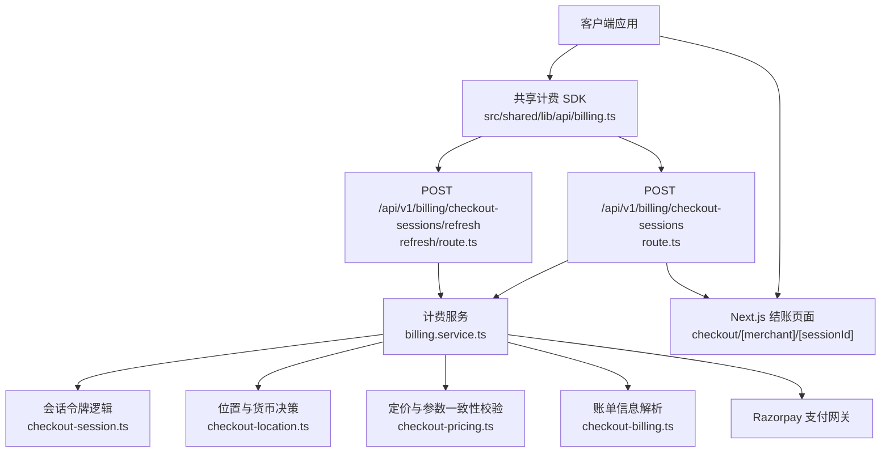
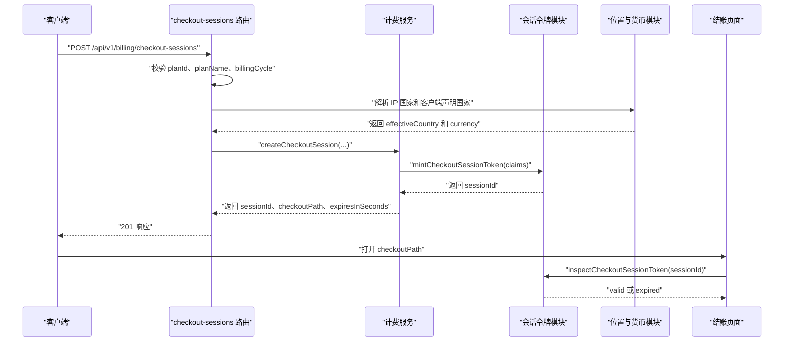
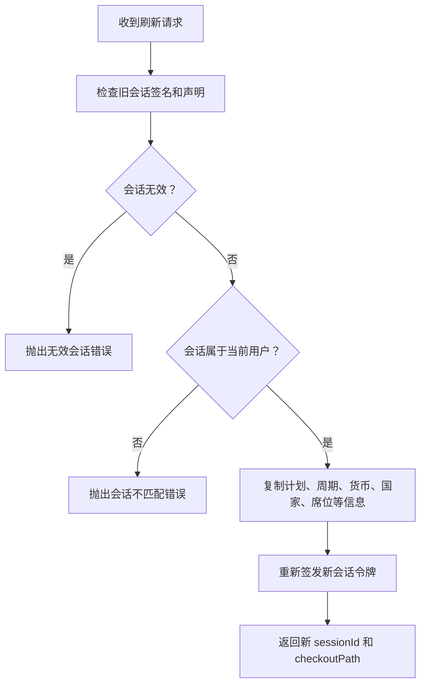
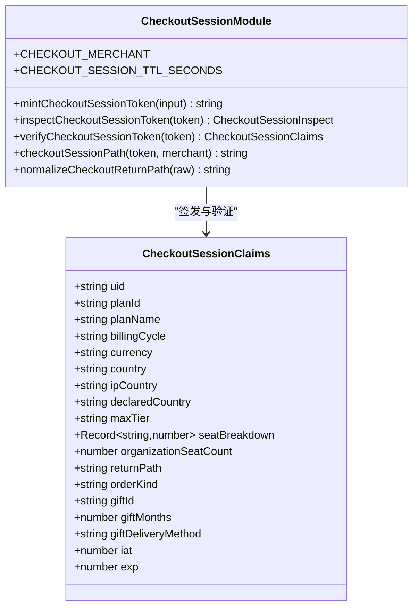
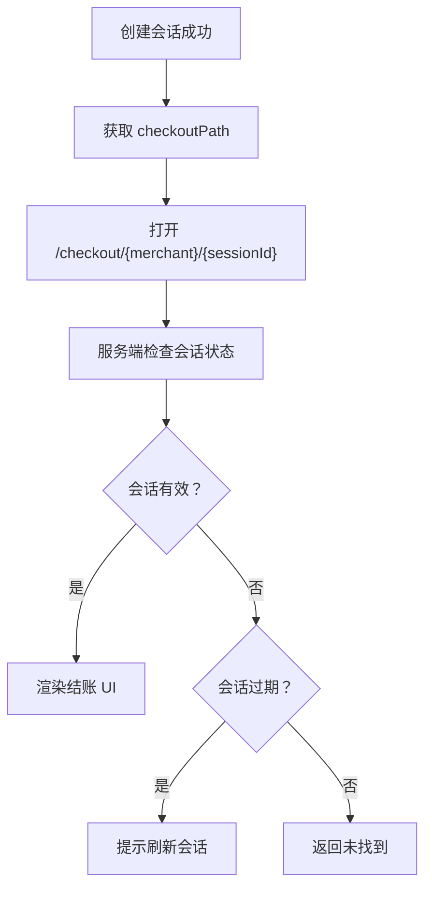
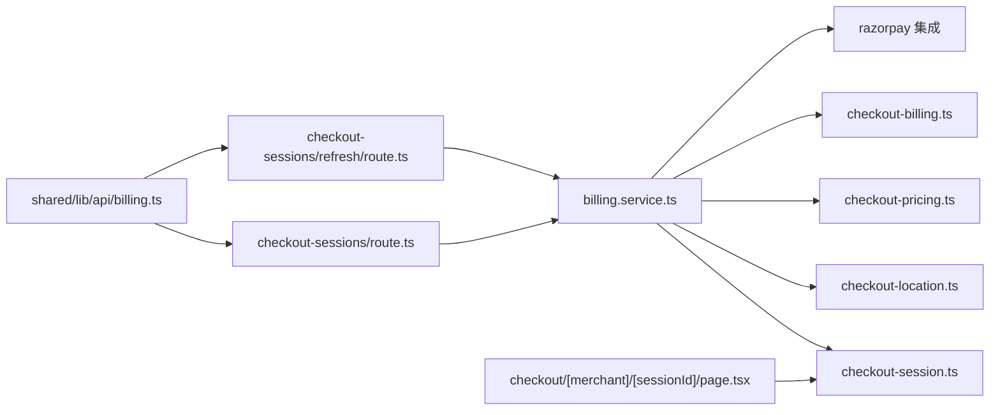
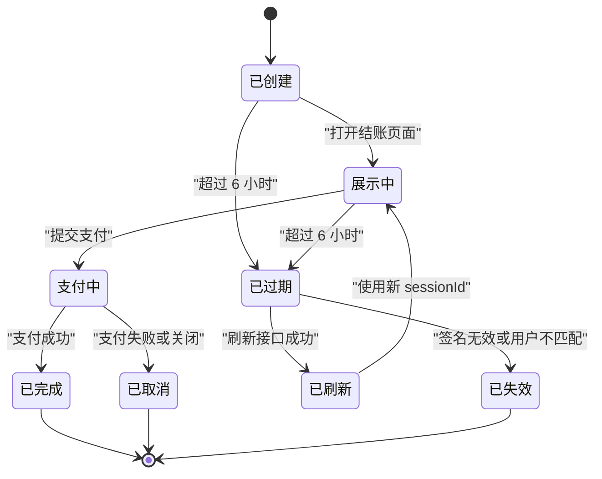
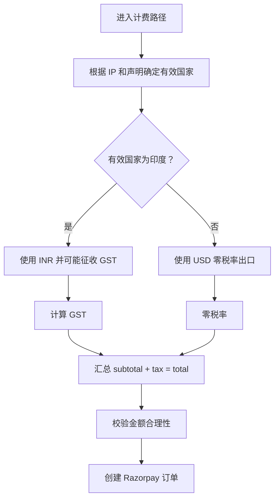
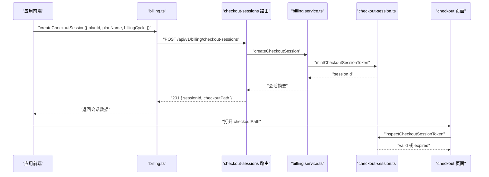
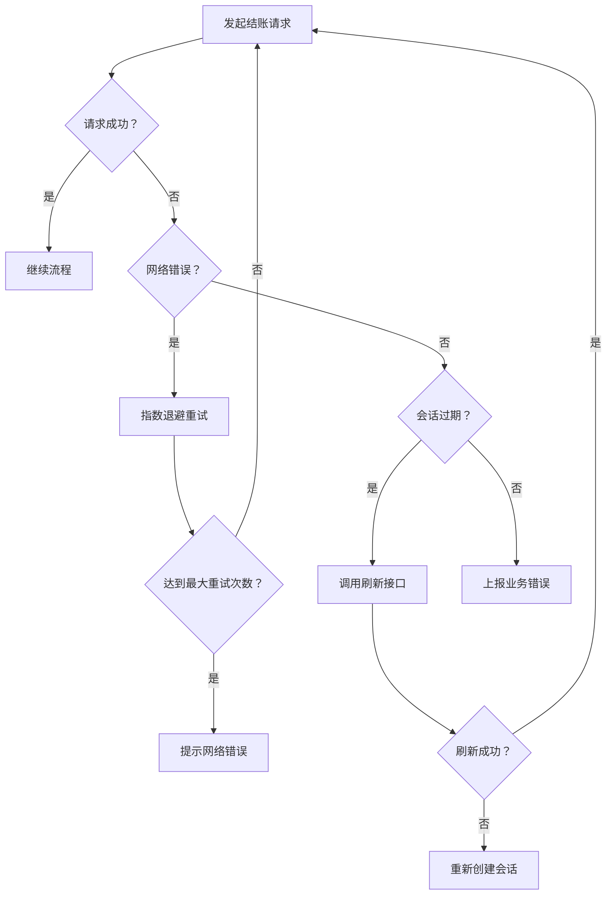

# 结账会话 API

<cite>
**本文引用的文件**   
- [src/app/api/v1/billing/checkout-sessions/route.ts](file://src/app/api/v1/billing/checkout-sessions/route.ts)
- [src/app/api/v1/billing/checkout-sessions/refresh/route.ts](file://src/app/api/v1/billing/checkout-sessions/refresh/route.ts)
- [src/server/services/billing.service.ts](file://src/server/services/billing.service.ts)
- [src/server/billing/checkout-session.ts](file://src/server/billing/checkout-session.ts)
- [src/server/billing/checkout-location.ts](file://src/server/billing/checkout-location.ts)
- [src/server/billing/checkout-billing.ts](file://src/server/billing/checkout-billing.ts)
- [src/server/billing/checkout-pricing.ts](file://src/server/billing/checkout-pricing.ts)
- [src/shared/lib/api/billing.ts](file://src/shared/lib/api/billing.ts)
- [src/app/checkout/[merchant]/[sessionId]/page.tsx](file://src/app/checkout/[merchant]/[sessionId]/page.tsx)
</cite>

## 目录

1. [简介](#简介)
2. [项目结构与边界](#项目结构与边界)
3. [核心接口定义](#核心接口定义)
4. [架构总览](#架构总览)
5. [详细组件分析](#详细组件分析)
6. [依赖关系分析](#依赖关系分析)
7. [会话生命周期与超时处理](#会话生命周期与超时处理)
8. [多币种、地址与税费逻辑](#多币种地址与税费逻辑)
9. [完整结账流程示例](#完整结账流程示例)
10. [错误处理与重试策略](#错误处理与重试策略)
11. [性能与可靠性建议](#性能与可靠性建议)
12. [故障排查指南](#故障排查指南)
13. [结论](#结论)

## 简介

本文档记录 **`/api/v1/billing/checkout-sessions`** 及其刷新端点 **`/api/v1/billing/checkout-sessions/refresh`** 的 RESTful 行为。该接口负责：

- 创建受签名保护的结账会话；
- 返回客户端用于跳转支付网关的 `checkoutPath`；
- 支持订阅和礼品购买两种订单类型；
- 在服务端统一计算国家、货币、税费和支付金额；
- 为过期但仍带有效签名的会话提供重新签发能力；
- 与 Razorpay 支付网关协作，完成 UPI、支付链接、二维码等支付方式；
- 将购物车数据（计划、计费周期、席位、组织席位数量）绑定到不可篡改的会话声明中。

本接口不是直接发起支付的最终入口，而是 **结账流程的第一步**：它生成会话令牌，让前端跳转到 Next.js 的结账页面 `/checkout/{merchant}/{sessionId}`，再由该页面驱动后续订单创建、支付网关交互和结果回调。

## 项目结构与边界

结账会话相关代码分布在以下层次：

| 层级 | 文件 | 职责 |
|---|---|---|
| 路由层 | `src/app/api/v1/billing/checkout-sessions/route.ts` | 接收 POST 请求，校验输入，调用服务层创建会话 |
| 刷新路由层 | `src/app/api/v1/billing/checkout-sessions/refresh/route.ts` | 接收刷新请求，校验旧会话并重新签发 |
| 服务层 | `src/server/services/billing.service.ts` | 封装会话创建、刷新、UPL 支付、订单创建等业务逻辑 |
| 会话安全层 | `src/server/billing/checkout-session.ts` | 签发、检查、验证会话令牌；定义 TTL 和返回路径白名单 |
| 地理位置层 | `src/server/billing/checkout-location.ts` | 根据 IP、客户端声明、支付工具判断最终国家 |
| 计费信息层 | `src/server/billing/checkout-billing.ts` | 解析最小化账单地址、GSTIN、公司名称等 |
| 定价层 | `src/server/billing/checkout-pricing.ts` | 校验客户端传入参数与签名会话一致，计算子总额 |
| 客户端 API | `src/shared/lib/api/billing.ts` | 前端 SDK，封装 `createCheckoutSession` 和 `refreshCheckoutSession` |
| 结账页面 | `src/app/checkout/[merchant]/[sessionId]/page.tsx` | 渲染结账客户端组件，处理过期会话重签提示 |



**图表来源**
- [src/app/api/v1/billing/checkout-sessions/route.ts:1-99](file://src/app/api/v1/billing/checkout-sessions/route.ts#L1-L99)
- [src/app/api/v1/billing/checkout-sessions/refresh/route.ts:1-31](file://src/app/api/v1/billing/checkout-sessions/refresh/route.ts#L1-L31)
- [src/server/services/billing.service.ts:1-200](file://src/server/services/billing.service.ts#L1-L200)
- [src/server/billing/checkout-session.ts:1-204](file://src/server/billing/checkout-session.ts#L1-L204)
- [src/server/billing/checkout-location.ts:1-197](file://src/server/billing/checkout-location.ts#L1-L197)
- [src/server/billing/checkout-billing.ts:1-200](file://src/server/billing/checkout-billing.ts#L1-L200)
- [src/server/billing/checkout-pricing.ts:1-200](file://src/server/billing/checkout-pricing.ts#L1-L200)
- [src/shared/lib/api/billing.ts:1-200](file://src/shared/lib/api/billing.ts#L1-L200)
- [src/app/checkout/[merchant]/[sessionId]/page.tsx:1-59](file://src/app/checkout/[merchant]/[sessionId]/page.tsx#L1-L59)

**章节来源**
- [src/app/api/v1/billing/checkout-sessions/route.ts:1-99](file://src/app/api/v1/billing/checkout-sessions/route.ts#L1-L99)
- [src/app/api/v1/billing/checkout-sessions/refresh/route.ts:1-31](file://src/app/api/v1/billing/checkout-sessions/refresh/route.ts#L1-L31)
- [src/shared/lib/api/billing.ts:1-200](file://src/shared/lib/api/billing.ts#L1-L200)

## 核心接口定义

### 创建结账会话

| 项目 | 说明 |
|---|---|
| URL | `POST /api/v1/billing/checkout-sessions` |
| 认证要求 | 需要已登录用户会话 |
| 运行时 | Node.js，强制动态路由 |
| 成功响应码 | `201 Created` |
| 失败响应码 | `400 Bad Request`、`401/403`（未通过认证或会话不匹配）、`503 Service Unavailable` |

#### 请求体字段

| 字段 | 类型 | 必填 | 默认值 | 约束与说明 |
|---|---|---:|---|---|
| `planId` | 字符串 | 是 | — | 计划标识，不能为空 |
| `planName` | 字符串 | 是 | — | 计划显示名称，不能为空 |
| `billingCycle` | `"monthly"` 或 `"yearly"` | 否 | `"monthly"` | 仅允许月度或年度 |
| `maxTier` | 字符串 | 否 | `null` | 可选的最大版本档位 |
| `seatBreakdown` | 对象 | 否 | `null` | 按席位类型的数量映射，用于团队计划 |
| `organizationSeatCount` | 数字 | 否 | `null` | 企业工作区计划的组织席位数量 |
| `currency` | 字符串 | 否 | 服务端决定 | **客户端传入值会被忽略**，由服务端基于国家推导 |
| `countryCode` | 字符串 | 否 | 无 | 客户端声明的国家代码，服务端会校验并与 IP 联合判定 |
| `returnPath` | 字符串 | 否 | `"/new"` | 支付成功后软导航的目标路径，受白名单限制 |
| `orderKind` | `"subscription"` 或 `"gift"` | 否 | `"subscription"` | 订单类型 |
| `giftId` | 字符串 | 条件必填 | `null` | 礼品购买时必填 |
| `giftMonths` | 整数 | 条件必填 | `null` | 礼品月份，范围 1–12 |
| `giftDeliveryMethod` | `"email"` 或 `"link"` | 条件必填 | `null` | 礼品交付方式 |

#### 响应体字段

| 字段 | 类型 | 说明 |
|---|---|---|
| `sessionId` | 字符串 | 结账会话令牌，以 `cs_live_` 开头 |
| `checkoutPath` | 字符串 | 支付网关跳转路径，形如 `/checkout/{merchant}/{sessionId}` |
| `returnPath` | 字符串 | 规范化后的支付成功返回路径 |
| `expiresInSeconds` | 数字 | 会话有效期秒数，当前实现为 6 小时 |

### 刷新结账会话

| 项目 | 说明 |
|---|---|
| URL | `POST /api/v1/billing/checkout-sessions/refresh` |
| 认证要求 | 需要已登录用户会话 |
| 运行时 | Node.js，强制动态路由 |
| 成功响应码 | `201 Created` |
| 失败响应码 | `400 Bad Request`、`403 Forbidden`、`503 Service Unavailable` |

#### 请求体字段

| 字段 | 类型 | 必填 | 说明 |
|---|---|---:|---|
| `sessionId` | 字符串 | 是 | 要刷新的原会话令牌 |

#### 响应体字段

与创建接口相同，返回新的 `sessionId`、`checkoutPath`、`returnPath` 和 `expiresInSeconds`。刷新不会改变原始会话中的计划、计费周期、货币、国家、席位等核心业务数据，只会重新签发令牌并重置有效期。

**章节来源**
- [src/app/api/v1/billing/checkout-sessions/route.ts:1-99](file://src/app/api/v1/billing/checkout-sessions/route.ts#L1-L99)
- [src/app/api/v1/billing/checkout-sessions/refresh/route.ts:1-31](file://src/app/api/v1/billing/checkout-sessions/refresh/route.ts#L1-L31)
- [src/shared/lib/api/billing.ts:120-200](file://src/shared/lib/api/billing.ts#L120-L200)

## 架构总览

结账会话 API 的职责是 **建立可信的结账上下文**，而不是直接执行支付。其调用链如下：



**图表来源**
- [src/app/api/v1/billing/checkout-sessions/route.ts:1-99](file://src/app/api/v1/billing/checkout-sessions/route.ts#L1-L99)
- [src/server/services/billing.service.ts:1-200](file://src/server/services/billing.service.ts#L1-L200)
- [src/server/billing/checkout-session.ts:1-204](file://src/server/billing/checkout-session.ts#L1-L204)
- [src/server/billing/checkout-location.ts:1-197](file://src/server/billing/checkout-location.ts#L1-L197)
- [src/app/checkout/[merchant]/[sessionId]/page.tsx:1-59](file://src/app/checkout/[merchant]/[sessionId]/page.tsx#L1-L59)

## 详细组件分析

### 路由层：创建结账会话

`POST /api/v1/billing/checkout-sessions` 是一个使用 `withApiHandler` 包装的路由处理器，具备以下特征：

- 必须携带已认证的用户会话；
- 校验 `planId` 和 `planName` 是否为非空字符串；
- 校验 `billingCycle` 只能是 `"monthly"` 或 `"yearly"`；
- 忽略客户端传入的 `currency`，改由服务端根据地理位置推导；
- 对礼品订单校验 `giftId`、`giftMonths` 和 `giftDeliveryMethod`；
- 调用 `billingService.createCheckoutSession` 生成会话；
- 返回 `201` 状态码和 JSON 响应。

需要注意：**客户端传入的 `currency` 不被信任**。真正的货币由 `resolveOrderTimeLocation` 根据 IP 国家和客户端声明国家共同决定。

**章节来源**
- [src/app/api/v1/billing/checkout-sessions/route.ts:1-99](file://src/app/api/v1/billing/checkout-sessions/route.ts#L1-L99)

### 路由层：刷新结账会话

`POST /api/v1/billing/checkout-sessions/refresh` 的职责更简单：

- 校验 `sessionId` 是否为非空字符串；
- 调用 `billingService.refreshCheckoutSession`；
- 返回新的会话令牌；
- 如果旧会话无效或属于其他用户，则抛出错误。

刷新端点适用于用户在支付页面停留过久、原会话已过期但签名仍然有效的场景。

**章节来源**
- [src/app/api/v1/billing/checkout-sessions/refresh/route.ts:1-31](file://src/app/api/v1/billing/checkout-sessions/refresh/route.ts#L1-L31)

### 服务层：会话创建与刷新

`billing.service.ts` 暴露两个关键函数：

- `createCheckoutSession`：把用户输入、计划信息、席位信息和返回路径打包成会话声明，调用 `mintCheckoutSessionToken`，并返回面向前端的会话摘要；
- `refreshCheckoutSession`：先检查原会话是否有效且属于当前用户，再把原会话中的业务声明复制到新会话中重新签发。

刷新逻辑的核心是 **保留原始业务上下文**，只刷新令牌本身。



**图表来源**
- [src/server/services/billing.service.ts:201-240](file://src/server/services/billing.service.ts#L201-L240)

**章节来源**
- [src/server/services/billing.service.ts:1-240](file://src/server/services/billing.service.ts#L1-L240)

### 会话令牌与安全模型

会话令牌格式为：

```
cs_live_<base64url 载荷>.<HMAC-SHA256 签名>
```

其中载荷包含：

| 字段 | 含义 |
|---|---|
| `uid` | 用户 ID |
| `planId` | 计划 ID |
| `planName` | 计划名称 |
| `billingCycle` | 月度或年度 |
| `currency` | 结算货币 |
| `country` | 服务端判定的有效国家 |
| `ipCountry` | 边缘节点 IP 国家 |
| `declaredCountry` | 客户端声明国家 |
| `maxTier` | 最大版本档位 |
| `seatBreakdown` | 席位分布 |
| `organizationSeatCount` | 组织席位数量 |
| `returnPath` | 支付后返回路径 |
| `orderKind` | 订单类型 |
| `giftId` | 礼品 ID |
| `giftMonths` | 礼品月份 |
| `giftDeliveryMethod` | 礼品交付方式 |
| `iat` | 签发时间戳 |
| `exp` | 过期时间戳 |

会话默认有效期为 **6 小时**，常量名为 `CHECKOUT_SESSION_TTL_SECONDS`。

安全性方面：

- 签名密钥优先使用 Razorpay 密钥配置，回退到 JWT 密钥；
- 使用 HMAC-SHA256 生成签名；
- 使用恒定时间比较防止时序攻击；
- 区分“无效”“过期”“有效”三种状态；
- 过期但仍签名的会话可被刷新；
- 被篡改的会话无法刷新。



**图表来源**
- [src/server/billing/checkout-session.ts:1-204](file://src/server/billing/checkout-session.ts#L1-L204)

**章节来源**
- [src/server/billing/checkout-session.ts:1-204](file://src/server/billing/checkout-session.ts#L1-L204)

### 地理位置、货币与税费

地理位置决策遵循保守原则：**只要存在印度信号，就倾向按印度处理**，从而避免客户通过虚假声明规避印度 GST。

检测证据包括：

1. 客户端声明的国家；
2. 边缘 IP 国家；
3. 支付工具线索（UPI、Netbanking、RuPay、国内卡等）。

订单时间点的决策规则：

- 任一信号为印度 → 有效国家为印度，使用 INR，可能征收 18% GST；
- 两个信号均非印度 → 使用 USD，零税率出口；
- 冲突时保守判定为印度。

支付工具完成后，系统会根据支付工具快照更新最终国家判定，例如 UPI 或 RuPay 会被视为印度支付渠道。

税费计算由 `checkout-billing.ts` 和 `checkout-tax` 类型配合完成，最终金额以“paise”为单位传给 Razorpay。

**章节来源**
- [src/server/billing/checkout-location.ts:1-197](file://src/server/billing/checkout-location.ts#L1-L197)
- [src/server/billing/checkout-billing.ts:1-200](file://src/server/billing/checkout-billing.ts#L1-L200)

### 计费地址与身份信息

计费地址输入分为最小化模式和兼容模式：

| 字段 | 用途 |
|---|---|
| `purchasingAsBusiness` | 是否以企业身份采购 |
| `gstin` | 印度 GSTIN，仅在启用企业采购且提供时校验 |
| `billToName` | 发票抬头 |
| `fullName` | 联系人姓名 |
| `countryCode` | ISO-2 国家代码 |
| `addressLine` | 账单地址行 |

系统会对姓名、地址、GSTIN 进行长度、字符集和格式校验。若地址不完整，会拒绝结账。

**章节来源**
- [src/server/billing/checkout-billing.ts:1-200](file://src/server/billing/checkout-billing.ts#L1-L200)

### 定价与购物车数据同步

`checkout-pricing.ts` 的核心职责是 **防止客户端篡改购物车数据**：

- 校验客户端传入的 `planId`、`billingCycle`、`currency`、`maxTier`、`seatBreakdown`、`organizationSeatCount` 是否与签名会话一致；
- 对团队计划校验席位总数是否在配置范围内；
- 对企业工作区计划校验组织席位数量；
- 将席位价格转换为 paise；
- 返回可用于后续支付创建的子总额。

这使“购物车数据”不再只是前端状态，而是由服务端签名锁定的业务契约。

**章节来源**
- [src/server/billing/checkout-pricing.ts:1-200](file://src/server/billing/checkout-pricing.ts#L1-L200)

### 支付网关跳转 URL 生成

会话创建接口不直接返回 Razorpay 的支付 URL。它返回：

- `sessionId`；
- `checkoutPath`，形如 `/checkout/shirova/{sessionId}`；
- `returnPath`；
- `expiresInSeconds`。

客户端应打开 `checkoutPath`，由 Next.js 页面加载 `CheckoutSessionClient` 组件，并根据会话是否过期决定是否调用刷新接口。



**图表来源**
- [src/server/services/billing.service.ts:1-200](file://src/server/services/billing.service.ts#L1-L200)
- [src/server/billing/checkout-session.ts:180-204](file://src/server/billing/checkout-session.ts#L180-L204)
- [src/app/checkout/[merchant]/[sessionId]/page.tsx:1-59](file://src/app/checkout/[merchant]/[sessionId]/page.tsx#L1-L59)

**章节来源**
- [src/app/checkout/[merchant]/[sessionId]/page.tsx:1-59](file://src/app/checkout/[merchant]/[sessionId]/page.tsx#L1-L59)

## 依赖关系分析



**图表来源**
- [src/app/api/v1/billing/checkout-sessions/route.ts:1-99](file://src/app/api/v1/billing/checkout-sessions/route.ts#L1-L99)
- [src/app/api/v1/billing/checkout-sessions/refresh/route.ts:1-31](file://src/app/api/v1/billing/checkout-sessions/refresh/route.ts#L1-L31)
- [src/server/services/billing.service.ts:1-240](file://src/server/services/billing.service.ts#L1-L240)
- [src/server/billing/checkout-session.ts:1-204](file://src/server/billing/checkout-session.ts#L1-L204)
- [src/server/billing/checkout-location.ts:1-197](file://src/server/billing/checkout-location.ts#L1-L197)
- [src/server/billing/checkout-pricing.ts:1-200](file://src/server/billing/checkout-pricing.ts#L1-L200)
- [src/server/billing/checkout-billing.ts:1-200](file://src/server/billing/checkout-billing.ts#L1-L200)
- [src/shared/lib/api/billing.ts:1-200](file://src/shared/lib/api/billing.ts#L1-L200)
- [src/app/checkout/[merchant]/[sessionId]/page.tsx:1-59](file://src/app/checkout/[merchant]/[sessionId]/page.tsx#L1-L59)

**章节来源**
- [src/shared/lib/api/billing.ts:1-200](file://src/shared/lib/api/billing.ts#L1-L200)
- [src/server/services/billing.service.ts:1-240](file://src/server/services/billing.service.ts#L1-L240)

## 会话生命周期与超时处理

### 生命周期阶段

| 阶段 | 描述 |
|---|---|
| 创建 | 客户端调用创建接口，服务端签发带签名的会话令牌 |
| 展示 | 客户端打开 `/checkout/{merchant}/{sessionId}` |
| 支付准备 | 前端根据计划、货币、税费生成支付请求 |
| 支付进行中 | Razorpay 处理 UPI、二维码、支付链接或卡片支付 |
| 支付完成 | 支付网关回调或前端轮询确认订单状态 |
| 过期 | 超过 6 小时后，会话仍签名但状态变为过期 |
| 刷新 | 同一用户可刷新过期会话，获得新令牌 |
| 失效 | 签名被篡改或不属于当前用户，会话不可刷新 |

### 超时处理

- 会话默认有效期为 6 小时；
- 过期会话在 Next.js 结账页面会被识别为 `needsSessionRemint`；
- 前端可调用刷新接口获取新的 `sessionId` 和 `checkoutPath`；
- 刷新接口要求旧会话签名有效且属于当前用户；
- 被篡改的会话无法刷新，应引导用户重新创建会话。



**图表来源**
- [src/server/billing/checkout-session.ts:1-120](file://src/server/billing/checkout-session.ts#L1-L120)
- [src/server/services/billing.service.ts:201-240](file://src/server/services/billing.service.ts#L201-L240)
- [src/app/checkout/[merchant]/[sessionId]/page.tsx:1-59](file://src/app/checkout/[merchant]/[sessionId]/page.tsx#L1-L59)

**章节来源**
- [src/server/billing/checkout-session.ts:1-120](file://src/server/billing/checkout-session.ts#L1-L120)
- [src/server/services/billing.service.ts:201-240](file://src/server/services/billing.service.ts#L201-L240)
- [src/app/checkout/[merchant]/[sessionId]/page.tsx:1-59](file://src/app/checkout/[merchant]/[sessionId]/page.tsx#L1-L59)

## 多币种、地址与税费逻辑

### 多币种支持

当前实现主要围绕以下货币：

- **INR**：印度卢比，适用于印度境内交易，可能产生 18% GST；
- **USD**：美元，适用于非印度出口交易，通常为零税率。

客户端可以请求指定货币，但 **创建会话路由会忽略该值**，由服务端根据地理位置决定。后续支付创建流程还会校验客户端传入的货币是否与签名会话一致，防止篡改。

UPI 支付目前仅支持 INR。

### 地址信息收集

结账流程支持两类地址信息：

1. 用户上下文中的基础信息；
2. 最小化结账账单输入，包括企业名称、GSTIN、联系人、国家、地址行。

服务器会：

- 合并用户显示名、邮箱和本地输入；
- 校验 GSTIN 是否合法；
- 校验国家代码是否已知；
- 确保地址完整；
- 将地址用于税费计算和发票信息。

### 税费计算逻辑

税费计算发生在订单创建阶段，而非会话创建阶段。核心规则：

- 有效国家为印度时使用 INR 并可能征收 GST；
- 有效国家非印度时使用 USD 并按出口零税率处理；
- 税费以 paise 为单位参与 Razorpay 订单金额；
- 总金额有上限保护，防止异常金额；
- 支付工具确认后，可进一步修正最终国家判定。



**图表来源**
- [src/server/billing/checkout-location.ts:60-120](file://src/server/billing/checkout-location.ts#L60-L120)
- [src/server/services/billing.service.ts:240-350](file://src/server/services/billing.service.ts#L240-L350)
- [src/server/billing/checkout-billing.ts:1-200](file://src/server/billing/checkout-billing.ts#L1-L200)

**章节来源**
- [src/server/billing/checkout-location.ts:1-197](file://src/server/billing/checkout-location.ts#L1-L197)
- [src/server/billing/checkout-billing.ts:1-200](file://src/server/billing/checkout-billing.ts#L1-L200)
- [src/server/services/billing.service.ts:240-350](file://src/server/services/billing.service.ts#L240-L350)

## 完整结账流程示例

以下示例描述一个订阅结账流程。注意：实际实现中，支付细节可能在后续订单和支付接口中完成，本节重点说明会话创建与跳转。

### 订阅订阅流程

1. 前端调用 `createCheckoutSession`，传入计划 ID、计划名称、计费周期、可选席位信息和返回路径；
2. 服务端校验输入，解析国家与货币，签发会话；
3. 前端收到 `sessionId` 和 `checkoutPath`；
4. 前端打开 `/checkout/shirova/{sessionId}`；
5. Next.js 页面检查会话状态；
6. 若会话过期，前端调用刷新接口；
7. 刷新成功后继续渲染结账界面；
8. 前端根据会话中的计划、货币、税费构建支付请求；
9. 支付完成后根据 `returnPath` 进行软导航。



**图表来源**
- [src/shared/lib/api/billing.ts:120-200](file://src/shared/lib/api/billing.ts#L120-L200)
- [src/app/api/v1/billing/checkout-sessions/route.ts:1-99](file://src/app/api/v1/billing/checkout-sessions/route.ts#L1-L99)
- [src/server/services/billing.service.ts:1-200](file://src/server/services/billing.service.ts#L1-L200)
- [src/server/billing/checkout-session.ts:1-120](file://src/server/billing/checkout-session.ts#L1-L120)
- [src/app/checkout/[merchant]/[sessionId]/page.tsx:1-59](file://src/app/checkout/[merchant]/[sessionId]/page.tsx#L1-L59)

### 礼品购买流程

礼品购买在会话创建时额外携带：

- `orderKind: "gift"`；
- `giftId`；
- `giftMonths`；
- `giftDeliveryMethod`。

这些字段会被写入会话声明，并在结账页面传递给客户端组件，以便正确处理礼品购买逻辑。

**章节来源**
- [src/app/api/v1/billing/checkout-sessions/route.ts:1-99](file://src/app/api/v1/billing/checkout-sessions/route.ts#L1-L99)
- [src/server/billing/checkout-session.ts:1-120](file://src/server/billing/checkout-session.ts#L1-L120)
- [src/app/checkout/[merchant]/[sessionId]/page.tsx:1-59](file://src/app/checkout/[merchant]/[sessionId]/page.tsx#L1-L59)

## 错误处理与重试策略

### 常见错误

| 错误场景 | 典型原因 | 建议处理方式 |
|---|---|---|
| 缺少 `planId` | 前端未传递计划标识 | 阻止创建，提示用户选择计划 |
| 缺少 `planName` | 前端未传递计划名称 | 阻止创建，使用计划目录名称 |
| 非法 `billingCycle` | 前端传入非月度或非年度值 | 拒绝请求，不允许自定义周期 |
| 礼品缺少 `giftId` | 礼品购买未绑定礼品 | 阻止创建，引导用户选择礼品 |
| 礼品月份超出范围 | 前端传入小于 1 或大于 12 的值 | 拒绝请求，限制为 1–12 |
| 会话无效 | 签名错误或格式错误 | 不刷新，引导重新创建 |
| 会话过期 | 超过 6 小时 | 调用刷新接口 |
| 会话不匹配 | 旧会话不属于当前用户 | 拒绝刷新，清理本地状态 |
| 货币不匹配 | 客户端篡改货币 | 拒绝支付创建 |
| 席位不匹配 | 客户端篡改席位 | 拒绝支付创建 |
| 计费地址不完整 | 地址缺失或格式错误 | 阻止支付，要求补全地址 |
| 支付网关未配置 | Razorpay 密钥缺失 | 返回 503，提示暂时不可用 |

### 重试策略

推荐的前端重试策略：

1. **网络错误**：使用指数退避重试，最多 3 次；
2. **会话过期**：立即调用刷新接口一次；
3. **刷新失败**：如果返回无效会话或用户不匹配，重新创建会话；
4. **支付网关错误**：区分临时错误和永久错误，临时错误可重试，永久错误需提示用户；
5. **幂等性**：不要重复提交支付请求；应依赖后端订单 ID 或支付 ID 做去重。



**图表来源**
- [src/app/api/v1/billing/checkout-sessions/refresh/route.ts:1-31](file://src/app/api/v1/billing/checkout-sessions/refresh/route.ts#L1-L31)
- [src/server/billing/checkout-session.ts:80-160](file://src/server/billing/checkout-session.ts#L80-L160)
- [src/server/services/billing.service.ts:201-240](file://src/server/services/billing.service.ts#L201-L240)

**章节来源**
- [src/app/api/v1/billing/checkout-sessions/route.ts:1-99](file://src/app/api/v1/billing/checkout-sessions/route.ts#L1-L99)
- [src/app/api/v1/billing/checkout-sessions/refresh/route.ts:1-31](file://src/app/api/v1/billing/checkout-sessions/refresh/route.ts#L1-L31)
- [src/server/billing/checkout-session.ts:80-160](file://src/server/billing/checkout-session.ts#L80-L160)
- [src/server/services/billing.service.ts:201-240](file://src/server/services/billing.service.ts#L201-L240)

## 性能与可靠性建议

- **会话创建应避免频繁刷新**：只在检测到过期或用户明确操作时刷新；
- **前端缓存计划目录**：减少重复查询计划列表；
- **避免重复支付提交**：使用后端订单 ID 做幂等控制；
- **分离会话创建与支付创建**：会话只承载意图，支付金额和税费由服务端在支付创建时重新计算；
- **合理设置超时**：Razorpay 调用和网络请求应有独立超时；
- **监控 503 错误**：当 Razorpay 密钥未配置或服务不可用时，前端应降级提示；
- **日志脱敏**：记录会话 ID 时避免记录完整签名敏感内容，至少记录前缀和哈希。

[本节为通用性能建议，不直接分析具体源码文件]

## 故障排查指南

### 如何判断会话是否过期

- 查看 `expiresInSeconds`；
- 在前端比较会话创建时间与当前时间；
- 打开结账页面后观察是否需要刷新；
- 刷新接口返回 400 或 403 通常表示会话无效或用户不匹配。

### 如何定位税费问题

- 检查有效国家是否为印度；
- 检查客户端声明国家与 IP 国家是否冲突；
- 检查是否提供了正确的 GSTIN；
- 检查地址是否完整；
- 检查最终货币是否为预期值；
- 检查 Razorpay 订单金额是否与 subtotal + tax 一致。

### 如何排查购物车篡改

- 核对 `planId`、`billingCycle`、`currency`、`maxTier`、`seatBreakdown`、`organizationSeatCount`；
- 任何不一致都会触发“会话不匹配”类错误；
- 不要信任前端传来的最终金额，应以服务端定价为准。

### 常见问题对照表

| 现象 | 可能原因 | 排查步骤 |
|---|---|---|
| 创建会话返回 400 | 缺少必要字段或字段格式错误 | 检查 `planId`、`planName`、`billingCycle` |
| 刷新返回 403 | 旧会话不属于当前用户 | 检查用户身份和会话归属 |
| 结账页面找不到 | 会话签名无效 | 检查是否篡改或传错 sessionId |
| UPI 支付失败 | 货币不是 INR | 检查地理位置和货币推导 |
| 支付金额异常 | 客户端篡改购物车 | 检查服务端定价和会话一致性 |
| 支付网关不可用 | Razorpay 密钥未配置 | 检查环境变量和部署配置 |

**章节来源**
- [src/app/api/v1/billing/checkout-sessions/route.ts:1-99](file://src/app/api/v1/billing/checkout-sessions/route.ts#L1-L99)
- [src/app/api/v1/billing/checkout-sessions/refresh/route.ts:1-31](file://src/app/api/v1/billing/checkout-sessions/refresh/route.ts#L1-L31)
- [src/server/billing/checkout-session.ts:80-160](file://src/server/billing/checkout-session.ts#L80-L160)
- [src/server/billing/checkout-location.ts:60-197](file://src/server/billing/checkout-location.ts#L60-L197)
- [src/server/billing/checkout-pricing.ts:1-200](file://src/server/billing/checkout-pricing.ts#L1-L200)
- [src/server/billing/checkout-billing.ts:1-200](file://src/server/billing/checkout-billing.ts#L1-L200)

## 结论

`/api/v1/billing/checkout-sessions` 是结账流程的信任锚点。它通过签名会话令牌把用户、计划、货币、国家、税费、席位和返回路径绑定在一起，防止前端篡改购物车数据，并为后续支付网关跳转提供安全上下文。

关键设计要点包括：

- 会话有效期为 6 小时，支持过期刷新；
- 客户端货币不被信任，由国家和服务端逻辑决定；
- 印度交易保守采用 INR 和 GST；
- 非印度交易采用 USD 零税率；
- 计费地址和 GSTIN 在服务端严格校验；
- 会话令牌与支付网关跳转路径分离，便于前端灵活处理支付状态；
- 刷新接口只能用于签名有效且属于当前用户的过期会话。

对外部集成方而言，最安全的做法是：

- 始终调用服务端接口创建会话；
- 不自行拼接支付金额；
- 不绕过会话直接提交支付；
- 正确处理过期和刷新；
- 将 Razorpay 回调作为最终支付结果依据。

[本节为总结性内容，不直接分析具体源码文件]