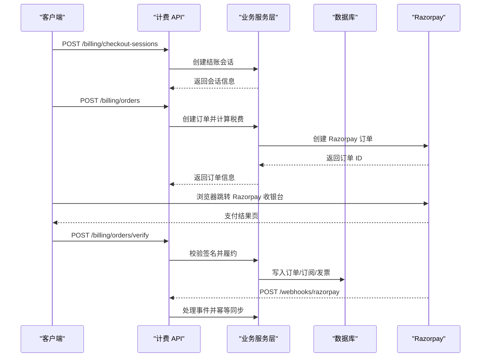
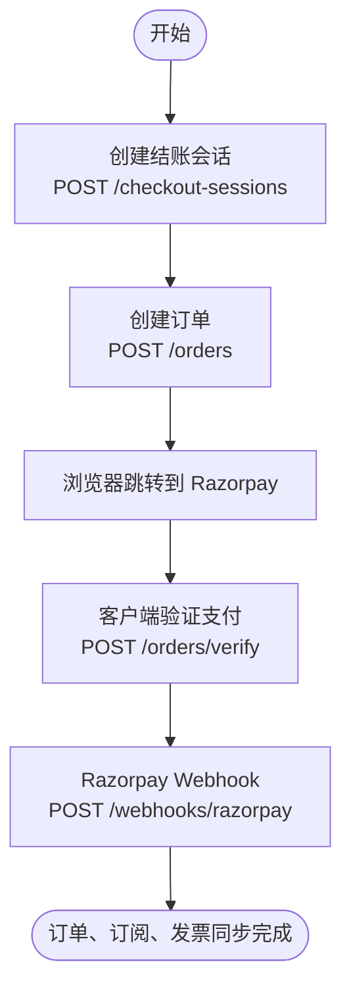
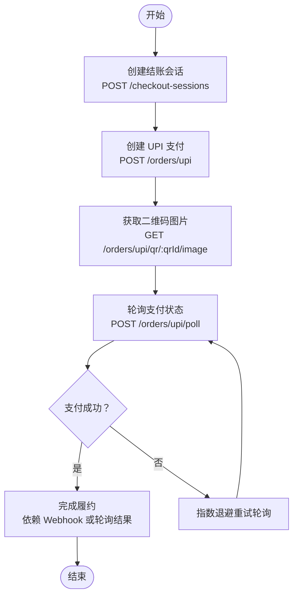
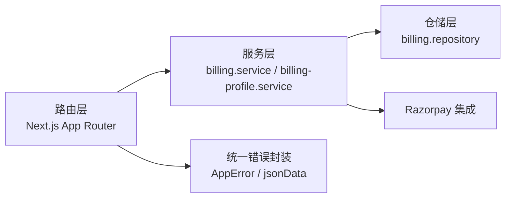

# 计费支付 API

<cite>
**本文引用的文件**   
- [src/app/api/v1/billing/plans/route.ts](file://src/app/api/v1/billing/plans/route.ts)
- [src/app/api/v1/billing/subscription/route.ts](file://src/app/api/v1/billing/subscription/route.ts)
- [src/app/api/v1/billing/checkout-sessions/route.ts](file://src/app/api/v1/billing/checkout-sessions/route.ts)
- [src/app/api/v1/billing/checkout-sessions/refresh/route.ts](file://src/app/api/v1/billing/checkout-sessions/refresh/route.ts)
- [src/app/api/v1/billing/orders/route.ts](file://src/app/api/v1/billing/orders/route.ts)
- [src/app/api/v1/billing/orders/upi/route.ts](file://src/app/api/v1/billing/orders/upi/route.ts)
- [src/app/api/v1/billing/orders/upi/poll/route.ts](file://src/app/api/v1/billing/orders/upi/poll/route.ts)
- [src/app/api/v1/billing/orders/upi/qr/[qrId]/image/route.ts](file://src/app/api/v1/billing/orders/upi/qr/%5BqrId%5D/image/route.ts)
- [src/app/api/v1/billing/orders/verify/route.ts](file://src/app/api/v1/billing/orders/verify/route.ts)
- [src/app/api/v1/billing/orders/razorpay-callback/route.ts](file://src/app/api/v1/billing/orders/razorpay-callback/route.ts)
- [src/app/api/v1/billing/invoices/route.ts](file://src/app/api/v1/billing/invoices/route.ts)
- [src/app/api/v1/billing/invoices/[paymentId]/route.ts](file://src/app/api/v1/billing/invoices/%5BpaymentId%5D/route.ts)
- [src/app/api/v1/billing/invoices/[paymentId]/pdf/route.ts](file://src/app/api/v1/billing/invoices/%5BpaymentId%5D/pdf/route.ts)
- [src/app/api/v1/billing/payment-methods/route.ts](file://src/app/api/v1/billing/payment-methods/route.ts)
- [src/app/api/v1/billing/payment-methods/[id]/route.ts](file://src/app/api/v1/billing/payment-methods/%5Bid%5D/route.ts)
- [src/app/api/v1/billing/payment-methods/setup/route.ts](file://src/app/api/v1/billing/payment-methods/setup/route.ts)
- [src/app/api/v1/billing/payment-methods/setup/verify/route.ts](file://src/app/api/v1/billing/payment-methods/setup/verify/route.ts)
- [src/app/api/v1/billing/address/route.ts](file://src/app/api/v1/billing/address/route.ts)
- [src/app/api/v1/webhooks/razorpay/route.ts](file://src/app/api/v1/webhooks/razorpay/route.ts)
</cite>

## 目录
1. [引言](#引言)
2. [项目结构与边界](#项目结构与边界)
3. [核心计费组件](#核心计费组件)
4. [架构总览](#架构总览)
5. [API 端点清单](#api-端点清单)
6. [Razorpay 集成与 UPI 流程](#razorpay-集成与-upi-流程)
7. [错误处理、重试与幂等建议](#错误处理重试与幂等建议)
8. [依赖关系分析](#依赖关系分析)
9. [性能与可靠性考虑](#性能与可靠性考虑)
10. [故障排查指南](#故障排查指南)
11. [结论](#结论)

## 引言
本文档面向调用方与后端开发者，系统性记录 `/api/v1/billing/*` 下的计费与支付 RESTful API。内容涵盖：
- 套餐查询与订阅概览
- 结账会话创建与刷新
- 订单创建、UPI 支付、Webhook 回调、签名校验与支付验证
- 发票查询与 PDF 下载
- 支付方式管理与默认支付方式设置
- 账单地址管理
- Razorpay 集成流程、UPI 扫码支付、回调处理与状态同步机制

该文档不直接展示业务实现代码，但通过“章节来源”标注每个技术细节对应的源文件路径与行号，便于进一步深入源码。

## 项目结构与边界
计费 API 基于 Next.js App Router 的 `src/app/api/v1/billing` 目录组织，每个路由模块暴露一个或多个 HTTP 方法；Webhook 独立位于 `src/app/api/v1/webhooks/razorpay`。所有需要用户身份的端点都通过 `requireSession` 做鉴权，并通过 `withApiHandler` / `withApiRouteParams` 统一封装错误响应与类型参数。

```mermaid
graph TB
  Client["客户端"] --> Plans["GET /plans"]
  Client --> Checkout["POST /checkout-sessions"]
  Client --> Refresh["POST /checkout-sessions/refresh"]
  Client --> Order["POST /orders"]
  Client --> UpiCreate["POST /orders/upi"]
  Client --> UpiPoll["POST /orders/upi/poll"]
  Client --> UpiImage["GET /orders/upi/qr/:qrId/image"]
  Client --> Verify["POST /orders/verify"]
  Client --> Invoices["GET /invoices"]
  Client --> InvoiceDetail["GET /invoices/:paymentId"]
  Client --> InvoicePdf["GET /invoices/:paymentId/pdf"]
  Client --> Methods["GET /payment-methods"]
  Client --> MethodDefault["PATCH /payment-methods/:id"]
  Client --> MethodDelete["DELETE /payment-methods/:id"]
  Client --> MethodSetup["POST /payment-methods/setup"]
  Client --> MethodVerify["POST /payment-methods/setup/verify"]
  Client --> AddressGet["GET /address"]
  Client --> AddressPut["PUT /address"]
  Client --> Webhook["POST /webhooks/razorpay"]
  Razorpay["Razorpay 网关"] --> Webhook
```

**图表来源**
- [src/app/api/v1/billing/plans/route.ts:1-11](file://src/app/api/v1/billing/plans/route.ts#L1-L11)
- [src/app/api/v1/billing/checkout-sessions/route.ts:1-99](file://src/app/api/v1/billing/checkout-sessions/route.ts#L1-L99)
- [src/app/api/v1/billing/orders/route.ts:1-172](file://src/app/api/v1/billing/orders/route.ts#L1-L172)
- [src/app/api/v1/billing/orders/upi/route.ts:1-148](file://src/app/api/v1/billing/orders/upi/route.ts#L1-L148)
- [src/app/api/v1/billing/orders/upi/poll/route.ts:1-31](file://src/app/api/v1/billing/orders/upi/poll/route.ts#L1-L31)
- [src/app/api/v1/billing/orders/upi/qr/[qrId]/image/route.ts:1-99](file://src/app/api/v1/billing/orders/upi/qr/%5BqrId%5D/image/route.ts#L1-L99)
- [src/app/api/v1/billing/orders/verify/route.ts:1-90](file://src/app/api/v1/billing/orders/verify/route.ts#L1-L90)
- [src/app/api/v1/billing/invoices/route.ts:1-16](file://src/app/api/v1/billing/invoices/route.ts#L1-L16)
- [src/app/api/v1/billing/invoices/[paymentId]/route.ts:1-23](file://src/app/api/v1/billing/invoices/%5BpaymentId%5D/route.ts#L1-L23)
- [src/app/api/v1/billing/invoices/[paymentId]/pdf/route.ts:1-32](file://src/app/api/v1/billing/invoices/%5BpaymentId%5D/pdf/route.ts#L1-L32)
- [src/app/api/v1/billing/payment-methods/route.ts:1-16](file://src/app/api/v1/billing/payment-methods/route.ts#L1-L16)
- [src/app/api/v1/billing/payment-methods/[id]/route.ts:1-44](file://src/app/api/v1/billing/payment-methods/%5Bid%5D/route.ts#L1-L44)
- [src/app/api/v1/billing/payment-methods/setup/route.ts:1-49](file://src/app/api/v1/billing/payment-methods/setup/route.ts#L1-L49)
- [src/app/api/v1/billing/payment-methods/setup/verify/route.ts:1-56](file://src/app/api/v1/billing/payment-methods/setup/verify/route.ts#L1-L56)
- [src/app/api/v1/billing/address/route.ts:1-63](file://src/app/api/v1/billing/address/route.ts#L1-L63)
- [src/app/api/v1/webhooks/razorpay/route.ts:1-70](file://src/app/api/v1/webhooks/razorpay/route.ts#L1-L70)

**章节来源**
- [src/app/api/v1/billing/plans/route.ts:1-11](file://src/app/api/v1/billing/plans/route.ts#L1-L11)
- [src/app/api/v1/billing/subscription/route.ts:1-20](file://src/app/api/v1/billing/subscription/route.ts#L1-L20)

## 核心计费组件
- 套餐目录：从数据库读取可用订阅套餐，供前端计费界面渲染。
- 订阅概览：返回当前用户的订阅状态，并在每次请求时尝试重试队列中的礼品购买任务。
- 结账会话：服务端权威签发包含计划、计费周期、货币、国家、席位信息等的短期会话，用于后续下单。
- 订单创建：根据会话声明与服务端定价计算总价、税费与币种；支持普通订阅与礼品购买两条分支。
- UPI 支付：仅对印度卢比结算有效，支持 UPI 二维码、支付链接、轮询状态。
- 支付验证：校验 Razorpay 订单、支付与签名，并执行本地履约。
- Webhook：验签后同步 Razorpay 事件到本地订单、订阅与发票状态。
- 发票：列出发票、按支付 ID 查询详情、按需生成 PDF。
- 支付方式：列表、设置默认、删除、新增 UPI 或卡支付方式。
- 账单地址：获取与更新用户账单地址。

**章节来源**
- [src/app/api/v1/billing/plans/route.ts:1-11](file://src/app/api/v1/billing/plans/route.ts#L1-L11)
- [src/app/api/v1/billing/subscription/route.ts:1-20](file://src/app/api/v1/billing/subscription/route.ts#L1-L20)
- [src/app/api/v1/billing/checkout-sessions/route.ts:1-99](file://src/app/api/v1/billing/checkout-sessions/route.ts#L1-L99)
- [src/app/api/v1/billing/orders/route.ts:1-172](file://src/app/api/v1/billing/orders/route.ts#L1-L172)
- [src/app/api/v1/billing/orders/upi/route.ts:1-148](file://src/app/api/v1/billing/orders/upi/route.ts#L1-L148)
- [src/app/api/v1/billing/orders/verify/route.ts:1-90](file://src/app/api/v1/billing/orders/verify/route.ts#L1-L90)
- [src/app/api/v1/webhooks/razorpay/route.ts:1-70](file://src/app/api/v1/webhooks/razorpay/route.ts#L1-L70)
- [src/app/api/v1/billing/invoices/route.ts:1-16](file://src/app/api/v1/billing/invoices/route.ts#L1-L16)
- [src/app/api/v1/billing/invoices/[paymentId]/route.ts:1-23](file://src/app/api/v1/billing/invoices/%5BpaymentId%5D/route.ts#L1-L23)
- [src/app/api/v1/billing/invoices/[paymentId]/pdf/route.ts:1-32](file://src/app/api/v1/billing/invoices/%5BpaymentId%5D/pdf/route.ts#L1-L32)
- [src/app/api/v1/billing/payment-methods/route.ts:1-16](file://src/app/api/v1/billing/payment-methods/route.ts#L1-L16)
- [src/app/api/v1/billing/payment-methods/[id]/route.ts:1-44](file://src/app/api/v1/billing/payment-methods/%5Bid%5D/route.ts#L1-L44)
- [src/app/api/v1/billing/payment-methods/setup/route.ts:1-49](file://src/app/api/v1/billing/payment-methods/setup/route.ts#L1-L49)
- [src/app/api/v1/billing/payment-methods/setup/verify/route.ts:1-56](file://src/app/api/v1/billing/payment-methods/setup/verify/route.ts#L1-L56)
- [src/app/api/v1/billing/address/route.ts:1-63](file://src/app/api/v1/billing/address/route.ts#L1-L63)

## 架构总览
计费 API 的整体交互分为三条主线：
1. 常规卡片/网银支付：创建会话 → 创建订单 → 浏览器完成支付 → 客户端调用验证接口 → Webhook 最终同步。
2. UPI 扫码支付：创建会话 → 创建 UPI 支付 → 获取二维码图片 → 轮询支付状态 → 成功则触发履约。
3. Razorpay Webhook：Razorpay 向 webhook 发送事件 → 验签 → 服务层持久化并同步订单、订阅、发票。

**图表来源**
- [src/app/api/v1/billing/checkout-sessions/route.ts:1-99](file://src/app/api/v1/billing/checkout-sessions/route.ts#L1-L99)
- [src/app/api/v1/billing/orders/route.ts:1-172](file://src/app/api/v1/billing/orders/route.ts#L1-L172)
- [src/app/api/v1/billing/orders/verify/route.ts:1-90](file://src/app/api/v1/billing/orders/verify/route.ts#L1-L90)
- [src/app/api/v1/webhooks/razorpay/route.ts:1-70](file://src/app/api/v1/webhooks/razorpay/route.ts#L1-L70)

## API 端点清单

### 套餐查询
- 方法：`GET`
- URL：`/api/v1/billing/plans`
- 鉴权：否（公开）
- 请求体：无
- 响应字段：
  - `plans`：套餐数组，由后端仓库读取。
- 错误码：
  - 未定义显式业务错误；异常由统一处理器包装。

**章节来源**
- [src/app/api/v1/billing/plans/route.ts:1-11](file://src/app/api/v1/billing/plans/route.ts#L1-L11)

### 订阅概览
- 方法：`GET`
- URL：`/api/v1/billing/subscription`
- 鉴权：需要登录会话
- 请求体：无
- 响应字段：
  - 订阅概览对象，包含当前用户订阅状态。
- 副作用：
  - 每次调用会尝试重试排队中的礼品购买任务。
- 错误码：
  - 未登录：401 或 403（由会话中间件决定）。
  - 其他业务异常：4xx/5xx。

**章节来源**
- [src/app/api/v1/billing/subscription/route.ts:1-20](file://src/app/api/v1/billing/subscription/route.ts#L1-L20)

### 结账会话
#### 创建结账会话
- 方法：`POST`
- URL：`/api/v1/billing/checkout-sessions`
- 鉴权：需要登录会话
- 请求体字段：
  - `planId`：必填，字符串。
  - `planName`：必填，字符串。
  - `billingCycle`：可选，`monthly` 或 `yearly`，默认 `monthly`。
  - `maxTier`：可选。
  - `seatBreakdown`：可选，键值映射。
  - `organizationSeatCount`：可选。
  - `countryCode`：可选，客户端声明的国家 ISO 代码，服务端校验。
  - `returnPath`：可选，支付完成后回跳路径。
  - `orderKind`：可选，`subscription` 或 `gift`。
  - 礼品场景额外字段：
    - `giftId`：当 `orderKind` 为 `gift` 时必填。
    - `giftMonths`：1–12 整数。
    - `giftDeliveryMethod`：`email` 或 `link`。
- 响应：
  - 201，返回结账会话对象。
- 错误码：
  - 400：缺少必填字段、`billingCycle` 非法、礼品月份不在范围。
  - 401/403：未登录。

**章节来源**
- [src/app/api/v1/billing/checkout-sessions/route.ts:1-99](file://src/app/api/v1/billing/checkout-sessions/route.ts#L1-L99)

#### 刷新结账会话
- 方法：`POST`
- URL：`/api/v1/billing/checkout-sessions/refresh`
- 鉴权：需要登录会话
- 请求体字段：
  - `sessionId`：必填，字符串。
- 响应：
  - 201，返回刷新后的会话对象。
- 错误码：
  - 400：缺少 `sessionId`。
  - 401/403：未登录。

**章节来源**
- [src/app/api/v1/billing/checkout-sessions/refresh/route.ts:1-31](file://src/app/api/v1/billing/checkout-sessions/refresh/route.ts#L1-L31)

### 订单管理
#### 创建订单
- 方法：`POST`
- URL：`/api/v1/billing/orders`
- 鉴权：需要登录会话
- 请求体字段：
  - `checkoutSessionId`：必填。
  - `planId`、`planName`、`billingCycle`、`maxTier`、`seatBreakdown`、`organizationSeatCount`：用于匹配会话声明。
  - `billingDetails`：可选，最小账单信息。
  - `currency`：服务端重新推导，客户端传入不信任。
- 关键行为：
  - 校验会话归属用户。
  - 校验客户端输入与会话声明一致。
  - 根据计费国家与货币计算税费，IN → INR + GST，其余 → USD、零税率。
  - 礼品购买复用已创建的 Razorpay 订单。
  - 普通订阅创建 Razorpay 订单并返回订单信息。
- 响应：
  - 201，返回订单、Razorpay 信息、价格明细与位置判定。
- 错误码：
  - 400：缺少 `checkoutSessionId`。
  - 404：套餐不存在。
  - 401/403：未登录。

**章节来源**
- [src/app/api/v1/billing/orders/route.ts:1-172](file://src/app/api/v1/billing/orders/route.ts#L1-L172)

#### UPI 支付创建
- 方法：`POST`
- URL：`/api/v1/billing/orders/upi`
- 鉴权：需要登录会话
- 请求体字段：
  - `checkoutSessionId`：必填。
  - `billingDetails`：可选。
  - `customerContact`：可选，客户联系方式。
  - `seatBreakdown`、`organizationSeatCount`：可选。
- 约束：
  - 仅允许印度卢比结算；否则返回错误。
  - 礼品购买走专用 UPI 分支。
- 响应：
  - 201，返回 UPI 支付信息与价格明细。
- 错误码：
  - 400：缺少 `checkoutSessionId`、非 INR。
  - 404：套餐不存在。
  - 401/403：未登录。

**章节来源**
- [src/app/api/v1/billing/orders/upi/route.ts:1-148](file://src/app/api/v1/billing/orders/upi/route.ts#L1-L148)

#### UPI 支付轮询
- 方法：`POST`
- URL：`/api/v1/billing/orders/upi/poll`
- 鉴权：需要登录会话
- 请求体字段：
  - `qrId`：必填。
  - `billingOrderId`：必填。
- 响应：
  - 返回轮询结果，包含 UPI 支付状态。
- 错误码：
  - 400：缺少 `qrId` 或 `billingOrderId`。
  - 401/403：未登录。

**章节来源**
- [src/app/api/v1/billing/orders/upi/poll/route.ts:1-31](file://src/app/api/v1/billing/orders/upi/poll/route.ts#L1-L31)

#### UPI 二维码图片
- 方法：`GET`
- URL：`/api/v1/billing/orders/upi/qr/{qrId}/image`
- 鉴权：需要登录会话
- 路径参数：
  - `qrId`：支持 Razorpay 支付链接 `plink_...` 或 UPI QR `qr_...`。
- 行为：
  - 校验订单归属。
  - 优先使用缓存的 UPI intent；否则拉取 Razorpay 数据并解析 `upi://` 意图。
  - 返回方形 PNG，不使用 Razorpay 品牌营销卡片。
- 响应：
  - 200，`Content-Type: image/png`。
- 错误码：
  - 400：无效 `qrId`。
  - 404：二维码不存在。
  - 502：Razorpay 支付链接不可用。
  - 401/403：未登录。

**章节来源**
- [src/app/api/v1/billing/orders/upi/qr/[qrId]/image/route.ts:1-99](file://src/app/api/v1/billing/orders/upi/qr/%5BqrId%5D/image/route.ts#L1-L99)

#### 支付验证
- 方法：`POST`
- URL：`/api/v1/billing/orders/verify`
- 鉴权：需要登录会话
- 请求体字段：
  - `razorpayOrderId`：必填，正则 `order_[A-Za-z0-9]{8,40}`。
  - `razorpayPaymentId`：必填，正则 `pay_[A-Za-z0-9]{8,40}`。
  - `razorpaySignature`：必填，64 位十六进制。
  - `cardFirst4`：可选，仅前四位数字，用于卡片显示。
- 行为：
  - 校验标识符格式。
  - 检查订单是否存在且属于当前用户。
  - 调用服务层验证签名并履约。
- 响应：
  - 200，返回 `{ fulfillment }`。
- 错误码：
  - 400：标识符无效、`cardFirst4` 非法。
  - 404：订单不存在。
  - 401/403：未登录。

**章节来源**
- [src/app/api/v1/billing/orders/verify/route.ts:1-90](file://src/app/api/v1/billing/orders/verify/route.ts#L1-L90)

#### Razorpay 网银回调
- 方法：`POST`
- URL：`/api/v1/billing/orders/razorpay-callback`
- 鉴权：需要登录会话
- 入参：
  - JSON 或表单形式接收 `razorpay_order_id`、`razorpay_payment_id`、`razorpay_signature`。
  - 错误描述通过 `error.description` 或表单字段传递。
  - 回跳路径通过 `?return=` 传递，仅限同域相对路径。
- 行为：
  - 安全校验 `return` 参数，防止开放重定向。
  - 校验订单归属。
  - 调用服务层验证并履约。
  - 303 重定向回原结账页面，附带 `?checkout=success|failed|error`。
- 错误码：
  - 失败或错误时以 303 重定向，不会返回详细错误信息给前端。

**章节来源**
- [src/app/api/v1/billing/orders/razorpay-callback/route.ts:1-111](file://src/app/api/v1/billing/orders/razorpay-callback/route.ts#L1-L111)

### 发票处理
#### 列出发票
- 方法：`GET`
- URL：`/api/v1/billing/invoices`
- 鉴权：需要登录会话
- 响应：
  - `invoices`：发票列表。
- 错误码：
  - 401/403：未登录。

**章节来源**
- [src/app/api/v1/billing/invoices/route.ts:1-16](file://src/app/api/v1/billing/invoices/route.ts#L1-L16)

#### 查询发票详情
- 方法：`GET`
- URL：`/api/v1/billing/invoices/{paymentId}`
- 鉴权：需要登录会话
- 路径参数：
  - `paymentId`：必须匹配 `pay_[A-Za-z0-9]{8,40}`。
- 响应：
  - 发票详情对象。
- 错误码：
  - 400：无效 `paymentId`。
  - 404：发票不存在。
  - 401/403：未登录。

**章节来源**
- [src/app/api/v1/billing/invoices/[paymentId]/route.ts:1-23](file://src/app/api/v1/billing/invoices/%5BpaymentId%5D/route.ts#L1-L23)

#### 下载发票 PDF
- 方法：`GET`
- URL：`/api/v1/billing/invoices/{paymentId}/pdf`
- 鉴权：需要登录会话
- 路径参数：
  - `paymentId`：必须匹配 `pay_[A-Za-z0-9]{8,40}`。
- 行为：
  - 校验所有权。
  - 若缺失 PDF，按需生成并存入对象存储。
- 响应：
  - 200，`application/pdf`，`inline` 预览。
- 错误码：
  - 400：无效 `paymentId`。
  - 404：PDF 不存在。
  - 401/403：未登录。

**章节来源**
- [src/app/api/v1/billing/invoices/[paymentId]/pdf/route.ts:1-32](file://src/app/api/v1/billing/invoices/%5BpaymentId%5D/pdf/route.ts#L1-L32)

### 支付方式管理
#### 列出支付方式
- 方法：`GET`
- URL：`/api/v1/billing/payment-methods`
- 鉴权：需要登录会话
- 响应：
  - `paymentMethods`：支付方式列表。
- 错误码：
  - 401/403：未登录。

**章节来源**
- [src/app/api/v1/billing/payment-methods/route.ts:1-16](file://src/app/api/v1/billing/payment-methods/route.ts#L1-L16)

#### 设置默认支付方式
- 方法：`PATCH`
- URL：`/api/v1/billing/payment-methods/{id}`
- 鉴权：需要登录会话
- 路径参数：
  - `id`：UUID 格式。
- 请求体字段：
  - `action`：仅支持 `set_default`。
- 响应：
  - 更新后的支付方式对象。
- 错误码：
  - 400：无效 UUID、不支持的操作。
  - 401/403：未登录。

**章节来源**
- [src/app/api/v1/billing/payment-methods/[id]/route.ts:1-44](file://src/app/api/v1/billing/payment-methods/%5Bid%5D/route.ts#L1-L44)

#### 删除支付方式
- 方法：`DELETE`
- URL：`/api/v1/billing/payment-methods/{id}`
- 鉴权：需要登录会话
- 路径参数：
  - `id`：UUID 格式。
- 响应：
  - `{ ok: true }`。
- 错误码：
  - 400：无效 UUID。
  - 401/403：未登录。

**章节来源**
- [src/app/api/v1/billing/payment-methods/[id]/route.ts:1-44](file://src/app/api/v1/billing/payment-methods/%5Bid%5D/route.ts#L1-L44)

#### 新增支付方式
- 方法：`POST`
- URL：`/api/v1/billing/payment-methods/setup`
- 鉴权：需要登录会话
- 请求体字段：
  - `method`：`card` 或 `upi`。
  - `contact`：可选，仅接受印度手机号 `+91[6-9]` 开头共 10 位数字。
- 行为：
  - 校验账户邮箱存在。
  - 启动 Razorpay 支付方式设置流程。
- 响应：
  - `setup`：支付方式设置上下文。
- 错误码：
  - 400：非法 method、缺少邮箱、非法印度手机号。
  - 401/403：未登录。

**章节来源**
- [src/app/api/v1/billing/payment-methods/setup/route.ts:1-49](file://src/app/api/v1/billing/payment-methods/setup/route.ts#L1-L49)

#### 验证支付方式设置
- 方法：`POST`
- URL：`/api/v1/billing/payment-methods/setup/verify`
- 鉴权：需要登录会话
- 请求体字段：
  - `method`：`card` 或 `upi`。
  - `razorpayOrderId`、`razorpayPaymentId`、`razorpaySignature`：必填，符合正则。
  - `cardFirst4`：可选，卡片首四位。
  - `upiVpa`：可选，UPI VPA。
  - `customerId`：可选。
- 响应：
  - `paymentMethod`：保存后的支付方式。
- 错误码：
  - 400：非法 method、标识符格式不符。
  - 401/403：未登录。

**章节来源**
- [src/app/api/v1/billing/payment-methods/setup/verify/route.ts:1-56](file://src/app/api/v1/billing/payment-methods/setup/verify/route.ts#L1-L56)

### 账单地址管理
#### 获取账单地址
- 方法：`GET`
- URL：`/api/v1/billing/address`
- 鉴权：需要登录会话
- 响应：
  - `address`：账单地址对象。
- 错误码：
  - 401/403：未登录。

**章节来源**
- [src/app/api/v1/billing/address/route.ts:1-63](file://src/app/api/v1/billing/address/route.ts#L1-L63)

#### 更新账单地址
- 方法：`PUT`
- URL：`/api/v1/billing/address`
- 鉴权：需要登录会话
- 请求体字段：
  - 必填：`fullName`、`addressLine1`、`city`、`state`、`postalCode`。
  - 可选：`countryCode`、`addressLine2`、`phone`、`notify`。
- 响应：
  - `address`：更新后的账单地址。
- 错误码：
  - 400：缺少必填字段。
  - 401/403：未登录。

**章节来源**
- [src/app/api/v1/billing/address/route.ts:1-63](file://src/app/api/v1/billing/address/route.ts#L1-L63)

## Razorpay 集成与 UPI 流程

### 常规支付流程

**图表来源**
- [src/app/api/v1/billing/checkout-sessions/route.ts:1-99](file://src/app/api/v1/billing/checkout-sessions/route.ts#L1-L99)
- [src/app/api/v1/billing/orders/route.ts:1-172](file://src/app/api/v1/billing/orders/route.ts#L1-L172)
- [src/app/api/v1/billing/orders/verify/route.ts:1-90](file://src/app/api/v1/billing/orders/verify/route.ts#L1-L90)
- [src/app/api/v1/webhooks/razorpay/route.ts:1-70](file://src/app/api/v1/webhooks/razorpay/route.ts#L1-L70)

### UPI 扫码支付流程

**图表来源**
- [src/app/api/v1/billing/checkout-sessions/route.ts:1-99](file://src/app/api/v1/billing/checkout-sessions/route.ts#L1-L99)
- [src/app/api/v1/billing/orders/upi/route.ts:1-148](file://src/app/api/v1/billing/orders/upi/route.ts#L1-L148)
- [src/app/api/v1/billing/orders/upi/qr/[qrId]/image/route.ts:1-99](file://src/app/api/v1/billing/orders/upi/qr/%5BqrId%5D/image/route.ts#L1-L99)
- [src/app/api/v1/billing/orders/upi/poll/route.ts:1-31](file://src/app/api/v1/billing/orders/upi/poll/route.ts#L1-L31)

### Razorpay Webhook 验签与处理
- 入口：`POST /api/v1/webhooks/razorpay`。
- 安全控制：
  - 限制请求体大小至 256KB。
  - 校验 `x-razorpay-signature`。
  - 校验 payload 结构。
- 处理逻辑：
  - 调用服务层处理 Razorpay 事件，持久化订单、订阅、发票变更。
- 响应：
  - 成功返回结构化数据；失败返回错误 JSON。

**章节来源**
- [src/app/api/v1/webhooks/razorpay/route.ts:1-70](file://src/app/api/v1/webhooks/razorpay/route.ts#L1-L70)

## 错误处理、重试与幂等建议

### 常见错误分类
- 400 坏请求：
  - 缺少必填字段。
  - 字段格式非法，如 Razorpay 标识符、印度手机号、UUID。
  - 非支持的计费周期、操作动作。
  - UPI 非 INR 结算。
- 401/403 未授权：
  - 会话缺失或无效。
  - Webhook 验签失败。
- 404 资源不存在：
  - 订单不属于当前用户。
  - 套餐或发票不存在。
- 413 负载过大：
  - Webhook 请求体超过 256KB。
- 502/500 服务端错误：
  - Razorpay 外部错误、PDF 生成失败或未捕获异常。

### 重试策略建议
- 客户端轮询 UPI 状态：
  - 使用指数退避，例如 1s、2s、4s、8s、16s，最多 N 次。
  - 遇到网络错误或 5xx 时重试；遇到明确失败状态立即停止。
- Webhook 重试：
  - Razorpay 会对未返回 2xx 的事件重试；服务端应保证幂等。
  - 服务端不应依赖单一回调作为唯一成功信号，应以数据库最终状态为准。
- 会话过期：
  - 如果结账会话失效，调用刷新接口；仍失败则重新创建会话。

### 幂等性要点
- Webhook 处理应基于 Razorpay 事件 ID 或实体 ID 去重。
- 支付验证接口应只履约一次；重复调用应返回相同结果。
- UPI 轮询接口应可重复调用，直到状态稳定。

**章节来源**
- [src/app/api/v1/billing/orders/verify/route.ts:1-90](file://src/app/api/v1/billing/orders/verify/route.ts#L1-L90)
- [src/app/api/v1/billing/orders/upi/poll/route.ts:1-31](file://src/app/api/v1/billing/orders/upi/poll/route.ts#L1-L31)
- [src/app/api/v1/webhooks/razorpay/route.ts:1-70](file://src/app/api/v1/webhooks/razorpay/route.ts#L1-L70)

## 依赖关系分析
计费 API 在路由层主要依赖以下层次：
- 认证层：`requireSession` 确保受保护端点身份。
- 服务层：`billing.service`、`billing-profile.service`、`gift.service` 负责业务编排。
- 仓储层：`billing.repository` 访问数据库。
- 第三方集成：Razorpay SDK 或 HTTP 客户端用于创建订单、拉取 QR、支付链接与验签。
- 工具层：计费定价、税务、地理位置、国家货币推断。

**图表来源**
- [src/app/api/v1/billing/orders/route.ts:1-172](file://src/app/api/v1/billing/orders/route.ts#L1-L172)
- [src/app/api/v1/billing/payment-methods/setup/route.ts:1-49](file://src/app/api/v1/billing/payment-methods/setup/route.ts#L1-L49)
- [src/app/api/v1/billing/invoices/[paymentId]/route.ts:1-23](file://src/app/api/v1/billing/invoices/%5BpaymentId%5D/route.ts#L1-L23)
- [src/app/api/v1/webhooks/razorpay/route.ts:1-70](file://src/app/api/v1/webhooks/razorpay/route.ts#L1-L70)

**章节来源**
- [src/app/api/v1/billing/orders/route.ts:1-172](file://src/app/api/v1/billing/orders/route.ts#L1-L172)
- [src/app/api/v1/billing/payment-methods/setup/route.ts:1-49](file://src/app/api/v1/billing/payment-methods/setup/route.ts#L1-L49)
- [src/app/api/v1/billing/invoices/[paymentId]/route.ts:1-23](file://src/app/api/v1/billing/invoices/%5BpaymentId%5D/route.ts#L1-L23)
- [src/app/api/v1/webhooks/razorpay/route.ts:1-70](file://src/app/api/v1/webhooks/razorpay/route.ts#L1-L70)

## 性能与可靠性考虑
- 计费国家与货币决策在服务端进行，避免客户端篡改。
- UPI 二维码图片采用本地渲染 PNG，并缓存解析出的 `upi://` intent，减少重复远程请求。
- Webhook 请求体限制到 256KB，防止超大 payload 造成资源耗尽。
- PDF 发票按需生成，避免不必要的存储开销。
- Razorpay 客户创建为最佳努力，失败不影响正常结账流程。
- UPI 轮询接口应配合客户端指数退避，避免高频请求。

[本节为通用指导，不直接分析具体文件]

## 故障排查指南

### 常见问题
- 400 非法 Razorpay 标识符：
  - 检查 `razorpayOrderId`、`razorpayPaymentId`、`razorpaySignature` 是否符合正则。
- 404 订单不存在：
  - 确认订单属于当前用户；不要泄露另一用户是否存在的细节。
- 401 未授权 Webhook：
  - 检查 Razorpay 配置的密钥与 `x-razorpay-signature`。
- 413 负载过大：
  - 检查 Razorpay 事件体积，确认未被恶意放大。
- UPI 二维码不可用：
  - 检查支付链接或 QR 是否有效；关注 502 错误。

### 调试步骤
1. 确认会话有效：调用订阅概览或任意受保护接口。
2. 创建会话并打印会话声明。
3. 创建订单并核对税费、货币与国家判断。
4. 如果是 UPI，获取二维码并轮询状态。
5. 如果是卡片/网银，等待浏览器回调或验证接口。
6. 检查 Webhook 日志，确认事件处理结果。

**章节来源**
- [src/app/api/v1/billing/orders/verify/route.ts:1-90](file://src/app/api/v1/billing/orders/verify/route.ts#L1-L90)
- [src/app/api/v1/webhooks/razorpay/route.ts:1-70](file://src/app/api/v1/webhooks/razorpay/route.ts#L1-L70)
- [src/app/api/v1/billing/orders/upi/qr/[qrId]/image/route.ts:1-99](file://src/app/api/v1/billing/orders/upi/qr/%5BqrId%5D/image/route.ts#L1-L99)

## 结论
本 API 体系围绕 Razorpay 构建，覆盖订阅与礼品购买的主要计费场景。其设计强调：
- 服务端权威定价与地理货币判断。
- 严格的输入校验与所有权检查。
- 多重成功信号：客户端验证与 Razorpay Webhook 共同保障一致性。
- UPI 支付提供二维码与轮询能力，适配印度市场。
- 发票与支付方式管理完善，支撑续费与复购体验。

调用方应遵循本文的字段约束、错误码与重试策略，并结合服务端最终状态进行 UI 与业务流程控制。