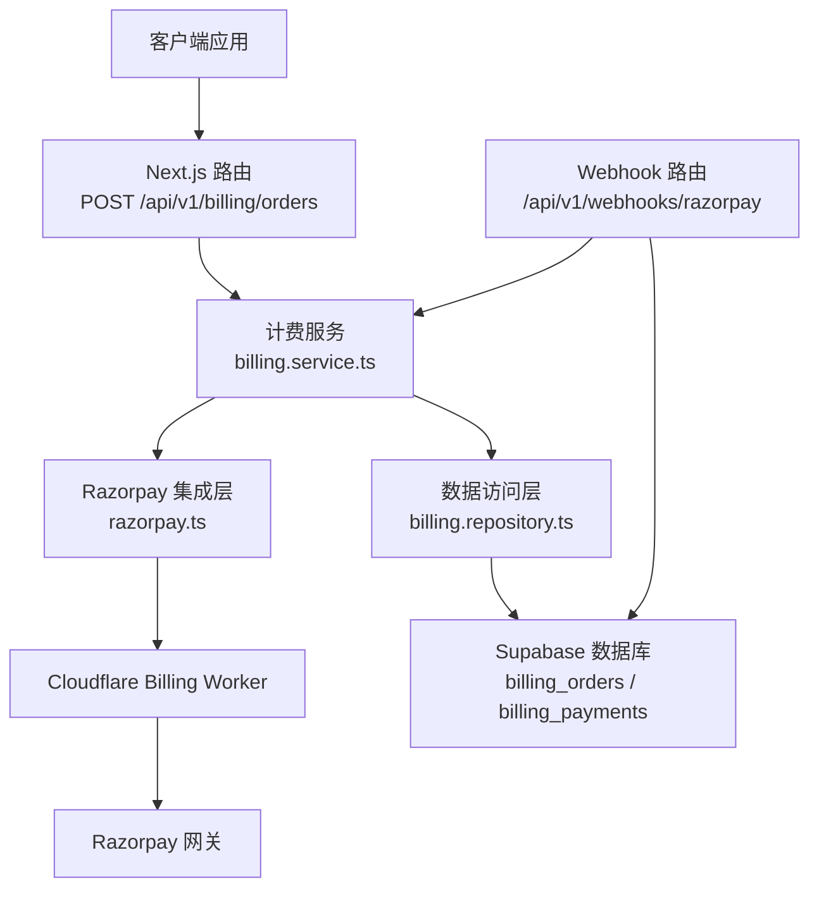
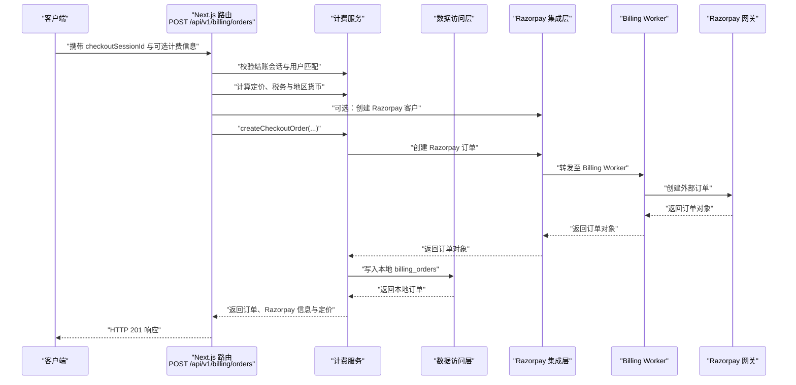
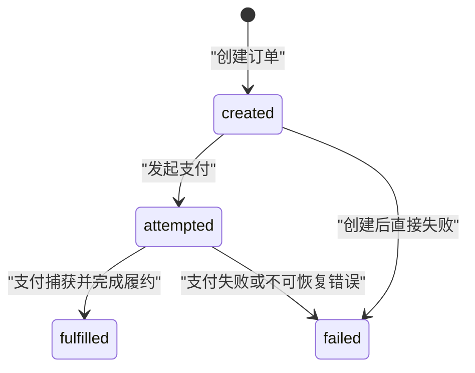
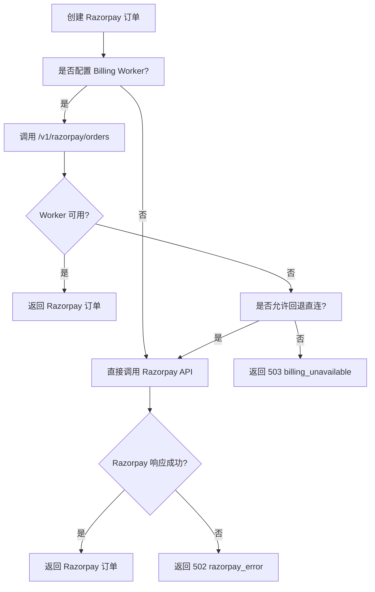
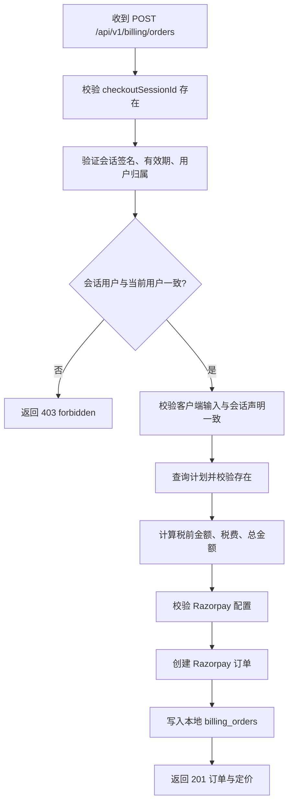
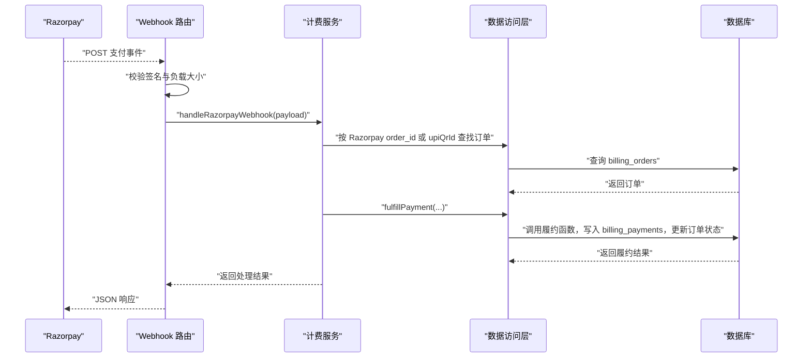
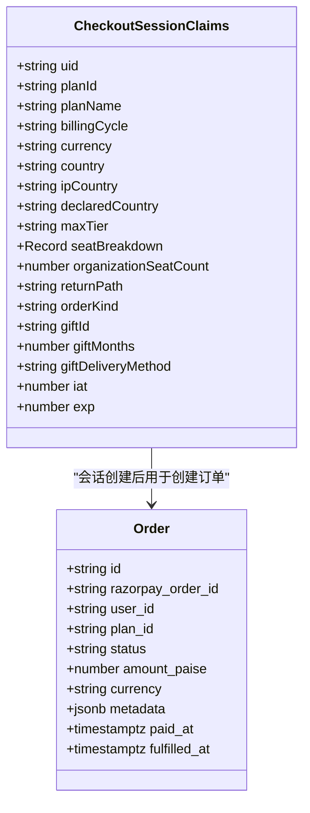
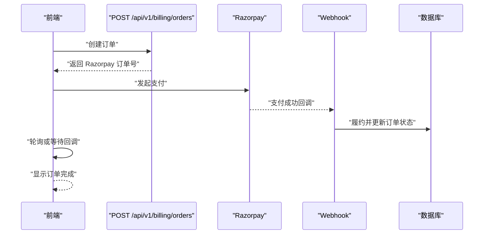
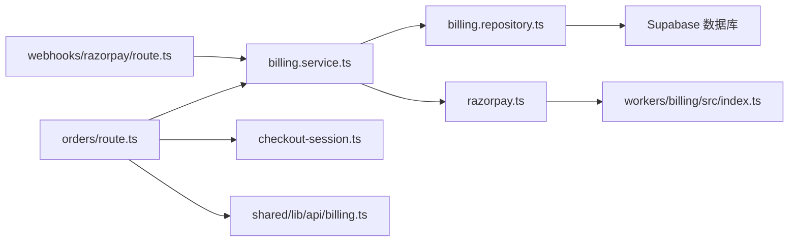

# 订单管理 API

<cite>
**本文引用的文件**   
- [orders/route.ts](file://src/app/api/v1/billing/orders/route.ts)
- [billing.service.ts](file://src/server/services/billing.service.ts)
- [billing.repository.ts](file://src/server/repositories/billing.repository.ts)
- [razorpay.ts](file://src/server/billing/razorpay.ts)
- [checkout-session.ts](file://src/server/billing/checkout-session.ts)
- [billing.ts](file://src/shared/lib/api/billing.ts)
- [webhook route.ts](file://src/app/api/v1/webhooks/razorpay/route.ts)
- [billing worker index.ts](file://workers/billing/src/index.ts)
- [core backend migration](file://supabase/migrations/20260506160000_core_backend.sql)
</cite>

## 目录
1. [引言](#引言)
2. [项目结构](#项目结构)
3. [核心组件](#核心组件)
4. [架构总览](#架构总览)
5. [详细组件分析](#详细组件分析)
6. [依赖关系分析](#依赖关系分析)
7. [性能与可靠性考虑](#性能与可靠性考虑)
8. [故障排查指南](#故障排查指南)
9. [结论](#结论)

## 引言
本文件围绕 `/api/v1/billing/orders` 端点，系统性说明订阅类订单的创建、校验、与 Razorpay 的集成流程、支付状态同步、失败处理、以及与结账会话的关联关系。文档同时给出数据库中的订单状态机、数据结构、错误码约定和异常处理方案，帮助后端开发者、前端集成方及运维人员准确理解并安全接入该计费接口。

需要特别说明的是：当前仓库中并未实现面向前端的“订单历史查询”或“批量操作”端点；订单历史可通过已实现的发票列表等机制间接观察。相关限制在文末章节有明确说明。

## 项目结构
与 `/api/v1/billing/orders` 相关的代码分布在以下层次：

- Next.js App Router 路由层：接收认证后的客户端请求，做参数校验、计费定价、税务计算与 Razorpay 订单创建。
- 领域服务层：封装结账会话校验、Razorpay 调用、本地订单持久化、发票生成、礼物交付等业务流程。
- 数据访问层：通过 Supabase SQL 读写 `billing_orders`、`billing_payments` 等表。
- Razorpay 集成层：统一走 Cloudflare Billing Worker 或直接调用 Razorpay REST。
- Webhook 层：接收 Razorpay 回调，完成幂等支付入账与订单履约。
- 数据库迁移层：定义订单状态机、索引、行级安全策略与履约函数。



**图表来源**
- [orders/route.ts:1-172](file://src/app/api/v1/billing/orders/route.ts#L1-L172)
- [billing.service.ts:748-1050](file://src/server/services/billing.service.ts#L748-L1050)
- [billing.repository.ts:289-540](file://src/server/repositories/billing.repository.ts#L289-L540)
- [razorpay.ts:1-200](file://src/server/billing/razorpay.ts#L1-L200)
- [billing worker index.ts:1-200](file://workers/billing/src/index.ts#L1-L200)

**章节来源**
- [orders/route.ts:1-172](file://src/app/api/v1/billing/orders/route.ts#L1-L172)
- [billing.service.ts:748-1050](file://src/server/services/billing.service.ts#L748-L1050)
- [billing.repository.ts:289-540](file://src/server/repositories/billing.repository.ts#L289-L540)
- [razorpay.ts:1-200](file://src/server/billing/razorpay.ts#L1-L200)
- [billing worker index.ts:1-200](file://workers/billing/src/index.ts#L1-L200)

## 核心组件
- 路由处理器：负责登录态校验、结账会话校验、最小账单信息解析、地区与货币推导、计划价格验证、Razorpay 客户创建（可选）、创建本地订单并返回订单与定价信息。
- 计费服务：提供结账会话生命周期方法、订单创建、UPI QR/Payment Link 流程、轮询支付、Webhook 处理、发票生成调度、礼物交付等。
- Razorpay 集成：统一对外暴露创建订单、获取订单、支付、QR、客户、令牌等方法；优先走内部 Billing Worker，不可用时回退到 Vercel 直连。
- 数据访问：提供按 ID、Razorpay order id、UPI QR id 查询订单，合并元数据，以及调用存储过程完成支付履约。
- Webhook 路由：校验签名、限制负载大小、解析事件，交由服务层进行幂等入账。
- 数据库：定义订单表、支付表、状态枚举、索引与安全策略。

**章节来源**
- [orders/route.ts:1-172](file://src/app/api/v1/billing/orders/route.ts#L1-L172)
- [billing.service.ts:748-1050](file://src/server/services/billing.service.ts#L748-L1050)
- [razorpay.ts:1-200](file://src/server/billing/razorpay.ts#L1-L200)
- [billing.repository.ts:289-540](file://src/server/repositories/billing.repository.ts#L289-L540)
- [webhook route.ts:1-70](file://src/app/api/v1/webhooks/razorpay/route.ts#L1-L70)
- [core backend migration:137-175](file://supabase/migrations/20260506160000_core_backend.sql#L137-L175)

## 架构总览
订单创建主流程如下：



**图表来源**
- [orders/route.ts:1-172](file://src/app/api/v1/billing/orders/route.ts#L1-L172)
- [billing.service.ts:748-1050](file://src/server/services/billing.service.ts#L748-L1050)
- [razorpay.ts:1-200](file://src/server/billing/razorpay.ts#L1-L200)
- [billing worker index.ts:1-200](file://workers/billing/src/index.ts#L1-L200)

## 详细组件分析

### `/api/v1/billing/orders` 端点规范

#### 基本属性
- 路径：`POST /api/v1/billing/orders`
- 认证：需要已登录会话；由路由中间件要求认证。
- 运行时：Node.js 环境。
- 成功响应：HTTP 201，返回订单、Razorpay 初始化信息、地区信息和定价。

#### 请求体字段
| 字段 | 类型 | 必填 | 说明 |
|---|---|---:|---|
| `checkoutSessionId` | string | 是 | 已认证的结账会话令牌；用于锁定计划、周期、地区和金额语义。 |
| `planId` | string | 否 | 客户端声明的计划标识，服务端会与会话声明对比。 |
| `planName` | string | 否 | 客户端声明的计划名称，仅用于审计和日志。 |
| `billingCycle` | `"monthly"` 或 `"yearly"` | 否 | 客户端声明的计费周期，服务端与会话校验。 |
| `maxTier` | string | 否 | 最大层级标识，与服务端会话声明一致。 |
| `seatBreakdown` | object | 否 | 席位拆分，与服务端会话声明一致。 |
| `organizationSeatCount` | number | 否 | 组织席位数量，与服务端会话声明一致。 |
| `billingDetails` | object | 否 | 最小账单信息，包括企业名称、GSTIN、账单收件人、国家代码、地址等。 |
| `currency` | string | 否 | 客户端可传，但实际货币在服务端根据地区重新推导，不被信任。 |

#### 请求校验规则
- 若缺少 `checkoutSessionId`，返回 400，错误码为业务要求的会话缺失错误。
- 会话必须属于当前登录用户；否则返回 403。
- 客户端传入的 `planId`、`billingCycle`、`maxTier`、`seatBreakdown`、`organizationSeatCount` 必须与会话声明一致；不一致会被拒绝。
- 计费详情会被规范化为服务器侧账单结构。
- 地区判定逻辑：优先使用会话中 IP 地理信息与用户声明国家，确定有效国家，再决定货币和是否适用印度 GST。

#### 成功响应结构
| 字段 | 类型 | 说明 |
|---|---|---|
| `order.id` | string | 系统内部订单标识。 |
| `order.razorpay_order_id` | string | Razorpay 订单号。 |
| `razorpay.orderId` | string | Razorpay 订单号。 |
| `razorpay.amount` | number | Razorpay 计费金额，单位为分或派沙。 |
| `razorpay.currency` | string | ISO 货币代码。 |
| `razorpay.keyId` | string | Razorpay 公开密钥标识。 |
| `razorpay.contact` | string | 可选，Razorpay 侧联系号码。 |
| `razorpay.customerId` | string | 可选，Razorpay 客户标识，用于绑卡与 Express Pay。 |
| `location.country` | string | 结算有效国家代码。 |
| `location.currency` | string | 结算货币。 |
| `location.verdict` | string | 地区判定证据摘要。 |
| `pricing.subtotalPaise` | number | 税前金额，单位分或派沙。 |
| `pricing.taxPaise` | number | 税费金额。 |
| `pricing.totalPaise` | number | 总金额，等于税前加税费。 |
| `pricing.taxLabel` | string 或 null | 税费标签，例如印度 18% GST。 |
| `pricing.gstExempt` | boolean | 是否免 GST。 |

#### 主要错误响应
| HTTP 状态 | 业务含义 | 典型错误码 |
|---|---|---|
| 400 | 缺少结账会话或输入不合法 | `invalid_billing_input` 或会话相关错误 |
| 403 | 结账会话不属于当前用户 | `forbidden` |
| 404 | 计划不存在 | `not_found` |
| 503 | Razorpay 未配置或计费服务不可用 | `billing_unavailable` |
| 502 | Razorpay 外部请求失败 | `razorpay_error` |

#### 示例请求
```http
POST /api/v1/billing/orders
Authorization: Bearer <用户会话令牌>
Content-Type: application/json

{
  "checkoutSessionId": "<结账会话令牌>",
  "planId": "pro",
  "planName": "Pro",
  "billingCycle": "monthly",
  "billingDetails": {
    "purchasingAsBusiness": true,
    "gstin": "22AAAAA0000A1Z5",
    "billToName": "企业采购负责人",
    "fullName": "企业主体名称",
    "countryCode": "IN",
    "addressLine": "印度某城市地址"
  }
}
```

#### 示例成功响应
```json
{
  "order": {
    "id": "ORD_系统订单ID",
    "razorpay_order_id": "order_Razorpay订单ID"
  },
  "razorpay": {
    "orderId": "order_Razorpay订单ID",
    "amount": 11800,
    "currency": "INR",
    "keyId": "rzp_test_key",
    "contact": "+91XXXXXXXXXX",
    "customerId": "cust_Razorpay客户ID"
  },
  "location": {
    "country": "IN",
    "currency": "INR",
    "verdict": "declared_and_ip_match"
  },
  "pricing": {
    "subtotalPaise": 10000,
    "taxPaise": 1800,
    "totalPaise": 11800,
    "taxLabel": "Tax (18% GST)",
    "gstExempt": false
  }
}
```

**章节来源**
- [orders/route.ts:1-172](file://src/app/api/v1/billing/orders/route.ts#L1-L172)
- [billing.service.ts:748-1050](file://src/server/services/billing.service.ts#L748-L1050)
- [billing.repository.ts:289-360](file://src/server/repositories/billing.repository.ts#L289-L360)
- [razorpay.ts:1-200](file://src/server/billing/razorpay.ts#L1-L200)

### 订单状态机
数据库中 `billing_orders.status` 的合法值为：

| 状态 | 含义 | 触发时机 |
|---|---|---|
| `created` | 订单已创建，等待支付 | 调用 `/api/v1/billing/orders` 成功后立即进入。 |
| `attempted` | 已尝试支付或处于支付流程中 | 支付发起后、履约过程中可能进入。 |
| `fulfilled` | 支付成功且已完成履约 | Razorpay 支付捕获后，由履约函数更新。 |
| `failed` | 支付失败或无法继续履约 | 支付失败、金额/货币不匹配、超时或不可恢复错误时进入。 |

注意：题目描述中提到的 `pending`、`processing`、`completed`、`failed` 并非本仓库 `billing_orders` 表的实际状态枚举。实际实现采用 `created → attempted → fulfilled | failed`。因此，对接方不应把 `pending`、`processing`、`completed` 当作合法值。



**图表来源**
- [core backend migration:137-175](file://supabase/migrations/20260506160000_core_backend.sql#L137-L175)
- [billing.repository.ts:289-540](file://src/server/repositories/billing.repository.ts#L289-L540)

**章节来源**
- [core backend migration:137-175](file://supabase/migrations/20260506160000_core_backend.sql#L137-L175)
- [billing.repository.ts:289-540](file://src/server/repositories/billing.repository.ts#L289-L540)

### 订单数据结构
`billing_orders` 表的核心字段如下：

| 字段 | 类型 | 约束与说明 |
|---|---|---|
| `id` | text | 主键，系统内部订单标识。 |
| `razorpay_order_id` | text | 唯一索引，Razorpay 订单号。 |
| `razorpay_payment_id` | text | 可选，最终捕获支付的 Razorpay 支付标识。 |
| `user_id` | uuid | 引用认证用户。 |
| `user_email` | text | 可选，下单邮箱。 |
| `plan_id` | text | 订阅计划标识。 |
| `plan_name` | text | 计划显示名。 |
| `billing_cycle` | text | 仅限 `monthly` 或 `yearly`。 |
| `max_tier` | text | 可选最大层级。 |
| `status` | text | 仅限 `created`、`attempted`、`fulfilled`、`failed`。 |
| `currency` | text | 默认 `INR`。 |
| `subtotal_paise` | integer | 税前金额，必须大于零。 |
| `tax_paise` | integer | 税费金额，非负。 |
| `amount_paise` | integer | 总金额，必须大于零。 |
| `tokens` | integer | 支付成功后授予的 token 额度。 |
| `receipt` | text | 收据编号。 |
| `razorpay_status` | text | Razorpay 侧订单状态快照。 |
| `metadata` | jsonb | 扩展元数据，含账单详情、地区证据、税费、座位拆分、Razorpay 客户信息等。 |
| `paid_at` | timestamptz | 支付时间。 |
| `fulfilled_at` | timestamptz | 履约完成时间。 |
| `created_at` | timestamptz | 创建时间。 |
| `updated_at` | timestamptz | 更新时间。 |

`metadata` 常见子字段包括：
- `billingDetails`：规范化后的账单信息。
- `checkoutCurrency`：结账货币。
- `razorpayCharge`：Razorpay 计费金额与货币转换结果。
- `tax.label`、`tax.paise`、`tax.gstExempt`：税费标签与豁免标志。
- `locationEvidence`：地区判定证据。
- `idempotencyKey`：幂等键。
- `razorpayCustomerId`：Razorpay 客户标识。
- `seatBreakdown`、`organizationSeatCount`：组织与席位信息。
- `upiQrId`、`channel`：UPI QR 或 Payment Link 通道标识。

**章节来源**
- [core backend migration:137-175](file://supabase/migrations/20260506160000_core_backend.sql#L137-L175)
- [billing.service.ts:748-1050](file://src/server/services/billing.service.ts#L748-L1050)
- [billing.repository.ts:289-360](file://src/server/repositories/billing.repository.ts#L289-L360)

### 与 Razorpay 的集成流程
Razorpay 调用路径有两种：

1. **优先路径**：通过 Cloudflare Billing Worker。
   - Next.js 路由和服务调用 `razorpay.ts`。
   - `razorpay.ts` 判断是否配置了 Billing Worker；如果是，则映射内部路径，如 `/v1/razorpay/orders`。
   - Billing Worker 持有 Razorpay 密钥，向 `https://api.razorpay.com` 发起真实请求。
   - 如果 Worker 不可用且生产环境要求强制 Worker，则抛出 503。

2. **回退路径**：直接使用 Vercel 环境变量中的 Razorpay 密钥。
   - 当 Billing Worker 缺失密钥、不可达，且允许回退时，`razorpayApiDirect` 直接调用 Razorpay。
   - 所有外部错误统一包装为 502 `razorpay_error`。



**图表来源**
- [razorpay.ts:1-200](file://src/server/billing/razorpay.ts#L1-L200)
- [billing worker index.ts:1-200](file://workers/billing/src/index.ts#L1-L200)

**章节来源**
- [razorpay.ts:1-200](file://src/server/billing/razorpay.ts#L1-L200)
- [billing worker index.ts:1-200](file://workers/billing/src/index.ts#L1-L200)

### 订单验证流程
订单创建时的验证分为四层：

1. **会话验证**：
   - 检查 `checkoutSessionId` 是否存在。
   - 解析并校验会话签名、有效期、用户归属。
   - 确保会话中的 `uid` 与当前登录用户一致。

2. **客户端输入与会话声明一致性校验**：
   - 比较 `planId`、`billingCycle`、`maxTier`、`seatBreakdown`、`organizationSeatCount`。
   - `currency` 被忽略，因为服务端会在付款时基于地区重新计算货币。

3. **计划与定价校验**：
   - 根据会话中的 `planId` 查询计划。
   - 校验计划存在、活跃、价格区间合理。
   - 根据计划、币种、税务规则计算税前金额、税费和总金额。

4. **Razorpay 订单校验**：
   - 校验金额是否为正整数。
   - 校验 Razorpay 配置是否可用。
   - 将内部订单、Razorpay 订单、计费详情、地区证据、税费信息一起落库。



**图表来源**
- [orders/route.ts:1-172](file://src/app/api/v1/billing/orders/route.ts#L1-L172)
- [billing.service.ts:748-1050](file://src/server/services/billing.service.ts#L748-L1050)

**章节来源**
- [orders/route.ts:1-172](file://src/app/api/v1/billing/orders/route.ts#L1-L172)
- [billing.service.ts:748-1050](file://src/server/services/billing.service.ts#L748-L1050)
- [checkout-session.ts:1-200](file://src/server/billing/checkout-session.ts#L1-L200)

### 支付状态同步与失败订单处理
支付状态同步主要通过 Razorpay Webhook 完成：

- Webhook 路由限制请求体大小，校验 `x-razorpay-signature`。
- 支持两类关键事件：
  - `payment.captured`：标准支付捕获事件。
  - `qr_code.credited`：UPI QR 收款事件。
- 对 `payment.captured`：
  - 校验支付 ID 格式、金额合法性。
  - 通过 `razorpay_order_id`、`billing_order_id` 或 `upiQrId` 定位本地订单。
  - 调用履约函数，写入 `billing_payments`，更新订单状态为 `fulfilled`，记录支付时间和履约时间。
  - 异步生成发票 PDF，并尝试交付礼物订单。
- 对 `qr_code.credited`：
  - 通过 UPI QR ID 查找订单。
  - 拉取 QR 支付列表，找到已捕获支付。
  - 若支付关联的 Razorpay order 与本地不同，先同步修正。
  - 同样调用履约函数并生成发票、交付礼物。

失败处理要点：
- 金额不匹配：轮询或 webhook 中发现金额与订单不一致时，抛出金额不匹配错误。
- 无效支付标识：支付 ID 或订单 ID 格式非法时忽略或报错。
- 不支持的事件：只处理已知事件，其他事件返回忽略状态。
- 外部不可用：Razorpay 配置缺失返回 503；外部请求失败返回 502。



**图表来源**
- [webhook route.ts:1-70](file://src/app/api/v1/webhooks/razorpay/route.ts#L1-L70)
- [billing.service.ts:748-1050](file://src/server/services/billing.service.ts#L748-L1050)
- [billing.repository.ts:473-540](file://src/server/repositories/billing.repository.ts#L473-L540)

**章节来源**
- [webhook route.ts:1-70](file://src/app/api/v1/webhooks/razorpay/route.ts#L1-L70)
- [billing.service.ts:748-1050](file://src/server/services/billing.service.ts#L748-L1050)
- [billing.repository.ts:473-540](file://src/server/repositories/billing.repository.ts#L473-L540)

### 订单与结账会话的关联关系
结账会话是订单创建前的强校验凭证：

- 会话包含用户 ID、计划 ID、计划名称、计费周期、货币、国家、IP 国家、声明国家、最大层级、席位拆分、组织席位、返回路径、订单类型等信息。
- 会话以 HMAC 签名，TTL 为 6 小时。
- 会话过期时，前端可刷新会话；刷新仍要求同一登录用户。
- 订单创建时必须提供 `checkoutSessionId`，且服务端会严格比对客户端传入的定价相关字段。
- 对于礼品订单，会话还会携带 `giftId`、`giftMonths`、`giftDeliveryMethod`，并在创建订单时复用之前创建的 Razorpay 订单。



**图表来源**
- [checkout-session.ts:1-200](file://src/server/billing/checkout-session.ts#L1-L200)
- [orders/route.ts:1-172](file://src/app/api/v1/billing/orders/route.ts#L1-L172)
- [core backend migration:137-175](file://supabase/migrations/20260506160000_core_backend.sql#L137-L175)

**章节来源**
- [checkout-session.ts:1-200](file://src/server/billing/checkout-session.ts#L1-L200)
- [orders/route.ts:1-172](file://src/app/api/v1/billing/orders/route.ts#L1-L172)

### 订单历史查询与批量操作
当前代码库中：

- **没有** 直接提供 `GET /api/v1/billing/orders` 或类似的历史订单列表端点。
- 数据访问层提供了按内部 ID、Razorpay order ID、UPI QR ID 查询订单的方法，但这些主要用于后端流程，不是面向前端的开放历史接口。
- 发票列表接口 `listInvoices` 可按用户查询最近 50 条支付记录，可作为订单历史的近似替代。
- 没有发现批量创建、批量取消、批量作废订单的端点或实现。

建议对接方：
- 若需展示订单历史，应基于已有发票列表接口，并结合自身缓存或后台报表工具聚合。
- 不要自行假设存在批量操作接口；如需批量能力，应在后端新增受控的管理员接口，并增加权限控制、审计与幂等保护。

**章节来源**
- [billing.repository.ts:520-540](file://src/server/repositories/billing.repository.ts#L520-L540)

### 完整订单管理示例
以下为端到端集成示例，涵盖创建、支付、轮询、Webhook 和订单状态确认：

1. **创建结账会话**：
   - 调用 `/api/v1/billing/checkout-sessions`，获得 `sessionId` 和 `checkoutPath`。
   - 前端跳转到结账页面，用户选择支付方式。

2. **创建订单**：
   - 调用 `POST /api/v1/billing/orders`，传入 `checkoutSessionId` 和最小账单信息。
   - 返回 Razorpay 订单号、金额、货币、地区与定价。

3. **前端支付**：
   - 使用 Razorpay SDK 拉起支付。
   - 支持 UPI QR、Payment Link、绑卡、Express Pay 等通道。

4. **支付轮询或回调**：
   - 前端轮询支付状态，或通过已完成的支付回调跳转。
   - 若使用 UPI QR，后端还提供轮询接口以检测支付结果。

5. **Webhook 入账**：
   - Razorpay 回调 `/api/v1/webhooks/razorpay`。
   - 服务端校验签名，执行幂等履约，更新订单状态为 `fulfilled`。

6. **确认订单完成**：
   - 前端再次读取订单状态，或通过发票列表确认支付完成。
   - 对于订阅订单，后续可使用订阅管理接口激活或取消订阅。



[本图为概念流程，不直接映射具体源码文件]

## 依赖关系分析



**图表来源**
- [orders/route.ts:1-172](file://src/app/api/v1/billing/orders/route.ts#L1-L172)
- [billing.service.ts:748-1050](file://src/server/services/billing.service.ts#L748-L1050)
- [billing.repository.ts:289-540](file://src/server/repositories/billing.repository.ts#L289-L540)
- [razorpay.ts:1-200](file://src/server/billing/razorpay.ts#L1-L200)
- [billing worker index.ts:1-200](file://workers/billing/src/index.ts#L1-L200)
- [checkout-session.ts:1-200](file://src/server/billing/checkout-session.ts#L1-L200)
- [billing.ts:1-200](file://src/shared/lib/api/billing.ts#L1-L200)
- [webhook route.ts:1-70](file://src/app/api/v1/webhooks/razorpay/route.ts#L1-L70)

**章节来源**
- [orders/route.ts:1-172](file://src/app/api/v1/billing/orders/route.ts#L1-L172)
- [billing.service.ts:748-1050](file://src/server/services/billing.service.ts#L748-L1050)
- [billing.repository.ts:289-540](file://src/server/repositories/billing.repository.ts#L289-L540)
- [razorpay.ts:1-200](file://src/server/billing/razorpay.ts#L1-L200)
- [billing worker index.ts:1-200](file://workers/billing/src/index.ts#L1-L200)
- [checkout-session.ts:1-200](file://src/server/billing/checkout-session.ts#L1-L200)
- [billing.ts:1-200](file://src/shared/lib/api/billing.ts#L1-L200)
- [webhook route.ts:1-70](file://src/app/api/v1/webhooks/razorpay/route.ts#L1-L70)

## 性能与可靠性考虑
- **外部依赖降级**：Razorpay 调用优先走 Billing Worker，避免在生产环境把密钥暴露在 Vercel 运行时；Worker 不可用时按配置回退或直接报错。
- **幂等性**：Webhook 处理使用数据库函数与支付 ID 作为幂等键，避免重复入账。
- **金额与货币校验**：服务层对税前金额、税费、总金额做正整数校验，并对 Razorpay 金额做二次校验。
- **地区与税务**：服务端重算货币和 GST，不信任客户端传入的 `currency`。
- **安全签名**：结账会话使用 HMAC 签名；Webhook 使用 Razorpay 签名校验。
- **资源限制**：Webhook 入口限制请求体大小，防止过大负载。
- **审计字段**：订单保留收据、计划、计费周期、税费、地区证据、渠道、支付方法等元数据，便于排障与合规。

[本节为通用指导，不直接分析具体文件]

## 故障排查指南

### 常见问题与定位步骤
| 现象 | 可能原因 | 排查建议 |
|---|---|---|
| 创建订单返回 400 | 缺少 `checkoutSessionId` 或客户端输入与会话不一致 | 检查会话是否过期、是否刷新过、前端传入字段是否与服务端声明一致。 |
| 创建订单返回 403 | 会话不属于当前用户 | 检查登录态与会话签发用户是否匹配。 |
| 创建订单返回 404 | 计划不存在 | 检查 `planId` 是否有效且计划处于活跃状态。 |
| 创建订单返回 503 | Razorpay 未配置或 Billing Worker 不可用 | 检查 Razorpay 密钥、Billing Worker 配置、`billingRequireWorker` 环境。 |
| 创建订单返回 502 | Razorpay 外部请求失败 | 检查 Razorpay API 响应、网络连通性与密钥权限。 |
| Webhook 返回 401 | Razorpay 签名校验失败 | 检查签名头、签名算法、密钥配置。 |
| 订单状态长期停留在 `created` | 支付未完成或 Webhook 未到达 | 检查前端支付回调、Razorpay 控制台、Webhook URL 配置。 |
| 订单状态长期停留在 `attempted` | 支付已发起但未捕获 | 检查支付渠道、风控拦截、余额不足、OTP 失败。 |
| 订单状态变为 `failed` | 支付失败或金额/货币不匹配 | 检查 Razorpay 支付详情、金额校验、货币转换。 |

### 推荐诊断信息
- 订单 ID 与 Razorpay order ID。
- 会话签发用户与实际登录用户。
- 客户端传入的 `planId`、`billingCycle`、`maxTier`、`seatBreakdown`、`organizationSeatCount`。
- 地区判定结果：声明国家、IP 国家、有效国家、货币。
- Razorpay 订单金额、货币、支付 ID、支付状态。
- Webhook 事件类型、事件负载摘要、签名校验结果。
- 数据库 `billing_orders` 与 `billing_payments` 的记录差异。

**章节来源**
- [orders/route.ts:1-172](file://src/app/api/v1/billing/orders/route.ts#L1-L172)
- [webhook route.ts:1-70](file://src/app/api/v1/webhooks/razorpay/route.ts#L1-L70)
- [billing.service.ts:748-1050](file://src/server/services/billing.service.ts#L748-L1050)
- [razorpay.ts:1-200](file://src/server/billing/razorpay.ts#L1-L200)

## 结论
`/api/v1/billing/orders` 是一个面向已登录用户的订单创建接口，其核心职责是把经过结账会话校验的购买意图转化为 Razorpay 订单和本地订单记录，并返回前端所需的支付与定价信息。订单状态机实际为 `created → attempted → fulfilled | failed`，而不是题目描述中的 `pending`、`processing`、`completed`、`failed`。支付状态同步依赖 Razorpay Webhook，服务层实现了幂等入账、发票生成与礼物交付。

当前仓库未提供面向前端的订单历史查询与批量操作端点；历史查询可通过发票列表接口近似替代，批量操作需要额外设计管理员接口。对接方应重点保证会话有效性、金额与货币一致性、Webhook 签名校验和失败重试机制，并确保在 Razorpay 不可用时正确处理 503 与 502 错误。