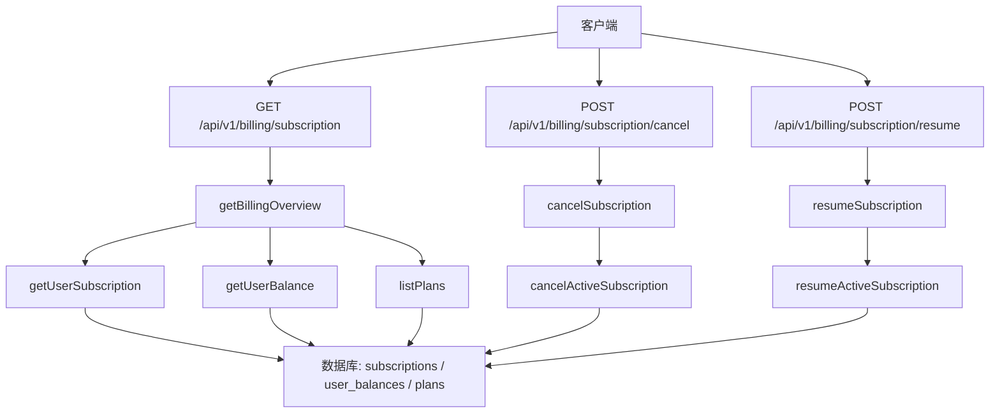
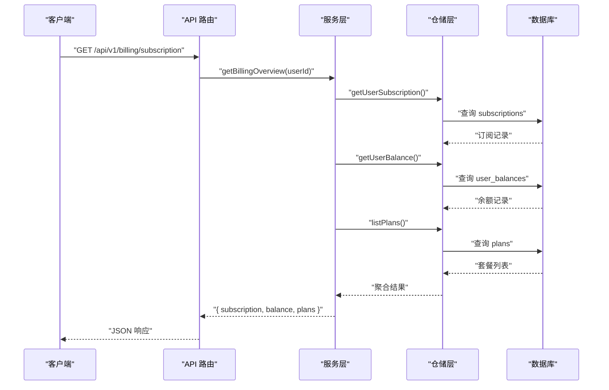
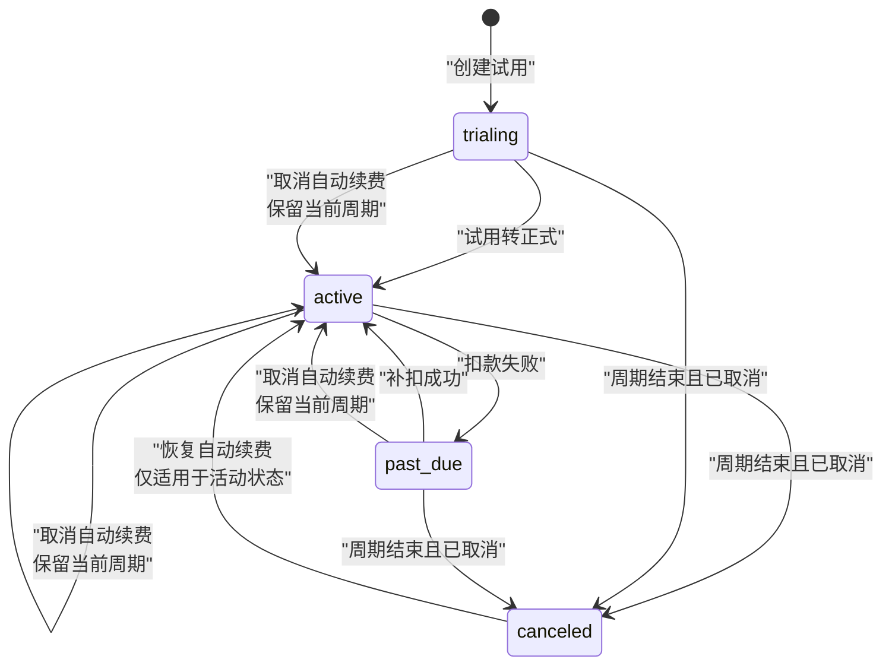
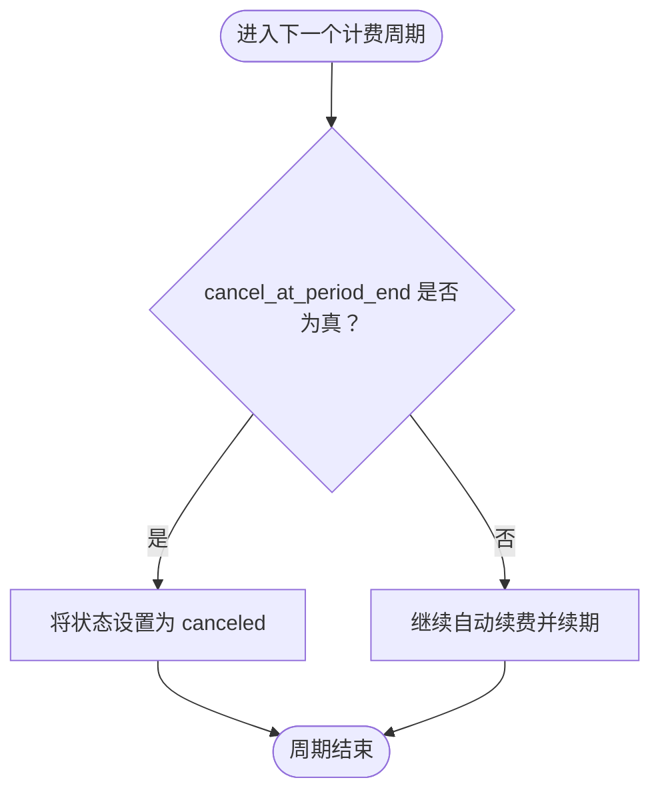
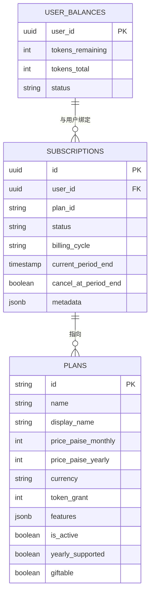
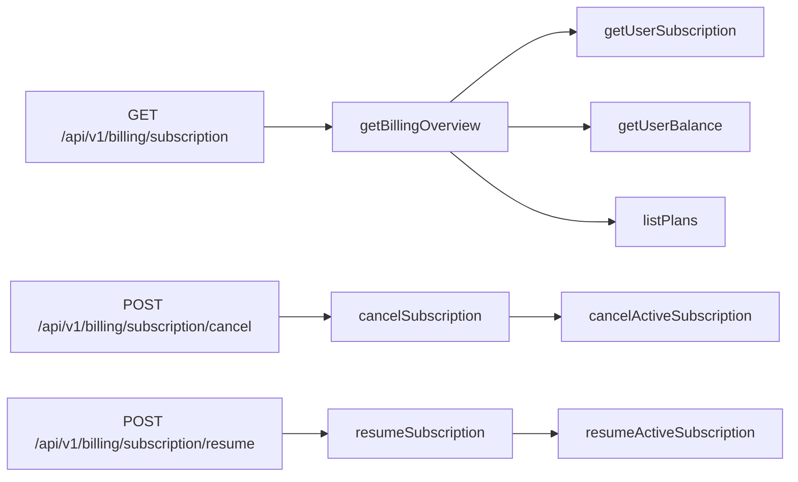

# 订阅管理 API

<cite>
**本文引用的文件**   
- [src/app/api/v1/billing/subscription/route.ts](file://src/app/api/v1/billing/subscription/route.ts)
- [src/app/api/v1/billing/subscription/cancel/route.ts](file://src/app/api/v1/billing/subscription/cancel/route.ts)
- [src/app/api/v1/billing/subscription/resume/route.ts](file://src/app/api/v1/billing/subscription/resume/route.ts)
- [src/shared/lib/api/billing.ts](file://src/shared/lib/api/billing.ts)
- [src/server/services/billing.service.ts](file://src/server/services/billing.service.ts)
- [src/server/repositories/billing.repository.ts](file://src/server/repositories/billing.repository.ts)
</cite>

## 目录
1. [简介](#简介)
2. [项目结构](#项目结构)
3. [核心组件](#核心组件)
4. [架构总览](#架构总览)
5. [详细组件分析](#详细组件分析)
6. [依赖关系分析](#依赖关系分析)
7. [性能与可用性](#性能与可用性)
8. [故障排查指南](#故障排查指南)
9. [结论](#结论)
10. [附录](#附录)

## 简介
本文档面向开发者，定义并说明订阅管理 RESTful API。重点覆盖以下端点：
- GET /api/v1/billing/subscription：查询当前用户订阅概览、余额与可用套餐。
- POST /api/v1/billing/subscription/cancel：取消自动续费（保留当前周期）。
- POST /api/v1/billing/subscription/resume：恢复自动续费。

文档同时解释订阅状态机、计费周期与自动续费逻辑、订阅变更流程、降级升级处理、退款政策、订阅与套餐关联关系、试用期与到期提醒机制，并提供完整的请求响应示例、状态转换图及错误处理策略。

## 项目结构
订阅管理功能由四层组成：
- 路由层：Next.js App Router 的 `/api/v1/billing/subscription` 及其子端点。
- 服务层：统一业务逻辑封装，负责校验、编排调用仓储层。
- 仓储层：直接访问数据库表 `public.subscriptions`、`public.user_balances`、`public.plans`。
- 客户端 SDK：共享类型与函数，用于前端或后端服务调用上述 API。



**图表来源**
- [src/app/api/v1/billing/subscription/route.ts:1-20](file://src/app/api/v1/billing/subscription/route.ts#L1-L20)
- [src/app/api/v1/billing/subscription/cancel/route.ts:1-16](file://src/app/api/v1/billing/subscription/cancel/route.ts#L1-L16)
- [src/app/api/v1/billing/subscription/resume/route.ts:1-16](file://src/app/api/v1/billing/subscription/resume/route.ts#L1-L16)
- [src/server/services/billing.service.ts:118-145](file://src/server/services/billing.service.ts#L118-L145)
- [src/server/services/billing.service.ts:1048-1062](file://src/server/services/billing.service.ts#L1048-L1062)
- [src/server/repositories/billing.repository.ts:259-287](file://src/server/repositories/billing.repository.ts#L259-L287)
- [src/server/repositories/billing.repository.ts:349-387](file://src/server/repositories/billing.repository.ts#L349-L387)

**章节来源**
- [src/app/api/v1/billing/subscription/route.ts:1-20](file://src/app/api/v1/billing/subscription/route.ts#L1-L20)
- [src/app/api/v1/billing/subscription/cancel/route.ts:1-16](file://src/app/api/v1/billing/subscription/cancel/route.ts#L1-L16)
- [src/app/api/v1/billing/subscription/resume/route.ts:1-16](file://src/app/api/v1/billing/subscription/resume/route.ts#L1-L16)
- [src/server/services/billing.service.ts:118-145](file://src/server/services/billing.service.ts#L118-L145)
- [src/server/repositories/billing.repository.ts:259-287](file://src/server/repositories/billing.repository.ts#L259-L287)

## 核心组件
- 订阅查询接口：返回订阅信息、用户余额、套餐目录。
- 取消订阅接口：将“按周期取消”标记为真，保持当前周期有效。
- 恢复订阅接口：取消“按周期取消”，恢复自动续费。
- 数据模型：订阅包含计划标识、状态、计费周期、当前周期结束时间与取消标记。

关键行为摘要：
- GET /api/v1/billing/subscription：读取最新一条订阅记录，读取用户余额，列出活跃套餐。
- POST /api/v1/billing/subscription/cancel：仅对处于 active/trialing/past_due 的最新订阅设置 cancel_at_period_end=true。
- POST /api/v1/billing/subscription/resume：对同一条件集合清除 cancel_at_period_end=false。

**章节来源**
- [src/shared/lib/api/billing.ts:60-95](file://src/shared/lib/api/billing.ts#L60-L95)
- [src/shared/lib/api/billing.ts:280-310](file://src/shared/lib/api/billing.ts#L280-L310)
- [src/server/services/billing.service.ts:118-145](file://src/server/services/billing.service.ts#L118-L145)
- [src/server/services/billing.service.ts:1048-1062](file://src/server/services/billing.service.ts#L1048-L1062)
- [src/server/repositories/billing.repository.ts:259-287](file://src/server/repositories/billing.repository.ts#L259-L287)
- [src/server/repositories/billing.repository.ts:349-387](file://src/server/repositories/billing.repository.ts#L349-L387)

## 架构总览
订阅管理的控制流遵循“路由 → 服务 → 仓储 → 数据库”的分层设计：
- 路由层只做鉴权与参数透传。
- 服务层进行业务决策与异常映射。
- 仓储层执行 SQL 并保证原子性更新。
- 数据库表保存订阅状态、计费周期与取消标记。



**图表来源**
- [src/app/api/v1/billing/subscription/route.ts:8-19](file://src/app/api/v1/billing/subscription/route.ts#L8-L19)
- [src/server/services/billing.service.ts:118-145](file://src/server/services/billing.service.ts#L118-L145)
- [src/server/repositories/billing.repository.ts:259-287](file://src/server/repositories/billing.repository.ts#L259-L287)

## 详细组件分析

### 订阅查询：GET /api/v1/billing/subscription
- 认证要求：需要登录会话。
- 返回内容：
  - subscription：订阅对象，包含 id、plan_id、status、billing_cycle、current_period_end、cancel_at_period_end。
  - balance：余额对象，包含 tokens_remaining、tokens_total、status。
  - plans：套餐目录数组。
- 典型用途：渲染账户页、展示订阅状态与到期时间、展示可升级套餐。

请求示例
- 方法：GET
- URL：/api/v1/billing/subscription
- 头部：需携带有效会话 Cookie 或鉴权头。

响应示例
- 成功：HTTP 200
- 主体：
  ```json
  {
    "subscription": {
      "id": "sub_xxx",
      "plan_id": "pro",
      "status": "active",
      "billing_cycle": "monthly",
      "current_period_end": "2026-11-28T00:00:00Z",
      "cancel_at_period_end": false
    },
    "balance": {
      "tokens_remaining": 1200,
      "tokens_total": 5000,
      "status": "active"
    },
    "plans": [
      {
        "id": "pro",
        "name": "Pro",
        "display_name": "专业版",
        "price_paise_monthly": 99000,
        "price_paise_yearly": 990000,
        "currency": "INR",
        "token_grant": 1000000,
        "features": {},
        "yearly_supported": true,
        "giftable": true
      }
    ]
  }
  ```

失败情况
- 未认证：由中间件拒绝。
- 内部错误：服务层抛出异常后由全局处理器转换为 HTTP 错误。

**章节来源**
- [src/app/api/v1/billing/subscription/route.ts:8-19](file://src/app/api/v1/billing/subscription/route.ts#L8-L19)
- [src/shared/lib/api/billing.ts:60-95](file://src/shared/lib/api/billing.ts#L60-L95)
- [src/server/services/billing.service.ts:118-145](file://src/server/services/billing.service.ts#L118-L145)
- [src/server/repositories/billing.repository.ts:259-287](file://src/server/repositories/billing.repository.ts#L259-L287)

### 取消自动续费：POST /api/v1/billing/subscription/cancel
- 作用：取消后续周期的自动续费；不立即终止当前周期。
- 前置条件：存在处于 active、trialing 或 past_due 状态的订阅。
- 行为：
  - 将 cancel_at_period_end 设置为 true。
  - 在 metadata 中记录 cancelRequestedAt。
  - 保持 status 不变（active/trialing/past_due 时仍为原状态）。

请求示例
- 方法：POST
- URL：/api/v1/billing/subscription/cancel
- 主体：无请求体。

响应示例
- 成功：HTTP 200
- 主体：
  ```json
  {
    "subscription": {
      "id": "sub_xxx",
      "plan_id": "pro",
      "status": "active",
      "cancel_at_period_end": true,
      "current_period_end": "2026-11-28T00:00:00Z"
    }
  }
  ```

失败情况
- 不存在符合条件的订阅：返回“找不到活动订阅”类错误。
- 非活动订阅：无法取消自动续费，因为只允许 active/trialing/past_due。

**章节来源**
- [src/app/api/v1/billing/subscription/cancel/route.ts:8-15](file://src/app/api/v1/billing/subscription/cancel/route.ts#L8-L15)
- [src/server/services/billing.service.ts:1048-1054](file://src/server/services/billing.service.ts#L1048-L1054)
- [src/server/repositories/billing.repository.ts:349-373](file://src/server/repositories/billing.repository.ts#L349-L373)

### 恢复自动续费：POST /api/v1/billing/subscription/resume
- 作用：重新启用自动续费。
- 前置条件：存在处于 active、trialing 或 past_due 状态的订阅。
- 行为：
  - 将 cancel_at_period_end 设置为 false。
  - 在 metadata 中记录 autoRenewResumedAt。
  - 保持 status 不变。

请求示例
- 方法：POST
- URL：/api/v1/billing/subscription/resume
- 主体：无请求体。

响应示例
- 成功：HTTP 200
- 主体：
  ```json
  {
    "subscription": {
      "id": "sub_xxx",
      "plan_id": "pro",
      "status": "active",
      "cancel_at_period_end": false,
      "current_period_end": "2026-11-28T00:00:00Z"
    }
  }
  ```

失败情况
- 不存在符合条件的订阅：返回“找不到活动订阅”类错误。

**章节来源**
- [src/app/api/v1/billing/subscription/resume/route.ts:8-15](file://src/app/api/v1/billing/subscription/resume/route.ts#L8-L15)
- [src/server/services/billing.service.ts:1056-1062](file://src/server/services/billing.service.ts#L1056-L1062)
- [src/server/repositories/billing.repository.ts:374-387](file://src/server/repositories/billing.repository.ts#L374-L387)

### 订阅状态机
订阅状态字段来自数据库 subscriptions.status，当前实现支持如下语义：
- active：正常付费订阅。
- trialing：试用中。
- past_due：应扣款失败或逾期。
- canceled：已取消（通常由后台任务根据 cancel_at_period_end 与周期结束时间转换）。
- paused：暂停（本仓库中更多用于其他业务模块；订阅层当前取消逻辑不会设为 paused）。
- expired：过期（通常由后台任务根据 current_period_end 转换）。



注意：
- 取消操作不会立即将 status 改为 canceled；它只是标记 cancel_at_period_end=true，等待周期结束时转为 canceled。
- 恢复操作仅作用于 active/trialing/past_due，不能从 canceled 恢复。

**图表来源**
- [src/server/repositories/billing.repository.ts:349-387](file://src/server/repositories/billing.repository.ts#L349-L387)
- [src/server/services/billing.service.ts:1048-1062](file://src/server/services/billing.service.ts#L1048-L1062)

### 计费周期与自动续费
关键字段：
- billing_cycle：monthly 或 yearly。
- current_period_end：当前计费周期结束时间。
- cancel_at_period_end：是否在当前周期结束后取消。

计费周期管理要点：
- 取消自动续费不会改变 current_period_end，也不会立即停止服务。
- 系统应在周期结束时检查 cancel_at_period_end，若为 true 则将 status 转为 canceled。
- 恢复自动续费会清除 cancel_at_period_end，使下次周期继续自动续费。



**图表来源**
- [src/server/repositories/billing.repository.ts:259-287](file://src/server/repositories/billing.repository.ts#L259-L287)
- [src/server/repositories/billing.repository.ts:349-387](file://src/server/repositories/billing.repository.ts#L349-L387)

### 订阅与套餐关联
订阅通过 plan_id 关联到 public.plans：
- plan_id：当前生效的计划标识。
- plans 列表：服务端返回当前可用的活跃套餐，供前端展示升级、购买选项。
- 套餐字段包括价格、货币、令牌配额、功能、是否支持年付、是否可赠送等。



**图表来源**
- [src/server/repositories/billing.repository.ts:259-287](file://src/server/repositories/billing.repository.ts#L259-L287)
- [src/shared/lib/api/billing.ts:60-95](file://src/shared/lib/api/billing.ts#L60-L95)

### 订阅变更流程
当前 API 支持：
- 取消自动续费。
- 恢复自动续费。
- 查询订阅与套餐。

尚未在订阅端点中暴露的变更能力：
- 切换套餐（降级、升级）：需要新的变更接口或通过订单流程完成。
- 立即终止：取消不等于立即终止，终止通常发生在周期结束。

建议扩展：
- 新增 PUT /api/v1/billing/subscription/change-plan，用于在支付成功后切换 plan_id。
- 新增 PATCH /api/v1/billing/subscription/cycle，用于修改 billing_cycle。

### 降级与升级处理
现有实现没有直接的“升级/降级”订阅端点。常见处理方式：
- 新购一个更高价套餐：通过结账流程创建订单并完成支付后，在服务层将订阅 plan_id 切换到新计划。
- 降级：可在下个计费周期开始时将 plan_id 切换为较低计划，并在 UI 提示用户。
- 退款：不在订阅端点内处理；退款属于订单与支付回调或人工审核流程。

### 退款政策
订阅 API 本身不提供退款操作。退款相关逻辑通常位于：
- 支付回调处理。
- 发票生成与导出。
- 外部支付网关（如 Razorpay）的退款工具或后台流程。

本仓库中与账单相关的辅助能力包括发票 PDF 生成、Razorpay 集成、订单与支付记录查询等。

### 试用期处理
试用期使用 trialing 状态表示：
- 取消自动续费同样适用于 trialing。
- 恢复自动续费也适用于 trialing。
- 试用期结束后应转为 active 或 canceled，取决于是否已取消。

### 到期提醒机制
当前订阅查询返回 current_period_end，可用于客户端计算到期倒计时。服务端侧可通过定时任务或队列触发通知，但具体通知实现不在本 API 范围内。

## 依赖关系分析



**图表来源**
- [src/app/api/v1/billing/subscription/route.ts:8-19](file://src/app/api/v1/billing/subscription/route.ts#L8-L19)
- [src/app/api/v1/billing/subscription/cancel/route.ts:8-15](file://src/app/api/v1/billing/subscription/cancel/route.ts#L8-L15)
- [src/app/api/v1/billing/subscription/resume/route.ts:8-15](file://src/app/api/v1/billing/subscription/resume/route.ts#L8-L15)
- [src/server/services/billing.service.ts:118-145](file://src/server/services/billing.service.ts#L118-L145)
- [src/server/services/billing.service.ts:1048-1062](file://src/server/services/billing.service.ts#L1048-L1062)
- [src/server/repositories/billing.repository.ts:259-287](file://src/server/repositories/billing.repository.ts#L259-L287)
- [src/server/repositories/billing.repository.ts:349-387](file://src/server/repositories/billing.repository.ts#L349-L387)

**章节来源**
- [src/server/services/billing.service.ts:118-145](file://src/server/services/billing.service.ts#L118-L145)
- [src/server/services/billing.service.ts:1048-1062](file://src/server/services/billing.service.ts#L1048-L1062)
- [src/server/repositories/billing.repository.ts:259-287](file://src/server/repositories/billing.repository.ts#L259-L287)
- [src/server/repositories/billing.repository.ts:349-387](file://src/server/repositories/billing.repository.ts#L349-L387)

## 性能与可用性
- 查询接口并行获取订阅、余额和套餐，减少往返延迟。
- 取消与恢复操作为单行更新，事务粒度小，影响面有限。
- 建议在计费周期转换时使用数据库事务或锁保护，避免并发导致的重复取消或恢复。
- 对于高频查询场景，可对套餐目录做缓存，但订阅状态必须实时读取。

[本节为通用性能建议，不直接分析具体代码文件]

## 故障排查指南
常见问题与定位方式：
- 未认证：确认会话有效，检查鉴权中间件配置。
- 找不到活动订阅：检查用户是否存在 active/trialing/past_due 的订阅。
- 取消无效：确认目标订阅未被其他后台任务提前转为 canceled。
- 恢复无效：只有活动状态订阅才能恢复；canceled 状态需要先重新购买。
- 状态不一致：核对 cancel_at_period_end、current_period_end 与 status 的一致性。

推荐调试步骤：
1. 先调用 GET /api/v1/billing/subscription 查看当前状态。
2. 再调用取消或恢复接口，观察 cancel_at_period_end 变化。
3. 检查数据库中 subscriptions.metadata 是否有 cancelRequestedAt 或 autoRenewResumedAt。
4. 检查计费周期转换任务是否正确将 canceled 状态应用到已结束周期。

**章节来源**
- [src/server/services/billing.service.ts:1048-1062](file://src/server/services/billing.service.ts#L1048-L1062)
- [src/server/repositories/billing.repository.ts:349-387](file://src/server/repositories/billing.repository.ts#L349-L387)

## 结论
订阅管理 API 提供了基础的订阅查询、取消自动续费与恢复自动续费能力。其核心在于 subscriptions 表的 status、billing_cycle、current_period_end 与 cancel_at_period_end 字段组合。当前实现不包含直接的套餐切换或退款接口，这些能力需要通过订单流程、后台任务或扩展的新端点补充。开发时应确保周期转换逻辑与 UI 展示一致，并对取消、恢复与续费场景做好幂等性与并发保护。

[本节为总结性内容，不直接分析具体代码文件]

## 附录

### API 参考摘要

#### GET /api/v1/billing/subscription
- 功能：获取订阅、余额与套餐。
- 认证：需要登录。
- 响应字段：
  - subscription.id
  - subscription.plan_id
  - subscription.status
  - subscription.billing_cycle
  - subscription.current_period_end
  - subscription.cancel_at_period_end
  - balance.tokens_remaining
  - balance.tokens_total
  - balance.status
  - plans[]

**章节来源**
- [src/app/api/v1/billing/subscription/route.ts:8-19](file://src/app/api/v1/billing/subscription/route.ts#L8-L19)
- [src/shared/lib/api/billing.ts:60-95](file://src/shared/lib/api/billing.ts#L60-L95)
- [src/server/services/billing.service.ts:118-145](file://src/server/services/billing.service.ts#L118-L145)

#### POST /api/v1/billing/subscription/cancel
- 功能：取消自动续费。
- 认证：需要登录。
- 响应字段：subscription.id、plan_id、status、cancel_at_period_end、current_period_end。

**章节来源**
- [src/app/api/v1/billing/subscription/cancel/route.ts:8-15](file://src/app/api/v1/billing/subscription/cancel/route.ts#L8-L15)
- [src/server/services/billing.service.ts:1048-1054](file://src/server/services/billing.service.ts#L1048-L1054)

#### POST /api/v1/billing/subscription/resume
- 功能：恢复自动续费。
- 认证：需要登录。
- 响应字段：subscription.id、plan_id、status、cancel_at_period_end、current_period_end。

**章节来源**
- [src/app/api/v1/billing/subscription/resume/route.ts:8-15](file://src/app/api/v1/billing/subscription/resume/route.ts#L8-L15)
- [src/server/services/billing.service.ts:1056-1062](file://src/server/services/billing.service.ts#L1056-L1062)