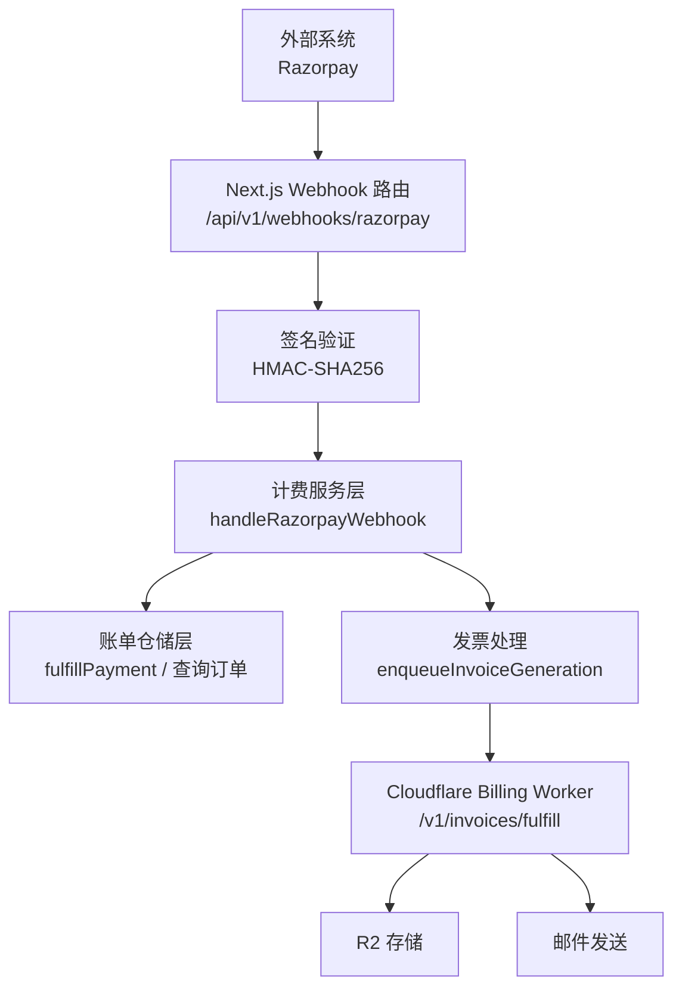
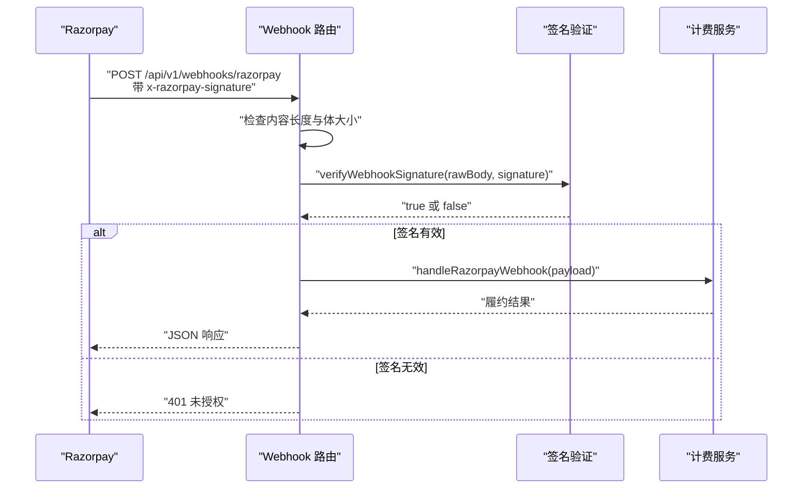
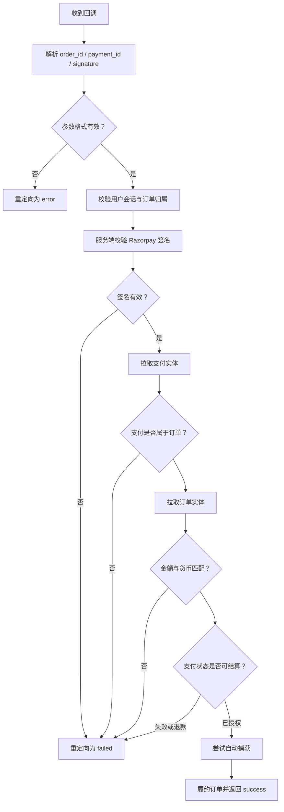
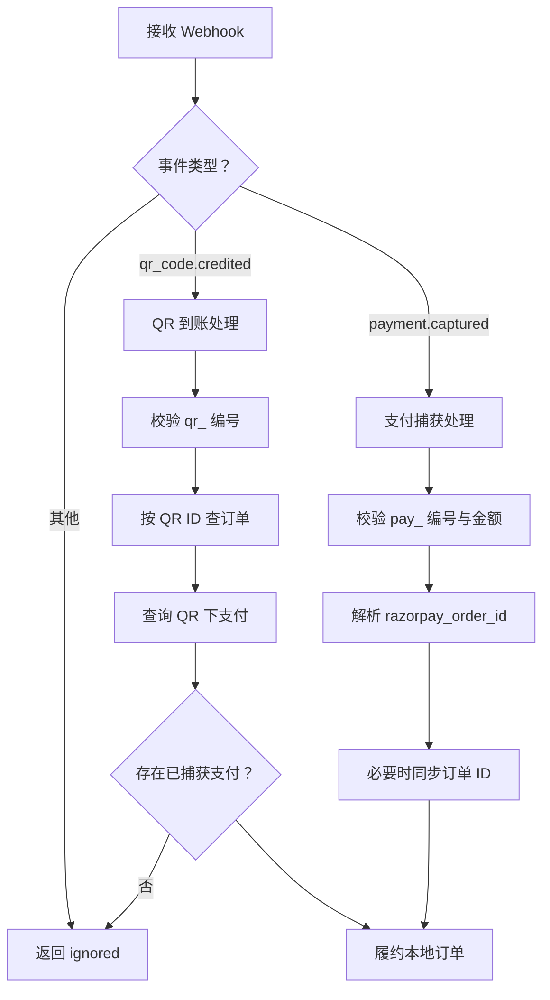
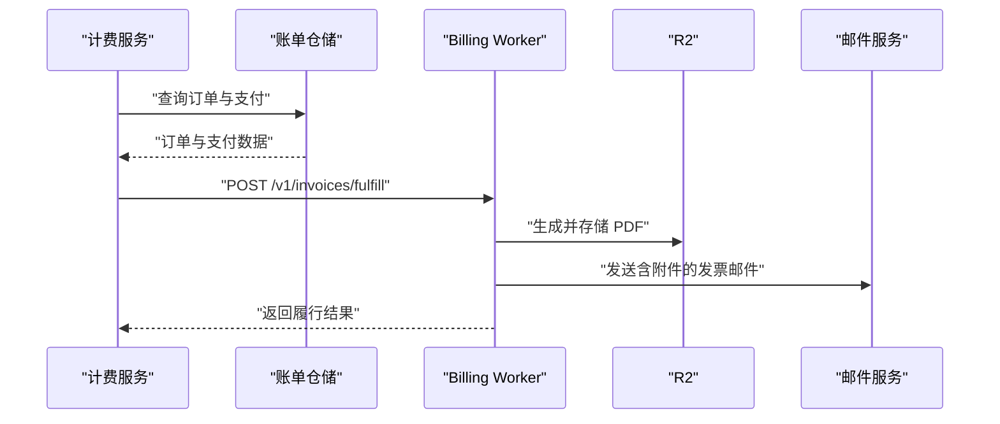
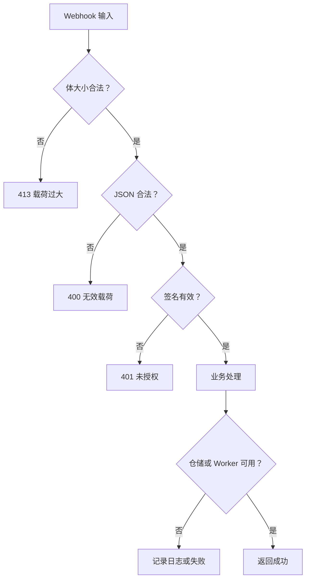

# Webhook 接口

<cite>
**本文引用的文件**   
- [src/app/api/v1/webhooks/razorpay/route.ts](file://src/app/api/v1/webhooks/razorpay/route.ts)
- [src/server/billing/razorpay.ts](file://src/server/billing/razorpay.ts)
- [src/server/services/billing.service.ts](file://src/server/services/billing.service.ts)
- [src/app/api/v1/billing/orders/razorpay-callback/route.ts](file://src/app/api/v1/billing/orders/razorpay-callback/route.ts)
- [src/server/billing/billing-worker.ts](file://src/server/billing/billing-worker.ts)
- [workers/billing/src/index.ts](file://workers/billing/src/index.ts)
</cite>

## 目录

1. [简介](#简介)
2. [项目结构与入口](#项目结构与入口)
3. [Webhook 总览](#webhook-总览)
4. [安全验证与签名流程](#安全验证与签名流程)
5. [事件类型与载荷定义](#事件类型与载荷定义)
6. [处理逻辑与幂等性](#处理逻辑与幂等性)
7. [错误处理、重试与不可用场景](#错误处理重试与不可用场景)
8. [订阅变更与计费事件现状](#订阅变更与计费事件现状)
9. [各语言实现要点与示例路径](#各语言实现要点与示例路径)
10. [故障排查](#故障排查)
11. [结论](#结论)

## 简介

本仓库实现了 Razorpay 支付回调的 Webhook 接入，并围绕支付完成后的订单履约、发票生成和礼品发放构建后端处理链路。当前代码主要覆盖：

- Razorpay 标准 Webhook 端点 `/api/v1/webhooks/razorpay`。
- 对 `payment.captured` 与 `qr_code.credited` 两类事件的处理。
- 基于 HMAC-SHA256 的请求签名验证。
- 通过内部服务层把支付结果落库到本地账单订单表。
- 异步触发发票 PDF 生成与邮件发送。
- 浏览器端的 Razorpay Custom Checkout 银行转账回调 `/api/v1/billing/orders/razorpay-callback`。

文档未直接分析 Stripe 或订阅类 Webhook；订阅相关 API 目前仅暴露取消与恢复操作，未在本仓库中见到订阅状态变更 Webhook 端点。

## 项目结构与入口

Razorpay Webhook 请求进入 Next.js 应用后，由 Node Runtime 路由接收，再委托给计费服务层；计费服务层再调用数据库仓储、Razorpay 查询接口以及 Cloudflare Billing Worker 进行发票处理。

**图表来源**
- [src/app/api/v1/webhooks/razorpay/route.ts:1-70](file://src/app/api/v1/webhooks/razorpay/route.ts#L1-L70)
- [src/server/services/billing.service.ts:877-1046](file://src/server/services/billing.service.ts#L877-L1046)
- [src/server/billing/billing-worker.ts:1-200](file://src/server/billing/billing-worker.ts#L1-L200)

**章节来源**
- [src/app/api/v1/webhooks/razorpay/route.ts:1-70](file://src/app/api/v1/webhooks/razorpay/route.ts#L1-L70)
- [src/server/billing/billing-worker.ts:1-200](file://src/server/billing/billing-worker.ts#L1-L200)
- [workers/billing/src/index.ts:1-200](file://workers/billing/src/index.ts#L1-L200)

## Webhook 总览

| 名称 | 路径 | 方法 | 运行时 | 用途 |
|---|---|---:|---:|---|
| Razorpay Webhook | `/api/v1/webhooks/razorpay` | POST | Node.js | 接收 Razorpay 支付与 UPI QR 回调 |
| Custom Checkout 回调 | `/api/v1/billing/orders/razorpay-callback` | POST | Node.js | 浏览器端银行授权后返回的跳转校验 |

### Razorpay Webhook 端点

- 路由强制使用 Node Runtime。
- 限制请求体大小上限为 256 KiB。
- 要求携带 `x-razorpay-signature` 头。
- 先验证签名，再解析 JSON，最后调用计费服务处理事件。
- 成功时返回 `{ data }`；失败时通过统一错误响应返回 HTTP 状态码和错误码。

### Custom Checkout 回调

该端点不是 Razorpay 官方 Webhook，而是浏览器端 Razorpay Custom Checkout 在完成网银授权后跳转回应用的回调。它负责：

- 校验用户会话。
- 从 JSON 或表单中提取 `razorpay_order_id`、`razorpay_payment_id`、`razorpay_signature`。
- 校验参数格式。
- 确认订单属于当前用户。
- 调用服务层执行签名校验、金额与货币校验，并在需要时自动捕获支付。
- 最终 303 重定向回前端，附带 `?checkout=success|failed|error`。

**章节来源**
- [src/app/api/v1/webhooks/razorpay/route.ts:1-70](file://src/app/api/v1/webhooks/razorpay/route.ts#L1-L70)
- [src/app/api/v1/billing/orders/razorpay-callback/route.ts:1-111](file://src/app/api/v1/billing/orders/razorpay-callback/route.ts#L1-L111)

## 安全验证与签名流程

### Webhook 签名验证

Razorpay Webhook 端点使用 HMAC-SHA256 验证请求体。核心规则如下：

| 项目 | 行为 |
|---|---|
| 输入 | 原始请求体文本 + `x-razorpay-signature` 请求头 |
| 密钥 | 环境变量中的 Razorpay Webhook Secret |
| 算法 | HMAC-SHA256，十六进制摘要 |
| 比较方式 | 时序安全比较，避免侧信道泄露 |
| 缺失密钥 | 直接拒绝，返回未授权 |
| 无效签名 | 返回 401 Unauthorized |

**图表来源**
- [src/app/api/v1/webhooks/razorpay/route.ts:27-66](file://src/app/api/v1/webhooks/razorpay/route.ts#L27-L66)
- [src/server/billing/razorpay.ts:478-487](file://src/server/billing/razorpay.ts#L478-L487)

### Custom Checkout 回调签名验证

浏览器回调走的是 Razorpay Standard Checkout 签名校验流程，而不是 Webhook HMAC：

1. 校验 `razorpay_order_id`、`razorpay_payment_id`、`razorpay_signature` 格式。
2. 调用服务层的 `verifyCheckoutPayment`。
3. 服务层调用 `verifyPaymentSignatureSecure` 验证 `order_id|payment_id` 的 HMAC。
4. 拉取 Razorpay 支付实体，确认支付属于对应订单。
5. 拉取 Razorpay 订单，校验金额与货币一致。
6. 如果支付处于已授权但未捕获状态，则尝试自动捕获。
7. 成功后继续履约。

**图表来源**
- [src/app/api/v1/billing/orders/razorpay-callback/route.ts:20-111](file://src/app/api/v1/billing/orders/razorpay-callback/route.ts#L20-L111)
- [src/server/services/billing.service.ts:1130-1210](file://src/server/services/billing.service.ts#L1130-L1210)

**章节来源**
- [src/server/billing/razorpay.ts:478-487](file://src/server/billing/razorpay.ts#L478-L487)
- [src/server/services/billing.service.ts:1130-1210](file://src/server/services/billing.service.ts#L1130-L1210)
- [src/app/api/v1/billing/orders/razorpay-callback/route.ts:20-111](file://src/app/api/v1/billing/orders/razorpay-callback/route.ts#L20-L111)

## 事件类型与载荷定义

当前 Webhook 处理器只显式支持两类事件：

| 事件类型 | 常量名 | 含义 | 关键字段 |
|---|---|---|---|
| `qr_code.credited` | `WEBHOOK_QR_CREDITED_EVENT` | UPI QR 到账通知 | `payload.qr_code.entity.id` |
| `payment.captured` | `WEBHOOK_CAPTURE_EVENT` | 支付捕获成功 | `payload.payload.payment.entity` |

其他事件会被忽略，返回状态为 `ignored`。

### `qr_code.credited` 载荷结构

| 字段 | 类型 | 说明 |
|---|---|---|
| `event` | 字符串 | 固定为 `qr_code.credited` |
| `payload.qr_code.entity.id` | 字符串 | Razorpay QR 编号，形如 `qr_...` |
| `payload.qr_code.entity.status` | 字符串 | QR 状态 |
| `payload.qr_code.entity.notes` | 对象或数组 | 扩展备注 |

处理器会：

1. 校验 QR ID 格式。
2. 根据 QR ID 查找本地账单订单。
3. 查询该 QR 下的支付列表。
4. 找到已捕获支付后履约。
5. 当 Razorpay 支付实体没有 `order_id` 时，使用本地订单的 `razorpay_order_id`。
6. 同步不一致的 Razorpay 订单 ID。
7. 异步触发发票生成。
8. 调用礼品交付钩子，保证礼物订单也能通过 Webhook 完成后续流程。

### `payment.captured` 载荷结构

| 字段 | 类型 | 说明 |
|---|---|---|
| `event` | 字符串 | 固定为 `payment.captured` |
| `payload.payment.entity.id` | 字符串 | Razorpay 支付 ID，形如 `pay_...` |
| `payload.payment.entity.order_id` | 字符串 | Razorpay 订单 ID，可能为空 |
| `payload.payment.entity.status` | 字符串 | 支付状态 |
| `payload.payment.entity.amount` | 整数 | 以最小单位表示的金额 |
| `payload.payment.entity.method` | 字符串 | 支付方式 |
| `payload.payment.entity.notes` | 对象或数组 | 扩展备注，包含 `billing_order_id`、`upiQrId` 等 |

处理器会：

1. 校验支付 ID 格式。
2. 要求状态为已捕获。
3. 校验金额为正整数。
4. 优先使用支付实体的 `order_id`。
5. 若 `order_id` 缺失，则通过 notes 中的 `billing_order_id` 或 `upiQrId` 反查本地订单。
6. 将本地订单与 Razorpay 订单 ID 对齐。
7. 调用仓储层履约支付。
8. 异步触发发票生成。
9. 调用礼品交付钩子。

**图表来源**
- [src/server/services/billing.service.ts:877-1046](file://src/server/services/billing.service.ts#L877-L1046)

**章节来源**
- [src/server/services/billing.service.ts:65-69](file://src/server/services/billing.service.ts#L65-L69)
- [src/server/services/billing.service.ts:877-1046](file://src/server/services/billing.service.ts#L877-L1046)

## 处理逻辑与幂等性

### 支付履约

所有支付完成分支最终都调用仓储层的 `fulfillPayment`，传入以下关键信息：

| 字段 | 值来源 |
|---|---|
| `orderId` | Razorpay 订单 ID 或本地同步后的订单 ID |
| `paymentId` | Razorpay 支付 ID |
| `paymentStatus` | 通常为 `captured` |
| `paymentMethod` | 来自支付实体或默认值 |
| `amountPaise` | Razorpay 支付金额 |
| `currency` | 通常为 `INR` |
| `source` | `webhook` 或 `checkout` |
| `webhookEventName` | Razorpay 事件名 |
| `providerPayload` | QR ID、渠道、Razorpay 支付上的订单 ID 等上下文 |

这种设计让本地订单成为最终一致性目标：即使 Razorpay 返回的 `order_id` 缺失或不一致，系统也会尝试通过 notes 中的元数据修复映射关系。

### 发票生成

支付完成后，系统调用 `enqueueInvoiceGeneration`，其职责包括：

- 根据 Razorpay 订单号加载本地订单详情。
- 加载支付记录。
- 构建发票载荷。
- 根据货币与 GSTIN 选择发票类型：国内 GST、出口 LUT 或 GSTIN 豁免。
- 构造发票下载链接。
- 有收件邮箱时调用 Cloudflare Billing Worker 完成 PDF 生成、R2 存储、Razorpay Documents 上传和邮件发送。
- 无收件邮箱时退回仅生成 PDF。

**图表来源**
- [src/server/services/billing.service.ts:1428-1488](file://src/server/services/billing.service.ts#L1428-L1488)
- [src/server/billing/billing-worker.ts:1-200](file://src/server/billing/billing-worker.ts#L1-L200)

### 幂等性保证

当前代码在 Webhook 处理层面没有看到基于 Razorpay 事件 ID 的去重表；幂等性主要通过以下机制实现：

1. **仓储层履约函数**：支付履约调用仓储层 `fulfillPayment`，实际去重应由仓储层或数据库约束保证（例如同一支付 ID 只能履约一次）。
2. **状态过滤**：Webhook 只接受 `payment.captured` 且状态为 `captured` 的事件。
3. **金额校验**：对金额是否为正整数做校验。
4. **订单映射修复**：对缺失或变化的 Razorpay 订单 ID 做同步，减少重复创建订单的风险。
5. **发票生成容错**：发票生成失败不会阻断支付履约，但会通过日志记录。
6. **礼品交付钩子**：礼品交付被设计为幂等，避免重复发放。

建议未来在 Webhook 层引入 Razorpay 事件 ID 去重表，以便直接丢弃重复事件，降低下游仓储压力。

**章节来源**
- [src/server/services/billing.service.ts:925-1046](file://src/server/services/billing.service.ts#L925-L1046)
- [src/server/services/billing.service.ts:1428-1488](file://src/server/services/billing.service.ts#L1428-L1488)

## 错误处理、重试与不可用场景

### HTTP 层错误

Webhook 路由的错误处理策略如下：

| 场景 | 行为 |
|---|---|
| 请求体过大 | 返回 413 |
| JSON 解析失败 | 返回 400，错误码 `invalid_webhook` |
| 缺少或无效签名 | 返回 401，错误码 `unauthorized` |
| 非 `AppError` 异常 | 返回 500，错误码通用失败 |
| 其他业务异常 | 通过统一错误响应返回状态码和错误码 |

### Razorpay API 不可用

Razorpay REST 调用优先走 Cloudflare Billing Worker；如果 Worker 未配置或不可用，则回退到 Vercel 环境直连 Razorpay。当 Worker 必须使用时，还会抛出 503 `billing_unavailable`。

### 发票生成失败

发票生成失败不会阻止支付履约，只会记录警告日志。对于需要恢复的场景，系统提供手动获取或重新生成发票 PDF 的服务能力。

### 自定义 Checkout 回调失败

浏览器回调遇到会话缺失、参数非法、订单不属于当前用户、签名无效、金额不匹配、支付未捕获等情况时，都会重定向为 `failed` 或 `error`，而不是静默失败。

**图表来源**
- [src/app/api/v1/webhooks/razorpay/route.ts:27-70](file://src/app/api/v1/webhooks/razorpay/route.ts#L27-L70)
- [src/server/billing/razorpay.ts:1-120](file://src/server/billing/razorpay.ts#L1-L120)
- [src/server/billing/billing-worker.ts:1-120](file://src/server/billing/billing-worker.ts#L1-L120)

**章节来源**
- [src/app/api/v1/webhooks/razorpay/route.ts:27-70](file://src/app/api/v1/webhooks/razorpay/route.ts#L27-L70)
- [src/server/billing/razorpay.ts:1-120](file://src/server/billing/razorpay.ts#L1-L120)
- [src/server/billing/billing-worker.ts:1-120](file://src/server/billing/billing-worker.ts#L1-L120)

## 订阅变更与计费事件现状

当前仓库中与订阅相关的公开 API 包括：

- 订阅查询。
- 订阅取消。
- 订阅恢复。

但这些 API 并未暴露订阅状态变更 Webhook 端点。计费系统的主要事件流集中在支付完成后的订单履约和发票生成，而不是订阅生命周期事件。

因此，针对“订阅取消、续费失败、订阅到期”等事件，当前仓库中没有可直接引用的 Webhook 处理实现。若需要接入 Stripe 或 Razorpay 订阅 Webhook，应新增独立端点，并参考现有支付 Webhook 的签名验证、事件分类、幂等处理和错误响应模式。

**章节来源**
- [src/server/services/billing.service.ts:1048-1062](file://src/server/services/billing.service.ts#L1048-L1062)

## 各语言实现要点与示例路径

由于本仓库基于 TypeScript 和 Node.js，下面给出与其他语言对接时的等价实现步骤，并提供本仓库对应的源码路径作为参考。

### Node.js / TypeScript 示例

- Webhook 入口：[src/app/api/v1/webhooks/razorpay/route.ts](file://src/app/api/v1/webhooks/razorpay/route.ts)
- 签名验证实现：[src/server/billing/razorpay.ts](file://src/server/billing/razorpay.ts)
- 事件处理逻辑：[src/server/services/billing.service.ts](file://src/server/services/billing.service.ts)

实现要点：

1. 读取原始请求体文本，不要先解析 JSON。
2. 从请求头取得 `x-razorpay-signature`。
3. 使用 Razorpay Webhook Secret 计算 HMAC-SHA256。
4. 使用时序安全比较验证签名。
5. 解析 JSON 并校验 `event` 字段。
6. 根据事件类型分发处理逻辑。
7. 对无效事件返回忽略状态。
8. 对已捕获支付调用本地履约函数。
9. 异步触发发票生成，不阻塞主流程。

### Python 示例思路

- 使用 `hmac` 和 `hashlib.sha256` 计算签名。
- 使用 `secrets.compare_digest` 做时序安全比较。
- 使用 Flask/FastAPI 接收 POST 请求。
- 先验签，再解析 JSON。
- 根据 `event` 判断处理分支。
- 调用内部 API 或写入消息队列完成履约。

可参考的路径：

- 签名计算与比较：[src/server/billing/razorpay.ts:478-487](file://src/server/billing/razorpay.ts#L478-L487)
- 事件分发与履约：[src/server/services/billing.service.ts:877-1046](file://src/server/services/billing.service.ts#L877-L1046)

### Go 示例思路

- 使用 `crypto/hmac` 和 `crypto/sha256`。
- 使用 `subtle.ConstantTimeCompare` 比较签名。
- 使用 Gin/Echo 接收请求。
- 先读取 body，再验签，再解码 JSON。
- 对不支持事件返回 200 忽略响应，避免 Razorpay 重试风暴。
- 对已捕获支付写入数据库或投递到后台任务。

可参考的路径：

- 请求体大小与错误响应：[src/app/api/v1/webhooks/razorpay/route.ts:17-70](file://src/app/api/v1/webhooks/razorpay/route.ts#L17-L70)
- 支付履约与发票触发：[src/server/services/billing.service.ts:925-1046](file://src/server/services/billing.service.ts#L925-L1046)

### Java / Spring 示例思路

- 使用 `Mac` 实例计算 HMAC-SHA256。
- 使用常量时间比较避免时序攻击。
- 使用 `@PostMapping` 接收请求。
- 在 Controller 中先验签，再调用 Service。
- Service 层处理事件分发、订单查询和履约。
- 发票生成放入异步线程或消息队列。

可参考的路径：

- 计费服务层入口：[src/server/services/billing.service.ts:877-1046](file://src/server/services/billing.service.ts#L877-L1046)
- 发票履行 Worker 接口：[src/server/billing/billing-worker.ts:1-200](file://src/server/billing/billing-worker.ts#L1-L200)

### Rust 示例思路

- 使用 `hmac` crate 与 `sha2::Sha256`。
- 使用常量时间比较。
- 使用 Axum/Salvo 接收请求。
- 先验签，再反序列化为结构化事件。
- 对 `payment.captured` 和 `qr_code.credited` 分别处理。
- 使用 tokio 异步调用数据库和发票服务。

可参考的路径：

- 事件常量与处理分支：[src/server/services/billing.service.ts:65-69](file://src/server/services/billing.service.ts#L65-L69)
- Webhook 路由边界条件：[src/app/api/v1/webhooks/razorpay/route.ts:27-66](file://src/app/api/v1/webhooks/razorpay/route.ts#L27-L66)

**章节来源**
- [src/app/api/v1/webhooks/razorpay/route.ts:17-70](file://src/app/api/v1/webhooks/razorpay/route.ts#L17-L70)
- [src/server/billing/razorpay.ts:478-487](file://src/server/billing/razorpay.ts#L478-L487)
- [src/server/services/billing.service.ts:65-69](file://src/server/services/billing.service.ts#L65-L69)
- [src/server/services/billing.service.ts:877-1046](file://src/server/services/billing.service.ts#L877-L1046)
- [src/server/billing/billing-worker.ts:1-200](file://src/server/billing/billing-worker.ts#L1-L200)

## 故障排查

| 现象 | 可能原因 | 排查建议 |
|---|---|---|
| 始终返回 401 | 未配置 Razorpay Webhook Secret，或请求头签名不匹配 | 检查环境变量、Razorpay 控制台配置的 Webhook Secret |
| 始终返回 413 | 请求体超过 256 KiB | 检查 Razorpay 是否发送了超大 payload |
| 支付成功但本地订单未更新 | 事件不是 `payment.captured` 或 `qr_code.credited` | 查看事件类型；当前仅处理这两类 |
| QR 到账但未履约 | QR ID 不存在或 QR 下没有已捕获支付 | 检查 QR 是否绑定本地订单、是否有支付 |
| 订单 ID 不一致 | Razorpay 支付实体缺少 `order_id` | 检查 notes 中的 `billing_order_id` 或 `upiQrId` |
| 发票未发送 | 无收件邮箱或 Worker 不可用 | 检查发票生成与 Billing Worker 配置 |
| 浏览器回调失败 | 签名无效、订单不属于当前用户、金额不匹配 | 查看 Custom Checkout 回调日志 |
| 订阅事件未处理 | 当前未实现订阅 Webhook | 新增订阅端点并实现鉴权、去重与幂等 |

**章节来源**
- [src/app/api/v1/webhooks/razorpay/route.ts:27-70](file://src/app/api/v1/webhooks/razorpay/route.ts#L27-L70)
- [src/app/api/v1/billing/orders/razorpay-callback/route.ts:20-111](file://src/app/api/v1/billing/orders/razorpay-callback/route.ts#L20-L111)
- [src/server/services/billing.service.ts:877-1046](file://src/server/services/billing.service.ts#L877-L1046)

## 结论

本项目实现了 Razorpay 支付回调的核心闭环：签名验证、事件分类、订单履约、发票生成和邮件发送。当前 Webhook 明确支持 `payment.captured` 与 `qr_code.credited`，并通过仓储层和 Billing Worker 保障支付结果落地与票据产出。

需要注意的限制包括：

- 未实现 Stripe Webhook。
- 未实现订阅变更 Webhook。
- Webhook 层未见基于 Razorpay 事件 ID 的直接去重。
- 发票生成失败不会阻断支付履约，需依赖日志与恢复接口。
- Custom Checkout 回调用于浏览器端银行转账场景，与 Razorpay 官方 Webhook 不同。

在生产环境中，建议补充：

1. Razorpay 事件 ID 去重表。
2. 订阅生命周期 Webhook 端点。
3. 更细粒度的指标与告警，区分签名失败、事件忽略、履约失败和发票失败。
4. 对 Razorpay 返回的其他重要事件（退款、争议、订阅状态变化）增加专门处理分支。