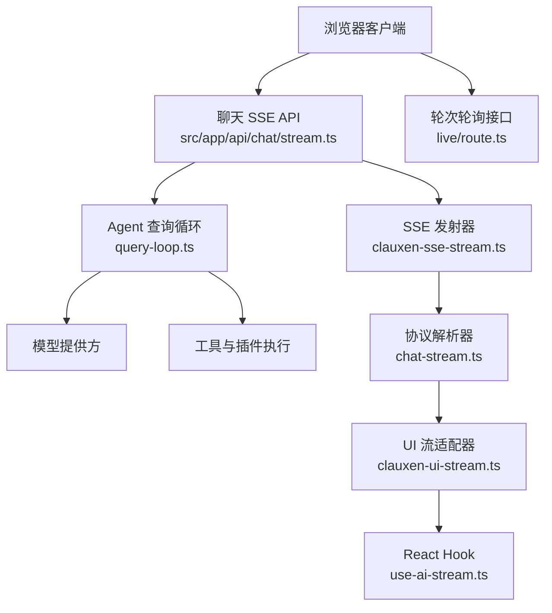
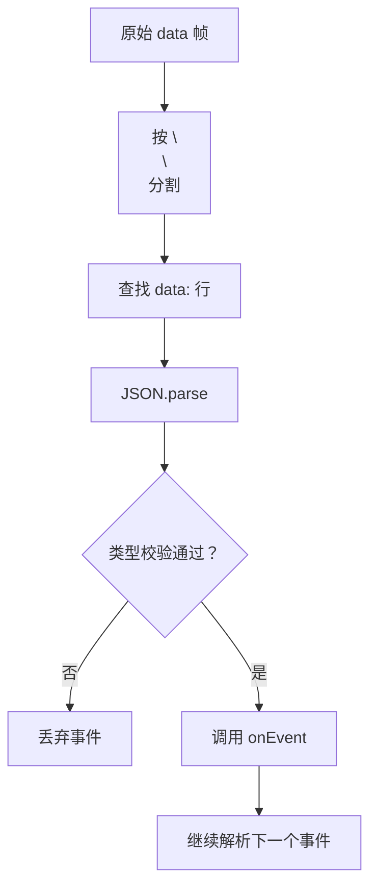
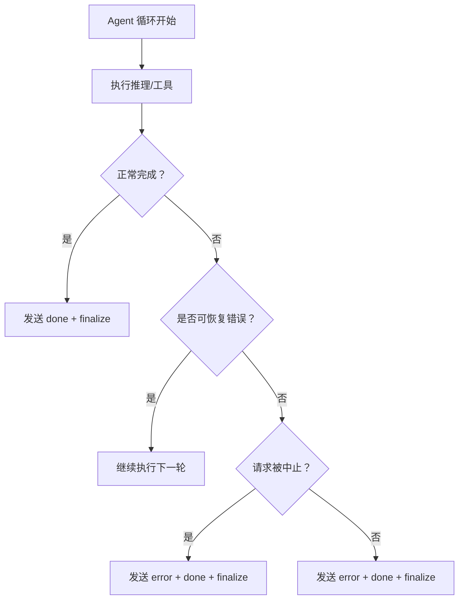
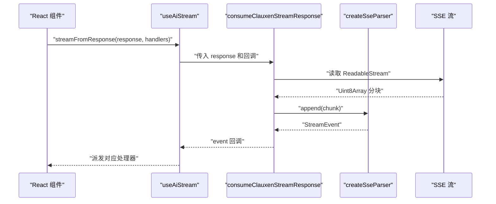
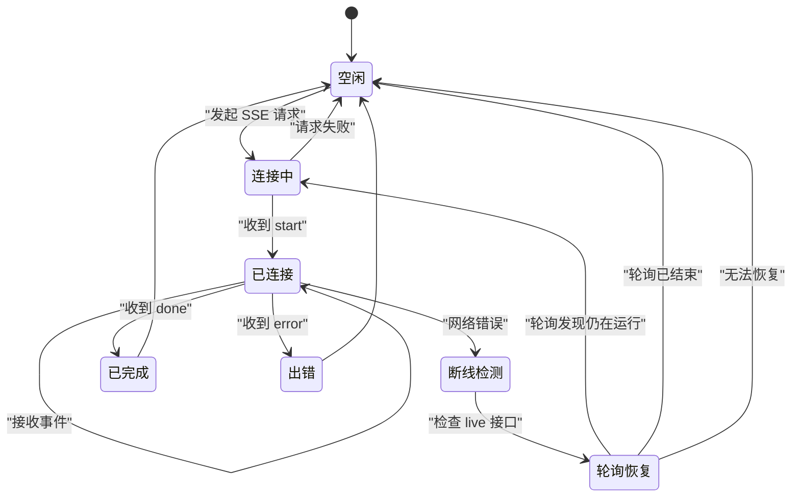
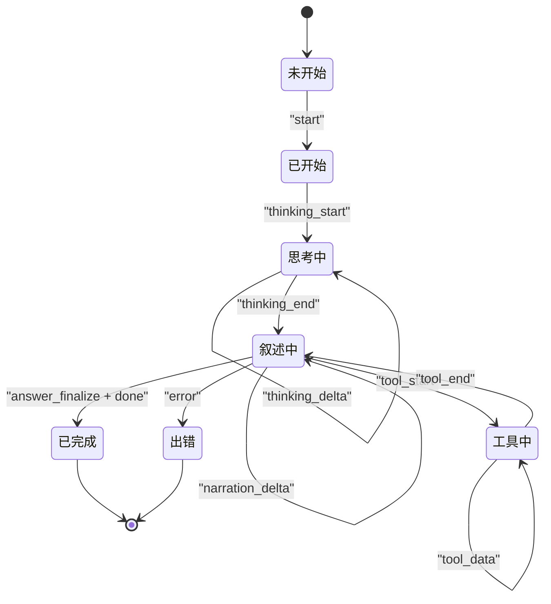
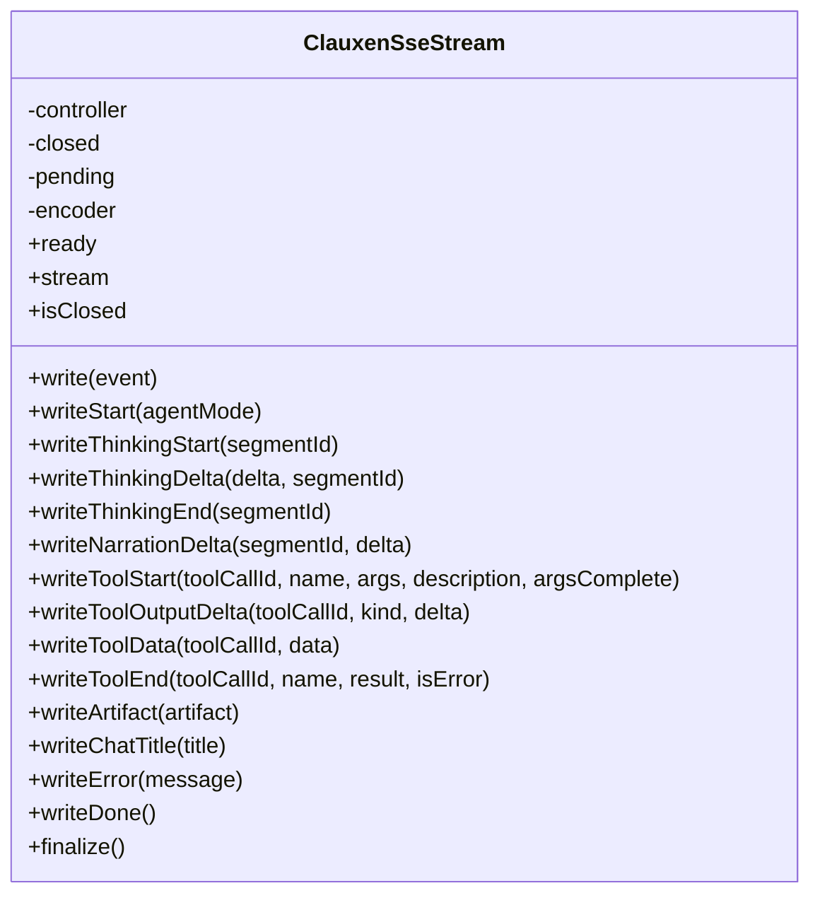

# 实时通信接口

<cite>
**本文引用的文件**   
- [src/app/api/chat/stream.ts](file://src/app/api/chat/stream.ts)
- [src/server/inference/clauxen-sse-stream.ts](file://src/server/inference/clauxen-sse-stream.ts)
- [src/server/inference/clauxen-ui-stream.ts](file://src/server/inference/clauxen-ui-stream.ts)
- [src/shared/lib/chat-stream.ts](file://src/shared/lib/chat-stream.ts)
- [src/shared/lib/ui-message-stream.ts](file://src/shared/lib/ui-message-stream.ts)
- [src/client/hooks/use-ai-stream.ts](file://src/client/hooks/use-ai-stream.ts)
- [src/server/agent-core/runtime/query-loop.ts](file://src/server/agent-core/runtime/query-loop.ts)
- [src/app/api/v1/chats/[chatId]/live/route.ts](file://src/app/api/v1/chats/[chatId]/live/route.ts)
</cite>

## 目录

1. [简介](#简介)
2. [项目结构与定位](#项目结构与定位)
3. [SSE 协议总览](#sse-协议总览)
4. [连接建立与响应头](#连接建立与响应头)
5. [事件类型定义](#事件类型定义)
6. [Agent Trace 事件流](#agent-trace-事件流)
7. [进度、工具与产物事件](#进度工具与产物事件)
8. [错误事件与终止语义](#错误事件与终止语义)
9. [客户端连接处理](#客户端连接处理)
10. [重连机制与心跳保持](#重连机制与心跳保持)
11. [状态转换图](#状态转换图)
12. [服务端实现分析](#服务端实现分析)
13. [客户端实现分析](#客户端实现分析)
14. [集成示例指引](#集成示例指引)
15. [性能与可靠性建议](#性能与可靠性建议)
16. [故障排查](#故障排查)
17. [结论](#结论)

## 简介

本文件为该项目中 Agent 对话的实时通信接口文档，重点记录基于 Server-Sent Events 的 SSE 流式协议。该协议用于向客户端推送 Agent 执行过程中的可观测 Trace，包括思考阶段、叙述阶段和工具调用阶段，同时承载最终答案、聊天标题、错误、完成等控制事件。

系统并未使用 WebSocket；项目中存在的 WebSocket 相关搜索匹配主要指向语音听写、Supabase 代理等外部或独立通道，不属于本次 Agent SSE 协议范围。

## 项目结构与定位

Agent 实时通信由以下层次组成：

| 层级 | 职责 | 关键文件 |
|---|---|---|
| API 入口层 | 接收聊天请求，组装上下文，创建 SSE 流 | [src/app/api/chat/stream.ts](file://src/app/api/chat/stream.ts) |
| SSE 发射器 | 将结构化 `StreamEvent` 编码为 `data:` JSON 帧 | [src/server/inference/clauxen-sse-stream.ts](file://src/server/inference/clauxen-sse-stream.ts) |
| Agent 循环 | 驱动推理、思考、叙述和工具执行，按阶段发射事件 | [src/server/agent-core/runtime/query-loop.ts](file://src/server/agent-core/runtime/query-loop.ts) |
| 协议类型与解析器 | 定义 `StreamEvent` 联合类型，并提供安全解析器 | [src/shared/lib/chat-stream.ts](file://src/shared/lib/chat-stream.ts) |
| UI 流适配器 | 从字节流中提取答案、思考、工具、错误等回调 | [src/server/inference/clauxen-ui-stream.ts](file://src/server/inference/clauxen-ui-stream.ts) |
| 前端 Hook | 暴露给 React 组件消费流式事件 | [src/client/hooks/use-ai-stream.ts](file://src/client/hooks/use-ai-stream.ts) |
| 历史与轮次适配层 | 兼容 Vercel AI SDK 风格的消息块，映射到内部事件 | [src/shared/lib/ui-message-stream.ts](file://src/shared/lib/ui-message-stream.ts) |
| 轮次轮询接口 | 提供运行中轮次的快照，作为 SSE 断线后的补充恢复手段 | [src/app/api/v1/chats/[chatId]/live/route.ts](file://src/app/api/v1/chats/[chatId]/live/route.ts) |



**图表来源**   
- [src/app/api/chat/stream.ts:160-331](file://src/app/api/chat/stream.ts#L160-L331)
- [src/server/inference/clauxen-sse-stream.ts:24-241](file://src/server/inference/clauxen-sse-stream.ts#L24-L241)
- [src/server/agent-core/runtime/query-loop.ts:1-1208](file://src/server/agent-core/runtime/query-loop.ts#L1-L1208)
- [src/shared/lib/chat-stream.ts:1-325](file://src/shared/lib/chat-stream.ts#L1-L325)
- [src/server/inference/clauxen-ui-stream.ts:1-243](file://src/server/inference/clauxen-ui-stream.ts#L1-L243)
- [src/client/hooks/use-ai-stream.ts:1-73](file://src/client/hooks/use-ai-stream.ts#L1-L73)
- [src/app/api/v1/chats/[chatId]/live/route.ts:1-125](file://src/app/api/v1/chats/[chatId]/live/route.ts#L1-L125)

**章节来源**   
- [src/app/api/chat/stream.ts:1-331](file://src/app/api/chat/stream.ts#L1-L331)
- [src/shared/lib/chat-stream.ts:1-325](file://src/shared/lib/chat-stream.ts#L1-L325)

## SSE 协议总览

### 传输格式

每条消息都是标准 SSE 数据帧：

| 字段 | 含义 |
|---|---|
| `data:` | 以字符串开头的行，后面跟随一个 JSON 对象 |
| `\n\n` | 两个换行符表示一条完整事件结束 |
| JSON 根对象 | 必须包含 `type` 字段，其他字段随事件类型变化 |

协议注释明确说明：每个 SSE `data` 帧携带一个 JSON 对象，例如叙述增量事件的结构中包含 `type`、`segmentId`、`delta`。

### 基本约束

- 服务端使用 UTF-8 文本编码器输出 JSON。
- 客户端解析器对超大缓冲进行截断，并对单个 `data` 载荷限制大小。
- 未知或非法事件会被解析器丢弃，不会中断整个流。
- 事件是“扁平化”的：思考、叙述、工具三个阶段顺序追加到一个 Agent 步骤列表中，而不是嵌套帧结构。

### 事件生命周期

一个完整的 Agent 回合通常遵循以下顺序：

1. 发送 `start`。
2. 可选发送 `thinking_start`、`thinking_delta`、`thinking_end`。
3. 通过 `segment_start` / `segment_end` 包裹 thinking、narration、tool 阶段。
4. 持续发送 `narration_delta` 或 `answer_delta`。
5. 在最终轮结束时发送 `answer_finalize`。
6. 工具调用期间发送 `tool_start`、`tool_output_delta`、`tool_data`、`tool_end`。
7. 可能发送 `artifact_upsert`。
8. 发送 `chat_title`（如果生成聊天标题）。
9. 正常结束发送 `done`，异常路径发送 `error`。

**章节来源**   
- [src/shared/lib/chat-stream.ts:1-60](file://src/shared/lib/chat-stream.ts#L1-L60)
- [src/server/inference/clauxen-sse-stream.ts:1-25](file://src/server/inference/clauxen-sse-stream.ts#L1-L25)

## 连接建立与响应头

### API 入口

聊天 SSE 工厂函数负责：

- 解析模型 ID。
- 确定模型运行时。
- 创建 `ClauxenSseStream`。
- 并行加载项目上下文和插件工具。
- 等待消费者就绪后发送 `start`。
- 包装 Agent 循环并处理错误。
- 在 finally 分支中发送 `done` 并关闭流。

```mermaid
sequenceDiagram
    participant Client as "浏览器"
    participant StreamApi as "聊天 SSE API"
    participant Sse as "ClauxenSseStream"
    participant Loop as "Agent 查询循环"

    Client->>StreamApi: "GET /api/chat/stream"
    StreamApi->>Sse: "创建 SSE 发射器"
    StreamApi->>Sse: "等待消费者就绪"
    Sse-->>StreamApi: "ready 已触发"
    StreamApi->>Sse: "writeStart(true)"
    StreamApi->>Loop: "启动 Agent 循环"
    Loop-->>Sse: "发送 thinking/narration/tool 事件"
    Loop-->>StreamApi: "完成或抛出错误"
    StreamApi->>Sse: "finalize()"
```

**图表来源**   
- [src/app/api/chat/stream.ts:160-331](file://src/app/api/chat/stream.ts#L160-L331)
- [src/server/inference/clauxen-sse-stream.ts:24-90](file://src/server/inference/clauxen-sse-stream.ts#L24-L90)
- [src/server/agent-core/runtime/query-loop.ts:420-1121](file://src/server/agent-core/runtime/query-loop.ts#L420-L1121)

### HTTP 响应头

服务端为 SSE 响应设置以下关键响应头：

| 响应头 | 值 | 作用 |
|---|---|---|
| `Content-Type` | `text/event-stream; charset=utf-8` | 声明为 SSE 文本流 |
| `Cache-Control` | `no-cache, no-transform` | 禁止缓存和中间变换 |
| `X-Accel-Buffering` | `no` | 避免反向代理缓冲 |
| `Connection` | `keep-alive` | 保持长连接 |

这些响应头由 `CLAUXEN_STREAM_HEADERS` 定义，并通过 `createStreamResponse` 应用到 Response。

**章节来源**   
- [src/server/inference/clauxen-sse-stream.ts:17-27](file://src/server/inference/clauxen-sse-stream.ts#L17-L27)
- [src/server/inference/clauxen-sse-stream.ts:234-241](file://src/server/inference/clauxen-sse-stream.ts#L234-L241)
- [src/app/api/chat/stream.ts:160-331](file://src/app/api/chat/stream.ts#L160-L331)

## 事件类型定义

`StreamEvent` 是一个严格联合类型，所有事件都通过 `parseStreamEvent` 校验后再交给消费者。

| 事件类型 | 关键字段 | 用途 |
|---|---|---|
| `start` | `agentMode?`、`assistantMessageId?` | 回合开始，标记是否为 Agent 模式 |
| `turn_ready` | `userMessageId?`、`assistantMessageId?` | 持久化 ID 写入后可用 |
| `thinking_start` | `segmentId?` | 思考阶段开始 |
| `thinking_delta` | `delta`、`segmentId?` | 思考内容增量 |
| `thinking_end` | `segmentId?` | 思考阶段结束 |
| `segment_start` | `segmentId`、`kind` | 阶段分段开始 |
| `segment_end` | `segmentId`、`kind` | 阶段分段结束 |
| `narration_delta` | `delta`、`segmentId` | 面向用户的叙述增量 |
| `answer_delta` | `delta`、`segmentId?` | 最终答案增量 |
| `answer_finalize` | `segmentId?`、`text` | 将叙述段落提升为最终答案 |
| `tool_start` | `toolCallId`、`name`、`args?`、`description?`、`argsComplete?` | 工具调用开始 |
| `tool_output_delta` | `toolCallId`、`kind`、`delta` | 工具 stdout/stderr 增量 |
| `tool_data` | `toolCallId`、`data` | 工具结构化数据 |
| `tool_end` | `toolCallId`、`name`、`result`、`isError?` | 工具调用结束 |
| `artifact_upsert` | `artifactId`、`path`、`content` 等 | 产物文件更新 |
| `chat_title` | `title` | 聊天标题 |
| `done` | 无 | 成功完成 |
| `error` | `message` | 错误信息 |
| `backgrounded` | `jobId?`、`chatId?` | 回合转入后台分片 |

### 字段验证规则

解析器对关键字段做了基础校验：

- `delta` 必须是字符串。
- `segmentId`、`toolCallId`、`name`、`artifactId`、`path`、`content`、`title`、`message` 等字段需要满足期望类型。
- `kind` 仅限于 `thinking`、`narration`、`tool`。
- `tool_output_delta.kind` 仅限于 `stdout`、`stderr`。
- 未知事件返回空结果并被丢弃。



**图表来源**   
- [src/shared/lib/chat-stream.ts:255-325](file://src/shared/lib/chat-stream.ts#L255-L325)

**章节来源**   
- [src/shared/lib/chat-stream.ts:1-254](file://src/shared/lib/chat-stream.ts#L1-L254)

## Agent Trace 事件流

Agent 循环采用“平铺式 Trace”设计：思考、叙述、工具三个阶段的输出顺序追加到同一个步骤列表，客户端 reducer 将其折叠进消息的 `agentTrace`。

### 阶段语义

| 阶段 | 行为 |
|---|---|
| thinking | 模型内部推理过程，不一定直接展示给用户 |
| narration | 面向用户的第一人称进展叙述，也是最终答案的来源 |
| tool | 工具调用，包括参数流式输入、标准输出、结构化数据和最终结果 |

### 事件序列

```mermaid
sequenceDiagram
    participant Loop as "Agent 循环"
    participant Sse as "SSE 发射器"
    participant Client as "客户端"

    Loop->>Sse: "writeSegmentStart(narration)"
    Loop->>Sse: "writeNarrationDelta(...)"
    Note over Loop,Sse: "叙述持续产出"
    Loop->>Sse: "writeSegmentEnd(narration)"
    Loop->>Sse: "writeAnswerFinalize(segmentId, text)"
    Loop->>Sse: "writeDone()"
    Sse-->>Client: "SSE data 帧"
```

**图表来源**   
- [src/server/agent-core/runtime/query-loop.ts:513-536](file://src/server/agent-core/runtime/query-loop.ts#L513-L536)
- [src/server/agent-core/runtime/query-loop.ts:770-785](file://src/server/agent-core/runtime/query-loop.ts#L770-L785)
- [src/server/inference/clauxen-sse-stream.ts:110-150](file://src/server/inference/clauxen-sse-stream.ts#L110-L150)

### 思考阶段

思考阶段允许携带 `segmentId`，用于关联同一段思考的 start、delta、end。思考事件会先打开 thinking 阶段，再发送增量，最后关闭阶段。

### 叙述阶段

叙述阶段与思考阶段不同：它是用户可见的进展文本，并且最终轮的叙述会被提升为最终答案。

**章节来源**   
- [src/server/agent-core/runtime/query-loop.ts:513-536](file://src/server/agent-core/runtime/query-loop.ts#L513-L536)
- [src/server/agent-core/runtime/query-loop.ts:770-785](file://src/server/agent-core/runtime/query-loop.ts#L770-L785)
- [src/server/inference/clauxen-sse-stream.ts:100-150](file://src/server/inference/clauxen-sse-stream.ts#L100-L150)

## 进度、工具与产物事件

### 工具调用流程

工具调用分为四个关键事件：

1. `tool_start`：工具名称、参数、描述。
2. `tool_output_delta`：stdout 或 stderr 增量。
3. `tool_data`：工具结构化数据。
4. `tool_end`：最终结果，可能带 `isError`。

```mermaid
sequenceDiagram
    participant Loop as "Agent 循环"
    participant Sse as "SSE 发射器"
    participant Tool as "工具执行"
    participant Client as "客户端"

    Loop->>Sse: "writeToolStart(toolCallId, name, args)"
    Tool-->>Loop: "stdout/stderr 增量"
    Loop->>Sse: "writeToolOutputDelta(kind, delta)"
    Tool-->>Loop: "结构化数据"
    Loop->>Sse: "writeToolData(data)"
    Tool-->>Loop: "完成或失败"
    Loop->>Sse: "writeToolEnd(name, result, isError)"
```

**图表来源**   
- [src/server/agent-core/runtime/query-loop.ts:839-1017](file://src/server/agent-core/runtime/query-loop.ts#L839-L1017)
- [src/server/inference/clauxen-sse-stream.ts:150-200](file://src/server/inference/clauxen-sse-stream.ts#L150-L200)

### 产物事件

`artifact_upsert` 用于表达文件类产物，例如通过工具创建的代码文件或研究结果。它支持文件 ID、存储路径、MIME 类型、字节大小等元数据。

### 进度语义

- `segment_start` / `segment_end` 包裹 thinking、narration、tool 三个阶段。
- `tool_output_delta.kind` 区分标准输出和标准错误。
- `tool_end.isError` 表示工具执行是否失败。
- `answer_finalize` 表示当前轮叙述被提升为最终答案。

**章节来源**   
- [src/server/agent-core/runtime/query-loop.ts:839-1017](file://src/server/agent-core/runtime/query-loop.ts#L839-L1017)
- [src/server/inference/clauxen-sse-stream.ts:150-200](file://src/server/inference/clauxen-sse-stream.ts#L150-L200)
- [src/shared/lib/chat-stream.ts:60-120](file://src/shared/lib/chat-stream.ts#L60-L120)

## 错误事件与终止语义

### 错误事件

当模型提供方抛出错误、工具执行失败或请求被中止时，服务端会发送 `error` 事件。错误消息会通过面向用户的错误转换器处理，避免把供应商内部细节泄露到聊天转录中。

### 正常终止

正常路径会在 finally 中发送 `done`，然后调用 `finalize()` 关闭流。

### 中止路径

当 AbortSignal 被触发时，服务端会：

- 发送 `Generation aborted.` 错误。
- 发送 `done`。
- 调用 `finalize()`。



**图表来源**   
- [src/server/agent-core/runtime/query-loop.ts:550-577](file://src/server/agent-core/runtime/query-loop.ts#L550-L577)
- [src/server/agent-core/runtime/query-loop.ts:722-735](file://src/server/agent-core/runtime/query-loop.ts#L722-L735)
- [src/server/agent-core/runtime/query-loop.ts:1111-1121](file://src/server/agent-core/runtime/query-loop.ts#L1111-L1121)
- [src/app/api/chat/stream.ts:319-331](file://src/app/api/chat/stream.ts#L319-L331)

**章节来源**   
- [src/server/inference/clauxen-sse-stream.ts:201-233](file://src/server/inference/clauxen-sse-stream.ts#L201-L233)
- [src/server/agent-core/runtime/query-loop.ts:722-735](file://src/server/agent-core/runtime/query-loop.ts#L722-L735)
- [src/server/agent-core/runtime/query-loop.ts:1111-1121](file://src/server/agent-core/runtime/query-loop.ts#L1111-L1121)
- [src/app/api/chat/stream.ts:319-331](file://src/app/api/chat/stream.ts#L319-L331)

## 客户端连接处理

### React Hook 封装

`useAiStream` 暴露 `streamFromResponse`，用于消费后端响应。它委托 `consumeClauxenStreamResponse` 解析流，并把每个 `StreamEvent` 派发到具体处理器：

| 事件 | 默认行为 |
|---|---|
| `start` | 触发 `onStart` |
| `thinking_start` | 触发 `onThinkingStart` |
| `thinking_delta` | 触发 `onThinkingDelta` |
| `answer_delta` | 触发 `onAnswerDelta` |
| `done` | 触发 `onDone` |
| `error` | 触发 `onError` |
| 其他事件 | 转发给 `onEvent` |

### 流解析器

`consumeClauxenStreamResponse` 使用 `createSseParser` 读取响应体，逐块拼接并按 `\n\n` 分割事件。解析器会把每个合法事件交给上层回调，再由 Hook 分发到业务处理器。



**图表来源**   
- [src/client/hooks/use-ai-stream.ts:1-73](file://src/client/hooks/use-ai-stream.ts#L1-L73)
- [src/shared/lib/ui-message-stream.ts:271-376](file://src/shared/lib/ui-message-stream.ts#L271-L376)
- [src/shared/lib/chat-stream.ts:255-325](file://src/shared/lib/chat-stream.ts#L255-L325)

**章节来源**   
- [src/client/hooks/use-ai-stream.ts:1-73](file://src/client/hooks/use-ai-stream.ts#L1-L73)
- [src/shared/lib/ui-message-stream.ts:271-376](file://src/shared/lib/ui-message-stream.ts#L271-L376)

## 重连机制与心跳保持

### 当前实现现状

仓库中的 SSE 实现**没有内置自动重连逻辑**，也**没有心跳、ping/pong 或 keepalive 帧**。这意味着：

- 客户端不应依赖框架自动重连。
- 若网络断开，应自行判断是否需要重新发起请求。
- 若需要维持空闲连接，应由上层策略决定如何探测连接状态。

### 推荐的客户端重连策略

虽然代码未实现，但结合项目已有的轮询接口，可实现较可靠的恢复方案：

1. 首次连接使用 `/api/chat/stream`。
2. 连接建立后保存最近收到的事件或阶段状态。
3. 连接断开时，使用 `/api/v1/chats/{chatId}/live` 拉取当前轮次快照。
4. 根据快照决定是否重建 SSE 连接。
5. 如果服务器已经发送 `done`，则不重建。
6. 如果服务器仍显示 `running`，则尝试重建连接并继续渲染。



**图表来源**   
- [src/app/api/v1/chats/[chatId]/live/route.ts:1-125](file://src/app/api/v1/chats/[chatId]/live/route.ts#L1-L125)

### 心跳建议

由于协议中没有心跳事件，建议在客户端侧实现：

- 定时检查最近一次收到事件的时间。
- 超过阈值时主动轮询 `/api/v1/chats/{chatId}/live`。
- 如果轮询结果为空且无活跃任务，则认为会话已结束。
- 如果轮询结果显示仍在运行，则重建 SSE 连接。

**章节来源**   
- [src/shared/lib/chat-stream.ts:255-325](file://src/shared/lib/chat-stream.ts#L255-L325)
- [src/app/api/v1/chats/[chatId]/live/route.ts:1-125](file://src/app/api/v1/chats/[chatId]/live/route.ts#L1-L125)

## 状态转换图

Agent 回合的状态可以从事件角度建模。



**图表来源**   
- [src/shared/lib/chat-stream.ts:1-120](file://src/shared/lib/chat-stream.ts#L1-L120)
- [src/server/agent-core/runtime/query-loop.ts:513-1017](file://src/server/agent-core/runtime/query-loop.ts#L513-L1017)

## 服务端实现分析

### ClauxenSseStream 类

该类是 SSE 协议的直接实现者：

- 维护 `StreamController`。
- 在消费者尚未就绪时缓冲早期事件。
- 将 `StreamEvent` 编码为 `data: {...}\n\n`。
- 提供 `writeStart`、`writeThinkingStart/Delta/End`、`writeNarrationDelta`、`writeToolStart/Data/OutputDelta/End`、`writeArtifact`、`writeChatTitle`、`writeError`、`writeDone`、`finalize` 等方法。



**图表来源**   
- [src/server/inference/clauxen-sse-stream.ts:24-241](file://src/server/inference/clauxen-sse-stream.ts#L24-L241)

### Agent 查询循环

`query-loop.ts` 是 Agent 的核心编排逻辑：

- 最多执行 24 步。
- 在每个 round 中驱动模型输出。
- 将思考增量发送到 thinking 阶段。
- 将用户可见叙述发送到 narration 阶段。
- 遇到工具调用时切换到工具阶段。
- 最终轮将叙述提升为最终答案。
- 在所有路径上确保发送 `done` 并关闭流。

**章节来源**   
- [src/server/agent-core/runtime/query-loop.ts:1-1208](file://src/server/agent-core/runtime/query-loop.ts#L1-L1208)

### UI 流适配器

`clauxen-ui-stream.ts` 从原始字节流中复制一份数据，同时提取业务回调：

- 解码 UTF-8。
- 按 `\n\n` 分割事件。
- 查找 `data:` 行。
- 解析 JSON。
- 将 `answer_finalize`、`answer_delta`、`thinking_*`、`segment_*`、`narration_delta`、`tool_*`、`chat_title`、`error` 等事件映射为回调。

注意：该适配器主要用于服务端的日志、追踪或额外监听场景，并不是浏览器端 SSE 连接的唯一入口。

**章节来源**   
- [src/server/inference/clauxen-ui-stream.ts:1-243](file://src/server/inference/clauxen-ui-stream.ts#L1-L243)

## 客户端实现分析

### useAiStream

这是 React 应用中消费 SSE 的主要 Hook。它将底层响应转换为结构化事件，并调用用户提供的处理器。

优点：

- 统一处理 `start`、`thinking`、`answer`、`done`、`error`。
- 保留完整事件以便高级组件处理 agent trace。

限制：

- 默认处理器只覆盖少量基础事件。
- 复杂 Agent Trace 应使用 `onEvent` 字段获取完整 `StreamEvent`。

**章节来源**   
- [src/client/hooks/use-ai-stream.ts:1-73](file://src/client/hooks/use-ai-stream.ts#L1-L73)

### ui-message-stream 与 chat-stream

`ui-message-stream.ts` 提供了 `consumeClauxenStreamResponse`，它复用 `chat-stream.ts` 中的 `createSseParser`。

`chat-stream.ts` 是协议核心：

- 定义 `StreamEvent` 联合类型。
- 实现 `parseStreamEvent`。
- 实现 `createSseParser`。
- 限制最大缓冲和单条数据大小。

**章节来源**   
- [src/shared/lib/chat-stream.ts:1-325](file://src/shared/lib/chat-stream.ts#L1-L325)
- [src/shared/lib/ui-message-stream.ts:1-376](file://src/shared/lib/ui-message-stream.ts#L1-L376)

## 集成示例指引

本节给出集成指南，但不直接粘贴源代码。请参考下方文件路径获取实现细节。

### JavaScript 浏览器集成要点

参考实现位置：

- [src/client/hooks/use-ai-stream.ts](file://src/client/hooks/use-ai-stream.ts)
- [src/shared/lib/ui-message-stream.ts](file://src/shared/lib/ui-message-stream.ts)
- [src/shared/lib/chat-stream.ts](file://src/shared/lib/chat-stream.ts)

实现步骤：

1. 发起 GET 请求到 `/api/chat/stream`。
2. 检查响应头是否为 `text/event-stream`。
3. 使用 `ReadableStream` 读取 `Uint8Array`。
4. 使用 `TextDecoder` 解码为字符串。
5. 使用 `createSseParser` 或自定义 SSE 解析器。
6. 根据 `type` 字段分发事件。
7. 处理 `error` 后停止消费。
8. 处理 `done` 后关闭流。
9. 如需重连，使用 `/api/v1/chats/{chatId}/live` 判断会话状态。

### Python 集成要点

Python 客户端可直接使用 `requests` 或 `httpx` 的流式读取能力，或使用第三方 SSE 客户端库。

实现步骤：

1. 使用流式 GET 请求 `/api/chat/stream`。
2. 设置请求头，必要时携带认证 Cookie 或 Token。
3. 逐块读取响应体。
4. 按 `\n\n` 分割事件。
5. 查找 `data:` 行。
6. JSON 解析并处理事件。
7. 对 `error` 做退出或重试处理。
8. 对 `done` 做清理处理。

### Node.js 集成要点

Node.js 环境推荐：

- 使用原生 `fetch` 或 `undici` 获取 `ReadableStream`。
- 使用 `stream.Readable.toWeb` 或直接处理 Web Stream。
- 使用 `TextEncoder`/`TextDecoder` 处理 UTF-8。
- 使用项目中的 `createSseParser` 思路实现解析器。

参考文件：

- [src/shared/lib/chat-stream.ts](file://src/shared/lib/chat-stream.ts)
- [src/shared/lib/ui-message-stream.ts](file://src/shared/lib/ui-message-stream.ts)

### 通用注意事项

- 不要假设事件顺序完全固定，应使用 `segmentId` 和 `segment_start` / `segment_end` 维护阶段边界。
- 不要仅依赖 `answer_delta` 作为最终答案，应以 `answer_finalize` 为准。
- 不要忽略 `tool_output_delta.kind`，stdout 和 stderr 应分别渲染。
- 不要忽略 `error`；即使收到 `done`，也应优先显示错误。
- 不要阻塞解析器主循环；JSON 解析失败应跳过当前事件。
- 不要缓存整个流；应增量渲染。

## 性能与可靠性建议

### 缓冲区控制

- 解析器限制最大缓冲为 256KB。
- 单条 `data` 载荷限制为 64KB。
- UI 流适配器限制为 512KB，并在超限时只保留尾部一半。

建议客户端：

- 及时消费流数据。
- 不要累积未处理的 JSON 对象。
- 对大产物使用 `artifact_upsert` 的远程 ID 或存储路径，而不是内联全部内容。

### 首字延迟优化

API 层在个人化、项目上下文、插件工具准备未完成时就发送 `start`，以减少首字延迟。客户端应利用这一点，尽早显示“助手正在工作”状态。

### 错误隔离

解析器把 JSON 解析错误吞掉，避免单个损坏事件导致整个流失效。业务层应在收到 `error` 事件时显式处理，而不是静默忽略。

### 长连接管理

由于协议没有心跳，建议：

- 在浏览器中监听 `onabort`、`onerror`。
- 在服务端 worker 或边缘环境中设置超时。
- 使用轮询接口确认会话是否仍在运行。
- 避免无限重连；应设置最大重试次数和退避间隔。

[本节为通用性能指导，不直接分析具体代码片段]

## 故障排查

| 现象 | 可能原因 | 处理建议 |
|---|---|---|
| 只收到 `start`，后续无事件 | 请求被中止、模型提供方错误、网络断开 | 检查 `error` 事件；使用 live 接口确认轮次状态 |
| 只显示思考，没有答案 | 最终轮未产生叙述或未发送 `answer_finalize` | 检查 Agent 循环是否到达最终轮 |
| 工具卡片不完整 | `tool_start` 参数还在流式拼装 | 等待 `tool_end` 或 `argsComplete=true` |
| 标准错误混入正文 | 混淆了 `stdout` 和 `stderr` | 根据 `tool_output_delta.kind` 分开渲染 |
| 页面长时间假死 | 解析器缓冲过大或消费过慢 | 检查缓冲上限和事件消费速度 |
| 断网后无法恢复 | 缺少重连逻辑 | 自行实现重连并使用 live 接口判断 |
| 收到 `done` 但没有答案 | 可能提前完成或发生错误 | 检查是否收到 `error` 事件 |

**章节来源**   
- [src/shared/lib/chat-stream.ts:255-325](file://src/shared/lib/chat-stream.ts#L255-L325)
- [src/server/inference/clauxen-ui-stream.ts:1-243](file://src/server/inference/clauxen-ui-stream.ts#L1-L243)
- [src/app/api/v1/chats/[chatId]/live/route.ts:1-125](file://src/app/api/v1/chats/[chatId]/live/route.ts#L1-L125)

## 结论

该项目的实时通信基于标准 SSE 协议，围绕 Agent 的 thinking、narration、tool 三阶段构建了一套扁平化的 Trace 事件体系。服务端通过 `ClauxenSseStream` 将结构化事件编码为 `data:` JSON 帧，客户端通过 `useAiStream` 和 `createSseParser` 消费事件并渲染界面。

对于生产环境集成，最重要的是：

1. 正确识别事件类型，尤其是 `answer_finalize` 与 `done`。
2. 正确处理 `error` 事件。
3. 自行实现连接断开的重连逻辑。
4. 使用 `/api/v1/chats/{chatId}/live` 作为 SSE 断线后的恢复依据。
5. 不在协议层面假设心跳或自动重连。