# 认证接口

<cite>
**本文引用的文件**
- [jwt.ts](file://src/server/auth/jwt.ts)
- [session.ts](file://src/server/auth/session.ts)
- [supabase-session.ts](file://src/server/auth/supabase-session.ts)
- [require-session.ts](file://src/server/auth/require-session.ts)
- [login/route.ts](file://src/app/api/v1/auth/login/route.ts)
- [register/route.ts](file://src/app/api/v1/auth/register/route.ts)
- [logout/route.ts](file://src/app/api/v1/auth/logout/route.ts)
- [session/route.ts](file://src/app/api/v1/auth/session/route.ts)
- [magic/request/route.ts](file://src/app/api/v1/auth/magic/request/route.ts)
- [magic/complete/route.ts](file://src/app/api/v1/auth/magic/complete/route.ts)
- [magic/inspect/route.ts](file://src/app/api/v1/auth/magic/inspect/route.ts)
- [email-status/route.ts](file://src/app/api/v1/auth/email-status/route.ts)
- [validate-email/route.ts](file://src/app/api/v1/auth/validate-email/route.ts)
- [signup/request-otp/route.ts](file://src/app/api/v1/auth/signup/request-otp/route.ts)
- [signup/verify/route.ts](file://src/app/api/v1/auth/signup/verify/route.ts)
- [oauth-callbacks.md](file://docs/auth/oauth-callbacks.md)
- [gateway.ts](file://workers/native-auth/src/gateway.ts)
- [device/code/route.ts](file://src/app/api/oauth/device/code/route.ts)
- [device/approve/route.ts](file://src/app/api/oauth/device/approve/route.ts)
- [oauth/token/route.ts](file://src/app/api/oauth/token/route.ts)
- [oauth/userinfo/route.ts](file://src/app/api/oauth/userinfo/route.ts)
- [oauth/revoke/route.ts](file://src/app/api/oauth/revoke/route.ts)
- [service.ts](file://src/server/oauth/service.ts)
- [repository.ts](file://src/server/oauth/repository.ts)
- [constants.ts](file://src/server/oauth/constants.ts)
- [crypto.ts](file://src/server/oauth/crypto.ts)
</cite>

## 目录
1. [简介](#简介)
2. [项目结构与定位](#项目结构与定位)
3. [核心认证组件](#核心认证组件)
4. [系统架构总览](#系统架构总览)
5. [详细接口说明](#详细接口说明)
6. [授权码与设备授权流程](#授权码与设备授权流程)
7. [令牌与权限模型](#令牌与权限模型)
8. [依赖关系分析](#依赖关系分析)
9. [性能与安全特性](#性能与安全特性)
10. [故障排查指南](#故障排查指南)
11. [结论与最佳实践](#结论与最佳实践)

## 简介
本文件系统化记录项目的认证体系，包括：
- REST 认证入口：用户注册、登录、登出、会话查询。
- Magic Link 认证：邮箱魔法链接申请、检查、完成注册。
- OTP 注册验证：发送验证码、校验并创建账户。
- 第三方 OAuth 集成：Supabase 社交登录回调、本项目自有 OAuth 授权服务器。
- WebAuthn/FIDO2 支持现状与原生网关。
- JWT 结构、刷新机制、OAuth token 生命周期与权限声明。
- 安全建议：CSRF、Cookie、速率限制、账号有效性校验等。

需要特别说明的是：
- 当前 `/api/v1/auth/*` 中的显式密码注册和登录是开发模式路径；生产环境主要依赖 Supabase 管理用户、JWT 和 Cookie。
- 本项目未实现独立的 WebAuthn/FIDO2 认证路由；原生端通过 `native-auth` 网关代理到 Supabase，但代码中未发现自定义 FIDO2 凭据处理逻辑。

## 项目结构与定位
认证相关代码分布在以下层次：
- Next.js API 路由：提供浏览器和客户端调用的 REST 接口。
- 服务端认证模块：解析 JWT、读取会话、加载用户资料。
- OAuth 服务层：实现授权码、设备授权、令牌签发与撤销。
- 原生认证网关：为移动或桌面 SDK 提供受控的 Supabase 代理。
- Supabase 文档：描述社交 OAuth 回调与应用重定向配置。

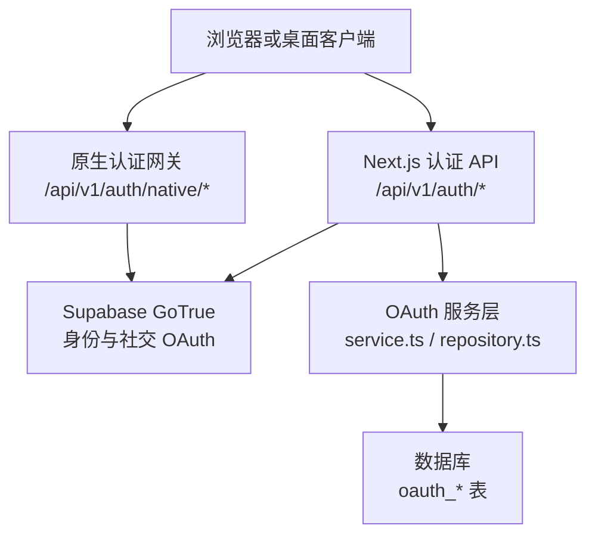

**图表来源**
- [login/route.ts:1-128](file://src/app/api/v1/auth/login/route.ts#L1-L128)
- [gateway.ts:1-166](file://workers/native-auth/src/gateway.ts#L1-L166)
- [service.ts:1-200](file://src/server/oauth/service.ts#L1-L200)
- [repository.ts:1-200](file://src/server/oauth/repository.ts#L1-L200)

**章节来源**
- [login/route.ts:1-128](file://src/app/api/v1/auth/login/route.ts#L1-L128)
- [gateway.ts:1-166](file://workers/native-auth/src/gateway.ts#L1-L166)
- [oauth-callbacks.md:1-71](file://docs/auth/oauth-callbacks.md#L1-L71)

## 核心认证组件
### JWT 与访问令牌验证
- 模块负责从 Cookie 或 `Authorization` 头中读取 Supabase 访问令牌。
- 使用本地 JWKS 缓存验证 ES256/RS256 令牌，也支持 HS256 场景。
- 对已验证令牌做内存缓存，避免重复网络请求。
- 不主动刷新令牌；过期令牌返回空结果，由客户端刷新 Cookie。
- 注销或账号删除时清理令牌缓存。

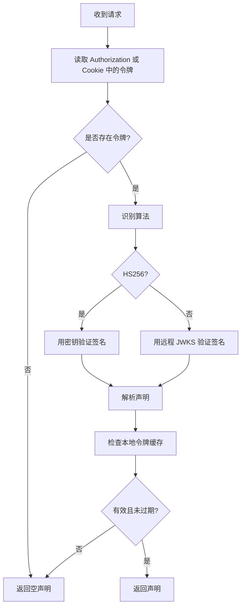

**图表来源**
- [jwt.ts:1-200](file://src/server/auth/jwt.ts#L1-L200)

**章节来源**
- [jwt.ts:1-200](file://src/server/auth/jwt.ts#L1-L200)
- [supabase-session.ts:1-34](file://src/server/auth/supabase-session.ts#L1-L34)

### 会话解析与用户资料
- 优先解析 Supabase JWT 声明。
- 若 JWT 无效但存在 Bearer 头或可解析 Cookie，则返回“需要刷新”错误。
- 同时支持 OAuth access token、API Key 和本地开发会话 Cookie。
- 查询 `public.profiles` 表补充显示名、头像、偏好名等信息。
- 校验用户是否仍存在于 `auth.users`，防止已删除账号继续使用会话。

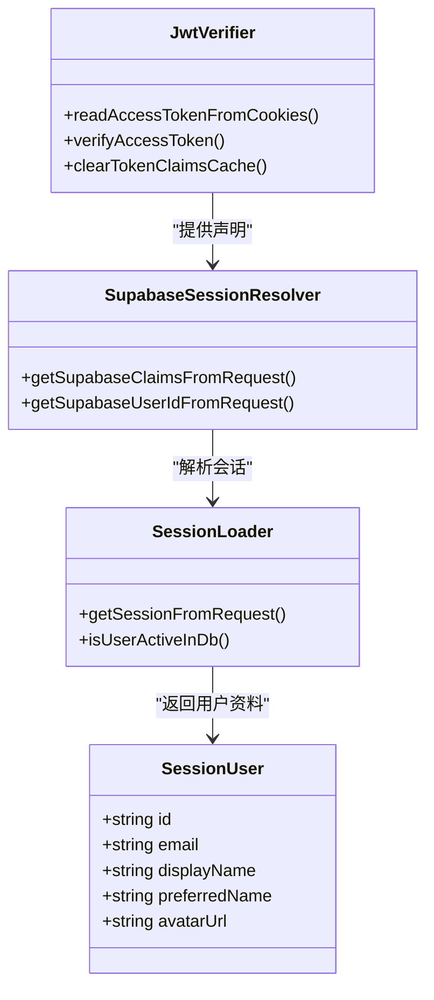

**图表来源**
- [session.ts:1-200](file://src/server/auth/session.ts#L1-L200)
- [supabase-session.ts:1-34](file://src/server/auth/supabase-session.ts#L1-L34)
- [jwt.ts:1-200](file://src/server/auth/jwt.ts#L1-L200)

**章节来源**
- [session.ts:1-200](file://src/server/auth/session.ts#L1-L200)
- [require-session.ts:1-9](file://src/server/auth/require-session.ts#L1-L9)

## 系统架构总览
认证系统分为三条主线：
1. **Web 与浏览器认证**：基于 Supabase 管理的用户、社交登录、JWT Cookie。
2. **REST 认证辅助接口**：用于统一邮箱校验、Magic Link、OTP、开发模式登录注册、会话查询与登出。
3. **OAuth 授权服务器**：为 CLI、桌面端或第三方应用提供标准授权码和设备授权流程。

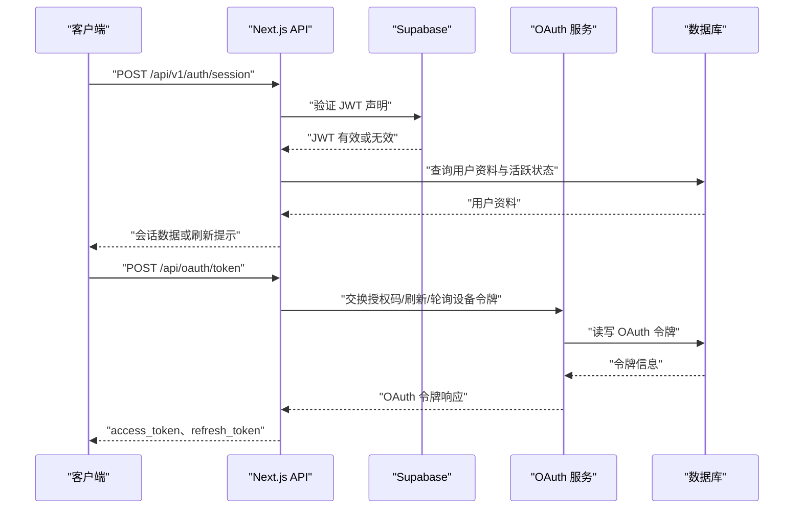

**图表来源**
- [session/route.ts:1-182](file://src/app/api/v1/auth/session/route.ts#L1-L182)
- [oauth/token/route.ts:1-108](file://src/app/api/oauth/token/route.ts#L1-L108)
- [service.ts:1-200](file://src/server/oauth/service.ts#L1-L200)
- [repository.ts:1-200](file://src/server/oauth/repository.ts#L1-L200)

## 详细接口说明

### 用户邮箱校验与可用性检测
#### 邮箱格式与临时邮箱校验
- 接口：`POST /api/v1/auth/validate-email`
- 作用：服务端强制校验邮箱格式、长度，并拒绝临时邮箱。
- 成功响应包含允许标记；失败响应携带具体错误码。
- 适用于所有涉及邮箱的注册、登录、Magic Link、OTP 流程前置校验。

**章节来源**
- [validate-email/route.ts:1-46](file://src/app/api/v1/auth/validate-email/route.ts#L1-L46)

#### 邮箱是否已有账户
- 接口：`POST /api/v1/auth/email-status`
- 作用：根据邮箱判断应走登录还是创建账户流程。
- 返回邮箱、是否存在以及推荐模式。
- 同样进行临时邮箱校验。

**章节来源**
- [email-status/route.ts:1-27](file://src/app/api/v1/auth/email-status/route.ts#L1-L27)

### 用户注册
#### 开发模式密码注册
- 接口：`POST /api/v1/auth/register`
- 行为：仅在开发环境变量开启时可用；否则返回 503。
- 输入：邮箱、密码、可选显示名。
- 校验：邮箱格式、长度、是否为临时邮箱、密码长度、显示名长度、邮箱唯一性。
- 成功：返回用户信息，并设置会话 Cookie。
- 失败：返回 400、409 等结构化错误。

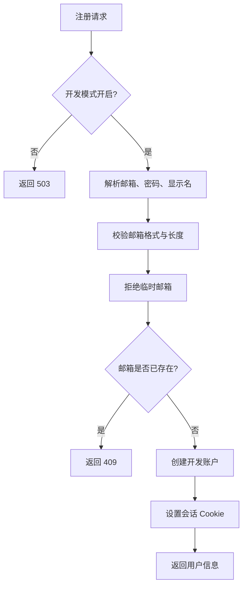

**图表来源**
- [register/route.ts:1-93](file://src/app/api/v1/auth/register/route.ts#L1-L93)

**章节来源**
- [register/route.ts:1-93](file://src/app/api/v1/auth/register/route.ts#L1-L93)

### 用户登录
#### 开发模式密码登录
- 接口：`POST /api/v1/auth/login`
- 行为：仅在开发环境变量开启时可用；GET 会返回开发模式提示或不可用状态。
- 输入：邮箱和密码。
- 校验：IP 级登录速率限制、邮箱必填、临时邮箱禁止。
- 新用户自动注册，旧用户校验密码。
- 成功：返回用户信息，并设置会话 Cookie。
- 失败：返回 401 或 429。

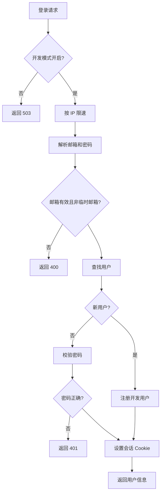

**图表来源**
- [login/route.ts:1-128](file://src/app/api/v1/auth/login/route.ts#L1-L128)

**章节来源**
- [login/route.ts:1-128](file://src/app/api/v1/auth/login/route.ts#L1-L128)

### 用户登出
- 接口：`POST /api/v1/auth/logout`
- 行为：清除会话 Cookie 和身份提示 Cookie。
- 响应：固定成功结构，不依赖当前登录状态。

**章节来源**
- [logout/route.ts:1-20](file://src/app/api/v1/auth/logout/route.ts#L1-L20)

### 会话管理
- 接口：`GET /api/v1/auth/session?quiet=1|0`
- 行为：
  - 默认完整模式：解析 Supabase JWT，检查用户是否仍存在，同步 profile，返回合并后的会话。
  - 静默模式：仅返回当前会话，不触发完整重建。
  - 如果检测到令牌存在但无法解析，返回“需要刷新”错误。
  - 未登录时返回空会话，并清理 Cookie。
- Cookie：
  - 成功登录时设置会话 Cookie 和身份提示 Cookie。
  - 会话无效时清除 Cookie。

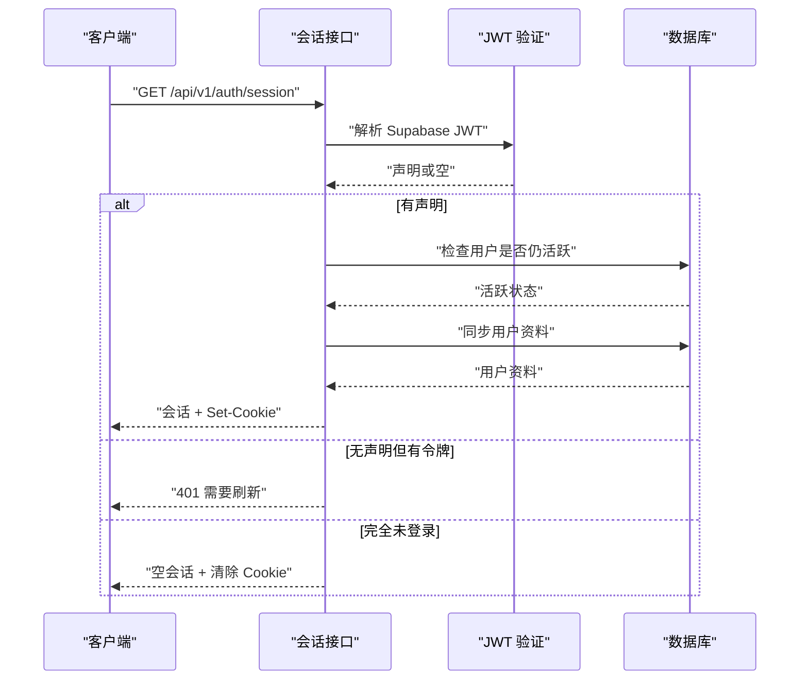

**图表来源**
- [session/route.ts:1-182](file://src/app/api/v1/auth/session/route.ts#L1-L182)
- [jwt.ts:1-200](file://src/server/auth/jwt.ts#L1-L200)
- [session.ts:1-200](file://src/server/auth/session.ts#L1-L200)

**章节来源**
- [session/route.ts:1-182](file://src/app/api/v1/auth/session/route.ts#L1-L182)

### Magic Link 认证
#### 申请魔法链接
- 接口：`POST /api/v1/auth/magic/request`
- 作用：为新用户发送有效期约 5 分钟的注册魔法链接。
- 输入：邮箱。
- 输出：服务返回结果，供前端展示状态。

#### 检查魔法链接
- 接口：`POST /api/v1/auth/magic/inspect`
- 作用：在不消耗 token 的情况下查看邮箱、用途和剩余有效期。
- 适用场景：前端在打开链接前预检，提升用户体验。

#### 完成魔法链接注册
- 接口：`POST /api/v1/auth/magic/complete`
- 作用：使用魔法链接 token 和用户设置的密码创建确认过的 Supabase 账户。
- 成功后前端再走正常登录流程获取会话。

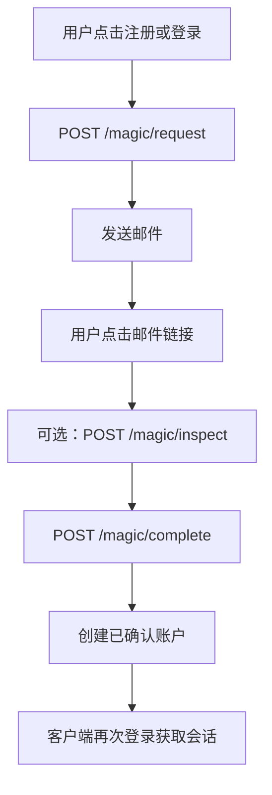

**图表来源**
- [magic/request/route.ts:1-18](file://src/app/api/v1/auth/magic/request/route.ts#L1-L18)
- [magic/inspect/route.ts:1-23](file://src/app/api/v1/auth/magic/inspect/route.ts#L1-L23)
- [magic/complete/route.ts:1-35](file://src/app/api/v1/auth/magic/complete/route.ts#L1-L35)

**章节来源**
- [magic/request/route.ts:1-18](file://src/app/api/v1/auth/magic/request/route.ts#L1-L18)
- [magic/inspect/route.ts:1-23](file://src/app/api/v1/auth/magic/inspect/route.ts#L1-L23)
- [magic/complete/route.ts:1-35](file://src/app/api/v1/auth/magic/complete/route.ts#L1-L35)

### OTP 注册验证
#### 发送注册 OTP
- 接口：`POST /api/v1/auth/signup/request-otp`
- 作用：通过 Cloudflare auth-email Worker 发送 6 位验证码。
- 输入：邮箱。
- 校验：邮箱必填。

#### 验证 OTP 并创建账户
- 接口：`POST /api/v1/auth/signup/verify`
- 作用：验证验证码后创建已确认的 Supabase 账户。
- 输入：邮箱、验证码、密码。
- 成功后返回用户邮箱与 userId，前端继续登录流程。

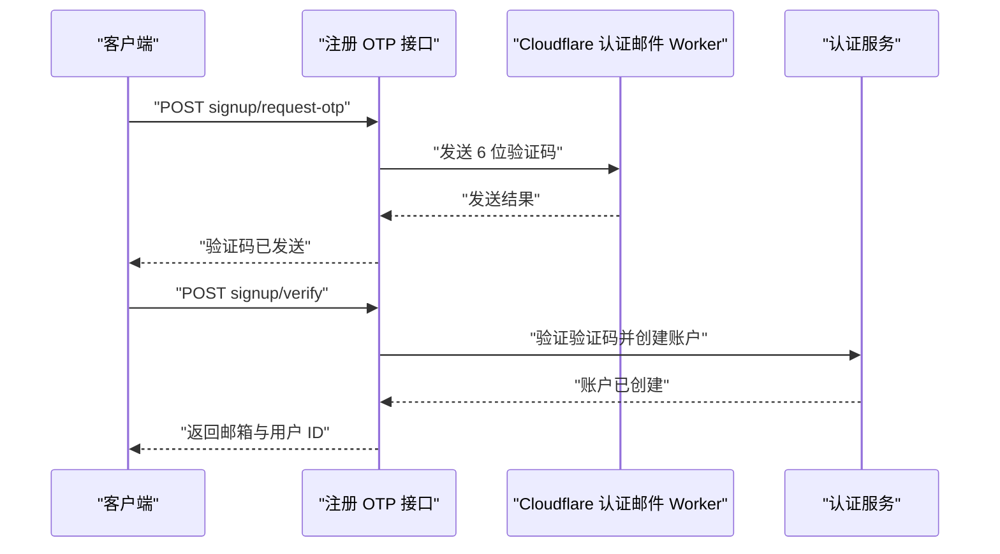

**图表来源**
- [signup/request-otp/route.ts:1-18](file://src/app/api/v1/auth/signup/request-otp/route.ts#L1-L18)
- [signup/verify/route.ts:1-46](file://src/app/api/v1/auth/signup/verify/route.ts#L1-L46)

**章节来源**
- [signup/request-otp/route.ts:1-18](file://src/app/api/v1/auth/signup/request-otp/route.ts#L1-L18)
- [signup/verify/route.ts:1-46](file://src/app/api/v1/auth/signup/verify/route.ts#L1-L46)

### 第三方 OAuth 集成
#### Supabase 社交登录回调
- 项目使用 Supabase 作为社交 OAuth 主入口。
- 回调地址：`https://ntplcfsbcyhiqklkbldk.supabase.co/auth/v1/callback`。
- 应用回调地址需配置到 Supabase 的 URL 配置中，例如 `https://www.clauxen.com/auth/callback` 及本地预览地址。
- Google One Tap 由前端组件自动触发，结合 Supabase 的 `signInWithIdToken` 建立会话。

**章节来源**
- [oauth-callbacks.md:1-71](file://docs/auth/oauth-callbacks.md#L1-L71)

#### 原生认证网关
- 路径：`/api/v1/auth/native/*`
- 作用：为移动或桌面 SDK 提供受限的 Supabase 代理。
- 限制：
  - 只允许指定 Origin。
  - 限制请求体大小与响应大小。
  - 要求 JSON 内容类型。
  - 严格校验 provider、PKCE challenge、grant_type。
  - 对 GitHub/GitLab authorize 直接重定向到 `https://auth.clauxen.com/auth/v1/authorize`。
  - 对 `/token` 端点支持 `id_token`、`password`、`refresh_token`、`pkce`。
  - 每 IP 速率限制，超出返回 429。

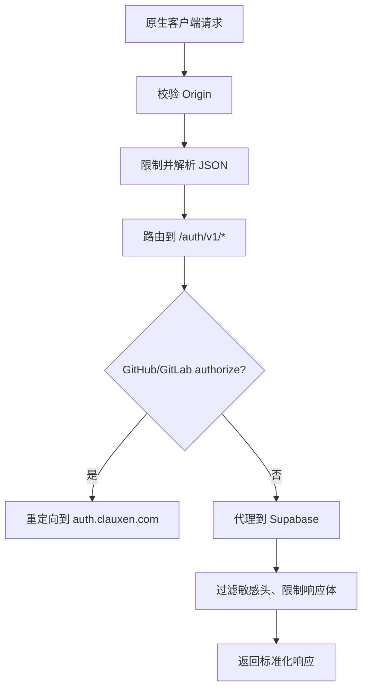

**图表来源**
- [gateway.ts:1-166](file://workers/native-auth/src/gateway.ts#L1-L166)

**章节来源**
- [gateway.ts:1-166](file://workers/native-auth/src/gateway.ts#L1-L166)

### WebAuthn/FIDO2 认证流程
- 当前仓库中没有独立的 WebAuthn/FIDO2 认证路由。
- 原生认证网关允许原生 SDK 调用 Supabase 的认证端点，但未见自定义 FIDO2 挑战、凭据生成或注册的实现。
- 若需启用 FIDO2，通常应由 Supabase 配置 WebAuthn Provider，并由前端调用 Supabase SDK 完成认证；本项目现有代码未暴露对应 REST 端点。

[本节为现状说明，不涉及具体代码实现]

## 授权码与设备授权流程

### OAuth 授权码流程
- 接口：`POST /api/oauth/token`
- 支持的 grant_type：
  - `authorization_code`：需要 `client_id`、`code`、`redirect_uri`、`code_verifier`。
  - `refresh_token`：需要 `refresh_token`。
  - `urn:ietf:params:oauth:grant-type:device_code`：需要 `device_code`，轮询等待用户批准。
- 必须使用 PKCE S256。
- redirect_uri 必须是本机回环地址。

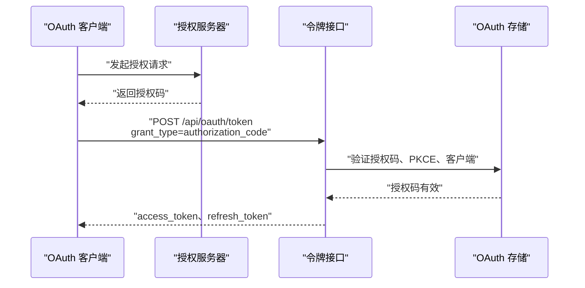

**图表来源**
- [oauth/token/route.ts:1-108](file://src/app/api/oauth/token/route.ts#L1-L108)
- [service.ts:1-200](file://src/server/oauth/service.ts#L1-L200)
- [repository.ts:1-200](file://src/server/oauth/repository.ts#L1-L200)

**章节来源**
- [oauth/token/route.ts:1-108](file://src/app/api/oauth/token/route.ts#L1-L108)
- [service.ts:1-200](file://src/server/oauth/service.ts#L1-L200)

### 设备授权流程
- 设备获取码：`POST /api/oauth/device/code`
- 用户批准：`POST /api/oauth/device/approve`（需已登录）
- 设备轮询令牌：`POST /api/oauth/token`，grant_type 为 device code。

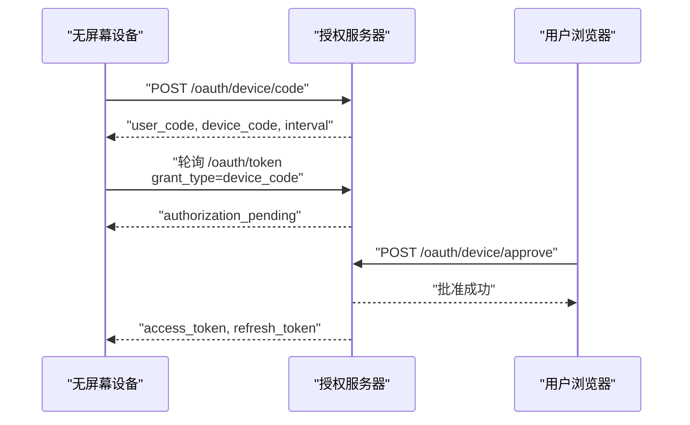

**图表来源**
- [device/code/route.ts:1-49](file://src/app/api/oauth/device/code/route.ts#L1-L49)
- [device/approve/route.ts:1-47](file://src/app/api/oauth/device/approve/route.ts#L1-L47)
- [oauth/token/route.ts:1-108](file://src/app/api/oauth/token/route.ts#L1-L108)

**章节来源**
- [device/code/route.ts:1-49](file://src/app/api/oauth/device/code/route.ts#L1-L49)
- [device/approve/route.ts:1-47](file://src/app/api/oauth/device/approve/route.ts#L1-L47)
- [oauth/token/route.ts:1-108](file://src/app/api/oauth/token/route.ts#L1-L108)

## 令牌与权限模型

### Supabase JWT
- 由 Supabase 签发，本项目在服务端验证。
- 支持算法：ES256、RS256、HS256。
- 必需声明：`sub`、`exp`、`iss`、`aud`。
- 扩展声明：`email`、`phone`、`role`、`session_id`、`is_anonymous`、`user_metadata`、`app_metadata`。
- 服务端不刷新 JWT；过期由客户端刷新 Cookie。

**章节来源**
- [jwt.ts:1-200](file://src/server/auth/jwt.ts#L1-L200)
- [supabase-session.ts:1-34](file://src/server/auth/supabase-session.ts#L1-L34)

### OAuth 令牌模型
- 本项目 OAuth access token 和 refresh token 为不透明令牌，以固定前缀区分：
  - access token：`cla_at_`
  - refresh token：`cla_rt_`
  - 授权码：`cla_ac_`
  - 设备码：`cla_dc_`
- 令牌有效期：
  - access token：1 小时。
  - refresh token：90 天。
  - 授权码：10 分钟。
  - 设备码：15 分钟。
  - 设备轮询间隔：5 秒。
- 权限通过 scope 表达，默认包含 `openid`、`profile`、`offline_access`、`code:inference`、`code:profile`，并兼容部分历史 scope。
- 用户信息接口：`GET /api/oauth/userinfo`，返回 `sub`、`email`、`name`、`preferred_username`、`picture`。
- 令牌撤销：`POST /api/oauth/revoke`，符合 RFC 7009，始终返回 200。

```mermaid
erDiagram
  OAUTH_CLIENTS {
    uuid id PK
    string client_id UK
    string client_type
    string status
    string name
    text description
    boolean require_pkce
    boolean first_party
    json allowed_grant_types
    json metadata
  }

  OAUTH_AUTHORIZATION_REQUESTS {
    uuid id PK
    uuid user_id FK
    uuid oauth_client_id FK
    string redirect_uri
    json scopes
    string state_hash
    string code_challenge
    string ip_address
    string user_agent
    timestamp expires_at
  }

  OAUTH_AUTHORIZATION_CODES {
    uuid id PK
    uuid authorization_request_id FK
    uuid user_id FK
    uuid oauth_client_id FK
    string code_hash
    string redirect_uri
    json scopes
    string code_challenge
    string status
    timestamp expires_at
    timestamp consumed_at
  }

  OAUTH_ACCESS_TOKENS {
    uuid id PK
    uuid refresh_token_id FK
    uuid user_id FK
    uuid oauth_client_id FK
    string token_hash
    json scopes
    timestamp expires_at
  }

  OAUTH_REFRESH_TOKENS {
    uuid id PK
    uuid family_id FK
    uuid user_id FK
    uuid oauth_client_id FK
    string token_hash
    json scopes
    timestamp expires_at
    uuid rotated_from_token_id
  }

  OAUTH_REFRESH_TOKEN_FAMILIES {
    uuid id PK
    uuid user_id FK
    uuid oauth_client_id FK
  }

  OAUTH_CONSENT_GRANTS {
    uuid id PK
    uuid user_id FK
    uuid oauth_client_id FK
    json scopes
    timestamp granted_at
    timestamp revoked_at
  }

  OAUTH_EVENTS {
    uuid id PK
    uuid user_id FK
    uuid oauth_client_id FK
    string event_type
    string ip_address
    string user_agent
    timestamp created_at
  }

  OAUTH_CLIENTS ||--o{ OAUTH_AUTHORIZATION_REQUESTS : "发起"
  OAUTH_AUTHORIZATION_REQUESTS ||--o{ OAUTH_AUTHORIZATION_CODES : "产生"
  OAUTH_AUTHORIZATION_CODES ||--o{ OAUTH_ACCESS_TOKENS : "兑换"
  OAUTH_REFRESH_TOKEN_FAMILIES ||--o{ OAUTH_REFRESH_TOKENS : "拥有"
  OAUTH_REFRESH_TOKENS ||--o{ OAUTH_ACCESS_TOKENS : "轮换"
  OAUTH_CLIENTS ||--o{ OAUTH_CONSENT_GRANTS : "授权"
  OAUTH_CLIENTS ||--o{ OAUTH_EVENTS : "记录"
```

**图表来源**
- [repository.ts:1-200](file://src/server/oauth/repository.ts#L1-L200)
- [service.ts:1-200](file://src/server/oauth/service.ts#L1-L200)
- [constants.ts:1-29](file://src/server/oauth/constants.ts#L1-L29)

**章节来源**
- [constants.ts:1-29](file://src/server/oauth/constants.ts#L1-L29)
- [service.ts:1-200](file://src/server/oauth/service.ts#L1-L200)
- [repository.ts:1-200](file://src/server/oauth/repository.ts#L1-L200)
- [oauth/userinfo/route.ts:1-24](file://src/app/api/oauth/userinfo/route.ts#L1-L24)
- [oauth/revoke/route.ts:1-43](file://src/app/api/oauth/revoke/route.ts#L1-L43)

## 依赖关系分析
- API 路由依赖统一的 API handler 和响应封装。
- 认证路由依赖身份服务、邮箱校验、会话模块、OAuth 服务。
- OAuth 服务依赖常量、加密工具、重定向校验、数据库仓储。
- 会话解析依赖 JWT 模块、Supabase 声明解析、用户活跃性检查、profile 服务。

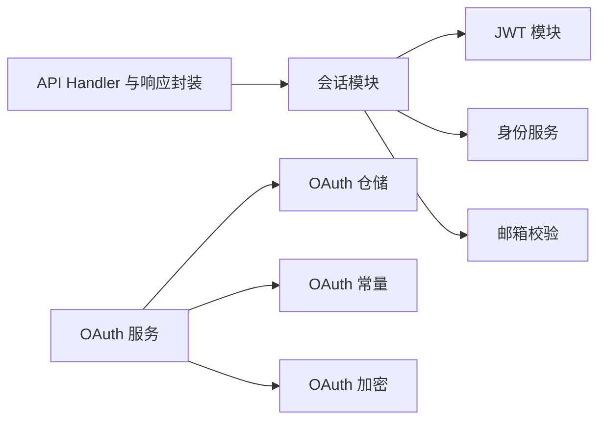

**图表来源**
- [session.ts:1-200](file://src/server/auth/session.ts#L1-L200)
- [jwt.ts:1-200](file://src/server/auth/jwt.ts#L1-L200)
- [service.ts:1-200](file://src/server/oauth/service.ts#L1-L200)
- [repository.ts:1-200](file://src/server/oauth/repository.ts#L1-L200)
- [constants.ts:1-29](file://src/server/oauth/constants.ts#L1-L29)
- [crypto.ts:1-43](file://src/server/oauth/crypto.ts#L1-L43)

**章节来源**
- [session.ts:1-200](file://src/server/auth/session.ts#L1-L200)
- [service.ts:1-200](file://src/server/oauth/service.ts#L1-L200)

## 性能与安全特性

### 性能特性
- JWT 验证使用本地 JWKS 缓存，减少每次请求的网络往返。
- 已验证令牌做内存缓存，降低重复验证开销。
- 会话查询中对用户活跃状态使用短期内存缓存，避免频繁数据库查询。
- OAuth 令牌为不透明值，避免在服务端解析敏感业务信息。

**章节来源**
- [jwt.ts:1-200](file://src/server/auth/jwt.ts#L1-L200)
- [session.ts:1-200](file://src/server/auth/session.ts#L1-L200)

### 安全特性
- 邮箱校验：统一拒绝临时邮箱，防止滥用注册。
- 登录速率限制：开发登录按 IP 限制每分钟尝试次数。
- 原生网关：Origin 白名单、请求体和响应体大小限制、JSON 类型强制、重复查询参数拒绝、上游错误不泄露敏感信息。
- OAuth：
  - 强制 PKCE S256。
  - redirect_uri 限制为本机回环地址。
  - 授权码一次性消费。
  - refresh token 家族化管理，支持轮换。
  - 令牌哈希存储，不持久化明文。
  - 事件审计记录授权、令牌发放等行为。
- 会话：
  - 检测已删除账号，立即拒绝访问。
  - 会话 Cookie 使用正则校验，避免注入非法值。
  - 登出时清除身份提示 Cookie。

**章节来源**
- [login/route.ts:1-128](file://src/app/api/v1/auth/login/route.ts#L1-L128)
- [gateway.ts:1-166](file://workers/native-auth/src/gateway.ts#L1-L166)
- [service.ts:1-200](file://src/server/oauth/service.ts#L1-L200)
- [repository.ts:1-200](file://src/server/oauth/repository.ts#L1-L200)
- [session/route.ts:1-182](file://src/app/api/v1/auth/session/route.ts#L1-L182)

## 故障排查指南

### 常见问题
- **会话需要刷新**：当请求带有 Bearer 头或 Cookie 中可解析令牌，但服务端无法建立有效会话时，会返回需要刷新错误。客户端应调用 Supabase 刷新流程更新 Cookie。
- **账号已删除**：若用户被管理员删除，即使 JWT 尚未过期，也会返回账号已删除错误。
- **开发登录不可用**：若未开启开发环境变量，注册和登录接口返回 503。
- **邮箱无效或临时邮箱**：所有邮箱入口都会拒绝无效格式和临时邮箱。
- **OAuth 授权码无效**：检查是否使用了正确的 `code_verifier`、`redirect_uri`、`client_id`，并确保授权码未被重复消费。
- **设备授权一直 pending**：确认用户已在浏览器中批准设备码，并按 `interval` 轮询 `/api/oauth/token`。

**章节来源**
- [session/route.ts:1-182](file://src/app/api/v1/auth/session/route.ts#L1-L182)
- [login/route.ts:1-128](file://src/app/api/v1/auth/login/route.ts#L1-L128)
- [register/route.ts:1-93](file://src/app/api/v1/auth/register/route.ts#L1-L93)
- [oauth/token/route.ts:1-108](file://src/app/api/oauth/token/route.ts#L1-L108)

## 结论与最佳实践

### 设计总结
- 生产用户身份主要由 Supabase 管理，Next.js 侧重会话解析、邮箱流程、OAuth 授权服务和原生网关。
- 开发模式提供显式密码注册和登录，便于本地调试。
- OAuth 采用标准授权码和设备授权流程，配合 PKCE 和不透明令牌，兼顾 CLI 和桌面端场景。
- 安全方面强调邮箱治理、速率限制、令牌哈希、账号活跃检查和敏感信息隔离。

### 安全最佳实践
- **CSRF 防护**：
  - 使用 SameSite Cookie、HttpOnly Cookie 保护会话。
  - 对跨站请求使用 CSRF Token 或同源策略。
  - 对 OAuth redirect_uri 严格校验，避免开放重定向。
- **会话安全管理**：
  - 不在日志中记录 JWT、refresh token、密码或手机号。
  - 登出后立即清除 Cookie，并在服务端失效会话。
  - 对已删除账号立即拒绝访问。
- **令牌生命周期**：
  - 短寿命 access token，长寿命 refresh token。
  - 定期轮换 refresh token。
  - 客户端在 token 过期时主动刷新，避免服务端刷新风暴。
- **第三方集成**：
  - 使用 Supabase 官方回调地址。
  - 原生网关限制 Origin、Content-Type、请求大小和 query 参数。
  - 不使用明文传输敏感凭证。

[本节为通用安全建议总结，不直接分析具体代码片段]