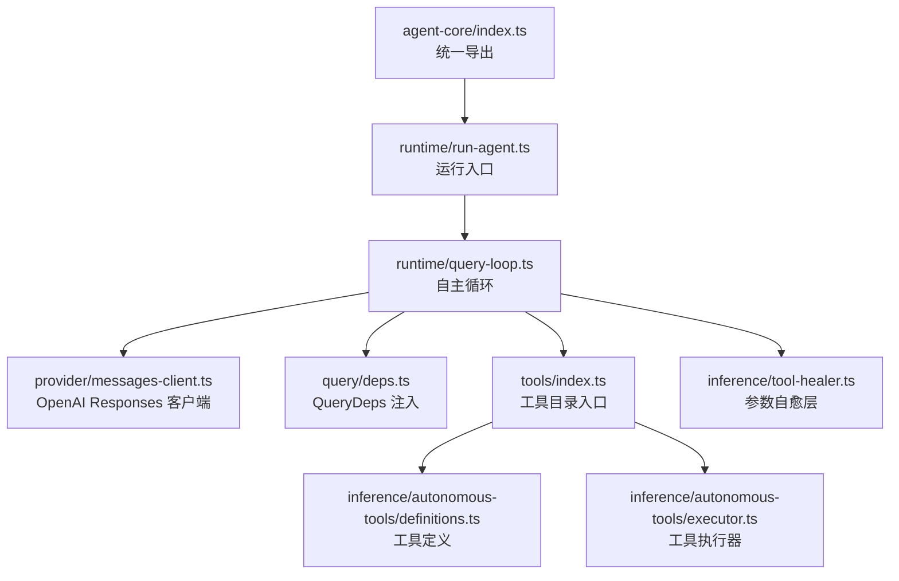
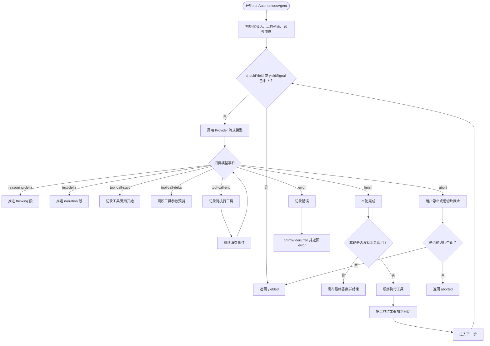
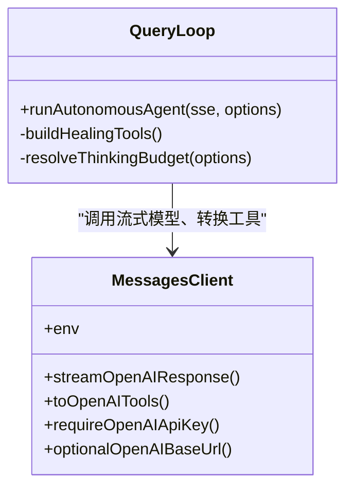
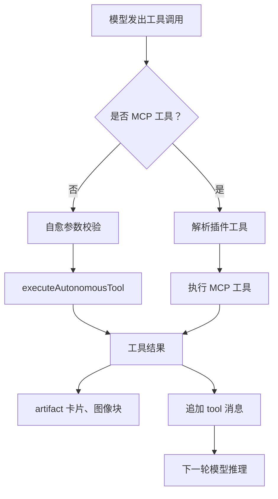
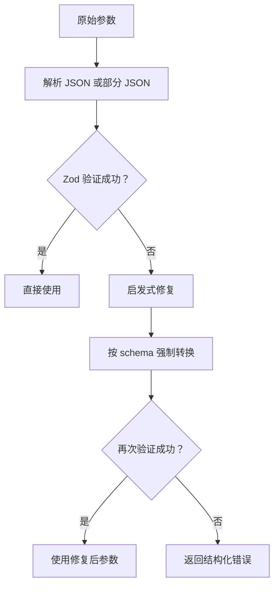
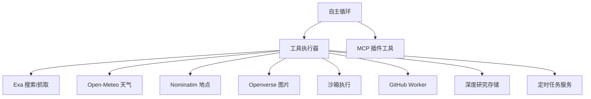
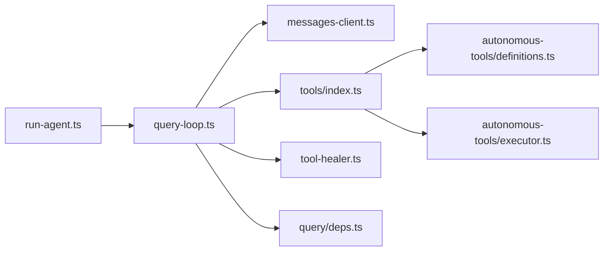
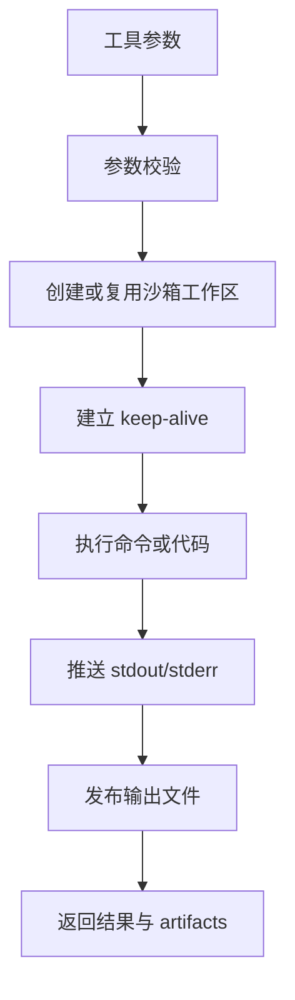

# Agent 核心

<cite>
**本文引用的文件**   
- [src/server/agent-core/index.ts](file://src/server/agent-core/index.ts)
- [src/server/agent-core/runtime/run-agent.ts](file://src/server/agent-core/runtime/run-agent.ts)
- [src/server/agent-core/runtime/query-loop.ts](file://src/server/agent-core/runtime/query-loop.ts)
- [src/server/agent-core/provider/messages-client.ts](file://src/server/agent-core/provider/messages-client.ts)
- [src/server/agent-core/query/deps.ts](file://src/server/agent-core/query/deps.ts)
- [src/server/agent-core/tools/index.ts](file://src/server/agent-core/tools/index.ts)
- [src/server/inference/tool-healer.ts](file://src/server/inference/tool-healer.ts)
- [src/server/inference/autonomous-tools/definitions.ts](file://src/server/inference/autonomous-tools/definitions.ts)
- [src/server/inference/autonomous-tools/executor.ts](file://src/server/inference/autonomous-tools/executor.ts)
- [docs/github-agent.md](file://docs/github-agent.md)
</cite>

## 目录
1. [引言](#引言)
2. [项目结构](#项目结构)
3. [核心组件](#核心组件)
4. [架构总览](#架构总览)
5. [详细组件分析](#详细组件分析)
6. [依赖关系分析](#依赖关系分析)
7. [性能与可靠性](#性能与可靠性)
8. [配置与参数调优](#配置与参数调优)
9. [自定义工具开发指南](#自定义工具开发指南)
10. [故障排查](#故障排查)
11. [结论](#结论)

## 引言
Agent 核心是 Clauxen 聊天系统的服务端自主智能体运行时。它围绕 OpenAI Responses API 构建“多轮推理 + 工具调用”的自主循环：模型每轮输出思考、叙述和严格函数调用；系统按顺序执行工具，把结果回传给模型，直到模型不再调用工具为止。整个流程通过服务器端事件流实时推送到前端，同时支持深度研究计划、沙箱代码执行、外部搜索、天气、地点、图片、文件读写、GitHub 集成、MCP 插件工具以及可恢复的切片执行。

该文档聚焦以下目标：
- 解释自主循环机制、多轮推理流程和工具调用生命周期。
- 说明 Query Loop、Provider 抽象层、工具注册和执行器。
- 记录自我修复、错误恢复、超时与切片恢复策略。
- 汇总 Agent 配置选项、模型选择与参数调优。
- 描述与外部 AI 服务集成的请求编排与结果聚合方式。
- 提供自定义工具的完整开发指南，包括定义、权限控制、沙箱执行。

## 项目结构
Agent 核心位于 `src/server/agent-core`，采用分层组织：
- 顶层入口导出运行时、Provider 工具类型、查询依赖和工具目录。
- `runtime` 实现自主循环与流式协议。
- `provider` 转发到实际的 OpenAI Responses 客户端和环境变量。
- `query` 注入模型调用与 UUID 生成。
- `tools` 暴露自主工具目录与执行入口。



**图表来源**
- [src/server/agent-core/index.ts:1-33](file://src/server/agent-core/index.ts#L1-L33)
- [src/server/agent-core/runtime/run-agent.ts:1-14](file://src/server/agent-core/runtime/run-agent.ts#L1-L14)
- [src/server/agent-core/runtime/query-loop.ts:1-120](file://src/server/agent-core/runtime/query-loop.ts#L1-L120)
- [src/server/agent-core/provider/messages-client.ts:1-18](file://src/server/agent-core/provider/messages-client.ts#L1-L18)
- [src/server/agent-core/query/deps.ts:1-16](file://src/server/agent-core/query/deps.ts#L1-L16)
- [src/server/agent-core/tools/index.ts:1-7](file://src/server/agent-core/tools/index.ts#L1-L7)

**章节来源**
- [src/server/agent-core/index.ts:1-33](file://src/server/agent-core/index.ts#L1-L33)
- [src/server/agent-core/runtime/run-agent.ts:1-14](file://src/server/agent-core/runtime/run-agent.ts#L1-L14)

## 核心组件
- **运行时入口**：`run-agent.ts` 将 `runAutonomousAgent`、`generateChatTitle` 等能力再导出给上层路由使用。
- **自主循环**：`query-loop.ts` 实现单轮推理、工具执行、结果聚合、SSE 事件发射、恢复与切片。
- **Provider 抽象**：`messages-client.ts` 统一从 `openai-responses-client` 和 `env` 暴露流式接口、工具转换与环境变量。
- **查询依赖**：`deps.ts` 定义 `QueryDeps`，默认生产环境绑定 OpenAI 流式调用和随机 UUID。
- **工具目录**：`tools/index.ts` 暴露内置自主工具的定义与执行入口。
- **参数自愈**：`tool-healer.ts` 在模型参数不合法时自动修正，避免整轮失败。

**章节来源**
- [src/server/agent-core/runtime/run-agent.ts:1-14](file://src/server/agent-core/runtime/run-agent.ts#L1-L14)
- [src/server/agent-core/runtime/query-loop.ts:1-120](file://src/server/agent-core/runtime/query-loop.ts#L1-L120)
- [src/server/agent-core/provider/messages-client.ts:1-18](file://src/server/agent-core/provider/messages-client.ts#L1-L18)
- [src/server/agent-core/query/deps.ts:1-16](file://src/server/agent-core/query/deps.ts#L1-L16)
- [src/server/agent-core/tools/index.ts:1-7](file://src/server/agent-core/tools/index.ts#L1-L7)
- [src/server/inference/tool-healer.ts:1-40](file://src/server/inference/tool-healer.ts#L1-L40)

## 架构总览
Agent 核心的数据流由四层组成：
1. **调用方**：聊天路由或后台任务构造消息、模型参数与 SSE 流。
2. **自主循环**：维护对话历史、步骤预算、思考预算、工具状态与恢复元数据。
3. **Provider 层**：向 OpenAI Responses 发送带工具定义的请求并消费增量事件。
4. **工具层**：内置工具、MCP 插件工具、沙箱执行、外部服务和持久化写入。

```mermaid
sequenceDiagram
  participant Caller as "调用方"
  participant Loop as "自主循环"
  participant Provider as "Provider 层"
  participant Model as "外部模型服务"
  participant Tools as "工具层"
  participant UI as "前端 SSE"

  Caller->>Loop: 传入消息、模型、SSE、回调
  Loop->>Provider: 流式调用 Responses API
  Provider->>Model: 发送 instructions、input、tools
  Model-->>Provider: reasoning-delta / text-delta / tool-call-* / finish
  Provider-->>Loop: 事件流
  Loop->>UI: 推送 thinking、narration、toolStart/delta/end
  Loop->>Tools: 顺序执行工具调用
  Tools-->>Loop: 工具结果、暂停信号、产物
  Loop->>Provider: 下一轮携带工具结果继续推理
  Provider-->>Loop: 最终无工具调用轮
  Loop->>UI: finalize answer、roundEnd
```

**图表来源**
- [src/server/agent-core/runtime/query-loop.ts:201-600](file://src/server/agent-core/runtime/query-loop.ts#L201-L600)
- [src/server/agent-core/runtime/query-loop.ts:601-1047](file://src/server/agent-core/runtime/query-loop.ts#L601-L1047)
- [src/server/agent-core/provider/messages-client.ts:1-18](file://src/server/agent-core/provider/messages-client.ts#L1-L18)
- [src/server/inference/autonomous-tools/executor.ts:1-200](file://src/server/inference/autonomous-tools/executor.ts#L1-L200)

## 详细组件分析

### 自主循环：Query Loop
自主循环是 Agent 的核心调度器。其关键职责包括：
- 维护单步预算：普通模式最多 24 步，深度研究模式允许更多步数。
- 管理两种内部预算：外部模型步数和“思考”预算。
- 处理三种模型增量事件：思考增量、叙述文本、工具调用。
- 顺序执行本轮所有工具调用，并把工具结果追加到对话历史。
- 当一轮没有工具调用时，把叙述文本提升为最终答案。
- 暴露恢复钩子，支持切片检查点、中断恢复、执行中工具保护。



**图表来源**
- [src/server/agent-core/runtime/query-loop.ts:201-600](file://src/server/agent-core/runtime/query-loop.ts#L201-L600)
- [src/server/agent-core/runtime/query-loop.ts:601-1047](file://src/server/agent-core/runtime/query-loop.ts#L601-L1047)

#### 轮次生命周期
- **第一轮**：根据输入消息构造 Responses API 输入列表，附加系统提示和工具定义。
- **推理阶段**：先输出思考，再输出面向用户的叙述。
- **工具阶段**：当模型发出工具调用时，关闭当前叙述；逐个执行工具。
- **恢复阶段**：如果从 `initialPendingToolRound` 恢复，直接复用已缓冲的工具调用、结果和部分模型输出。
- **终止阶段**：某轮没有工具调用时，清理标题标签，发布最终答案，并上报训练转录。

#### 切片与恢复
循环支持长任务切片：
- `shouldYield` 表示软切片预算耗尽。
- `yieldSignal` 表示硬切片截止时间到达。
- 两者任一触发时，循环在当前轮开始前或流结束时返回 `yielded`。
- 调用方可保存 `step`、`conversation`、`narrationCounter`、`toolCallIds` 和 `terminalOutcome`，并在下一片段重新传入 `initialConversation`、`startStep`、`initialNarrationCounter`。
- 对执行中的工具，若外部写入结果不确定，循环会拒绝盲目重试，防止重复副作用。

**章节来源**
- [src/server/agent-core/runtime/query-loop.ts:201-600](file://src/server/agent-core/runtime/query-loop.ts#L201-L600)
- [src/server/agent-core/runtime/query-loop.ts:601-1047](file://src/server/agent-core/runtime/query-loop.ts#L601-L1047)

### Provider 抽象层
Provider 层不直接实现网络细节，而是从 `openai-responses-client` 暴露统一的流式响应接口。它负责：
- 将工具定义转换为 OpenAI Responses 可用的工具格式。
- 暴露 API Key 校验和可选 Base URL。
- 暴露环境变量。

这使 Agent 循环只关心“模型流事件”，而不关心具体 HTTP 实现。



**图表来源**
- [src/server/agent-core/provider/messages-client.ts:1-18](file://src/server/agent-core/provider/messages-client.ts#L1-L18)
- [src/server/agent-core/runtime/query-loop.ts:201-600](file://src/server/agent-core/runtime/query-loop.ts#L201-L600)

**章节来源**
- [src/server/agent-core/provider/messages-client.ts:1-18](file://src/server/agent-core/provider/messages-client.ts#L1-L18)

### 工具注册与执行器
工具分为三类：
1. **内置自主工具**：如 `web_search`、`web_fetch`、`bash_tool`、`execute_code`、`weather_fetch`、`places_search`、`image_search`、`file_read`、`create_file`、`file_write`、`github_agent`、`read_skill`、研究计划、定时任务和用户交互工具。
2. **MCP 插件工具**：以 `mcp__<slug>__<tool>` 形式动态挂载，需要用户授权。
3. **自愈包装工具**：对内置工具进行 Zod 参数校验与自动修复。

工具注册流程：
- 从 `autonomousAgentTools` 获取声明式工具定义。
- 用 `toOpenAITools` 转为 OpenAI 工具格式。
- 为每个内置工具创建自愈包装，绑定 `executeAutonomousTool`。
- 连接插件后，把 MCP 工具追加到工具列表。

工具执行流程：
- 非 MCP 工具走自愈包装或直接执行。
- MCP 工具通过 `resolveMcpToolCall` 和 `executeMcpToolCall` 执行。
- 工具结果被序列化、标记错误、映射图像文件、写入对话历史。
- 部分工具输出会立即以 artifact 卡片形式呈现给用户。



**图表来源**
- [src/server/agent-core/runtime/query-loop.ts:601-1047](file://src/server/agent-core/runtime/query-loop.ts#L601-L1047)
- [src/server/agent-core/tools/index.ts:1-7](file://src/server/agent-core/tools/index.ts#L1-L7)
- [src/server/inference/autonomous-tools/executor.ts:1-200](file://src/server/inference/autonomous-tools/executor.ts#L1-L200)

**章节来源**
- [src/server/agent-core/tools/index.ts:1-7](file://src/server/agent-core/tools/index.ts#L1-L7)
- [src/server/inference/autonomous-tools/definitions.ts:1-200](file://src/server/inference/autonomous-tools/definitions.ts#L1-L200)
- [src/server/inference/autonomous-tools/executor.ts:1-200](file://src/server/inference/autonomous-tools/executor.ts#L1-L200)

### 自我修复机制
Self-healing 层被称为“免疫系统”。当 LLM 输出错误的工具参数时，系统不会直接崩溃或浪费一轮去让模型重写，而是按三步尝试修复：
1. 直接使用 Zod 验证。
2. 应用启发式修复：字符串转数字、布尔值、空值、单元素数组解包、`{value}` 对象展开。
3. 基于 schema 形状逐字段强制转换。

如果仍无法修复，则返回结构化错误，而不是中断循环。



**图表来源**
- [src/server/inference/tool-healer.ts:1-213](file://src/server/inference/tool-healer.ts#L1-L213)

**章节来源**
- [src/server/inference/tool-healer.ts:1-213](file://src/server/inference/tool-healer.ts#L1-L213)

### 错误恢复、超时与中止
- **Provider 错误**：普通模式下直接记录错误并返回 `error`；深度研究模式下对可重试错误最多重试两次。
- **用户中止**：`signal` 表示显式停止，返回 `aborted`。
- **硬切片中止**：`yieldSignal` 用于运行时 slice 截止时间，返回 `yielded`，以便调用方检查点并继续。
- **执行中工具保护**：如果某轮恢复时发现正在执行的工具不是幂等安全的，循环会停止，避免重复副作用。
- **思维与叙述段落关闭**：每次模型流结束前都会关闭 thinking 和 narration 段，保证 UI 状态一致。
- **训练转录**：最终轮会把模型输出封装成训练转录条目，但不影响可见响应。

**章节来源**
- [src/server/agent-core/runtime/query-loop.ts:601-1047](file://src/server/agent-core/runtime/query-loop.ts#L601-L1047)

### 外部服务集成与结果聚合
Agent 核心并不直接耦合每个外部服务，而是通过工具执行器聚合：
- **搜索与抓取**：通过 Exa 进行网页搜索与内容抓取，支持进度流和结果分页。
- **天气**：通过地理编码与 Open-Meteo 获取预报。
- **地点**：通过 Nominatim 搜索地理位置。
- **图片**：通过 Openverse 搜索开源图片。
- **沙箱**：执行 Bash 命令和代码，输出 stdout/stderr 流式推送，并将产出文件持久化。
- **GitHub**：通过 `github_agent` 工具调用 GitHub Worker，执行仓库枚举、读取和变更提交。
- **MCP 插件**：连接用户授权的插件工具，如邮件、日历等。
- **研究计划**：将搜索结果、任务进度、来源链接持久化到深度研究存储。



**图表来源**
- [src/server/inference/autonomous-tools/executor.ts:1-722](file://src/server/inference/autonomous-tools/executor.ts#L1-L722)
- [docs/github-agent.md:1-108](file://docs/github-agent.md#L1-L108)

**章节来源**
- [src/server/inference/autonomous-tools/executor.ts:1-722](file://src/server/inference/autonomous-tools/executor.ts#L1-L722)
- [docs/github-agent.md:1-108](file://docs/github-agent.md#L1-L108)

## 依赖关系分析
Agent 核心的依赖边界清晰：
- 运行时只依赖 Provider 的流式接口和工具目录。
- Provider 依赖 OpenAI Responses 客户端和环境配置。
- 工具执行器依赖搜索、天气、地点、图片、沙箱、GitHub、研究和定时任务等服务。
- 查询依赖可注入，便于测试与替换模型实现。



**图表来源**
- [src/server/agent-core/runtime/run-agent.ts:1-14](file://src/server/agent-core/runtime/run-agent.ts#L1-L14)
- [src/server/agent-core/runtime/query-loop.ts:1-120](file://src/server/agent-core/runtime/query-loop.ts#L1-L120)
- [src/server/agent-core/provider/messages-client.ts:1-18](file://src/server/agent-core/provider/messages-client.ts#L1-L18)
- [src/server/agent-core/tools/index.ts:1-7](file://src/server/agent-core/tools/index.ts#L1-L7)
- [src/server/agent-core/query/deps.ts:1-16](file://src/server/agent-core/query/deps.ts#L1-L16)
- [src/server/inference/tool-healer.ts:1-40](file://src/server/inference/tool-healer.ts#L1-L40)

**章节来源**
- [src/server/agent-core/index.ts:1-33](file://src/server/agent-core/index.ts#L1-L33)
- [src/server/agent-core/query/deps.ts:1-16](file://src/server/agent-core/query/deps.ts#L1-L16)

## 性能与可靠性
- **流式优先**：thinking、narration、tool delta、stdout/stderr、搜索结果均流式推送，降低首字延迟。
- **顺序工具执行**：沙箱是状态化的，UI 也期望自上而下阅读，因此工具按调用顺序执行。
- **结果缓存**：工具结果在轮内持久化，恢复时可直接回放，避免重复执行。
- **预算限制**：最大步数、思考 token 上限、研究搜索数量限制共同控制成本。
- **重试与降级**：深度研究对可重试 Provider 错误有限重试；fetch 失败返回结构化错误而非抛异常。
- **安全隔离**：Bash 命令需通过安全检查；URL 抓取走 Exa，避免 SSRF 风险；GitHub 分支与 PR 操作有明确约束。

[本节为通用性能与可靠性建议，未直接分析具体文件]

## 配置与参数调优
Agent 核心通过 `AgentStreamOptions` 暴露丰富配置：
- **消息与模型**：`messages`、`model`、`chatModelId`。
- **系统提示**：`systemPrompt`。
- **推理控制**：`temperature`、`maxTokens`、`thinkingEnabled`、`homerReasoningEffort`。
- **身份上下文**：`userId`、`conversationId`、`userCountryCode`。
- **取消信号**：`signal` 表示用户主动停止。
- **深度研究**：`researchPlanId` 开启研究模式，调整步数、重试行为和输出格式。
- **切片恢复**：`initialConversation`、`startStep`、`initialNarrationCounter`、`initialPendingToolRound`、`initialTerminalOutcome`。
- **切片预算**：`shouldYield`、`yieldSignal`。
- **观察与诊断**：`onProviderDispatch`、`onProviderError`、`onModelTurn`、`onRoundEnd`、`onToolRoundState`、`beforeTool`、`loopResult`。
- **启动行为**：`skipWriteStart` 允许调用方提前发送 start 事件。

思考预算计算逻辑：
- 默认关闭扩展思考。
- 深度研究或显式开启时启用。
- effort 为 low/medium/high/max 时分别映射不同 thinking token 上限。
- 超过阈值时设置更高 reasoning effort。

Provider 层还暴露：
- OpenAI API Key 校验。
- 可选 Base URL。
- 环境变量访问。

**章节来源**
- [src/server/agent-core/runtime/query-loop.ts:201-600](file://src/server/agent-core/runtime/query-loop.ts#L201-L600)
- [src/server/agent-core/provider/messages-client.ts:1-18](file://src/server/agent-core/provider/messages-client.ts#L1-L18)

## 自定义工具开发指南

### 一、定义工具
自定义工具应遵循自主工具定义规范：
- 指定 `type`、`name`、`description`、`parameters`。
- 使用清晰的能力描述，回答模型何时使用、做什么、如何与其他工具衔接。
- 对于稳定契约的工具，可使用 `strict` 提高模型调用稳定性。
- 避免在 description 中泄露敏感信息。

示例路径参考：
- [src/server/inference/autonomous-tools/definitions.ts:1-200](file://src/server/inference/autonomous-tools/definitions.ts#L1-L200)

### 二、实现执行逻辑
在 `executeAutonomousTool` 中添加新分支：
- 校验必要参数。
- 调用外部服务或本地能力。
- 返回 `{ output, pauseForUser? }`。
- 对错误返回结构化 `{ error }`，不要抛出未捕获异常。
- 如需流式进度，通过 `onToolProgress` 推送中间状态。

示例路径参考：
- [src/server/inference/autonomous-tools/executor.ts:1-200](file://src/server/inference/autonomous-tools/executor.ts#L1-L200)
- [src/server/inference/autonomous-tools/executor.ts:201-722](file://src/server/inference/autonomous-tools/executor.ts#L201-L722)

### 三、注册工具
新增工具后：
- 确保 `autonomousAgentTools` 包含新工具定义。
- 如果需要在循环中自愈校验，为工具名添加 Zod schema。
- 如果工具需要沙箱或用户权限，在执行器中进行鉴权。
- 如果需要 MCP 插件形式暴露，通过插件运行时注册。

示例路径参考：
- [src/server/agent-core/tools/index.ts:1-7](file://src/server/agent-core/tools/index.ts#L1-L7)
- [src/server/agent-core/runtime/query-loop.ts:201-600](file://src/server/agent-core/runtime/query-loop.ts#L201-L600)

### 四、权限控制与安全
- 需要登录的工具应检查 `ctx.userId`。
- 涉及写操作的工具应检查用户所有权、资源归属和操作权限。
- 沙箱执行必须通过安全命令检查。
- 对外部 URL 抓取应避免 SSRF，优先走受控搜索服务。
- GitHub 等外部集成应使用短生命周期的安装令牌，不得向客户端泄露密钥。

示例路径参考：
- [src/server/inference/autonomous-tools/executor.ts:201-722](file://src/server/inference/autonomous-tools/executor.ts#L201-L722)
- [docs/github-agent.md:1-108](file://docs/github-agent.md#L1-L108)

### 五、沙箱执行
沙箱工具支持：
- Bash 命令执行。
- 代码执行。
- stdout/stderr 流式推送。
- 输出文件路径发布为 artifact。
- 工作区隔离与 keep-alive。



**图表来源**
- [src/server/inference/autonomous-tools/executor.ts:201-722](file://src/server/inference/autonomous-tools/executor.ts#L201-L722)

**章节来源**
- [src/server/inference/autonomous-tools/definitions.ts:1-200](file://src/server/inference/autonomous-tools/definitions.ts#L1-L200)
- [src/server/inference/autonomous-tools/executor.ts:1-722](file://src/server/inference/autonomous-tools/executor.ts#L1-L722)
- [src/server/agent-core/runtime/query-loop.ts:201-600](file://src/server/agent-core/runtime/query-loop.ts#L201-L600)

## 故障排查
常见问题与定位方式：
- **模型流中断**：检查 `signal` 和 `yieldSignal`，确认是用户停止还是切片截止。
- **Provider 错误**：查看 `onProviderError` 和日志；深度研究模式会对可重试错误自动重试。
- **工具参数非法**：自愈层会尝试修复；若仍失败，检查 Zod schema 和工具定义。
- **工具执行异常**：执行器通常返回结构化错误；若抛出异常，检查工具分支逻辑。
- **切片恢复丢失状态**：确认 `initialConversation`、`startStep`、`initialNarrationCounter` 是否正确传递。
- **执行中工具重复**：若外部写入不确定，循环会阻止恢复重试，应先检查数据库或外部系统状态。
- **GitHub 操作失败**：确认安装令牌、仓库权限、base branch SHA 和 request_id 一致性。

**章节来源**
- [src/server/agent-core/runtime/query-loop.ts:601-1047](file://src/server/agent-core/runtime/query-loop.ts#L601-L1047)
- [src/server/inference/tool-healer.ts:1-213](file://src/server/inference/tool-healer.ts#L1-L213)
- [docs/github-agent.md:1-108](file://docs/github-agent.md#L1-L108)

## 结论
Agent 核心以 OpenAI Responses 为基础，构建了清晰的自主循环、Provider 抽象、工具注册与执行体系。它通过流式事件、自愈参数、切片恢复、沙箱隔离和外部服务聚合，既保证了用户体验，又控制了成本和风险。开发者可以在不修改循环主体的前提下扩展工具能力，并通过配置项灵活调整模型行为、思考预算和恢复策略。

[本节为总结性内容，未直接分析具体文件]