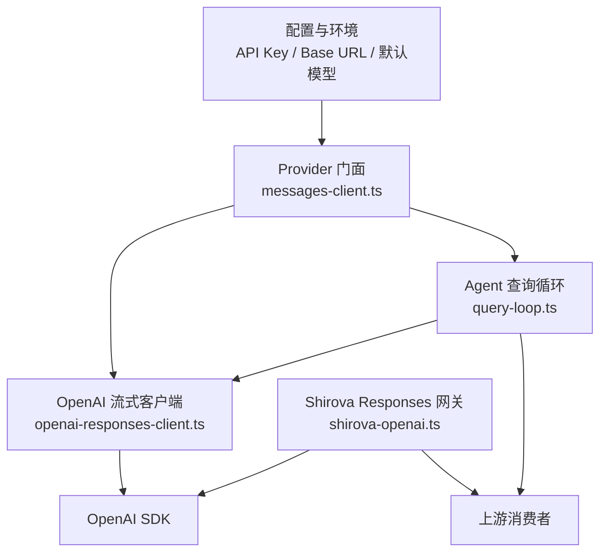
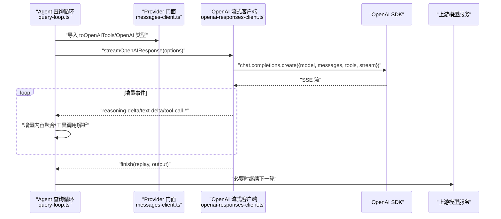
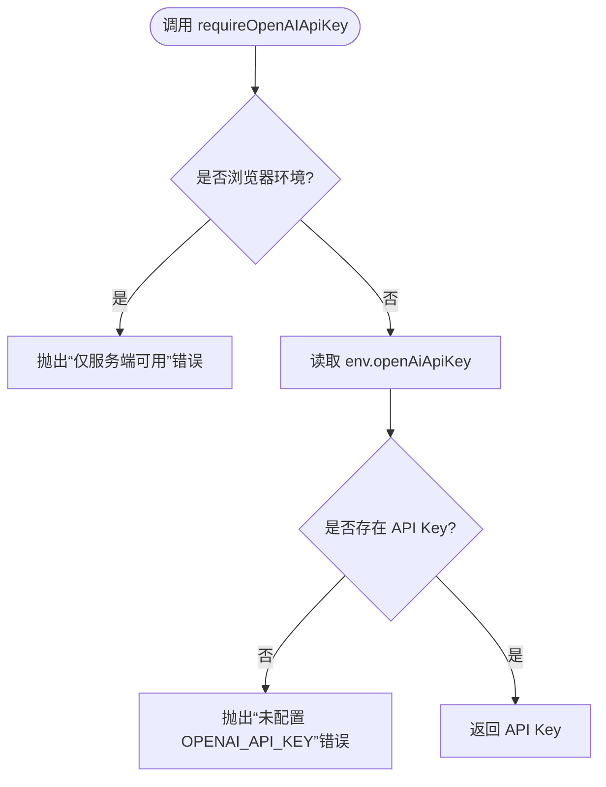
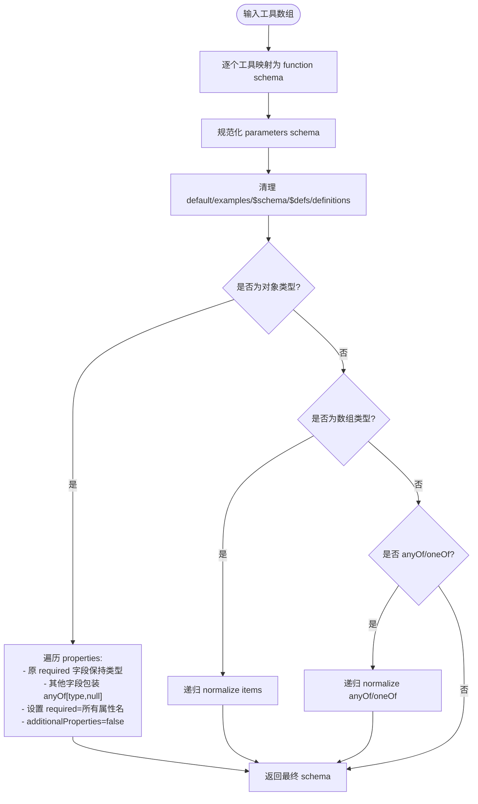
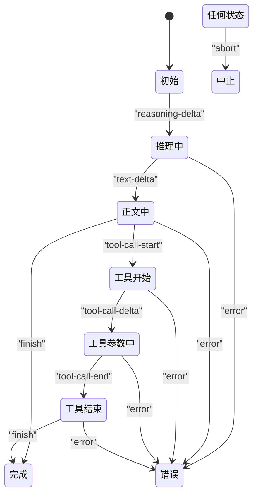
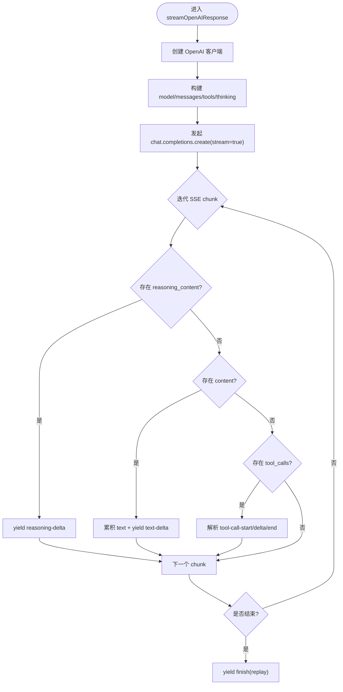
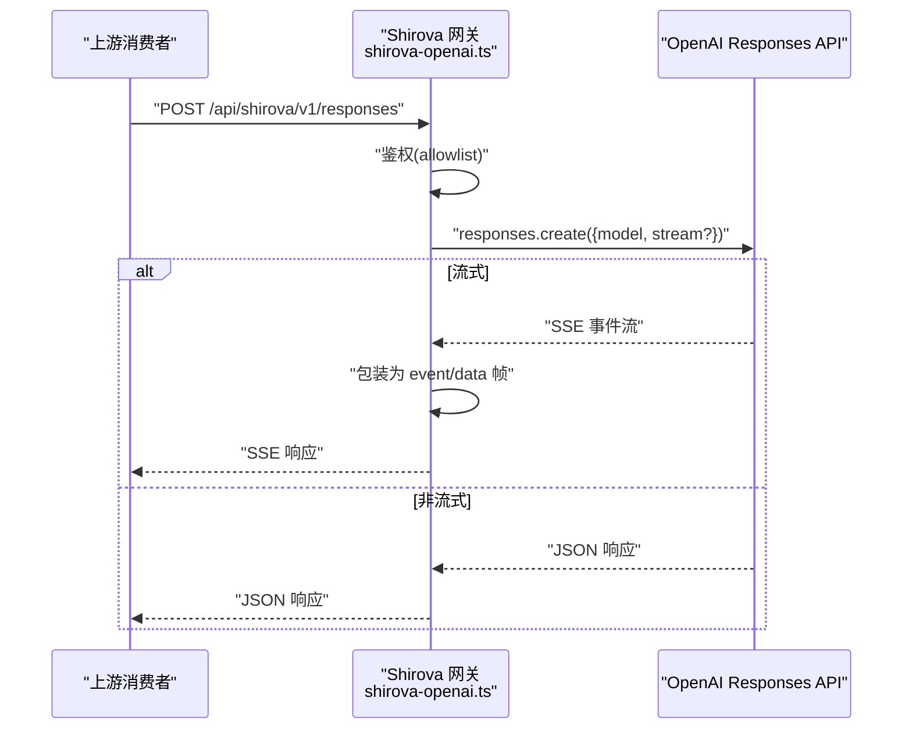
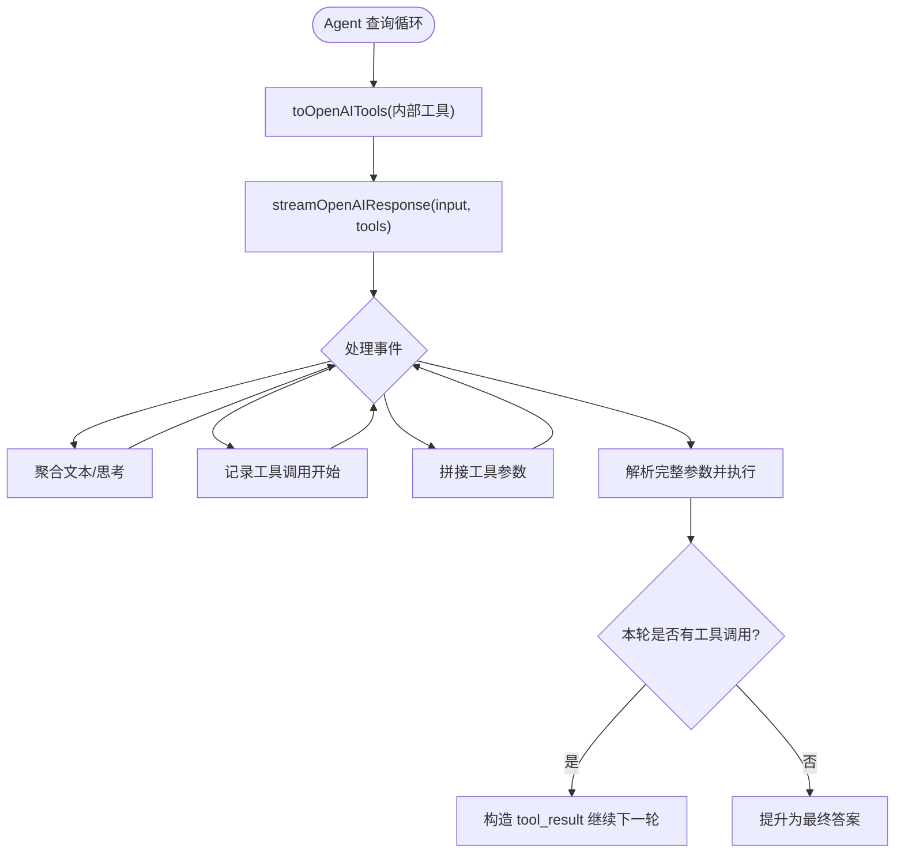
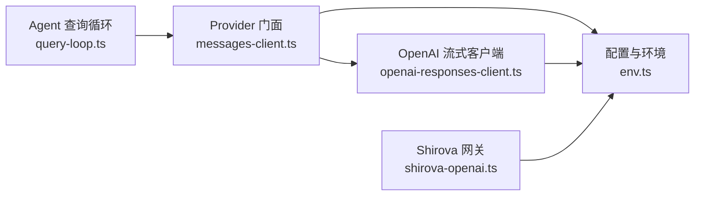

# Provider 抽象层

<cite>
**本文引用的文件**   
- [src/server/agent-core/provider/messages-client.ts](file://src/server/agent-core/provider/messages-client.ts)
- [src/server/inference/openai-responses-client.ts](file://src/server/inference/openai-responses-client.ts)
- [src/server/config/env.ts](file://src/server/config/env.ts)
- [src/server/shirova-openai.ts](file://src/server/shirova-openai.ts)
- [src/server/agent-core/runtime/query-loop.ts](file://src/server/agent-core/runtime/query-loop.ts)
</cite>

## 目录
1. [简介](#简介)
2. [项目结构](#项目结构)
3. [核心组件](#核心组件)
4. [架构总览](#架构总览)
5. [详细组件分析](#详细组件分析)
6. [依赖关系分析](#依赖关系分析)
7. [性能与可靠性](#性能与可靠性)
8. [故障排查指南](#故障排查指南)
9. [结论](#结论)
10. [附录：客户端使用示例与错误处理模式](#附录客户端使用示例与错误处理模式)

## 简介
本文件系统化梳理 Provider 抽象层，重点解释 OpenAI Responses API 的封装设计、消息构建、工具定义转换、流式响应协议，以及外部模型接入和请求编排策略。代码库中通过 agent-core 暴露统一的 Provider 能力，底层使用 OpenAI SDK 调用 Chat Completions 或 Responses API，并向上游消费方提供稳定的类型、事件和流式传输语义。

该抽象层承担以下职责：
- 统一对外暴露 OpenAI 兼容的消息输入输出类型、工具 schema 转换函数、流式事件协议。
- 将内部工具定义转换为 OpenAI strict function schema。
- 管理 OpenAI SDK 实例、超时、重试与可选 base URL。
- 在网关代理层桥接 Shirova 客户端到 OpenAI Responses API，并透传 SSE 事件。
- 为自主 Agent 循环提供消息构建、工具执行、增量内容聚合与 replay 能力。

## 项目结构
Provider 抽象层由四层组成：
- 配置与环境层：集中管理 API Key、base URL、默认模型等运行时参数。
- Provider 类型与工具转换层：导出 OpenAI 相关类型、工具 schema 转换函数。
- 流式推理客户端层：实现 OpenAI 流式调用、增量文本/思考/工具调用解析。
- 网关代理层：将受控的请求转发到 OpenAI Responses API，并维持 SSE 传输。
- Agent 运行层：组合 Provider 能力，完成多轮工具调用、增量输出与回放。

**图表来源**
- [src/server/config/env.ts:302-325](file://src/server/config/env.ts#L302-L325)
- [src/server/agent-core/provider/messages-client.ts:1-18](file://src/server/agent-core/provider/messages-client.ts#L1-L18)
- [src/server/inference/openai-responses-client.ts:1-60](file://src/server/inference/openai-responses-client.ts#L1-L60)
- [src/server/shirova-openai.ts:1-115](file://src/server/shirova-openai.ts#L1-L115)
- [src/server/agent-core/runtime/query-loop.ts:1-40](file://src/server/agent-core/runtime/query-loop.ts#L1-L40)

**章节来源**
- [src/server/config/env.ts:1-325](file://src/server/config/env.ts#L1-L325)
- [src/server/agent-core/provider/messages-client.ts:1-18](file://src/server/agent-core/provider/messages-client.ts#L1-L18)
- [src/server/inference/openai-responses-client.ts:1-60](file://src/server/inference/openai-responses-client.ts#L1-L60)
- [src/server/shirova-openai.ts:1-115](file://src/server/shirova-openai.ts#L1-L115)
- [src/server/agent-core/runtime/query-loop.ts:1-40](file://src/server/agent-core/runtime/query-loop.ts#L1-L40)

## 核心组件
- 配置与环境
  - `requireOpenAIApiKey`：在服务端校验并返回 OpenAI 兼容 API Key；若在浏览器环境调用直接抛出错误。
  - `optionalOpenAIBaseUrl`：返回可选的 OpenAI 兼容 base URL；空值表示使用 SDK 默认官方端点。
  - `env`：集中暴露默认模型、基础 URL、各种服务密钥。
- Provider 门面
  - 从 messages-client.ts 统一导出 `streamOpenAIResponse`、`toOpenAITools`、OpenAI 类型及环境访问函数。
- OpenAI 流式客户端
  - `streamOpenAIResponse`：以异步生成器方式流式调用 OpenAI Chat Completions，产出 `OpenAIStreamPart` 事件。
  - `toOpenAITools`：将内部工具数组转换为 OpenAI strict function schema。
  - 类型系统：`OpenAIInputItem`、`OpenAIOutputItem`、`OpenAIMessageContent`、`OpenAICompletionOptions`、`OpenAIStreamPart`。
- Shirova Responses 网关
  - `handleShirovaResponsesPost`：鉴权后代理 OpenAI Responses API，支持非流与流式两种模式，并以 SSE 格式回传事件。

**章节来源**
- [src/server/config/env.ts:302-325](file://src/server/config/env.ts#L302-L325)
- [src/server/agent-core/provider/messages-client.ts:1-18](file://src/server/agent-core/provider/messages-client.ts#L1-L18)
- [src/server/inference/openai-responses-client.ts:1-60](file://src/server/inference/openai-responses-client.ts#L1-L60)
- [src/server/shirova-openai.ts:1-115](file://src/server/shirova-openai.ts#L1-L115)

## 架构总览
下图展示从 Agent 侧到上游模型的端到端调用路径，包括流式事件和工具调用闭环。

**图表来源**
- [src/server/agent-core/runtime/query-loop.ts:1-40](file://src/server/agent-core/runtime/query-loop.ts#L1-L40)
- [src/server/inference/openai-responses-client.ts:60-200](file://src/server/inference/openai-responses-client.ts#L60-L200)

**章节来源**
- [src/server/agent-core/runtime/query-loop.ts:1-40](file://src/server/agent-core/runtime/query-loop.ts#L1-L40)
- [src/server/inference/openai-responses-client.ts:60-200](file://src/server/inference/openai-responses-client.ts#L60-L200)

## 详细组件分析

### 配置与环境验证：`requireOpenAIApiKey` 与 `optionalOpenAIBaseUrl`
- 服务端校验
  - 两个函数均在非服务端环境（浏览器）抛错，避免前端误用敏感配置。
- API Key 获取
  - `requireOpenAIApiKey` 读取 `env.openAiApiKey`，为空时抛出配置缺失错误。
- Base URL 解析
  - `optionalOpenAIBaseUrl` 返回 `env.providerBaseUrl`，若为空则 SDK 走官方端点。
- 默认模型与提供商变量
  - `env` 暴露默认模型、基础 URL、Thinking 开关等，供上层构建请求体。

**图表来源**
- [src/server/config/env.ts:302-313](file://src/server/config/env.ts#L302-L313)

**章节来源**
- [src/server/config/env.ts:302-325](file://src/server/config/env.ts#L302-L325)

### 工具定义转换：`toOpenAITools`
目标是将内部工具数组转换为 OpenAI 严格函数 schema，以便下游模型按严格 JSON Schema 执行工具调用。

关键行为：
- 每个工具映射为 `{ type: "function", function: { name, description, parameters, strict: true } }`。
- 描述未提供时使用工具名作为描述。
- 对参数 schema 进行规范化：
  - 删除 `default`、`examples`、`$schema`、`$defs`、`definitions` 等非必要字段。
  - 对象属性：若原 schema 中未列入 required，则包装为 `anyOf[当前类型, null]`，保留可选语义。
  - 强制要求所有对象属性均出现在 `required` 列表中。
  - 禁用额外键：设置 `additionalProperties: false`。
  - 递归处理 `array`、`anyOf`、`oneOf` 子 schema。

**图表来源**
- [src/server/inference/openai-responses-client.ts:201-315](file://src/server/inference/openai-responses-client.ts#L201-L315)

**章节来源**
- [src/server/inference/openai-responses-client.ts:201-315](file://src/server/inference/openai-responses-client.ts#L201-L315)

### 类型系统：`OpenAIInputItem`、`OpenAIOutputItem`、`OpenAIMessageContent`
- `OpenAIInputItem`：对应 OpenAI Chat Completions 的消息参数类型，用于构建对话历史。
- `OpenAIOutputItem`：由于 Chat Completions 不直接暴露 Responses 输出项，此类型为 `never`，调用方使用 `replay` 继续工具轮次。
- `OpenAIMessageContent`：消息内容的联合类型，继承自 OpenAI 消息参数。

这些类型由 Provider 门面统一导出，使 Agent 层无需直接依赖具体 SDK 类型。

**章节来源**
- [src/server/inference/openai-responses-client.ts:1-25](file://src/server/inference/openai-responses-client.ts#L1-L25)
- [src/server/agent-core/provider/messages-client.ts:1-18](file://src/server/agent-core/provider/messages-client.ts#L1-L18)

### 流式事件协议：`OpenAIStreamPart`
事件协议定义了流式响应的增量数据结构，便于上层增量渲染与工具调用解析：

- `reasoning-delta`：思考阶段增量文本。
- `text-delta`：正文增量文本。
- `tool-call-start`：工具调用开始，携带 toolCallId 与 toolName。
- `tool-call-delta`：工具参数增量拼接。
- `tool-call-end`：工具调用结束，携带完整 arguments。
- `finish`：一轮完成，包含 reason、output、replay。
- `error`：错误信息。
- `abort`：取消信号触发。

**图表来源**
- [src/server/inference/openai-responses-client.ts:25-59](file://src/server/inference/openai-responses-client.ts#L25-L59)

**章节来源**
- [src/server/inference/openai-responses-client.ts:25-59](file://src/server/inference/openai-responses-client.ts#L25-L59)

### 流式 SSE 传输与增量聚合
`streamOpenAIResponse` 的核心流程：
- 创建 OpenAI SDK 客户端，配置 API Key、可选 base URL、超时与最大重试次数。
- 组装请求体：system 指令、input 消息、tools、tool_choice、max_tokens、thinking controls。
- 迭代 SSE chunk，根据 delta 内容分派事件：
  - reasoning_content → `reasoning-delta`。
  - content → 累积 text 并产生 `text-delta`。
  - tool_calls → 维护 toolCalls map，产出 `tool-call-start`、`tool-call-delta`、`tool-call-end`。
- 结束时构造 replay 消息，包含 assistant 角色、content 与 tool_calls。
- 异常处理：区分 abort、timeout、普通错误，产出对应事件。

**图表来源**
- [src/server/inference/openai-responses-client.ts:60-200](file://src/server/inference/openai-responses-client.ts#L60-L200)

**章节来源**
- [src/server/inference/openai-responses-client.ts:60-200](file://src/server/inference/openai-responses-client.ts#L60-L200)

### Shirova Responses 网关代理
`handleShirovaResponsesPost` 负责将受控请求代理到 OpenAI Responses API：
- 鉴权：检查 Authorization 或 x-shirova-api-key 头是否匹配允许列表。
- 请求体：读取 `OpenAI.Responses.ResponseCreateParams`，合并默认模型。
- 流式模式：
  - 使用 `client.responses.create({stream: true})` 获取上游流。
  - 使用 `ReadableStream` 与 `TextEncoder` 将每个事件包装为 `event: ... \n data: ... \n\n` 的 SSE 帧。
  - 异常时编码 `event: error` 帧。
  - 设置 SSE 响应头：`text/event-stream`、`Cache-Control: no-cache`、`Connection: keep-alive`、`X-Accel-Buffering: no`。
- 非流式模式：直接返回 JSON 响应。
- 全局异常：捕获并返回 `api_error` 类型错误。

**图表来源**
- [src/server/shirova-openai.ts:1-115](file://src/server/shirova-openai.ts#L1-L115)

**章节来源**
- [src/server/shirova-openai.ts:1-115](file://src/server/shirova-openai.ts#L1-L115)

### Agent 查询循环与 Provider 集成
Agent 查询循环从 Provider 门面导入工具转换函数与类型，并在多轮交互中：
- 使用 `toOpenAITools` 将内部工具定义转换为 OpenAI strict function schema。
- 调用 Provider 流式接口，消费 `reasoning-delta`、`text-delta`、`tool-call-*` 事件。
- 对工具调用结果进行执行与回填，形成下一轮 input。
- 将无工具调用的回合提升为最终答案。

**图表来源**
- [src/server/agent-core/runtime/query-loop.ts:1-40](file://src/server/agent-core/runtime/query-loop.ts#L1-L40)
- [src/server/agent-core/provider/messages-client.ts:1-18](file://src/server/agent-core/provider/messages-client.ts#L1-L18)

**章节来源**
- [src/server/agent-core/runtime/query-loop.ts:1-40](file://src/server/agent-core/runtime/query-loop.ts#L1-L40)
- [src/server/agent-core/provider/messages-client.ts:1-18](file://src/server/agent-core/provider/messages-client.ts#L1-L18)

## 依赖关系分析
Provider 抽象层的依赖关系如下：

- 松耦合：Agent 层通过 Provider 门面间接依赖 OpenAI 类型与流式客户端。
- 配置隔离：API Key 与 base URL 由 env.ts 统一管理，避免硬编码。
- 网关独立：Shirova 网关直接依赖 OpenAI SDK，但不侵入 Agent 层逻辑。

**图表来源**
- [src/server/agent-core/provider/messages-client.ts:1-18](file://src/server/agent-core/provider/messages-client.ts#L1-L18)
- [src/server/inference/openai-responses-client.ts:1-60](file://src/server/inference/openai-responses-client.ts#L1-L60)
- [src/server/config/env.ts:302-325](file://src/server/config/env.ts#L302-L325)
- [src/server/agent-core/runtime/query-loop.ts:1-40](file://src/server/agent-core/runtime/query-loop.ts#L1-L40)
- [src/server/shirova-openai.ts:1-115](file://src/server/shirova-openai.ts#L1-L115)

**章节来源**
- [src/server/agent-core/provider/messages-client.ts:1-18](file://src/server/agent-core/provider/messages-client.ts#L1-L18)
- [src/server/inference/openai-responses-client.ts:1-60](file://src/server/inference/openai-responses-client.ts#L1-L60)
- [src/server/config/env.ts:302-325](file://src/server/config/env.ts#L302-L325)
- [src/server/agent-core/runtime/query-loop.ts:1-40](file://src/server/agent-core/runtime/query-loop.ts#L1-L40)
- [src/server/shirova-openai.ts:1-115](file://src/server/shirova-openai.ts#L1-L115)

## 性能与可靠性
- 超时控制
  - 流式客户端默认 45 秒超时，可通过 `idleTimeoutMs` 覆盖。
  - 关闭 SDK 自动重试（`maxRetries: 0`），由上层作业系统负责恢复与重试。
- 空闲心跳
  - 通过活动守卫在每次增量事件中 touch，防止长时间无响应被误判为超时。
- 并发工具调用
  - 明确禁止并行工具调用（`parallel_tool_calls: false`），确保工具执行顺序可控。
- SSE 传输优化
  - 网关启用 `keep-alive`、禁用加速缓冲，保证长连接稳定。
- 错误分类
  - 区分 abort、timeout、普通错误，便于上层降级与提示。

**章节来源**
- [src/server/inference/openai-responses-client.ts:60-120](file://src/server/inference/openai-responses-client.ts#L60-L120)
- [src/server/shirova-openai.ts:40-115](file://src/server/shirova-openai.ts#L40-L115)

## 故障排查指南
常见问题与定位要点：
- 未配置 API Key
  - 现象：调用 Provider 时报“OPENAI_API_KEY is not configured on the server”。
  - 处理：检查服务器环境变量 `OPENAI_API_KEY` 或 `PROVIDER.apiKey`。
- 浏览器环境误用
  - 现象：在非服务端环境调用 `requireOpenAIApiKey` 或 `optionalOpenAIBaseUrl` 抛错。
  - 处理：确保仅在 Node 服务端环境中初始化 Provider。
- SSE 中断或乱码
  - 现象：客户端收到不完整事件或中文乱码。
  - 处理：确认网关响应头包含 `text/event-stream; charset=utf-8` 与 `no-transform`。
- 工具参数校验失败
  - 现象：模型返回参数不符合 strict schema。
  - 处理：检查 `toOpenAITools` 生成的 schema 是否正确移除非必要字段并设置 `additionalProperties: false`。
- 超时或无响应
  - 现象：流式响应长时间无增量。
  - 处理：调整 `idleTimeoutMs`，检查上游模型服务健康状态。

**章节来源**
- [src/server/config/env.ts:302-325](file://src/server/config/env.ts#L302-L325)
- [src/server/shirova-openai.ts:40-115](file://src/server/shirova-openai.ts#L40-L115)
- [src/server/inference/openai-responses-client.ts:201-315](file://src/server/inference/openai-responses-client.ts#L201-L315)

## 结论
Provider 抽象层通过类型化接口、严格工具 schema 转换、稳定流式事件协议与网关代理，将 OpenAI Responses API 与 Chat Completions 的差异化细节隐藏在后端，为 Agent 层提供一致、可组合、可扩展的模型调用能力。配置与环境隔离、超时与重试策略、SSE 传输优化共同保障了系统的可靠性与可观测性。

## 附录：客户端使用示例与错误处理模式

### 在 Agent 中使用 Provider
- 导入工具转换函数与类型：
  - 从 `@/server/agent-core/provider/messages-client` 导入 `toOpenAITools`、`OpenAIInputItem`、`OpenAIOutputItem`、`OpenAIStreamPart`。
- 构建工具定义：
  - 使用 `toOpenAITools` 将内部工具数组转换为 OpenAI strict function schema。
- 流式调用：
  - 调用 Provider 流式接口，逐条消费 `reasoning-delta`、`text-delta`、`tool-call-*` 事件。
- 聚合与回放：
  - 聚合文本与思考内容，解析工具调用参数，执行工具后构造下一轮 input。
  - 使用 `finish` 事件中的 `replay` 继续后续轮次。

参考路径：
- [src/server/agent-core/provider/messages-client.ts:1-18](file://src/server/agent-core/provider/messages-client.ts#L1-L18)
- [src/server/inference/openai-responses-client.ts:25-59](file://src/server/inference/openai-responses-client.ts#L25-L59)
- [src/server/inference/openai-responses-client.ts:60-200](file://src/server/inference/openai-responses-client.ts#L60-L200)

### 在网关中代理 Responses API
- 鉴权：
  - 检查 `Authorization` 或 `x-shirova-api-key` 是否在允许列表。
- 流式模式：
  - 使用 `client.responses.create({stream: true})`，将每个事件包装为 SSE 帧。
- 非流式模式：
  - 直接返回 JSON 响应。
- 错误处理：
  - 捕获异常并返回 `api_error` 类型错误。

参考路径：
- [src/server/shirova-openai.ts:1-115](file://src/server/shirova-openai.ts#L1-L115)

### 错误处理模式建议
- 区分错误类型：
  - `authentication_error`：鉴权失败。
  - `api_error`：上游 API 异常。
  - `error`：流式客户端异常。
  - `abort`：用户主动取消。
- 用户体验：
  - 对超时错误给出友好提示。
  - 对鉴权失败返回明确状态码与错误类型。
- 日志与可观测性：
  - 记录错误上下文（模型、工具名称、参数长度）。
  - 监控 SSE 断连与重连率。

参考路径：
- [src/server/shirova-openai.ts:20-115](file://src/server/shirova-openai.ts#L20-L115)
- [src/server/inference/openai-responses-client.ts:200-315](file://src/server/inference/openai-responses-client.ts#L200-L315)