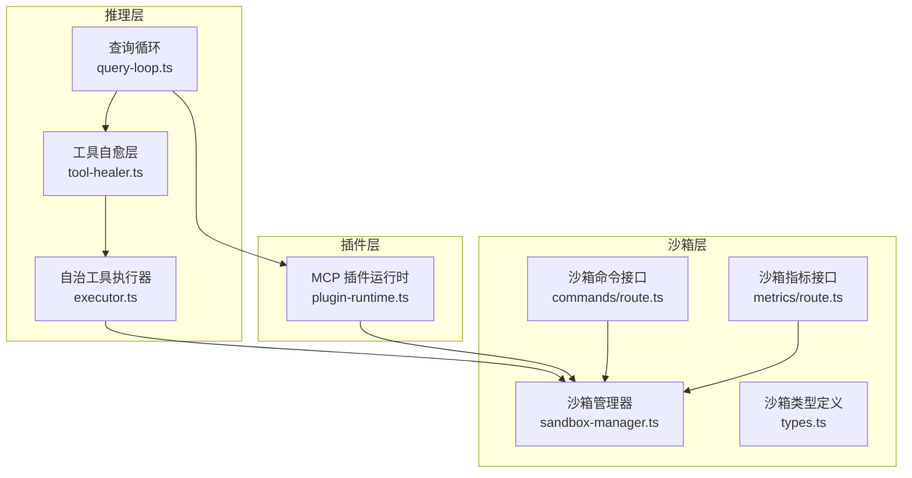
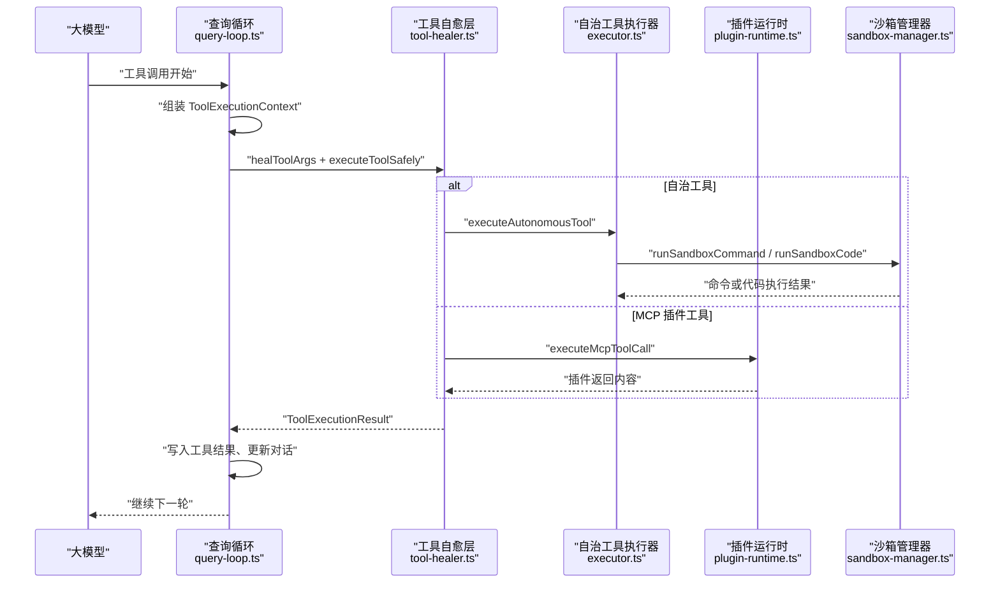
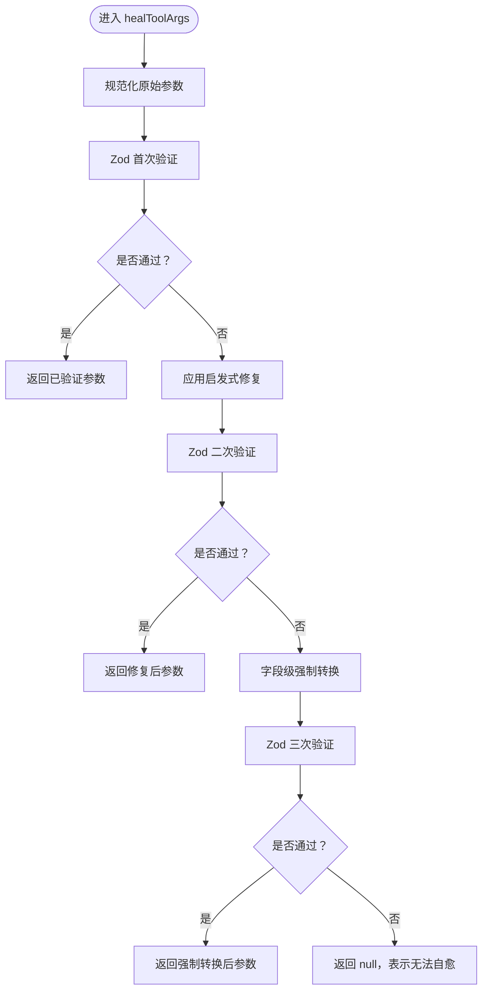
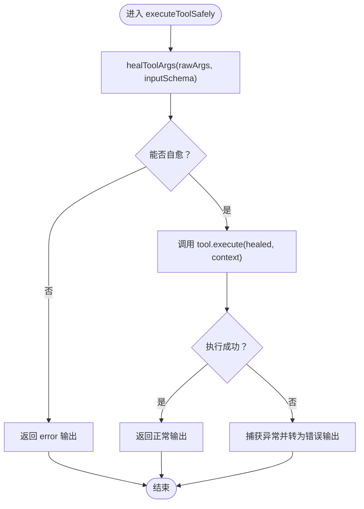
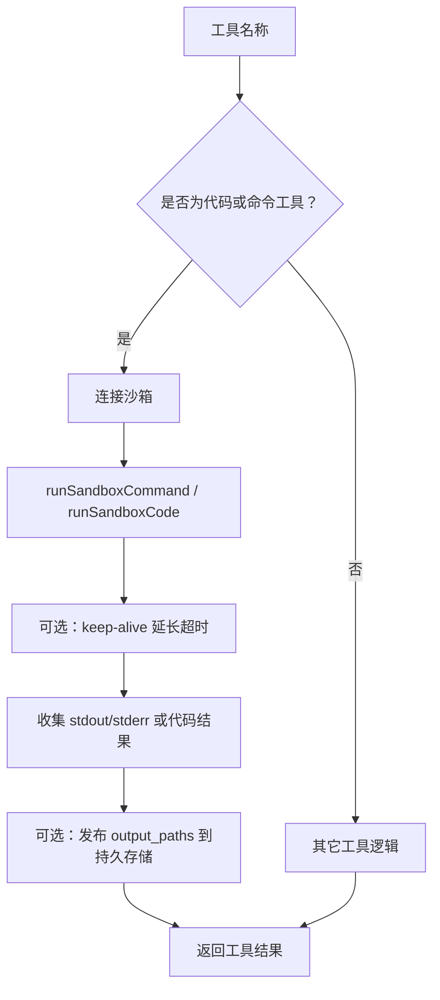
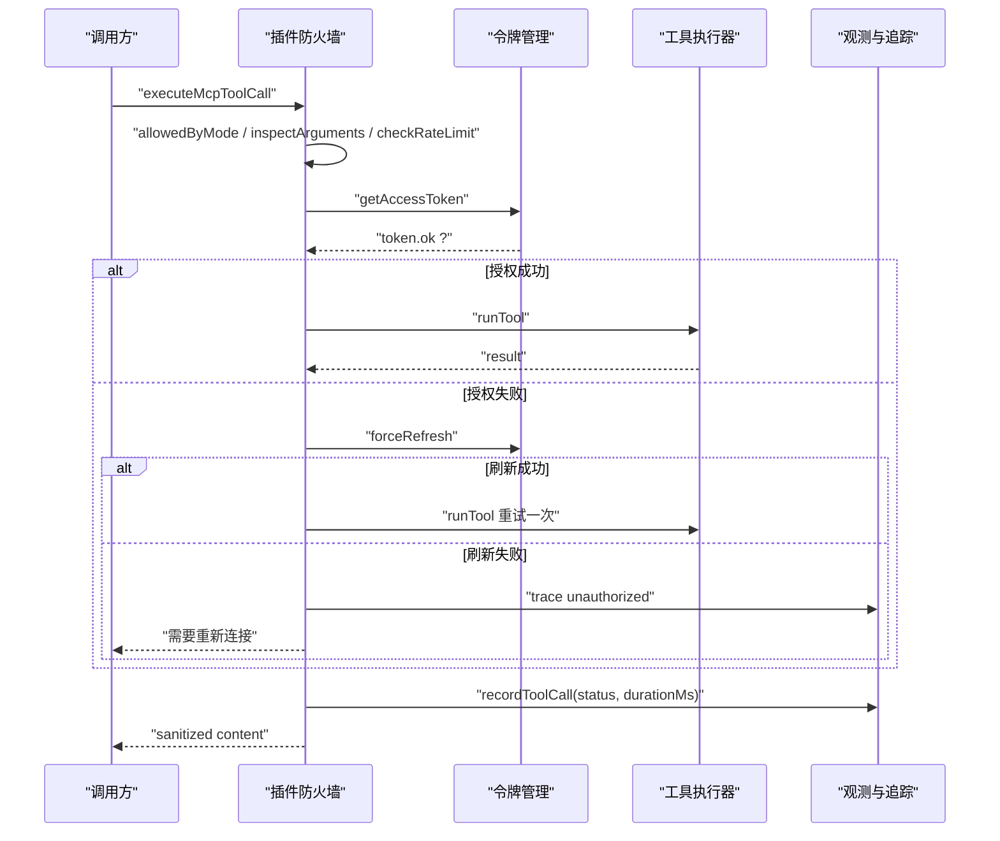
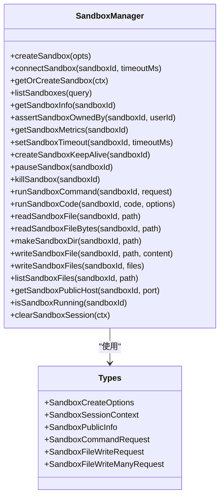
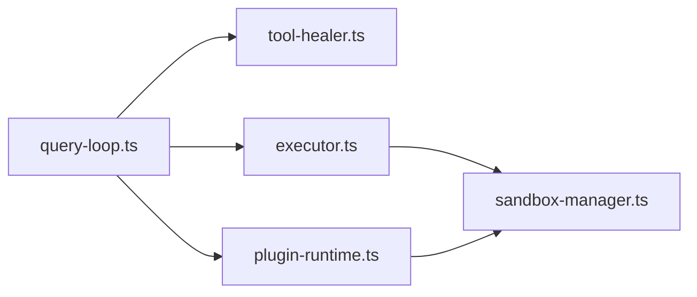

# 工具自愈与修复

<cite>
**本文引用的文件**   
- [tool-healer.ts](file://src/server/inference/tool-healer.ts)
- [query-loop.ts](file://src/server/agent-core/runtime/query-loop.ts)
- [executor.ts](file://src/server/inference/autonomous-tools/executor.ts)
- [plugin-runtime.ts](file://src/server/plugins/plugin-runtime.ts)
- [sandbox-manager.ts](file://src/server/sandbox/sandbox-manager.ts)
- [types.ts](file://src/server/sandbox/types.ts)
- [commands/route.ts](file://src/app/api/v1/sandbox/[sandboxId]/commands/route.ts)
- [metrics/route.ts](file://src/app/api/v1/sandbox/[sandboxId]/metrics/route.ts)
</cite>

## 目录
1. [引言](#引言)
2. [项目结构](#项目结构)
3. [核心组件](#核心组件)
4. [架构总览](#架构总览)
5. [详细组件分析](#详细组件分析)
6. [依赖关系分析](#依赖关系分析)
7. [性能考虑](#性能考虑)
8. [故障排除指南](#故障排除指南)
9. [结论](#结论)

## 引言
本文件系统化说明“工具自愈与修复”机制，聚焦以下目标：
- 解释 tool-healer 的参数自动修复、代码语法修正思路、工具调用重试策略。
- 文档化 executeToolSafely 的安全执行环境、异常捕获与降级处理。
- 说明沙箱会话管理、资源隔离、超时控制、网络访问控制。
- 梳理工具执行失败时的诊断、错误分类与修复建议生成流程。
- 覆盖执行上下文传递、状态持久化、监控指标收集。
- 提供常见问题解决方案和性能优化建议。

该能力主要服务于大模型在生成工具参数或调用外部服务时出现的类型错误、JSON 不完整、第三方 API 临时异常等场景，通过本地自愈、安全边界与可观测性降低失败率并减少不必要的 LLM 往返。

## 项目结构
与工具自愈相关的代码分布在推理层、插件运行层与沙箱层：
- 推理层负责将大模型的工具调用请求接入 healer，并维护 agent 轮次与 SSE 流式输出。
- 自愈层封装参数修复、类型强制转换与工具执行的统一入口。
- 自治工具执行器将具体工具逻辑（搜索、天气、代码执行、文件系统、计划任务等）与沙箱集成。
- 插件运行时通过防火墙对 MCP 工具进行权限、速率限制与输入检查。
- 沙箱管理器封装远程代码解释器的生命周期、命令执行、文件操作、指标获取与会话复用。



**图表来源**
- [query-loop.ts:30-39](file://src/server/agent-core/runtime/query-loop.ts#L30-L39)
- [tool-healer.ts:1-213](file://src/server/inference/tool-healer.ts#L1-L213)
- [executor.ts:1-200](file://src/server/inference/autonomous-tools/executor.ts#L1-L200)
- [plugin-runtime.ts:270-370](file://src/server/plugins/plugin-runtime.ts#L270-L370)
- [sandbox-manager.ts:1-200](file://src/server/sandbox/sandbox-manager.ts#L1-L200)
- [types.ts:1-46](file://src/server/sandbox/types.ts#L1-L46)
- [commands/route.ts:1-28](file://src/app/api/v1/sandbox/[sandboxId]/commands/route.ts#L1-L28)
- [metrics/route.ts:1-20](file://src/app/api/v1/sandbox/[sandboxId]/metrics/route.ts#L1-L20)

**章节来源**
- [query-loop.ts:30-39](file://src/server/agent-core/runtime/query-loop.ts#L30-L39)
- [tool-healer.ts:1-213](file://src/server/inference/tool-healer.ts#L1-L213)
- [executor.ts:1-200](file://src/server/inference/autonomous-tools/executor.ts#L1-L200)
- [plugin-runtime.ts:270-370](file://src/server/plugins/plugin-runtime.ts#L270-L370)
- [sandbox-manager.ts:1-200](file://src/server/sandbox/sandbox-manager.ts#L1-L200)
- [types.ts:1-46](file://src/server/sandbox/types.ts#L1-L46)
- [commands/route.ts:1-28](file://src/app/api/v1/sandbox/[sandboxId]/commands/route.ts#L1-L28)
- [metrics/route.ts:1-20](file://src/app/api/v1/sandbox/[sandboxId]/metrics/route.ts#L1-L20)

## 核心组件
- 工具自愈层：提供 healToolArgs 与 executeToolSafely，用于在不增加额外 LLM 往返的情况下修复参数并安全执行。
- 查询循环：负责解析模型输出、组装 ToolExecutionContext、触发 healer、记录工具结果并维持对话历史。
- 自治工具执行器：实现 read_skill、web_search、execute_code、bash_tool、weather_fetch、places_search、image_search、文件读写、计划任务等工具；对长耗时命令使用 keep-alive 延长沙箱超时。
- 插件运行时：对 MCP 工具调用进行模式校验、参数检查、速率限制、令牌刷新与输出清洗。
- 沙箱管理器：封装远程代码解释器 SDK，提供创建、连接、复用、暂停、销毁、命令执行、文件操作、指标获取与会话清理。

**章节来源**
- [tool-healer.ts:1-213](file://src/server/inference/tool-healer.ts#L1-L213)
- [query-loop.ts:822-1080](file://src/server/agent-core/runtime/query-loop.ts#L822-L1080)
- [executor.ts:1-200](file://src/server/inference/autonomous-tools/executor.ts#L1-L200)
- [plugin-runtime.ts:270-370](file://src/server/plugins/plugin-runtime.ts#L270-L370)
- [sandbox-manager.ts:1-200](file://src/server/sandbox/sandbox-manager.ts#L1-L200)

## 架构总览
下图展示一次工具调用的端到端流程：模型生成工具调用 → 查询循环组装上下文 → 自愈层修复参数 → 自治工具或插件执行 → 沙箱执行代码或命令 → 结果写入对话与追踪。



**图表来源**
- [query-loop.ts:879-905](file://src/server/agent-core/runtime/query-loop.ts#L879-L905)
- [tool-healer.ts:201-213](file://src/server/inference/tool-healer.ts#L201-L213)
- [executor.ts:1-200](file://src/server/inference/autonomous-tools/executor.ts#L1-L200)
- [plugin-runtime.ts:270-370](file://src/server/plugins/plugin-runtime.ts#L270-L370)
- [sandbox-manager.ts:201-423](file://src/server/sandbox/sandbox-manager.ts#L201-L423)

## 详细组件分析

### 工具自愈层：参数修复与安全执行
工具自愈层承担两个职责：
1. 参数自愈：当 LLM 输出字符串型数字、布尔值、单元素数组、带 value 包装的对象、部分 JSON 时，尝试确定性地修复参数。
2. 安全执行：以统一的 ToolDefinition 接口调用工具，并在发生异常时降级为结构化错误输出，避免整个推理中断。

#### 参数修复策略
healToolArgs 的修复流程包括：
- 原始值规范化：字符串尝试 JSON.parse；对象直接作为参数；其他情况回退为空对象。
- 第一轮验证：直接使用 Zod schema.safeParse。
- 启发式修复：
  - 字符串转数字、布尔、null。
  - 单元素数组取首元素。
  - 含单个 value 键的对象解包。
- 第二轮验证：再次用 schema.safeParse。
- 字段级强制转换：按 schema 形状将 String、Number、Boolean 做合理转换。
- 第三轮验证：若仍失败，返回 null，表示无法自愈。
- 部分 JSON 提取：当 raw 是字符串且 JSON.parse 失败时，尝试 partial-json 解析；再失败则用正则提取 key-value 字符串对。



**图表来源**
- [tool-healer.ts:43-110](file://src/server/inference/tool-healer.ts#L43-L110)
- [tool-healer.ts:111-170](file://src/server/inference/tool-healer.ts#L111-L170)
- [tool-healer.ts:171-200](file://src/server/inference/tool-healer.ts#L171-L200)

#### 安全执行与降级
executeToolSafely 的工作方式：
- 先调用 healToolArgs 修复参数。
- 如果无法修复，返回包含 error 字段的 output，提示参数类型问题。
- 否则调用 tool.execute(healed, context)。
- 任何未捕获异常都被捕获并转换为结构化错误输出，保证上层不会崩溃。



**图表来源**
- [tool-healer.ts:201-213](file://src/server/inference/tool-healer.ts#L201-L213)

**章节来源**
- [tool-healer.ts:1-213](file://src/server/inference/tool-healer.ts#L1-L213)

### 查询循环：执行上下文与工具调用编排
查询循环负责：
- 解析模型输出的工具调用事件。
- 为每个工具调用构造 ToolExecutionContext，包括 userId、conversationId、userCountryCode、toolCallId、modelId、researchPlanId、chatModelId 与 onProgress。
- 对特定工具（如 web_search）使用 healer 的 healToolArgs 与 executeToolSafely 包裹执行。
- 对其它自治工具直接调用 executeAutonomousTool。
- 将工具结果写入 conversation，并持续报告 round-end，供持久化与恢复。

关键行为：
- 工具调用缓冲：按 toolCallId 缓存 name、argumentsDelta，以便实时预览。
- 进度回调：通过 onToolProgress 向客户端推送中间结果。
- 结果持久化：将 tool_result 写入对话历史，便于后续轮次理解上下文。
- 最终回合结束：报告 toolCallIds 与 terminalOutcome，支持暂停与恢复。

```mermaid
sequenceDiagram
    participant Stream as "模型输出流"
    participant Loop as "查询循环"
    participant Healer as "工具自愈层"
    participant Exec as "自治工具执行器"
    participant Store as "对话与追踪存储"

    Stream->>Loop: "tool-call-start / delta / end"
    Loop->>Loop: "按 toolCallId 缓存参数"
    Loop->>Loop: "组装 ToolExecutionContext"
    Loop->>Healer: "healToolArgs + executeToolSafely"
    Healer->>Exec: "executeAutonomousTool"
    Exec-->>Healer: "ToolExecutionResult"
    Healer-->>Loop: "ToolExecutionResult"
    Loop->>Store: "写入 tool_result 与 trace"
    Loop-->>Stream: "继续下一轮"
```

**图表来源**
- [query-loop.ts:652-700](file://src/server/agent-core/runtime/query-loop.ts#L652-L700)
- [query-loop.ts:879-905](file://src/server/agent-core/runtime/query-loop.ts#L879-L905)
- [query-loop.ts:1014-1080](file://src/server/agent-core/runtime/query-loop.ts#L1014-L1080)

**章节来源**
- [query-loop.ts:30-39](file://src/server/agent-core/runtime/query-loop.ts#L30-L39)
- [query-loop.ts:652-700](file://src/server/agent-core/runtime/query-loop.ts#L652-L700)
- [query-loop.ts:879-905](file://src/server/agent-core/runtime/query-loop.ts#L879-L905)
- [query-loop.ts:1014-1080](file://src/server/agent-core/runtime/query-loop.ts#L1014-L1080)

### 自治工具执行器：工具语义与沙箱集成
自治工具执行器集中实现多种工具：
- 技能读取：read_skill。
- 搜索与信息：web_search、web_fetch、weather_fetch、places_search、image_search。
- 代码与命令：execute_code、bash_tool。
- 文件系统：file_read、create_file、file_write。
- 计划任务：create_scheduled_task、list_scheduled_tasks、cancel_scheduled_task。

对代码与命令执行：
- 使用沙箱管理器提供的 runSandboxCommand 与 runSandboxCode。
- 对长耗时命令使用 createSandboxKeepAlive 周期性延长沙箱空闲超时，避免慢任务被误杀。
- 对 Python 代码执行复用 codeContextIndex，避免因 cwd 不一致而重建上下文导致导入失效。
- 对 output_paths 进行路径过滤与大小限制，文本类 artifact 最大 512KB，并可选择持久化为 agent-created file。



**图表来源**
- [executor.ts:1-200](file://src/server/inference/autonomous-tools/executor.ts#L1-L200)
- [sandbox-manager.ts:201-423](file://src/server/sandbox/sandbox-manager.ts#L201-L423)

**章节来源**
- [executor.ts:1-200](file://src/server/inference/autonomous-tools/executor.ts#L1-L200)

### 插件运行时：MCP 工具防火墙与重试
插件运行时对 MCP 工具调用实施严格治理：
- 模式校验：根据 connection 风险等级判断只读或允许变更。
- 参数检查：基于风险等级 inspectArguments。
- 速率限制：checkRateLimit。
- 令牌获取与刷新：getAccessToken，失败时标记需要重新授权。
- 单次重试：遇到 RestApiError 时使用新 token 重试一次。
- 输出清洗：sanitizeUntrustedOutput，移除敏感信息并统计被移除指令数量。
- 追踪记录：recordToolCall 记录 status、durationMs、detail。



**图表来源**
- [plugin-runtime.ts:270-370](file://src/server/plugins/plugin-runtime.ts#L270-L370)

**章节来源**
- [plugin-runtime.ts:270-370](file://src/server/plugins/plugin-runtime.ts#L270-L370)

### 沙箱会话管理：创建、复用、超时与资源控制
沙箱管理器提供完整的生命周期管理：
- 会话键：sessionKey(userId, conversationId)，用于进程内缓存 sandboxId。
- 创建与连接：createSandbox、connectSandbox、getOrCreateSandbox。
- 查找已有沙箱：findExistingSandboxId，按 metadata.app、userId、conversationId 匹配 running/paused 状态。
- 会话复用：优先连接进程内缓存；失败时回退查找；找不到则新建并缓存。
- 超时控制：DEFAULT_TIMEOUT_MS 默认 5 分钟；MAX_SANDBOX_TIMEOUT_MS 上限 30 分钟；KEEP_ALIVE_EXTENSION_MS 每次保活延长 5 分钟，最小间隔 20 秒。
- 命令执行：runSandboxCommand 支持前台/后台命令、cwd、envs、timeoutMs、stdout/stderr 回调。
- 代码执行：runSandboxCode 复用 Python codeContext，避免跨调用丢失导入。
- 文件操作：read/write/mkdir/list。
- 指标与公开主机：getSandboxMetrics、getSandboxPublicHost。
- 暂停与销毁：pauseSandbox、killSandbox，并清理 sessionIndex 与 codeContextIndex。
- 所有权校验：assertSandboxOwnedBy 确保用户只能访问自己的沙箱。



**图表来源**
- [sandbox-manager.ts:1-200](file://src/server/sandbox/sandbox-manager.ts#L1-L200)
- [sandbox-manager.ts:201-423](file://src/server/sandbox/sandbox-manager.ts#L201-L423)
- [types.ts:1-46](file://src/server/sandbox/types.ts#L1-L46)

**章节来源**
- [sandbox-manager.ts:1-200](file://src/server/sandbox/sandbox-manager.ts#L1-L200)
- [sandbox-manager.ts:201-423](file://src/server/sandbox/sandbox-manager.ts#L201-L423)
- [types.ts:1-46](file://src/server/sandbox/types.ts#L1-L46)

## 依赖关系分析
- query-loop.ts 依赖 tool-healer.ts 与 executor.ts，并通过 SSE 与客户端交互。
- tool-healer.ts 依赖 Zod 与 partial-json，不直接依赖沙箱或插件。
- executor.ts 依赖 sandbox-manager.ts 与多个外部服务（Exa、Open-Meteo、Nominatim、Openverse）。
- plugin-runtime.ts 依赖认证、速率限制、REST 工具集与输出清洗。
- sandbox-manager.ts 依赖 novita-sandbox/code-interpreter 与配置。



**图表来源**
- [query-loop.ts:30-39](file://src/server/agent-core/runtime/query-loop.ts#L30-L39)
- [tool-healer.ts:1-20](file://src/server/inference/tool-healer.ts#L1-L20)
- [executor.ts:1-30](file://src/server/inference/autonomous-tools/executor.ts#L1-L30)
- [plugin-runtime.ts:1-30](file://src/server/plugins/plugin-runtime.ts#L1-L30)
- [sandbox-manager.ts:1-20](file://src/server/sandbox/sandbox-manager.ts#L1-L20)

**章节来源**
- [query-loop.ts:30-39](file://src/server/agent-core/runtime/query-loop.ts#L30-L39)
- [tool-healer.ts:1-20](file://src/server/inference/tool-healer.ts#L1-L20)
- [executor.ts:1-30](file://src/server/inference/autonomous-tools/executor.ts#L1-L30)
- [plugin-runtime.ts:1-30](file://src/server/plugins/plugin-runtime.ts#L1-L30)
- [sandbox-manager.ts:1-20](file://src/server/sandbox/sandbox-manager.ts#L1-L20)

## 性能考虑
- 参数自愈减少 LLM 往返：healToolArgs 通过多轮本地修复避免频繁让模型重生成参数。
- 沙箱会话复用：getOrCreateSandbox 基于 userId/conversationId 复用现有沙箱，降低创建开销。
- Python 上下文复用：codeContextIndex 避免重复创建 Python 执行上下文，提升连续代码执行效率。
- Keep-alive 保活：对长时间运行的命令周期性延长超时，避免慢任务被固定超时杀死。
- 批量文件写入：writeSandboxFiles 支持一次性写入多个文件，减少 RPC 次数。
- 指标暴露：getSandboxMetrics 可用于监控 CPU、内存、状态等指标。
- 插件输出清洗：sanitizeUntrustedOutput 仅处理必要字段，避免昂贵的全量解析。

[本节为通用性能指导，不直接分析具体代码行]

## 故障排除指南

### 常见工具执行问题与解决
- 参数类型错误：
  - 现象：LLM 输出字符串型数字、布尔、单元素数组或部分 JSON。
  - 处理：healToolArgs 会尝试修复；若失败，executeToolSafely 返回 error 输出。
  - 建议：检查工具输入 schema，必要时在前端或业务层提供更明确的约束。
  - 参考路径：[tool-healer.ts:43-200](file://src/server/inference/tool-healer.ts#L43-L200)

- 工具执行异常：
  - 现象：tool.execute 抛出异常。
  - 处理：executeToolSafely 捕获异常并返回结构化错误。
  - 建议：在上层日志中记录 tool.name、error.message，并引导用户重试或修改参数。
  - 参考路径：[tool-healer.ts:201-213](file://src/server/inference/tool-healer.ts#L201-L213)

- 沙箱命令失败：
  - 现象：runSandboxCommand 返回 exitCode、stderr 或 error。
  - 处理：检查 command、cwd、envs、timeoutMs；后台任务关注 pid 与 stdout/stderr。
  - 建议：对长耗时任务启用 background，并使用 keep-alive 保活。
  - 参考路径：[sandbox-manager.ts:241-320](file://src/server/sandbox/sandbox-manager.ts#L241-L320)

- 沙箱代码执行异常：
  - 现象：runSandboxCode 返回 error、logs 或 results。
  - 处理：确认 Python 上下文是否复用；检查 cwd 与导入路径。
  - 建议：避免频繁重建 codeContext；对大型依赖提前安装。
  - 参考路径：[sandbox-manager.ts:321-370](file://src/server/sandbox/sandbox-manager.ts#L321-L370)

- 插件授权失败：
  - 现象：executeMcpToolCall 返回需要重新连接的消息。
  - 处理：触发 getAccessToken(forceRefresh=true)；失败则标记 reauthorization_required。
  - 建议：在 UI 中引导用户重新授权插件。
  - 参考路径：[plugin-runtime.ts:270-370](file://src/server/plugins/plugin-runtime.ts#L270-L370)

- 沙箱所有权校验失败：
  - 现象：assertSandboxOwnedBy 抛出 notFound。
  - 处理：确认 sandboxId 属于当前用户；避免跨用户访问。
  - 建议：API 层始终先校验 ownership 再执行命令。
  - 参考路径：[sandbox-manager.ts:201-230](file://src/server/sandbox/sandbox-manager.ts#L201-L230)

### 监控与可观测性
- 工具调用追踪：plugin-runtime.ts 通过 recordToolCall 记录 status、durationMs、detail。
- 沙箱指标：getSandboxMetrics 暴露 CPU、内存、状态等信息。
- 沙箱超时：setSandboxTimeout 可动态调整；createSandboxKeepAlive 周期性延长。
- 对话追踪：query-loop.ts 将 tool_results 写入 transcript，便于审计与回放。

**章节来源**
- [plugin-runtime.ts:270-370](file://src/server/plugins/plugin-runtime.ts#L270-L370)
- [sandbox-manager.ts:201-230](file://src/server/sandbox/sandbox-manager.ts#L201-L230)
- [sandbox-manager.ts:241-370](file://src/server/sandbox/sandbox-manager.ts#L241-L370)
- [query-loop.ts:1062-1080](file://src/server/agent-core/runtime/query-loop.ts#L1062-L1080)

## 结论
工具自愈与修复系统通过多层防护提升工具调用的鲁棒性：
- 自愈层在本地修复参数与类型，减少 LLM 往返。
- 安全执行层捕获异常并降级，保证推理链路稳定。
- 自治工具与插件运行时分别承载业务逻辑与外部服务调用，配合防火墙与重试策略。
- 沙箱层提供资源隔离、会话复用、超时控制与指标采集。
- 查询循环负责上下文传递、状态持久化与监控指标收集。

在生产环境中，建议结合监控指标与日志定位失败根因，并根据工具类型调整自愈策略、沙箱超时与重试次数，以达到更高的可用性与更低的延迟。