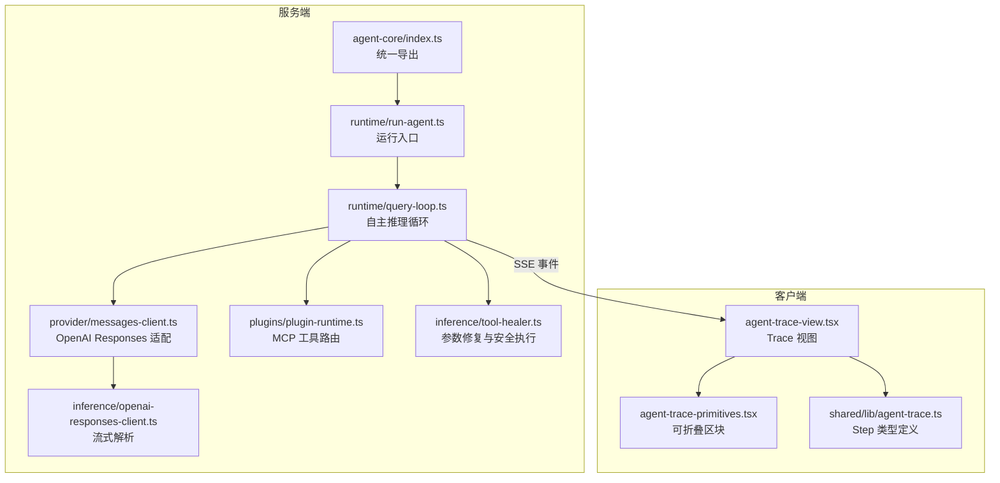
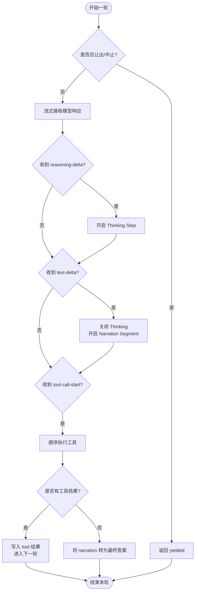
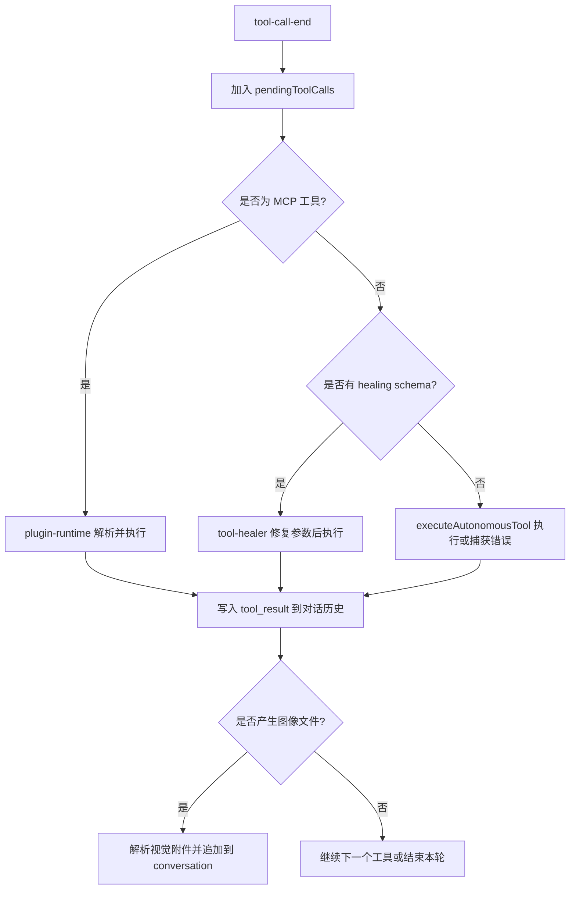
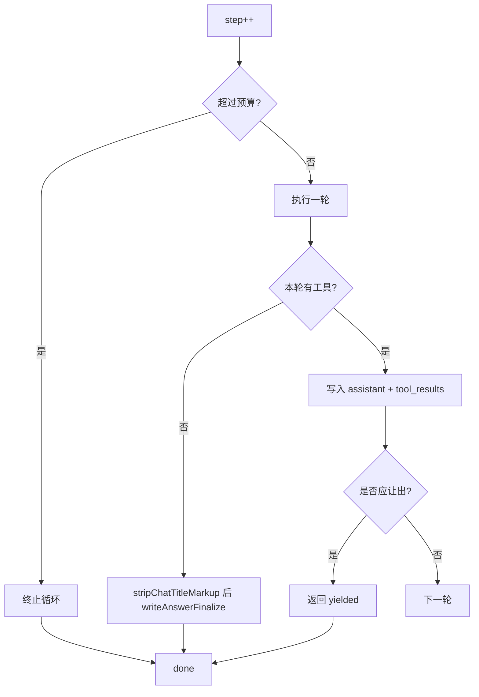
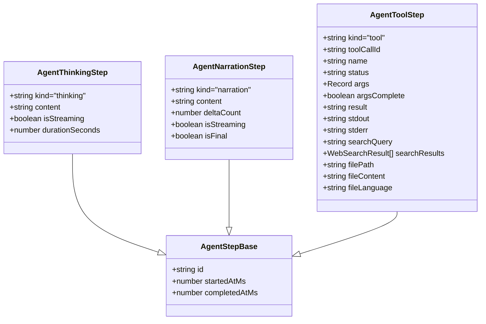
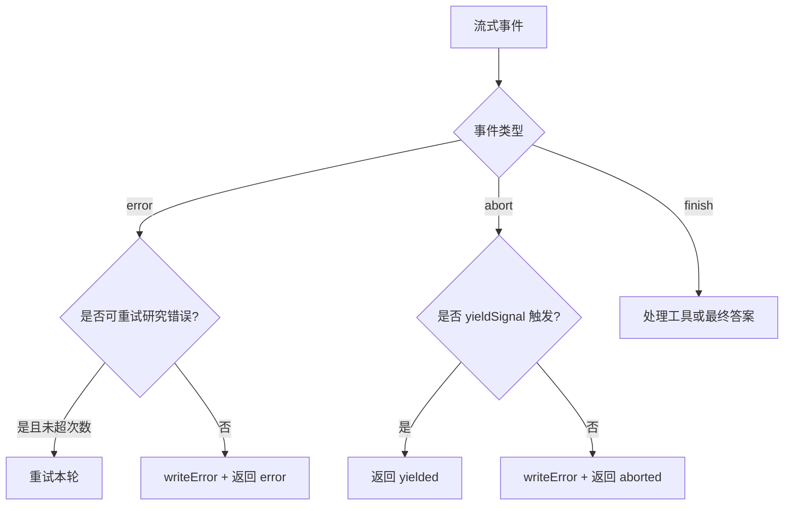
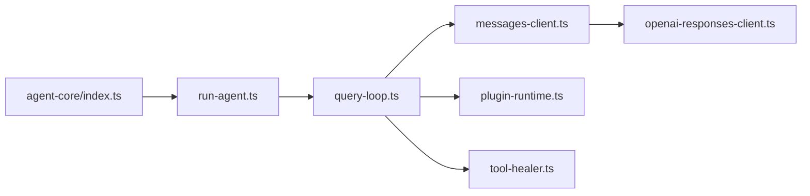

# 查询循环与自主推理

<cite>
**本文引用的文件**   
- [src/server/agent-core/runtime/query-loop.ts](file://src/server/agent-core/runtime/query-loop.ts)
- [src/server/agent-core/runtime/run-agent.ts](file://src/server/agent-core/runtime/run-agent.ts)
- [src/server/agent-core/index.ts](file://src/server/agent-core/index.ts)
- [src/server/agent-core/provider/messages-client.ts](file://src/server/agent-core/provider/messages-client.ts)
- [src/server/agent-core/query/deps.ts](file://src/server/agent-core/query/deps.ts)
- [src/server/inference/openai-responses-client.ts](file://src/server/inference/openai-responses-client.ts)
- [src/shared/lib/agent-trace.ts](file://src/shared/lib/agent-trace.ts)
- [src/client/components/agent/agent-trace-view.tsx](file://src/client/components/agent/agent-trace-view.tsx)
- [src/client/components/agent/agent-trace-primitives.tsx](file://src/client/components/agent/agent-trace-primitives.tsx)
- [src/server/plugins/plugin-runtime.ts](file://src/server/plugins/plugin-runtime.ts)
- [src/server/inference/tool-healer.ts](file://src/server/inference/tool-healer.ts)
- [src/server/inference/research-evidence.ts](file://src/server/inference/research-evidence.ts)
- [src/server/inference/language.ts](file://src/server/inference/language.ts)
</cite>

## 目录
1. [引言](#引言)
2. [项目结构](#项目结构)
3. [核心组件](#核心组件)
4. [架构总览](#架构总览)
5. [详细组件分析](#详细组件分析)
6. [依赖关系分析](#依赖关系分析)
7. [性能与可靠性](#性能与可靠性)
8. [故障排查指南](#故障排查指南)
9. [结论](#结论)
10. [附录：配置与实用示例](#附录配置与实用示例)

## 引言
本文面向 Agent 的“查询循环”和“自主推理系统”，解释服务器端如何驱动多轮推理、如何在 thinking / narration / tool 三阶段协议之间流转，以及客户端如何消费扁平化的 Agent Trace。重点覆盖以下主题：
- Agent 自主循环的生命周期：一轮模型响应 → 工具执行 → 下一轮。
- Query Loop 流式处理模型响应、叙述阶段关闭时机、工具结果聚合。
- 步骤预算控制（MAX_STEPS）、回合结束条件、最终答案聚合策略。
- 扁平化 Agent Trace 协议的设计动机与客户端折叠逻辑。
- 错误恢复、超时处理、重试策略。
- 自定义推理参数、语言检测、标题生成等扩展点。

## 项目结构
Agent 查询循环的核心位于服务端 `src/server/agent-core`，通过统一的运行时入口暴露给上层 Chat API；客户端通过 SSE 事件构建并折叠 Agent Trace。



**图示来源**
- [src/server/agent-core/index.ts:1-33](file://src/server/agent-core/index.ts#L1-L33)
- [src/server/agent-core/runtime/run-agent.ts:1-14](file://src/server/agent-core/runtime/run-agent.ts#L1-L14)
- [src/server/agent-core/runtime/query-loop.ts:1-200](file://src/server/agent-core/runtime/query-loop.ts#L1-L200)
- [src/server/agent-core/provider/messages-client.ts:1-18](file://src/server/agent-core/provider/messages-client.ts#L1-L18)
- [src/server/inference/openai-responses-client.ts:1-186](file://src/server/inference/openai-responses-client.ts#L1-L186)
- [src/client/components/agent/agent-trace-view.tsx:1-200](file://src/client/components/agent/agent-trace-view.tsx#L1-L200)
- [src/client/components/agent/agent-trace-primitives.tsx:1-200](file://src/client/components/agent/agent-trace-primitives.tsx#L1-L200)
- [src/shared/lib/agent-trace.ts:26-73](file://src/shared/lib/agent-trace.ts#L26-L73)

**章节来源**
- [src/server/agent-core/index.ts:1-33](file://src/server/agent-core/index.ts#L1-L33)
- [src/server/agent-core/runtime/run-agent.ts:1-14](file://src/server/agent-core/runtime/run-agent.ts#L1-L14)

## 核心组件
- **Query Loop**：`runAutonomousAgent` 是自主推理主循环，负责维护对话历史、工具调用、SSE 事件、步骤预算、切片恢复与最终答案聚合。
- **Provider 适配层**：`messages-client.ts` 将 OpenAI Responses 能力抽象为 `streamOpenAIResponse`，并导出工具定义类型与环境变量。
- **依赖注入**：`query/deps.ts` 提供 `QueryDeps`，默认绑定生产环境的模型流与 UUID 生成器。
- **工具执行**：内置自主工具通过 `autonomousAgentTools` 暴露；MCP 插件工具通过 `plugin-runtime.ts` 动态注册与执行；`tool-healer.ts` 负责参数修复与安全执行。
- **客户端 Trace**：`agent-trace.ts` 定义思考、叙述、工具三类 Step；`agent-trace-view.tsx` 将扁平 Step 列表折叠为可读 UI。

**章节来源**
- [src/server/agent-core/runtime/query-loop.ts:1-200](file://src/server/agent-core/runtime/query-loop.ts#L1-L200)
- [src/server/agent-core/provider/messages-client.ts:1-18](file://src/server/agent-core/provider/messages-client.ts#L1-L18)
- [src/server/agent-core/query/deps.ts:1-16](file://src/server/agent-core/query/deps.ts#L1-L16)
- [src/server/inference/tool-healer.ts](file://src/server/inference/tool-healer.ts)
- [src/shared/lib/agent-trace.ts:26-73](file://src/shared/lib/agent-trace.ts#L26-L73)

## 架构总览
Query Loop 以“轮次”为单位驱动模型。每轮模型可能输出：
- reasoning-delta：可选的深层思考摘要。
- text-delta：面向用户的叙述文本。
- tool-call-start/delta/end：严格函数调用。
- finish/error/abort：本轮结束信号。

```mermaid
sequenceDiagram
  participant Client as "客户端"
  participant Loop as "Query Loop"
  participant Provider as "OpenAI Responses"
  participant Tools as "工具/MCP"
  participant UI as "Agent Trace UI"

  Client->>Loop: 启动 runAutonomousAgent
  Loop->>Provider: 发送消息+工具定义
  Provider-->>Loop: reasoning-delta
  Loop->>UI: writeThinkingStart/Delta
  Provider-->>Loop: text-delta
  Loop->>UI: writeSegmentStart("narration") + writeNarrationDelta
  Provider-->>Loop: tool-call-start/delta/end
  Loop->>UI: writeToolStart(实时预览)
  Loop->>Tools: 顺序执行工具
  Tools-->>Loop: tool_result
  Loop->>UI: writeToolEnd
  alt 无工具调用
    Loop->>UI: writeAnswerFinalize
    Loop-->>Client: 完成
  else 有工具调用
    Loop->>Provider: 下一轮
  end
```

**图示来源**
- [src/server/agent-core/runtime/query-loop.ts:500-944](file://src/server/agent-core/runtime/query-loop.ts#L500-L944)
- [src/server/agent-core/runtime/query-loop.ts:945-1208](file://src/server/agent-core/runtime/query-loop.ts#L945-L1208)
- [src/server/inference/openai-responses-client.ts:121-186](file://src/server/inference/openai-responses-client.ts#L121-L186)

## 详细组件分析

### 1. 自主推理循环与三阶段协议
- **thinking 阶段**：当启用 thinking budget 时，reasoning-delta 会被写入 Thinking Step。该阶段不直接成为可见答案，而是先被关闭，再进入 narration。
- **narration 阶段**：text-delta 会关闭当前 thinking，打开一个 narration segment，并持续追加内容。narration 是用户可见的进度说明。
- **tool 阶段**：一旦出现 tool-call-start，thinking 与 narration 都会被关闭，随后按工具 ID 顺序执行。每个工具执行完成后将结果推入对话历史，供下一轮使用。



**图示来源**
- [src/server/agent-core/runtime/query-loop.ts:500-944](file://src/server/agent-core/runtime/query-loop.ts#L500-L944)
- [src/server/agent-core/runtime/query-loop.ts:945-1208](file://src/server/agent-core/runtime/query-loop.ts#L945-L1208)

**章节来源**
- [src/server/agent-core/runtime/query-loop.ts:500-944](file://src/server/agent-core/runtime/query-loop.ts#L500-L944)
- [src/server/agent-core/runtime/query-loop.ts:945-1208](file://src/server/agent-core/runtime/query-loop.ts#L945-L1208)

### 2. 工具调用生命周期
- **参数预览**：在 tool-call-delta 期间，Query Loop 尝试解析尚未完成的 JSON 参数，并使用 `previewToolArgs` 做部分解析，以便客户端尽早显示工具描述和参数预览。
- **执行路径**：
  - MCP 工具：名称以 `mcp__` 开头时，通过 `plugin-runtime.ts` 解析并执行。
  - 内置自主工具：优先匹配 `buildHealingTools()` 中带有 Zod schema 的工具，使用 `tool-healer.ts` 修复参数后安全执行。
  - 其他工具：回退到通用 `executeAutonomousTool`，失败时记录 error 字段作为工具结果。
- **结果聚合**：所有工具结果按顺序追加到 conversation 中；若结果为图像文件，还会解析视觉附件并追加到下一轮输入。



**图示来源**
- [src/server/agent-core/runtime/query-loop.ts:500-944](file://src/server/agent-core/runtime/query-loop.ts#L500-L944)
- [src/server/plugins/plugin-runtime.ts](file://src/server/plugins/plugin-runtime.ts)
- [src/server/inference/tool-healer.ts](file://src/server/inference/tool-healer.ts)

**章节来源**
- [src/server/agent-core/runtime/query-loop.ts:500-944](file://src/server/agent-core/runtime/query-loop.ts#L500-L944)

### 3. 步骤预算控制与回合结束条件
- **步骤上限**：普通模式最多 `MAX_STEPS = 24`；研究计划模式下放宽至 96。
- **回合结束**：
  - 如果一轮中没有工具调用，则本轮的 narration 文本会被清理掉标题标记并提升为最终答案。
  - 如果有工具调用，则将 assistant 消息与 tool_results 写入 conversation，然后进入下一轮。
- **切片让出**：当 `shouldYield()` 或 `yieldSignal` 触发时，循环在轮边界返回 `yielded`，由外部检查点恢复。



**图示来源**
- [src/server/agent-core/runtime/query-loop.ts:500-944](file://src/server/agent-core/runtime/query-loop.ts#L500-L944)
- [src/server/agent-core/runtime/query-loop.ts:945-1208](file://src/server/agent-core/runtime/query-loop.ts#L945-L1208)

**章节来源**
- [src/server/agent-core/runtime/query-loop.ts:1-200](file://src/server/agent-core/runtime/query-loop.ts#L1-L200)
- [src/server/agent-core/runtime/query-loop.ts:500-944](file://src/server/agent-core/runtime/query-loop.ts#L500-L944)
- [src/server/agent-core/runtime/query-loop.ts:945-1208](file://src/server/agent-core/runtime/query-loop.ts#L945-L1208)

### 4. 扁平化 Agent Trace 协议与客户端折叠
- **设计动机**：server 端将 thinking、narration、tool 全部追加到一个有序列表中，而不是分帧事件。这样客户端可以按时间顺序渲染，避免复杂的帧状态机。
- **Step 类型**：
  - `AgentThinkingStep`：思考摘要，支持流式增量。
  - `AgentNarrationStep`：叙述段落，支持 deltaCount 和最终答案提升。
  - `AgentToolStep`：工具行，包含名称、状态、参数、stdout/stderr、搜索结果等。
- **客户端折叠逻辑**：`agent-trace-view.tsx` 根据最后活跃 step 生成活动标签；当 turn 结束时折叠成头部标签，保持可读性。



**图示来源**
- [src/shared/lib/agent-trace.ts:26-73](file://src/shared/lib/agent-trace.ts#L26-L73)
- [src/client/components/agent/agent-trace-view.tsx:1-200](file://src/client/components/agent/agent-trace-view.tsx#L1-L200)
- [src/client/components/agent/agent-trace-primitives.tsx:1-200](file://src/client/components/agent/agent-trace-primitives.tsx#L1-L200)

**章节来源**
- [src/shared/lib/agent-trace.ts:26-73](file://src/shared/lib/agent-trace.ts#L26-L73)
- [src/client/components/agent/agent-trace-view.tsx:1-200](file://src/client/components/agent/agent-trace-view.tsx#L1-L200)
- [src/client/components/agent/agent-trace-primitives.tsx:1-200](file://src/client/components/agent/agent-trace-primitives.tsx#L1-L200)

### 5. 错误恢复、超时与重试
- **提供者错误**：对于可重试的研究提供者错误，最多重试两次；否则写入错误事件并返回 `error`。
- **中止信号**：
  - `signal`：用户主动中止，返回 `aborted`。
  - `yieldSignal`：切片硬截止时间，返回 `yielded`，下一片重新执行该轮。
- **恢复机制**：
  - `initialConversation`、`startStep`、`initialNarrationCounter`、`initialPendingToolRound` 支持从断点恢复。
  - 正在执行的工具如果外部写操作不确定，会拒绝重复执行，避免副作用。



**图示来源**
- [src/server/agent-core/runtime/query-loop.ts:500-944](file://src/server/agent-core/runtime/query-loop.ts#L500-L944)
- [src/server/agent-core/runtime/query-loop.ts:945-1208](file://src/server/agent-core/runtime/query-loop.ts#L945-L1208)

**章节来源**
- [src/server/agent-core/runtime/query-loop.ts:500-944](file://src/server/agent-core/runtime/query-loop.ts#L500-L944)
- [src/server/agent-core/runtime/query-loop.ts:945-1208](file://src/server/agent-core/runtime/query-loop.ts#L945-L1208)

### 6. 最终答案聚合策略
- 当一轮没有工具调用时，round 内的 narration 文本会经过 `stripChatTitleMarkup` 清理标题占位符，然后调用 `writeAnswerFinalize` 提升为最终答案。
- 标题标记 `<chat_title>` 不会进入可见答案，仅用于生成侧边栏标题。
- 最终答案提升后会记录 `onModelTurn`，用于训练回放与统计。

**章节来源**
- [src/server/agent-core/runtime/query-loop.ts:945-1208](file://src/server/agent-core/runtime/query-loop.ts#L945-L1208)

### 7. 语言检测与标题生成
- **语言检测**：artifact 元数据中包含基于路径的语言推断，便于客户端或后续处理识别文件语言。
- **标题生成**：`generateChatTitle` 使用非流式 completion，从最近的用户/助手消息中提取信息，生成 3-6 词的短标题；失败时回退到用户首条消息片段。

**章节来源**
- [src/server/agent-core/runtime/query-loop.ts:1-200](file://src/server/agent-core/runtime/query-loop.ts#L1-L200)
- [src/server/inference/language.ts](file://src/server/inference/language.ts)

## 依赖关系分析
- **入口导出**：`agent-core/index.ts` 统一导出 `runAgent`、`runAutonomousAgent`、`generateChatTitle` 及类型。
- **Provider 抽象**：`messages-client.ts` 转发 OpenAI Responses 流、工具定义与环境配置。
- **依赖注入**：`query/deps.ts` 提供 `QueryDeps`，默认绑定 `streamOpenAIResponse` 与 `randomUUID`。
- **工具生态**：内置自主工具与 MCP 插件工具共同构成工具集；MCP 工具名称带 slug，便于区分来源。



**图示来源**
- [src/server/agent-core/index.ts:1-33](file://src/server/agent-core/index.ts#L1-L33)
- [src/server/agent-core/runtime/run-agent.ts:1-14](file://src/server/agent-core/runtime/run-agent.ts#L1-L14)
- [src/server/agent-core/runtime/query-loop.ts:1-200](file://src/server/agent-core/runtime/query-loop.ts#L1-L200)
- [src/server/agent-core/provider/messages-client.ts:1-18](file://src/server/agent-core/provider/messages-client.ts#L1-L18)
- [src/server/inference/openai-responses-client.ts:1-186](file://src/server/inference/openai-responses-client.ts#L1-L186)
- [src/server/plugins/plugin-runtime.ts](file://src/server/plugins/plugin-runtime.ts)
- [src/server/inference/tool-healer.ts](file://src/server/inference/tool-healer.ts)

**章节来源**
- [src/server/agent-core/index.ts:1-33](file://src/server/agent-core/index.ts#L1-L33)
- [src/server/agent-core/query/deps.ts:1-16](file://src/server/agent-core/query/deps.ts#L1-L16)

## 性能与可靠性
- **并行工具调用禁用**：Responses 调用设置 `parallel_tool_calls=false`，确保工具顺序执行，简化 UI 阅读与沙箱状态管理。
- **空闲超时**：研究计划模式设置较长的 idleTimeout，适应长任务场景。
- **切片让出**：通过 `shouldYield` 与 `yieldSignal` 实现 serverless 时间片切分，避免冷启动超时。
- **流式中间产物**：web_search 的结果、bash/execute_code 的 stdout/stderr 都通过 SSE 实时推送，减少阻塞。
- **转录录制**：每轮结束后通过 `onModelTurn` 记录 model output 与 tool results，不影响可见响应。

[本节为通用性能建议，不直接分析具体代码行]

## 故障排查指南
- **循环提前结束**：检查是否触发 `signal` 或 `yieldSignal`；确认 `shouldYield` 逻辑。
- **工具未执行**：确认工具名称是否在内置 catalog 或 MCP 工具集中；检查 `beforeTool` 权限日志。
- **参数解析失败**：查看 `safeParseJson` 与 `previewToolArgs` 的降级行为；必要时增加工具参数的 Zod schema。
- **最终答案缺失**：确认一轮确实没有 tool_calls；检查 `stripChatTitleMarkup` 是否清除了全部内容。
- **标题异常**：检查 `generateChatTitle` 的 fallback 行为；确认用户消息不为空。

**章节来源**
- [src/server/agent-core/runtime/query-loop.ts:945-1208](file://src/server/agent-core/runtime/query-loop.ts#L945-L1208)

## 结论
Query Loop 将自主推理拆分为 thinking、narration、tool 三个清晰阶段，并以轮次为单位驱动模型。它通过扁平化的 Agent Trace 协议向客户端提供稳定、可折叠的活动清单，同时支持步骤预算、切片恢复、错误恢复与工具结果聚合。对外暴露的配置项允许调整 thinking 预算、温度、最大 token 数、MCP 工具集与恢复钩子，满足多种推理场景。

[本节为总结性内容，不直接分析具体代码行]

## 附录：配置与实用示例

### 自定义推理参数
- `temperature`：影响模型随机性。
- `maxTokens`：限制单次输出长度，默认 8192。
- `thinkingEnabled`：显式启用或禁用 thinking；研究计划模式会自动启用。
- `homerReasoningEffort`：低/中/高/最高对应不同 thinking budget。
- `systemPrompt`：注入系统提示，MCP 工具存在时会追加插件安全指令。

**章节来源**
- [src/server/agent-core/runtime/query-loop.ts:201-500](file://src/server/agent-core/runtime/query-loop.ts#L201-L500)

### 语言检测
- artifact 记录中的 `language` 通过 `inferLanguage(path)` 推断，适用于文件类交付物。
- 可用于客户端展示文件语言、语法高亮或后续处理管线。

**章节来源**
- [src/server/agent-core/runtime/query-loop.ts:1-200](file://src/server/agent-core/runtime/query-loop.ts#L1-L200)
- [src/server/inference/language.ts](file://src/server/inference/language.ts)

### 标题生成
- 调用 `generateChatTitle(messages, signal)` 获取简短标题。
- 失败时回退到用户首条消息前 50 字符。
- 标题生成独立于主推理循环，避免阻塞用户交互。

**章节来源**
- [src/server/agent-core/runtime/query-loop.ts:945-1208](file://src/server/agent-core/runtime/query-loop.ts#L945-L1208)

### 研究证据预算与重试
- 研究计划模式下，每轮开始前调用 `budgetResearchEvidence(conversation)` 进行证据预算控制。
- 对可重试的提供者错误最多重试 2 次；其他错误立即上报并结束。

**章节来源**
- [src/server/agent-core/runtime/query-loop.ts:500-944](file://src/server/agent-core/runtime/query-loop.ts#L500-L944)
- [src/server/inference/research-evidence.ts](file://src/server/inference/research-evidence.ts)