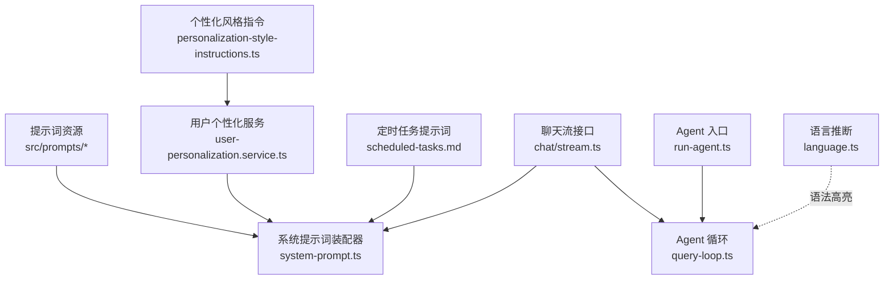
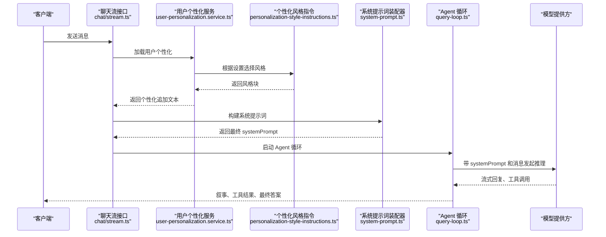
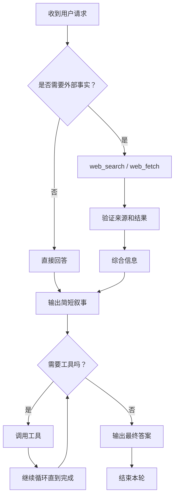
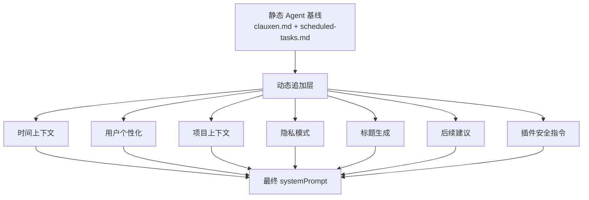
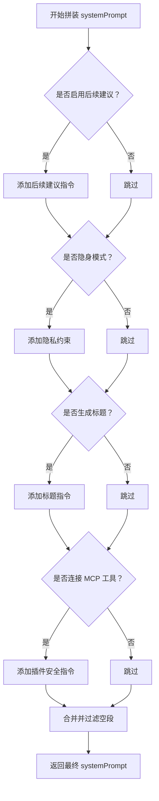
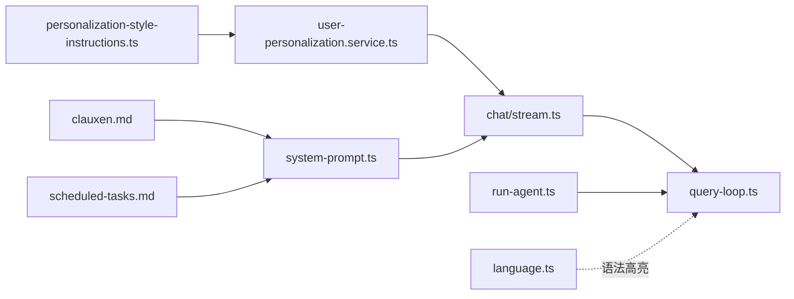

# 系统提示词工程

<cite>
**本文引用的文件**   
- [src/prompts/clauxen.md](file://src/prompts/clauxen.md)
- [src/prompts/scheduled-tasks.md](file://src/prompts/scheduled-tasks.md)
- [src/server/inference/system-prompt.ts](file://src/server/inference/system-prompt.ts)
- [src/server/services/personalization-style-instructions.ts](file://src/server/services/personalization-style-instructions.ts)
- [src/server/services/user-personalization.service.ts](file://src/server/services/user-personalization.service.ts)
- [src/app/api/chat/stream.ts](file://src/app/api/chat/stream.ts)
- [src/server/agent-core/runtime/query-loop.ts](file://src/server/agent-core/runtime/query-loop.ts)
- [src/server/agent-core/runtime/run-agent.ts](file://src/server/agent-core/runtime/run-agent.ts)
- [src/server/inference/language.ts](file://src/server/inference/language.ts)
- [src/prompts/personalization/base-style/default.md](file://src/prompts/personalization/base-style/default.md)
</cite>

## 目录
1. [引言](#引言)
2. [项目结构](#项目结构)
3. [核心组件](#核心组件)
4. [架构总览](#架构总览)
5. [详细组件分析](#详细组件分析)
6. [依赖关系分析](#依赖关系分析)
7. [性能与缓存特性](#性能与缓存特性)
8. [调试、分析与迭代优化](#调试分析与迭代优化)
9. [多语言与文化适配](#多语言与文化适配)
10. [安全约束与行为边界](#安全约束与行为边界)
11. [模型特定优化与最佳实践](#模型特定优化与最佳实践)
12. [故障排查指南](#故障排查指南)
13. [结论](#结论)

## 引言
本文件系统化梳理 Clauxen 项目的“系统提示词工程”。它不是单一文本，而是一套由静态基线、用户个性化、项目上下文、时间上下文、功能开关和插件安全策略共同拼装而成的提示词装配管线。目标包括：
- 解释通用聊天提示词、Agent 专用提示词、模型特定优化提示词的分工。
- 说明提示词的结构组织、变量插值、条件分支逻辑。
- 说明语言检测机制、多语言支持和文化适配策略。
- 说明提示词版本管理、A/B 测试框架、效果评估指标在系统中的现状与扩展建议。
- 明确安全提示词、约束条件、行为边界定义。
- 提供提示词调试工具、输出分析、迭代优化方法。
- 总结针对不同模型的最佳实践和调优技巧。

## 项目结构
提示词相关代码主要分布在以下位置：
- `src/prompts`：Agent 基线提示词、定时任务提示词、可组合的个性化风格指令。
- `src/server/inference/system-prompt.ts`：系统提示词装配器，负责加载静态基线、拼接动态后缀。
- `src/server/services/personalization-style-instructions.ts`：按用户设置选择并格式化模块化风格指令。
- `src/server/services/user-personalization.service.ts`：读取用户配置、生成用户个性化追加块。
- `src/app/api/chat/stream.ts`：聊天流入口，拼装最终系统提示词并启动 Agent 循环。
- `src/server/agent-core/runtime/query-loop.ts`：Agent 执行循环、工具调用、叙事流和推理控制。
- `src/server/agent-core/runtime/run-agent.ts`：对外暴露 Agent 运行入口。
- `src/server/inference/language.ts`：基于文件扩展名的语言标识推断（用于语法高亮等）。

**图示来源**
- [src/server/inference/system-prompt.ts:1-163](file://src/server/inference/system-prompt.ts#L1-L163)
- [src/server/services/user-personalization.service.ts:1-253](file://src/server/services/user-personalization.service.ts#L1-L253)
- [src/server/services/personalization-style-instructions.ts:1-153](file://src/server/services/personalization-style-instructions.ts#L1-L153)
- [src/app/api/chat/stream.ts:1-341](file://src/app/api/chat/stream.ts#L1-L341)
- [src/server/agent-core/runtime/query-loop.ts:1-200](file://src/server/agent-core/runtime/query-loop.ts#L1-L200)
- [src/server/agent-core/runtime/run-agent.ts:1-14](file://src/server/agent-core/runtime/run-agent.ts#L1-L14)
- [src/server/inference/language.ts:1-20](file://src/server/inference/language.ts#L1-L20)

**章节来源**
- [src/server/inference/system-prompt.ts:1-163](file://src/server/inference/system-prompt.ts#L1-L163)
- [src/app/api/chat/stream.ts:1-341](file://src/app/api/chat/stream.ts#L1-L341)

## 核心组件
本节聚焦提示词工程中的关键模块及其职责。

| 组件 | 职责 | 关键行为 |
|---|---|---|
| Agent 基线提示词 | 定义 Clauxen 自主 Agent 的行为准则、工具契约、叙事规范、安全边界、深度研究流程 | 作为所有会话的“操作系统”，不随用户切换频繁变化 |
| 系统提示词装配器 | 将静态 Agent 基线与动态后缀拼接，缓存稳定前缀以提升提示词命中率 | 提供构建标题提示词、时间上下文、RAG 上下文的函数 |
| 用户个性化服务 | 读取用户配置，拼装 `<user_profile>`、`<response_preferences>`、`<memory_and_tools>`、`<custom_instructions>` 等块 | 失败时返回空字符串，避免阻塞聊天 |
| 个性化风格指令 | 根据用户设置选择 base-style、warm、enthusiastic、headers-lists、emoji 等 Markdown 指令 | 使用 slugify 白名单映射到允许的文件名 |
| 聊天流接口 | 组装最终 systemPrompt，决定 thinking、温度、最大 token、MCP 工具、隐私模式等 | 快速启动 SSE，异步加载项目上下文和插件工具 |
| Agent 循环 | 驱动模型回合、工具执行、叙事流、结果归档、错误处理 | 限制每轮步数，支持深度研究和计划审批工作流 |
| 语言推断 | 根据文件扩展名推断语言 ID | 主要用于语法高亮与产物卡片，并非对话语言检测 |

**章节来源**
- [src/prompts/clauxen.md:1-97](file://src/prompts/clauxen.md#L1-L97)
- [src/server/inference/system-prompt.ts:1-163](file://src/server/inference/system-prompt.ts#L1-L163)
- [src/server/services/user-personalization.service.ts:1-253](file://src/server/services/user-personalization.service.ts#L1-L253)
- [src/server/services/personalization-style-instructions.ts:1-153](file://src/server/services/personalization-style-instructions.ts#L1-L153)
- [src/app/api/chat/stream.ts:1-341](file://src/app/api/chat/stream.ts#L1-L341)
- [src/server/agent-core/runtime/query-loop.ts:1-200](file://src/server/agent-core/runtime/query-loop.ts#L1-L200)

## 架构总览
下图展示一次聊天请求从 HTTP 入口到模型系统提示词装配、再到 Agent 执行的完整链路。

**图示来源**
- [src/app/api/chat/stream.ts:1-341](file://src/app/api/chat/stream.ts#L1-L341)
- [src/server/services/user-personalization.service.ts:1-253](file://src/server/services/user-personalization.service.ts#L1-L253)
- [src/server/services/personalization-style-instructions.ts:1-153](file://src/server/services/personalization-style-instructions.ts#L1-L153)
- [src/server/inference/system-prompt.ts:1-163](file://src/server/inference/system-prompt.ts#L1-L163)
- [src/server/agent-core/runtime/query-loop.ts:1-200](file://src/server/agent-core/runtime/query-loop.ts#L1-L200)

## 详细组件分析

### Agent 专用提示词
Agent 专用提示词位于 `src/prompts/clauxen.md`，是 Clauxen 的核心行为协议。其重点包括：
- 角色定位：自主 AI Agent，具备工具编排能力。
- 行动原则：优先执行而非描述；自由链式工具调用；先验证再断言；尽量自行决策，仅在重大歧义或风险时询问用户。
- 实时叙事：在工具调用前后用简短自然语言向用户说明下一步动作和上一步发现。
- 工具契约：web_search、web_fetch、bash_tool、execute_code、create_file、file_read、read_skill、image_search、places_search、weather_fetch、ask_user_input_v0、MCP 工具、定时任务工具等。
- 沙箱规则：Debian/Ubuntu、outputs 目录、密钥保护、命令合并、复用状态。
- 回答标准：干净 Markdown、表格标题标签、匹配用户语言和正式程度、诚实优于修饰。
- 深度研究：通过 present_research_plan 规划、research_task_update 跟踪、最终报告以普通 Markdown 呈现。

**图示来源**
- [src/prompts/clauxen.md:1-97](file://src/prompts/clauxen.md#L1-L97)
- [src/server/agent-core/runtime/query-loop.ts:1-200](file://src/server/agent-core/runtime/query-loop.ts#L1-L200)

**章节来源**
- [src/prompts/clauxen.md:1-97](file://src/prompts/clauxen.md#L1-L97)

### 通用聊天提示词
通用聊天提示词由系统提示词装配器统一拼装，顺序大致为：
1. 静态 Agent 基线提示词。
2. 可选追加内容，包括：
   - 时间上下文：当前本地日期、时间、时区、UTC ISO。
   - 用户个性化：用户资料、响应偏好、记忆与工具开关、自定义指令。
   - 项目上下文：RAG 知识或项目指令。
   - 隐私模式：隐身会话约束。
   - 标题生成指令。
   - 后续建议指令。
   - MCP 插件安全指令。

**图示来源**
- [src/server/inference/system-prompt.ts:1-163](file://src/server/inference/system-prompt.ts#L1-L163)
- [src/app/api/chat/stream.ts:1-341](file://src/app/api/chat/stream.ts#L1-L341)

**章节来源**
- [src/server/inference/system-prompt.ts:1-163](file://src/server/inference/system-prompt.ts#L1-L163)
- [src/app/api/chat/stream.ts:1-341](file://src/app/api/chat/stream.ts#L1-L341)

### 模型特定优化提示词
当前代码中未实现“按模型族拆分不同 systemPrompt 模板”的逻辑。`getModelSystemPrompt` 接受 model 参数但当前仅用于命名与缓存键语义，实际仍加载 `clauxen.md`。模型差异化主要体现在：
- `buildModelSystemPrompt` 允许 append 额外指令。
- `buildTitleGenerationSystemPrompt` 单独用于生成侧边栏标题。
- 聊天流接口传入 temperature、maxTokens、thinkingEnabled、homerReasoningEffort 等运行时参数。
- 未来可扩展为按模型族选择不同 append 或不同 instruction set。

**章节来源**
- [src/server/inference/system-prompt.ts:1-163](file://src/server/inference/system-prompt.ts#L1-L163)
- [src/app/api/chat/stream.ts:1-341](file://src/app/api/chat/stream.ts#L1-L341)

### 提示词结构组织与变量插值
提示词结构采用“静态基线 + 模块化指令 + 动态上下文”的分层设计：
- 静态基线：`clauxen.md` 与 `scheduled-tasks.md`，进程级缓存。
- 模块化风格：`personalization/base-style`、`warm`、`enthusiastic`、`headers-lists`、`emoji`，按用户设置 slugify 后读取。
- 动态上下文：用户资料、响应偏好、记忆与工具开关、自定义指令、时间上下文、项目 RAG、隐私模式、标题指令、后续建议、插件安全。

变量插值主要通过字符串拼接实现：
- 用户名称、职业、昵称。
- fastAnswers、responsePreference。
- referenceSavedMemories、referenceChatHistory、webSearch。
- customInstructions。
- clientTimezone 转换为本地时间字符串。
- projectInstructions 与 ragContext。

**章节来源**
- [src/server/services/personalization-style-instructions.ts:1-153](file://src/server/services/personalization-style-instructions.ts#L1-L153)
- [src/server/services/user-personalization.service.ts:1-253](file://src/server/services/user-personalization.service.ts#L1-L253)
- [src/server/inference/system-prompt.ts:1-163](file://src/server/inference/system-prompt.ts#L1-L163)

### 条件分支逻辑
提示词拼装中存在多处条件分支：
- 是否启用 follow-up 建议。
- 是否隐身模式。
- 是否生成对话标题。
- 是否存在 MCP 插件工具。
- 是否开启 extendedThinking。
- 是否启用 self-growth insights。
- 项目上下文是否为仅项目模式。
- 个性化设置是否冲突于平台安全。

**图示来源**
- [src/app/api/chat/stream.ts:1-341](file://src/app/api/chat/stream.ts#L1-L341)
- [src/server/services/user-personalization.service.ts:1-253](file://src/server/services/user-personalization.service.ts#L1-L253)

**章节来源**
- [src/app/api/chat/stream.ts:1-341](file://src/app/api/chat/stream.ts#L1-L341)

## 依赖关系分析
提示词工程的依赖关系如下：

**图示来源**
- [src/server/inference/system-prompt.ts:1-163](file://src/server/inference/system-prompt.ts#L1-L163)
- [src/server/services/personalization-style-instructions.ts:1-153](file://src/server/services/personalization-style-instructions.ts#L1-L153)
- [src/server/services/user-personalization.service.ts:1-253](file://src/server/services/user-personalization.service.ts#L1-L253)
- [src/app/api/chat/stream.ts:1-341](file://src/app/api/chat/stream.ts#L1-L341)
- [src/server/agent-core/runtime/query-loop.ts:1-200](file://src/server/agent-core/runtime/query-loop.ts#L1-L200)
- [src/server/agent-core/runtime/run-agent.ts:1-14](file://src/server/agent-core/runtime/run-agent.ts#L1-L14)
- [src/server/inference/language.ts:1-20](file://src/server/inference/language.ts#L1-L20)

**章节来源**
- [src/server/inference/system-prompt.ts:1-163](file://src/server/inference/system-prompt.ts#L1-L163)
- [src/app/api/chat/stream.ts:1-341](file://src/app/api/chat/stream.ts#L1-L341)

## 性能与缓存特性
- 静态 Agent 基线提示词进程级缓存：避免每次请求重新读取大文件。
- 个性化风格指令进程级缓存：避免重复解析 `.md` 指令。
- 聊天流接口延迟加载项目上下文和插件工具，尽快返回 SSE 首事件，降低首 Token 延迟。
- 系统提示词拼装保持静态前缀稳定，有利于模型提供方或网关层的 prompt cache 命中。
- 个性化加载失败时降级为空字符串，防止数据库抖动导致聊天不可用。

**章节来源**
- [src/server/inference/system-prompt.ts:1-163](file://src/server/inference/system-prompt.ts#L1-L163)
- [src/server/services/personalization-style-instructions.ts:1-153](file://src/server/services/personalization-style-instructions.ts#L1-L153)
- [src/app/api/chat/stream.ts:1-341](file://src/app/api/chat/stream.ts#L1-L341)

## 调试、分析与迭代优化

### 提示词调试工具
- 查看最终 systemPrompt：可在聊天流接口处记录 `systemPrompt` 原始值，确认各段是否正确拼接。
- 检查个性化块：打印 `<user_profile>`、`<response_preferences>`、`<memory_and_tools>`、`<custom_instructions>`、`<self_growth>` 是否存在且内容符合预期。
- 检查时间上下文：确认 `<current_datetime>` 包含用户时区、本地时间、UTC ISO。
- 检查插件安全指令：当存在 MCP 工具时，确认 `PLUGIN_SAFETY_INSTRUCTIONS` 已加入。
- 检查隐身模式：确认 `<incognito_mode>` 正确移除 memory_and_tools 引用。

### 输出分析
- Agent 叙事：观察工具调用前后的自然语言叙述是否符合“简短、具体、不泄露内部推理”的要求。
- 工具调用：检查参数校验、输出路径、沙箱行为、错误重试。
- 深度研究：检查 plan 标题、任务数量、running/complete 状态、最终报告格式。
- 最终答案：检查是否直接给出答案、是否避免多余元评论、是否遵循 Markdown 标准。

### 迭代优化方法
- 修改静态基线：调整 `clauxen.md` 的行为准则、工具契约、安全边界。
- 调整个性化风格：修改 `personalization/base-style` 及各 characteristic 下的 `.md` 文件。
- 调整运行时参数：在聊天流接口中调节 temperature、maxTokens、thinkingEnabled、homerReasoningEffort。
- 引入新的追加段：例如新增语言策略、文化适配、安全强化段，并在 `append` 数组中插入。
- 增加版本标记：建议在 systemPrompt 中加入隐式版本注释，便于 A/B 和回滚。

**章节来源**
- [src/server/agent-core/runtime/query-loop.ts:1-200](file://src/server/agent-core/runtime/query-loop.ts#L1-L200)
- [src/app/api/chat/stream.ts:1-341](file://src/app/api/chat/stream.ts#L1-L341)
- [src/prompts/clauxen.md:1-97](file://src/prompts/clauxen.md#L1-L97)

## 多语言与文化适配

### 语言检测机制
当前仓库中没有独立的对话语言检测模型。`src/server/inference/language.ts` 提供的 `inferLanguage` 是根据文件扩展名推断语言 ID，主要用于语法高亮和产物卡片，而不是判断用户输入语言。

因此，语言适配主要依赖：
- Agent 基线要求“匹配用户语言和正式程度”。
- 时间上下文使用用户时区，有助于本地化表达。
- 个性化设置中 responsePreference 影响回答长度和细节程度。
- 自定义指令可由用户指定语言偏好。

### 多语言支持
- Agent 行为鼓励跟随用户语言，但没有强制语言路由。
- 时间格式化使用 `Intl.DateTimeFormat`，但固定使用 `en-US` 作为格式化 locale，因此 `<current_datetime>` 中的星期、月份名称会是英文。
- 若需严格本地化日期显示，应考虑改用用户语言 locale 或至少保留 IANA 时区的同时提供多语言日期片段。

### 文化适配策略
当前没有显式的地区文化模板。可借鉴现有模块化风格设计：
- 新增 `culture` 或 `locale` 模块，类似 base-style。
- 在 `user-personalization.service.ts` 中读取地区偏好。
- 在 `personalization-style-instructions.ts` 中加载对应文化指令。
- 在 `system-prompt.ts` 或 `chat/stream.ts` 中拼接到 systemPrompt。

**章节来源**
- [src/server/inference/language.ts:1-20](file://src/server/inference/language.ts#L1-L20)
- [src/server/inference/system-prompt.ts:1-163](file://src/server/inference/system-prompt.ts#L1-L163)
- [src/prompts/clauxen.md:1-97](file://src/prompts/clauxen.md#L1-L97)

## 安全约束与行为边界

### 安全提示词
- Agent 基线明确要求诚实、不编造成功、不伪造引用、不使用自定义 XML 控制标签。
- 沙箱禁止泄露密钥，强调 outputs 目录、权限最小化和错误重试。
- 自定义指令必须服从 Shirova 安全、政策和平台指南，冲突部分应被忽略。
- MCP 工具调用需尊重 schema，出现认证错误时应以用户可读方式告知。
- 插件安全指令由插件防火墙提供，并在有 MCP 工具时加入 systemPrompt。

### 约束条件
- 每轮 Agent 步骤上限为 24。
- 标题指令只在首次对话中出现，且被清理出可见答案。
- 深度研究计划必须经用户批准，不能自动开始。
- 定时任务创建需收集必要字段，不得猜测时间、时区或频率。

### 行为边界定义
- 不替代用户做高风险决策，必要时使用 ask_user_input_v0。
- 不虚构数据、链接、索引、成功结果。
- 不输出内部推理过程，只输出面向用户的叙事。
- 不绕过安全策略；个性化只能细化表达方式，不能改变能力或覆盖安全。

**章节来源**
- [src/prompts/clauxen.md:1-97](file://src/prompts/clauxen.md#L1-L97)
- [src/server/services/user-personalization.service.ts:1-253](file://src/server/services/user-personalization.service.ts#L1-L253)
- [src/server/agent-core/runtime/query-loop.ts:1-200](file://src/server/agent-core/runtime/query-loop.ts#L1-L200)

## 模型特定优化与最佳实践

### 当前模型差异点
- 无独立模型族提示词模板。
- 通过 append 注入标题、时间、个性化、项目、隐私、插件安全等内容。
- 通过 runtime 参数区分 thinking、temperature、maxTokens、effort。

### 推荐最佳实践
- 将稳定、通用的 Agent 行为放在静态基线。
- 将易变、用户相关的行为放在动态 append。
- 对每个模型族维护一套 append 模板，例如：
  - 强推理模型：更强调思维链、工具验证、分步计划。
  - 轻量模型：更强调简洁、少工具、明确终止条件。
  - 编码模型：更强调代码结构、沙箱命令、输出路径。
- 对每个模型族维护一组 evaluation 指标，如准确率、工具调用成功率、幻觉率、延迟、成本。
- 使用 feature flag 或实验框架控制不同模型族的提示词版本，逐步放量。

**章节来源**
- [src/server/inference/system-prompt.ts:1-163](file://src/server/inference/system-prompt.ts#L1-L163)
- [src/app/api/chat/stream.ts:1-341](file://src/app/api/chat/stream.ts#L1-L341)

## 故障排查指南

| 现象 | 可能原因 | 排查步骤 |
|---|---|---|
| 个性化设置不生效 | 个性化文件缺失、slugify 不匹配、用户设置未保存 | 检查 `personalization-style-instructions.ts` 中 slugify 映射；检查用户设置存储；查看日志中 missing instruction file |
| 系统提示词过长 | 自定义指令过长、RAG 上下文过大 | 检查 `MAX_CUSTOM_INSTRUCTIONS_LEN`；截断或压缩 RAG 上下文 |
| 时间上下文异常 | 客户端时区无效、Intl 抛错 | 检查 `clientTimezone`；确认 fallback 到 UTC |
| 隐身模式下仍引用历史 | incognito 未正确移除 memory_and_tools | 检查 `chat/stream.ts` 中对 personalizationAppend 的正则替换 |
| 标题出现在最终答案中 | 标题标签未被清理 | 检查 `stripChatTitleMarkup` 及正则表达式 |
| 工具调用参数错误 | 模型输出不符合 Zod schema | 检查 autonomousZodByName 校验；查看 tool-healer 自愈逻辑 |
| 深度研究未开始 | 用户未批准计划 | 检查 `[Deep research start: ...]` 触发条件 |
| 定时任务无法创建 | 缺少必填字段、时区或日期非法 | 检查 `scheduled-tasks.md` 的字段要求和业务校验 |

**章节来源**
- [src/server/services/personalization-style-instructions.ts:1-153](file://src/server/services/personalization-style-instructions.ts#L1-L153)
- [src/server/inference/system-prompt.ts:1-163](file://src/server/inference/system-prompt.ts#L1-L163)
- [src/app/api/chat/stream.ts:1-341](file://src/app/api/chat/stream.ts#L1-L341)
- [src/server/agent-core/runtime/query-loop.ts:1-200](file://src/server/agent-core/runtime/query-loop.ts#L1-L200)
- [src/prompts/scheduled-tasks.md:1-41](file://src/prompts/scheduled-tasks.md#L1-L41)

## 结论
该项目的系统提示词工程以“稳定基线 + 模块化个性化 + 动态上下文”为核心设计。Agent 基线定义了自主工具执行、叙事、安全和深度研究的工作模式；系统提示词装配器负责把用户个性化、项目上下文、时间上下文、隐私模式、插件安全等信息拼装成最终 systemPrompt；聊天流接口负责控制推理参数、SSE 生命周期和错误处理；Agent 循环负责执行工具、维护步数预算并产出最终答案。

当前系统尚未内置完整的提示词版本管理、A/B 测试框架和效果评估指标体系，但提供了良好的扩展基础：可通过 append 层、个性化模块、运行时参数和 feature flag 逐步实现这些能力。在多语言方面，系统鼓励跟随用户语言，但日期格式化仍以英文 locale 为主，如需严格本地化需进一步改造。安全方面，已有较清晰的行为边界、沙箱约束和自定义指令优先级规则，适合继续沉淀为可审计的安全提示词清单。