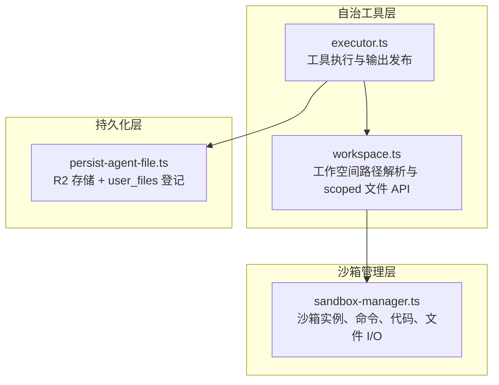
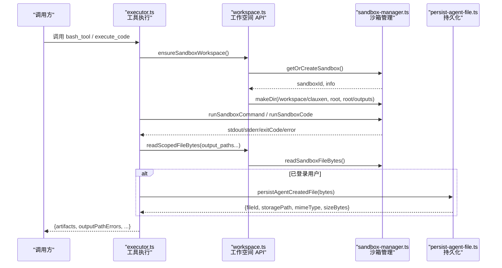
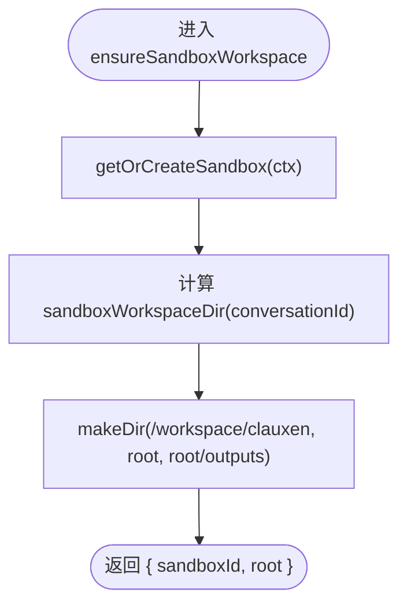
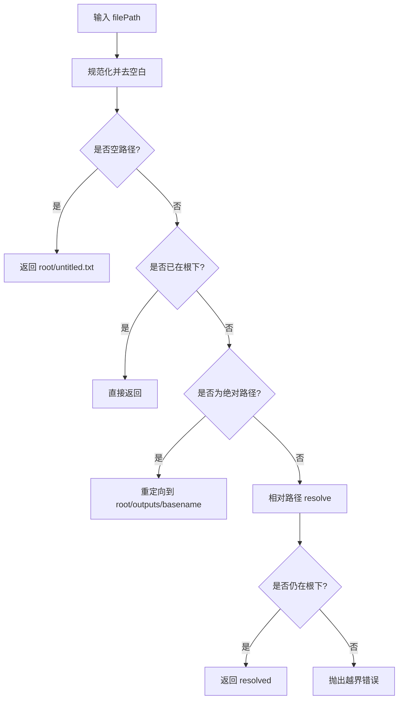
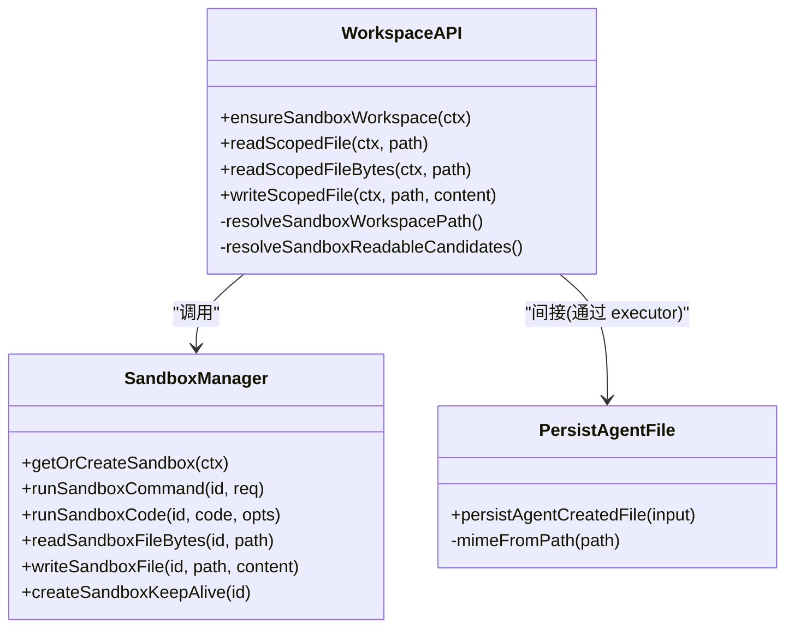
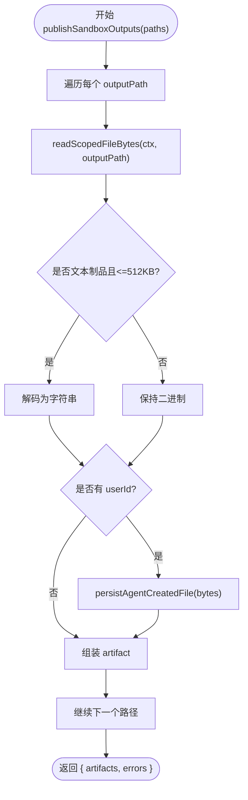
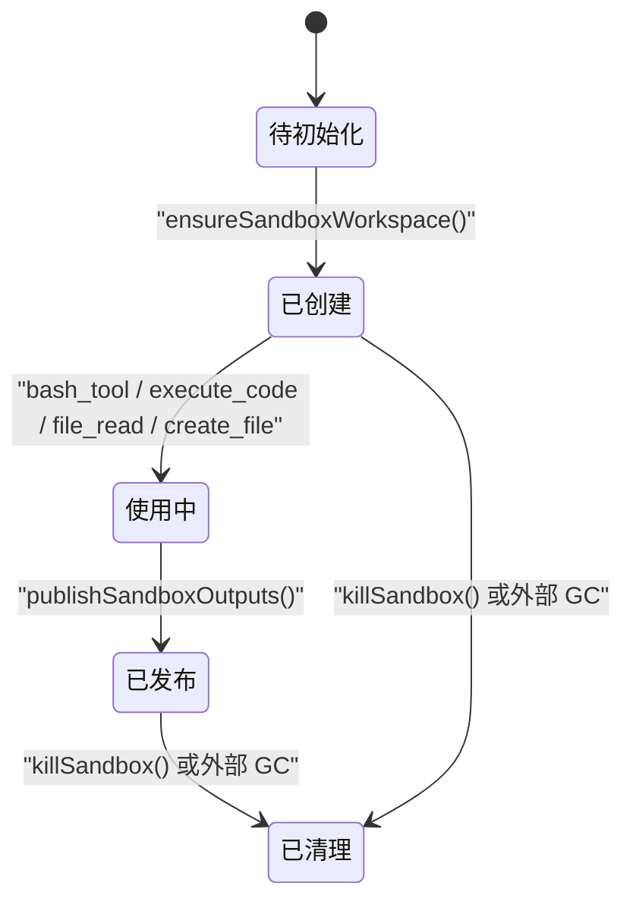
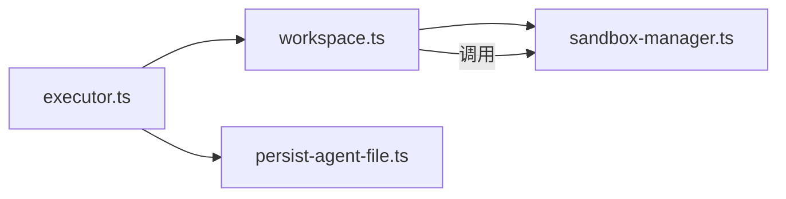

# 工作空间管理

<cite>
**本文引用的文件**   
- [workspace.ts](file://src/server/inference/autonomous-tools/workspace.ts)
- [executor.ts](file://src/server/inference/autonomous-tools/executor.ts)
- [sandbox-manager.ts](file://src/server/sandbox/sandbox-manager.ts)
- [persist-agent-file.ts](file://src/server/inference/autonomous-tools/persist-agent-file.ts)
</cite>

## 目录
1. [引言](#引言)
2. [项目结构](#项目结构)
3. [核心组件](#核心组件)
4. [架构总览](#架构总览)
5. [详细组件分析](#详细组件分析)
6. [依赖关系分析](#依赖关系分析)
7. [性能与并发特性](#性能与并发特性)
8. [故障排查指南](#故障排查指南)
9. [结论](#结论)
10. [附录：扩展点与最佳实践](#附录扩展点与最佳实践)

## 引言
本文面向工作空间管理系统，重点解释以下能力：
- 工作空间初始化：`ensureSandboxWorkspace()` 如何创建并隔离会话级沙箱目录。
- 安全文件 API：`readScopedFile()`、`writeScopedFile()`、`readScopedFileBytes()` 的路径白名单校验与安全边界。
- 沙箱隔离机制：路径映射规则、输出目录隔离、文件大小限制、MIME 类型检测。
- 输出发布流程：`publishSandboxOutputs()` 如何将临时文件转换为持久化 artifact。
- 生命周期管理：从创建、使用到清理的完整流程。
- 可扩展性：自定义文件处理逻辑的扩展点说明。

本系统围绕“按会话隔离的工作空间 + 受控沙箱运行时 + 可持久化的产物”展开，既保证模型在沙箱中的执行能力，又通过严格的白名单和大小限制防止越权访问和资源滥用。

## 项目结构
与工作空间管理直接相关的代码主要位于以下模块：
- `src/server/inference/autonomous-tools/workspace.ts`：工作空间路径解析、读写 API、会话上下文封装。
- `src/server/inference/autonomous-tools/executor.ts`：工具执行入口、输出发布、工作空间使用点。
- `src/server/sandbox/sandbox-manager.ts`：沙箱实例管理、命令与代码执行、文件 I/O 桥接、KeepAlive。
- `src/server/inference/autonomous-tools/persist-agent-file.ts`：将工作区产物写入对象存储并登记用户文件记录。

**图表来源**
- [workspace.ts:1-190](file://src/server/inference/autonomous-tools/workspace.ts#L1-L190)
- [executor.ts:1-730](file://src/server/inference/autonomous-tools/executor.ts#L1-L730)
- [sandbox-manager.ts:1-423](file://src/server/sandbox/sandbox-manager.ts#L1-L423)
- [persist-agent-file.ts:1-102](file://src/server/inference/autonomous-tools/persist-agent-file.ts#L1-L102)

**章节来源**
- [workspace.ts:1-190](file://src/server/inference/autonomous-tools/workspace.ts#L1-L190)
- [executor.ts:1-730](file://src/server/inference/autonomous-tools/executor.ts#L1-L730)
- [sandbox-manager.ts:1-423](file://src/server/sandbox/sandbox-manager.ts#L1-L423)
- [persist-agent-file.ts:1-102](file://src/server/inference/autonomous-tools/persist-agent-file.ts#L1-L102)

## 核心组件
- 工作空间上下文与会话标识：基于 conversationId 生成稳定且安全的 workspace 根目录；可选 userId 用于权限与持久化。
- 路径解析器：确保所有写操作落在会话工作空间或 outputs 子目录，读操作提供候选路径集合以兼容模型写出绝对路径的场景。
- 沙箱管理器：负责获取或复用会话级沙箱、执行命令或 Python 代码、读写沙箱文件系统、维持长任务存活。
- 持久化工具：将已验证的文件内容以 MIME 推断的类型写入对象存储，并回写 user_files 表元数据。

**章节来源**
- [workspace.ts:1-190](file://src/server/inference/autonomous-tools/workspace.ts#L1-L190)
- [sandbox-manager.ts:1-423](file://src/server/sandbox/sandbox-manager.ts#L1-L423)
- [persist-agent-file.ts:1-102](file://src/server/inference/autonomous-tools/persist-agent-file.ts#L1-L102)

## 架构总览
下图展示一次典型的 `bash_tool` 或 `execute_code` 调用中，工作空间与沙箱的交互流程。

**图表来源**
- [executor.ts:1-730](file://src/server/inference/autonomous-tools/executor.ts#L1-L730)
- [workspace.ts:1-190](file://src/server/inference/autonomous-tools/workspace.ts#L1-L190)
- [sandbox-manager.ts:1-423](file://src/server/sandbox/sandbox-manager.ts#L1-L423)
- [persist-agent-file.ts:1-102](file://src/server/inference/autonomous-tools/persist-agent-file.ts#L1-L102)

## 详细组件分析

### 工作空间初始化：`ensureSandboxWorkspace()`
职责：
- 根据会话上下文获取或复用沙箱实例。
- 创建工作区根目录 `/workspace/clauxen/<conversation>`。
- 预创建 `outputs` 子目录，作为模型写出绝对路径时的目标位置。

关键行为：
- 会话级沙箱复用：同一 userId+conversationId 会复用已有沙箱，减少启动开销。
- 目录初始化幂等：多次调用不会破坏已有结构。
- 返回 sandboxId 与 root，供后续文件 API 与命令执行使用。

生命周期要点：
- 创建：首次调用时创建沙箱并初始化目录。
- 使用：后续调用复用同一沙箱。
- 清理：由上层调度策略（例如会话结束、超时）触发沙箱销毁；当前实现未在工作空间层主动删除文件。

**图表来源**
- [workspace.ts:1-190](file://src/server/inference/autonomous-tools/workspace.ts#L1-L190)
- [sandbox-manager.ts:1-423](file://src/server/sandbox/sandbox-manager.ts#L1-L423)

**章节来源**
- [workspace.ts:106-128](file://src/server/inference/autonomous-tools/workspace.ts#L106-L128)
- [sandbox-manager.ts:121-160](file://src/server/sandbox/sandbox-manager.ts#L121-L160)

### 路径解析与安全边界
#### 写路径约束：`resolveSandboxWorkspacePath()`
- 规范化反斜杠与空路径。
- 若请求路径等于或位于工作空间根下，则直接使用。
- 若为绝对路径但不在工作空间内，则重定向至 `root/outputs/<basename>`，避免任意写。
- 相对路径经 `path.posix.resolve` 后仍须以工作空间根开头，否则抛出错误。

该机制构成写操作的“白名单”，确保：
- 不允许跳出会话工作空间。
- 允许模型写出 `/tmp/report.pdf` 这类绝对路径，但被安全地归口到 `outputs`。

**图表来源**
- [workspace.ts:29-74](file://src/server/inference/autonomous-tools/workspace.ts#L29-L74)

**章节来源**
- [workspace.ts:29-74](file://src/server/inference/autonomous-tools/workspace.ts#L29-L74)

#### 读路径候选：`resolveSandboxReadableCandidates()`
- 优先尝试原始路径；若为绝对路径，同时添加工作空间映射后的路径作为备选。
- 读取失败时按候选顺序逐一尝试，直到成功或全部失败。

该设计兼容模型在沙箱内写出绝对路径（如 `/home/user/file`），同时优先消费映射到工作空间的产物。

**章节来源**
- [workspace.ts:76-104](file://src/server/inference/autonomous-tools/workspace.ts#L76-L104)

### 安全文件 API
#### `readScopedFile()`
- 先确保工作空间存在。
- 构造候选路径列表。
- 逐个尝试 `readSandboxFile`，成功后返回相对路径与文本内容。
- 全部失败则抛出最后一个错误或统一错误信息。

#### `readScopedFileBytes()`
- 同 `readScopedFile`，但返回二进制字节数组与绝对路径。
- 用于输出发布与二进制制品（图片、PDF、压缩包等）。

#### `writeScopedFile()`
- 先确保工作空间存在。
- 将用户传入路径转为工作区相对路径，再解析为最终安全路径。
- 确保父目录存在后写入文件。
- 返回相对路径、写入字节数与内容副本。

注意：写入内容由调用方控制，这里不做 MIME 检测；MIME 仅在持久化阶段推断。

**章节来源**
- [workspace.ts:130-190](file://src/server/inference/autonomous-tools/workspace.ts#L130-L190)
- [sandbox-manager.ts:341-379](file://src/server/sandbox/sandbox-manager.ts#L341-L379)

### 沙箱隔离机制
- 会话隔离：每个 userId+conversationId 对应一个沙箱实例，并通过 session key 缓存。
- 路径白名单：写路径必须落在会话工作空间或 `outputs` 子目录。
- 输出目录隔离：绝对路径写操作会被重定向到 `outputs`，便于集中发布。
- 文件大小限制：输出发布时对文本制品进行 512KB 解码阈值限制，避免大文本占内存。
- MIME 类型检测：持久化阶段根据后缀推断 MIME，未知类型退化为 `application/octet-stream`。
- 并发访问控制：沙箱实例通过 Map 缓存，避免重复创建；命令与代码执行串行化到 SDK 层。

**图表来源**
- [workspace.ts:1-190](file://src/server/inference/autonomous-tools/workspace.ts#L1-L190)
- [sandbox-manager.ts:1-423](file://src/server/sandbox/sandbox-manager.ts#L1-L423)
- [persist-agent-file.ts:1-102](file://src/server/inference/autonomous-tools/persist-agent-file.ts#L1-L102)

**章节来源**
- [sandbox-manager.ts:121-160](file://src/server/sandbox/sandbox-manager.ts#L121-L160)
- [sandbox-manager.ts:235-291](file://src/server/sandbox/sandbox-manager.ts#L235-L291)
- [sandbox-manager.ts:341-423](file://src/server/sandbox/sandbox-manager.ts#L341-L423)
- [persist-agent-file.ts:1-102](file://src/server/inference/autonomous-tools/persist-agent-file.ts#L1-L102)

### 输出文件发布流程：`publishSandboxOutputs()`
职责：
- 遍历模型声明的输出路径。
- 通过 `readScopedFileBytes()` 读取二进制内容。
- 对文本制品进行解码（长度上限 512KB）。
- 若已登录用户，调用 `persistAgentCreatedFile()` 写入对象存储并登记 user_files。
- 汇总 artifacts 与 errors，返回给调用方。

关键约束：
- 文本制品仅当路径匹配已知文本扩展名且大小不超过 512KB 时才解码为字符串。
- 持久化失败不影响其他文件发布，错误单独收集。
- 产物 id 优先使用持久化生成的 fileId，否则回退到 toolCallId 与路径组合。

**图表来源**
- [executor.ts:1-200](file://src/server/inference/autonomous-tools/executor.ts#L1-L200)
- [workspace.ts:130-170](file://src/server/inference/autonomous-tools/workspace.ts#L130-L170)
- [persist-agent-file.ts:1-102](file://src/server/inference/autonomous-tools/persist-agent-file.ts#L1-L102)

**章节来源**
- [executor.ts:52-120](file://src/server/inference/autonomous-tools/executor.ts#L52-L120)
- [workspace.ts:130-170](file://src/server/inference/autonomous-tools/workspace.ts#L130-L170)
- [persist-agent-file.ts:1-102](file://src/server/inference/autonomous-tools/persist-agent-file.ts#L1-L102)

### 工作空间生命周期管理
- 创建：
  - 首次调用 `ensureSandboxWorkspace()` 时，通过 `getOrCreateSandbox()` 创建或连接沙箱。
  - 创建 `/workspace/clauxen`、会话根目录与 `outputs`。
- 使用：
  - `bash_tool`、`execute_code` 通过 `ensureSandboxWorkspace()` 获取 sandboxId 与 root。
  - 使用 `createSandboxKeepAlive()` 在长任务活跃时延长沙箱空闲超时。
  - 文件读写通过 scoped API 完成，路径始终受白名单保护。
- 清理：
  - 工作空间本身不主动删除文件；清理由上层生命周期策略决定。
  - 沙箱可通过 `killSandbox()` 终止，并清理内部缓存索引。

**图表来源**
- [workspace.ts:106-190](file://src/server/inference/autonomous-tools/workspace.ts#L106-L190)
- [executor.ts:300-420](file://src/server/inference/autonomous-tools/executor.ts#L300-L420)
- [sandbox-manager.ts:235-291](file://src/server/sandbox/sandbox-manager.ts#L235-L291)
- [sandbox-manager.ts:309-321](file://src/server/sandbox/sandbox-manager.ts#L309-L321)

**章节来源**
- [workspace.ts:106-190](file://src/server/inference/autonomous-tools/workspace.ts#L106-L190)
- [executor.ts:300-420](file://src/server/inference/autonomous-tools/executor.ts#L300-L420)
- [sandbox-manager.ts:235-321](file://src/server/sandbox/sandbox-manager.ts#L235-L321)

## 依赖关系分析
工作空间模块对外暴露稳定的 API，依赖沙箱管理与持久化模块：

- `executor.ts` 是工具执行入口，协调工作空间与持久化。
- `workspace.ts` 提供安全路径解析与 scoped 文件 API。
- `sandbox-manager.ts` 封装底层沙箱 SDK，提供命令、代码、文件 I/O 与 KeepAlive。
- `persist-agent-file.ts` 负责 R2 对象存储与 user_files 元数据登记。

**图表来源**
- [executor.ts:1-730](file://src/server/inference/autonomous-tools/executor.ts#L1-L730)
- [workspace.ts:1-190](file://src/server/inference/autonomous-tools/workspace.ts#L1-L190)
- [sandbox-manager.ts:1-423](file://src/server/sandbox/sandbox-manager.ts#L1-L423)
- [persist-agent-file.ts:1-102](file://src/server/inference/autonomous-tools/persist-agent-file.ts#L1-L102)

**章节来源**
- [executor.ts:1-730](file://src/server/inference/autonomous-tools/executor.ts#L1-L730)
- [workspace.ts:1-190](file://src/server/inference/autonomous-tools/workspace.ts#L1-L190)
- [sandbox-manager.ts:1-423](file://src/server/sandbox/sandbox-manager.ts#L1-L423)
- [persist-agent-file.ts:1-102](file://src/server/inference/autonomous-tools/persist-agent-file.ts#L1-L102)

## 性能与并发特性
- 沙箱复用：通过 `sessionIndex` 缓存 userId+conversationId 对应的沙箱 ID，避免频繁创建。
- 长任务保活：`createSandboxKeepAlive()` 周期性延长沙箱超时，上限为固定最大值，避免无限延长。
- 输出解码阈值：文本制品仅当小于等于 512KB 时解码为字符串，降低内存峰值。
- 并发安全：
  - 沙箱命令与代码执行通过 SDK 层管理，工作空间层无共享可变状态。
  - 会话级沙箱缓存使用进程内 Map，适用于单进程环境；多进程部署需额外分布式锁或外部状态。

建议优化点：
- 对于超大二进制制品，考虑流式上传与分片存储，避免一次性加载到内存。
- 在持久化失败时增加重试与降级策略（例如仅保留本地临时文件标记）。
- 为工作区扫描结果增加分页与过滤，避免列出大量文件造成延迟。

[本节为通用性能讨论，不直接分析具体代码行]

## 故障排查指南
常见问题与定位思路：
- 无法读取输出文件：
  - 检查 `output_paths` 是否正确传递，确认模型确实在该路径写入了文件。
  - 查看 `publishSandboxOutputs()` 的错误列表，确认是否路径不存在或权限异常。
- 写路径被拒绝：
  - 若路径不在工作空间或 `outputs` 下，`resolveSandboxWorkspacePath()` 会抛出越界错误。
  - 建议使用相对路径或将绝对路径改写到 `outputs`。
- 沙箱过早退出：
  - 长命令需要 `createSandboxKeepAlive()`；stdout/stderr 回调应调用 `keepAlive.ping()`。
  - 检查 KeepAlive 的最大超时上限是否足够。
- 持久化失败：
  - 检查用户是否登录；未登录用户不会持久化。
  - 检查对象存储配置与 user_files 写入是否成功。

**章节来源**
- [executor.ts:52-120](file://src/server/inference/autonomous-tools/executor.ts#L52-L120)
- [workspace.ts:29-74](file://src/server/inference/autonomous-tools/workspace.ts#L29-L74)
- [sandbox-manager.ts:235-291](file://src/server/sandbox/sandbox-manager.ts#L235-L291)
- [persist-agent-file.ts:1-102](file://src/server/inference/autonomous-tools/persist-agent-file.ts#L1-L102)

## 结论
工作空间管理系统通过会话级沙箱、严格的路径白名单、输出目录隔离与大小限制，为模型执行提供了安全可控的环境。`ensureSandboxWorkspace()` 负责初始化与复用沙箱目录，scoped 文件 API 保证读写操作不越界，`publishSandboxOutputs()` 将临时产物安全地转化为可下载的 artifact。结合 KeepAlive 与沙箱复用机制，系统在性能与安全性之间取得平衡。未来可在流式持久化、分布式会话状态与更细粒度的资源配额方面继续增强。

[本节为总结性内容，不直接分析具体代码行]

## 附录：扩展点与最佳实践

### 自定义文件处理逻辑扩展点
- 文本制品解码阈值与 MIME 推断：
  - 文本制品判断与解码阈值位于输出发布逻辑；可根据业务调整扩展名集合与大小限制。
  - MIME 推断位于持久化模块，可按新增文件类型扩展 `mimeFromPath()`。
- 输出路径白名单与映射规则：
  - 如需放宽或收紧写路径策略，修改 `resolveSandboxWorkspacePath()` 的规则分支。
- 沙箱行为扩展：
  - 在 `runSandboxCommand()` 与 `runSandboxCode()` 中添加环境变量、资源限制或审计钩子。
- 持久化策略：
  - 可替换 `persistAgentCreatedFile()` 的实现，接入不同对象存储或增加加密、签名、合规校验。

### 最佳实践
- 始终使用 `writeScopedFile()` 与 `readScopedFile*()`，避免绕过路径白名单。
- 将模型可能写出的绝对路径统一规划到 `outputs`，便于发布与审计。
- 对长任务启用 KeepAlive，并在 stdout/stderr 回调中 ping 保活。
- 对超大二进制文件采用流式处理，避免一次性加载到内存。
- 在持久化失败时保留局部成功结果，并上报错误以便人工复核。

[本节为概念性指导，不直接分析具体代码行]