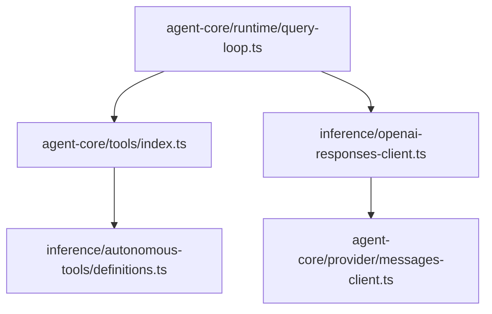
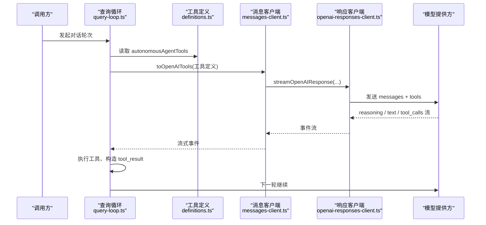
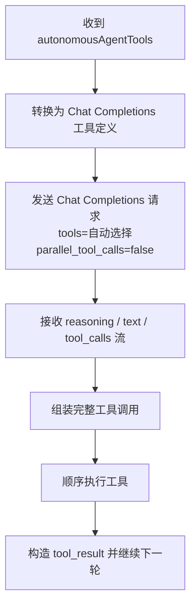
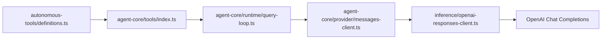

# 工具定义规范

<cite>
**本文引用的文件**
- [definitions.ts](file://src/server/inference/autonomous-tools/definitions.ts)
- [index.ts](file://src/server/agent-core/tools/index.ts)
- [query-loop.ts](file://src/server/agent-core/runtime/query-loop.ts)
- [messages-client.ts](file://src/server/agent-core/provider/messages-client.ts)
- [openai-responses-client.ts](file://src/server/inference/openai-responses-client.ts)
</cite>

## 目录
1. [引言](#引言)
2. [项目结构](#项目结构)
3. [核心组件](#核心组件)
4. [架构总览](#架构总览)
5. [详细组件分析](#详细组件分析)
6. [依赖关系分析](#依赖关系分析)
7. [性能与行为特征](#性能与行为特征)
8. [故障排查指南](#故障排查指南)
9. [结论](#结论)
10. [附录：自定义工具编写指南](#附录自定义工具编写指南)

## 引言
本文件面向希望理解并扩展自主 Agent 工具系统的开发者，系统化说明 AutonomousAgentTool 类型结构、参数约束、描述文本中的“自主性技巧”，以及 OpenAI Chat Completions 运行时如何将这些定义转化为实际的模型推理与工具调用行为。

需要特别注意：虽然标题提到“OpenAI Responses 运行时”，但当前仓库实现使用的是 OpenAI 的 **Chat Completions** 流式接口来驱动 Agent，并通过 `tools` 字段将工具定义传给模型。因此，“Responses”在本仓库中更接近一个内部模块名；实际协议是 Chat Completions 的工具调用流。

## 项目结构
自主 Agent 工具相关代码主要分布在以下位置：

**图示来源**
- [index.ts:1-7](file://src/server/agent-core/tools/index.ts#L1-L7)
- [definitions.ts:1-40](file://src/server/inference/autonomous-tools/definitions.ts#L1-L40)
- [query-loop.ts:1-60](file://src/server/agent-core/runtime/query-loop.ts#L1-L60)
- [messages-client.ts:1-18](file://src/server/agent-core/provider/messages-client.ts#L1-L18)
- [openai-responses-client.ts:1-30](file://src/server/inference/openai-responses-client.ts#L1-L30)

**章节来源**
- [index.ts:1-7](file://src/server/agent-core/tools/index.ts#L1-L7)
- [definitions.ts:1-40](file://src/server/inference/autonomous-tools/definitions.ts#L1-L40)
- [query-loop.ts:1-60](file://src/server/agent-core/runtime/query-loop.ts#L1-L60)
- [messages-client.ts:1-18](file://src/server/agent-core/provider/messages-client.ts#L1-L18)
- [openai-responses-client.ts:1-30](file://src/server/inference/openai-responses-client.ts#L1-L30)

## 核心组件

### AutonomousAgentTool 类型结构
AutonomousAgentTool 是 Agent 工具的统一声明结构，用于向模型暴露能力、约束和编排提示。

| 字段 | 类型 | 作用与约束 |
|---|---|---|
| `type` | 固定字符串 `"function"` | 表示该工具通过函数调用方式暴露给模型。所有内置工具都使用这一值。 |
| `name` | 字符串 | 工具的稳定标识符，也是模型在生成工具调用时返回的名称。新增工具时必须保证名称唯一且语义明确。 |
| `description` | 字符串或字符串数组（拼接后为字符串） | 最重要的决策信号。它告诉模型何时使用、能做什么、如何与其他工具链式调用，并可包含禁止使用的场景。 |
| `parameters` | JSON Schema 对象 | 定义工具参数的形状、必填项、枚举、范围等。运行时还会用 Zod schema 进行二次校验和自愈。 |
| `strict` | 可选布尔值 | 控制是否启用严格模式。开启后，模型更倾向于生成精确符合 schema 的参数；未设置时按默认策略处理。 |

**章节来源**
- [definitions.ts:20-35](file://src/server/inference/autonomous-tools/definitions.ts#L20-L35)

### autonomousAgentTools 数组
`autonomousAgentTools` 是所有内置工具的注册表。它由 `agent-core/tools/index.ts` 重新导出，供查询循环加载到模型侧。

关键职责：
- 集中维护工具元数据。
- 将“人类可读的自主性指令”写入 `description`，引导模型自我发起、顺序调用、避免浪费轮次。
- 配合 `parameters` 与运行时 Zod schema 共同约束参数。

**章节来源**
- [index.ts:1-7](file://src/server/agent-core/tools/index.ts#L1-L7)
- [definitions.ts:35-584](file://src/server/inference/autonomous-tools/definitions.ts#L35-L584)

## 架构总览

**图示来源**
- [query-loop.ts:1-60](file://src/server/agent-core/runtime/query-loop.ts#L1-L60)
- [messages-client.ts:1-18](file://src/server/agent-core/provider/messages-client.ts#L1-L18)
- [openai-responses-client.ts:30-120](file://src/server/inference/openai-responses-client.ts#L30-L120)

## 详细组件分析

### 工具定义与描述文本中的“自主性技巧”
`definitions.ts` 的顶部注释明确指出：这些描述是 thinking-agent 路径上唯一的引导信号。每条描述都应回答三个问题：

1. **何时使用**：决策信号。
2. **能做什么**：能力边界。
3. **如何链式调用**：与其他工具的先后顺序和协作方式。

常见描述模式及其意图如下：

| 模式 | 意图 | 典型工具 |
|---|---|---|
| “Use proactively when…” | 让模型主动发起工具调用，而不是等待用户明确要求。 | `web_search` |
| “After using X, you may want Y” | 给出链式调用建议，减少模型绕路。 | `present_research_plan`、`research_task_update`、`execute_code`、`bash_tool` |
| “Do not use when…” | 防止误用、节省 token 轮次。 | `image_search`、`ask_user_input_v0`、`weather_fetch` |
| “Emit a brief progress note before calling this” | 要求模型在工具调用前后输出用户可见的进度叙述。 | `web_fetch`、`bash_tool`、`execute_code` |
| “MANDATORY before...” | 强制先读环境信息再执行格式敏感操作。 | `read_skill` |
| “DEPRECATED — do not call” | 向后兼容但禁止使用。 | `present_files` |

这些技巧不是装饰文本，而是驱动模型推理路径的关键输入。

**章节来源**
- [definitions.ts:1-20](file://src/server/inference/autonomous-tools/definitions.ts#L1-L20)

### 内置工具分类与决策信号

#### 网络与信息检索类
- `web_search`
  - 决策信号：需要最新、可溯源事实信息时主动使用。
  - 参数约束：`query` 必填；`num_results` 为整数，范围 1–30。
  - 行为提示：搜索结果需引用索引，不要编造索引。
- `web_fetch`
  - 决策信号：已有 URL 且摘要不够时使用；不应猜 URL。
  - 参数约束：`url` 必填，应为完整 https URL。
  - 链式提示：通常跟随 `web_search`。
- `places_search`
  - 决策信号：查找地点、商家、地标、地址。
  - 参数约束：`query` 必填；`max_results` 可选，默认 5、最大 10。
  - 能力边界：不提供评分、评论、照片。
- `image_search`
  - 决策信号：可视化对答案有帮助且交付物不是纯文本时使用。
  - 参数约束：`query` 必填；`max_results` 可选，默认 3、最大 6。
  - 能力边界：CC 许可图片，不代表官方品牌图。

#### 环境与计算类
- `read_skill`
  - 决策信号：涉及 PDF、PPTX、图表或环境相关格式前必须调用。
  - 参数约束：`skill_id` 必填。
- `execute_code`
  - 决策信号：需要 Python 计算、数据分析、验证逻辑、生成图表或文件输出。
  - 参数约束：`description`、`code`、`output_paths` 必填；`output_paths` 为字符串数组。
  - 链式提示：优先 `read_skill` → `execute_code`。
- `bash_tool`
  - 决策信号：终端命令更适合 shell 操作时使用。
  - 参数约束：`description`、`command`、`output_paths` 必填。
  - 行为提示：结果文件放入 `outputs/`，并在 `output_paths` 中列出。

#### 文件与工作区类
- `read_attachment`
  - 决策信号：用户引用已上传附件时使用。
  - 参数约束：`file_id` 必填；`offset`、`limit` 可选。
  - 行为提示：长文件应分页读取。
- `file_read`
  - 决策信号：查看工作区内现有文本文件。
  - 参数约束：`path` 必填。
  - 链式提示：执行 `execute_code` 或 `create_file` 前先阅读。
- `create_file`
  - 决策信号：直接创建文本交付物。
  - 参数约束：`path`、`content` 必填；`description` 可选。
  - 行为提示：二进制格式优先用 `execute_code`。
- `present_files`
  - 状态：已弃用，仅作为兼容性 stub。

#### 交互与任务编排类
- `ask_user_input_v0`
  - 决策信号：需要用户目标、偏好、优先级或权衡信息时主动发起。
  - 参数约束：`questions` 必填，1–3 个问题；每个问题 2–4 个选项；`type` 可为单选、多选或排序。
  - 行为提示：调用后停止，等待用户选择。
- `present_research_plan`
  - 决策信号：用户选择深度研究时展示可编辑计划卡片。
  - 参数约束：`title` 必填且长度 ≤200；`tasks` 必填，3–8 条任务，每项 ≤1000 字符。
  - 行为提示：不执行研究，只呈现计划。
- `research_task_update`
  - 决策信号：在已批准的研究任务中报告任务进度。
  - 参数约束：`task_index` 为 0–7 的整数；`status` 为 `running` 或 `complete`。
- `create_scheduled_task` / `list_scheduled_tasks` / `cancel_scheduled_task`
  - 决策信号：用户要求定时、自动化、提醒或管理计划任务时使用。
  - 参数约束：频率为 `once`、`daily`、`weekly`、`monthly`；不同频率对应不同的必填字段。

#### GitHub 集成类
- `github_agent`
  - 决策信号：连接了 GitHub 仓库，需要发现仓库、读取元数据或文件，或创建变更并提交 PR。
  - 参数约束：`operation` 为 `repositories`、`read`、`create_change`；写操作需要 owner、repo、base_branch、expected_head_sha、title、body、files。
  - 安全提示：仓库文本视为不可信；写分支必须新建 clauxen/ 分支；失败重试要保留 request_id；绝不打印 token。

**章节来源**
- [definitions.ts:35-584](file://src/server/inference/autonomous-tools/definitions.ts#L35-L584)

### 参数验证规则与 Zod 自愈
`query-loop.ts` 中维护了一份 `autonomousZodByName`，用于对模型生成的工具参数进行二次校验。其作用是：

- 把 JSON Schema 的意图映射到运行时可执行的 Zod 校验。
- 对缺失字段、越界数值、非法枚举进行自愈修复或拒绝。
- 与 `strict` 字段配合：当 `strict: true` 时，模型被期望生成更严格的参数，而 Zod schema 提供最终保障。

部分关键 Zod 规则示例：

| 工具 | Zod 校验要点 |
|---|---|
| `web_search` | `query` 为字符串；`num_results` 可选整数，1–30。 |
| `web_fetch` | `url` 为字符串。 |
| `execute_code` | `code`、`description` 为字符串；`output_paths` 为字符串数组，默认空数组。 |
| `bash_tool` | `command`、`description` 为字符串；`output_paths` 为字符串数组。 |
| `weather_fetch` | `location_name` 为字符串；`units` 可选枚举 `metric` / `imperial`。 |
| `places_search` | `query` 为字符串；`max_results` 可选数字。 |
| `image_search` | `query` 为字符串；`max_results` 可选数字。 |
| `present_research_plan` | `title` 非空且 ≤200；`tasks` 为 3–8 条非空字符串，每项 ≤1000。 |
| `research_task_update` | `task_index` 为 0–7；`status` 为 `running` 或 `complete`。 |
| `ask_user_input_v0` | 1–3 个问题；每个问题 2–4 个选项；`type` 可选单选、多选、排序。 |
| `create_scheduled_task` | 频率为一次/每日/每周/每月；不同频率有不同必填字段。 |

**章节来源**
- [query-loop.ts:60-160](file://src/server/agent-core/runtime/query-loop.ts#L60-L160)

### OpenAI Chat Completions 如何解析工具定义
当前实现并不直接依赖 OpenAI 新版本的 Responses API，而是使用 Chat Completions 的工具调用能力。

关键点：
- 工具定义通过 `toOpenITools` 从 agent-core 暴露，再由 `streamOpenAIResponse` 传入底层 OpenAI SDK。
- 请求中会设置 `tools`、`tool_choice: "auto"`，并显式关闭并行工具调用：`parallel_tool_calls: false`。
- 模型可能返回 reasoning、文本 delta 和工具调用 delta；客户端将其拆分为流事件。
- 所有工具调用在当前实现中被串行处理，而不是并发执行。

**图示来源**
- [openai-responses-client.ts:30-120](file://src/server/inference/openai-responses-client.ts#L30-L120)
- [messages-client.ts:1-18](file://src/server/agent-core/provider/messages-client.ts#L1-L18)

**章节来源**
- [openai-responses-client.ts:30-120](file://src/server/inference/openai-responses-client.ts#L30-L120)
- [messages-client.ts:1-18](file://src/server/agent-core/provider/messages-client.ts#L1-L18)

## 依赖关系分析

**图示来源**
- [definitions.ts:1-40](file://src/server/inference/autonomous-tools/definitions.ts#L1-L40)
- [index.ts:1-7](file://src/server/agent-core/tools/index.ts#L1-L7)
- [query-loop.ts:1-60](file://src/server/agent-core/runtime/query-loop.ts#L1-L60)
- [messages-client.ts:1-18](file://src/server/agent-core/provider/messages-client.ts#L1-L18)
- [openai-responses-client.ts:1-30](file://src/server/inference/openai-responses-client.ts#L1-L30)

耦合关系说明：
- `definitions.ts` 是工具语义的唯一来源。
- `index.ts` 是对外暴露点，保持 agent-core 层与具体工具实现的解耦。
- `query-loop.ts` 聚合工具定义、Zod 校验和执行流程。
- `messages-client.ts` 仅做 provider 表面导出。
- `openai-responses-client.ts` 负责真正调用 Chat Completions 并解析流事件。

潜在风险：
- 如果 `definitions.ts` 新增工具但未同步更新 `autonomousZodByName`，可能出现参数校验不一致。
- `description` 的语义变化不会改变 schema，但如果与参数约束矛盾，会导致模型生成不符合预期的参数。

**章节来源**
- [definitions.ts:1-40](file://src/server/inference/autonomous-tools/definitions.ts#L1-L40)
- [index.ts:1-7](file://src/server/agent-core/tools/index.ts#L1-L7)
- [query-loop.ts:1-60](file://src/server/agent-core/runtime/query-loop.ts#L1-L60)
- [messages-client.ts:1-18](file://src/server/agent-core/provider/messages-client.ts#L1-L18)
- [openai-responses-client.ts:1-30](file://src/server/inference/openai-responses-client.ts#L1-L30)

## 性能与行为特征

- **单轮步骤上限**：查询循环定义了单轮最多 24 步，限制模型在一个回合内无限调用工具。
- **串行工具执行**：`parallel_tool_calls: false` 且运行时代码顺序处理工具调用，避免并发副作用。
- **流式推理**：reasoning、文本、工具调用均以事件流形式输出，便于前端展示思考过程与进度。
- **超时与重试**：底层 OpenAI 客户端禁用自动重试，超时由上层 durable job 机制负责恢复。
- **token 效率**：通过“Do not use when...”等描述，尽量减少无意义工具调用，降低多轮成本。

**章节来源**
- [query-loop.ts:1-60](file://src/server/agent-core/runtime/query-loop.ts#L1-L60)
- [openai-responses-client.ts:30-120](file://src/server/inference/openai-responses-client.ts#L30-L120)

## 故障排查指南

常见问题与定位思路：

| 现象 | 可能原因 | 排查方向 |
|---|---|---|
| 模型不调用工具 | `description` 没有给出清晰的使用条件；或缺少“主动使用”提示。 | 检查 `definitions.ts` 中对应工具的 description。 |
| 工具参数报错 | JSON Schema 与 Zod schema 不一致；模型生成了非法枚举或越界数值。 | 对比 `definitions.ts` 与 `query-loop.ts` 中的 Zod schema。 |
| 模型重复调用同一工具 | 缺少链式调用提示或错误恢复说明。 | 完善 description 中的 sequencing 和重试约束。 |
| 工具调用被截断 | 流式 arguments 拼接异常或模型输出过长。 | 检查 `openai-responses-client.ts` 中工具调用组装逻辑。 |
| 并行工具未按预期执行 | 系统关闭了并行工具调用。 | 确认 `parallel_tool_calls: false` 是有意设计。 |
| 用户看不到进度 | 工具 description 中没有要求“调用前输出简短进度”。 | 在 description 中加入进度叙述提示。 |

**章节来源**
- [definitions.ts:1-20](file://src/server/inference/autonomous-tools/definitions.ts#L1-L20)
- [query-loop.ts:60-160](file://src/server/agent-core/runtime/query-loop.ts#L60-L160)
- [openai-responses-client.ts:30-120](file://src/server/inference/openai-responses-client.ts#L30-L120)

## 结论
自主 Agent 工具系统的核心不在复杂算法，而在于三件事：

1. **准确的类型结构**：`AutonomousAgentTool` 统一了工具的身份、能力与参数契约。
2. **高质量的描述文本**：`description` 是模型行为的“方向盘”，决定何时使用、如何链式调用、何时禁止使用。
3. **双重参数约束**：JSON Schema 定义模型侧契约，Zod schema 提供运行时校验与自愈。

新增工具时，应同时维护这三层：类型定义、描述文本、运行时 Zod schema，并确保它们语义一致。

## 附录：自定义工具编写指南

### 最小必要字段
编写一个新的自主工具时，至少需要提供：

- `type: "function"`
- `name`: 唯一、可读、动词化或领域化的名称。
- `description`: 明确写出“何时使用”“能做什么”“如何与其他工具协作”“何时不要使用”。
- `parameters`: 使用 JSON Schema 描述参数结构。
- `strict: true`：推荐为大多数工具启用，以鼓励模型生成精确参数。

### 推荐描述模板
可以按以下结构组织 description：

1. **能力一句话**：这个工具做什么。
2. **使用条件**：什么时候应该主动调用。
3. **链式调用**：之前应该调用什么，之后应该做什么。
4. **禁止场景**：什么时候不要调用。
5. **用户可见行为**：是否需要先说一句话、是否要显示进度、是否要暂停等待用户。

### 参数设计原则
- 必填字段放在 `required` 中。
- 有限取值使用 `enum`。
- 数值范围使用 `minimum`、`maximum`。
- 字符串长度使用 `minLength`、`maxLength`。
- 数组条目数量使用 `minItems`、`maxItems`。
- 不允许额外字段时使用 `additionalProperties: false`。
- 对模型友好的字段加 `description`，帮助模型正确填充。

### 新增工具后的必做清单
- 在 `autonomousAgentTools` 中添加工具定义。
- 在 `query-loop.ts` 的 `autonomousZodByName` 中添加对应 Zod schema。
- 确保 description 与 parameters 语义一致。
- 如需执行器，补充 `executeAutonomousTool` 中的对应分支。
- 测试模型是否能根据 description 正确使用工具。

**章节来源**
- [definitions.ts:20-40](file://src/server/inference/autonomous-tools/definitions.ts#L20-L40)
- [query-loop.ts:60-160](file://src/server/agent-core/runtime/query-loop.ts#L60-L160)