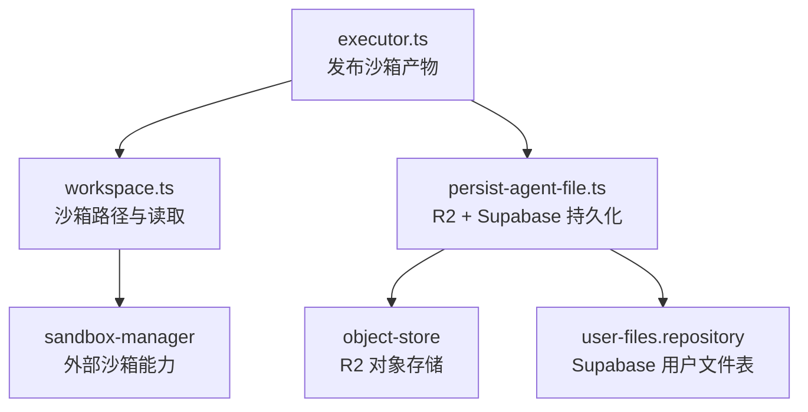
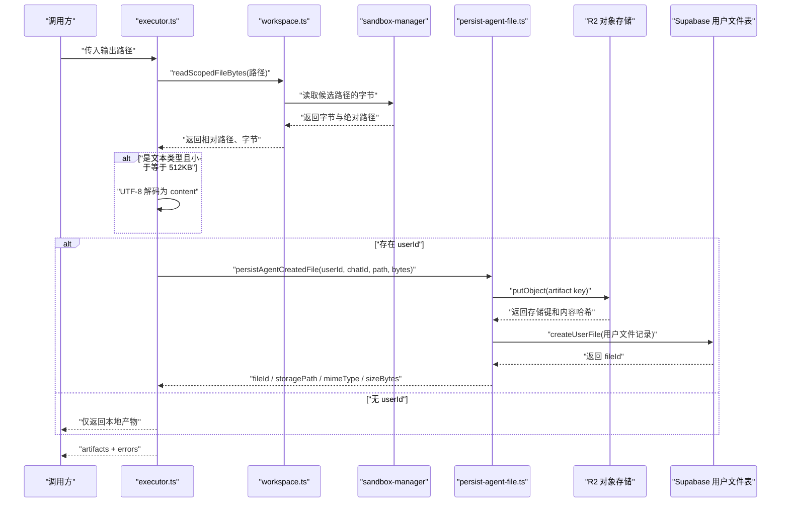
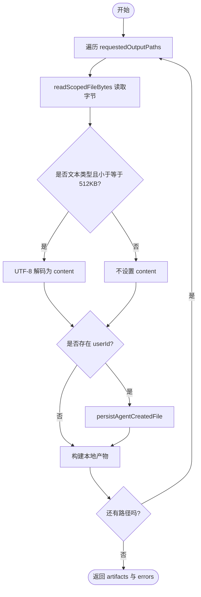
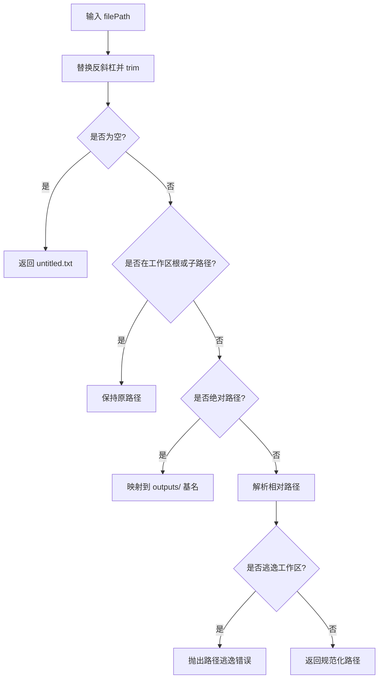
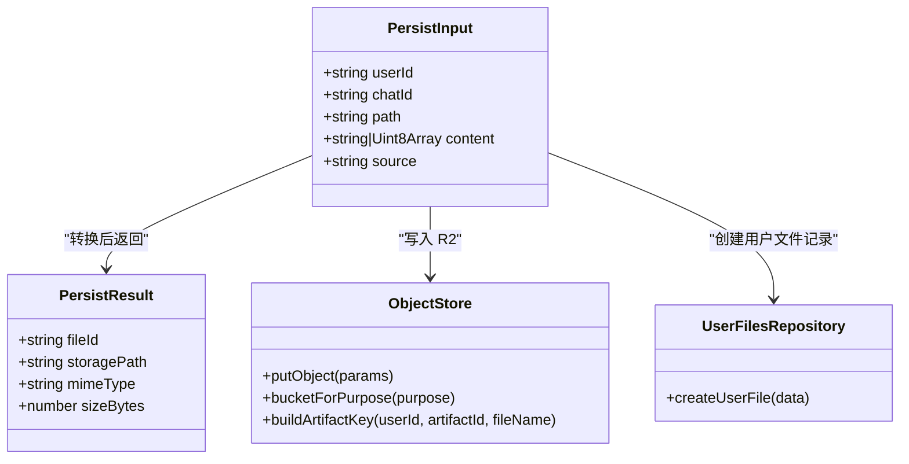
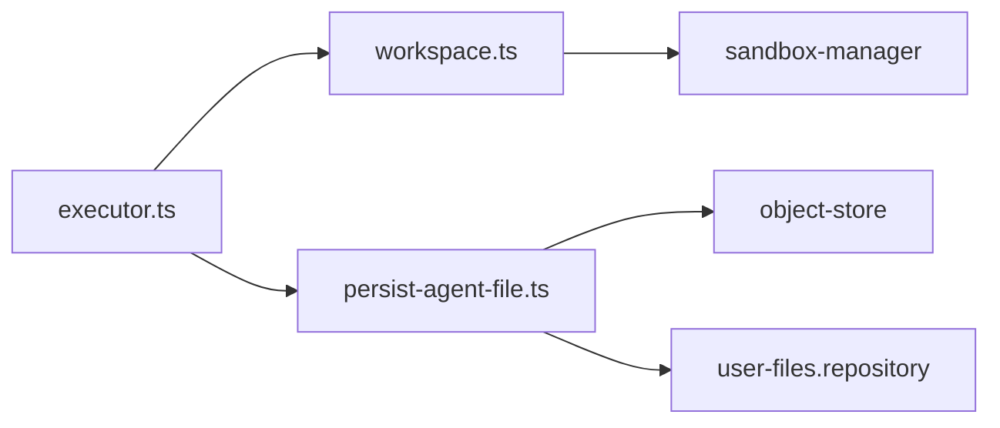

# 产物持久化系统

<cite>
**本文引用的文件**
- [executor.ts](file://src/server/inference/autonomous-tools/executor.ts)
- [workspace.ts](file://src/server/inference/autonomous-tools/workspace.ts)
- [persist-agent-file.ts](file://src/server/inference/autonomous-tools/persist-agent-file.ts)
</cite>

## 目录
1. [引言](#引言)
2. [项目结构](#项目结构)
3. [核心组件](#核心组件)
4. [架构总览](#架构总览)
5. [详细组件分析](#详细组件分析)
6. [依赖关系分析](#依赖关系分析)
7. [性能考虑](#性能考虑)
8. [故障排查指南](#故障排查指南)
9. [结论](#结论)

## 引言
本文件系统聚焦于“沙箱产物持久化”这一关键流程：当模型在沙箱中生成文件后，系统需要读取这些输出、判断是否为文本类型、对可展示的文本进行解码与页脚清理、将二进制或文本内容持久化到对象存储（R2）并在数据库（Supabase）中建立用户文件记录，最后向调用方返回标准化的产物元数据。该流程由三个核心模块协作完成：

- `executor.ts`：编排沙箱输出发布流程，解析请求路径、读取字节、构造产物结构并触发持久化。
- `workspace.ts`：提供沙箱工作区路径解析、安全校验、按候选路径读取字节的能力。
- `persist-agent-file.ts`：负责将代理生成的文件写入 R2 对象存储，并在 Supabase 中创建用户文件记录，返回可复用的文件标识和存储路径。

## 项目结构
本次文档只分析与产物持久化直接相关的源码文件：

**图表来源**
- [executor.ts:1-200](file://src/server/inference/autonomous-tools/executor.ts#L1-L200)
- [workspace.ts:1-190](file://src/server/inference/autonomous-tools/workspace.ts#L1-L190)
- [persist-agent-file.ts:1-102](file://src/server/inference/autonomous-tools/persist-agent-file.ts#L1-L102)

**章节来源**
- [executor.ts:1-200](file://src/server/inference/autonomous-tools/executor.ts#L1-L200)
- [workspace.ts:1-190](file://src/server/inference/autonomous-tools/workspace.ts#L1-L190)
- [persist-agent-file.ts:1-102](file://src/server/inference/autonomous-tools/persist-agent-file.ts#L1-L102)

## 核心组件
本节从业务语义出发，说明每个组件的职责与输入输出。

### `publishSandboxOutputs`：沙箱产物发布入口
- 接收上下文和执行结果中的输出路径数组。
- 遍历每条路径，调用 `readScopedFileBytes` 获取字节流。
- 若路径属于文本类型且大小不超过 512KB，则使用 UTF-8 解码为字符串，放入产物的 `content`。
- 如果当前工具执行包含 `userId`，则异步导入并调用 `persistAgentCreatedFile`，将字节写入 R2 并在 Supabase 创建用户文件记录。
- 最终产出标准化产物数组和错误列表。

关键点：
- 文本判定由 `isTextArtifactPath` 决定。
- 文本大小上限为 512KB，超出则不设置 `content`，但仍会尝试持久化二进制。
- 未登录时仍会构建产物，但不会调用持久化；产物 `id` 使用 `toolCallId` 与路径组合。

**章节来源**
- [executor.ts:60-160](file://src/server/inference/autonomous-tools/executor.ts#L60-L160)

### `requestedOutputPaths`：输出路径解析
- 支持 `output_paths` 数组。
- 也支持单个 `output_path` 字符串，自动包装为数组。
- 过滤非字符串值、去除空白、去重，并限制最多 12 条路径。

**章节来源**
- [executor.ts:90-110](file://src/server/inference/autonomous-tools/executor.ts#L90-L110)

### `readScopedFileBytes`：安全读取沙箱文件字节
- 先确保沙箱工作区存在。
- 根据原始路径生成多个候选路径，依次尝试读取。
- 成功返回相对工作区的路径、字节数组以及绝对路径。
- 所有候选失败时抛出错误。

**章节来源**
- [workspace.ts:120-170](file://src/server/inference/autonomous-tools/workspace.ts#L120-L170)

### `persistAgentCreatedFile`：R2 与 Supabase 持久化
- 校验 `userId` 和规范化后的路径。
- 根据文件名推断 MIME 类型。
- 调用对象存储接口写入 R2。
- 在 Supabase 中创建用户文件记录，状态标记为已上传。
- 返回 `fileId`、`storagePath`、`mimeType`、`sizeBytes`。

**章节来源**
- [persist-agent-file.ts:1-102](file://src/server/inference/autonomous-tools/persist-agent-file.ts#L1-L102)

## 架构总览
下图展示一次完整的沙箱产物发布过程，包括路径解析、字节读取、文本判断、持久化和产物组装。

**图表来源**
- [executor.ts:60-160](file://src/server/inference/autonomous-tools/executor.ts#L60-L160)
- [workspace.ts:120-170](file://src/server/inference/autonomous-tools/workspace.ts#L120-L170)
- [persist-agent-file.ts:30-102](file://src/server/inference/autonomous-tools/persist-agent-file.ts#L30-L102)

## 详细组件分析

### 产物发布主流程：`publishSandboxOutputs`
该函数是产物持久化的协调者。它并不直接关心沙箱实现细节，而是通过 `readScopedFileBytes` 拿到字节，再通过 `persistAgentCreatedFile` 决定是否落盘到 R2。

处理逻辑要点：
1. 初始化产物数组和错误数组。
2. 对每条输出路径：
   - 调用 `readScopedFileBytes` 读取字节。
   - 如果是文本类型且字节长度不超过 512KB，则解码为文本存入 `content`。
   - 如果有 `userId`，则调用持久化服务。
   - 组装产物对象：
     - `id`：优先使用持久化后的 `fileId`；否则使用 `${toolCallId}:${normalizedPath}`。
     - `path`：归一化后的工作区相对路径。
     - `content`：可选文本。
     - `fileId`、`storagePath`、`mimeType`、`sizeBytes`：来自持久化结果；未持久化时回退到字节长度。
3. 捕获读取异常，记录错误并继续处理其他路径。

**图表来源**
- [executor.ts:60-160](file://src/server/inference/autonomous-tools/executor.ts#L60-L160)

**章节来源**
- [executor.ts:60-160](file://src/server/inference/autonomous-tools/executor.ts#L60-L160)

### 文本判定与页脚剥离
#### `isTextArtifactPath`
该函数基于扩展名判断是否为文本类型，支持的扩展名包括常见代码、配置、数据与网页格式，例如 `.txt`、`.md`、`.json`、`.csv`、`.html`、`.css`、`.js`、`.ts`、`.py`、`.svg` 等。

设计意图：
- 避免将图片、压缩包等二进制误判为文本。
- 为后续 UTF-8 解码提供安全边界。

**章节来源**
- [executor.ts:50-70](file://src/server/inference/autonomous-tools/executor.ts#L50-L70)

#### 文本页脚剥离
对于以 Markdown 风格分隔线结尾、并且最后一行符合“由 clauxen 生成”类提示的文本，系统会移除末尾生成页脚和分隔线，使产物更干净。

剥离规则：
1. 去掉每行前导分隔符字符后判断是否匹配“由 clauxen 生成”模式。
2. 如果匹配，删除最后一行。
3. 再检查倒数第二行是否为纯分隔线，若是则一并删除。
4. 最后裁剪尾部空白。

注意：
- 当前实现位于 `executor.ts`，但在 `publishSandboxOutputs` 的主循环中并没有直接调用该剥离函数；因此严格来说，产物持久化主流程尚未使用该剥离逻辑。文档如实记录此现状，便于后续维护者决定是否引入。

**章节来源**
- [executor.ts:10-40](file://src/server/inference/autonomous-tools/executor.ts#L10-L40)

### 输出路径解析：`requestedOutputPaths`
该函数负责把模型可能提供的不同参数形式统一为标准路径数组。

行为说明：
- 优先读取 `output_paths` 数组。
- 如果没有数组但有字符串类型的 `output_path`，则将其包装成单元素数组。
- 过滤掉不是字符串的值。
- 对每个字符串执行 `trim()`。
- 过滤空字符串。
- 使用集合去重。
- 截取前 12 条路径。

复杂度：
- 时间复杂度近似 O(n)，其中 n 为原始路径数量。
- 空间复杂度近似 O(n)，用于存储去重后的路径集合。

**章节来源**
- [executor.ts:90-110](file://src/server/inference/autonomous-tools/executor.ts#L90-L110)

### 沙箱路径解析与读取：`workspace.ts`
#### 工作区根目录
- 每个对话有独立的工作区根目录。
- 对话 ID 会被清理为仅含字母、数字、下划线和连字符的安全值。
- 超长对话 ID 会使用 SHA-256 前缀，避免截断碰撞。

#### 路径规范化
- 将反斜杠替换为正斜杠。
- 绝对路径且不在工作区内时，映射到 `outputs/` 子目录下的同名文件。
- 相对路径通过 `path.posix.resolve` 解析。
- 若解析后逃逸工作区，则抛出错误，防止越权访问。

#### 读取候选路径
- 为了兼容模型直接写 `/tmp/...` 等绝对路径的情况，读取时会尝试原始绝对路径与工作区映射路径。
- 任一候选成功即返回。
- 全部失败则抛出错误。

#### `readScopedFileBytes` 返回值
- `path`：相对于工作区的显示路径。
- `bytes`：原始字节数组。
- `absolutePath`：实际读取到的绝对路径。

**图表来源**
- [workspace.ts:20-80](file://src/server/inference/autonomous-tools/workspace.ts#L20-L80)

**章节来源**
- [workspace.ts:1-190](file://src/server/inference/autonomous-tools/workspace.ts#L1-L190)

### 文件持久化：`persistAgentCreatedFile`
#### 输入
- `userId`：用户标识，必填。
- `chatId`：会话标识，用于元数据。
- `path`：规范化后的工作区路径。
- `content`：字符串或字节数组。
- `source`：可选来源标记，默认 `create_file`，沙箱场景传 `sandbox`。

#### 主要步骤
1. 清理 `userId` 和路径。
2. 提取文件名。
3. 生成 UUID 作为 artifact id。
4. 通过 `buildArtifactKey` 构建 R2 存储键。
5. 将字符串转为 Buffer，或直接使用字节数组。
6. 根据路径后缀推断 MIME 类型。
7. 调用 `putObject` 写入 R2。
8. 调用 `createUserFile` 在 Supabase 创建用户文件记录。
9. 返回 `fileId`、`storagePath`、`mimeType`、`sizeBytes`。

#### MIME 类型映射
支持 PDF、Office 文档、图片、压缩包、Markdown、JSON、HTML、CSS、JS、TS、Python、CSV、SVG 等常见类型。未知类型回退为 `application/octet-stream`。

**图表来源**
- [persist-agent-file.ts:1-102](file://src/server/inference/autonomous-tools/persist-agent-file.ts#L1-L102)

**章节来源**
- [persist-agent-file.ts:1-102](file://src/server/inference/autonomous-tools/persist-agent-file.ts#L1-L102)

### Artifact 数据结构
产物对象的结构如下：

| 字段 | 类型 | 含义 | 生成规则 |
|---|---|---|---|
| `id` | string | 产物唯一标识 | 持久化成功时使用 `fileId`；否则使用 `${toolCallId}:${normalizedPath}` |
| `path` | string | 相对于工作区的产物路径 | 由 `toWorkspaceRelativePath` 计算 |
| `content` | string \| undefined | 文本内容 | 仅当是文本类型且字节数不超过 512KB 时解码填充 |
| `fileId` | string \| undefined | Supabase 用户文件记录 ID | 持久化成功后返回 |
| `storagePath` | string \| undefined | R2 对象存储键 | 持久化成功后返回 |
| `mimeType` | string \| undefined | 媒体类型 | 由文件名推断，持久化成功后返回 |
| `sizeBytes` | number | 字节大小 | 持久化成功时使用 `sizeBytes`；否则使用原始字节长度 |

注意事项：
- `content` 与 `fileId` 不一定同时存在：二进制大文件或未登录场景可能只有 `sizeBytes`。
- `id` 在未持久化时可能重复，因为它是基于 `toolCallId` 和路径的组合；持久化后由数据库 UUID 保证唯一性。

**章节来源**
- [executor.ts:60-160](file://src/server/inference/autonomous-tools/executor.ts#L60-L160)
- [persist-agent-file.ts:30-102](file://src/server/inference/autonomous-tools/persist-agent-file.ts#L30-L102)

## 依赖关系分析

- `executor.ts` 依赖 `workspace.ts` 读取沙箱文件，并可选择依赖 `persist-agent-file.ts` 做持久化。
- `workspace.ts` 依赖沙箱管理器抽象，屏蔽底层沙箱实现差异。
- `persist-agent-file.ts` 依赖对象存储层和用户文件仓库，向上暴露统一的持久化结果。

潜在耦合点：
- 如果 `persistAgentCreatedFile` 返回 null，产物仍会保留，但缺少 `fileId`、`storagePath`、`mimeType`，`sizeBytes` 回退到原始字节长度。
- 如果 `userId` 为空，则跳过持久化，产物只能作为临时结果返回。

**图表来源**
- [executor.ts:1-200](file://src/server/inference/autonomous-tools/executor.ts#L1-L200)
- [workspace.ts:1-190](file://src/server/inference/autonomous-tools/workspace.ts#L1-L190)
- [persist-agent-file.ts:1-102](file://src/server/inference/autonomous-tools/persist-agent-file.ts#L1-L102)

**章节来源**
- [executor.ts:1-200](file://src/server/inference/autonomous-tools/executor.ts#L1-L200)
- [workspace.ts:1-190](file://src/server/inference/autonomous-tools/workspace.ts#L1-L190)
- [persist-agent-file.ts:1-102](file://src/server/inference/autonomous-tools/persist-agent-file.ts#L1-L102)

## 性能考虑
- 路径解析和候选路径读取采用线性扫描，整体复杂度与输出路径数量和候选路径数量成正比。
- 文本解码仅在满足条件时执行，避免对大二进制文件做不必要的 UTF-8 解码。
- 持久化操作是 I/O 密集型的，可能涉及网络请求；当前实现中 `persistAgentCreatedFile` 被异步调用，但 `publishSandboxOutputs` 并未等待其完成就返回产物，这有利于降低主流程延迟，但需要注意错误传播有限。
- 最大路径数量为 12，有助于限制单次产物发布的开销。

建议：
- 如需强一致性，可在必要时等待持久化完成，但会增加延迟。
- 对超大文件应明确拒绝或分块处理，避免内存压力。
- 可考虑对常见 MIME 类型使用缓存映射，减少重复判断。

[本节为通用性能讨论，不直接分析具体代码行]

## 故障排查指南

### 常见问题
1. **输出路径不存在**
   - 现象：`errors` 中出现对应路径的错误信息。
   - 原因：沙箱中没有该文件，或路径无法映射到有效位置。
   - 处理：检查模型是否在沙箱中正确写入文件，确认路径是否使用了工作区规范路径。

2. **未生成 `fileId` 或 `storagePath`**
   - 现象：产物中只有 `path`、`sizeBytes`，没有持久化字段。
   - 原因：工具执行上下文没有 `userId`，或持久化服务返回 null。
   - 处理：确认用户是否登录，并检查持久化链路。

3. **文本内容缺失**
   - 现象：产物中有字节但 `content` 为空。
   - 原因：文件不是文本类型，或字节数超过 512KB。
   - 处理：检查扩展名和文件大小；如需客户端下载，可使用 `fileId` 或 `storagePath`。

4. **MIME 类型不正确**
   - 现象：客户端下载或预览类型错误。
   - 原因：文件名后缀不在已知映射表中。
   - 处理：补充扩展名映射，或使用正确的文件扩展名。

### 错误处理与降级策略
- 读取失败：记录错误并继续处理其他路径，不中断整个批次。
- 未登录：跳过持久化，仍返回临时产物。
- 持久化失败：当前实现中 `persistAgentCreatedFile` 的异常未被显式捕获，可能向上抛出；但 `publishSandboxOutputs` 的 try/catch 针对的是 `readScopedFileBytes` 和后续逻辑。若持久化抛出异常，可能导致整条路径处理失败，需结合上层调用链观察。
- 降级：未持久化时，`sizeBytes` 回退为原始字节长度，保证产物仍可描述文件大小。

**章节来源**
- [executor.ts:60-160](file://src/server/inference/autonomous-tools/executor.ts#L60-L160)
- [persist-agent-file.ts:30-102](file://src/server/inference/autonomous-tools/persist-agent-file.ts#L30-L102)

## 结论
产物持久化系统围绕“安全读取沙箱文件、识别文本类型、限制文本体积、可选持久化到 R2 与 Supabase、返回标准产物结构”这一主线展开。`executor.ts` 负责编排，`workspace.ts` 负责路径安全与读取，`persist-agent-file.ts` 负责跨存储系统的持久化契约。

当前实现的优点是职责清晰、路径安全、支持多种文件类型，并对未登录场景做了降级处理。需要注意的点包括：
- 文本页脚剥离逻辑已存在但未在主流程中启用。
- 未持久化时的产物 `id` 可能不具备全局唯一性。
- 持久化失败的错误传播需要根据上层调用链进一步评估。

对于后续优化，建议：
- 在 `publishSandboxOutputs` 中决定是否应用文本页脚剥离。
- 对持久化失败增加明确的可观测日志和降级策略。
- 对超大文件和未知 MIME 类型提供更明确的诊断信息。

[本节为总结性内容，不直接分析具体代码行]