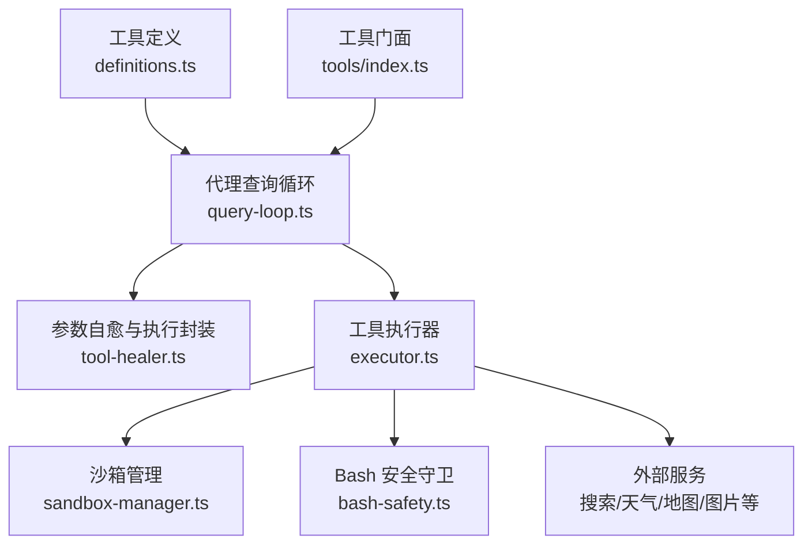
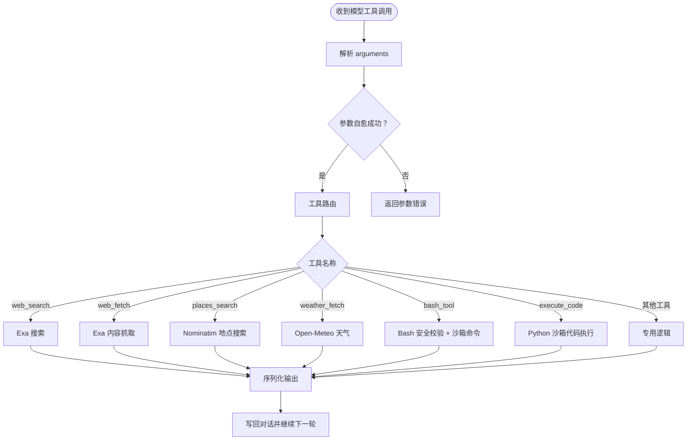
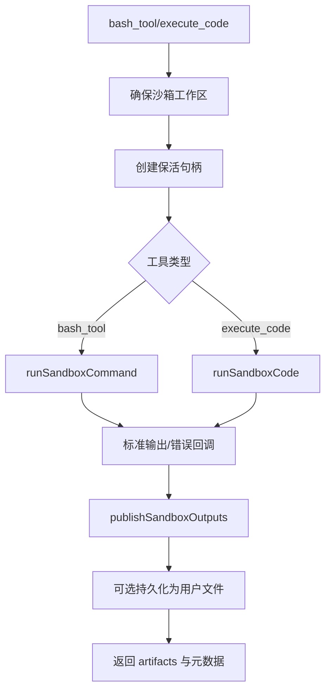
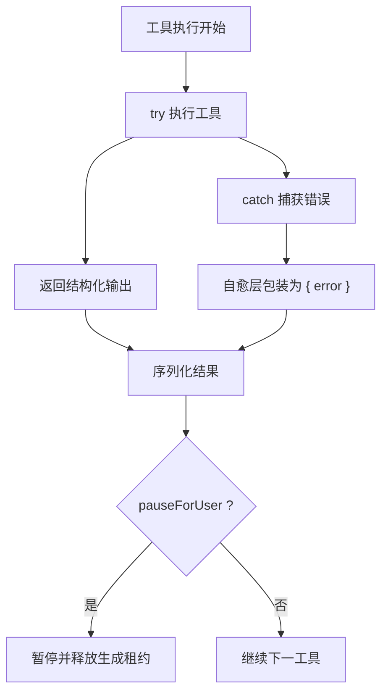
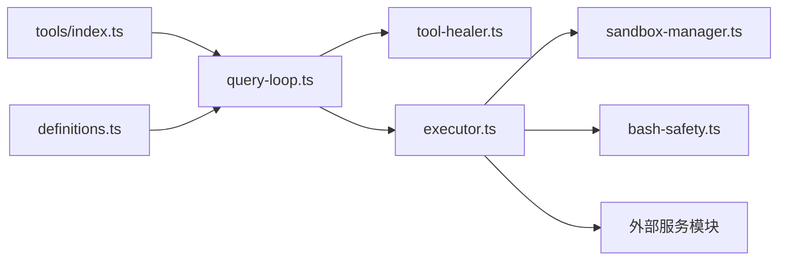

# 工具执行器

<cite>
**本文引用的文件**   
- [executor.ts](file://src/server/inference/autonomous-tools/executor.ts)
- [definitions.ts](file://src/server/inference/autonomous-tools/definitions.ts)
- [query-loop.ts](file://src/server/agent-core/runtime/query-loop.ts)
- [tool-healer.ts](file://src/server/inference/tool-healer.ts)
- [index.ts](file://src/server/agent-core/tools/index.ts)
- [sandbox-manager.ts](file://src/server/sandbox/sandbox-manager.ts)
- [bash-safety.ts](file://src/server/inference/bash-safety.ts)
</cite>

## 目录
1. [引言](#引言)
2. [项目结构](#项目结构)
3. [核心组件](#核心组件)
4. [架构总览](#架构总览)
5. [详细组件分析](#详细组件分析)
6. [依赖关系分析](#依赖关系分析)
7. [性能与资源限制](#性能与资源限制)
8. [故障排查指南](#故障排查指南)
9. [结论](#结论)

## 引言
本文聚焦于 Clauxen 自主代理的工具执行子系统，重点说明 `executeAutonomousTool` 的核心逻辑、工具生命周期、上下文对象 `ToolExecutionContext`、返回结果 `ToolExecutionOutcome`，以及参数校验、权限检查、沙箱隔离、网络访问控制、错误处理和超时机制。读者可据此理解从模型输出工具调用到具体实现函数调用的完整链路，并掌握如何扩展新工具。

## 项目结构
工具执行器位于服务端推理层与代理运行时之间：
- 工具定义：`src/server/inference/autonomous-tools/definitions.ts`
- 工具执行器：`src/server/inference/autonomous-tools/executor.ts`
- 代理查询循环（编排）：`src/server/agent-core/runtime/query-loop.ts`
- 参数自愈与通用工具执行封装：`src/server/inference/tool-healer.ts`
- 工具对外导出门面：`src/server/agent-core/tools/index.ts`
- 沙箱运行时：`src/server/sandbox/sandbox-manager.ts`
- Bash 安全守卫：`src/server/inference/bash-safety.ts`



**图示来源**
- [query-loop.ts:200-420](file://src/server/agent-core/runtime/query-loop.ts#L200-L420)
- [tool-healer.ts:1-120](file://src/server/inference/tool-healer.ts#L1-L120)
- [executor.ts:1-120](file://src/server/inference/autonomous-tools/executor.ts#L1-L120)
- [sandbox-manager.ts:230-420](file://src/server/sandbox/sandbox-manager.ts#L230-L420)
- [bash-safety.ts:1-27](file://src/server/inference/bash-safety.ts#L1-L27)
- [definitions.ts:1-120](file://src/server/inference/autonomous-tools/definitions.ts#L1-L120)
- [index.ts:1-7](file://src/server/agent-core/tools/index.ts#L1-L7)

**章节来源**
- [definitions.ts:1-120](file://src/server/inference/autonomous-tools/definitions.ts#L1-L120)
- [executor.ts:1-120](file://src/server/inference/autonomous-tools/executor.ts#L1-L120)
- [query-loop.ts:200-420](file://src/server/agent-core/runtime/query-loop.ts#L200-L420)
- [tool-healer.ts:1-120](file://src/server/inference/tool-healer.ts#L1-L120)
- [index.ts:1-7](file://src/server/agent-core/tools/index.ts#L1-L7)
- [sandbox-manager.ts:230-420](file://src/server/sandbox/sandbox-manager.ts#L230-L420)
- [bash-safety.ts:1-27](file://src/server/inference/bash-safety.ts#L1-L27)

## 核心组件
- 工具定义数组：声明每个工具的用途、参数结构与严格模式开关，供模型选择何时使用。
- 工具执行器：按工具名路由到具体实现，完成参数处理、权限检查、外部调用、沙箱执行与结果序列化。
- 代理查询循环：将模型输出的工具调用序列化为待执行任务，依次执行并把结果写回对话上下文。
- 参数自愈层：对模型可能产生的类型不匹配、字符串化数字、部分 JSON 进行确定性修复，避免额外往返。
- 沙箱管理器：提供命令执行、Python 代码执行、文件读写、连接复用与保活能力。
- Bash 安全守卫：拒绝危险命令模式并限制长度。

**章节来源**
- [definitions.ts:1-200](file://src/server/inference/autonomous-tools/definitions.ts#L1-L200)
- [executor.ts:1-200](file://src/server/inference/autonomous-tools/executor.ts#L1-L200)
- [query-loop.ts:200-420](file://src/server/agent-core/runtime/query-loop.ts#L200-L420)
- [tool-healer.ts:1-213](file://src/server/inference/tool-healer.ts#L1-L213)
- [sandbox-manager.ts:230-420](file://src/server/sandbox/sandbox-manager.ts#L230-L420)
- [bash-safety.ts:1-27](file://src/server/inference/bash-safety.ts#L1-L27)

## 架构总览
下图展示“模型工具调用 → 查询循环 → 自愈校验 → 工具路由 → 具体实现”的端到端流程。

```mermaid
sequenceDiagram
    participant Model as "语言模型"
    participant Loop as "查询循环<br/>query-loop.ts"
    participant Healer as "自愈层<br/>tool-healer.ts"
    participant Exec as "执行器<br/>executor.ts"
    participant Sandbox as "沙箱<br/>sandbox-manager.ts"
    participant API as "外部服务"

    Model->>Loop: 输出 tool_calls
    Loop->>Loop: 解析 arguments、构建上下文
    Loop->>Healer: healToolArgs()
    alt 内置自愈工具
      Healer->>Exec: executeToolSafely()
    else 其他工具
      Loop->>Exec: executeAutonomousTool(name, args, ctx)
    end
    Exec->>Exec: 路由 web_search/weather_fetch/places_search/...
    Exec->>API: 调用搜索/天气/地图等服务
    Exec->>Sandbox: 执行 bash_tool/execute_code
    Sandbox-->>Exec: 标准输出/错误/退出码
    Exec-->>Loop: ToolExecutionOutcome
    Loop-->>Model: 工具结果进入下一轮
```

**图示来源**
- [query-loop.ts:660-1116](file://src/server/agent-core/runtime/query-loop.ts#L660-L1116)
- [tool-healer.ts:120-213](file://src/server/inference/tool-healer.ts#L120-L213)
- [executor.ts:200-722](file://src/server/inference/autonomous-tools/executor.ts#L200-L722)
- [sandbox-manager.ts:230-420](file://src/server/sandbox/sandbox-manager.ts#L230-L420)

## 详细组件分析

### 工具执行生命周期
1. **模型输出工具调用**：模型在响应中携带一个或多个工具调用，包括工具名和参数字符串。
2. **查询循环收集工具调用**：循环累积 `pendingToolCalls`，并将本轮文本作为叙述写入对话。
3. **参数解析与自愈**：对原始参数做 JSON 解析；若失败，则尝试部分 JSON 提取、启发式修复与类型强制转换。
4. **工具路由**：
   - 若为内置自愈工具，通过 `executeToolSafely` 走自愈路径。
   - 否则直接调用 `executeAutonomousTool`。
5. **执行具体工具**：根据工具名分支到各自实现。
6. **结果序列化与流式推送**：将输出转为字符串或结构化对象，必要时推送到 SSE 流，并记录是否暂停等待用户。
7. **写回工具结果**：把工具结果追加到对话上下文中，驱动下一轮模型推理。



**图示来源**
- [query-loop.ts:660-1116](file://src/server/agent-core/runtime/query-loop.ts#L660-L1116)
- [executor.ts:200-722](file://src/server/inference/autonomous-tools/executor.ts#L200-L722)

**章节来源**
- [query-loop.ts:660-1116](file://src/server/agent-core/runtime/query-loop.ts#L660-L1116)
- [tool-healer.ts:120-213](file://src/server/inference/tool-healer.ts#L120-L213)
- [executor.ts:200-722](file://src/server/inference/autonomous-tools/executor.ts#L200-L722)

### 工具路由与参数验证
- 工具定义来自 `autonomousAgentTools`，包含名称、描述与参数 Schema。
- 查询循环为内置工具建立 Zod Schema 映射，并在自愈层使用 `healToolArgs` 进行三次尝试：
  1. 直接使用 Schema 校验。
  2. 应用启发式修复（字符串转数字/布尔值、单元素数组解包、包裹对象解包）。
  3. 按 Schema 字段形状强制转换类型。
- 自愈失败时返回统一错误消息，不会触发工具副作用。

**章节来源**
- [definitions.ts:1-200](file://src/server/inference/autonomous-tools/definitions.ts#L1-L200)
- [query-loop.ts:200-420](file://src/server/agent-core/runtime/query-loop.ts#L200-L420)
- [tool-healer.ts:1-213](file://src/server/inference/tool-healer.ts#L1-L213)

### 权限检查与上下文控制
- 需要登录的工具会检查 `ctx.userId`：
  - `github_agent`：未登录时返回提示错误。
  - `read_attachment`：未登录时返回未登录错误。
  - 定时任务相关工具：创建、列出、取消任务均需已登录。
- 研究计划相关工具受 `researchPlanId` 控制：
  - `present_research_plan`：已有计划时拒绝重复呈现。
  - `research_task_update`：没有活跃研究计划时拒绝更新。
- 上下文还传递 `conversationId`、`modelId`、`chatModelId`、`userCountryCode`、`toolCallId` 等标识信息，用于审计、归属、定位与本地化。

**章节来源**
- [executor.ts:120-200](file://src/server/inference/autonomous-tools/executor.ts#L120-L200)
- [executor.ts:500-722](file://src/server/inference/autonomous-tools/executor.ts#L500-L722)
- [query-loop.ts:200-420](file://src/server/agent-core/runtime/query-loop.ts#L200-L420)

### 沙箱执行与文件系统访问
- `bash_tool`：先经 `assertSafeBashCommand` 白名单/黑名单检查，再进入沙箱执行命令。
- `execute_code`：在沙箱中维护 Python 执行上下文，支持多次调用共享导入状态。
- 工作空间：通过 `ensureSandboxWorkspace` 获取会话级沙箱根目录，所有文件操作限定在该作用域内。
- 输出发布：工具可通过 `output_paths` 声明期望输出文件，执行器读取后尝试持久化为用户可访问的文件，并返回 artifact 元数据。
- 沙箱保活：通过 `createSandboxKeepAlive` 周期性延长超时，上限由 `MAX_SANDBOX_TIMEOUT_MS` 限制。



**图示来源**
- [executor.ts:300-500](file://src/server/inference/autonomous-tools/executor.ts#L300-L500)
- [sandbox-manager.ts:230-420](file://src/server/sandbox/sandbox-manager.ts#L230-L420)
- [bash-safety.ts:1-27](file://src/server/inference/bash-safety.ts#L1-L27)

**章节来源**
- [executor.ts:300-500](file://src/server/inference/autonomous-tools/executor.ts#L300-L500)
- [sandbox-manager.ts:230-420](file://src/server/sandbox/sandbox-manager.ts#L230-L420)
- [bash-safety.ts:1-27](file://src/server/inference/bash-safety.ts#L1-L27)

### 网络请求安全
- `web_search`：通过 Exa 接口进行搜索，支持流式内容与部分结果回调；研究模式下记录来源 URL。
- `web_fetch`：仅允许通过 Exa 抓取 URL 内容，明确禁止回退到任意 HTTP 客户端，以避免 SSRF 风险。
- `places_search`：调用 Nominatim 开放地理搜索。
- `image_search`：调用 Openverse 开源图片搜索。
- `weather_fetch`：调用 Open-Meteo 天气 API，先地名编码再拉取预报。

**章节来源**
- [executor.ts:200-360](file://src/server/inference/autonomous-tools/executor.ts#L200-L360)
- [definitions.ts:120-200](file://src/server/inference/autonomous-tools/definitions.ts#L120-L200)

### 工具执行错误处理策略
- 自愈层捕获工具执行异常，返回带 `error` 字段的输出，不中断整体流程。
- 工具内部对常见失败进行 try/catch 并返回语义化错误对象。
- 查询循环对模型提供方错误进行分类：
  - 研究模式下对可重试错误最多重试两次。
  - 硬切片超时（slice deadline）标记为 `yielded`，以便后续分片恢复。
  - 用户主动中止标记为 `aborted`。
- 工具结果会被序列化为字符串或结构化对象；若为图像文件，还会注入视觉附件块供下一轮模型理解。



**图示来源**
- [tool-healer.ts:120-213](file://src/server/inference/tool-healer.ts#L120-L213)
- [query-loop.ts:660-1116](file://src/server/agent-core/runtime/query-loop.ts#L660-L1116)
- [executor.ts:200-722](file://src/server/inference/autonomous-tools/executor.ts#L200-L722)

**章节来源**
- [tool-healer.ts:120-213](file://src/server/inference/tool-healer.ts#L120-L213)
- [query-loop.ts:660-1116](file://src/server/agent-core/runtime/query-loop.ts#L660-L1116)

### ToolExecutionContext 上下文对象
该上下文贯穿工具执行全过程，用于身份、会话、模型归属与进度反馈：
- `researchPlanId`：标识当前深度研究任务，用于限制研究相关工具与记录来源。
- `chatModelId`：记录用于生成本次对话配置的模型 ID。
- `conversationId`：关联聊天会话，用于文件持久化、沙箱工作区与审计。
- `userId`：判断是否需要登录及用户范围的数据访问。
- `userCountryCode`：传给搜索服务以改善本地化结果。
- `toolCallId`：唯一标识一次工具调用，用于进度事件与产物 ID。
- `modelId`：标注本次工具调用由哪个模型产生，便于追踪归因。
- `onToolProgress`：流式进度回调，用于向 UI 推送搜索进展、stdout/stderr 片段等。

**章节来源**
- [executor.ts:40-120](file://src/server/inference/autonomous-tools/executor.ts#L40-L120)
- [query-loop.ts:200-420](file://src/server/agent-core/runtime/query-loop.ts#L200-L420)
- [tool-healer.ts:1-60](file://src/server/inference/tool-healer.ts#L1-L60)

### ToolExecutionOutcome 返回结构
- `output`：工具返回的业务数据或错误对象。查询循环会将其序列化并写入对话。
- `pauseForUser`：当为真时，查询循环会在本轮结束后暂停，释放生成租约，等待用户交互。
- `clarificationQuestion`：用于澄清问题的字段（当前主要实现通过 `pauseForUser` 表达交互意图）。

典型用例：
- `ask_user_input_v0`：返回 `pauseForUser: true`，表示交互式问卷等待用户回答。
- 普通工具：返回 `output` 数据，继续自动执行下一个工具。

**章节来源**
- [executor.ts:600-722](file://src/server/inference/autonomous-tools/executor.ts#L600-L722)
- [query-loop.ts:660-1116](file://src/server/agent-core/runtime/query-loop.ts#L660-L1116)

### 具体工具执行流程示例

#### web_search 执行流程
1. 查询循环收到 `web_search` 调用，构造 `ToolExecutionContext`。
2. 执行器计算搜索限制，优先使用研究配额。
3. 立即发送“正在搜索”进度事件，随后流式推送部分内容与部分结果。
4. 若处于研究模式，记录来源 URL。
5. 返回标准化搜索结果，包含标题、URL、摘要、发布日期与高亮片段。

```mermaid
sequenceDiagram
  participant Loop as "查询循环"
  participant Exec as "执行器"
  participant Exa as "Exa 搜索"
  participant Repo as "研究仓库"

  Loop->>Exec: web_search(query, num_results)
  Exec->>Exec: 计算 searchLimit
  Exec->>Loop: onToolProgress(searching)
  Exec->>Exa: searchWebWithExa()
  Exa-->>Exec: 流式内容与部分结果
  Exec->>Loop: onToolProgress(streaming/results)
  alt researchPlanId 存在
    Exec->>Repo: addResearchSources(urls)
  end
  Exec-->>Loop: { query, results[], searchType }
```

**图示来源**
- [executor.ts:200-300](file://src/server/inference/autonomous-tools/executor.ts#L200-L300)
- [query-loop.ts:660-1116](file://src/server/agent-core/runtime/query-loop.ts#L660-L1116)

**章节来源**
- [executor.ts:200-300](file://src/server/inference/autonomous-tools/executor.ts#L200-L300)

#### weather_fetch 执行流程
1. 校验位置名称是否为空。
2. 将单位参数规范化为 metric 或 imperial。
3. 地名编码，找不到时返回错误。
4. 调用天气接口获取当前状况与预报。
5. 返回结构化天气数据。

**章节来源**
- [executor.ts:360-420](file://src/server/inference/autonomous-tools/executor.ts#L360-L420)

#### places_search 执行流程
1. 校验查询字符串。
2. 解析最大结果数。
3. 调用 Nominatim 地点搜索。
4. 返回地点列表，包含名称、地址与坐标。

**章节来源**
- [executor.ts:320-360](file://src/server/inference/autonomous-tools/executor.ts#L320-L360)

## 依赖关系分析
- 工具门面导出 `autonomousAgentTools` 与 `executeAutonomousTool`，供代理查询循环统一使用。
- 查询循环依赖：
  - 自愈层进行参数修复与通用执行封装。
  - 插件 MCP 工具用于第三方连接器。
  - 研究证据预算与结果清洗逻辑。
- 执行器依赖：
  - 沙箱管理器提供命令与代码执行。
  - Bash 安全守卫防止危险命令。
  - 外部服务模块负责搜索、天气、地图、图片与技能目录。
  - 工作区与作用域文件读写保证文件系统隔离。



**图示来源**
- [index.ts:1-7](file://src/server/agent-core/tools/index.ts#L1-L7)
- [query-loop.ts:200-420](file://src/server/agent-core/runtime/query-loop.ts#L200-L420)
- [executor.ts:1-120](file://src/server/inference/autonomous-tools/executor.ts#L1-L120)
- [sandbox-manager.ts:230-420](file://src/server/sandbox/sandbox-manager.ts#L230-L420)
- [bash-safety.ts:1-27](file://src/server/inference/bash-safety.ts#L1-L27)
- [definitions.ts:1-120](file://src/server/inference/autonomous-tools/definitions.ts#L1-L120)

**章节来源**
- [index.ts:1-7](file://src/server/agent-core/tools/index.ts#L1-L7)
- [query-loop.ts:200-420](file://src/server/agent-core/runtime/query-loop.ts#L200-L420)
- [executor.ts:1-120](file://src/server/inference/autonomous-tools/executor.ts#L1-L120)

## 性能与资源限制
- 模型回合步数限制：默认最多 24 步，研究模式下放宽至 96 步。
- 思考预算：根据模型配置与是否处于研究模式启用不同思考 Token 上限。
- 研究模式空闲超时：模型流空闲 120 秒可能触发超时。
- 沙箱超时：沙箱保活上限为 30 分钟，保活间隔有最小间隔限制。
- Bash 命令长度限制：超过 8000 字符的命令被拒绝。
- 输出路径限制：最多解析 12 个输出路径，文本工件大小限制为 512KB。
- 研究搜索限制：根据研究配额与参数限制搜索结果数量。

**章节来源**
- [query-loop.ts:200-420](file://src/server/agent-core/runtime/query-loop.ts#L200-L420)
- [sandbox-manager.ts:230-320](file://src/server/sandbox/sandbox-manager.ts#L230-L320)
- [bash-safety.ts:1-27](file://src/server/inference/bash-safety.ts#L1-L27)
- [executor.ts:100-200](file://src/server/inference/autonomous-tools/executor.ts#L100-L200)

## 故障排查指南
- 参数校验失败：自愈层无法修复时会返回统一错误消息，建议检查模型输出的参数类型是否与定义一致。
- 未登录错误：GitHub、附件读取、定时任务等工具在未提供 `userId` 时返回未登录提示。
- 研究计划冲突：重复呈现研究计划或无活跃计划更新任务会返回业务错误。
- 沙箱执行失败：查看 stdout/stderr 与 `error` 字段；确认命令未被 Bash 安全规则拦截。
- 网络请求失败：`web_fetch` 会通过 Exa 返回错误；检查 URL 是否可抓取。
- 超时与中止：区分用户中止、切片超时与研究模式空闲超时；切片超时会返回 `yielded` 以便恢复。
- 输出路径缺失：沙箱输出文件不存在时会在日志中警告并记录错误路径。

**章节来源**
- [tool-healer.ts:120-213](file://src/server/inference/tool-healer.ts#L120-L213)
- [executor.ts:200-722](file://src/server/inference/autonomous-tools/executor.ts#L200-L722)
- [query-loop.ts:660-1116](file://src/server/agent-core/runtime/query-loop.ts#L660-L1116)
- [bash-safety.ts:1-27](file://src/server/inference/bash-safety.ts#L1-L27)

## 结论
工具执行器以 `executeAutonomousTool` 为核心，配合查询循环的参数自愈、权限检查、沙箱隔离与外部服务调用，形成稳定可控的工具执行生命周期。上下文对象承载会话、身份与模型归属信息，返回结构清晰区分正常输出与用户暂停信号。通过严格的 Bash 安全规则、SSRF 防护、沙箱保活与超时控制，系统在保持灵活性的同时保障了安全性与可恢复性。新增工具时，应遵循现有路由模式、上下文约定与错误处理规范，并通过定义文件与自愈 Schema 使模型能够可靠地选择与调用。