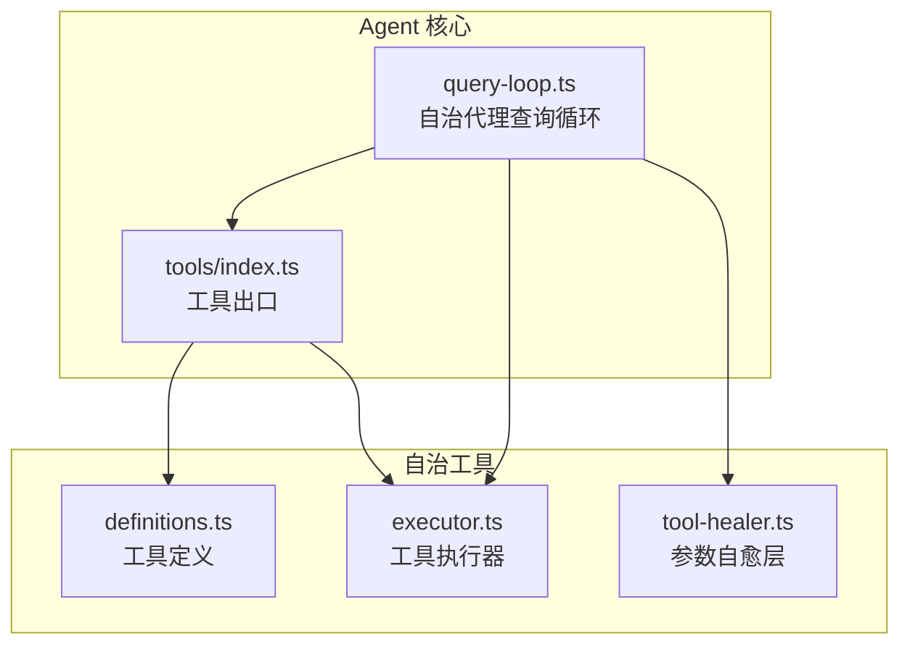
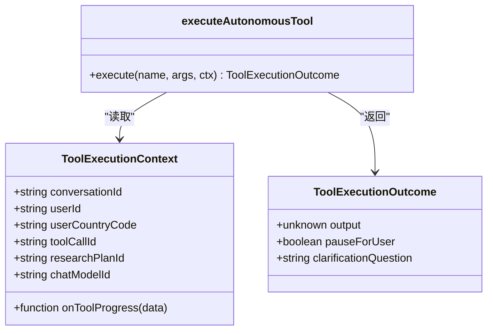
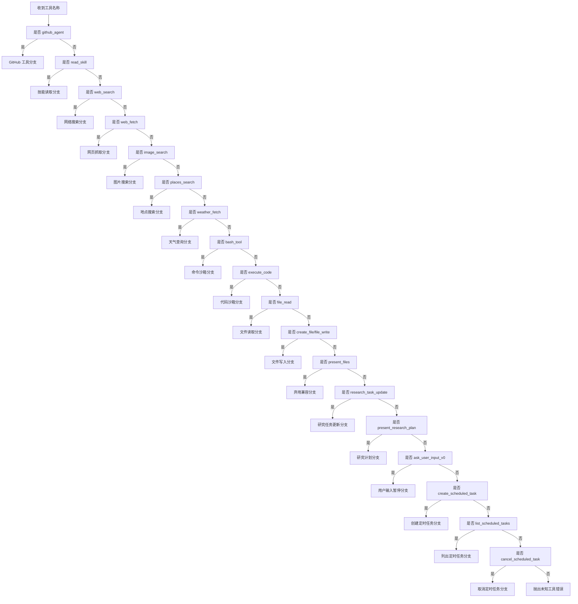
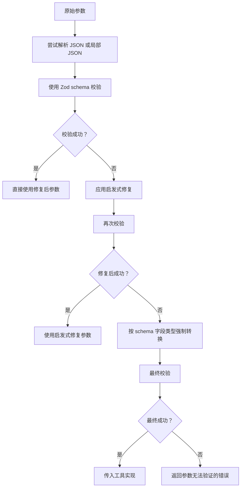
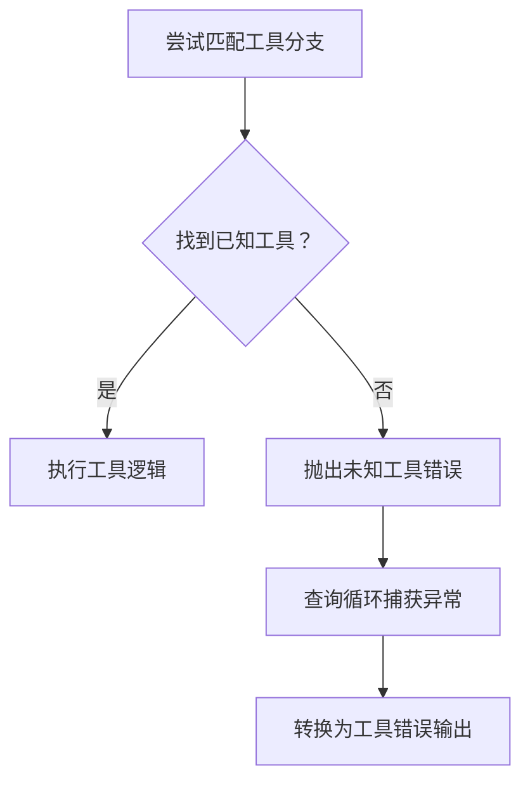
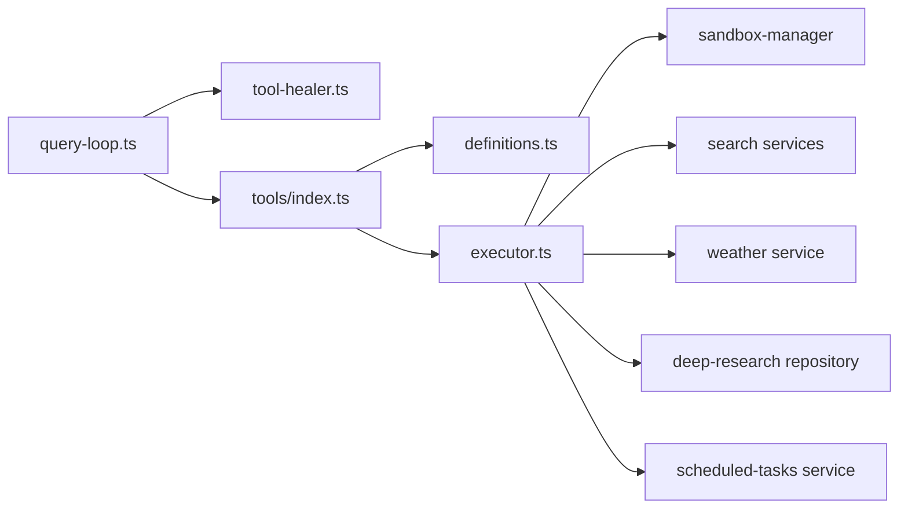

# 工具执行生命周期

<cite>
**本文引用的文件**   
- [executor.ts](file://src/server/inference/autonomous-tools/executor.ts)
- [definitions.ts](file://src/server/inference/autonomous-tools/definitions.ts)
- [query-loop.ts](file://src/server/agent-core/runtime/query-loop.ts)
- [tool-healer.ts](file://src/server/inference/tool-healer.ts)
- [tools/index.ts](file://src/server/agent-core/tools/index.ts)
- [index.ts](file://src/server/agent-core/index.ts)
</cite>

## 目录
1. [引言](#引言)
2. [项目结构定位](#项目结构定位)
3. [核心组件](#核心组件)
4. [架构总览](#架构总览)
5. [详细组件分析](#详细组件分析)
6. [依赖关系分析](#依赖关系分析)
7. [性能与可观测性](#性能与可观测性)
8. [故障排查指南](#故障排查指南)
9. [结论](#结论)

## 引言
本文面向“自主代理工具执行”这一关键路径，完整解释 `executeAutonomousTool` 函数从接收工具名称到返回 `ToolExecutionOutcome` 的调用流程。重点包括：

- 工具名称匹配与路由分支。
- 参数提取、类型转换与校验。
- 权限检查（例如是否需要登录）。
- 具体实现函数的调用。
- 结果封装为 `ToolExecutionOutcome`。
- 错误处理与未知工具抛出机制。
- 流式工具（如 `web_search`）中 `onToolProgress` 回调的作用。
- 内置工具定义、自愈参数修复层与查询循环之间的协作关系。

## 项目结构定位
工具执行生命周期主要涉及以下模块：

| 模块 | 职责 |
|---|---|
| `src/server/inference/autonomous-tools/executor.ts` | 工具执行入口 `executeAutonomousTool`，包含所有工具分支的具体实现。 |
| `src/server/inference/autonomous-tools/definitions.ts` | 模型侧的工具描述与参数定义，用于指导大模型何时调用哪些工具。 |
| `src/server/agent-core/runtime/query-loop.ts` | 自治代理查询循环，负责调用模型、解析工具调用、执行工具并组装结果。 |
| `src/server/inference/tool-healer.ts` | 工具参数的自愈修复层，将大模型可能输出的畸形参数修正为符合 Zod schema 的参数。 |
| `src/server/agent-core/tools/index.ts` | agent-core 对外暴露的工具接口，导出工具定义和 `executeAutonomousTool`。 |
| `src/server/agent-core/index.ts` | agent-core 顶层入口，向生成与流式接口暴露工具执行能力。 |



**图表来源**
- [tools/index.ts:1-7](file://src/server/agent-core/tools/index.ts#L1-L7)
- [index.ts:1-33](file://src/server/agent-core/index.ts#L1-L33)
- [query-loop.ts:150-600](file://src/server/agent-core/runtime/query-loop.ts#L150-L600)
- [definitions.ts:1-200](file://src/server/inference/autonomous-tools/definitions.ts#L1-L200)
- [executor.ts:1-200](file://src/server/inference/autonomous-tools/executor.ts#L1-L200)

**章节来源**
- [tools/index.ts:1-7](file://src/server/agent-core/tools/index.ts#L1-L7)
- [index.ts:1-33](file://src/server/agent-core/index.ts#L1-L33)
- [definitions.ts:1-200](file://src/server/inference/autonomous-tools/definitions.ts#L1-L200)

## 核心组件
### 工具执行上下文与结果类型
`executeAutonomousTool` 的输入包含三个部分：

| 字段 | 含义 |
|---|---|
| `name` | 工具名称，用于路由到对应分支。 |
| `args` | 大模型生成的原始参数对象。 |
| `ctx` | 执行上下文，包括会话标识、用户标识、研究计划标识、工具调用标识、进度回调等。 |

输出类型为 `ToolExecutionOutcome`，至少包含：

| 字段 | 含义 |
|---|---|
| `output` | 工具最终返回给上层的结果值。 |
| `pauseForUser` | 可选布尔值，表示是否应暂停代理循环等待用户交互。 |
| `clarificationQuestion` | 可选字段，用于提示需要澄清的问题。 |



**图表来源**
- [executor.ts:1-200](file://src/server/inference/autonomous-tools/executor.ts#L1-L200)

**章节来源**
- [executor.ts:1-200](file://src/server/inference/autonomous-tools/executor.ts#L1-L200)

## 架构总览
自治代理工具执行的总体流程如下：

1. 模型通过 OpenAI Responses 接口返回文本或工具调用。
2. 查询循环解析工具调用，确定目标工具名称。
3. 对于内置自治工具，先尝试走自愈参数修复层；若没有 schema，则直接调用 `executeAutonomousTool`。
4. `executeAutonomousTool` 根据工具名称进行分支处理。
5. 各分支完成参数提取、权限检查、外部服务调用或沙箱执行。
6. 最终统一封装为 `ToolExecutionOutcome`。
7. 查询循环将结果写入对话历史，并继续下一轮模型推理。

```mermaid
sequenceDiagram
  participant Model as "语言模型"
  participant Loop as "查询循环"
  participant Healer as "参数自愈层"
  participant Executor as "工具执行器"
  participant Service as "外部服务或沙箱"

  Model->>Loop: "返回工具调用"
  Loop->>Healer: "尝试修复参数"
  alt 有内置 schema
    Healer-->>Loop: "修复后的参数"
    Loop->>Executor: "executeAutonomousTool(name, args, ctx)"
  else 无内置 schema
    Loop->>Executor: "executeAutonomousTool(name, rawArgs, ctx)"
  end

  Executor->>Service: "按工具分支调用"
  Service-->>Executor: "业务结果或错误"
  Executor-->>Loop: "ToolExecutionOutcome"
  Loop->>Loop: "封装结果并继续下一轮"
```

**图表来源**
- [query-loop.ts:600-1044](file://src/server/agent-core/runtime/query-loop.ts#L600-L1044)
- [tool-healer.ts:1-213](file://src/server/inference/tool-healer.ts#L1-L213)
- [executor.ts:1-730](file://src/server/inference/autonomous-tools/executor.ts#L1-L730)

**章节来源**
- [query-loop.ts:600-1044](file://src/server/agent-core/runtime/query-loop.ts#L600-L1044)
- [tool-healer.ts:1-213](file://src/server/inference/tool-healer.ts#L1-L213)
- [executor.ts:1-730](file://src/server/inference/autonomous-tools/executor.ts#L1-L730)

## 详细组件分析

### 工具名称匹配与整体路由
`executeAutonomousTool` 使用一系列 `if (name === "...")` 分支匹配工具名称。其核心规则是：

- 如果名称匹配已知工具，则进入对应分支。
- 如果所有分支都不匹配，则在函数末尾抛出错误，表明这是未知工具。
- 某些工具在早期返回 `{ output: { error: "..." } }`，而不是抛出异常；这类错误属于业务级失败，由上层作为工具结果处理。



**图表来源**
- [executor.ts:1-730](file://src/server/inference/autonomous-tools/executor.ts#L1-L730)

**章节来源**
- [executor.ts:1-730](file://src/server/inference/autonomous-tools/executor.ts#L1-L730)

### 参数提取、验证与自愈
工具参数在进入具体实现前会经历两层处理：

1. **Zod schema 自愈修复**  
   查询循环为内置工具构建 healing tools，并通过 `healToolArgs` 对大模型可能输出的错误类型进行修复。修复策略包括：
   - 字符串数字转为数字。
   - `"true"`、`"false"`、`"null"` 转为对应布尔值和空值。
   - 单元素数组展开为单个值。
   - 单层 `{ value }` 包装解包。
   - 按 schema 形状做字段级类型强制转换。

2. **工具内部二次校验**  
   即使自愈成功，具体工具仍可能对必要字段进行再次校验，例如检查 URL、查询词、位置名称是否为空。



**图表来源**
- [tool-healer.ts:1-213](file://src/server/inference/tool-healer.ts#L1-L213)
- [query-loop.ts:150-600](file://src/server/agent-core/runtime/query-loop.ts#L150-L600)

**章节来源**
- [tool-healer.ts:1-213](file://src/server/inference/tool-healer.ts#L1-L213)
- [query-loop.ts:150-600](file://src/server/agent-core/runtime/query-loop.ts#L150-L600)

### 权限检查
多个工具在执行业务逻辑前会检查上下文中的用户标识：

| 工具 | 权限要求 | 行为 |
|---|---|---|
| `github_agent` | 需要已登录用户 | 未登录时返回 `{ output: { error: "Sign in to Clauxen before using GitHub." } }`。 |
| `read_attachment` | 需要已登录用户 | 未登录时返回 `{ output: { error: "Not signed in." } }`。 |
| `create_scheduled_task` | 需要已登录用户 | 未登录时返回带错误信息的输出。 |
| `list_scheduled_tasks` | 需要已登录用户 | 未登录时返回带错误信息的输出。 |
| `cancel_scheduled_task` | 需要已登录用户 | 未登录时返回带错误信息的输出。 |
| `present_research_plan` | 保存研究计划时需要用户与会话 | 无法持久化时返回错误信息。 |

这些权限检查通常不抛出异常，而是返回结构化错误输出，使上层可以继续推进对话。

**章节来源**
- [executor.ts:1-730](file://src/server/inference/autonomous-tools/executor.ts#L1-L730)

### 工具分支详解

#### GitHub 代理
- 输入：`operation` 及操作相关参数。
- 行为：检查用户登录状态，动态导入 GitHub 代理实现，调用 `executeGitHubAgent`。
- 错误处理：捕获异常并转换为 `{ output: { error: "..." } }`。

**章节来源**
- [executor.ts:1-200](file://src/server/inference/autonomous-tools/executor.ts#L1-L200)

#### 技能读取
- 输入：`skill_id` 或 `name`。
- 行为：列出可用技能，读取指定技能内容。
- 错误处理：技能不存在时返回错误信息和可用技能列表。

**章节来源**
- [executor.ts:1-200](file://src/server/inference/autonomous-tools/executor.ts#L1-L200)

#### 网络搜索
- 输入：`query`、可选 `num_results`。
- 行为：计算搜索上限，立即发出搜索开始进度，流式返回搜索结果片段，并将结果保存到研究来源记录。
- 流式回调：通过 `onToolProgress` 发送 `searching`、`streaming`、`results` 状态。

**章节来源**
- [executor.ts:201-730](file://src/server/inference/autonomous-tools/executor.ts#L201-L730)

#### 网页抓取
- 输入：`url`。
- 行为：仅允许通过 Exa 抓取，防止 SSRF 风险。
- 错误处理：无法获取内容时返回结构化错误。

**章节来源**
- [executor.ts:201-730](file://src/server/inference/autonomous-tools/executor.ts#L201-L730)

#### 图片搜索
- 输入：`query`、可选 `max_results`。
- 行为：调用图像搜索服务并返回图片列表。

**章节来源**
- [executor.ts:201-730](file://src/server/inference/autonomous-tools/executor.ts#L201-L730)

#### 地点搜索
- 输入：`query`、可选 `max_results`。
- 行为：调用 Nominatim 地点搜索服务。

**章节来源**
- [executor.ts:201-730](file://src/server/inference/autonomous-tools/executor.ts#L201-L730)

#### 天气查询
- 输入：`location_name`、可选 `units`。
- 行为：先地理编码位置，再获取天气预报。
- 错误处理：找不到位置时返回结构化错误。

**章节来源**
- [executor.ts:201-730](file://src/server/inference/autonomous-tools/executor.ts#L201-L730)

#### Bash 命令
- 输入：`command`、可选 `description`、可选 `output_paths`。
- 行为：安全校验命令，创建沙箱工作区，执行命令，流式输出 stdout/stderr，发布输出文件。
- 安全：使用安全命令校验函数。
- 流式回调：通过 `onToolProgress` 推送 stdout/stderr 增量。

**章节来源**
- [executor.ts:201-730](file://src/server/inference/autonomous-tools/executor.ts#L201-L730)

#### 代码执行
- 输入：`code`、可选 `description`、可选 `output_paths`。
- 行为：创建沙箱工作区，运行代码，聚合日志与结果，发布输出文件。
- 流式回调：通过 `onToolProgress` 推送 stdout/stderr 增量。

**章节来源**
- [executor.ts:201-730](file://src/server/inference/autonomous-tools/executor.ts#L201-L730)

#### 文件读取
- 输入：`path`。
- 行为：读取受作用域限制的文件。

**章节来源**
- [executor.ts:201-730](file://src/server/inference/autonomous-tools/executor.ts#L201-L730)

#### 创建文件或写入文件
- 输入：`path`、`content`、可选 `description`。
- 行为：写入受作用域限制的文件，可选持久化为可展示产物。
- 特殊处理：写入时会剥离自动生成的尾部标记。

**章节来源**
- [executor.ts:201-730](file://src/server/inference/autonomous-tools/executor.ts#L201-L730)

#### 展示文件
- 行为：保留兼容旧模型调用的占位返回，标记为弃用。

**章节来源**
- [executor.ts:201-730](file://src/server/inference/autonomous-tools/executor.ts#L201-L730)

#### 研究任务更新
- 输入：`task_index`、`status`。
- 行为：仅在活跃研究计划下更新任务进度。
- 错误处理：没有活跃研究计划时返回错误。

**章节来源**
- [executor.ts:201-730](file://src/server/inference/autonomous-tools/executor.ts#L201-L730)

#### 展示研究计划
- 输入：`title`、`tasks`。
- 行为：创建后台研究计划并调度执行；已有计划时拒绝重复创建。
- 输出：包含计划标题、任务列表、自动启动时间等。

**章节来源**
- [executor.ts:201-730](file://src/server/inference/autonomous-tools/executor.ts#L201-L730)

#### 请求用户输入
- 输入：问题数组，每个问题包含选项和可选选择类型。
- 行为：返回待用户输入状态，并设置 `pauseForUser` 为 true，使查询循环暂停。

**章节来源**
- [executor.ts:201-730](file://src/server/inference/autonomous-tools/executor.ts#L201-L730)

#### 创建定时任务
- 输入：任务名称、需求、频率、本地时间、时区、可选触发日期等。
- 行为：创建定时任务并返回任务元数据与管理链接。
- 错误处理：捕获异常并返回结构化错误。

**章节来源**
- [executor.ts:201-730](file://src/server/inference/autonomous-tools/executor.ts#L201-L730)

#### 列出定时任务
- 输入：可选 `include_completed`。
- 行为：按用户过滤任务列表。
- 错误处理：捕获异常并返回结构化错误。

**章节来源**
- [executor.ts:201-730](file://src/server/inference/autonomous-tools/executor.ts#L201-L730)

#### 取消定时任务
- 输入：`task_id` 或 `taskId`。
- 行为：删除用户拥有的定时任务。
- 错误处理：捕获异常并返回结构化错误。

**章节来源**
- [executor.ts:201-730](file://src/server/inference/autonomous-tools/executor.ts#L201-L730)

### 未知工具的错误抛出机制
当工具名称不匹配任何已知分支时，`executeAutonomousTool` 会在函数末尾抛出错误：

- 错误消息格式包含工具名称。
- 该异常由查询循环捕获，并转换为 `{ output: { error: "..." } }` 形式的工具结果。
- 这保证未知工具不会导致整个代理循环崩溃，而是以工具错误形式反馈给上层。



**图表来源**
- [executor.ts:723-730](file://src/server/inference/autonomous-tools/executor.ts#L723-L730)
- [query-loop.ts:600-1044](file://src/server/agent-core/runtime/query-loop.ts#L600-L1044)

**章节来源**
- [executor.ts:723-730](file://src/server/inference/autonomous-tools/executor.ts#L723-L730)
- [query-loop.ts:600-1044](file://src/server/agent-core/runtime/query-loop.ts#L600-L1044)

### 不同工具类型的执行路径差异
| 工具类别 | 典型工具 | 主要差异 |
|---|---|---|
| 外部 API 工具 | `web_search`、`web_fetch`、`image_search`、`places_search`、`weather_fetch` | 调用外部搜索或服务接口，返回结构化结果。 |
| 沙箱执行工具 | `bash_tool`、`execute_code` | 创建沙箱工作区，执行命令或代码，支持 stdout/stderr 流式输出。 |
| 文件系统工具 | `file_read`、`create_file`、`file_write` | 读写受作用域限制的文件，可能持久化为可展示产物。 |
| 研究控制工具 | `research_task_update`、`present_research_plan` | 与研究计划状态联动，可能调度后台任务。 |
| 用户交互工具 | `ask_user_input_v0` | 返回 `pauseForUser`，暂停代理循环。 |
| 定时任务工具 | `create_scheduled_task`、`list_scheduled_tasks`、`cancel_scheduled_task` | 与定时任务服务交互，通常需要登录。 |
| GitHub 工具 | `github_agent` | 需要登录，调用 GitHub 代理。 |
| 技能工具 | `read_skill` | 读取技能目录与内容。 |
| 兼容工具 | `present_files` | 不再必需，返回兼容占位结果。 |

**章节来源**
- [executor.ts:1-730](file://src/server/inference/autonomous-tools/executor.ts#L1-L730)

### `onToolProgress` 回调在流式工具中的作用
`onToolProgress` 是 `ToolExecutionContext` 中的一个回调，用于向 UI 或上层实时推送工具执行进度。它的主要使用场景包括：

1. **`web_search`**  
   - 搜索开始时发送 `status: "searching"`。
   - 流式内容到达时发送 `status: "streaming"` 和 `content_delta`。
   - 部分结果到达时发送 `status: "results"` 和部分结果列表。
   - 查询循环会将 `web_search` 的进度数据映射为 SSE `writeToolData`。

2. **`bash_tool` 与 `execute_code`**  
   - 标准输出和标准错误通过 `kind: "stdout"` 或 `kind: "stderr"` 推送。
   - 查询循环将这些增量映射为 SSE `writeToolOutputDelta`。

```mermaid
sequenceDiagram
  participant Executor as "工具执行器"
  participant Progress as "onToolProgress 回调"
  participant Loop as "查询循环"
  participant UI as "前端界面"

  Executor->>Progress: "searching / streaming / results"
  Progress->>Loop: "传递进度数据"
  Loop->>UI: "SSE writeToolData"
  UI-->>UI: "显示搜索进度与结果卡片"
```

**图表来源**
- [executor.ts:201-730](file://src/server/inference/autonomous-tools/executor.ts#L201-L730)
- [query-loop.ts:600-1044](file://src/server/agent-core/runtime/query-loop.ts#L600-L1044)

**章节来源**
- [executor.ts:201-730](file://src/server/inference/autonomous-tools/executor.ts#L201-L730)
- [query-loop.ts:600-1044](file://src/server/agent-core/runtime/query-loop.ts#L600-L1044)

## 依赖关系分析



**图表来源**
- [query-loop.ts:150-600](file://src/server/agent-core/runtime/query-loop.ts#L150-L600)
- [executor.ts:1-730](file://src/server/inference/autonomous-tools/executor.ts#L1-L730)

**章节来源**
- [query-loop.ts:150-600](file://src/server/agent-core/runtime/query-loop.ts#L150-L600)
- [executor.ts:1-730](file://src/server/inference/autonomous-tools/executor.ts#L1-L730)

## 性能与可观测性
- **流式进度**：`web_search`、`bash_tool`、`execute_code` 都支持流式进度，避免 UI 长时间空白。
- **沙箱保活**：命令和代码执行过程中通过 keep-alive 机制保持沙箱存活。
- **输出文件发布**：`output_paths` 指定的文件会被读取并尽可能持久化，同时向 UI 推送产物卡片。
- **研究计划集成**：`web_search` 和 `research_task_update` 与研究计划仓库联动，便于后台研究追踪。
- **自愈参数**：减少因大模型参数类型错误导致的重试成本。

[本节为通用性能讨论，不直接分析具体代码行]

## 故障排查指南

### 常见错误分类
| 错误类型 | 典型原因 | 处理方式 |
|---|---|---|
| 参数类型错误 | 大模型返回字符串、数组、空值等不符合 schema 的参数 | 自愈层修复；修复失败时返回参数验证错误。 |
| 必填字段缺失 | URL、查询词、位置名称为空 | 工具内部校验并返回结构化错误。 |
| 未登录访问 | 调用需要用户的工具 | 返回登录相关错误。 |
| 外部服务失败 | 网络搜索、网页抓取、天气服务等异常 | 转换为 `{ output: { error: "..." } }`。 |
| 未知工具 | 工具名称不在路由分支中 | 抛出未知工具错误，由查询循环捕获并转成工具错误。 |

### 排查建议
1. 确认工具名称是否在 `definitions.ts` 中声明。
2. 检查 `query-loop.ts` 中是否定义了该工具的 Zod schema。
3. 检查 `executor.ts` 是否存在对应分支。
4. 查看 `onToolProgress` 是否被正确调用，特别是流式工具。
5. 对于沙箱工具，检查命令安全性校验和输出路径是否存在。

**章节来源**
- [tool-healer.ts:1-213](file://src/server/inference/tool-healer.ts#L1-L213)
- [executor.ts:1-730](file://src/server/inference/autonomous-tools/executor.ts#L1-L730)
- [query-loop.ts:600-1044](file://src/server/agent-core/runtime/query-loop.ts#L600-L1044)

## 结论
`executeAutonomousTool` 是自治代理工具执行的核心枢纽。它通过明确的名称匹配分支，将模型意图转化为具体业务操作，并在参数自愈、权限检查、外部服务调用、沙箱执行、结果封装和错误处理之间形成稳定链路。配合查询循环与自愈参数层，系统能够容忍大模型参数输出缺陷，提升鲁棒性；配合流式进度回调，用户可以看到搜索、命令执行和代码执行的中间状态。未来新增工具时，应遵循现有模式：补充工具定义、Zod schema、路由分支和必要的权限与安全校验。

[本节为总结性内容，不直接分析具体代码行]