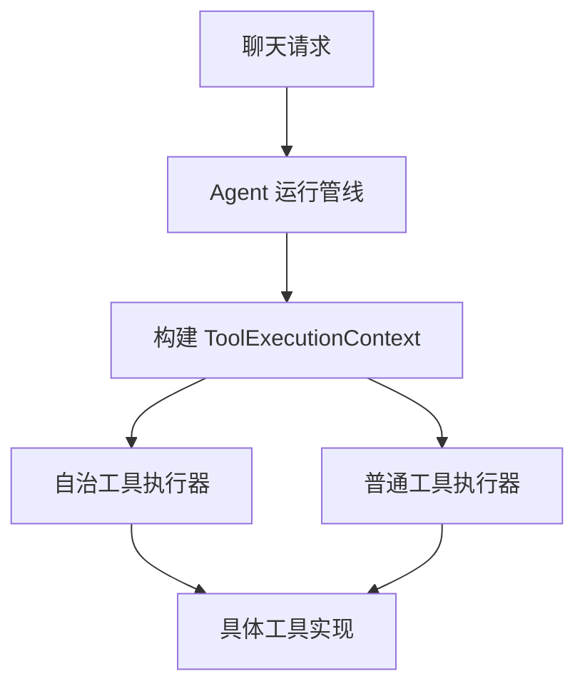
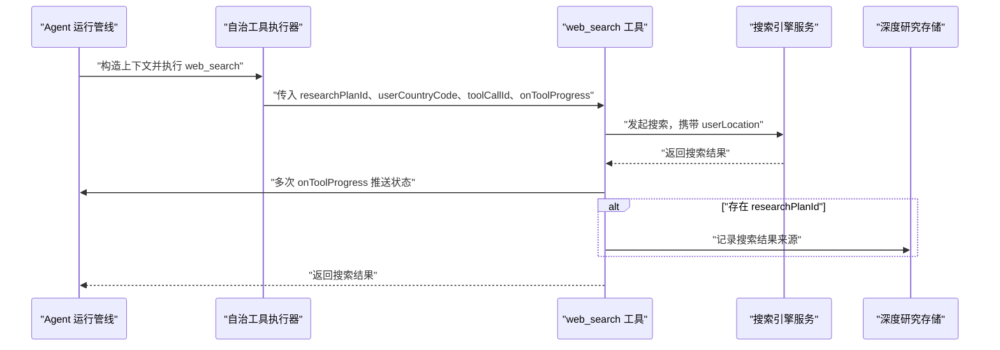
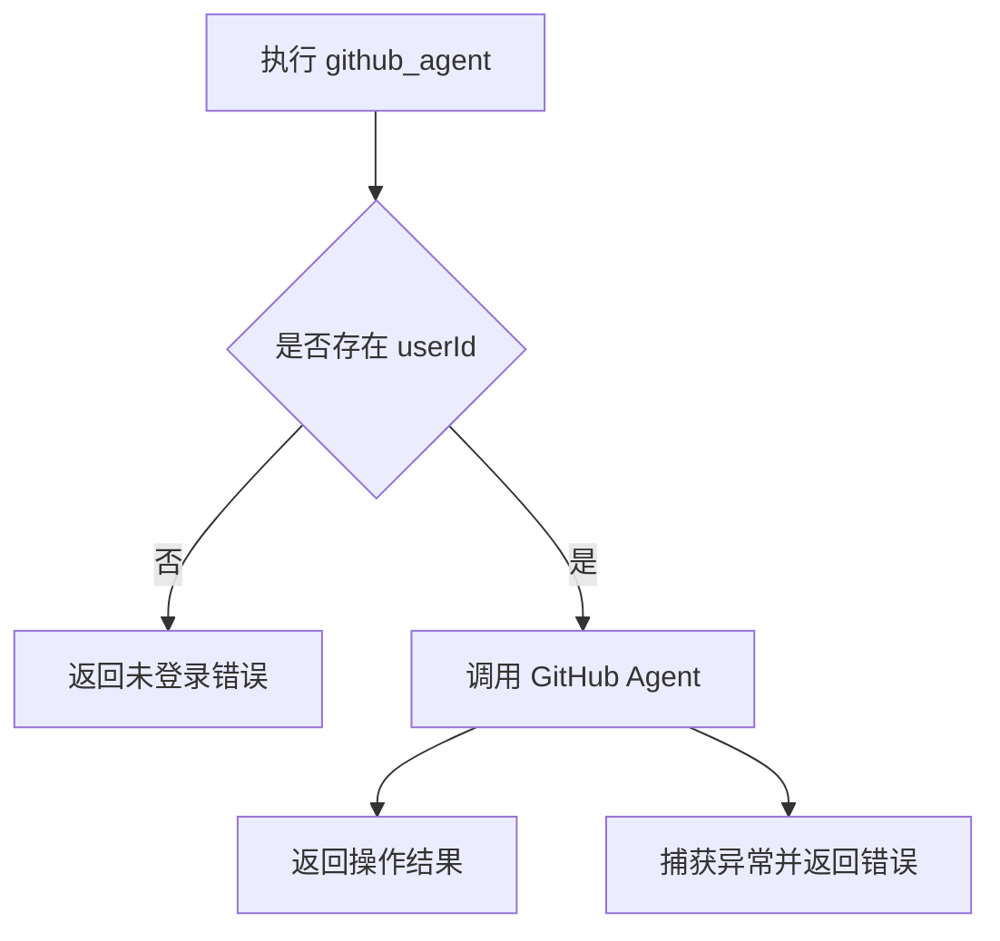
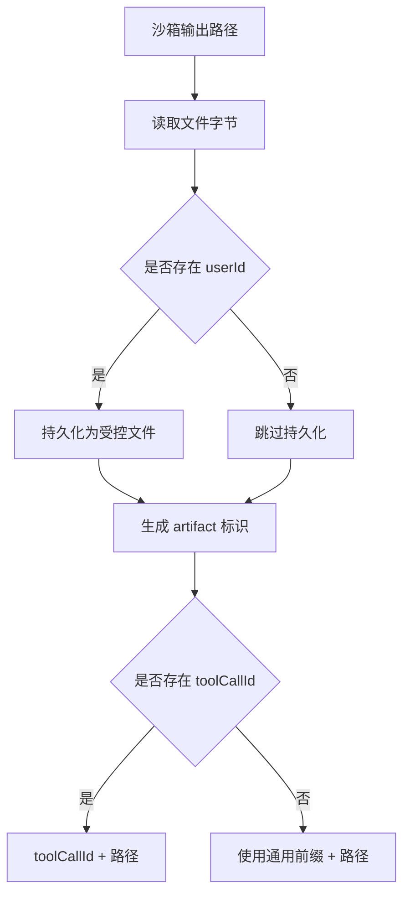
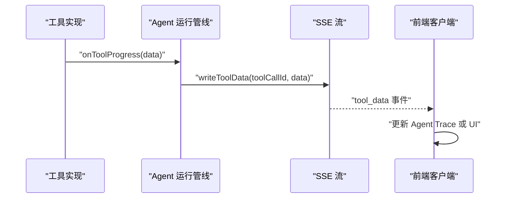
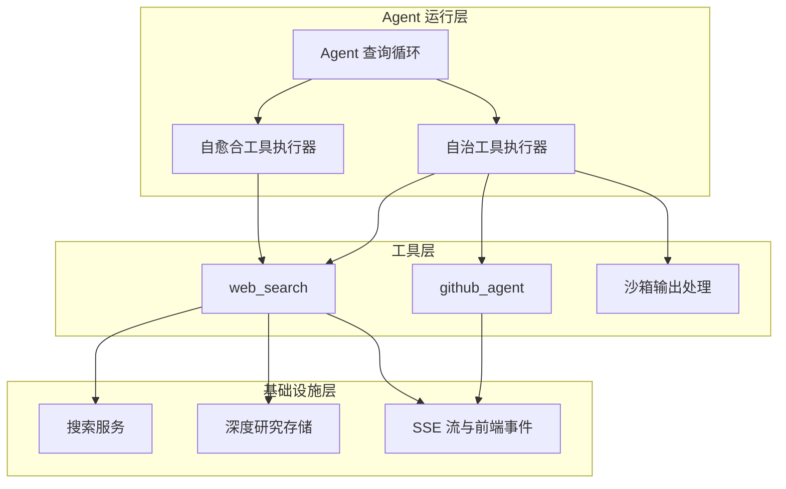
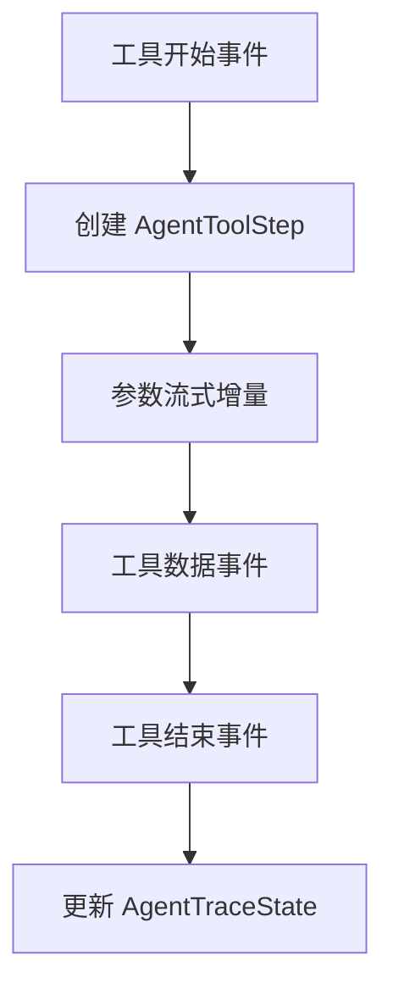
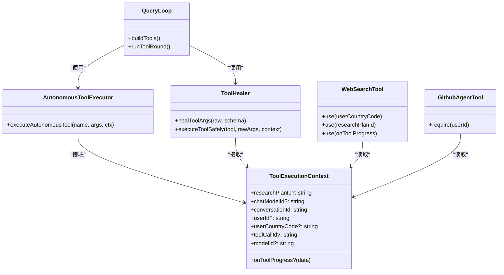

# 执行上下文对象

<cite>
**本文引用的文件**   
- [executor.ts](file://src/server/inference/autonomous-tools/executor.ts)
- [tool-healer.ts](file://src/server/inference/tool-healer.ts)
- [query-loop.ts](file://src/server/agent-core/runtime/query-loop.ts)
- [chat-stream.ts](file://src/shared/lib/chat-stream.ts)
- [agent-trace.ts](file://src/shared/lib/agent-trace.ts)
- [claussen-ui-stream.ts](file://src/server/inference/clauxen-ui-stream.ts)
</cite>

## 目录
1. [引言](#引言)
2. [上下文定义与字段语义](#上下文定义与字段语义)
3. [上下文在工具中的使用模式](#上下文在工具中的使用模式)
4. [架构总览](#架构总览)
5. [关键流程时序图](#关键流程时序图)
6. [依赖关系分析](#依赖关系分析)
7. [初始化最佳实践](#初始化最佳实践)
8. [常见错误处理](#常见错误处理)
9. [性能与可观测性建议](#性能与可观测性建议)
10. [结论](#结论)

## 引言
`ToolExecutionContext` 是 Agent 工具执行的运行时上下文。它把“谁在调用”“在哪个会话中调用”“当前模型是谁”“是否需要深度研究记录”“如何向界面推送进度”等跨工具共享信息，以结构化方式传递给每个工具实现。

该上下文有两个主要形态：
- 自治工具上下文：用于沙箱式自主工具，如 `web_search`、`bash_tool`、`github_agent` 等。
- 普通工具上下文：由自愈合工具执行器传入，供传统工具函数使用。

两者字段基本一致，但默认必填项和回调名称略有差异。

## 上下文定义与字段语义

### 自治工具上下文
自治工具上下文定义在自治工具执行器中，核心字段如下：

| 字段 | 是否必填 | 类型 | 用途说明 |
|---|---:|---|---|
| `researchPlanId` | 否 | `string` | 深度研究计划标识。当存在时，搜索等工具会启用直出结果模式并记录来源，同时影响搜索结果上限。 |
| `chatModelId` | 否 | `string` | 聊天模型标识，可用于计费、配额或日志归属。 |
| `conversationId` | 是 | `string` | 聊天会话标识符；若缺失，运行时通常降级为固定值。 |
| `userId` | 否 | `string | 用户认证标识；用于权限校验、资源隔离、持久化文件和限制访问。 |
| `userCountryCode` | 否 | `string` | 用户国家代码；用于地理位置相关工具，例如本地化搜索、天气查询。 |
| `toolCallId` | 否 | `string` | 当前工具调用的唯一标识；用于 Agent Trace、UI 流事件和 artifact 命名。 |
| `modelId` | 否 | `string` | 产生本次工具调用的模型标识，用于 Agent Trace 归因。 |
| `onToolProgress` | 否 | `(data) => void` | 实时进度回调；工具可在执行过程中推送状态，最终由上层流转换为 UI 事件。 |

**章节来源**
- [executor.ts:55-65](file://src/server/inference/autonomous-tools/executor.ts#L55-L65)

### 普通工具上下文
普通工具上下文定义在自愈合工具执行器中，字段含义与自治工具上下文一致，但存在以下差异：

| 差异点 | 说明 |
|---|---|
| `conversationId` | 在该上下文中是可选的；运行时通常在更外层补齐。 |
| `toolCallId` | 在该上下文中是必填的。 |
| 进度回调名称 | 使用 `onProgress`，而不是 `onToolProgress`。 |
| 设计目的 | 面向普通工具定义和执行封装，强调参数自愈和安全执行。 |

**章节来源**
- [tool-healer.ts:15-25](file://src/server/inference/tool-healer.ts#L15-L25)

### 字段数据来源
上下文不是由工具自己创建，而是由 Agent 运行管线构造并注入：

1. 聊天请求进入推理或 Agent 运行时。
2. 解析当前用户、会话、模型、研究计划等运行时信息。
3. 为每个待执行工具构建一次 `ToolExecutionContext`。
4. 将上下文传给工具执行器或直接传给工具函数。



[本图为概念流程图，不直接映射到特定源码结构]

## 上下文在工具中的使用模式

### `web_search`：本地化搜索与来源记录
`web_search` 是典型的使用上下文字段的工具：

- 使用 `researchPlanId` 调整搜索限制。
- 使用 `userCountryCode` 作为本地化位置参数。
- 使用 `toolCallId` 标记搜索事件。
- 通过 `onToolProgress` 推送搜索开始、流式内容、部分结果。
- 如果存在 `researchPlanId`，会把搜索结果来源写入深度研究存储。



**图表来源**
- [executor.ts:204-254](file://src/server/inference/autonomous-tools/executor.ts#L204-L254)

**章节来源**
- [executor.ts:204-254](file://src/server/inference/autonomous-tools/executor.ts#L204-L254)

### `github_agent`：用户身份与权限验证
`github_agent` 强依赖 `userId`：

- 如果 `userId` 为空，直接返回需要登录的错误响应。
- 如果存在 `userId`，则调用 GitHub Agent 执行操作。
- 外部异常被捕获并转换为工具输出中的错误消息。

这体现了上下文在权限边界中的作用：工具不应自行猜测用户身份，而应读取上下文提供的身份。



**图表来源**
- [executor.ts:170-198](file://src/server/inference/autonomous-tools/executor.ts#L170-L198)

**章节来源**
- [executor.ts:170-198](file://src/server/inference/autonomous-tools/executor.ts#L170-L198)

### 沙箱输出与 artifact 命名
当工具生成沙箱输出文件时，上下文参与 artifact 标识：

- 如果存在 `userId`，可能将文件持久化为受控用户资源。
- artifact 优先使用持久化后的文件标识。
- 否则使用 `toolCallId` 加上文件路径作为标识。
- 如果 `toolCallId` 也缺失，则回退为通用前缀加路径。

这意味着 `toolCallId` 不仅用于追踪，还直接影响产物命名稳定性。



**图表来源**
- [executor.ts:120-168](file://src/server/inference/autonomous-tools/executor.ts#L120-L168)

**章节来源**
- [executor.ts:120-168](file://src/server/inference/autonomous-tools/executor.ts#L120-L168)

### 进度回调与前端流
工具内部通过 `onToolProgress` 或 `onProgress` 推送数据，再由 Agent 运行管线转换为 SSE 流事件：

- `web_search` 的进度会被包装成 `tool_data` 事件，包含 `tool_call_id`。
- 其他工具如 `bash_tool`、`execute_code` 的标准输出和标准错误会通过专用输出增量事件发送。
- 前端解析这些事件后，更新 Agent Trace、工作区状态或 UI 行内输出。



**图表来源**
- [query-loop.ts:888-924](file://src/server/agent-core/runtime/query-loop.ts#L888-L924)
- [claussen-ui-stream.ts:178-227](file://src/server/inference/clauxen-ui-stream.ts#L178-L227)

**章节来源**
- [query-loop.ts:880-924](file://src/server/agent-core/runtime/query-loop.ts#L880-L924)
- [claussen-ui-stream.ts:178-227](file://src/server/inference/clauxen-ui-stream.ts#L178-L227)

## 架构总览



**图表来源**
- [query-loop.ts:258-267](file://src/server/agent-core/runtime/query-loop.ts#L258-L267)
- [query-loop.ts:880-924](file://src/server/agent-core/runtime/query-loop.ts#L880-L924)
- [executor.ts:55-65](file://src/server/inference/autonomous-tools/executor.ts#L55-L65)
- [executor.ts:204-254](file://src/server/inference/autonomous-tools/executor.ts#L204-L254)

## 关键流程时序图

### 工具调用上下文构造与执行

```mermaid
sequenceDiagram
    participant Caller as "调用方"
    participant Loop as "Agent 查询循环"
    participant Healer as "自愈合执行器"
    participant AutoExec as "自治工具执行器"
    participant Tool as "具体工具"

    Caller->>Loop: "发起工具轮次"
    Loop->>Loop: "收集 userId、conversationId、modelId、researchPlanId"
    Loop->>AutoExec: "构建 ToolExecutionContext"
    AutoExec->>Tool: "执行工具并传入上下文"
    Tool-->>AutoExec: "返回执行结果"
    AutoExec-->>Loop: "返回工具输出"
    Loop->>Caller: "写出工具结束事件"
```

**图表来源**
- [query-loop.ts:880-924](file://src/server/agent-core/runtime/query-loop.ts#L880-L924)
- [query-loop.ts:258-267](file://src/server/agent-core/runtime/query-loop.ts#L258-L267)

**章节来源**
- [query-loop.ts:880-924](file://src/server/agent-core/runtime/query-loop.ts#L880-L924)
- [query-loop.ts:258-267](file://src/server/agent-core/runtime/query-loop.ts#L258-L267)

### Agent Trace 与工具标识关联
Agent Trace 使用 `toolCallId` 定位工具步骤，并在前端显示工具状态、参数预览、结果和中间数据。



**图表来源**
- [agent-trace.ts:54-71](file://src/shared/lib/agent-trace.ts#L54-L71)
- [agent-trace.ts:105-114](file://src/shared/lib/agent-trace.ts#L105-L114)

**章节来源**
- [agent-trace.ts:54-71](file://src/shared/lib/agent-trace.ts#L54-L71)
- [agent-trace.ts:105-114](file://src/shared/lib/agent-trace.ts#L105-L114)

## 依赖关系分析



**图表来源**
- [executor.ts:55-65](file://src/server/inference/autonomous-tools/executor.ts#L55-L65)
- [tool-healer.ts:15-41](file://src/server/inference/tool-healer.ts#L15-L41)
- [query-loop.ts:258-267](file://src/server/agent-core/runtime/query-loop.ts#L258-L267)
- [query-loop.ts:880-924](file://src/server/agent-core/runtime/query-loop.ts#L880-L924)

**章节来源**
- [executor.ts:55-65](file://src/server/inference/autonomous-tools/executor.ts#L55-L65)
- [tool-healer.ts:15-41](file://src/server/inference/tool-healer.ts#L15-L41)
- [query-loop.ts:258-267](file://src/server/agent-core/runtime/query-loop.ts#L258-L267)
- [query-loop.ts:880-924](file://src/server/agent-core/runtime/query-loop.ts#L880-L924)

## 初始化最佳实践

### 1. 始终提供会话标识
- 如果 `conversationId` 缺失，运行时通常会回退为固定值。
- 推荐在入口处确保会话标识来自真实聊天上下文，避免多个会话混用同一标识。

### 2. 区分认证用户与匿名用户
- `userId` 应为空字符串或明确缺省，而不是伪造值。
- 需要权限的工具应显式检查 `userId`，并在缺失时返回明确的业务错误。

### 3. 正确使用地理位置字段
- `userCountryCode` 仅在有地理相关工具时才需要填充。
- 对于非地理位置工具，不应假设该字段必然存在。

### 4. 保证工具调用标识稳定
- `toolCallId` 应在单次工具调用生命周期内保持稳定。
- 不要每次进度推送都更换标识，否则前端无法正确聚合同一个工具的多次中间状态。

### 5. 模型归属要准确
- `modelId` 应反映实际调用模型的标识。
- 在多模型路由场景中，避免复用上一个模型的 `modelId`。

### 6. 进度回调要幂等且轻量
- `onToolProgress` 不应执行重型逻辑。
- 应避免重复推送相同状态，除非下游 UI 明确支持去重。

**章节来源**
- [query-loop.ts:880-924](file://src/server/agent-core/runtime/query-loop.ts#L880-L924)
- [executor.ts:55-65](file://src/server/inference/autonomous-tools/executor.ts#L55-L65)

## 常见错误处理

### 未登录调用敏感工具
当 `github_agent` 没有 `userId` 时，不应继续调用后端权限接口，而应直接返回需登录的错误。这样可以避免无意义的外部请求和潜在越权风险。

**章节来源**
- [executor.ts:170-198](file://src/server/inference/autonomous-tools/executor.ts#L170-L198)

### 工具参数无法自愈
普通工具执行器会对参数进行 Zod 校验和自愈。如果参数无法修复，会返回统一的参数校验错误，而不是抛出未捕获异常。

**章节来源**
- [tool-healer.ts:186-204](file://src/server/inference/tool-healer.ts#L186-L204)

### 搜索结果为空或受限
`web_search` 会根据 `researchPlanId` 决定是否启用直出结果模式，并根据配置限制结果数量。即使外部搜索失败，也应通过进度回调和最终结果向调用方反馈，而不是静默吞掉错误。

**章节来源**
- [executor.ts:204-254](file://src/server/inference/autonomous-tools/executor.ts#L204-L254)

### 沙箱输出路径不存在
沙箱输出读取失败时，工具应记录警告并将错误加入错误列表，而不是中断整个工具执行。这样可以让其他输出路径仍可发布。

**章节来源**
- [executor.ts:120-168](file://src/server/inference/autonomous-tools/executor.ts#L120-L168)

### 前端事件丢失工具标识
前端解析 `tool_data` 时必须保留 `toolCallId`，否则无法把中间状态挂载到正确的 Agent Trace 步骤上。

**章节来源**
- [claussen-ui-stream.ts:178-227](file://src/server/inference/clauxen-ui-stream.ts#L178-L227)
- [agent-trace.ts:105-114](file://src/shared/lib/agent-trace.ts#L105-L114)

## 性能与可观测性建议

### 控制搜索频率和结果量
- 深度研究场景下应限制结果数量，避免过多来源污染上下文窗口。
- 对频繁调用的搜索工具增加节流或缓存策略。

### 减少不必要的进度推送
- 只在状态变化时推送进度。
- 对高频流式数据做批量合并，避免前端渲染抖动。

### 利用 `modelId` 进行链路归因
- 在日志和遥测中标注 `modelId`，便于排查不同模型的行为差异。
- 在成本统计中按模型维度聚合工具调用。

### 使用 `researchPlanId` 隔离研究来源
- 不要把不同研究计划的搜索结果混入同一来源集合。
- 清理未完成的研究计划时，应级联清理其临时来源记录。

**章节来源**
- [executor.ts:204-254](file://src/server/inference/autonomous-tools/executor.ts#L204-L254)
- [query-loop.ts:880-924](file://src/server/agent-core/runtime/query-loop.ts#L880-L924)

## 结论
`ToolExecutionContext` 是连接 Agent 运行管线、工具实现和前端可观测性的关键纽带。它的字段分别承担会话标识、用户身份、地理位置、模型归属、深度研究来源、工具调用追踪和实时进度等职责。

编写新工具时，应遵循以下原则：
- 从上下文读取身份、会话和模型信息，而不是从请求或全局状态猜测。
- 对可选字段做空值保护。
- 使用 `toolCallId` 关联所有中间状态和最终结果。
- 通过进度回调提供可见性，但不要阻塞主执行路径。
- 对权限、资源限制和外部依赖失败做明确错误处理。