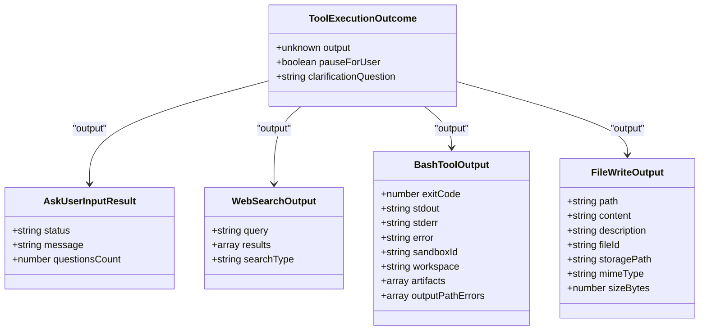
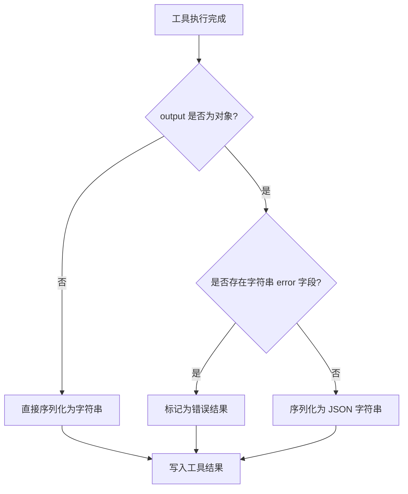
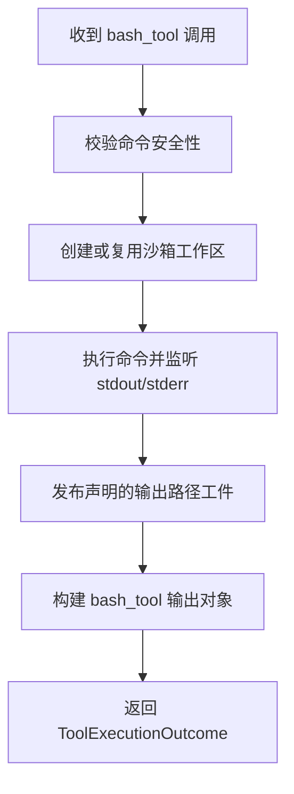
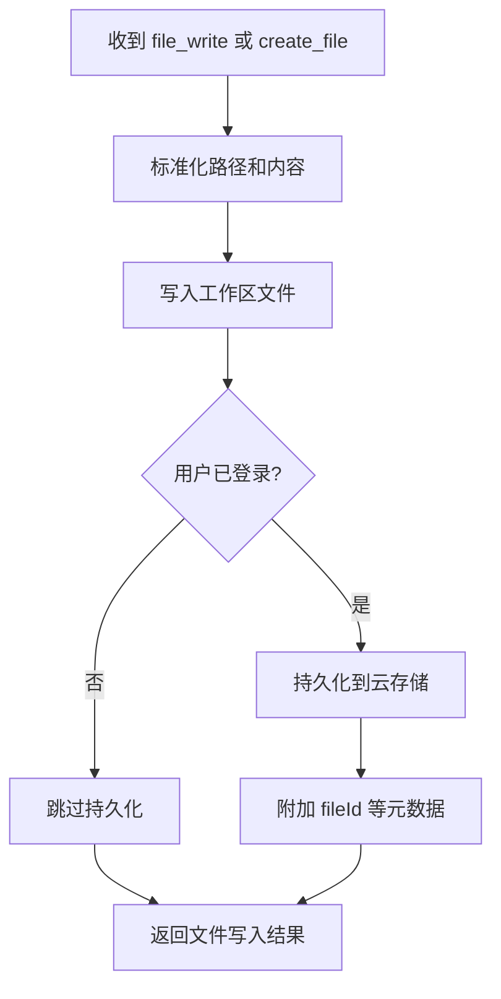
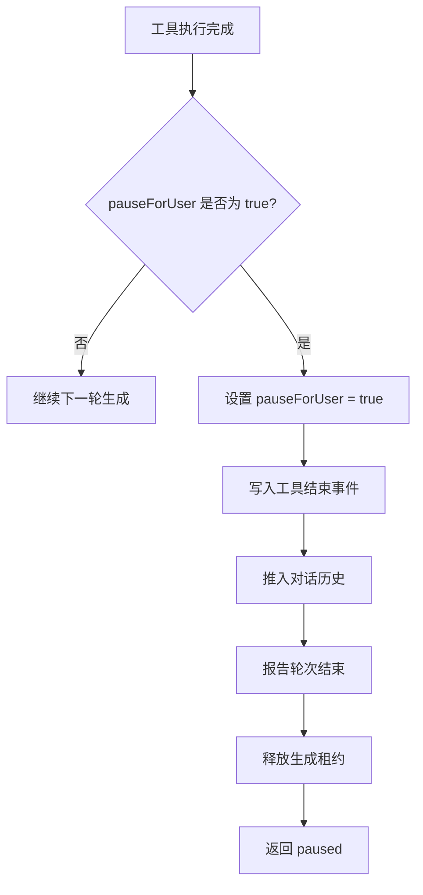
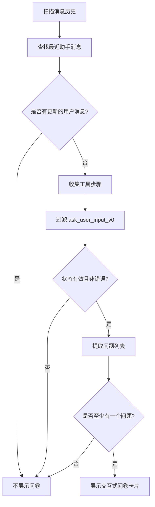
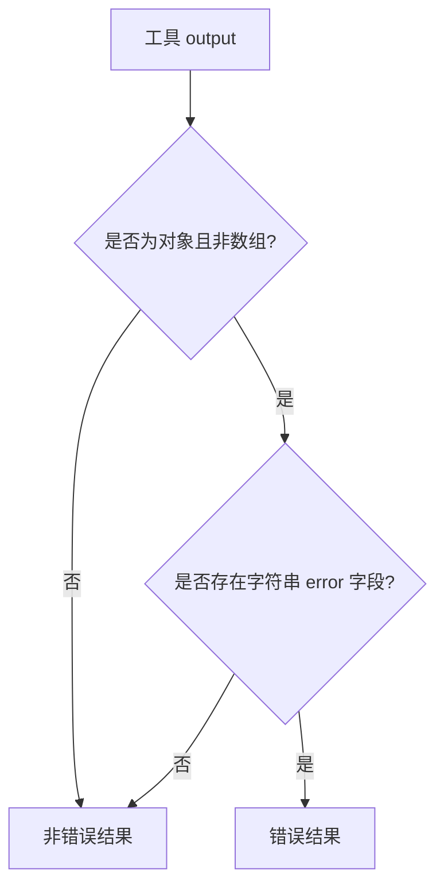
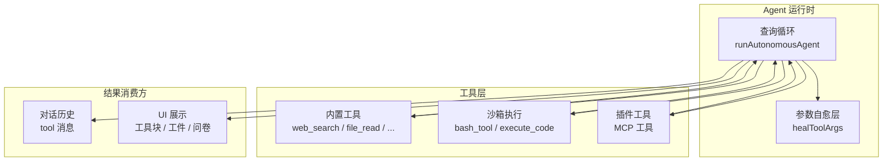

# 执行结果结构

<cite>
**本文引用的文件**   
- [executor.ts](file://src/server/inference/autonomous-tools/executor.ts)
- [definitions.ts](file://src/server/inference/autonomous-tools/definitions.ts)
- [query-loop.ts](file://src/server/agent-core/runtime/query-loop.ts)
- [tool-healer.ts](file://src/server/inference/tool-healer.ts)
- [pending-ask-user-input.ts](file://src/shared/lib/pending-ask-user-input.ts)
- [sdk-tools.d.ts](file://src/server/agent-core/sdk-tools.d.ts)
</cite>

## 目录
1. [引言](#引言)
2. [ToolExecutionOutcome 通用结构](#toolexecutionoutcome-通用结构)
3. [输出字段设计原则](#输出字段设计原则)
4. [工具级输出格式](#工具级输出格式)
5. [pauseForUser 暂停机制](#pauseforuser-暂停机制)
6. [clarificationQuestion 澄清问题语义](#clarificationquestion-澄清问题语义)
7. [ask_user_input_v0 交互式问卷流程](#ask_user_input_v0-交互式问卷流程)
8. [结果序列化与错误统一表示](#结果序列化与错误统一表示)
9. [架构与数据流总览](#架构与数据流总览)
10. [故障排查指南](#故障排查指南)
11. [结论](#结论)

## 引言
`ToolExecutionOutcome` 是自动化工具执行结果的统一抽象。它位于服务端推理层，用于封装不同工具在执行完成后返回给 Agent 循环的产物。其核心职责有三点：

- 提供通用的 `output` 字段，承载每个工具的具体业务结果。
- 通过 `pauseForUser` 标志位控制 Agent 是否应暂停本轮生成，等待用户交互。
- 预留 `clarificationQuestion` 字段，用于在需要更多上下文时向用户请求澄清信息。

该结构贯穿内置工具、沙箱执行、插件调用和客户端展示链路，是整个 Agent 执行模型的关键中间协议。

**章节来源**
- [executor.ts:67-73](file://src/server/inference/autonomous-tools/executor.ts#L67-L73)
- [query-loop.ts:825-836](file://src/server/agent-core/runtime/query-loop.ts#L825-L836)

## ToolExecutionOutcome 通用结构
`ToolExecutionOutcome` 是一个轻量型结果对象，包含三个关键字段：

| 字段 | 类型 | 含义 |
|---|---|---|
| `output` | `unknown` | 工具的业务结果。可以是字符串、对象、数组、图片标识或错误对象。 |
| `pauseForUser` | `boolean`（可选） | 是否为“等待用户输入”状态。为 `true` 时，Agent 轮次应暂停并进入交互式流程。 |
| `clarificationQuestion` | `string`（可选） | 向用户提出的澄清问题。当前主要用于结构化描述未来可扩展的交互语义。 |

从实现角度看，这个结构并不是一个严格强类型的运行时类，而是一个面向函数返回值和序列化的数据结构契约。所有自动化工具最终都应返回符合该结构的对象，由 Agent 查询循环统一消费。



**图表来源**
- [executor.ts:67-73](file://src/server/inference/autonomous-tools/executor.ts#L67-L73)
- [executor.ts:209-258](file://src/server/inference/autonomous-tools/executor.ts#L209-L258)
- [executor.ts:334-376](file://src/server/inference/autonomous-tools/executor.ts#L334-L376)
- [executor.ts:430-477](file://src/server/inference/autonomous-tools/executor.ts#L430-L477)

**章节来源**
- [executor.ts:67-73](file://src/server/inference/autonomous-tools/executor.ts#L67-L73)

## 输出字段设计原则
`output` 被设计为 `unknown`，目的是让不同工具保持各自的领域模型，而不是把全部工具结果强制收敛到单一扁平结构。这种设计的优点包括：

- 搜索工具可以返回搜索结果数组。
- 沙箱命令工具可以返回退出码、标准输出、标准错误和执行环境信息。
- 文件写入工具可以返回持久化后的文件元数据。
- 失败路径可以统一使用包含 `error` 字段的对象表示。

同时，查询循环对 `output` 做了两件事：

1. 将非字符串结果序列化为 JSON 字符串，作为工具结果消息写回对话历史。
2. 根据是否存在字符串 `error` 字段判断是否为错误结果。



**图表来源**
- [query-loop.ts:990-1006](file://src/server/agent-core/runtime/query-loop.ts#L990-L1006)
- [query-loop.ts:1187-1196](file://src/server/agent-core/runtime/query-loop.ts#L1187-L1196)

**章节来源**
- [query-loop.ts:990-1006](file://src/server/agent-core/runtime/query-loop.ts#L990-L1006)
- [query-loop.ts:1187-1196](file://src/server/agent-core/runtime/query-loop.ts#L1187-L1196)

## 工具级输出格式

### web_search 搜索结果
`web_search` 返回的对象通常包含以下字段：

| 字段 | 类型 | 含义 |
|---|---|---|
| `query` | `string` | 实际使用的搜索查询。 |
| `results` | `array` | 搜索结果数组，每项至少包含序号、标题、链接、摘要、发布日期、图标和高亮片段。 |
| `searchType` | `string` | 搜索类型标识，例如 `auto`。 |

搜索结果中的每个条目都使用 1 基索引，便于后续引用和引用标注。此外，该工具还会通过进度回调推送部分结果，以便界面在完整结果到达前显示“正在搜索”和“流式结果”。

```mermaid
sequenceDiagram
    participant Loop as "Agent 查询循环"
    participant Executor as "自动化工具执行器"
    participant Search as "外部搜索服务"

    Loop->>Executor: 执行 web_search
    Executor->>Search: 发起搜索请求
    Search-->>Executor: 返回搜索结果
    Executor-->>Loop: ToolExecutionOutcome<br/>output.results 为结果数组
    Loop->>Loop: 检查 output.results 并发送结果卡片
```

**图表来源**
- [executor.ts:209-258](file://src/server/inference/autonomous-tools/executor.ts#L209-L258)
- [query-loop.ts:1016-1026](file://src/server/agent-core/runtime/query-loop.ts#L1016-L1026)

**章节来源**
- [executor.ts:209-258](file://src/server/inference/autonomous-tools/executor.ts#L209-L258)
- [query-loop.ts:1016-1026](file://src/server/agent-core/runtime/query-loop.ts#L1016-L1026)

### bash_tool 执行状态与输出流
`bash_tool` 是沙箱命令执行工具，其 `output` 不是简单字符串，而是结构化执行报告：

| 字段 | 类型 | 含义 |
|---|---|---|
| `exitCode` | `number` | 命令退出码。 |
| `stdout` | `string` | 标准输出内容。 |
| `stderr` | `string` | 标准错误内容。 |
| `error` | `string`（可选） | 沙箱执行异常信息。 |
| `sandboxId` | `string` | 沙箱实例标识。 |
| `workspace` | `string` | 工作区根路径。 |
| `artifacts` | `array` | 声明的输出工件列表。 |
| `outputPathErrors` | `array`（可选） | 无法读取或上传的输出路径错误。 |

对于长时间运行的命令，标准输出和标准错误会通过 `onStdout`、`onStderr` 流式推送，并在 UI 中显示为工具输出增量。



**图表来源**
- [executor.ts:334-376](file://src/server/inference/autonomous-tools/executor.ts#L334-L376)
- [executor.ts:121-178](file://src/server/inference/autonomous-tools/executor.ts#L121-L178)

**章节来源**
- [executor.ts:334-376](file://src/server/inference/autonomous-tools/executor.ts#L334-L376)
- [executor.ts:121-178](file://src/server/inference/autonomous-tools/executor.ts#L121-L178)

### file_write 与 create_file 文件持久化信息
`file_write` 和 `create_file` 共享相似的文件写入逻辑，但 `file_write` 会保留工具参数中的 `content` 和 `description`，以便界面更完整地呈现文件行为。其输出通常包含：

| 字段 | 类型 | 含义 |
|---|---|---|
| `path` | `string` | 文件路径。 |
| `content` | `string` | 写入的内容。 |
| `description` | `string`（可选） | 工具调用描述。 |
| `fileId` | `string`（可选） | 持久化后的存储标识。 |
| `storagePath` | `string`（可选） | 后端存储路径。 |
| `mimeType` | `string`（可选） | 文件 MIME 类型。 |
| `sizeBytes` | `number`（可选） | 文件大小。 |

如果用户已登录且持久化成功，输出会携带 `fileId`、`storagePath`、`mimeType` 和 `sizeBytes`；否则仅返回工作区层面的写入结果。



**图表来源**
- [executor.ts:430-477](file://src/server/inference/autonomous-tools/executor.ts#L430-L477)

**章节来源**
- [executor.ts:430-477](file://src/server/inference/autonomous-tools/executor.ts#L430-L477)

### 其他工具输出概览
除了上述三种典型工具外，项目中还有其他工具遵循相同模式：

- `read_skill`：返回技能文档的 `id`、`path`、`content`，未找到时返回 `error` 和可用技能列表。
- `web_fetch`：返回网页摘要，失败时返回 `url` 和 `error`。
- `image_search`、`places_search`：返回查询和匹配结果数组。
- `weather_fetch`：返回天气数据或位置查找失败的错误。
- `execute_code`：返回 Python 执行的 `stdout`、`stderr`、`error`、`result` 以及沙箱工件。
- `github_agent`：返回 GitHub 操作结果或登录错误。
- `present_files`：兼容占位输出，标记为废弃。

这些工具共同体现了 `output` 的通用设计：成功路径返回领域对象，失败路径返回带 `error` 字段的对象。

**章节来源**
- [executor.ts:180-208](file://src/server/inference/autonomous-tools/executor.ts#L180-L208)
- [executor.ts:260-332](file://src/server/inference/autonomous-tools/executor.ts#L260-L332)
- [executor.ts:378-429](file://src/server/inference/autonomous-tools/executor.ts#L378-L429)
- [executor.ts:479-595](file://src/server/inference/autonomous-tools/executor.ts#L479-L595)

## pauseForUser 暂停机制
`pauseForUser` 是控制 Agent 是否继续下一轮生成的关键标志位。当它为 `true` 时，查询循环会：

1. 记录本轮结果为“暂停”。
2. 尝试释放生成租约。
3. 终止当前 Agent 轮次。
4. 返回 `paused` 状态，供上层处理用户交互。



**图表来源**
- [query-loop.ts:1006-1014](file://src/server/agent-core/runtime/query-loop.ts#L1006-L1014)
- [query-loop.ts:1072-1087](file://src/server/agent-core/runtime/query-loop.ts#L1072-L1087)

**章节来源**
- [query-loop.ts:1006-1014](file://src/server/agent-core/runtime/query-loop.ts#L1006-L1014)
- [query-loop.ts:1072-1087](file://src/server/agent-core/runtime/query-loop.ts#L1072-L1087)

## clarificationQuestion 澄清问题语义
`clarificationQuestion` 目前存在于 `ToolExecutionOutcome` 和 `ToolExecutionResult` 两个相关结构中，但其主要用途集中在接口契约层面。当前代码中，大多数工具并不填充该字段；`ask_user_input_v0` 通过 `pauseForUser` 触发交互，而不是依赖该字段。

因此，可以将该字段理解为：

- 一种面向未来的澄清信号。
- 一种可被工具返回的结构化澄清问题文本。
- 一种可与 `pauseForUser` 组合使用的增强语义：既暂停生成，又明确说明需要用户澄清什么。

在现有实现中，它的存在更多体现为“可扩展的统一错误/澄清通道”，而不是每个工具都必须实现的强制字段。

**章节来源**
- [executor.ts:67-73](file://src/server/inference/autonomous-tools/executor.ts#L67-L73)
- [tool-healer.ts:24-32](file://src/server/inference/tool-healer.ts#L24-L32)

## ask_user_input_v0 交互式问卷流程
`ask_user_input_v0` 是当前 Agent 与用户进行结构化问答的核心入口。它不会真正执行外部系统调用，而是返回一个特殊的 `ToolExecutionOutcome`，指示前端展示问卷并等待用户响应。

### 工具定义
工具定义位于自主 Agent 工具列表中，要求传入一个 `questions` 数组，每个问题至少包含：

- `question`：向用户展示的完整问题。
- `options`：2 到 4 个选项。
- `type`：可选的交互类型，如单选、多选或优先级排序。

Zod 校验进一步限制最多 3 个问题，最少 1 个问题，并约束选项数量和类型。

**章节来源**
- [definitions.ts:380-420](file://src/server/inference/autonomous-tools/definitions.ts#L380-L420)
- [query-loop.ts:120-154](file://src/server/agent-core/runtime/query-loop.ts#L120-L154)

### 执行结果
`ask_user_input_v0` 返回：

| 字段 | 值 | 含义 |
|---|---|---|
| `status` | `"pending_user_input"` | 问卷已展示，等待用户回答。 |
| `message` | 固定提示文案 | 说明交互式问卷已展示。 |
| `questionsCount` | 问题数量 | 便于前端统计和调试。 |
| `pauseForUser` | `true` | 强制暂停 Agent 轮次。 |

```mermaid
sequenceDiagram
    participant Model as "模型"
    participant Loop as "Agent 查询循环"
    participant Executor as "自动化工具执行器"
    participant Client as "客户端"

    Model->>Loop: 调用 ask_user_input_v0
    Loop->>Executor: 执行工具
    Executor-->>Loop: 返回 pauseForUser=true
    Loop->>Client: 写出工具结束事件
    Client->>Client: 解析问题列表
    Client-->>Model: 用户提交答案后恢复对话
```

**图表来源**
- [executor.ts:597-606](file://src/server/inference/autonomous-tools/executor.ts#L597-L606)
- [query-loop.ts:1006-1014](file://src/server/agent-core/runtime/query-loop.ts#L1006-L1014)

### 前端问卷发现逻辑
前端通过 `findPendingAskUserInput` 扫描消息历史，定位最新的 `ask_user_input_v0` 工具调用，并从中提取问题列表。其关键规则包括：

- 只识别名为 `ask_user_input_v0` 的工具步骤。
- 忽略错误状态的工具步骤。
- 接受 `done` 或 `running` 状态。
- 从 `args.questions` 或兼容字段中提取问题。
- 过滤空问题和无效选项。
- 如果最新消息是用户消息，则认为问卷已被回答，不再展示。



**图表来源**
- [pending-ask-user-input.ts:1-85](file://src/shared/lib/pending-ask-user-input.ts#L1-L85)

**章节来源**
- [pending-ask-user-input.ts:1-85](file://src/shared/lib/pending-ask-user-input.ts#L1-L85)

## 结果序列化与错误统一表示
### 序列化策略
查询循环在工具结束后，会对 `outcomeOutput` 做如下处理：

- 如果是字符串，则直接使用。
- 如果是其他类型，则调用 `JSON.stringify` 转为字符串。
- 如果结果为空或未定义，则序列化为 `{}`。

随后，该字符串会被写入工具结束事件，并追加到对话历史中，成为下一次模型调用的上下文。

### 错误统一表示
错误结果采用统一约定：只要 `output` 是非数组对象且包含字符串类型的 `error` 字段，就视为错误。这一判断由 `isToolErrorOutput` 实现。

常见错误来源包括：

- 工具参数校验失败。
- 沙箱命令执行异常。
- 外部 API 调用失败。
- 未登录访问受限工具。
- 输出路径不可读。



**图表来源**
- [query-loop.ts:1187-1196](file://src/server/agent-core/runtime/query-loop.ts#L1187-L1196)

**章节来源**
- [query-loop.ts:990-1006](file://src/server/agent-core/runtime/query-loop.ts#L990-L1006)
- [query-loop.ts:1187-1196](file://src/server/agent-core/runtime/query-loop.ts#L1187-L1196)

## 架构与数据流总览
下面的架构图展示了 `ToolExecutionOutcome` 在整个 Agent 执行链路中的位置：



**图表来源**
- [query-loop.ts:220-270](file://src/server/agent-core/runtime/query-loop.ts#L220-L270)
- [query-loop.ts:860-936](file://src/server/agent-core/runtime/query-loop.ts#L860-L936)
- [executor.ts:168-178](file://src/server/inference/autonomous-tools/executor.ts#L168-L178)

**章节来源**
- [query-loop.ts:220-270](file://src/server/agent-core/runtime/query-loop.ts#L220-L270)
- [query-loop.ts:860-936](file://src/server/agent-core/runtime/query-loop.ts#L860-L936)
- [executor.ts:168-178](file://src/server/inference/autonomous-tools/executor.ts#L168-L178)

## 故障排查指南

### 工具返回了非预期结构
**现象**：前端无法渲染工件，或工具结果显示为空。  
**可能原因**：
- 工具返回的不是对象，也没有被正确序列化。
- `artifacts` 字段缺失或为空。
- 文件写入未持久化，导致没有 `fileId`。

**建议排查**：
- 检查工具返回的 `output` 是否符合对应工具的字段定义。
- 确认 `create_file`、`file_write`、`bash_tool`、`execute_code` 是否正确声明输出路径。
- 查看日志中是否出现输出路径读取失败或持久化失败。

**章节来源**
- [executor.ts:121-178](file://src/server/inference/autonomous-tools/executor.ts#L121-L178)
- [executor.ts:430-477](file://src/server/inference/autonomous-tools/executor.ts#L430-L477)
- [query-loop.ts:220-270](file://src/server/agent-core/runtime/query-loop.ts#L220-L270)

### Agent 没有暂停
**现象**：即使使用了 `ask_user_input_v0`，Agent 仍继续生成。  
**可能原因**：
- 工具没有返回 `pauseForUser: true`。
- 工具名称不是 `ask_user_input_v0`。
- 工具结果被包装成非对象结构。

**建议排查**：
- 确认工具返回的 `ToolExecutionOutcome.pauseForUser` 是否为 `true`。
- 确认查询循环是否将该工具识别为待暂停工具。
- 检查前端是否能从工具调用中解析出问题列表。

**章节来源**
- [executor.ts:597-606](file://src/server/inference/autonomous-tools/executor.ts#L597-L606)
- [query-loop.ts:1006-1014](file://src/server/agent-core/runtime/query-loop.ts#L1006-L1014)
- [pending-ask-user-input.ts:1-85](file://src/shared/lib/pending-ask-user-input.ts#L1-L85)

### 错误结果未被识别
**现象**：工具失败，但 UI 没有显示错误样式。  
**可能原因**：
- `error` 字段不是字符串。
- `error` 字段不存在。
- 返回的是数组而非对象。

**建议排查**：
- 确保错误对象形如 `{ error: "具体错误消息" }`。
- 不要返回 `{ errors: [...] }` 作为统一错误表示，除非上层另有处理。
- 检查 `isToolErrorOutput` 的判断条件。

**章节来源**
- [query-loop.ts:1187-1196](file://src/server/agent-core/runtime/query-loop.ts#L1187-L1196)

## 结论
`ToolExecutionOutcome` 是一个简洁而实用的执行结果抽象。它以 `output` 承载工具领域数据，以 `pauseForUser` 控制 Agent 交互节奏，并以统一的 `error` 字段表达失败状态。

在实际系统中：

- `web_search` 用 `results` 数组传递搜索结果。
- `bash_tool` 用结构化对象传递执行状态、输出流和工件。
- `file_write` 和 `create_file` 返回文件路径、内容和可选的持久化元数据。
- `ask_user_input_v0` 通过 `pauseForUser` 和特殊 `output` 启动交互式问卷。
- 查询循环负责序列化、错误识别、工件展示和轮次暂停。

这种设计既保持了工具间的解耦，又保证了 Agent 执行流程的一致性和可恢复性。新增工具时，只需遵循 `ToolExecutionOutcome` 契约，即可无缝接入现有 Agent 循环和前端展示体系。