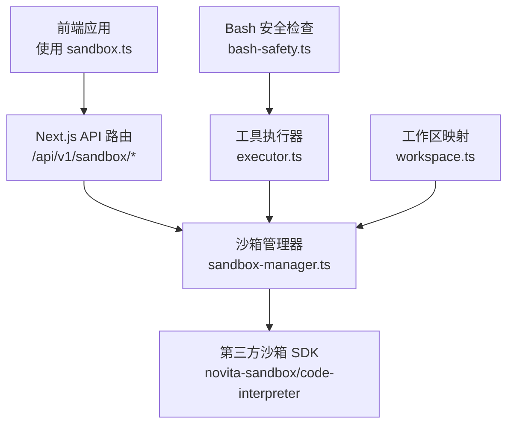
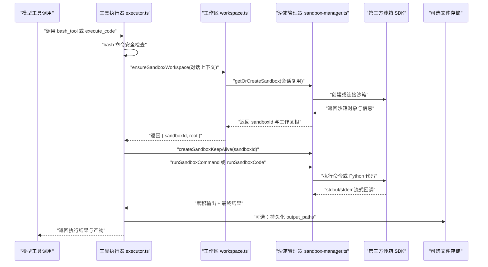
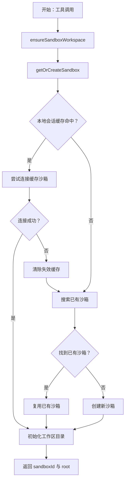
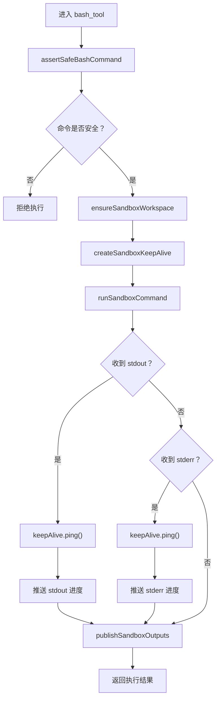
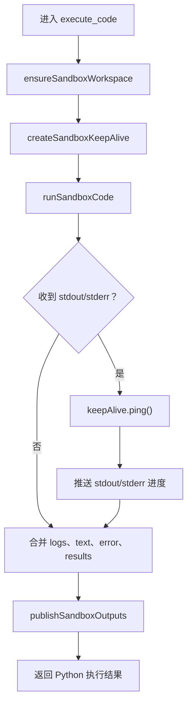
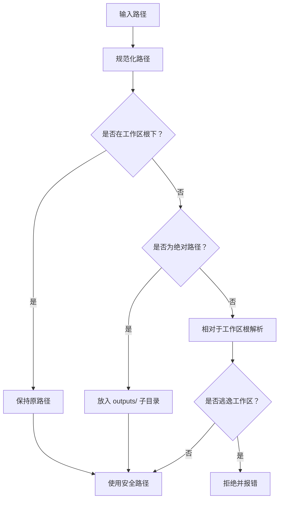
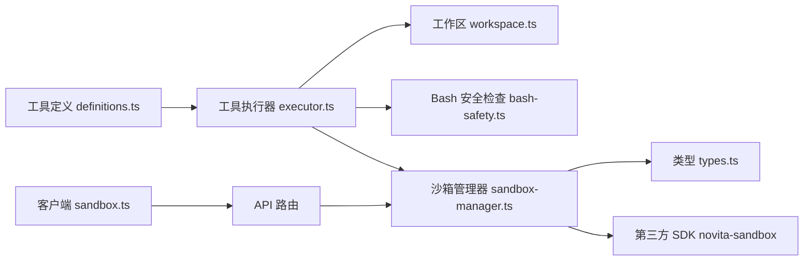
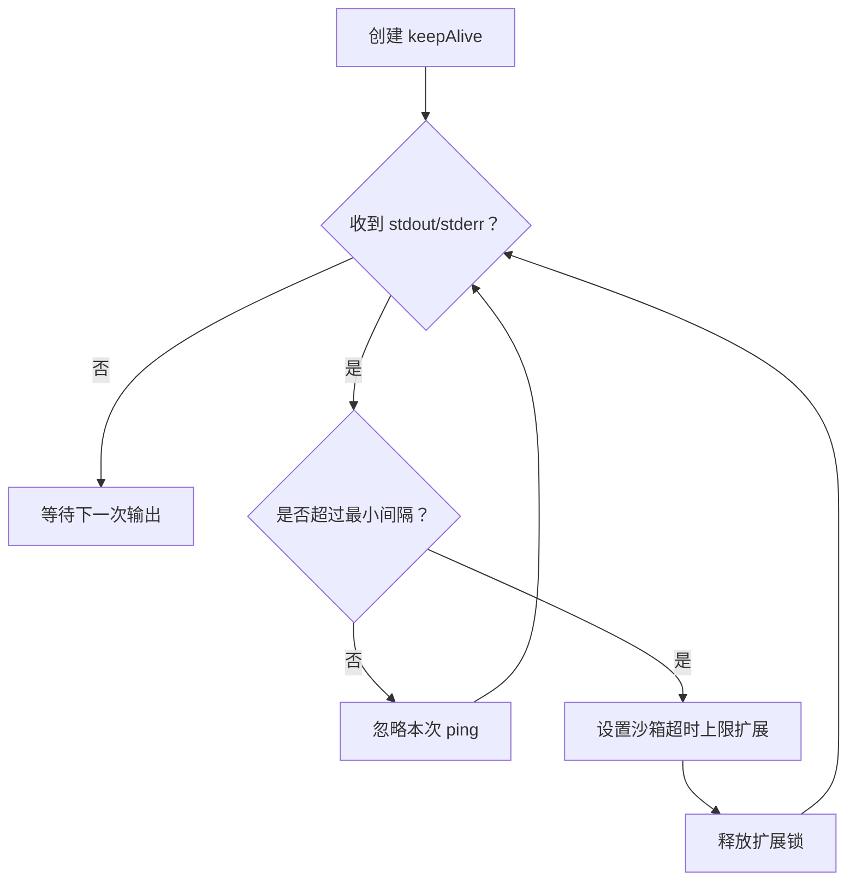

# 沙箱集成机制

<cite>
**本文引用的文件**   
- [sandbox-manager.ts](file://src/server/sandbox/sandbox-manager.ts)
- [types.ts](file://src/server/sandbox/types.ts)
- [definitions.ts](file://src/server/inference/autonomous-tools/definitions.ts)
- [executor.ts](file://src/server/inference/autonomous-tools/executor.ts)
- [workspace.ts](file://src/server/inference/autonomous-tools/workspace.ts)
- [bash-safety.ts](file://src/server/inference/bash-safety.ts)
- [route.ts（沙箱列表与创建）](file://src/app/api/v1/sandbox/route.ts)
- [route.ts（单个沙箱查询与销毁）](file://src/app/api/v1/sandbox/[sandboxId]/route.ts)
- [route.ts（连接沙箱）](file://src/app/api/v1/sandbox/[sandboxId]/connect/route.ts)
- [route.ts（命令执行）](file://src/app/api/v1/sandbox/[sandboxId]/commands/route.ts)
- [route.ts（文件系统访问）](file://src/app/api/v1/sandbox/[sandboxId]/files/route.ts)
- [route.ts（超时设置）](file://src/app/api/v1/sandbox/[sandboxId]/timeout/route.ts)
- [sandbox.ts（客户端沙箱 API）](file://shared/lib/api/sandbox.ts)
</cite>

## 目录
1. [引言](#引言)
2. [项目结构与角色定位](#项目结构与角色定位)
3. [核心组件](#核心组件)
4. [架构总览](#架构总览)
5. [关键流程详解](#关键流程详解)
6. [沙箱隔离与安全控制](#沙箱隔离与安全控制)
7. [依赖关系分析](#依赖关系分析)
8. [性能与生命周期特性](#性能与生命周期特性)
9. [调试与监控最佳实践](#调试与监控最佳实践)
10. [故障排查指南](#故障排查指南)
11. [结论](#结论)

## 引言
本文件聚焦于项目中“沙箱集成机制”，围绕 `bash_tool`、`execute_code` 两个工具如何借助服务端沙箱管理器创建工作空间、管理沙箱生命周期、执行命令和 Python 代码展开。文档解释以下关键点：

- 工作空间根目录与会话复用策略。
- 沙箱创建、查找、连接、暂停、销毁等生命周期操作。
- 通过 `runSandboxCommand`、`runSandboxCode` 执行的命令流式输出处理。
- keepAlive ping 机制防止长任务被固定超时误杀。
- 文件系统路径映射、读写安全与输出产物发布。
- bash 命令安全检查、所有权校验和资源上限设计。
- 面向生产环境的调试、监控和安全建议。

## 项目结构与角色定位
沙箱能力分布在三个层次：

| 层次 | 主要职责 | 代表文件 |
|---|---|---|
| 外部接口层 | 暴露 REST API，鉴权、参数解析、路由转发 | `app/api/v1/sandbox/**/route.ts` |
| 沙箱管理层 | 封装第三方 `novita-sandbox` SDK，提供会话、命令、代码、文件、指标等能力 | `server/sandbox/sandbox-manager.ts`、`server/sandbox/types.ts` |
| 工具调用层 | 将模型工具调用映射到沙箱工作区、命令执行、代码执行、输出发布 | `server/inference/autonomous-tools/executor.ts`、`workspace.ts`、`bash-safety.ts` |
| 客户端辅助层 | 前端通过统一客户端 API 调用 `/api/v1/sandbox/*` | `shared/lib/api/sandbox.ts` |

**图表来源**
- [sandbox-manager.ts:1-200](file://src/server/sandbox/sandbox-manager.ts#L1-L200)
- [executor.ts:320-470](file://src/server/inference/autonomous-tools/executor.ts#L320-L470)
- [workspace.ts:1-190](file://src/server/inference/autonomous-tools/workspace.ts#L1-L190)
- [bash-safety.ts:1-27](file://src/server/inference/bash-safety.ts#L1-L27)
- [route.ts（沙箱列表与创建）:1-58](file://src/app/api/v1/sandbox/route.ts#L1-L58)

**章节来源**
- [sandbox-manager.ts:1-200](file://src/server/sandbox/sandbox-manager.ts#L1-L200)
- [executor.ts:320-470](file://src/server/inference/autonomous-tools/executor.ts#L320-L470)
- [workspace.ts:1-190](file://src/server/inference/autonomous-tools/workspace.ts#L1-L190)
- [bash-safety.ts:1-27](file://src/server/inference/bash-safety.ts#L1-L27)
- [route.ts（沙箱列表与创建）:1-58](file://src/app/api/v1/sandbox/route.ts#L1-L58)

## 核心组件

### 沙箱管理器
`server/sandbox/sandbox-manager.ts` 是沙箱能力的核心实现，承担以下职责：

- 动态加载 `novita-sandbox/code-interpreter` 模块并注入服务端专用密钥。
- 维护进程内会话索引，按用户与对话上下文复用或重建沙箱。
- 提供创建、连接、查找、列出、获取信息、暂停、销毁、指标读取、超时设置等能力。
- 实现 `runSandboxCommand` 与 `runSandboxCode`，分别执行 shell 命令和 Python 代码。
- 实现 `createSandboxKeepAlive`，在命令或代码产生标准输出时延长沙箱空闲超时。
- 封装沙箱文件读、写、批量写、目录创建、列举、公开主机地址等能力。

关键数据结构由 `server/sandbox/types.ts` 定义，包括：

- `SandboxCreateOptions`：创建选项，包含用户标识、对话标识、超时、自动暂停、自动恢复、空闲超时、元数据与环境变量。
- `SandboxSessionContext`：用于会话键的用户与对话上下文。
- `SandboxPublicInfo`：对外暴露的沙箱元信息，不包含敏感内部状态。
- `SandboxCommandRequest`：命令请求体，支持背景模式、工作目录、环境变量与流式回调。
- `SandboxFileWriteRequest`、`SandboxFileWriteManyRequest`：单文件或多文件写入结构。

**章节来源**
- [sandbox-manager.ts:1-200](file://src/server/sandbox/sandbox-manager.ts#L1-L200)
- [sandbox-manager.ts:201-423](file://src/server/sandbox/sandbox-manager.ts#L201-L423)
- [types.ts:1-46](file://src/server/sandbox/types.ts#L1-L46)

### 工作区映射
`server/inference/autonomous-tools/workspace.ts` 负责把模型提供的路径映射到每个对话的固定沙箱根目录：

- 为每个对话生成稳定的工作区根路径 `/workspace/clauxen/<safeConversationId>`。
- 对绝对路径进行安全归一化；超出工作区的绝对路径会被重定向到 `outputs/` 子目录。
- 提供可读取候选路径列表，兼容模型直接写入 `/tmp` 等临时位置的场景。
- 提供相对路径展示逻辑，使终端和产物呈现对用户更友好。
- `ensureSandboxWorkspace` 会确保会话沙箱存在，并初始化 `/workspace/clauxen`、对话工作区与 `outputs` 目录。

该模块还封装了基于工作区的文件读取、字节读取、写入、列举等操作，保证所有写入最终落在受控工作区内。

**章节来源**
- [workspace.ts:1-190](file://src/server/inference/autonomous-tools/workspace.ts#L1-L190)

### Bash 安全检查
`server/inference/bash-safety.ts` 提供共享的 bash 工具护栏：

- 限制命令最大长度。
- 使用正则黑名单阻止高危操作，例如递归删除根目录、格式化磁盘、危险权限变更、通过管道执行远程脚本等。
- 对空命令抛出错误。

注意：这是命令级白名单/黑名单补充防护，不应被视为唯一隔离边界；真正的进程与文件系统隔离仍依赖底层沙箱 SDK。

**章节来源**
- [bash-safety.ts:1-27](file://src/server/inference/bash-safety.ts#L1-L27)

### 工具执行器
`server/inference/autonomous-tools/executor.ts` 是模型工具调用的执行中枢，其中 `bash_tool` 与 `execute_code` 是沙箱集成的入口点。

对于 `bash_tool`：

1. 校验命令安全性。
2. 调用 `ensureSandboxWorkspace` 获取 `sandboxId` 与工作区根目录。
3. 创建 keepAlive 实例。
4. 调用 `runSandboxCommand` 执行命令，并将 stdout/stderr 事件转发给进度回调。
5. 根据 `output_paths` 尝试读取并持久化产物。
6. 返回退出码、标准输出、标准错误、错误信息、沙箱 ID、工作区根路径与产物列表。

对于 `execute_code`：

1. 调用 `ensureSandboxWorkspace` 获取沙箱与工作区。
2. 创建 keepAlive 实例。
3. 调用 `runSandboxCode` 执行 Python 代码。
4. 合并日志、文本结果、错误信息与结果对象。
5. 同样尝试读取并持久化 `output_paths`。
6. 返回标准输出、标准错误、错误、Python 结果、沙箱 ID、工作区根路径与产物。

**章节来源**
- [executor.ts:320-470](file://src/server/inference/autonomous-tools/executor.ts#L320-L470)

## 架构总览

**图表来源**
- [executor.ts:320-470](file://src/server/inference/autonomous-tools/executor.ts#L320-L470)
- [workspace.ts:120-190](file://src/server/inference/autonomous-tools/workspace.ts#L120-L190)
- [sandbox-manager.ts:120-423](file://src/server/sandbox/sandbox-manager.ts#L120-L423)

## 关键流程详解

### 工作空间创建与会话复用
`ensureSandboxWorkspace` 是工具层的统一入口：

- 它调用 `getOrCreateSandbox`，优先复用当前用户与对话对应的沙箱。
- 如果本地会话缓存命中，则尝试连接已有沙箱；连接失败时清理缓存并重试。
- 如果本地未命中，会通过沙箱 SDK 的列表查询寻找已存在的同名会话沙箱。
- 如果仍未找到，则创建新沙箱，并将 `userId`、`conversationId`、`auto_resume` 等信息写入沙箱元数据。
- 随后初始化 `/workspace/clauxen`、对话专属工作区和 `outputs` 目录。

这意味着：

- 同一用户+对话通常会复用同一个沙箱，减少启动成本。
- 沙箱可通过元数据进行跨进程查找与恢复。
- 工作区根目录始终位于 `/workspace/clauxen/<safeConversationId>`。

**图表来源**
- [workspace.ts:120-190](file://src/server/inference/autonomous-tools/workspace.ts#L120-L190)
- [sandbox-manager.ts:80-170](file://src/server/sandbox/sandbox-manager.ts#L80-L170)

**章节来源**
- [workspace.ts:120-190](file://src/server/inference/autonomous-tools/workspace.ts#L120-L190)
- [sandbox-manager.ts:80-170](file://src/server/sandbox/sandbox-manager.ts#L80-L170)

### bash_tool 执行流程
`bash_tool` 的执行顺序如下：

1. 解析 `command` 参数。
2. 调用 `assertSafeBashCommand` 检查命令长度与黑名单。
3. 调用 `ensureSandboxWorkspace` 获取工作区。
4. 创建 keepAlive。
5. 调用 `runSandboxCommand`，传入命令、工作区根目录、stdout/stderr 回调。
6. 每次收到 stdout/stderr 都触发 keepAlive ping，并向上层推送进度事件。
7. 根据 `output_paths` 尝试读取产物。
8. 返回结构化结果。

**图表来源**
- [executor.ts:335-384](file://src/server/inference/autonomous-tools/executor.ts#L335-L384)
- [bash-safety.ts:1-27](file://src/server/inference/bash-safety.ts#L1-L27)
- [sandbox-manager.ts:260-330](file://src/server/sandbox/sandbox-manager.ts#L260-L330)

**章节来源**
- [executor.ts:335-384](file://src/server/inference/autonomous-tools/executor.ts#L335-L384)
- [bash-safety.ts:1-27](file://src/server/inference/bash-safety.ts#L1-L27)
- [sandbox-manager.ts:260-330](file://src/server/sandbox/sandbox-manager.ts#L260-L330)

### execute_code 执行流程
`execute_code` 的工作方式类似，但针对 Python 代码：

1. 解析 `code` 参数。
2. 调用 `ensureSandboxWorkspace`。
3. 创建 keepAlive。
4. 调用 `runSandboxCode`，传入 Python 代码、工作区根目录与流式回调。
5. 每次 stdout/stderr 都触发 keepAlive ping 与进度事件。
6. 合并 `logs.stdout`、`text`、`logs.stderr`、`error`、`results`。
7. 尝试读取 `output_paths` 并持久化。
8. 返回 Python 执行结果。

**图表来源**
- [executor.ts:385-470](file://src/server/inference/autonomous-tools/executor.ts#L385-L470)
- [sandbox-manager.ts:330-390](file://src/server/sandbox/sandbox-manager.ts#L330-L390)

**章节来源**
- [executor.ts:385-470](file://src/server/inference/autonomous-tools/executor.ts#L385-L470)
- [sandbox-manager.ts:330-390](file://src/server/sandbox/sandbox-manager.ts#L330-L390)

### 沙箱 API 路由与所有权校验
所有 `/api/v1/sandbox/*` 路由都要求登录，并通过 `assertSandboxOwnedBy` 校验沙箱归属：

- 查询沙箱信息。
- 从元数据中读取 `userId`。
- 若缺少所有者或不属于当前用户，返回“未找到”，避免泄露沙箱是否存在。
- 校验通过后，才允许连接、执行命令、读写文件、修改超时或销毁沙箱。

这构成了沙箱访问控制的第一道防线。

**章节来源**
- [route.ts（沙箱列表与创建）:1-58](file://src/app/api/v1/sandbox/route.ts#L1-L58)
- [route.ts（单个沙箱查询与销毁）:1-29](file://src/app/api/v1/sandbox/[sandboxId]/route.ts#L1-L29)
- [route.ts（连接沙箱）:1-23](file://src/app/api/v1/sandbox/[sandboxId]/connect/route.ts#L1-L23)
- [route.ts（命令执行）:1-28](file://src/app/api/v1/sandbox/[sandboxId]/commands/route.ts#L1-L28)
- [route.ts（文件系统访问）:1-59](file://src/app/api/v1/sandbox/[sandboxId]/files/route.ts#L1-L59)
- [route.ts（超时设置）:1-20](file://src/app/api/v1/sandbox/[sandboxId]/timeout/route.ts#L1-L20)
- [sandbox-manager.ts:201-240](file://src/server/sandbox/sandbox-manager.ts#L201-L240)

## 沙箱隔离与安全控制

### 文件系统访问控制
文件系统隔离主要通过工作区路径映射实现：

- 所有对话的工作区根目录以 `/workspace/clauxen/<safeConversationId>` 形式组织。
- 绝对路径若已在根目录下，保持不变。
- 绝对路径若在工作区外，写入时会重定向到 `outputs/` 子目录，并按原文件名保存。
- 路径解析会拒绝逃逸出工作区的非法路径。
- 读取时会优先尝试映射后的路径，也兼容模型直接写入 `/tmp` 等常见位置的读取场景。
- 所有写操作通过 `makeSandboxDir` 与 `writeSandboxFile` 间接调用沙箱 SDK，不直接拼接系统路径。

**图表来源**
- [workspace.ts:20-120](file://src/server/inference/autonomous-tools/workspace.ts#L20-L120)

**章节来源**
- [workspace.ts:20-120](file://src/server/inference/autonomous-tools/workspace.ts#L20-L120)

### 进程隔离与资源限制
当前代码中的隔离边界主要由两部分组成：

- 业务侧：会话复用、工作区路径隔离、命令长度限制、bash 黑名单。
- 基础设施侧：第三方 `novita-sandbox` SDK 负责实际进程、文件系统、网络与资源隔离。

仓库中并未直接配置 CPU、内存、网络规则；这些能力由 `Sandbox.create`、`Sandbox.connect` 以及 `novita-sandbox/code-interpreter` 的实现决定。因此，应把当前仓库视为沙箱集成层，而非完整容器运行时。

需要注意：

- `DEFAULT_TIMEOUT_MS` 默认约 5 分钟。
- keepAlive 最长扩展窗口为 30 分钟。
- 沙箱超时可通过 API 调整。
- 沙箱支持自动暂停与自动恢复。
- 命令可设置为后台运行。

**章节来源**
- [sandbox-manager.ts:1-80](file://src/server/sandbox/sandbox-manager.ts#L1-L80)
- [sandbox-manager.ts:240-330](file://src/server/sandbox/sandbox-manager.ts#L240-L330)
- [types.ts:1-46](file://src/server/sandbox/types.ts#L1-L46)

### Bash 命令白名单与黑名单
`assertSafeBashCommand` 是命令级安全门控：

- 禁止空命令。
- 限制命令长度。
- 阻止常见破坏性命令组合，如递归删除根目录、格式化磁盘、危险权限修改、通过 curl/wget 管道执行 shell 脚本。

这不是完整的命令白名单引擎；它更像是最小必要的安全护栏。推荐在生产环境中配合以下措施：

- 仅允许有限命令集合。
- 禁用交互式 shell 功能。
- 限制网络访问。
- 限制文件系统只读挂载，除非明确需要写输出。
- 限制进程数、CPU、内存、I/O 带宽。
- 记录审计日志，包含用户、对话、命令摘要、沙箱 ID。

**章节来源**
- [bash-safety.ts:1-27](file://src/server/inference/bash-safety.ts#L1-L27)

### 网络访问限制
当前代码没有显式关闭或放行网络访问。这意味着：

- 沙箱是否能访问外网取决于底层沙箱 SDK 与部署环境。
- 不应假设沙箱天然阻断网络。
- 如需严格限制，应在平台侧或 SDK 配置层关闭出站网络，或使用代理网关。

**章节来源**
- [sandbox-manager.ts:1-80](file://src/server/sandbox/sandbox-manager.ts#L1-L80)
- [sandbox-manager.ts:240-330](file://src/server/sandbox/sandbox-manager.ts#L240-L330)

## 依赖关系分析

**图表来源**
- [definitions.ts:1-200](file://src/server/inference/autonomous-tools/definitions.ts#L1-L200)
- [executor.ts:1-200](file://src/server/inference/autonomous-tools/executor.ts#L1-L200)
- [workspace.ts:1-190](file://src/server/inference/autonomous-tools/workspace.ts#L1-L190)
- [bash-safety.ts:1-27](file://src/server/inference/bash-safety.ts#L1-L27)
- [sandbox-manager.ts:1-423](file://src/server/sandbox/sandbox-manager.ts#L1-L423)
- [types.ts:1-46](file://src/server/sandbox/types.ts#L1-L46)
- [sandbox.ts:1-117](file://shared/lib/api/sandbox.ts#L1-L117)

**章节来源**
- [executor.ts:1-200](file://src/server/inference/autonomous-tools/executor.ts#L1-L200)
- [sandbox-manager.ts:1-423](file://src/server/sandbox/sandbox-manager.ts#L1-L423)
- [sandbox.ts:1-117](file://shared/lib/api/sandbox.ts#L1-L117)

## 性能与生命周期特性

### 会话复用与缓存
沙箱管理器使用进程内 Map 维护会话键到沙箱 ID 的映射：

- 会话键由用户 ID 与对话 ID 组成。
- 首次查找命中本地缓存后直接连接。
- 连接失败时移除缓存项，回退到远端搜索或新建。
- 这样可减少重复创建成本，同时具备容错能力。

此外，Python 代码执行上下文也按沙箱 ID 缓存，避免每次 `execute_code` 都重建 Python 解释器上下文，从而保留导入状态与全局变量。

**章节来源**
- [sandbox-manager.ts:10-80](file://src/server/sandbox/sandbox-manager.ts#L10-L80)
- [sandbox-manager.ts:330-390](file://src/server/sandbox/sandbox-manager.ts#L330-L390)

### KeepAlive 防超时机制
`createSandboxKeepAlive` 的核心目标是防止“慢活”命令因固定空闲超时被杀死：

- 每次 stdout/stderr 触发时调用 `ping()`。
- 使用最小间隔限制，避免对每个输出块都调用超时设置接口。
- 每次 ping 最多扩展固定时长。
- 扩展总量受最大沙箱超时上限保护。
- ping 失败采用“尽力而为”策略，不影响命令最终结果。

**图表来源**
- [sandbox-manager.ts:240-300](file://src/server/sandbox/sandbox-manager.ts#L240-L300)

**章节来源**
- [sandbox-manager.ts:240-300](file://src/server/sandbox/sandbox-manager.ts#L240-L300)

### 后台命令与流式输出
`runSandboxCommand` 支持 background 模式：

- 后台命令返回进程 PID 与已缓冲输出。
- 前台命令等待完成，返回退出码、标准输出、标准错误与错误信息。
- 两种模式都会收集 stdout/stderr 并调用上层回调。

这种设计适合构建实时终端体验：前端可在命令执行期间逐步显示输出，而不是等到全部完成。

**章节来源**
- [sandbox-manager.ts:260-330](file://src/server/sandbox/sandbox-manager.ts#L260-L330)

## 调试与监控最佳实践

### 建议关注的字段
| 字段或能力 | 用途 |
|---|---|
| `sandboxId` | 关联日志、追踪、问题复现 |
| `workspace.root` | 确认命令与代码是否在预期工作区执行 |
| `exitCode` | 判断 bash 命令是否成功 |
| `stdout`、`stderr` | 诊断命令输出与错误 |
| `error` | 捕获 SDK 或执行层异常 |
| `artifacts` | 查看产物是否成功读取与持久化 |
| `outputPathErrors` | 定位产物读取失败原因 |
| 沙箱指标 | 观察 CPU、内存等资源使用情况 |

### 推荐实践
- 在工具调用前记录 `conversationId`、`toolCallId`、`sandboxId`、`workspace.root`。
- 对 stdout/stderr 做增量日志采样，避免长时间高吞吐命令打满日志。
- 对 `output_paths` 读取失败单独记录路径与错误。
- 对 bash 命令先打印脱敏摘要，再决定是否记录完整命令。
- 对 `execute_code` 记录语言、工作目录、是否复用 Python 上下文。
- 定期通过 `/api/v1/sandbox/{id}/metrics` 查看资源趋势。
- 对长期运行的沙箱设置合理的自动暂停与超时策略。
- 对可疑命令结合黑名单与审计系统进行告警。

**章节来源**
- [executor.ts:320-470](file://src/server/inference/autonomous-tools/executor.ts#L320-L470)
- [sandbox-manager.ts:240-423](file://src/server/sandbox/sandbox-manager.ts#L240-L423)

## 故障排查指南

### 常见问题与定位思路

| 现象 | 可能原因 | 排查步骤 |
|---|---|---|
| bash 命令被拒绝 | 命令为空、过长或命中黑名单 | 检查 `assertSafeBashCommand` 的错误分支 |
| 命令立即结束但无输出 | 命令本身无输出或在前台模式下快速返回 | 查看 `stdout`、`stderr`、`exitCode` |
| 长任务被中断 | keepAlive 未触发或已达最大超时上限 | 检查 stdout/stderr 是否持续产生，以及沙箱超时设置 |
| 产物无法读取 | 路径不在工作区或文件不存在 | 检查 `output_paths`、`resolveSandboxReadableCandidates` |
| 文件写入位置不符合预期 | 使用了绝对路径或路径逃逸 | 检查 `resolveSandboxWorkspacePath` |
| 其他用户能访问我的沙箱 | 所有权校验失败或外部攻击 | 检查 API 路由是否经过 `assertSandboxOwnedBy` |
| Python 代码状态丢失 | Python 上下文被重建 | 检查是否意外断开沙箱或多次创建上下文 |
| 沙箱无法连接 | 沙箱已销毁、会话缓存失效或远端不可用 | 检查本地会话缓存、远端沙箱列表与连接错误 |

### 推荐修复顺序
1. 确认沙箱所有权校验通过。
2. 确认 `ensureSandboxWorkspace` 返回了有效 `sandboxId` 与 `root`。
3. 确认 bash 命令未被黑名单拦截。
4. 确认 stdout/stderr 流式回调正在触发 keepAlive。
5. 确认产物路径在工作区或 `outputs/` 下。
6. 检查沙箱指标与超时设置。
7. 必要时销毁并重新创建沙箱，验证会话缓存行为。

**章节来源**
- [bash-safety.ts:1-27](file://src/server/inference/bash-safety.ts#L1-L27)
- [workspace.ts:20-190](file://src/server/inference/autonomous-tools/workspace.ts#L20-L190)
- [executor.ts:320-470](file://src/server/inference/autonomous-tools/executor.ts#L320-L470)
- [sandbox-manager.ts:201-423](file://src/server/sandbox/sandbox-manager.ts#L201-L423)

## 结论
本项目的沙箱集成机制以 `sandbox-manager.ts` 为核心，将模型工具调用与第三方沙箱 SDK 解耦。`bash_tool` 与 `execute_code` 通过统一的 `ensureSandboxWorkspace` 获得会话化、隔离化的工作区，再通过 `runSandboxCommand` 与 `runSandboxCode` 执行命令与 Python 代码。keepAlive 机制结合 stdout/stderr 流式输出，让长任务能够在固定空闲超时下继续运行。工作区路径映射提供了基础的文件系统边界，bash 黑名单提供命令级安全补充，API 路由通过所有权校验防止越权访问。

若要进一步增强安全性，建议在平台层强化进程隔离、网络限制、资源配额与审计能力，并在业务层引入更严格的命令白名单与产物大小限制。当前实现已经为安全沙箱执行提供了清晰、可扩展的基础设施。