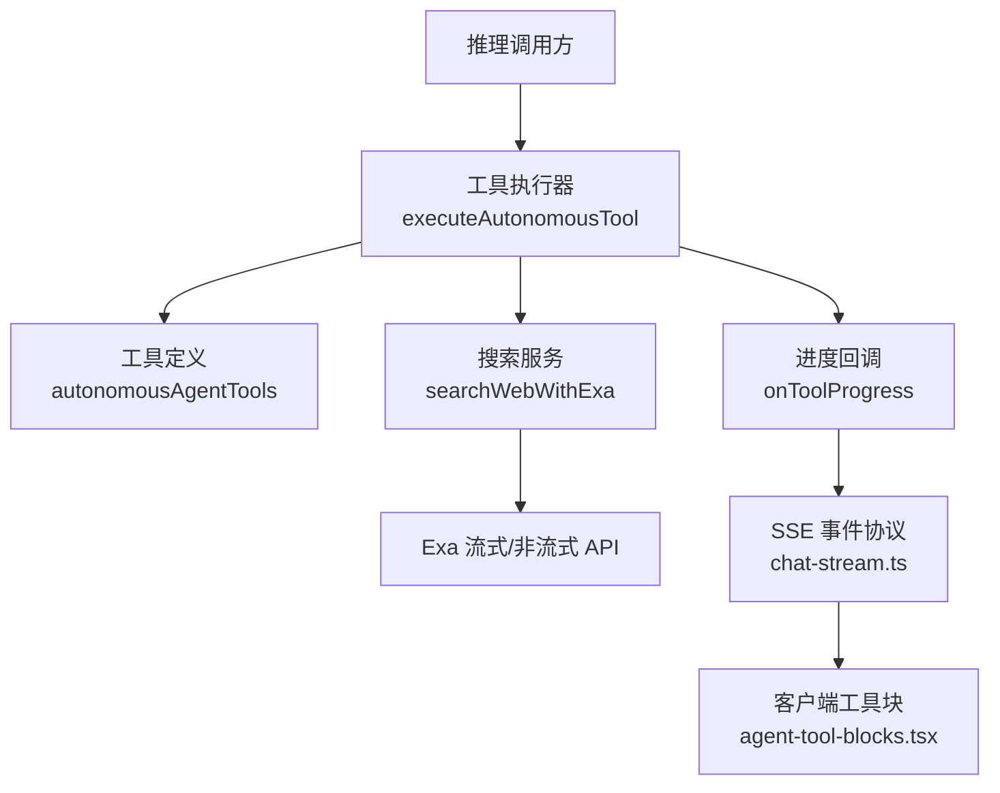
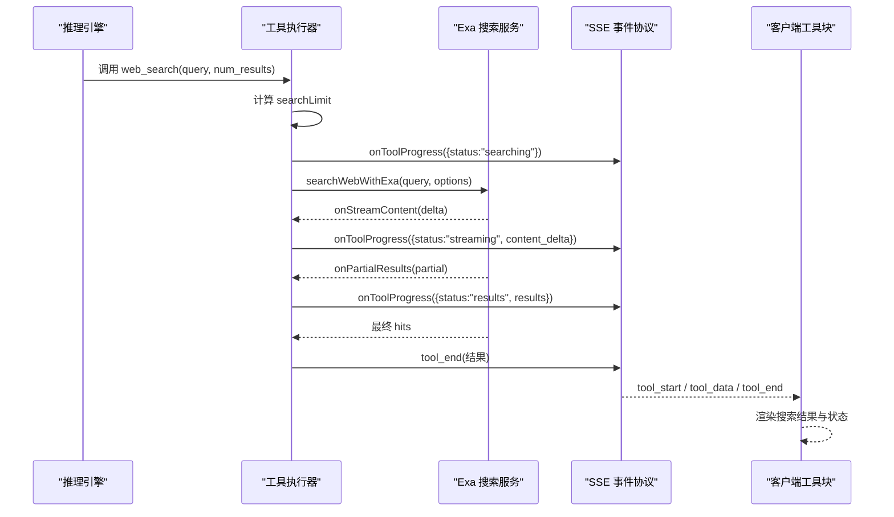
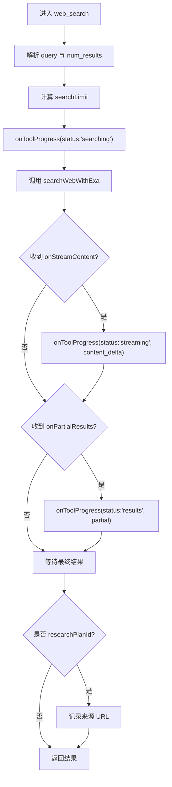
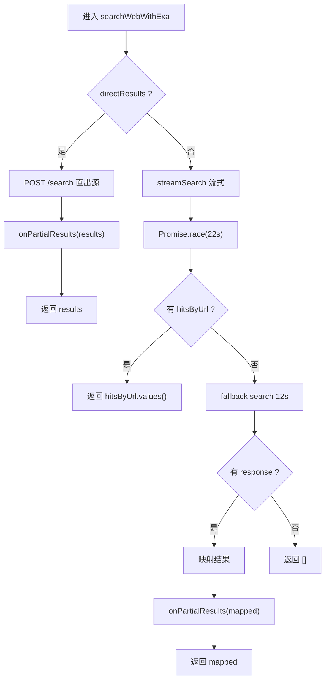
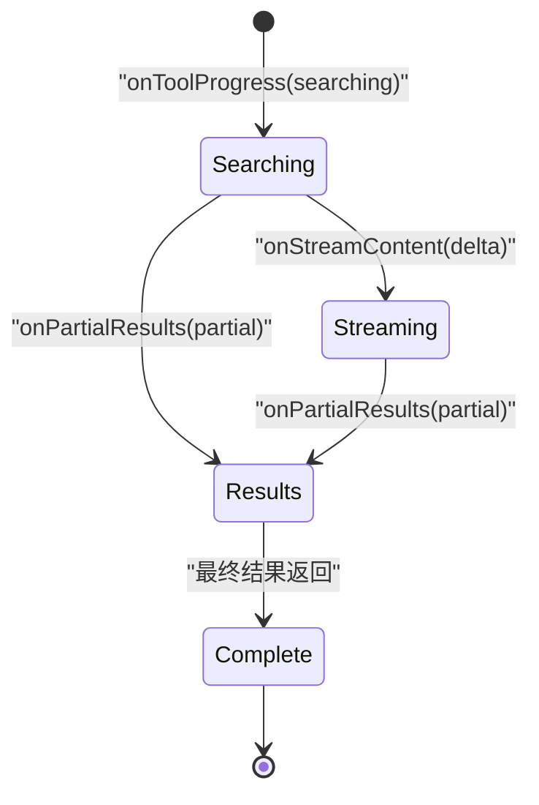
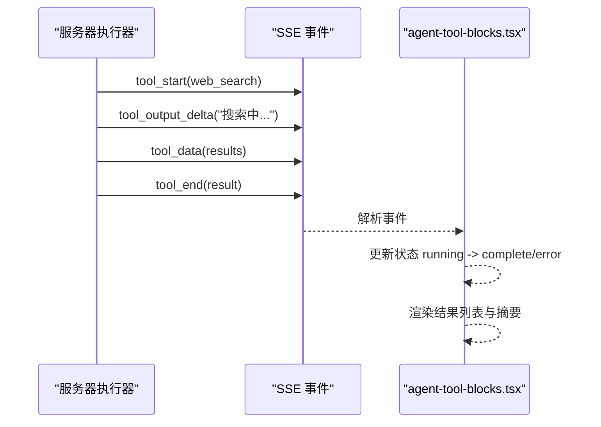
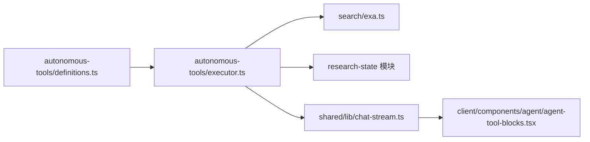

# 流式工具实现

<cite>
**本文引用的文件**   
- [autonomous-tools/definitions.ts](file://src/server/inference/autonomous-tools/definitions.ts)
- [autonomous-tools/executor.ts](file://src/server/inference/autonomous-tools/executor.ts)
- [search/exa.ts](file://src/server/search/exa.ts)
- [chat-stream.ts](file://src/shared/lib/chat-stream.ts)
- [agent-tool-blocks.tsx](file://src/client/components/agent/agent-tool-blocks.tsx)
- [research.ts](file://src/server/chat/research.ts)
- [deep-research.md](file://docs/deep-research.md)
</cite>

## 目录
1. [引言](#引言)
2. [项目结构](#项目结构)
3. [核心组件](#核心组件)
4. [架构总览](#架构总览)
5. [详细组件分析](#详细组件分析)
6. [依赖关系分析](#依赖关系分析)
7. [性能与超时特性](#性能与超时特性)
8. [错误恢复与健壮性](#错误恢复与健壮性)
9. [UI 增量更新机制](#ui-增量更新机制)
10. [可扩展的流式工具设计模式](#可扩展的流式工具设计模式)
11. [故障排查指南](#故障排查指南)
12. [结论](#结论)

## 引言
本文聚焦于“web_search”工具的流式实现，说明从推理执行器到 Exa 搜索、再到服务端进度回调和客户端 UI 更新的完整链路。重点包括：
- `searchWebWithExa` 的流式与直出两种路径；
- `onStreamContent` 与 `onPartialResults` 如何驱动中间状态；
- `onToolProgress` 的事件类型及 searching、streaming、results 状态切换；
- `researchPlanId` 对搜索行为的特殊处理，包括 `searchLimit` 限制和来源记录；
- 流式数据的增量更新策略和 UI 实时更新机制；
- 流式处理的错误恢复与超时处理；
- 其他工具扩展为流式的通用模式。

## 项目结构
本功能涉及四个主要层次：
- 工具定义层：声明 agent 可用的工具名称、参数和行为描述。
- 工具执行层：根据工具名路由具体实现，注入上下文并触发进度回调。
- 搜索服务层：封装 Exa 的流式与非流式搜索，返回结果或逐步推送。
- 传输与 UI 层：通过 SSE 事件协议将工具状态、文本增量和结果推送到前端，由工具块渲染。

**图示来源**
- [autonomous-tools/executor.ts:204-256](file://src/server/inference/autonomous-tools/executor.ts#L204-L256)
- [search/exa.ts:116-200](file://src/server/search/exa.ts#L116-L200)
- [chat-stream.ts:1-120](file://src/shared/lib/chat-stream.ts#L1-L120)
- [agent-tool-blocks.tsx:351-491](file://src/client/components/agent/agent-tool-blocks.tsx#L351-L491)

**章节来源**
- [autonomous-tools/definitions.ts:1-200](file://src/server/inference/autonomous-tools/definitions.ts#L1-L200)
- [autonomous-tools/executor.ts:1-120](file://src/server/inference/autonomous-tools/executor.ts#L1-L120)
- [search/exa.ts:1-120](file://src/server/search/exa.ts#L1-L120)
- [chat-stream.ts:1-120](file://src/shared/lib/chat-stream.ts#L1-L120)
- [agent-tool-blocks.tsx:1-120](file://src/client/components/agent/agent-tool-blocks.tsx#L1-L120)

## 核心组件
- 工具定义：`web_search` 用于实时网络搜索，参数包含查询和可选结果数量，默认普通聊天使用较少结果，深度研究可使用更多结果。
- 工具执行器：`executeAutonomousTool` 在识别到 `web_search` 时计算 `searchLimit`，立即发出 `searching` 状态，然后调用 `searchWebWithExa`，并通过 `onStreamContent` 和 `onPartialResults` 上报 `streaming` 与 `results` 状态。
- 搜索服务：`searchWebWithExa` 支持流式搜索和非流式回退，同时提供 `directResults` 模式用于深度研究直接取源。
- SSE 协议：`chat-stream.ts` 定义了 `tool_start`、`tool_output_delta`、`tool_data`、`tool_end`、`error`、`done` 等事件，作为统一传输格式。
- 客户端工具块：`agent-tool-blocks.tsx` 中的 `web_search` 渲染逻辑根据工具状态展示搜索中、流式文本、结果列表以及错误提示。

**章节来源**
- [autonomous-tools/definitions.ts:120-190](file://src/server/inference/autonomous-tools/definitions.ts#L120-L190)
- [autonomous-tools/executor.ts:204-256](file://src/server/inference/autonomous-tools/executor.ts#L204-L256)
- [search/exa.ts:116-200](file://src/server/search/exa.ts#L116-L200)
- [chat-stream.ts:1-120](file://src/shared/lib/chat-stream.ts#L1-L120)
- [agent-tool-blocks.tsx:351-491](file://src/client/components/agent/agent-tool-blocks.tsx#L351-L491)

## 架构总览
下图展示 web_search 从推理侧到 UI 的端到端流程。

**图示来源**
- [autonomous-tools/executor.ts:204-256](file://src/server/inference/autonomous-tools/executor.ts#L204-L256)
- [search/exa.ts:116-200](file://src/server/search/exa.ts#L116-L200)
- [chat-stream.ts:1-120](file://src/shared/lib/chat-stream.ts#L1-L120)
- [agent-tool-blocks.tsx:351-491](file://src/client/components/agent/agent-tool-blocks.tsx#L351-L491)

## 详细组件分析

### web_search 工具定义
`web_search` 是自主代理工具之一，其描述强调主动使用、引用格式和调用时机。参数包括：
- `query`：简短具体的自然语言查询。
- `num_results`：可选的结果数量，深度研究最多可到 30，普通聊天通常更少。

该定义是模型选择何时使用该工具的主要引导，而非系统提示。

**章节来源**
- [autonomous-tools/definitions.ts:120-190](file://src/server/inference/autonomous-tools/definitions.ts#L120-L190)

### 工具执行器与 onToolProgress
`executeAutonomousTool` 对 `web_search` 的处理流程如下：
1. 解析查询与 `num_results`。
2. 通过 `researchSearchLimit` 计算 `searchLimit`，考虑是否处于深度研究上下文。
3. 立即调用 `onToolProgress`，状态为 `searching`，携带查询和工具调用标识。
4. 调用 `searchWebWithExa`，传入：
   - 用户地区代码；
   - 搜索上限；
   - 是否为深度研究（`directResults`）；
   - `onStreamContent`：每收到合成内容片段即上报 `streaming` 状态；
   - `onPartialResults`：每当有新引用结果到达即上报 `results` 状态。
5. 如果是深度研究，将去重后的 URL 列表写入研究来源记录。
6. 返回结构化结果，包含查询、结果列表和搜索类型。

`onToolProgress` 的关键字段包括：
- `query`：当前搜索查询；
- `tool_call_id`：关联工具调用；
- `status`：`searching`、`streaming`、`results`；
- `content_delta`：流式合成文本增量；
- `results`：部分结果数组，每项包含序号、标题、URL、摘要、发布日期、图标和高亮片段。

**图示来源**
- [autonomous-tools/executor.ts:204-256](file://src/server/inference/autonomous-tools/executor.ts#L204-L256)

**章节来源**
- [autonomous-tools/executor.ts:204-256](file://src/server/inference/autonomous-tools/executor.ts#L204-L256)

### searchWebWithExa 的流式与直出路径
`searchWebWithExa` 提供两条路径：

- **直出路径**：当 `directResults=true`（深度研究）时，直接请求 `/search`，不等待合成答案，只取源。每次成功获取后调用 `onPartialResults`，返回去重后的结果数组。
- **流式路径**：使用 `exa.streamSearch`，遍历流式 chunk：
  - 若 chunk 包含合成内容，则调用 `onStreamContent`；
  - 若 chunk 包含 citations，则按 URL 去重并调用 `onPartialResults`；
  - 设置 22 秒超时；如果流式阶段产生任何结果，直接返回；否则回退到阻塞搜索。
- **回退路径**：使用 `exa.search`，再次设置 12 秒超时；若无响应则返回空数组。

**图示来源**
- [search/exa.ts:116-200](file://src/server/search/exa.ts#L116-L200)

**章节来源**
- [search/exa.ts:1-120](file://src/server/search/exa.ts#L1-L120)
- [search/exa.ts:116-200](file://src/server/search/exa.ts#L116-L200)
- [search/exa.ts:201-238](file://src/server/search/exa.ts#L201-L238)

### researchPlanId 的特殊处理
当 `ctx.researchPlanId` 存在时，web_search 的行为发生以下变化：
- `directResults=true`：不走流式合成答案，直接请求源，适合深度研究一次性获取多个来源预览。
- `searchLimit`：由 `researchSearchLimit` 决定，普通聊天默认较小，深度研究允许最多 30 个结果。
- 来源记录：搜索完成后，会将去重后的 URL 列表写入研究来源表，供后续报告与来源面板展示。
- 结果裁剪：无论是部分结果还是最终结果，都会按 `searchLimit` 切片，避免单次搜索输出过大。

深度研究文档也明确说明：普通聊天保留 10 个搜索结果，深度研究支持 `web_search.num_results` 从 1 到 30，默认 30；来源计数器对返回 URL 去重，但“检索来源数”不等于“已阅读或验证的来源数”。

**章节来源**
- [autonomous-tools/executor.ts:204-256](file://src/server/inference/autonomous-tools/executor.ts#L204-L256)
- [deep-research.md:1-39](file://docs/deep-research.md#L1-L39)

### onToolProgress 的状态机
`onToolProgress` 承载工具级进度，不是 SSE 协议本身，而是执行器向上传递的通用进度对象。web_search 使用三个关键状态：

- `searching`：表示搜索已开始，但尚未获得流式内容或部分结果。这能避免 UI 在 Exa 连接前空白。
- `streaming`：表示正在接收合成内容片段，携带 `content_delta`。
- `results`：表示已有部分或全部引用结果，携带 `results` 数组。

这些状态被上游转换为工具生命周期事件，如 `tool_start`、`tool_output_delta`、`tool_data`、`tool_end`。

**图示来源**
- [autonomous-tools/executor.ts:204-256](file://src/server/inference/autonomous-tools/executor.ts#L204-L256)
- [chat-stream.ts:1-120](file://src/shared/lib/chat-stream.ts#L1-L120)

**章节来源**
- [autonomous-tools/executor.ts:204-256](file://src/server/inference/autonomous-tools/executor.ts#L204-L256)
- [chat-stream.ts:1-120](file://src/shared/lib/chat-stream.ts#L1-L120)

### 流式数据增量更新策略
流式数据分为两类：
- 合成文本增量：通过 `onStreamContent` 传递，执行器以 `streaming` 状态上报 `content_delta`。
- 引用结果增量：通过 `onPartialResults` 传递，执行器以 `results` 状态上报 `results` 数组。

增量更新策略要点：
- 去重：Exa 层使用 `hitsByUrl` 按 URL 去重，避免重复来源。
- 截断：执行器对 `partial` 和最终结果都进行 `slice(0, searchLimit)`，保证输出受控。
- 顺序：先可能收到 `streaming`，再收到多次 `results`，最后得到完整结果。
- 直出模式：深度研究跳过合成答案，直接返回源，减少等待时间。

**章节来源**
- [search/exa.ts:116-200](file://src/server/search/exa.ts#L116-L200)
- [autonomous-tools/executor.ts:204-256](file://src/server/inference/autonomous-tools/executor.ts#L204-L256)

### UI 实时更新机制
客户端通过 SSE 事件协议消费工具输出。`chat-stream.ts` 定义了工具相关事件：
- `tool_start`：工具开始执行，携带工具名称、参数和描述。
- `tool_output_delta`：工具标准输出或错误输出增量。
- `tool_data`：工具结构化数据。
- `tool_end`：工具结束，携带结果和错误标志。
- `error`：错误事件。
- `done`：回合结束。

`agent-tool-blocks.tsx` 中的 `web_search` 渲染逻辑根据工具状态显示：
- 运行中：高亮或闪烁活动标签；
- 错误：红色样式；
- 结果：列出标题、URL、摘要、高亮片段；
- 任务型工具：根据 `task_index` 和 `status` 显示“证据收集完成”或“研究中”。

**图示来源**
- [chat-stream.ts:1-120](file://src/shared/lib/chat-stream.ts#L1-L120)
- [agent-tool-blocks.tsx:351-491](file://src/client/components/agent/agent-tool-blocks.tsx#L351-L491)

**章节来源**
- [chat-stream.ts:1-120](file://src/shared/lib/chat-stream.ts#L1-L120)
- [agent-tool-blocks.tsx:351-491](file://src/client/components/agent/agent-tool-blocks.tsx#L351-L491)

## 依赖关系分析
web_search 的依赖链如下：
- 工具定义依赖 agent 工具元数据；
- 工具执行器依赖 Exa 搜索服务和研究状态函数；
- 搜索服务依赖 Exa SDK 和配置；
- 传输层依赖 SSE 事件协议；
- 客户端依赖工具块和追踪原语。

**图示来源**
- [autonomous-tools/definitions.ts:1-200](file://src/server/inference/autonomous-tools/definitions.ts#L1-L200)
- [autonomous-tools/executor.ts:1-120](file://src/server/inference/autonomous-tools/executor.ts#L1-L120)
- [search/exa.ts:1-120](file://src/server/search/exa.ts#L1-L120)
- [chat-stream.ts:1-120](file://src/shared/lib/chat-stream.ts#L1-L120)
- [agent-tool-blocks.tsx:1-120](file://src/client/components/agent/agent-tool-blocks.tsx#L1-L120)

**章节来源**
- [autonomous-tools/executor.ts:1-120](file://src/server/inference/autonomous-tools/executor.ts#L1-L120)
- [search/exa.ts:1-120](file://src/server/search/exa.ts#L1-L120)
- [chat-stream.ts:1-120](file://src/shared/lib/chat-stream.ts#L1-L120)

## 性能与超时特性
- 流式超时：`searchWebWithExa` 对流式搜索使用 22 秒超时，避免长时间无响应。
- 回退搜索超时：回退到阻塞搜索时使用 12 秒超时，防止卡死。
- 直出模式优化：深度研究直接使用 `/search` 且限制最大 30 条结果，跳过合成答案，降低延迟。
- 结果裁剪：执行器对所有结果进行 `searchLimit` 裁剪，控制输出大小。
- 去重优化：按 URL 去重，避免重复结果影响 UI 和下游处理。

这些特性共同保证在外部搜索服务不稳定时仍能快速反馈，同时限制资源消耗。

**章节来源**
- [search/exa.ts:116-200](file://src/server/search/exa.ts#L116-L200)
- [autonomous-tools/executor.ts:204-256](file://src/server/inference/autonomous-tools/executor.ts#L204-L256)

## 错误恢复与健壮性
- 流式失败回退：如果流式阶段抛出异常，`searchWebWithExa` 会进入回退搜索逻辑。
- 超时保护：两个 Promise.race 分别约束流式和回退搜索的等待时间。
- 空结果处理：如果回退搜索无响应，返回空数组，避免上层崩溃。
- 工具错误传播：SSE 协议包含 `error` 事件，客户端可据此显示错误状态。
- 深度研究恢复：研究计划支持暂停、取消、重试和恢复，失败作业可重新排队并保留已收集证据。

```mermaid
flowchart TD
    TryStream["尝试流式搜索"] --> Fail{"流式失败?"}
    Fail -->|是| Fallback["回退阻塞搜索"]
    Fail -->|否| UseStream["使用流式结果"]
    Fallback --> Timeout{"回退超时?"}
    Timeout -->|是| Empty["返回空结果"]
    Timeout -->|否| UseFallback["使用回退结果"]
    UseStream --> Done["完成"]
    UseFallback --> Done
    Empty --> Done
```

**图示来源**
- [search/exa.ts:116-200](file://src/server/search/exa.ts#L116-L200)
- [chat-stream.ts:1-120](file://src/shared/lib/chat-stream.ts#L1-L120)
- [research.ts:1-120](file://src/server/chat/research.ts#L1-L120)

**章节来源**
- [search/exa.ts:116-200](file://src/server/search/exa.ts#L116-L200)
- [chat-stream.ts:1-120](file://src/shared/lib/chat-stream.ts#L1-L120)
- [research.ts:1-120](file://src/server/chat/research.ts#L1-L120)

## UI 增量更新机制
客户端工具块根据工具状态渲染不同界面：
- 运行中：显示活动指示器和可能的闪烁文本；
- 错误：显示红色错误样式；
- 结果：显示来源列表，包括标题、URL、摘要和高亮片段；
- 任务型工具：根据 `task_index` 和 `status` 显示任务进度。

SSE 事件协议确保事件有序、可解析，并对未知字段做容错处理。客户端在解析失败时忽略无效事件，避免整个流中断。

**章节来源**
- [agent-tool-blocks.tsx:351-491](file://src/client/components/agent/agent-tool-blocks.tsx#L351-L491)
- [chat-stream.ts:1-120](file://src/shared/lib/chat-stream.ts#L1-L120)

## 可扩展的流式工具设计模式
除 web_search 外，其他工具也可采用类似流式模式：
- 立即上报初始状态：如 `searching`、`processing`，避免 UI 空白。
- 分阶段上报增量：如 `streaming` 文本、`partial` 结果。
- 最终状态收尾：如 `complete` 或 `error`，携带最终结果。
- 超时与回退：对外部依赖设置超时，并提供降级路径。
- 去重与裁剪：对结果集合进行去重和上限控制，防止 UI 过载。
- 统一进度接口：通过 `onToolProgress` 暴露通用进度对象，便于上游统一处理。

这种模式适用于需要长时间外部 I/O、多阶段结果生成或大体积输出的工具，例如批量数据处理、长文档生成、多步研究任务等。

[本节为概念性总结，不直接分析具体文件]

## 故障排查指南
常见问题与定位方法：
- 搜索无响应：检查 Exa API 密钥和流式超时；确认是否进入回退搜索。
- UI 不更新：检查 SSE 事件是否正确发送，确认 `tool_start`、`tool_data`、`tool_end` 是否完整。
- 结果过多：检查 `searchLimit` 是否被正确应用，确认深度研究与普通聊天的区别。
- 来源未记录：确认 `researchPlanId` 是否存在，检查 `addResearchSources` 是否调用成功。
- 错误状态不显示：检查 `error` 事件是否触发，客户端是否正确渲染错误样式。

建议优先查看：
- 执行器日志，确认 `onToolProgress` 状态序列；
- SSE 流，确认事件顺序和内容；
- Exa 响应，确认流式或直出路径是否成功；
- 数据库记录，确认研究来源是否写入。

**章节来源**
- [autonomous-tools/executor.ts:204-256](file://src/server/inference/autonomous-tools/executor.ts#L204-L256)
- [search/exa.ts:116-200](file://src/server/search/exa.ts#L116-L200)
- [chat-stream.ts:1-120](file://src/shared/lib/chat-stream.ts#L1-L120)
- [agent-tool-blocks.tsx:351-491](file://src/client/components/agent/agent-tool-blocks.tsx#L351-L491)

## 结论
web_search 的流式实现通过三层协作达成低延迟、高可用和良好的用户体验：
- 执行器负责状态编排和进度上报；
- 搜索服务负责流式与回退逻辑；
- 传输层和 UI 负责增量渲染。

`researchPlanId` 使搜索行为适配深度研究场景，支持更大结果集和来源持久化。超时、回退、去重和裁剪共同保证了系统的健壮性。该模式可作为其他工具扩展为流式的基础设计范式。