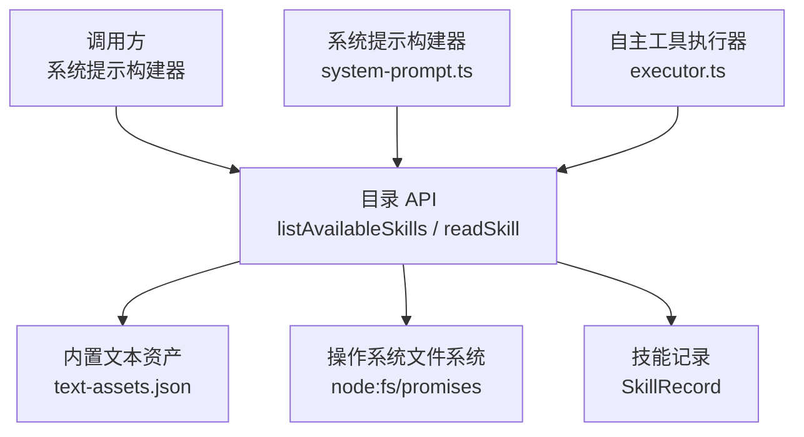
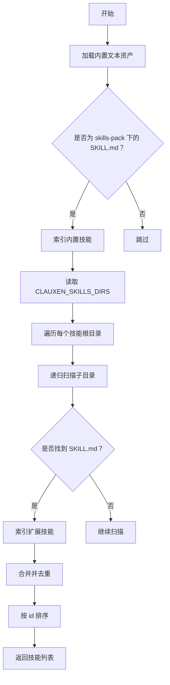
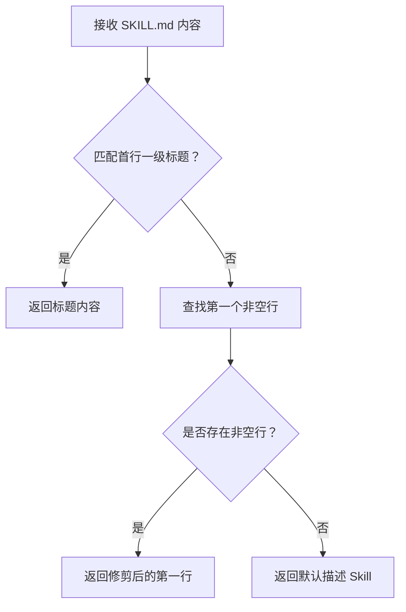
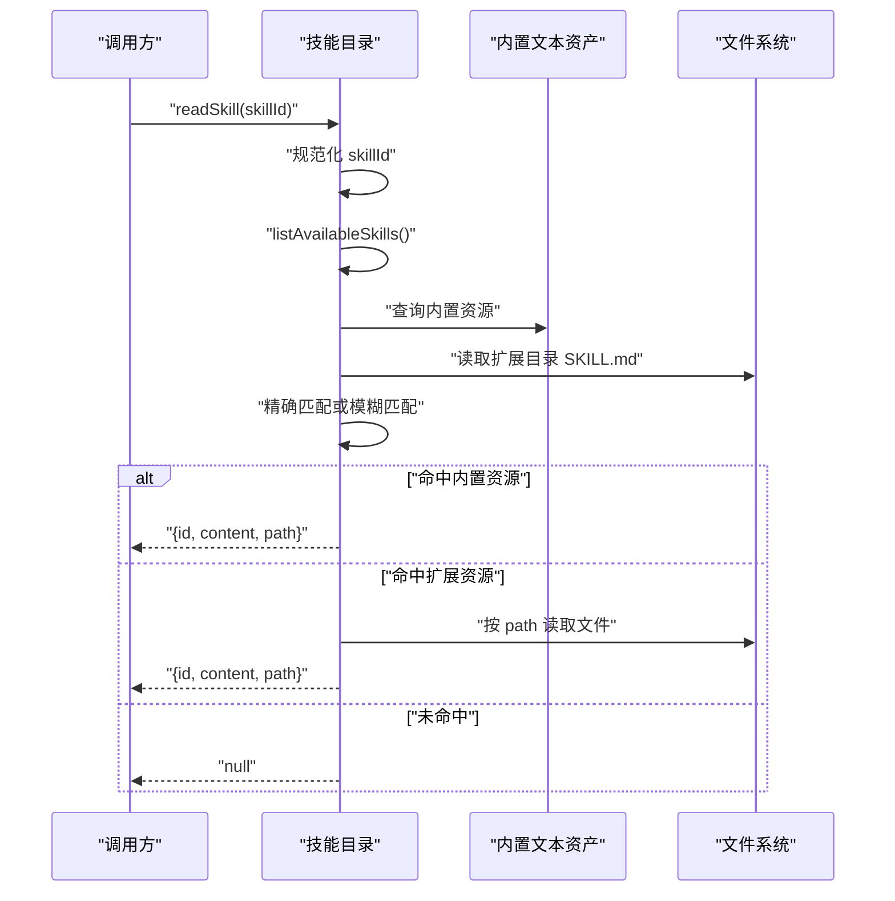
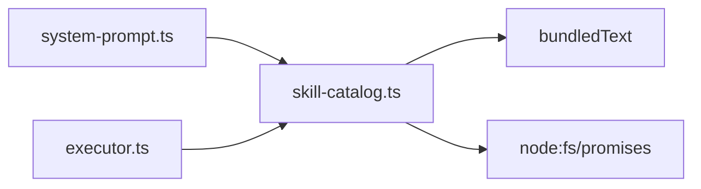

# 技能目录系统

<cite>
**本文引用的文件**
- [skill-catalog.ts](file://src/server/inference/autonomous-tools/skill-catalog.ts)
- [system-prompt.ts](file://src/server/inference/system-prompt.ts)
- [executor.ts](file://src/server/inference/autonomous-tools/executor.ts)
- [starter-skills-data.ts](file://src/shared/lib/starter-skills-data.ts)
- [text-assets.json](file://src/server/generated/text-assets.json)
- [clauxen-cli SKILL.md](file://.agents/skills/clauxen-cli/SKILL.md)
- [frontend-design SKILL.md](file://.agents/skills/frontend-design/SKILL.md)
- [skills-lock.json](file://skills-lock.json)
</cite>

## 目录
1. [简介](#简介)
2. [项目结构与角色定位](#项目结构与角色定位)
3. [核心类型与数据模型](#核心类型与数据模型)
4. [SKILL.md 文件格式规范](#skillmd-文件格式规范)
5. [技能发现机制](#技能发现机制)
6. [多根目录与递归扫描算法](#多根目录与递归扫描算法)
7. [技能标识符生成规则](#技能标识符生成规则)
8. [描述解析与标题提取](#描述解析与标题提取)
9. [可用技能列表与读取实现](#可用技能列表与读取实现)
10. [依赖关系与调用链](#依赖关系与调用链)
11. [创建新技能包指南](#创建新技能包指南)
12. [性能与去重分析](#性能与去重分析)
13. [故障排查](#故障排查)
14. [结论](#结论)

## 简介
技能目录系统负责在运行时发现、索引并加载“技能”资源。每个技能由一个 `SKILL.md` 文件定义，并提供标题、名称和可选的元数据；系统会将这些技能组织成统一的数据结构，供上层推理流程、系统提示构建和工具执行器使用。

该系统支持两类技能来源：
- **内置打包资源**：通过构建阶段生成的 `bundledText` 文本资产提供，适合生产环境。
- **扩展文件系统目录**：通过环境变量 `CLAUXEN_SKILLS_DIRS` 指定额外技能根目录，适合本地开发或运维配置。

## 项目结构与角色定位
技能目录系统的核心逻辑集中在服务端推理层：



**图表来源**
- [skill-catalog.ts:1-125](file://src/server/inference/autonomous-tools/skill-catalog.ts#L1-L125)
- [system-prompt.ts:182-183](file://src/server/inference/system-prompt.ts#L182-L183)
- [executor.ts:182-183](file://src/server/inference/autonomous-tools/executor.ts#L182-L183)

**章节来源**
- [skill-catalog.ts:1-125](file://src/server/inference/autonomous-tools/skill-catalog.ts#L1-L125)
- [system-prompt.ts:182-183](file://src/server/inference/system-prompt.ts#L182-L183)
- [executor.ts:182-183](file://src/server/inference/autonomous-tools/executor.ts#L182-L183)

## 核心类型与数据模型
`SkillRecord` 是技能目录对外暴露的最小可序列化记录，包含以下字段：

| 字段 | 类型 | 含义 |
| --- | --- | --- |
| `id` | `string` | 技能的稳定唯一标识符，通常来自目录名或文件名 |
| `name` | `string` | 用于展示的技能名称；当前实现中等于 `id` |
| `path` | `string` | 技能来源路径；对内置资源为包内相对路径，对扩展目录为绝对文件系统路径 |
| `description` | `string` | 从 `SKILL.md` 中提取的技能描述 |

该类型没有数据库实体字段；它是对运行期内存中技能索引的结构化抽象。

**章节来源**
- [skill-catalog.ts:6-12](file://src/server/inference/autonomous-tools/skill-catalog.ts#L6-L12)

## SKILL.md 文件格式规范
`SKILL.md` 是一个 Markdown 文件，其头部通常采用 YAML Front Matter 形式，至少应包含：

| 字段 | 是否必需 | 说明 |
| --- | --- | --- |
| `name` | 建议 | 人类可读的技能名称 |
| `description` | 建议 | 面向用户的技能用途说明 |
| `metadata.version` | 可选 | 技能版本 |
| `metadata.platform` | 可选 | 适用平台，例如 `macos` |
| `license` | 可选 | 许可证说明或指向许可证文件的链接 |

正文部分应以一级标题开始，表示技能的主题标题。示例技能包括：
- `.agents/skills/clauxen-cli/SKILL.md`
- `.agents/skills/frontend-design/SKILL.md`

这两个文件展示了 CLI 工具技能和前端设计指导类技能的典型结构。

**章节来源**
- [clauxen-cli SKILL.md:1-10](file://.agents/skills/clauxen-cli/SKILL.md#L1-L10)
- [frontend-design SKILL.md:1-10](file://.agents/skills/frontend-design/SKILL.md#L1-L10)

## 技能发现机制
技能发现分为两个阶段：

1. **内置资源扫描**：遍历 `bundledText` 中的键，筛选出路径包含 `/skills-pack/` 且以 `SKILL.md` 结尾的资源。
2. **扩展目录扫描**：根据 `CLAUXEN_SKILLS_DIRS` 环境变量解析多个冒号分隔的绝对路径，逐个递归查找其中的 `SKILL.md` 文件。



**图表来源**
- [skill-catalog.ts:14-125](file://src/server/inference/autonomous-tools/skill-catalog.ts#L14-L125)

**章节来源**
- [skill-catalog.ts:14-125](file://src/server/inference/autonomous-tools/skill-catalog.ts#L14-L125)

## 多根目录与递归扫描算法
### skillRoots() 的多根处理
`skillRoots()` 从环境变量 `CLAUXEN_SKILLS_DIRS` 中读取字符串，按冒号分割，去除空白段，过滤空值后返回数组。默认值为空数组，因此不启用任何扩展目录时只加载内置技能。

| 输入 | 行为 |
| --- | --- |
| 未设置环境变量 | 返回空数组 |
| 单个绝对路径 | 返回单元素数组 |
| 多个冒号分隔路径 | 返回多个根目录 |
| 包含空段或空白 | 被过滤掉 |

### collectSkillFiles() 的递归扫描
`collectSkillFiles()` 对给定目录进行深度优先遍历：
- 列出目录条目。
- 如果是目录，则递归进入。
- 如果是文件且文件名以 `SKILL.md` 结尾，则加入结果集。
- 如果目录不可读，捕获异常并返回空集合，避免中断整体扫描。

时间复杂度近似为 `O(N)`，其中 `N` 是被扫描目录树中的条目总数。空间复杂度受递归深度和结果数组影响，最坏情况下接近 `O(N)`。

**章节来源**
- [skill-catalog.ts:19-52](file://src/server/inference/autonomous-tools/skill-catalog.ts#L19-L52)

## 技能标识符生成规则
`skillIdFromPath()` 根据文件路径推导技能 ID：

| 路径特征 | 生成的 ID |
| --- | --- |
| 父目录不是 `skills-pack` 也不是 `skills` | 使用父目录名作为 ID |
| 父目录是 `skills-pack` 或 `skills` | 使用去掉 `.md` 后缀的文件名小写形式作为 ID |

这意味着：
- 同一目录下多个不同技能包具有稳定的目录级 ID。
- 直接放在 `skills-pack` 或 `skills` 下的技能以文件名作为 ID。
- ID 主要用于去重和模糊匹配，而不是严格的人类友好名称。

**章节来源**
- [skill-catalog.ts:54-61](file://src/server/inference/autonomous-tools/skill-catalog.ts#L54-L61)

## 描述解析与标题提取
`parseSkillDescription()` 从 `SKILL.md` 内容中提取描述：

1. 首先尝试匹配文档开头的第一个一级 Markdown 标题。
2. 如果找到，则返回该标题内容。
3. 否则回退到第一个非空行。
4. 如果仍然没有内容，返回默认值 `Skill`。



**图表来源**
- [skill-catalog.ts:63-74](file://src/server/inference/autonomous-tools/skill-catalog.ts#L63-L74)

**章节来源**
- [skill-catalog.ts:63-74](file://src/server/inference/autonomous-tools/skill-catalog.ts#L63-L74)

## 可用技能列表与读取实现
### listAvailableSkills()
该函数返回所有已发现技能的去重列表：

1. 初始化基于 ID 的 `Map`，保证同 ID 只保留一条记录。
2. 先扫描内置 `bundledText` 中的技能资源。
3. 再扫描 `CLAUXEN_SKILLS_DIRS` 配置的扩展目录。
4. 如果扩展目录中存在与内置资源相同 ID 的技能，则跳过，保持内置优先。
5. 最终按 `id` 的字典序排序返回。

去重策略的关键点是：**ID 相同时，先发现的记录胜出**。由于内置资源先被索引，扩展目录无法覆盖同名内置技能。

### readSkill()
该函数根据技能 ID 读取具体 `SKILL.md` 内容：

1. 规范化输入的 `skillId`：去除空白并转为小写。
2. 调用 `listAvailableSkills()` 获取最新技能列表。
3. 精确匹配优先：查找 `id` 完全相同的技能。
4. 若精确匹配失败，则尝试模糊匹配：任一方向包含目标字符串。
5. 命中后，从 `bundledText` 读取内置资源，或从文件系统读取扩展技能。
6. 未命中时返回 `null`。



**图表来源**
- [skill-catalog.ts:76-125](file://src/server/inference/autonomous-tools/skill-catalog.ts#L76-L125)

**章节来源**
- [skill-catalog.ts:76-125](file://src/server/inference/autonomous-tools/skill-catalog.ts#L76-L125)

## 依赖关系与调用链
技能目录系统被上层组件消费：

- `system-prompt.ts` 导入并调用 `listAvailableSkills` 和 `readSkill`，用于构建系统提示。
- `executor.ts` 同样导入并使用这两个 API，用于在执行阶段加载技能内容。



**图表来源**
- [system-prompt.ts:182-183](file://src/server/inference/system-prompt.ts#L182-L183)
- [executor.ts:182-183](file://src/server/inference/autonomous-tools/executor.ts#L182-L183)
- [skill-catalog.ts:1-125](file://src/server/inference/autonomous-tools/skill-catalog.ts#L1-L125)

**章节来源**
- [system-prompt.ts:182-183](file://src/server/inference/system-prompt.ts#L182-L183)
- [executor.ts:182-183](file://src/server/inference/autonomous-tools/executor.ts#L182-L183)
- [skill-catalog.ts:1-125](file://src/server/inference/autonomous-tools/skill-catalog.ts#L1-L125)

## 创建新技能包指南
### 1. 确定技能位置
- 对于内置打包技能，应放在构建产物中会被打包进 `text-assets.json` 的位置。当前代码期望内置技能路径包含 `/skills-pack/`。
- 对于本地开发或运维扩展技能，可放入任意绝对路径，并通过 `CLAUXEN_SKILLS_DIRS` 暴露给运行时。

### 2. 设计目录结构
推荐结构：
```
skills-pack/
  my-skill/
    SKILL.md
    LICENSE.txt
    reference/
      api.md
      examples.md
```

关键点：
- 每个技能目录通常包含一个 `SKILL.md`。
- 辅助参考文件可以放在同级或子目录中。
- 目录名会参与生成技能 ID。

### 3. 编写 SKILL.md
最小要求：
- 顶部包含 YAML Front Matter，建议提供 `name` 和 `description`。
- 正文以一级标题开头，作为技能描述。
- 如需许可证，可在仓库中添加 `LICENSE.txt` 并在 `SKILL.md` 中引用。

已有参考：
- `.agents/skills/clauxen-cli/SKILL.md`
- `.agents/skills/frontend-design/SKILL.md`

### 4. 打包与部署
- 内置技能需要通过构建流程生成 `text-assets.json`，使 `bundledText` 中包含对应路径和内容。
- 扩展技能不需要打包，只需确保部署环境中存在对应目录，并正确配置 `CLAUXEN_SKILLS_DIRS`。
- 如果使用第三方技能源，可结合类似 `skills-lock.json` 的版本锁定机制管理外部技能来源、来源类型、相对路径和计算哈希。

**章节来源**
- [skill-catalog.ts:14-23](file://src/server/inference/autonomous-tools/skill-catalog.ts#L14-L23)
- [skills-lock.json:1-17](file://skills-lock.json#L1-L17)
- [clauxen-cli SKILL.md:1-10](file://.agents/skills/clauxen-cli/SKILL.md#L1-L10)
- [frontend-design SKILL.md:1-10](file://.agents/skills/frontend-design/SKILL.md#L1-L10)

## 性能与去重分析
### 时间复杂度
- `listAvailableSkills()`：
  - 内置资源遍历：与 `bundledText` 中的键数量成正比。
  - 扩展目录扫描：与文件系统总条目数成正比。
  - 排序：与最终技能数量 `S` 成正比，为 `O(S log S)`。
- `readSkill()`：
  - 每次调用都会重新执行 `listAvailableSkills()`，因此重复读取可能产生额外开销。
  - 模糊匹配在最坏情况下需要检查全部技能。

### 空间复杂度
- `byId` 使用 `Map` 存储去重后的技能记录，空间与技能数量线性相关。
- `collectSkillFiles()` 的结果数组最多包含所有匹配的 `SKILL.md` 路径。

### 去重逻辑
- 使用 `Map<string, SkillRecord>` 按 `id` 去重。
- 内置技能先注册，扩展技能无法覆盖同名内置技能。
- 排序使用 `localeCompare`，保证输出顺序稳定。

### 优化建议
- 如果 `readSkill()` 被高频调用，可考虑缓存 `listAvailableSkills()` 的结果。
- 对大规模扩展目录，可考虑增量扫描或文件变更监听。
- 模糊匹配可根据业务需求限制匹配范围，避免全表扫描。

**章节来源**
- [skill-catalog.ts:76-125](file://src/server/inference/autonomous-tools/skill-catalog.ts#L76-L125)

## 故障排查
| 现象 | 可能原因 | 排查步骤 |
| --- | --- | --- |
| 找不到新增技能 | 未将 `SKILL.md` 放入正确位置 | 检查是否在 `skills-pack` 下或通过 `CLAUXEN_SKILLS_DIRS` 配置 |
| 技能 ID 不符合预期 | 目录名或文件名影响 ID 生成 | 确认父目录是否为 `skills-pack` 或 `skills` |
| 扩展技能被忽略 | 环境变量为空、路径不存在或权限不足 | 检查 `CLAUXEN_SKILLS_DIRS` 和文件系统权限 |
| 读取内容为空 | `SKILL.md` 缺少一级标题或为空文件 | 检查标题格式和文件内容 |
| 重复 ID 冲突 | 多个技能共享相同 ID | 调整目录名或文件名以避免冲突 |

**章节来源**
- [skill-catalog.ts:19-125](file://src/server/inference/autonomous-tools/skill-catalog.ts#L19-L125)

## 结论
技能目录系统以 `SkillRecord` 为核心抽象，通过内置资源和扩展文件系统目录两种方式提供技能发现能力。`skillRoots()` 支持多根目录配置，`collectSkillFiles()` 提供安全的递归扫描，`skillIdFromPath()` 用目录结构和文件名推导稳定 ID，`parseSkillDescription()` 从 `SKILL.md` 中提取标题作为描述。`listAvailableSkills()` 负责去重与排序，`readSkill()` 提供精确与模糊匹配读取。

对于使用者而言，最关键的实践是：
- 明确 `SKILL.md` 的头部和一级标题。
- 合理设计技能目录结构以控制 ID。
- 使用 `CLAUXEN_SKILLS_DIRS` 安全扩展本地技能。
- 理解内置资源优先于扩展目录的去重语义。