# 文件持久化

<cite>
**本文引用的文件**
- [persist-agent-file.ts](file://src/server/inference/autonomous-tools/persist-agent-file.ts)
- [executor.ts](file://src/server/inference/autonomous-tools/executor.ts)
- [object-store.ts](file://src/server/storage/object-store.ts)
- [user-files.repository.ts](file://src/server/repositories/user-files.repository.ts)
- [library_file_system.sql](file://supabase/migrations/20260731113156_library_file_system.sql)
- [library_file_system_fk_indexes.sql](file://supabase/migrations/20260731115644_library_file_system_fk_indexes.sql)
- [user_files_storage_url.sql](file://supabase/migrations/20260911120000_user_files_storage_url.sql)
- [r2-gateway/index.ts](file://workers/r2-gateway/src/index.ts)
</cite>

## 目录
1. [引言](#引言)
2. [项目结构](#项目结构)
3. [核心组件](#核心组件)
4. [架构总览](#架构总览)
5. [详细组件分析](#详细组件分析)
6. [依赖关系分析](#依赖关系分析)
7. [性能与一致性](#性能与一致性)
8. [故障排查指南](#故障排查指南)
9. [结论](#结论)

## 引言
本文件持久化系统用于将智能体（Agent）生成的工作区文件安全、可追踪地落盘，并允许用户后续访问和下载。其核心目标是：
- 通过 `persistAgentCreatedFile()` 将 Agent 产生的文件写入 R2 对象存储，并在数据库 `user_files` 中建立元数据记录。
- 保证用户身份与聊天上下文绑定，防止跨用户越权访问。
- 提供基于路径的 MIME 类型推断、大小约束与基础安全检查。
- 明确重复写入策略、覆盖行为与引用计数模型。
- 暴露可扩展的存储后端接口，便于替换或扩展存储实现。

## 项目结构
与文件持久化直接相关的代码分布在以下位置：
- Agent 工具执行器负责沙箱输出发布与调用持久化逻辑。
- 持久化入口函数位于独立模块，封装 R2 写入与数据库写入。
- 通用对象存储层统一处理桶选择、S3/R2 客户端与本地回退。
- 用户文件仓库提供 `user_files` 表的增删查改能力。
- Supabase 迁移脚本定义库文件夹、用户文件表结构与行级安全策略。
- R2 Gateway Worker 提供鉴权后的对象上传、读取与删除能力。

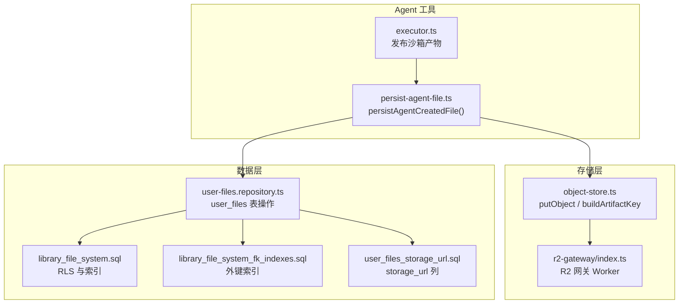

**图示来源**
- [executor.ts:1-200](file://src/server/inference/autonomous-tools/executor.ts#L1-L200)
- [persist-agent-file.ts:1-102](file://src/server/inference/autonomous-tools/persist-agent-file.ts#L1-L102)
- [object-store.ts:77-132](file://src/server/storage/object-store.ts#L77-L132)
- [object-store.ts:325-332](file://src/server/storage/object-store.ts#L325-L332)
- [user-files.repository.ts:1-200](file://src/server/repositories/user-files.repository.ts#L1-L200)
- [library_file_system.sql:1-76](file://supabase/migrations/20260731113156_library_file_system.sql#L1-L76)
- [library_file_system_fk_indexes.sql:1-6](file://supabase/migrations/20260731115644_library_file_system_fk_indexes.sql#L1-L6)
- [user_files_storage_url.sql:1-11](file://supabase/migrations/20260911120000_user_files_storage_url.sql#L1-L11)
- [r2-gateway/index.ts:1-213](file://workers/r2-gateway/src/index.ts#L1-L213)

**章节来源**
- [executor.ts:1-200](file://src/server/inference/autonomous-tools/executor.ts#L1-L200)
- [persist-agent-file.ts:1-102](file://src/server/inference/autonomous-tools/persist-agent-file.ts#L1-L102)
- [object-store.ts:77-132](file://src/server/storage/object-store.ts#L77-L132)
- [object-store.ts:325-332](file://src/server/storage/object-store.ts#L325-L332)
- [user-files.repository.ts:1-200](file://src/server/repositories/user-files.repository.ts#L1-L200)
- [library_file_system.sql:1-76](file://supabase/migrations/20260731113156_library_file_system.sql#L1-L76)
- [library_file_system_fk_indexes.sql:1-6](file://supabase/migrations/20260731115644_library_file_system_fk_indexes.sql#L1-L6)
- [user_files_storage_url.sql:1-11](file://supabase/migrations/20260911120000_user_files_storage_url.sql#L1-L11)
- [r2-gateway/index.ts:1-213](file://workers/r2-gateway/src/index.ts#L1-L213)

## 核心组件
本节聚焦 `persistAgentCreatedFile()` 及其上下游职责。

### persistAgentCreatedFile() 的职责
该函数是 Agent 创建文件的统一持久化入口，主要职责包括：
- 校验输入中的用户标识与路径。
- 规范化路径并生成文件名。
- 根据原始路径推断 MIME 类型。
- 生成 R2 对象键，写入内容。
- 在 `user_files` 表中插入元数据记录，包含存储桶、路径、状态、哈希与业务元数据。
- 返回文件标识、存储路径、MIME 类型与字节大小。

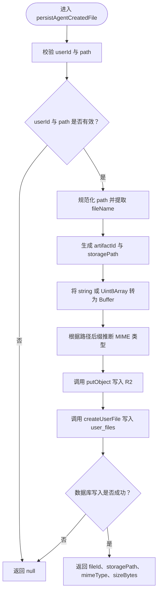

**图示来源**
- [persist-agent-file.ts:1-102](file://src/server/inference/autonomous-tools/persist-agent-file.ts#L1-L102)

**章节来源**
- [persist-agent-file.ts:1-102](file://src/server/inference/autonomous-tools/persist-agent-file.ts#L1-L102)

### 用户身份验证
- `persistAgentCreatedFile()` 本身不做 JWT 解析，而是依赖调用方传入的 `userId`。
- 实际调用发生在沙箱输出发布流程中，只有当执行上下文存在 `userId` 时才调用持久化；否则只保留临时产物信息。
- R2 侧还有一层由 R2 Gateway Worker 提供的 JWT 校验与密钥归属检查，作为最终访问控制边界。

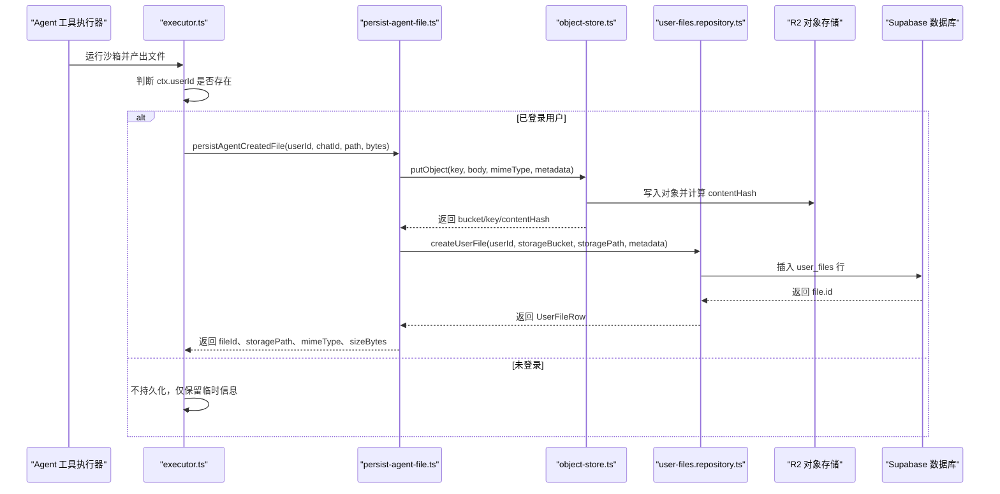

**图示来源**
- [executor.ts:1-200](file://src/server/inference/autonomous-tools/executor.ts#L1-L200)
- [persist-agent-file.ts:1-102](file://src/server/inference/autonomous-tools/persist-agent-file.ts#L1-L102)
- [object-store.ts:77-132](file://src/server/storage/object-store.ts#L77-L132)
- [user-files.repository.ts:1-200](file://src/server/repositories/user-files.repository.ts#L1-L200)

**章节来源**
- [executor.ts:1-200](file://src/server/inference/autonomous-tools/executor.ts#L1-L200)
- [persist-agent-file.ts:1-102](file://src/server/inference/autonomous-tools/persist-agent-file.ts#L1-L102)
- [r2-gateway/index.ts:1-213](file://workers/r2-gateway/src/index.ts#L1-L213)

### 聊天关联
- `chatId` 通过执行上下文传入，表示当前对话或线程。
- `chatId` 同时写入 R2 对象的自定义元数据与数据库 `user_files.metadata`，便于审计、回溯与按聊天检索。
- 当前实现没有强制校验 `chatId` 是否属于该用户，因此上层调用方应确保会话所有权。

**章节来源**
- [persist-agent-file.ts:1-102](file://src/server/inference/autonomous-tools/persist-agent-file.ts#L1-L102)
- [executor.ts:1-200](file://src/server/inference/autonomous-tools/executor.ts#L1-L200)

### 存储路径生成
- 文件名从完整路径中提取末尾部分。
- 使用随机 UUID 作为 artifactId，避免同名冲突。
- `buildArtifactKey()` 将路径规范化为 `users/{userId}/artifacts/{artifactId}/{safeFileName}`。
- 文件名中的非法字符会被替换为下划线，降低路径注入风险。

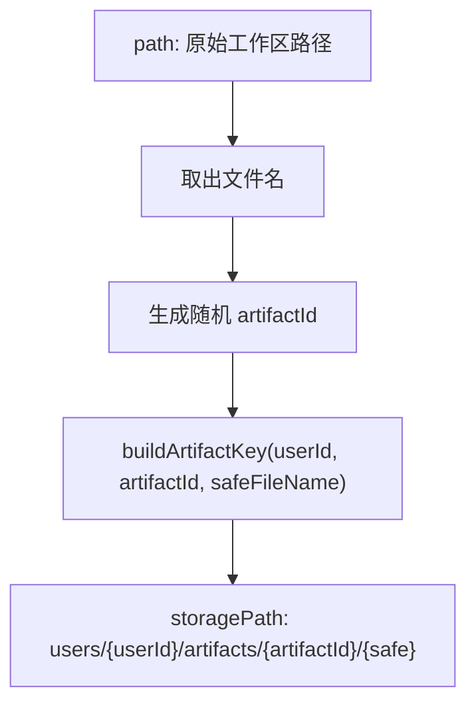

**图示来源**
- [persist-agent-file.ts:1-102](file://src/server/inference/autonomous-tools/persist-agent-file.ts#L1-L102)
- [object-store.ts:325-332](file://src/server/storage/object-store.ts#L325-L332)

**章节来源**
- [persist-agent-file.ts:1-102](file://src/server/inference/autonomous-tools/persist-agent-file.ts#L1-L102)
- [object-store.ts:325-332](file://src/server/storage/object-store.ts#L325-L332)

## 架构总览
文件持久化采用“对象存储 + 数据库元数据”的双写模型：

- R2 对象存储保存二进制内容，并通过前缀隔离用户空间。
- Supabase 的 `user_files` 表保存文件名、MIME 类型、大小、存储桶、存储路径、内容哈希、状态与业务元数据。
- R2 Gateway Worker 提供带鉴权的对象上传、读取与删除接口，确保外部无法随意访问任意用户对象。

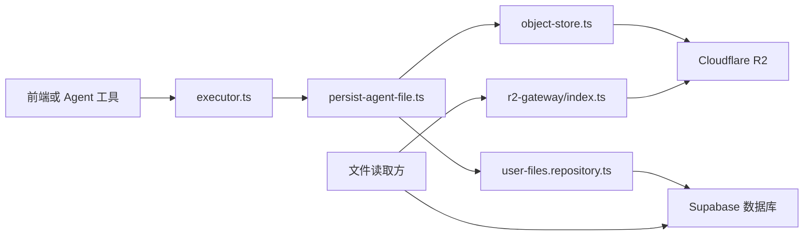

**图示来源**
- [executor.ts:1-200](file://src/server/inference/autonomous-tools/executor.ts#L1-L200)
- [persist-agent-file.ts:1-102](file://src/server/inference/autonomous-tools/persist-agent-file.ts#L1-L102)
- [object-store.ts:77-132](file://src/server/storage/object-store.ts#L77-L132)
- [user-files.repository.ts:1-200](file://src/server/repositories/user-files.repository.ts#L1-L200)
- [r2-gateway/index.ts:1-213](file://workers/r2-gateway/src/index.ts#L1-L213)

## 详细组件分析

### 文件存储策略：R2 与数据库协调机制
- `persistAgentCreatedFile()` 先调用 `putObject()` 写入 R2，再调用 `createUserFile()` 写入数据库。
- `putObject()` 会计算内容的 SHA-256 哈希，并返回 `contentHash`。
- 数据库记录中包含 `storage_bucket`、`storage_path`、`content_hash`、`status`、`metadata` 等字段。
- 迁移脚本新增了 `storage_url` 列，用于保存 R2 网关定位符，但 `persistAgentCreatedFile()` 当前未使用该字段。

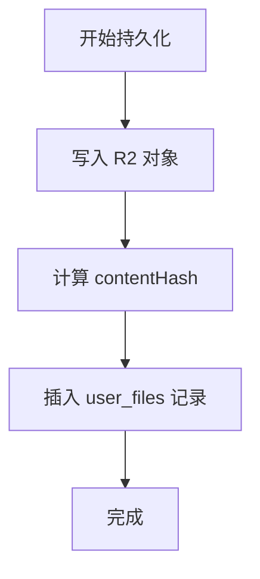

**图示来源**
- [persist-agent-file.ts:1-102](file://src/server/inference/autonomous-tools/persist-agent-file.ts#L1-L102)
- [object-store.ts:77-132](file://src/server/storage/object-store.ts#L77-L132)
- [user-files.repository.ts:1-200](file://src/server/repositories/user-files.repository.ts#L1-L200)
- [user_files_storage_url.sql:1-11](file://supabase/migrations/20260911120000_user_files_storage_url.sql#L1-L11)

**章节来源**
- [persist-agent-file.ts:1-102](file://src/server/inference/autonomous-tools/persist-agent-file.ts#L1-L102)
- [object-store.ts:77-132](file://src/server/storage/object-store.ts#L77-L132)
- [user-files.repository.ts:1-200](file://src/server/repositories/user-files.repository.ts#L1-L200)
- [user_files_storage_url.sql:1-11](file://supabase/migrations/20260911120000_user_files_storage_url.sql#L1-L11)

### MIME 类型检测
- 使用 `mimeFromPath()` 根据文件后缀映射常见 MIME 类型。
- 支持 PDF、Word、PPT、Excel、PNG、JPG、WebP、ZIP、Markdown、JSON、HTML、CSS、JS、TS、Python、CSV、SVG 等。
- 未知后缀默认返回 `application/octet-stream`。
- 注意：这是基于路径的后缀推断，不是对文件头进行真正的 MIME 探测。

**章节来源**
- [persist-agent-file.ts:1-102](file://src/server/inference/autonomous-tools/persist-agent-file.ts#L1-L102)

### 文件大小验证与安全校验
- 当前 `persistAgentCreatedFile()` 没有显式文件大小上限校验。
- 沙箱输出发布流程会对文本类产物做额外限制：若为文本类型且字节数不超过 512KB，则尝试解码为字符串以便返回预览；超过阈值或二进制类型不会解码。
- 安全方面：
  - 文件名经过 `buildArtifactKey()` 清理非法字符。
  - R2 Gateway Worker 对对象键进行归属校验，要求键以 `users/{userId}/` 或 `avatars/{userId}/` 开头。
  - 下载与删除请求需要有效的 Supabase JWT，且对象键必须属于当前用户。

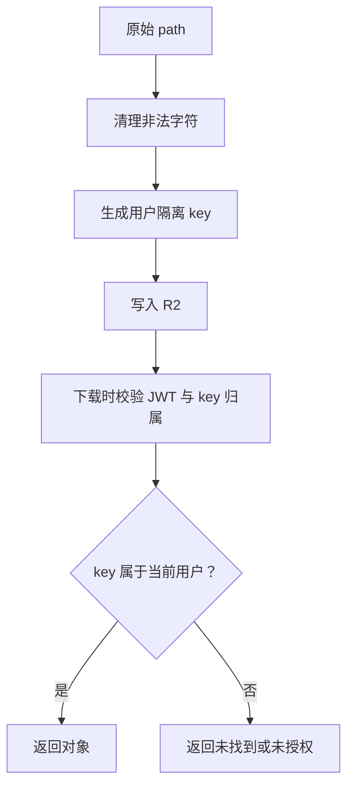

**图示来源**
- [persist-agent-file.ts:1-102](file://src/server/inference/autonomous-tools/persist-agent-file.ts#L1-L102)
- [object-store.ts:325-332](file://src/server/storage/object-store.ts#L325-L332)
- [r2-gateway/index.ts:1-213](file://workers/r2-gateway/src/index.ts#L1-L213)

**章节来源**
- [executor.ts:1-200](file://src/server/inference/autonomous-tools/executor.ts#L1-L200)
- [persist-agent-file.ts:1-102](file://src/server/inference/autonomous-tools/persist-agent-file.ts#L1-L102)
- [object-store.ts:325-332](file://src/server/storage/object-store.ts#L325-L332)
- [r2-gateway/index.ts:1-213](file://workers/r2-gateway/src/index.ts#L1-L213)

### 文件版本管理与覆盖策略
- 每次调用 `persistAgentCreatedFile()` 都会生成新的随机 `artifactId`，因此默认行为是“追加新对象”，而不是原地覆盖同一 key。
- 如果调用方传入相同 `workspacePath`，数据库元数据中的 `workspacePath` 会指向多个不同 R2 对象。
- 当前实现没有显式的“重复写入检测”“增量更新”或“覆盖旧版本”逻辑。
- 也没有维护引用计数；每个 `user_files` 行对应一个 R2 对象。

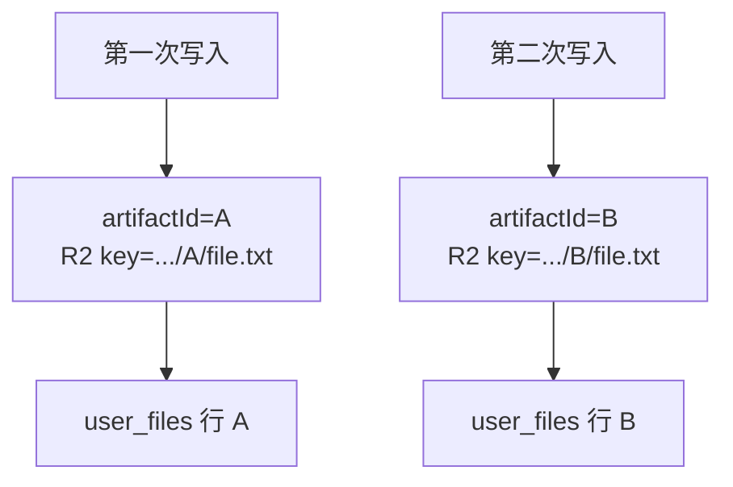

**图示来源**
- [persist-agent-file.ts:1-102](file://src/server/inference/autonomous-tools/persist-agent-file.ts#L1-L102)
- [object-store.ts:325-332](file://src/server/storage/object-store.ts#L325-L332)

**章节来源**
- [persist-agent-file.ts:1-102](file://src/server/inference/autonomous-tools/persist-agent-file.ts#L1-L102)
- [object-store.ts:325-332](file://src/server/storage/object-store.ts#L325-L332)

### 文件访问控制
- 数据库层：
  - `user_files` 表受 Supabase 行级安全策略保护，查询时需要匹配 `user_id`。
  - `getUserFile()` 明确要求 `fileId` 与 `userId` 匹配，且排除已删除状态。
- R2 层：
  - R2 Gateway Worker 要求下载、上传、删除请求携带有效 JWT。
  - 对象键必须以 `users/{userId}/` 或 `avatars/{userId}/` 开头，否则拒绝访问。
  - 公开路径 `public/` 和部分头像路径允许匿名读取，但 Agent 产物通常落在 `users/{userId}/artifacts/...`，不属于公开路径。

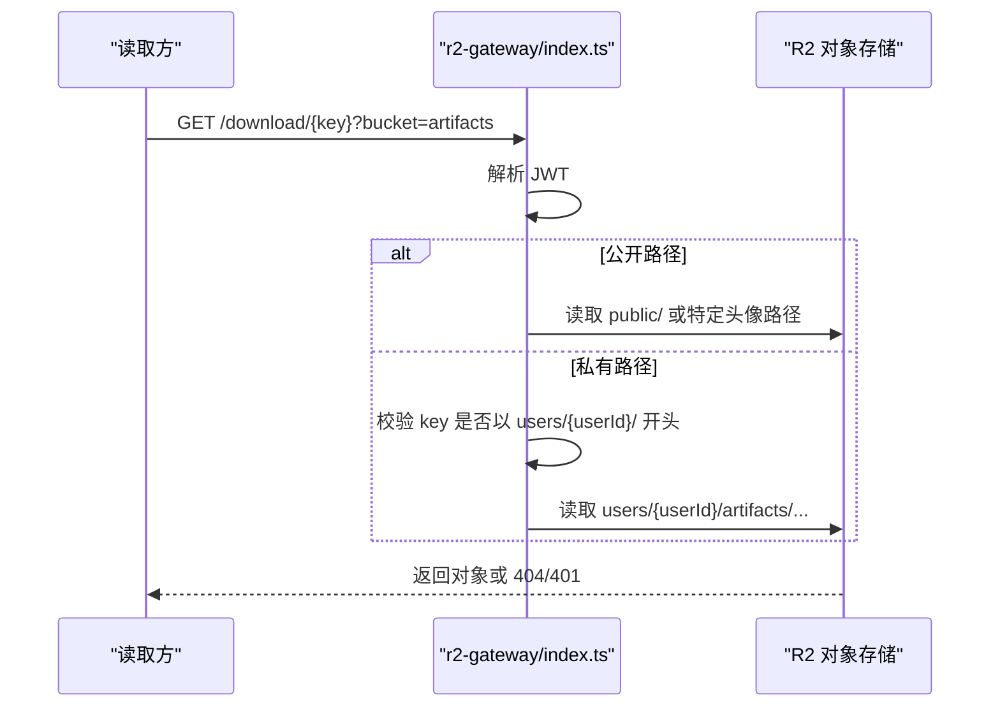

**图示来源**
- [r2-gateway/index.ts:1-213](file://workers/r2-gateway/src/index.ts#L1-L213)
- [user-files.repository.ts:1-200](file://src/server/repositories/user-files.repository.ts#L1-L200)
- [library_file_system.sql:1-76](file://supabase/migrations/20260731113156_library_file_system.sql#L1-L76)

**章节来源**
- [r2-gateway/index.ts:1-213](file://workers/r2-gateway/src/index.ts#L1-L213)
- [user-files.repository.ts:1-200](file://src/server/repositories/user-files.repository.ts#L1-L200)
- [library_file_system.sql:1-76](file://supabase/migrations/20260731113156_library_file_system.sql#L1-L76)

### 文件生命周期
文件从创建到删除的生命周期如下：

1. **创建**
   - Agent 在沙箱中生成文件。
   - `publishSandboxOutputs()` 读取输出路径。
   - 若存在 `userId`，调用 `persistAgentCreatedFile()`。
   - `persistAgentCreatedFile()` 生成 R2 key 并写入对象。
   - 同时向 `user_files` 插入元数据记录。

2. **存储**
   - 二进制内容存储在 R2。
   - 元数据存储在 Supabase，包含 `storage_bucket`、`storage_path`、`content_hash`、`metadata.chatId` 等。

3. **访问**
   - 客户端通过 R2 Gateway Worker 获取对象。
   - Gateway 校验 JWT 与对象键归属。
   - 数据库层可通过 `getUserFile()` 校验文件归属。

4. **删除**
   - R2 Gateway Worker 支持按 bucket 与 key 删除对象，但仍需 JWT 与 key 归属校验。
   - 当前代码未看到统一的“软删除”标记流程；`user_files.status` 支持 `deleted`，但 `persistAgentCreatedFile()` 不会将其设为已删除。

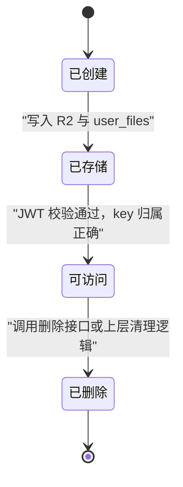

**图示来源**
- [executor.ts:1-200](file://src/server/inference/autonomous-tools/executor.ts#L1-L200)
- [persist-agent-file.ts:1-102](file://src/server/inference/autonomous-tools/persist-agent-file.ts#L1-L102)
- [user-files.repository.ts:1-200](file://src/server/repositories/user-files.repository.ts#L1-L200)
- [r2-gateway/index.ts:1-213](file://workers/r2-gateway/src/index.ts#L1-L213)

**章节来源**
- [executor.ts:1-200](file://src/server/inference/autonomous-tools/executor.ts#L1-L200)
- [persist-agent-file.ts:1-102](file://src/server/inference/autonomous-tools/persist-agent-file.ts#L1-L102)
- [user-files.repository.ts:1-200](file://src/server/repositories/user-files.repository.ts#L1-L200)
- [r2-gateway/index.ts:1-213](file://workers/r2-gateway/src/index.ts#L1-L213)

### 自定义存储后端的扩展接口
现有抽象集中在 `object-store.ts`，对外暴露的关键能力包括：
- `StoragePurpose`：逻辑存储目的，如 images、documents、artifacts、skills、chat-archives、audio-recordings、attachments。
- `bucketForPurpose(purpose)`：根据用途解析实际桶名。
- `putObject(input)`：写入对象并返回 `StoredObjectRef`，包含 purpose、bucket、key、contentHash。
- `buildArtifactKey(userId, artifactId, filename)`：生成用户隔离的对象键。
- `isR2Configured()`、`requireR2InProduction()`：环境配置与健康检查。

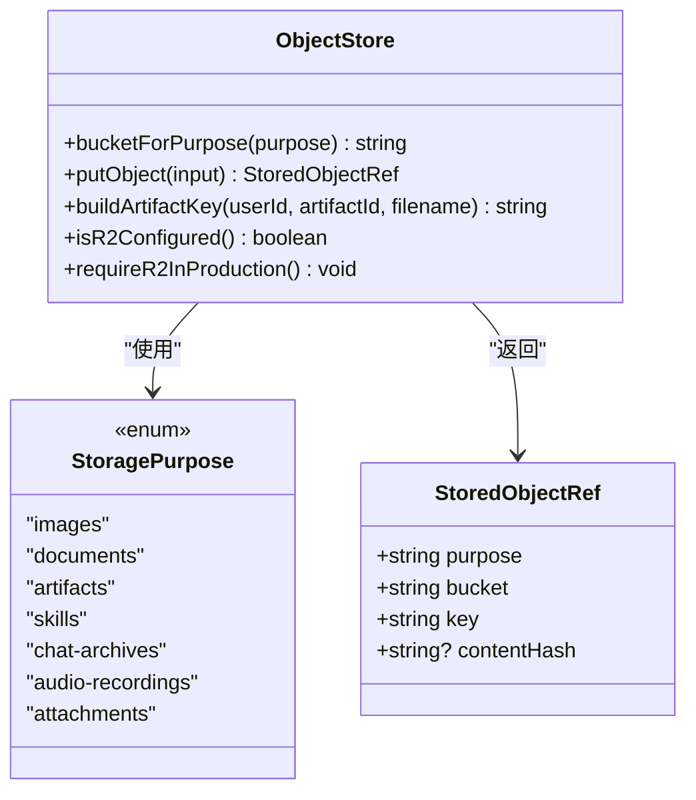

**图示来源**
- [object-store.ts:21-36](file://src/server/storage/object-store.ts#L21-L36)
- [object-store.ts:48-50](file://src/server/storage/object-store.ts#L48-L50)
- [object-store.ts:77-132](file://src/server/storage/object-store.ts#L77-L132)
- [object-store.ts:325-332](file://src/server/storage/object-store.ts#L325-L332)

#### 实现示例说明
若要扩展自定义存储后端，可遵循以下模式：
- 新增一个存储适配器，实现与 `putObject()` 一致的语义：接受用途、key、body、contentType、metadata，返回 object reference。
- 若希望复用现有桶路由，保持 `StoragePurpose` 枚举值不变；如需新增用途，扩展枚举并在 `bucketForPurpose()` 中映射。
- 若希望绕过 R2，可在本地回退或模拟实现中提供测试数据，类似现有本地回退逻辑。
- 若需要变更对象键格式，调整 `buildArtifactKey()` 或其他 key 构建函数，并确保所有调用方一致。

**章节来源**
- [object-store.ts:21-36](file://src/server/storage/object-store.ts#L21-L36)
- [object-store.ts:48-50](file://src/server/storage/object-store.ts#L48-L50)
- [object-store.ts:77-132](file://src/server/storage/object-store.ts#L77-L132)
- [object-store.ts:325-332](file://src/server/storage/object-store.ts#L325-L332)

## 依赖关系分析
- `executor.ts` 依赖 `persist-agent-file.ts` 完成已登录用户的文件持久化。
- `persist-agent-file.ts` 依赖 `object-store.ts` 与 `user-files.repository.ts`。
- `object-store.ts` 依赖 Cloudflare R2 或 S3 兼容客户端，以及环境变量配置。
- `user-files.repository.ts` 依赖数据库连接池与 `user_files`、`library_folders` 表。
- R2 Gateway Worker 独立于应用进程，承担对象访问鉴权。

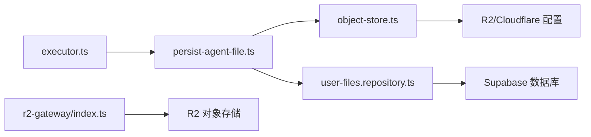

**图示来源**
- [executor.ts:1-200](file://src/server/inference/autonomous-tools/executor.ts#L1-L200)
- [persist-agent-file.ts:1-102](file://src/server/inference/autonomous-tools/persist-agent-file.ts#L1-L102)
- [object-store.ts:77-132](file://src/server/storage/object-store.ts#L77-L132)
- [user-files.repository.ts:1-200](file://src/server/repositories/user-files.repository.ts#L1-L200)
- [r2-gateway/index.ts:1-213](file://workers/r2-gateway/src/index.ts#L1-L213)

**章节来源**
- [executor.ts:1-200](file://src/server/inference/autonomous-tools/executor.ts#L1-L200)
- [persist-agent-file.ts:1-102](file://src/server/inference/autonomous-tools/persist-agent-file.ts#L1-L102)
- [object-store.ts:77-132](file://src/server/storage/object-store.ts#L77-L132)
- [user-files.repository.ts:1-200](file://src/server/repositories/user-files.repository.ts#L1-L200)
- [r2-gateway/index.ts:1-213](file://workers/r2-gateway/src/index.ts#L1-L213)

## 性能与一致性
- 双写顺序为先 R2 后数据库，这样即使数据库写入失败，R2 中可能已有孤立对象。
- 当前实现没有事务性补偿：若 R2 写入成功而数据库写入失败，会留下孤儿对象。
- `contentHash` 可用于未来去重或完整性校验，但当前 `persistAgentCreatedFile()` 并未利用它做重复写入优化。
- 文本预览路径对 512KB 以内文本做解码，有助于减少网络传输与渲染成本，但大文件或二进制仍只传元数据。
- R2 Gateway Worker 对私有对象设置 `private, no-store`，避免共享边缘缓存泄露用户数据。

建议改进方向：
- 引入幂等写入：根据 `contentHash` 或业务唯一键决定是否覆盖。
- 增加原子性：例如先占位数据库记录，再写 R2，成功后更新状态；失败时清理。
- 增加文件大小上限校验与恶意后缀过滤。
- 补充引用计数或软删除回收策略，避免孤儿对象堆积。

**章节来源**
- [executor.ts:1-200](file://src/server/inference/autonomous-tools/executor.ts#L1-L200)
- [persist-agent-file.ts:1-102](file://src/server/inference/autonomous-tools/persist-agent-file.ts#L1-L102)
- [object-store.ts:77-132](file://src/server/storage/object-store.ts#L77-L132)
- [r2-gateway/index.ts:1-213](file://workers/r2-gateway/src/index.ts#L1-L213)

## 故障排查指南
常见问题与定位方式：

| 现象 | 可能原因 | 排查建议 |
|---|---|---|
| Agent 生成了文件但用户看不到 | 未登录导致未调用持久化 | 检查执行上下文是否包含 `userId` |
| 文件写入成功但数据库无记录 | `createUserFile()` 失败 | 查看数据库插入日志与错误 |
| 下载返回未找到 | R2 对象不存在或 key 不匹配 | 核对 `storage_path` 与 R2 对象键 |
| 下载返回未授权 | JWT 缺失或无效 | 检查 R2 Gateway 请求头与 token |
| 下载被禁止 | key 不属于当前用户 | 确认 key 是否以 `users/{userId}/` 开头 |
| 文件名异常 | 路径包含非法字符 | 检查 `buildArtifactKey()` 的安全化处理 |
| 体积过大 | 缺少文件大小限制 | 在写入前增加大小校验 |

**章节来源**
- [executor.ts:1-200](file://src/server/inference/autonomous-tools/executor.ts#L1-L200)
- [persist-agent-file.ts:1-102](file://src/server/inference/autonomous-tools/persist-agent-file.ts#L1-L102)
- [user-files.repository.ts:1-200](file://src/server/repositories/user-files.repository.ts#L1-L200)
- [r2-gateway/index.ts:1-213](file://workers/r2-gateway/src/index.ts#L1-L213)

## 结论
`persistAgentCreatedFile()` 是当前 Agent 文件持久化的核心入口，它将 R2 对象存储与 `user_files` 数据库记录协调起来，实现了用户隔离、聊天关联与基础安全检查。其设计清晰但尚未实现完整的版本管理、引用计数与强一致性保障。对于生产环境，建议补充：
- 明确的文件大小与类型白名单。
- 幂等写入与重复文件去重。
- 双写失败的回滚或补偿机制。
- 统一的软删除与垃圾回收流程。
- 可选的自定义存储后端适配层，使底层存储可替换而不影响上层业务。