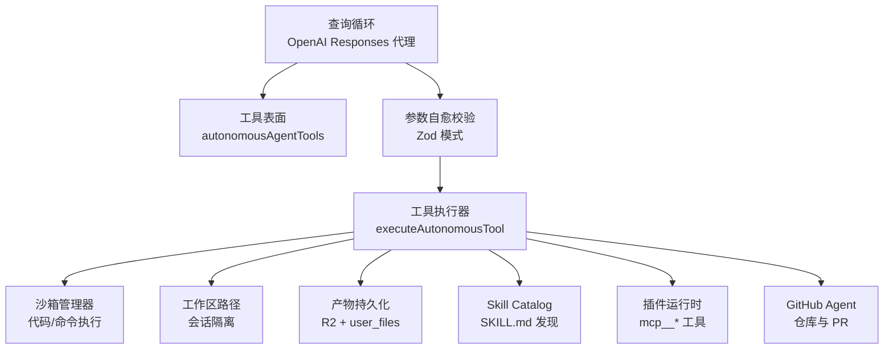
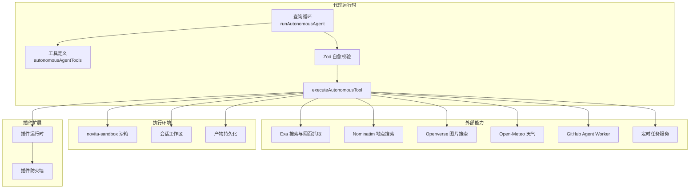
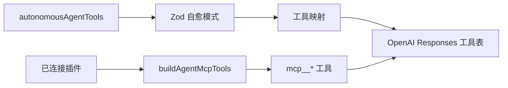
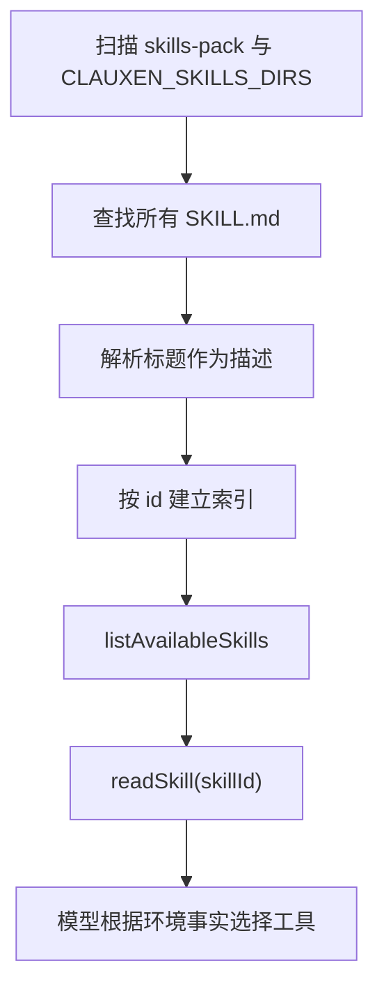
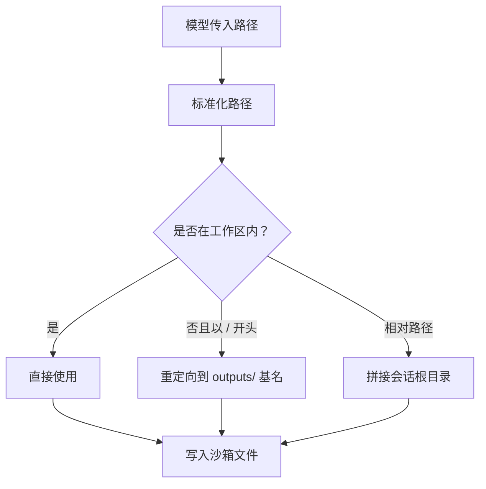
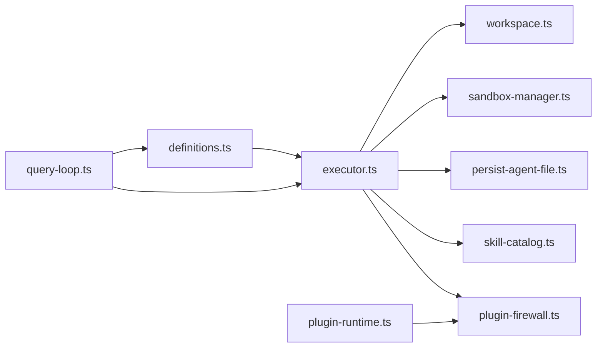
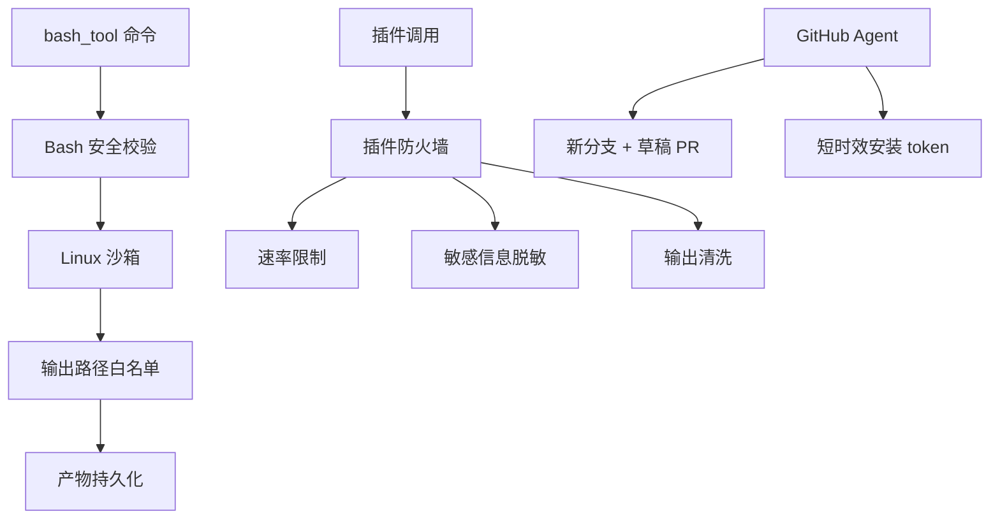

# 自主工具系统

<cite>
**本文引用的文件**   
- [definitions.ts](file://src/server/inference/autonomous-tools/definitions.ts)
- [executor.ts](file://src/server/inference/autonomous-tools/executor.ts)
- [skill-catalog.ts](file://src/server/inference/autonomous-tools/skill-catalog.ts)
- [workspace.ts](file://src/server/inference/autonomous-tools/workspace.ts)
- [persist-agent-file.ts](file://src/server/inference/autonomous-tools/persist-agent-file.ts)
- [bash-safety.ts](file://src/server/inference/bash-safety.ts)
- [query-loop.ts](file://src/server/agent-core/runtime/query-loop.ts)
- [tools/index.ts](file://src/server/agent-core/tools/index.ts)
- [plugin-runtime.ts](file://src/server/plugins/plugin-runtime.ts)
- [plugin-firewall.ts](file://src/server/plugins/plugin-firewall.ts)
- [sandbox-manager.ts](file://src/server/sandbox/sandbox-manager.ts)
- [github-agent.md](file://docs/github-agent.md)
</cite>

## 目录
1. [引言](#引言)
2. [项目结构](#项目结构)
3. [核心组件](#核心组件)
4. [架构总览](#架构总览)
5. [详细组件分析](#详细组件分析)
6. [依赖关系分析](#依赖关系分析)
7. [性能与并发特性](#性能与并发特性)
8. [安全策略与资源限制](#安全策略与资源限制)
9. [故障排查指南](#故障排查指南)
10. [自定义工具开发指南](#自定义工具开发指南)
11. [结论](#结论)

## 引言
本文件系统性地梳理 Clauxen 的“自主工具系统”。该系统由三部分组成：

- **工具定义规范**：通过 `autonomousAgentTools` 数组声明模型可使用的工具，包括决策信号、能力描述和链式调用提示。
- **执行器与生命周期**：`executeAutonomousTool` 负责参数校验后的权限检查、沙箱执行、结果序列化与产物持久化。
- **Skill Catalog 系统**：集中管理 `SKILL.md`，支持技能发现、描述解析和上下文注入，帮助模型在沙箱中正确完成 PDF、PPTX、图表等格式任务。

该系统的目标是让大模型以“主动调用工具”的方式完成搜索、代码执行、文件读写、计划研究、定时任务、GitHub 变更等工作，同时保证安全性、可观测性和可恢复性。

**章节来源**
- [definitions.ts:1-60](file://src/server/inference/autonomous-tools/definitions.ts#L1-L60)
- [executor.ts:1-80](file://src/server/inference/autonomous-tools/executor.ts#L1-L80)
- [skill-catalog.ts:1-30](file://src/server/inference/autonomous-tools/skill-catalog.ts#L1-L30)

## 项目结构
自主工具相关代码主要分布在以下层次：

| 层级 | 职责 | 关键路径 |
|---|---|---|
| 工具声明层 | 定义模型可见的工具名称、描述和参数模式 | `src/server/inference/autonomous-tools/definitions.ts` |
| 工具分发层 | 把 OpenAI Responses 工具表转换为可执行函数 | `src/server/agent-core/runtime/query-loop.ts` |
| 工具实现层 | 具体业务逻辑：搜索、网页抓取、天气、沙箱命令、文件、研究计划、定时任务、GitHub | `src/server/inference/autonomous-tools/executor.ts` |
| 工作区与安全层 | 会话级沙箱工作目录、路径隔离、输出发布 | `src/server/inference/autonomous-tools/workspace.ts`、`src/server/sandbox/sandbox-manager.ts` |
| Skill Catalog 层 | 扫描并读取 `SKILL.md`，提供环境事实 | `src/server/inference/autonomous-tools/skill-catalog.ts` |
| 插件扩展层 | 第三方插件工具的安全接入 | `src/server/plugins/plugin-runtime.ts`、`src/server/plugins/plugin-firewall.ts` |
| GitHub Agent 层 | 独立 Worker 中的仓库读写与 PR 流程 | `docs/github-agent.md` |



**图示来源**
- [query-loop.ts:230-360](file://src/server/agent-core/runtime/query-loop.ts#L230-L360)
- [executor.ts:1-120](file://src/server/inference/autonomous-tools/executor.ts#L1-L120)
- [sandbox-manager.ts:1-80](file://src/server/sandbox/sandbox-manager.ts#L1-L80)
- [workspace.ts:1-40](file://src/server/inference/autonomous-tools/workspace.ts#L1-L40)
- [skill-catalog.ts:1-40](file://src/server/inference/autonomous-tools/skill-catalog.ts#L1-L40)
- [plugin-runtime.ts:1-60](file://src/server/plugins/plugin-runtime.ts#L1-L60)
- [github-agent.md:1-40](file://docs/github-agent.md#L1-L40)

**章节来源**
- [tools/index.ts:1-7](file://src/server/agent-core/tools/index.ts#L1-L7)
- [query-loop.ts:200-360](file://src/server/agent-core/runtime/query-loop.ts#L200-L360)
- [executor.ts:1-120](file://src/server/inference/autonomous-tools/executor.ts#L1-L120)

## 核心组件

### 工具定义规范：`autonomousAgentTools`
`autonomousAgentTools` 是模型能看到的工具清单。每个条目都包含：

| 字段 | 含义 |
|---|---|
| `type` | 固定为 `function` |
| `name` | 工具名，如 `web_search`、`execute_code`、`bash_tool`、`read_skill`、`github_agent` 等 |
| `description` | 给模型的引导文本，说明何时使用、做什么、如何与其他工具组合 |
| `parameters` | JSON Schema 风格的参数结构，配合 Zod 进行自愈校验 |
| `strict` | 是否启用严格模式；部分工具要求更严格的参数约束 |

这些描述不仅是“文档”，而是驱动模型行为的关键提示。它明确回答三个问题：

1. **何时使用**：例如“需要最新事实信息时使用 `web_search`”。
2. **能力边界**：例如 `web_fetch` 只能获取已知 URL，不能猜测链接。
3. **链式调用提示**：例如先 `read_skill`，再 `execute_code`，再把产出放入 `outputs/` 并通过 `output_paths` 暴露。

当前系统中的代表性工具包括：

| 工具 | 主要用途 | 关键行为 |
|---|---|---|
| `web_search` | 实时搜索 | 返回标题、URL、摘要、高亮；支持流式进度 |
| `web_fetch` | 抓取完整页面 | 仅通过 Exa 获取内容，避免 SSRF |
| `places_search` | 地点搜索 | 基于 Nominatim |
| `image_search` | 图片搜索 | 基于 Openverse |
| `weather_fetch` | 天气查询 | 地理编码后拉取预报 |
| `bash_tool` | 执行 shell 命令 | 沙箱内运行，带安全过滤 |
| `execute_code` | Python 代码执行 | 流式 stdout/stderr，支持输出文件 |
| `read_skill` | 读取技能文档 | 根据 `SKILL.md` 判断可用库 |
| `read_attachment` | 读取用户附件 | 支持分页偏移 |
| `file_read` / `create_file` / `file_write` | 工作区文件操作 | 会话级路径隔离 |
| `present_files` | 已废弃兼容项 | 空操作 |
| `ask_user_input_v0` | 交互式问卷 | 暂停代理等待用户输入 |
| `present_research_plan` / `research_task_update` | 深度研究计划 | 创建后台研究任务 |
| `create_scheduled_task` / `list_scheduled_tasks` / `cancel_scheduled_task` | 定时任务 | 与调度服务集成 |
| `github_agent` | GitHub 仓库与 PR | 调用独立 GitHub Agent Worker |

**章节来源**
- [definitions.ts:1-200](file://src/server/inference/autonomous-tools/definitions.ts#L1-L200)
- [definitions.ts:201-584](file://src/server/inference/autonomous-tools/definitions.ts#L201-L584)

### 执行器入口：`executeAutonomousTool`
`executeAutonomousTool` 是工具分发的统一入口。它接收：

- `name`：工具名
- `args`：原始参数对象
- `ctx`：执行上下文，包括会话 ID、用户 ID、工具调用 ID、研究计划 ID、进度回调等

其基本流程是：

```mermaid
flowchart TD
    Start(["进入 executeAutonomousTool"]) --> CheckName{"识别工具名"}
    CheckName -->|github_agent| GithubPath["检查登录状态<br/>调用 GitHub Agent"]
    CheckName -->|read_skill| SkillPath["列出技能<br/>读取 SKILL.md"]
    CheckName -->|web_search| SearchPath["Exa 搜索<br/>发送进度事件"]
    CheckName -->|web_fetch| FetchPath["Exa 抓取内容"]
    CheckName -->|places_search| PlacesPath["Nominatim 地点搜索"]
    CheckName -->|image_search| ImagePath["Openverse 图片搜索"]
    CheckName -->|weather_fetch| WeatherPath["地理编码+天气预报"]
    CheckName -->|bash_tool| BashPath["安全校验<br/>沙箱命令执行"]
    CheckName -->|execute_code| CodePath["沙箱代码执行"]
    CheckName -->|read_attachment| AttachmentPath["按 file_id 读取附件"]
    CheckName -->|file_read| FileReadPath["工作区只读"]
    CheckName -->|create_file| FileWritePath["工作区写入<br/>可选持久化"]
    CheckName -->|present_files| DeprecatedPath["废弃兼容，直接返回"]
    CheckName -->|research_*| ResearchPath["深度研究状态更新"]
    CheckName -->|ask_user_input_v0| PausePath["暂停代理等待用户"]
    CheckName -->|scheduled_tasks| ScheduledPath["创建/列表/取消定时任务"]
    GithubPath --> End(["返回 ToolExecutionOutcome"])
    SkillPath --> End
    SearchPath --> End
    FetchPath --> End
    PlacesPath --> End
    ImagePath --> End
    WeatherPath --> End
    BashPath --> End
    CodePath --> End
    AttachmentPath --> End
    FileReadPath --> End
    FileWritePath --> End
    DeprecatedPath --> End
    ResearchPath --> End
    PausePath --> End
    ScheduledPath --> End
```



**图示来源**
- [executor.ts:1-120](file://src/server/inference/autonomous-tools/executor.ts#L1-L120)
- [executor.ts:201-722](file://src/server/inference/autonomous-tools/executor.ts#L201-L722)

**章节来源**
- [executor.ts:1-120](file://src/server/inference/autonomous-tools/executor.ts#L1-L120)

### 工具执行生命周期
工具执行的生命周期分为五个阶段：

1. **参数验证**
   - 在查询循环中，每个工具的参数会通过 Zod 模式进行自愈校验。
   - 如果模型传参不完全符合 schema，会尝试修复或拒绝。
   - 工具定义中的 `strict` 标志会影响 OpenAI Responses 的参数严格程度。

2. **权限检查**
   - `github_agent`：未登录时直接返回错误。
   - `read_attachment`：未登录时返回错误。
   - 定时任务工具：创建、查询、取消都需要已登录用户。
   - 插件工具：通过插件防火墙进行权限、速率限制和敏感数据过滤。

3. **沙箱执行**
   - `bash_tool` 和 `execute_code` 使用独立的 Linux 沙箱。
   - 会话级工作目录通过 `ensureSandboxWorkspace` 初始化。
   - 执行过程通过 `onStdout` / `onStderr` 推送进度。
   - 沙箱具有超时、自动恢复和会话复用机制。

4. **结果序列化**
   - 外部 API 结果被封装为结构化输出。
   - 沙箱产物通过 `publishSandboxOutputs` 收集。
   - 文本小文件可直接嵌入结果；二进制文件生成 artifact 记录。

5. **产物持久化**
   - 当存在 `userId` 时，产物可通过 `persistAgentCreatedFile` 写入 R2 和用户文件表。
   - 持久化后返回 `fileId`、`storagePath`、`mimeType`、`sizeBytes`。
   - 前端通过 artifact 面板展示下载卡片。

```mermaid
sequenceDiagram
    participant Loop as "查询循环"
    participant Executor as "工具执行器"
    participant Sandbox as "沙箱管理器"
    participant Workspace as "工作区"
    participant Storage as "对象存储与用户文件"

    Loop->>Executor: "executeAutonomousTool(name, args, ctx)"
    Executor->>Executor: "参数类型转换与校验"
    alt bash_tool 或 execute_code
        Executor->>Workspace: "ensureSandboxWorkspace"
        Workspace->>Sandbox: "getOrCreateSandbox"
        Sandbox-->>Workspace: "sandboxId + root"
        Executor->>Sandbox: "runSandboxCommand 或 runSandboxCode"
        Sandbox-->>Executor: "stdout/stderr/error/result"
    end
    Executor->>Executor: "publishSandboxOutputs"
    alt 有 userId
        Executor->>Storage: "persistAgentCreatedFile"
        Storage-->>Executor: "fileId + storagePath + mimeType"
    end
    Executor-->>Loop: "ToolExecutionOutcome"
```

**图示来源**
- [query-loop.ts:230-360](file://src/server/agent-core/runtime/query-loop.ts#L230-L360)
- [executor.ts:120-200](file://src/server/inference/autonomous-tools/executor.ts#L120-L200)
- [executor.ts:520-722](file://src/server/inference/autonomous-tools/executor.ts#L520-L722)
- [workspace.ts:100-190](file://src/server/inference/autonomous-tools/workspace.ts#L100-L190)
- [persist-agent-file.ts:1-102](file://src/server/inference/autonomous-tools/persist-agent-file.ts#L1-L102)

**章节来源**
- [query-loop.ts:200-360](file://src/server/agent-core/runtime/query-loop.ts#L200-L360)
- [executor.ts:120-200](file://src/server/inference/autonomous-tools/executor.ts#L120-L200)
- [persist-agent-file.ts:1-102](file://src/server/inference/autonomous-tools/persist-agent-file.ts#L1-L102)

## 架构总览
整体架构围绕“查询循环 → 工具定义 → 执行器 → 外部服务/沙箱/存储”展开：



**图示来源**
- [query-loop.ts:200-360](file://src/server/agent-core/runtime/query-loop.ts#L200-L360)
- [executor.ts:201-722](file://src/server/inference/autonomous-tools/executor.ts#L201-L722)
- [plugin-runtime.ts:1-120](file://src/server/plugins/plugin-runtime.ts#L1-L120)
- [plugin-firewall.ts:1-167](file://src/server/plugins/plugin-firewall.ts#L1-L167)

## 详细组件分析

### 工具定义与决策信号
`autonomousAgentTools` 的描述不是普通注释，而是模型行为的主要引导。它采用以下技巧：

- **主动触发**：例如“需要最新事实时使用 web_search”。
- **禁止误用**：例如“不要猜测 URL，先用 web_search”。
- **链式提示**：例如“先 read_skill，再 execute_code，最后把产出放到 outputs/”。
- **UI 叙事提示**：例如“调用前用一句话描述正在做什么，以便界面显示 Analyzing”。
- **能力框架**：例如“观察…、决定…”激活 ReAct 风格推理。

这些描述共同构成“工具契约”：模型必须理解工具的职责、前置条件和后续动作。

**章节来源**
- [definitions.ts:1-60](file://src/server/inference/autonomous-tools/definitions.ts#L1-L60)
- [definitions.ts:201-584](file://src/server/inference/autonomous-tools/definitions.ts#L201-L584)

### 自动化工具注册机制
工具注册发生在两个层面：

1. **内置工具注册**
   - `autonomousAgentTools` 在 `src/server/agent-core/tools/index.ts` 中导出。
   - 查询循环通过 `buildHealingTools` 将工具定义映射到 Zod 校验和执行函数。
   - 最终通过 OpenAI Responses 的 `toOpenAITools` 暴露给模型。

2. **插件工具注册**
   - 已连接插件的能力通过 `buildAgentMcpTools` 动态生成。
   - 工具名形如 `mcp__<plugin>__<tool>`。
   - 如果工具数量超过直连上限，会提供搜索工具和调用工具。



**图示来源**
- [tools/index.ts:1-7](file://src/server/agent-core/tools/index.ts#L1-L7)
- [query-loop.ts:230-360](file://src/server/agent-core/runtime/query-loop.ts#L230-L360)
- [plugin-runtime.ts:60-200](file://src/server/plugins/plugin-runtime.ts#L60-L200)

**章节来源**
- [tools/index.ts:1-7](file://src/server/agent-core/tools/index.ts#L1-L7)
- [query-loop.ts:230-360](file://src/server/agent-core/runtime/query-loop.ts#L230-L360)
- [plugin-runtime.ts:60-200](file://src/server/plugins/plugin-runtime.ts#L60-L200)

### Skill Catalog 系统
Skill Catalog 的核心职责是把 `SKILL.md` 变成模型可用的环境知识。

#### 技能发现机制
- 默认技能包随应用打包，位于生成的文本资产中。
- 可通过环境变量 `CLAUXEN_SKILLS_DIRS` 叠加额外技能目录。
- 递归扫描目录，查找所有 `SKILL.md` 文件。
- 重复的 skill id 以后加载者为准，但内置包优先去重。

#### 技能描述解析
- 从 `SKILL.md` 的第一行标题提取描述。
- 若无标题，则取第一个非空行。
- 返回 `{ id, name, path, description }` 列表。

#### 技能读取
- 支持精确匹配和部分匹配。
- 优先从生成资产读取，否则回退到文件系统。
- 返回 `{ id, content, path }`。



**图示来源**
- [skill-catalog.ts:1-125](file://src/server/inference/autonomous-tools/skill-catalog.ts#L1-L125)

**章节来源**
- [skill-catalog.ts:1-125](file://src/server/inference/autonomous-tools/skill-catalog.ts#L1-L125)

### 工作区与路径隔离
工作区用于隔离不同会话的文件和沙箱状态：

- 每个会话拥有独立的工作目录，路径基于 `conversationId` 计算。
- 绝对路径若逃逸工作区根，会被重定向到 `outputs/`。
- 写操作前会自动创建父目录。
- 读取操作支持多个候选路径，提高兼容性。
- 输出路径限制最多 12 个，防止恶意产物膨胀。



**图示来源**
- [workspace.ts:1-190](file://src/server/inference/autonomous-tools/workspace.ts#L1-L190)

**章节来源**
- [workspace.ts:1-190](file://src/server/inference/autonomous-tools/workspace.ts#L1-L190)

### 实际工具实现示例

#### web_search
- 使用 Exa 进行实时搜索。
- 支持 `num_results` 限制。
- 支持流式进度事件：`searching`、`streaming`、`results`。
- 深度研究中会将搜索结果源地址持久化。

**章节来源**
- [definitions.ts:80-140](file://src/server/inference/autonomous-tools/definitions.ts#L80-L140)
- [executor.ts:201-280](file://src/server/inference/autonomous-tools/executor.ts#L201-L280)

#### execute_code
- 在 Linux 沙箱中执行 Python。
- 支持 stdout、stderr、error 和结构化 result。
- 支持 `output_paths` 上传产物。
- 建议先 `read_skill` 确认环境库可用性。

**章节来源**
- [definitions.ts:260-340](file://src/server/inference/autonomous-tools/definitions.ts#L260-L340)
- [executor.ts:560-660](file://src/server/inference/autonomous-tools/executor.ts#L560-L660)

#### github_agent
- 工具名：`github_agent`
- 操作：`repositories`、`read`、`create_change`
- 权限：必须登录，且需用户明确授权变更
- 安全：不推送 base branch，不合并，只创建新分支和草稿 PR
- 恢复：失败时保留相同 `request_id`，不应盲目重试

**章节来源**
- [definitions.ts:10-40](file://src/server/inference/autonomous-tools/definitions.ts#L10-L40)
- [executor.ts:120-160](file://src/server/inference/autonomous-tools/executor.ts#L120-L160)
- [github-agent.md:1-108](file://docs/github-agent.md#L1-L108)

## 依赖关系分析



**图示来源**
- [definitions.ts:1-60](file://src/server/inference/autonomous-tools/definitions.ts#L1-L60)
- [executor.ts:1-120](file://src/server/inference/autonomous-tools/executor.ts#L1-L120)
- [query-loop.ts:230-360](file://src/server/agent-core/runtime/query-loop.ts#L230-L360)
- [plugin-runtime.ts:1-60](file://src/server/plugins/plugin-runtime.ts#L1-L60)

**章节来源**
- [executor.ts:1-120](file://src/server/inference/autonomous-tools/executor.ts#L1-L120)
- [query-loop.ts:230-360](file://src/server/agent-core/runtime/query-loop.ts#L230-L360)

## 性能与并发特性

### 轮次预算
- 普通自主代理每轮最大步数为 24。
- 深度研究路径允许更多步数（上限约 96）。
- 每次模型调用前都会检查 yield 信号，支持长任务切片恢复。

### 并行与串行
- 工具调用串行执行，避免同一轮内竞态。
- 沙箱会话在同一用户与会话维度下复用。
- 插件目录构建中对多个连接进行异步处理。

### 流式体验
- 搜索、网页抓取、沙箱 stdout/stderr 都通过 `onToolProgress` 推送。
- 查询循环将思考、叙事、工具调用、工具结果映射为有序步骤。
- UI 可以展示“Analyzing”、“Searching”、“Streaming”等中间状态。

**章节来源**
- [query-loop.ts:1-60](file://src/server/agent-core/runtime/query-loop.ts#L1-L60)
- [query-loop.ts:360-520](file://src/server/agent-core/runtime/query-loop.ts#L360-L520)
- [executor.ts:201-280](file://src/server/inference/autonomous-tools/executor.ts#L201-L280)
- [executor.ts:520-660](file://src/server/inference/autonomous-tools/executor.ts#L520-L660)

## 安全策略与资源限制

### Bash 安全
- 命令长度上限：8000 字符。
- 黑名单包括破坏性命令、格式化磁盘、危险权限修改、管道执行 shell 等。
- 违反规则直接抛出错误，不会进入沙箱。

### 沙箱隔离
- 代码和命令在独立 Linux 沙箱中执行。
- 会话级工作目录隔离。
- 绝对路径逃逸会被重定向到 `outputs/`。
- 沙箱具有超时、自动恢复和会话复用。

### 插件安全
- 参数大小限制：最大 64KB。
- 输出大小限制：最大 24000 字符。
- 每分钟调用上限：通用 40，写操作更严格。
- 敏感信息检测：密钥、令牌、凭证形状字符串会被阻止或脱敏。
- 输出清洗：移除不可见字符、HTML 注释、脚本、样式，替换指令注入行。

### GitHub Agent 安全
- 不请求组织管理员权限、工作流写入、仓库删除。
- 变更始终提交到新分支，创建草稿 PR。
- 不暴露安装 token 给客户端或模型。
- 凭据加密存储，HMAC 校验 webhook，短时效 token。



**图示来源**
- [bash-safety.ts:1-27](file://src/server/inference/bash-safety.ts#L1-L27)
- [workspace.ts:1-190](file://src/server/inference/autonomous-tools/workspace.ts#L1-L190)
- [plugin-firewall.ts:1-167](file://src/server/plugins/plugin-firewall.ts#L1-L167)
- [github-agent.md:60-108](file://docs/github-agent.md#L60-L108)

**章节来源**
- [bash-safety.ts:1-27](file://src/server/inference/bash-safety.ts#L1-L27)
- [plugin-firewall.ts:1-167](file://src/server/plugins/plugin-firewall.ts#L1-L167)
- [github-agent.md:60-108](file://docs/github-agent.md#L60-L108)

## 故障排查指南

### 常见问题与定位方式

| 现象 | 可能原因 | 排查位置 |
|---|---|---|
| 模型不调用工具 | 工具描述不够清晰，或缺少链式提示 | `definitions.ts` |
| 参数报错 | Zod 模式不匹配或 strict 模式过严 | `query-loop.ts` 中的 `autonomousZodByName` |
| 沙箱无输出 | `output_paths` 未填写或路径不在 `outputs/` | `executor.ts`、`workspace.ts` |
| 文件无法读取 | 路径逃逸或会话目录不存在 | `workspace.ts` |
| 产物未出现在 UI | 没有 `userId` 或持久化失败 | `persist-agent-file.ts` |
| GitHub 变更未提交 | 未登录、base SHA 不一致、重复 request_id | `executor.ts`、`github-agent.md` |
| 插件调用被拒绝 | 超出速率限制、参数含敏感信息 | `plugin-firewall.ts` |
| 沙箱卡住 | 长时间无 stdout/stderr | `sandbox-manager.ts`、keepAlive 心跳 |

### 调试建议
1. 先看查询循环输出的 agent trace，确认模型是否生成了工具调用。
2. 检查 Zod 模式是否与工具定义一致。
3. 对沙箱类工具，查看 stdout/stderr 和 exit code。
4. 对产物类工具，检查 `output_paths` 是否为相对路径且落在 `outputs/`。
5. 对插件类工具，检查插件连接状态、权限模式和速率限制。
6. 对 GitHub 类工具，检查是否登录、是否已授权仓库、是否重复使用 request_id。

**章节来源**
- [query-loop.ts:200-360](file://src/server/agent-core/runtime/query-loop.ts#L200-L360)
- [executor.ts:120-200](file://src/server/inference/autonomous-tools/executor.ts#L120-L200)
- [executor.ts:520-722](file://src/server/inference/autonomous-tools/executor.ts#L520-L722)
- [plugin-firewall.ts:1-167](file://src/server/plugins/plugin-firewall.ts#L1-L167)
- [github-agent.md:60-108](file://docs/github-agent.md#L60-L108)

## 自定义工具开发指南

### 第一步：定义工具
在 `autonomousAgentTools` 中添加一个条目，包含：

- `name`：唯一工具名
- `description`：明确说明何时使用、做什么、如何与其他工具组合
- `parameters`：JSON Schema 风格的参数定义
- `strict`：如需严格参数校验，设为 true

描述应回答：
- 何时使用
- 能力边界
- 是否需要先调用其他工具
- 是否会产生用户可见产物
- 是否需要用户确认

**参考路径**
- [definitions.ts:201-584](file://src/server/inference/autonomous-tools/definitions.ts#L201-L584)

### 第二步：添加参数校验
在查询循环的 `autonomousZodByName` 中添加对应 Zod 模式，确保参数能被自愈校验。

**参考路径**
- [query-loop.ts:200-360](file://src/server/agent-core/runtime/query-loop.ts#L200-L360)

### 第三步：实现执行逻辑
在 `executeAutonomousTool` 中添加新的 `if (name === "...")` 分支，实现：

- 参数提取与类型转换
- 权限检查
- 外部服务调用或沙箱执行
- 进度回调
- 结果封装

**参考路径**
- [executor.ts:201-722](file://src/server/inference/autonomous-tools/executor.ts#L201-L722)

### 第四步：配置权限
根据工具风险决定权限策略：

| 工具类型 | 权限建议 |
|---|---|
| 只读查询 | 通常无需登录，或仅需基础身份 |
| 沙箱执行 | 必须在沙箱中运行，限制输出路径 |
| 文件写入 | 需要会话级路径隔离，可选持久化 |
| 外部写操作 | 必须显式用户确认 |
| 敏感平台操作 | 必须登录，并做二次校验 |

**参考路径**
- [executor.ts:120-160](file://src/server/inference/autonomous-tools/executor.ts#L120-L160)
- [plugin-firewall.ts:1-167](file://src/server/plugins/plugin-firewall.ts#L1-L167)

### 第五步：测试方法
推荐测试分层：

1. **单元测试**
   - 测试参数校验是否正确拒绝非法输入。
   - 测试权限分支是否返回预期错误。
   - 测试沙箱输出路径解析是否正确。

2. **集成测试**
   - 调用真实或 mock 的外部服务。
   - 验证产物是否持久化并返回 artifact 记录。
   - 验证进度回调是否正常触发。

3. **端到端测试**
   - 通过查询循环发起完整代理轮次。
   - 验证模型是否能正确使用新工具。
   - 验证 UI 是否展示正确的活动记录和产物卡片。

**参考路径**
- [query-loop.ts:200-360](file://src/server/agent-core/runtime/query-loop.ts#L200-L360)
- [executor.ts:520-722](file://src/server/inference/autonomous-tools/executor.ts#L520-L722)
- [persist-agent-file.ts:1-102](file://src/server/inference/autonomous-tools/persist-agent-file.ts#L1-L102)

### 最佳实践
- 工具描述要像“给另一个工程师写的接口说明”，而不是系统内部注释。
- 对副作用工具，明确写出是否需要用户确认。
- 对产物工具，明确写出输出路径约定。
- 对易错工具，增加链式调用提示。
- 对高风险工具，增加权限检查和错误回退。
- 对长耗时工具，使用进度回调提升用户体验。
- 对沙箱工具，始终使用工作区路径，避免绝对路径逃逸。

**章节来源**
- [definitions.ts:201-584](file://src/server/inference/autonomous-tools/definitions.ts#L201-L584)
- [query-loop.ts:200-360](file://src/server/agent-core/runtime/query-loop.ts#L200-L360)
- [executor.ts:120-200](file://src/server/inference/autonomous-tools/executor.ts#L120-L200)
- [workspace.ts:1-190](file://src/server/inference/autonomous-tools/workspace.ts#L1-L190)

## 结论
Cl auxen 的自主工具系统是一个面向大模型的“工具契约 + 安全执行 + 可观测流水线”：

- `autonomousAgentTools` 是模型行为的起点，用自然语言描述驱动工具选择。
- `executeAutonomousTool` 是统一执行入口，串联权限、沙箱、外部服务和产物持久化。
- Skill Catalog 让模型具备环境感知能力，减少幻觉和错误依赖。
- 工作区、沙箱、插件防火墙和 GitHub Agent 共同构成纵深安全体系。
- 查询循环提供可恢复、可切片、可追踪的代理执行生命周期。

对于开发者而言，新增工具的关键在于：**清晰的工具描述、严格的参数模式、安全的执行路径、明确的产物约定和完整的错误回退**。只要遵循这套规范，就可以在不牺牲安全性的前提下，持续扩展 AI 代理的实际能力。