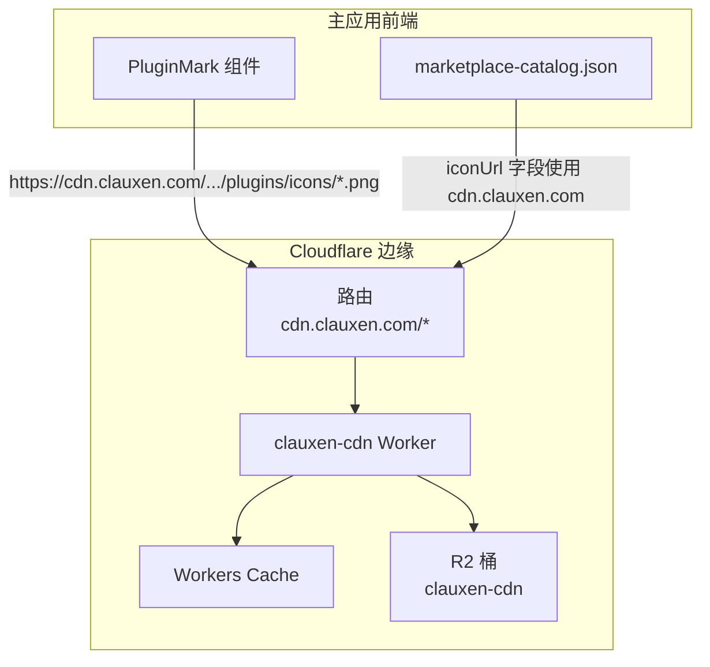
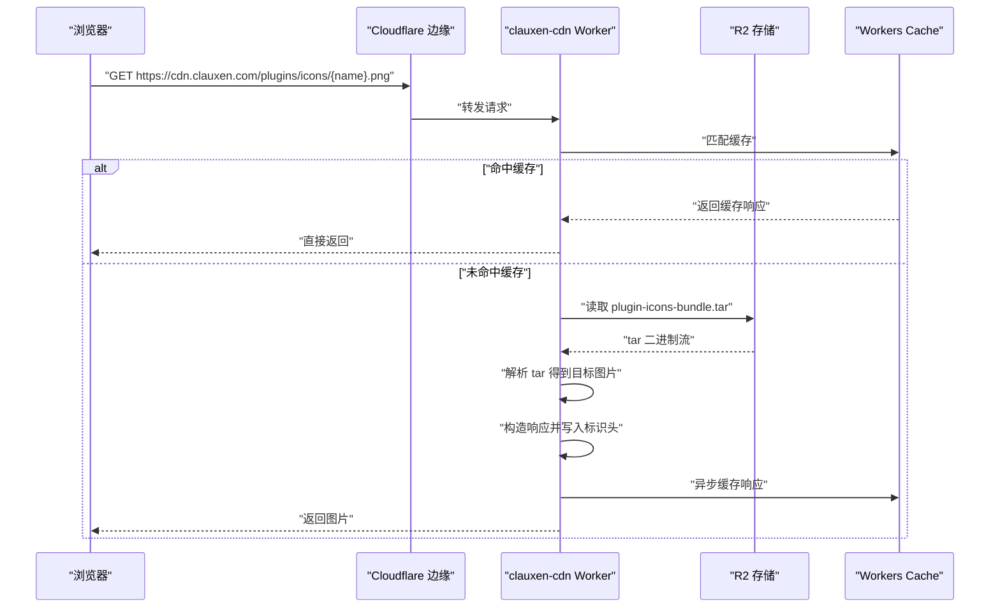
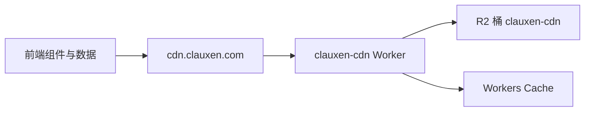

# CDN Worker

<cite>
**本文引用的文件**
- [workers/cdn/src/index.ts](file://workers/cdn/src/index.ts)
- [workers/cdn/wrangler.toml](file://workers/cdn/wrangler.toml)
- [workers/cdn/package.json](file://workers/cdn/package.json)
- [src/client/components/plugins/plugin-mark.tsx](file://src/client/components/plugins/plugin-mark.tsx)
- [src/client/components/prompt-input.tsx](file://src/client/components/prompt-input.tsx)
- [src/client/components/plugins/marketplace-catalog.json](file://src/client/components/plugins/marketplace-catalog.json)
- [cloudflare-env.d.ts](file://cloudflare-env.d.ts)
</cite>

## 目录
1. [简介](#简介)
2. [项目结构](#项目结构)
3. [核心组件](#核心组件)
4. [架构总览](#架构总览)
5. [详细组件分析](#详细组件分析)
6. [依赖关系分析](#依赖关系分析)
7. [性能与带宽优化](#性能与带宽优化)
8. [监控指标与可观测性](#监控指标与可观测性)
9. [故障排查指南](#故障排查指南)
10. [结论](#结论)

## 简介
CDN Worker 是一个基于 Cloudflare Workers 的轻量静态资源分发服务，当前主要服务于插件图标等前端图片资源。它从 R2 对象存储中读取预打包的 tar 资源包，在内存中解析并按路径路由到具体图片；同时提供浏览器缓存、CORS、健康检查以及基础的可观测性标识头。Worker 通过域名 `cdn.clauxen.com` 暴露，主应用前端以该域名为基础加载插件图标，并在加载失败时自动回退到应用内部代理路径，形成高可用的前端资源获取链路。

## 项目结构
CDN Worker 采用最小化单文件实现：
- `workers/cdn/wrangler.toml`：定义 Worker 名称、路由、R2 桶绑定和兼容性设置。
- `workers/cdn/src/index.ts`：Worker 入口逻辑，包含请求处理、tar 解析、缓存与响应生成。
- `workers/cdn/package.json`：Worker 包元信息。
- 前端集成点位于 React 客户端组件及数据文件中，负责构造 `cdn.clauxen.com` 的图标 URL，并在错误时降级到 `/cdn` 路径。

图表来源
- [workers/cdn/wrangler.toml:1-13](file://workers/cdn/wrangler.toml#L1-L13)
- [workers/cdn/src/index.ts:1-114](file://workers/cdn/src/index.ts#L1-L114)
- [src/client/components/plugins/plugin-mark.tsx:1-66](file://src/client/components/plugins/plugin-mark.tsx#L1-L66)
- [src/client/components/plugins/marketplace-catalog.json:502-780](file://src/client/components/plugins/marketplace-catalog.json#L502-L780)

章节来源
- [workers/cdn/wrangler.toml:1-13](file://workers/cdn/wrangler.toml#L1-L13)
- [workers/cdn/package.json:1-6](file://workers/cdn/package.json#L1-L6)

## 核心组件
- 请求处理器：统一处理 `OPTIONS`、`/health` 和静态图片请求。
- tar 解析器：将 `plugin-icons-bundle.tar` 中的文件映射为文件名到字节数组。
- 内存缓存：Worker 进程级 Map，避免重复从 R2 拉取 tar 包。
- Workers Cache：对首次成功请求进行缓存，减少冷启动和后续请求延迟。
- 响应构建器：根据扩展名设置内容类型，并附加强缓存、CORS 和标识头。

章节来源
- [workers/cdn/src/index.ts:1-114](file://workers/cdn/src/index.ts#L1-L114)

## 架构总览
CDN Worker 的请求生命周期如下：

图表来源
- [workers/cdn/src/index.ts:1-114](file://workers/cdn/src/index.ts#L1-L114)

## 详细组件分析

### 路由与请求处理
- 仅允许 `OPTIONS`、`GET`、`HEAD` 相关语义，`OPTIONS` 直接返回跨域预检响应。
- `/health` 返回 JSON 健康状态，便于外部探针检测 Worker 可用性。
- 非健康路径按路径规则尝试解析图片文件名。

章节来源
- [workers/cdn/src/index.ts:1-114](file://workers/cdn/src/index.ts#L1-L114)

### 静态资源缓存策略
- 图片响应设置长期缓存：`public, max-age=31536000, immutable`，表示一年后不变，适合版本化或不可变资源。
- tar 包响应设置一天缓存：`public, max-age=86400`，用于降低频繁更新 tar 时的存储访问压力。
- Workers Cache 对首次成功响应进行缓存，加速后续相同请求。

章节来源
- [workers/cdn/src/index.ts:1-114](file://workers/cdn/src/index.ts#L1-L114)

### 响应头优化
- 内容类型：SVG 使用 `image/svg+xml`，其余使用 `image/png`。
- 缓存控制：图片使用长期不可变缓存，tar 包使用短期公共缓存。
- CORS：图片与健康接口均允许任意来源；OPTIONS 预检最大有效期为一天。
- ETag：基于文件名与长度生成，利于条件请求优化。
- 标识头：`X-CDN-Provider` 标明资源由 Cloudflare R2 提供，便于运维识别。

章节来源
- [workers/cdn/src/index.ts:1-114](file://workers/cdn/src/index.ts#L1-L114)

### 压缩传输
- 当前 Worker 不自行压缩图片；压缩通常由 Cloudflare 边缘层根据客户端支持情况自动处理。
- 若需更细粒度控制，可在 Cloudflare 控制台配置图像优化与压缩策略；本 Worker 不强制压缩头部。

说明：本节为通用建议，不涉及具体代码行。

### R2 存储集成
- Worker 绑定 R2 桶 `clauxen-cdn`，并通过 `CDN_BUCKET` 环境变量访问。
- tar 包键名为 `plugin-icons-bundle.tar`，Worker 先读对象元数据，再按需转换为字节数组进行解析。
- 当 tar 包不存在时返回 404；当图片不在 tar 包中也返回 404。

章节来源
- [workers/cdn/wrangler.toml:8-13](file://workers/cdn/wrangler.toml#L8-L13)
- [workers/cdn/src/index.ts:1-114](file://workers/cdn/src/index.ts#L1-L114)

### URL 重写规则
- 路径匹配规则允许以下形式：
  - `/plugins/icons/{name}.png`
  - `/plugins/{name}.png`
  - `/icons/{name}.png`
- 文件名提取后统一转为小写；扩展名限制为 `png|jpg|jpeg|svg|webp`。
- 其他路径直接返回 404，避免泄露后端结构。

章节来源
- [workers/cdn/src/index.ts:1-114](file://workers/cdn/src/index.ts#L1-L114)

### CORS 配置
- 所有图片响应包含 `Access-Control-Allow-Origin: *`。
- OPTIONS 预检响应允许 `GET, HEAD, OPTIONS`，最大有效期为一天。
- 该策略适合公开插件图标；如需限制来源，应修改允许的 Origin 列表。

章节来源
- [workers/cdn/src/index.ts:1-114](file://workers/cdn/src/index.ts#L1-L114)

### 缓存失效机制
- 当前未实现主动失效接口；失效依赖：
  - 更换 tar 包键名（例如引入版本号）以实现新缓存。
  - 清理 Workers Cache 或等待缓存过期。
- 建议在发布新版本时改变 tar 包键名，而不是原地覆盖旧键。

章节来源
- [workers/cdn/src/index.ts:1-114](file://workers/cdn/src/index.ts#L1-L114)

### 版本控制
- 当前 tar 包键名固定为 `plugin-icons-bundle.tar`，没有显式版本参数。
- 推荐做法：使用带版本的前缀或查询参数，例如 `plugin-icons-bundle-v1.tar`，并在前端或构建流程中同步升级引用。

说明：本节为改进建议，不涉及现有代码实现。

### 灰度发布支持
- 当前 Worker 不支持按用户、地域或流量比例分流。
- 可实现方案：
  - 多 tar 包键名配合灰度路由。
  - 结合 Cloudflare Rules 或自定义 Header 判断灰度用户。
  - 前端根据配置开关选择不同 CDN 前缀。

说明：本节为概念设计，不涉及现有代码实现。

### 与主应用前端资源的集成方式
- 前端组件 `PluginMark` 使用 `https://cdn.clauxen.com/...` 作为默认图标地址。
- 当远程图片加载失败时，组件将域名替换为相对路径 `/cdn`，从而利用主应用的反向代理或本地静态资源回退。
- marketplace 数据文件中的 `iconUrl` 字段也使用 `cdn.clauxen.com` 域名，确保市场展示图标一致。
- 工具栏图标常量同样使用该 CDN 域名。

章节来源
- [src/client/components/plugins/plugin-mark.tsx:1-66](file://src/client/components/plugins/plugin-mark.tsx#L1-L66)
- [src/client/components/prompt-input.tsx:156-163](file://src/client/components/prompt-input.tsx#L156-L163)
- [src/client/components/plugins/marketplace-catalog.json:502-780](file://src/client/components/plugins/marketplace-catalog.json#L502-L780)

### 部署流程
- Worker 名称：`clauxen-cdn`。
- 入口文件：`workers/cdn/src/index.ts`。
- 路由：绑定到 `cdn.clauxen.com/*`，Zone 为 `clauxen.com`。
- R2 桶绑定：`CDN_BUCKET` 指向 `clauxen-cdn`。
- 类型与环境：全局环境声明中包含多个 R2 桶和签名密钥，但 CDN Worker 仅使用其自身的 `CDN_BUCKET` 绑定。

章节来源
- [workers/cdn/wrangler.toml:1-13](file://workers/cdn/wrangler.toml#L1-L13)
- [workers/cdn/package.json:1-6](file://workers/cdn/package.json#L1-L6)
- [cloudflare-env.d.ts:1-180](file://cloudflare-env.d.ts#L1-L180)

## 依赖关系分析
CDN Worker 的依赖关系较为简单：
- 对外依赖：Cloudflare Workers Runtime、R2 对象存储、Workers Cache。
- 对内依赖：无第三方业务库，仅使用标准 Web API 与内置 R2 绑定。
- 前端依赖：React 组件和数据文件通过 URL 间接依赖该 Worker。

图表来源
- [workers/cdn/src/index.ts:1-114](file://workers/cdn/src/index.ts#L1-L114)
- [src/client/components/plugins/plugin-mark.tsx:1-66](file://src/client/components/plugins/plugin-mark.tsx#L1-L66)

章节来源
- [workers/cdn/src/index.ts:1-114](file://workers/cdn/src/index.ts#L1-L114)

## 性能与带宽优化
- 浏览器强缓存：图片设置一年不可变缓存，减少重复请求。
- Workers Cache：首查后缓存响应，降低 R2 调用次数。
- tar 内存解析：Worker 进程内缓存 tar 解析结果，避免每次重新下载大对象。
- 懒加载：前端 `PluginMark` 使用 `loading="lazy"` 和 `decoding="async"`，减少首屏带宽占用。
- 带宽优化建议：
  - 优先使用 PNG/WebP/SVG 合适格式，避免过大位图。
  - 在 Cloudflare 控制台开启图像优化和自动压缩。
  - 合并图标时使用 sprite 或 tar 包，减少连接数。
  - 对于高频图标，考虑预热 Workers Cache 或在构建阶段预取 tar 包。

章节来源
- [workers/cdn/src/index.ts:1-114](file://workers/cdn/src/index.ts#L1-L114)
- [src/client/components/plugins/plugin-mark.tsx:1-66](file://src/client/components/plugins/plugin-mark.tsx#L1-L66)

## 监控指标与可观测性
- 健康检查：`/health` 返回 `ok` 与 `status`，可用于存活探测。
- 标识头：`X-CDN-Provider` 帮助定位请求来源。
- 可观测性建议：
  - 启用 Cloudflare Analytics 和 Workers 日志。
  - 统计 404、5xx、缓存命中率、R2 读取次数、平均延迟。
  - 监控 tar 包大小变化与解析失败率。
  - 记录前端回退到 `/cdn` 的比例，评估远程图标可用性。

说明：本节为运维建议，不涉及现有代码实现。

## 故障排查指南
- 404 图片：
  - 确认文件名是否符合正则规则且扩展名合法。
  - 确认 tar 包中存在该文件且文件名小写一致。
- 404 tar 包：
  - 检查 R2 桶中是否存在 `plugin-icons-bundle.tar`。
  - 检查 Worker 是否绑定了正确的 `CDN_BUCKET`。
- 跨域问题：
  - 确认请求是否为跨域预检；Worker 已允许任意来源。
  - 若需要限制来源，请调整 `Access-Control-Allow-Origin`。
- 前端加载失败：
  - 检查 `PluginMark` 的错误回调是否触发回退路径 `/cdn`。
  - 检查主应用是否正确代理 `/cdn` 到 CDN Worker。
- 缓存未生效：
  - 检查响应头是否包含长期缓存指令。
  - 检查浏览器开发者工具的 Network 面板是否显示命中缓存。
- 健康检查失败：
  - 直接访问 `/health`，确认返回 JSON 健康状态。

章节来源
- [workers/cdn/src/index.ts:1-114](file://workers/cdn/src/index.ts#L1-L114)
- [src/client/components/plugins/plugin-mark.tsx:1-66](file://src/client/components/plugins/plugin-mark.tsx#L1-L66)

## 结论
CDN Worker 当前实现了面向插件图标的最小可用静态资源分发能力：基于 R2 的 tar 包分发、浏览器强缓存、Workers Cache、CORS 支持和健康检查。前端通过 `cdn.clauxen.com` 加载图标，并在失败时自动回退到应用内部路径，提升了鲁棒性。未来可在此基础上扩展版本控制、灰度发布、主动缓存失效、精细化 CORS 与更强的可观测性，以满足更大规模资源分发需求。