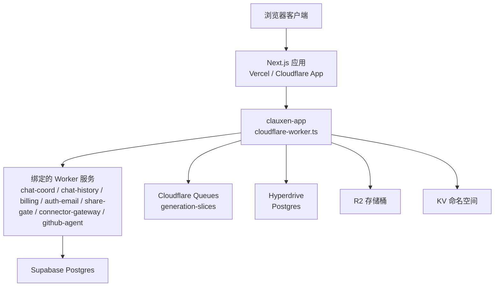
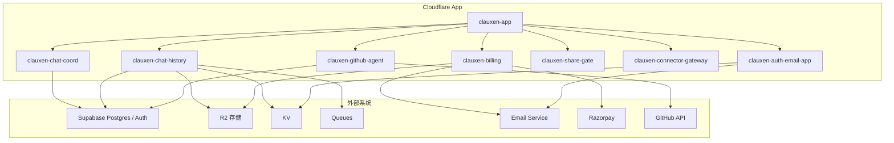
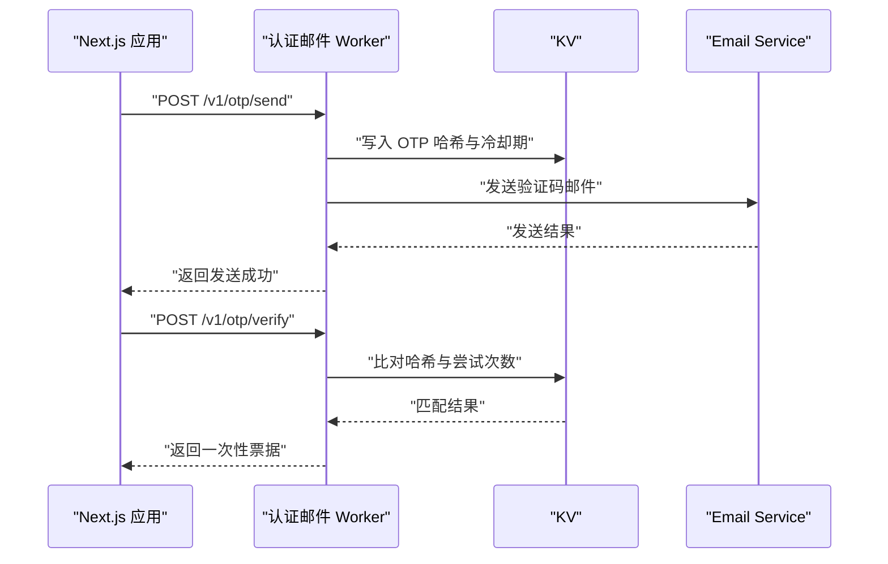
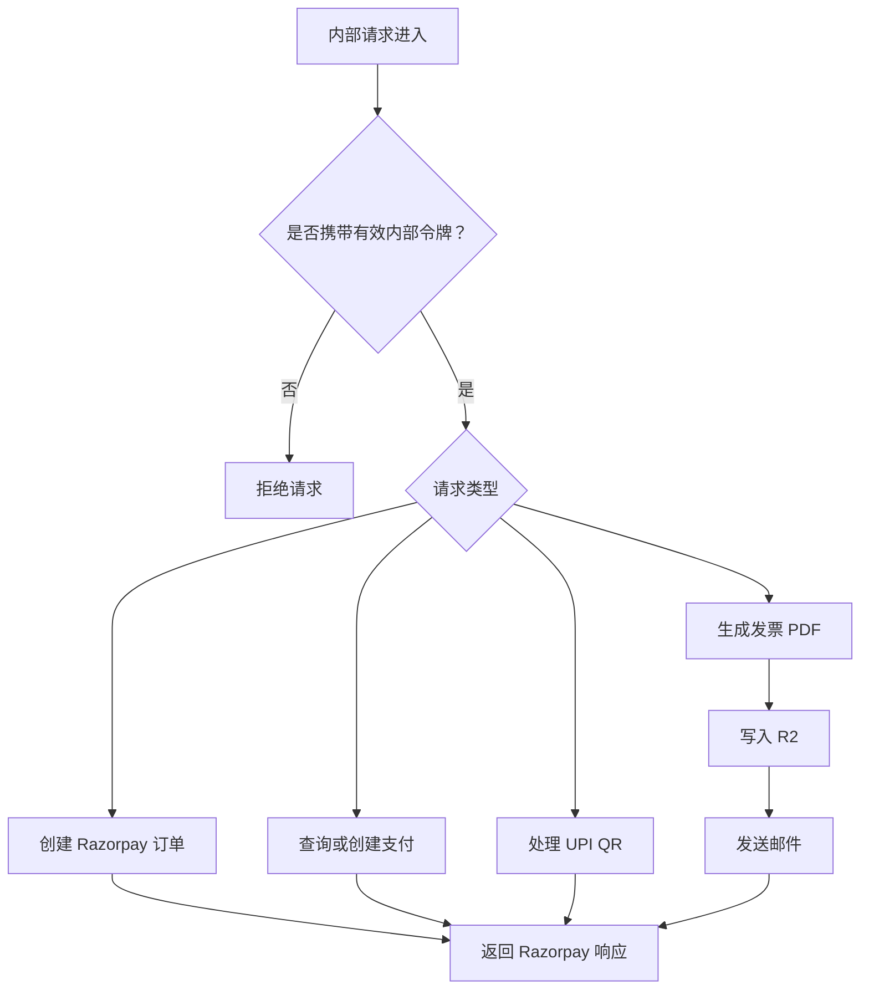
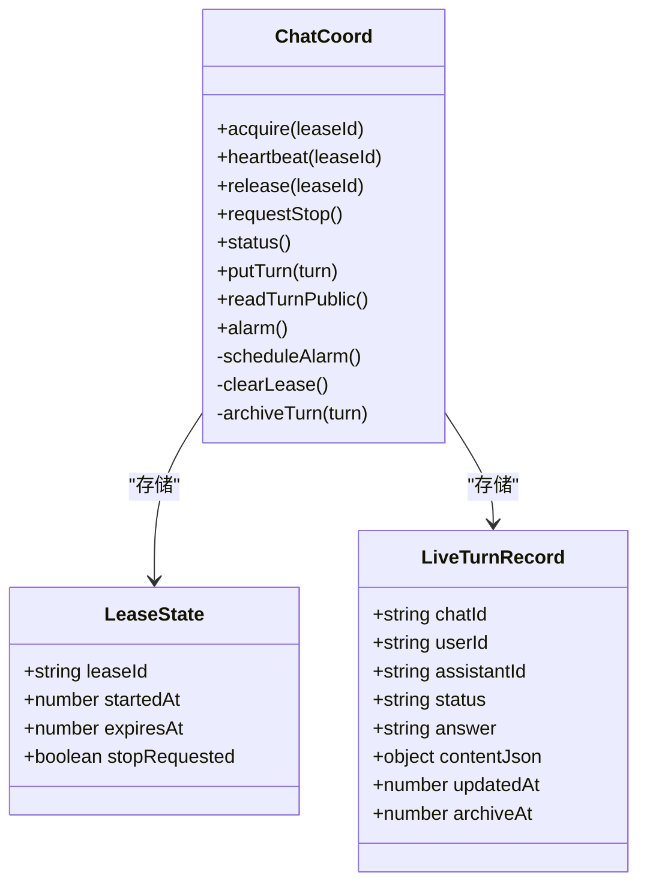
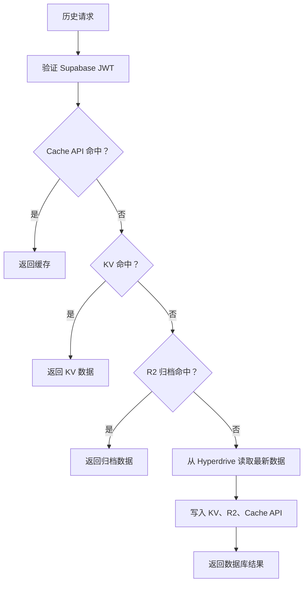
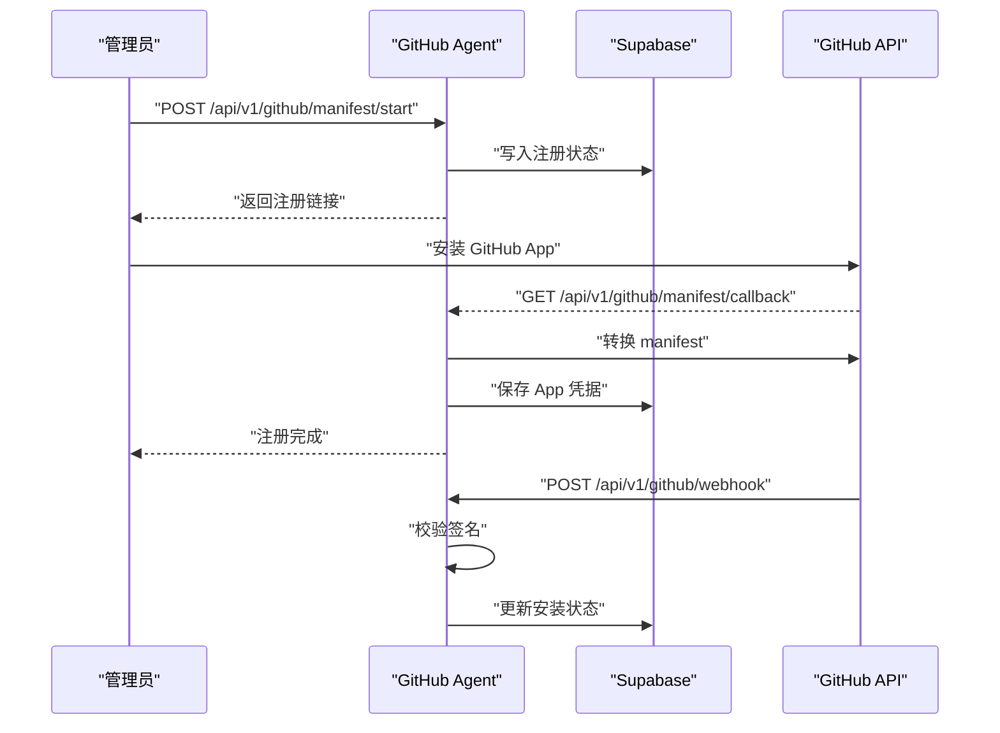
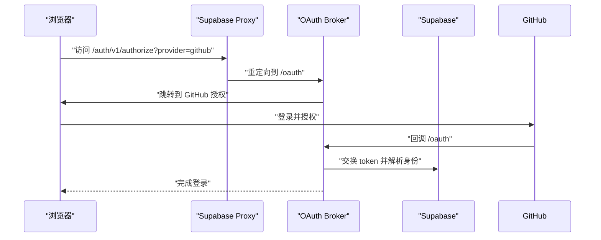
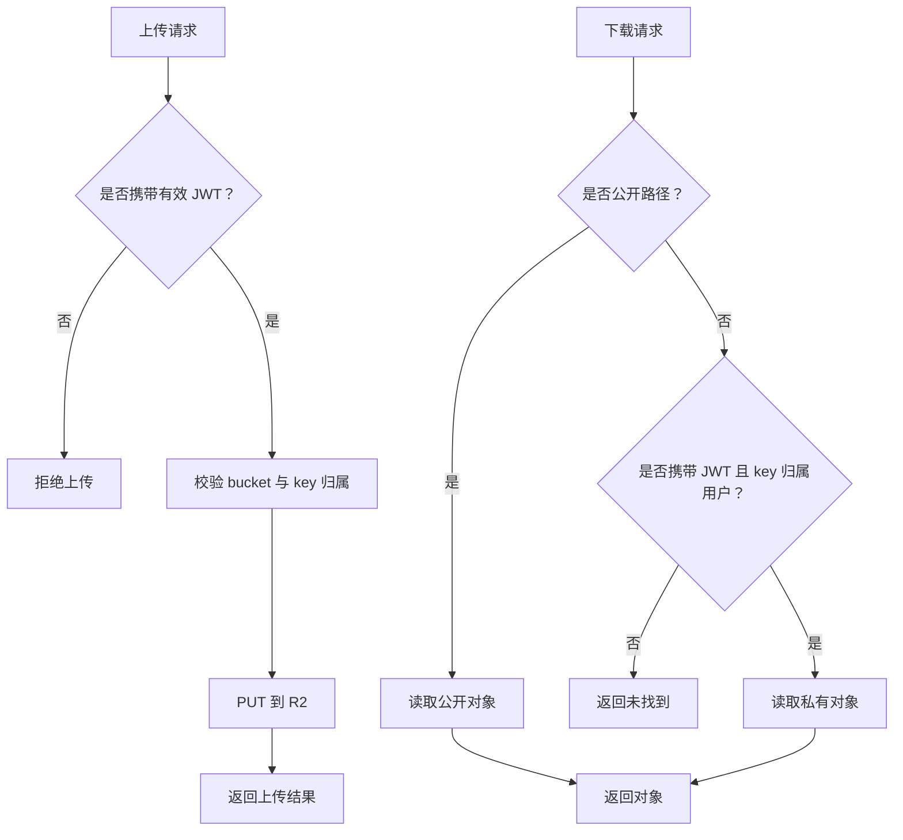

# Cloudflare Workers

<cite>
**本文引用的文件**   
- [README.md](file://README.md)
- [cloudflare-worker.ts](file://cloudflare-worker.ts)
- [wrangler.jsonc](file://wrangler.jsonc)
- [docs/cloudflare-workers-setup.md](file://docs/cloudflare-workers-setup.md)
- [docs/cloudflare-chat-storage-architecture.md](file://docs/cloudflare-chat-storage-architecture.md)
- [docs/background-execution.md](file://docs/background-execution.md)
- [docs/scheduled-tasks.md](file://docs/scheduled-tasks.md)
- [.github/workflows/deploy-cloudflare-workers.yml](file://.github/workflows/deploy-cloudflare-workers.yml)
- [scripts/deploy-cloudflare-workers.sh](file://scripts/deploy-cloudflare-workers.sh)
- [scripts/wire-auth-email-vercel.sh](file://scripts/wire-auth-email-vercel.sh)
- [scripts/wire-chat-history-vercel.sh](file://scripts/wire-chat-history-vercel.sh)
- [workers/auth-email/src/index.ts](file://workers/auth-email/src/index.ts)
- [workers/billing/src/index.ts](file://workers/billing/src/index.ts)
- [workers/chat-coord/src/index.ts](file://workers/chat-coord/src/index.ts)
- [workers/chat-history/src/index.ts](file://workers/chat-history/src/index.ts)
- [workers/github-agent/src/index.ts](file://workers/github-agent/src/index.ts)
- [workers/oauth-broker/src/index.ts](file://workers/oauth-broker/src/index.ts)
- [workers/supabase-proxy/src/index.ts](file://workers/supabase-proxy/src/index.ts)
- [workers/r2-gateway/src/index.ts](file://workers/r2-gateway/src/index.ts)
</cite>

## 目录
1. [引言](#引言)
2. [项目结构](#项目结构)
3. [核心组件](#核心组件)
4. [架构总览](#架构总览)
5. [详细组件分析](#详细组件分析)
6. [依赖与集成关系](#依赖与集成关系)
7. [部署与环境变量管理](#部署与环境变量管理)
8. [Worker 间通信、共享状态与错误处理](#worker-间通信共享状态与错误处理)
9. [监控、告警与可观测性](#监控告警与可观测性)
10. [新 Worker 开发指南](#新-worker-开发指南)
11. [测试方法](#测试方法)
12. [性能优化建议](#性能优化建议)
13. [故障排查](#故障排查)
14. [结论](#结论)

## 引言
本仓库是一个以 Next.js 前端和 Supabase 后端为核心的 AI 聊天平台，同时维护一个 Cloudflare Workers 边缘微服务集群。该集群承担认证邮件、账单与发票、聊天协调、聊天历史缓存与归档、R2 对象网关、OAuth 代理与经纪、GitHub Agent、定时任务调度等职责。主应用通过 HTTP、Cloudflare Queues、Hyperdrive、KV、R2、Durable Objects 与这些 Worker 协作，把高延迟或需要跨请求持久化的能力下沉到边缘侧。

## 项目结构
仓库根目录包含 Next.js 应用、Supabase 迁移、脚本工具和 `workers/` 下的多个独立 Worker 工程；顶层 `cloudflare-worker.ts` 是 Cloudflare App 入口，负责把内部存储访问路由到专用处理器，并把生成队列消费转发给 OpenNext 构建出的 Worker handler。`wrangler.jsonc` 集中声明了自定义域名、绑定服务、Hyperdrive、R2 Bucket、KV、Queues、变量、放置区域和可观测性采样率。

**图表来源**
- [cloudflare-worker.ts:1-22](file://cloudflare-worker.ts#L1-L22)
- [wrangler.jsonc:1-117](file://wrangler.jsonc#L1-L117)

**章节来源**
- [README.md:1-89](file://README.md#L1-L89)
- [wrangler.jsonc:1-117](file://wrangler.jsonc#L1-L117)

## 核心组件
| Worker | 主要职责 | 对外路径或触发方式 | 关键外部依赖 |
|---|---|---|---|
| 认证邮件 Worker | 发送 OTP、魔术链接，验证并签发一次性票据 | `/v1/otp/*`、`/v1/magic/*` | Email Service、KV |
| 账单 Worker | Razorpay 订单、支付、UPI QR、发票 PDF 生成与投递 | `/v1/razorpay/*`、`/v1/invoices/*` | Razorpay、Email Service、R2、可选 Supabase |
| 聊天协调 Worker | 基于 Durable Object 的会话级生成租约、心跳、停止、活跃轮次镜像 | `/lease`、`/heartbeat`、`/stop`、`/turn/*` | Durable Object、Supabase（归档回调） |
| 聊天历史 Worker | 消息分页、活跃分支页、最近消息缓存、R2 归档、JWT 校验 | 历史 API（由上层调用） | Hyperdrive、KV、Cache API、R2、Queues |
| GitHub Agent | GitHub App 注册、用户连接、Webhook、仓库读取与变更创建 | `/api/v1/github/*` | Supabase、GitHub API、Rate Limit |
| OAuth Broker | 代理 GitHub/GitLab OAuth，统一回调和身份解析 | `/auth/oauth`、`/oauth/*` | Supabase、Hyperdrive、Rate Limit |
| Supabase Proxy | 固定上游 Supabase 端点、鉴权限流、OAuth Provider 重写 | `auth.clauxen.com` | Supabase |
| R2 Gateway | 预签名上传、私有下载、公开头像和营销资源下载 | `/upload/*`、`/download/*` | R2、Supabase Auth |
| 定时任务 Worker | Cron 调度、队列分发、执行重试与死信队列 | Cloudflare Cron、Queues | Supabase、Queues |
| 主 Worker 入口 | 存储对象路由、Generation 队列消费 | `/api/v1/storage/object`、Queue | OpenNext handler |

**章节来源**
- [workers/auth-email/src/index.ts:1-682](file://workers/auth-email/src/index.ts#L1-L682)
- [workers/billing/src/index.ts:1-652](file://workers/billing/src/index.ts#L1-L652)
- [workers/chat-coord/src/index.ts:1-394](file://workers/chat-coord/src/index.ts#L1-L394)
- [workers/chat-history/src/index.ts:1-1126](file://workers/chat-history/src/index.ts#L1-L1126)
- [workers/github-agent/src/index.ts:1-471](file://workers/github-agent/src/index.ts#L1-L471)
- [workers/oauth-broker/src/index.ts:1-34](file://workers/oauth-broker/src/index.ts#L1-L34)
- [workers/supabase-proxy/src/index.ts:1-76](file://workers/supabase-proxy/src/index.ts#L1-L76)
- [workers/r2-gateway/src/index.ts:1-213](file://workers/r2-gateway/src/index.ts#L1-L213)
- [docs/scheduled-tasks.md:1-69](file://docs/scheduled-tasks.md#L1-L69)
- [cloudflare-worker.ts:1-22](file://cloudflare-worker.ts#L1-L22)

## 架构总览
Cloudflare 侧存在两类部署形态：
1. **单应用形态**：`wrangler.jsonc` 将多个 Worker 作为服务绑定到 `clauxen-app`，并通过 `services` 字段互相调用。
2. **多 Worker 形态**：`deploy-cloudflare-workers.sh` 分别部署 `clauxen-auth-email`、`clauxen-chat-history`、`clauxen-chat-coord`、`clauxen-billing` 等独立 Worker，并由 Vercel 环境同步 Worker URL 和内部令牌。

**图表来源**
- [wrangler.jsonc:1-117](file://wrangler.jsonc#L1-L117)
- [scripts/deploy-cloudflare-workers.sh:1-221](file://scripts/deploy-cloudflare-workers.sh#L1-L221)

**章节来源**
- [wrangler.jsonc:1-117](file://wrangler.jsonc#L1-L117)
- [docs/cloudflare-workers-setup.md:1-70](file://docs/cloudflare-workers-setup.md#L1-L70)

## 详细组件分析

### 认证邮件 Worker
该 Worker 提供 OTP 和魔术链接流程：生成 6 位验证码、哈希存入 KV、发送邮件；支持验证码校验、一次性票据签发与燃烧；魔术链接支持查看、燃烧和签发票据。所有服务端调用必须携带内部令牌，令牌来自 `Authorization: Bearer` 或 `x-clauxen-internal` 头。KV 中维护 OTP 记录、票据记录和冷却期键，防止暴力猜测和频繁重发。

**图表来源**
- [workers/auth-email/src/index.ts:1-682](file://workers/auth-email/src/index.ts#L1-L682)

**章节来源**
- [workers/auth-email/src/index.ts:1-682](file://workers/auth-email/src/index.ts#L1-L682)

### 账单 Worker
账单 Worker 封装 Razorpay 的订单、支付、客户、UPI QR、支付凭证和发票生命周期。内部调用通过 `BILLING_INTERNAL_TOKEN` 或 `x-clauxen-billing` 头保护；面向用户的 PDF 下载则通过 Supabase JWT 验证用户身份。发票生成会构造 PDF、上传至 R2，并可调用 Razorpay Documents；邮件通知使用 Email Service。

**图表来源**
- [workers/billing/src/index.ts:1-652](file://workers/billing/src/index.ts#L1-L652)

**章节来源**
- [workers/billing/src/index.ts:1-652](file://workers/billing/src/index.ts#L1-L652)

### 聊天协调 Worker
聊天协调 Worker 基于 Durable Object 实现每个聊天会话的生命周期协调。它维护生成租约、心跳、停止信号、活跃轮次快照和自动归档。租约过期后允许抢占，避免卡住聊天；终端轮次会在到期后尝试归档回主应用；归档失败会指数式重试。

**图表来源**
- [workers/chat-coord/src/index.ts:1-394](file://workers/chat-coord/src/index.ts#L1-L394)

**章节来源**
- [workers/chat-coord/src/index.ts:1-394](file://workers/chat-coord/src/index.ts#L1-L394)
- [docs/background-execution.md:1-38](file://docs/background-execution.md#L1-L38)

### 聊天历史 Worker
聊天历史 Worker 是历史读写、缓存与归档的核心。它支持：
- 活跃分支分页；
- 最近消息缓存优先读取；
- Cache API、KV、R2、Hyperdrive 多级缓存；
- JWT 校验结果本地缓存；
- 异步写入 R2 归档；
- 失效最近页面和列表缓存；
- 使用 Queue 进行非阻塞预热与归档。

**图表来源**
- [workers/chat-history/src/index.ts:1-1126](file://workers/chat-history/src/index.ts#L1-L1126)

**章节来源**
- [workers/chat-history/src/index.ts:1-1126](file://workers/chat-history/src/index.ts#L1-L1126)

### GitHub Agent
GitHub Agent 负责 GitHub App 注册、用户连接、Webhook 接收、仓库读取和变更创建。它使用 Supabase 保存 App 配置和用户 Token 密封值，使用 Rate Limit 限制 API 访问，对 Webhook 做签名校验，并对敏感操作做内部令牌保护。

**图表来源**
- [workers/github-agent/src/index.ts:1-471](file://workers/github-agent/src/index.ts#L1-L471)

**章节来源**
- [workers/github-agent/src/index.ts:1-471](file://workers/github-agent/src/index.ts#L1-L471)

### OAuth Broker 与 Supabase Proxy
Supabase Proxy 固定上游为 Supabase，禁止 Host、Cookie、Forwarded 等危险头，对认证接口做速率限制，并在特定 provider 下把授权地址改写为 OAuth Broker。OAuth Broker 在指定域名上拦截 Supabase 的授权跳转，将其重定向到自有 OAuth 流程，随后再走 Broker 的回调、凭证管理和身份解析逻辑。

**图表来源**
- [workers/supabase-proxy/src/index.ts:1-76](file://workers/supabase-proxy/src/index.ts#L1-L76)
- [workers/oauth-broker/src/index.ts:1-34](file://workers/oauth-broker/src/index.ts#L1-L34)

**章节来源**
- [workers/supabase-proxy/src/index.ts:1-76](file://workers/supabase-proxy/src/index.ts#L1-L76)
- [workers/oauth-broker/src/index.ts:1-34](file://workers/oauth-broker/src/index.ts#L1-L34)

### R2 Gateway
R2 Gateway 负责受保护的上传与下载。用户上传前先获取预签名地址，随后直接 PUT 到 R2；下载时区分公开路径和私有路径，私有路径要求 Supabase JWT 且 key 必须以用户前缀开头。公开路径如 `public/` 和头像路径允许匿名读取，但不会误缓存私有对象。

**图表来源**
- [workers/r2-gateway/src/index.ts:1-213](file://workers/r2-gateway/src/index.ts#L1-L213)

**章节来源**
- [workers/r2-gateway/src/index.ts:1-213](file://workers/r2-gateway/src/index.ts#L1-L213)

## 依赖与集成关系

### 主应用与 Worker 集成
- `cloudflare-worker.ts` 拦截 `/api/v1/storage/object` 路径，交给存储访问处理器；其他请求交给 OpenNext 构建的 handler。
- `wrangler.jsonc` 将多个 Worker 作为服务绑定到主应用，例如 `CHAT_COORD`、`CHAT_HISTORY`、`BILLING`、`AUTH_EMAIL`、`SHARE_GATE`、`CONNECTOR_GATEWAY`、`GITHUB_AGENT`。
- 主应用还绑定 Hyperdrive、R2 Bucket、KV、Queues 和全局变量。

**章节来源**
- [cloudflare-worker.ts:1-22](file://cloudflare-worker.ts#L1-L22)
- [wrangler.jsonc:1-117](file://wrangler.jsonc#L1-L117)

### 与 Supabase 的关系
- Supabase Proxy 固定上游 Supabase 域名，屏蔽不安全请求头，对认证接口限流，并将部分 OAuth provider 重写到 Broker。
- 聊天历史、账单、GitHub Agent 等 Worker 可能直接访问 Supabase 或 Hyperdrive。
- 聊天存储架构文档指出，未来设计可逐步迁移到 D1、R2 和 Durable Objects，但当前仍大量依赖 Supabase。

**章节来源**
- [workers/supabase-proxy/src/index.ts:1-76](file://workers/supabase-proxy/src/index.ts#L1-L76)
- [workers/chat-history/src/index.ts:1-1126](file://workers/chat-history/src/index.ts#L1-L1126)
- [workers/github-agent/src/index.ts:1-471](file://workers/github-agent/src/index.ts#L1-L471)
- [docs/cloudflare-chat-storage-architecture.md:1-109](file://docs/cloudflare-chat-storage-architecture.md#L1-L109)

### 与主应用的数据同步策略
- 聊天协调 Worker 在轮次完成后尝试调用主应用的内部归档接口，失败时会延后重试。
- 聊天历史 Worker 将最近消息写入 KV、R2 和 Cache API，并在写成功后设置带 tag 的响应头，供上层按需失效。
- 定时任务通过 Cron 触发 Worker，再由 Worker 调用主应用受保护调度接口，最终进入 Queues 消费。

**章节来源**
- [workers/chat-coord/src/index.ts:200-394](file://workers/chat-coord/src/index.ts#L200-L394)
- [workers/chat-history/src/index.ts:200-600](file://workers/chat-history/src/index.ts#L200-L600)
- [docs/scheduled-tasks.md:1-69](file://docs/scheduled-tasks.md#L1-L69)

## Worker 间通信、共享状态与错误处理

### 通信机制
| 机制 | 用途 | 说明 |
|---|---|---|
| HTTP 内部令牌 | Worker 与主应用、Worker 之间 | 使用 `x-clauxen-internal`、`x-clauxen-billing`、`Authorization: Bearer` 等头部，配合随机生成的内部令牌 |
| Cloudflare Queues | 生成切片、定时任务、归档任务 | 至少一次投递，结合数据库唯一键和幂等重试 |
| Durable Object | 聊天级并发控制 | 每个聊天对应一个 DO，管理租约、心跳、停止和轮次快照 |
| KV | OTP、魔术链接、短期状态 | 适合小对象、低延迟、易失效的状态 |
| R2 | 聊天记录归档、发票 PDF、用户附件 | 不可变对象、强一致性存储 |
| Cache API | 同可用区快速缓存 | 用于 JWT 校验、最近消息、列表页 |
| Hyperdrive | 加速 Supabase 连接 | 聊天历史读路径使用无缓存连接保证写后一致 |

**章节来源**
- [workers/auth-email/src/index.ts:1-682](file://workers/auth-email/src/index.ts#L1-L682)
- [workers/chat-history/src/index.ts:1-1126](file://workers/chat-history/src/index.ts#L1-L1126)
- [workers/chat-coord/src/index.ts:1-394](file://workers/chat-coord/src/index.ts#L1-L394)
- [docs/scheduled-tasks.md:1-69](file://docs/scheduled-tasks.md#L1-L69)

### 共享状态
- 共享令牌：`AUTH_EMAIL_INTERNAL_TOKEN`、`CHAT_COORD_INTERNAL_TOKEN`、`CHAT_HISTORY_INTERNAL_TOKEN`、`BILLING_INTERNAL_TOKEN`、`SCHEDULED_TASKS_INTERNAL_TOKEN` 等，需要在 Cloudflare Worker 和 Vercel 环境中保持一致。
- 聊天状态：聊天 ID 映射到 Durable Object stub，确保同一聊天只有一个生成持有者。
- 缓存版本：聊天历史使用 `CACHE_SCHEMA_VERSION` 使旧缓存自然失效。

**章节来源**
- [scripts/deploy-cloudflare-workers.sh:1-221](file://scripts/deploy-cloudflare-workers.sh#L1-L221)
- [workers/chat-history/src/index.ts:200-600](file://workers/chat-history/src/index.ts#L200-L600)
- [workers/chat-coord/src/index.ts:1-394](file://workers/chat-coord/src/index.ts#L1-L394)

### 错误处理
- 认证失败：返回 401，不泄露内部实现细节。
- 请求体无效：返回 400，通常附带结构化错误信息。
- 下游不可用：Razorpay 缺失密钥时返回 503；Supabase Proxy 异常返回 502。
- 速率限制：认证接口、GitHub Agent、OAuth Broker 使用 Cloudflare Rate Limit。
- 重试与死信：Queues 配置最大重试次数和死信队列，避免丢失任务。
- 归档失败：聊天协调 Worker 归档失败后延迟重试，而不是立即丢弃。

**章节来源**
- [workers/billing/src/index.ts:1-652](file://workers/billing/src/index.ts#L1-L652)
- [workers/github-agent/src/index.ts:200-471](file://workers/github-agent/src/index.ts#L200-L471)
- [workers/supabase-proxy/src/index.ts:1-76](file://workers/supabase-proxy/src/index.ts#L1-L76)
- [workers/chat-coord/src/index.ts:200-394](file://workers/chat-coord/src/index.ts#L200-L394)

## 监控、告警与可观测性
- `wrangler.jsonc` 启用 observability，开启查询字符串脱敏，设置 head sampling rate 为 0.05。
- GitHub Agent 在 500 错误时输出结构化日志，包含服务名、事件名、路径和错误类型。
- 定时任务和背景执行文档强调观察队列积压、DLQ、Worker 可观测性和生产链路。
- 聊天存储架构文档建议监控发布积压、R2 GET/PUT 量、D1 读写、每行元数据字节数。

**章节来源**
- [wrangler.jsonc:1-117](file://wrangler.jsonc#L1-L117)
- [workers/github-agent/src/index.ts:200-471](file://workers/github-agent/src/index.ts#L200-L471)
- [docs/scheduled-tasks.md:1-69](file://docs/scheduled-tasks.md#L1-L69)
- [docs/cloudflare-chat-storage-architecture.md:1-109](file://docs/cloudflare-chat-storage-architecture.md#L1-L109)

## 新 Worker 开发指南

### 开发步骤
1. 在 `workers/` 下新建子目录，包含 `src/index.ts`、`package.json`、`tsconfig.json` 和 Wrangler 配置文件。
2. 定义 `Env` 接口，明确外部绑定，例如 KV、R2、Queue、Durable Object、Fetcher、Rate Limit。
3. 实现安全校验：内部接口使用内部令牌，用户接口使用 Supabase JWT 或 OAuth。
4. 实现健康检查路径，便于部署后冒烟测试。
5. 如需被主应用调用，在 `wrangler.jsonc` 的 `services` 中添加绑定；如需独立部署，加入部署脚本。
6. 添加环境变量和 secret，保持与主应用或相邻 Worker 共享。

### 最佳实践
- 始终对输入做最小化校验，避免长字符串、非法 JSON、越界数值。
- 不要向响应体返回敏感密钥或完整堆栈。
- 对外部调用设置超时和降级策略。
- 对幂等操作使用唯一请求 ID。
- 对异步任务使用 Queues 或 alarm，不要在单次请求中执行长时间 I/O。
- 对缓存设置 schema version，避免旧格式污染新请求。

**章节来源**
- [workers/github-agent/src/index.ts:1-471](file://workers/github-agent/src/index.ts#L1-L471)
- [workers/supabase-proxy/src/index.ts:1-76](file://workers/supabase-proxy/src/index.ts#L1-L76)
- [docs/cloudflare-workers-setup.md:1-70](file://docs/cloudflare-workers-setup.md#L1-L70)

## 测试方法
- 背景执行测试覆盖流式、工具日志、检查点失败、watchdog 重试和认证中继回归。
- 定时任务测试覆盖 CRUD、日期边界、DST、重复投递、终端结果持久化和通知。
- 聊天存储架构文档强调应练习中断生成、重复重试、并发标签页、分叉编辑、发布失败和删除流程。
- GitHub Agent 和 OAuth Broker 提供独立测试文件；Supabase Proxy 也有代理测试。

**章节来源**
- [docs/background-execution.md:1-38](file://docs/background-execution.md#L1-L38)
- [docs/scheduled-tasks.md:1-69](file://docs/scheduled-tasks.md#L1-L69)
- [docs/cloudflare-chat-storage-architecture.md:1-109](file://docs/cloudflare-chat-storage-architecture.md#L1-L109)

## 性能优化建议
- 优先使用 Cache API 和 KV 缓存热点数据，减少 Hyperdrive 压力。
- 使用分层缓存：Cache API → KV → R2 → Hyperdrive，避免每次打开对话都直连数据库。
- 对长对话只加载有界最近消息窗口，避免整段转录进入模型上下文。
- 使用 Queue 异步归档和预热，避免阻塞用户请求。
- 对 Durable Object 使用租约和心跳，避免崩溃导致长期锁。
- 对 R2 私有对象禁用共享公共缓存，公开对象才设置合理的 `max-age`。
- 使用 Hyperdrive 无缓存连接进行写后一致读，避免脏读。

**章节来源**
- [workers/chat-history/src/index.ts:200-600](file://workers/chat-history/src/index.ts#L200-L600)
- [workers/r2-gateway/src/index.ts:1-213](file://workers/r2-gateway/src/index.ts#L1-L213)
- [docs/cloudflare-chat-storage-architecture.md:1-109](file://docs/cloudflare-chat-storage-architecture.md#L1-L109)

## 故障排查
| 现象 | 可能原因 | 排查方向 |
|---|---|---|
| 无法发送 OTP | KV 未配置、Email Service 未绑定、内部令牌不一致 | 检查 Worker secret、KV 绑定、Vercel 中的 `AUTH_EMAIL_WORKER_URL` |
| 账单 API 返回 503 | Razorpay 密钥未配置 | 检查 `RAZORPAY_KEY_ID`、`RAZORPAY_KEY_SECRET` |
| 聊天生成被卡住 | 租约未释放、DO 未收到心跳 | 检查 `/lease`、`/heartbeat`、`/status` |
| 历史消息陈旧 | KV/R2/Cache API 未失效 | 检查失效逻辑和缓存 schema version |
| GitHub Webhook 失败 | 签名不匹配、App 未正确注册 | 检查 webhook secret、App 安装状态 |
| Supabase 认证限流 | 认证接口请求过多 | 检查 Rate Limit 配置、客户端重试策略 |

**章节来源**
- [workers/auth-email/src/index.ts:1-682](file://workers/auth-email/src/index.ts#L1-L682)
- [workers/billing/src/index.ts:1-652](file://workers/billing/src/index.ts#L1-L652)
- [workers/chat-coord/src/index.ts:1-394](file://workers/chat-coord/src/index.ts#L1-L394)
- [workers/chat-history/src/index.ts:200-600](file://workers/chat-history/src/index.ts#L200-L600)
- [workers/github-agent/src/index.ts:200-471](file://workers/github-agent/src/index.ts#L200-L471)
- [workers/supabase-proxy/src/index.ts:1-76](file://workers/supabase-proxy/src/index.ts#L1-L76)

## 结论
Cloudflare Workers 在该项目中不是简单的前置层，而是承载认证、账单、聊天协调、聊天历史、对象存储、OAuth 代理、GitHub Agent 和定时任务的边缘服务集群。它们通过内部令牌、Queues、Durable Objects、KV、R2、Cache API 和 Hyperdrive 与主应用及其他 Worker 协作。部署方面既支持单个 Cloudflare App 绑定多个 Worker，也支持独立部署并通过脚本同步环境变量。运维重点在于共享令牌一致性、缓存一致性、队列重试与死信、日志可观测性和外部服务降级。新增 Worker 时应遵循最小权限、幂等设计、输入校验、分层缓存和异步任务原则，以保持整体系统的稳定性和可扩展性。