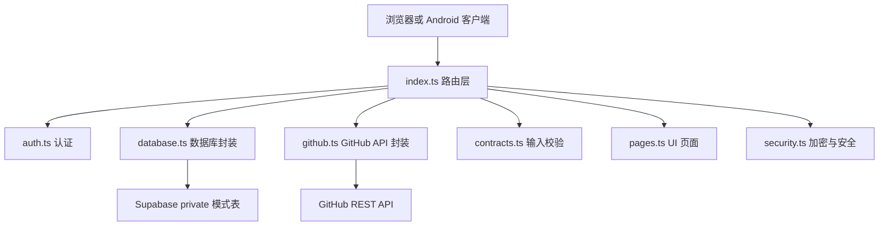
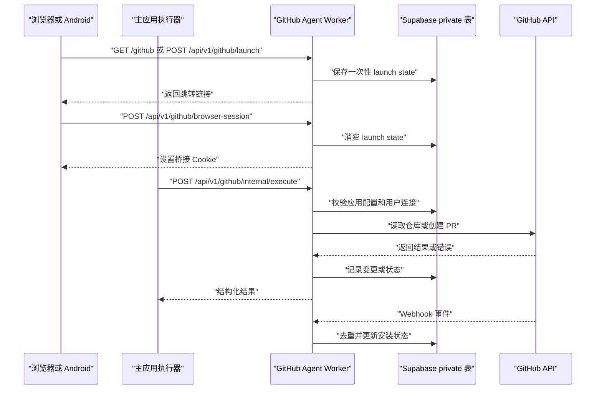
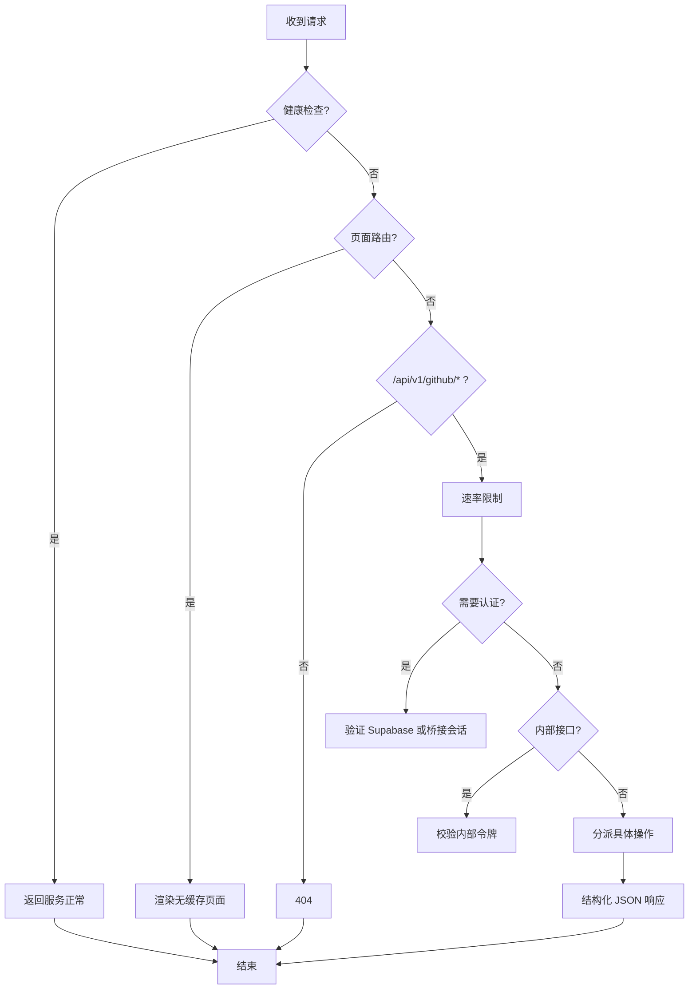
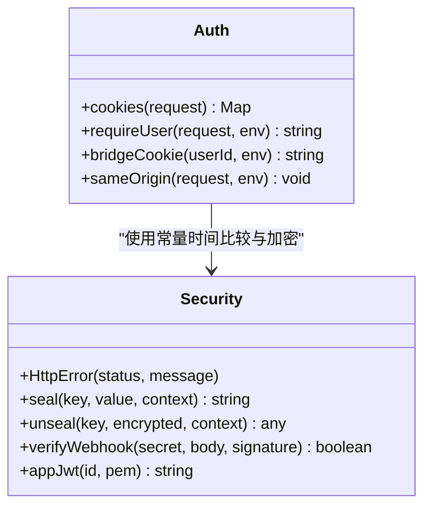
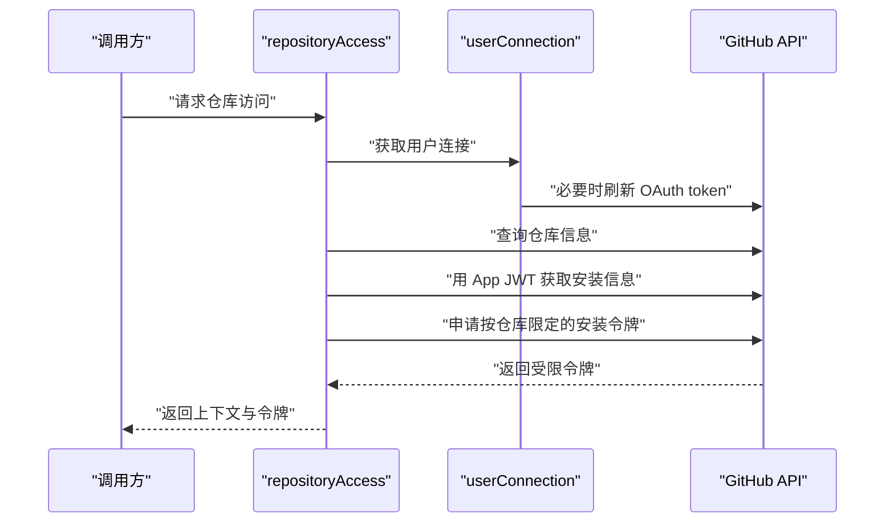
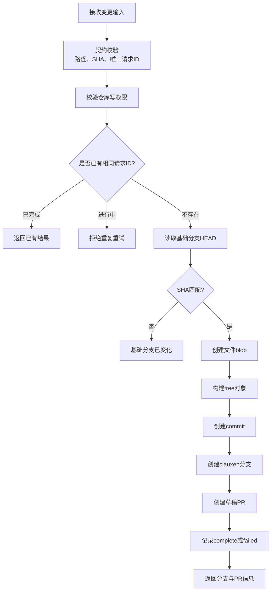
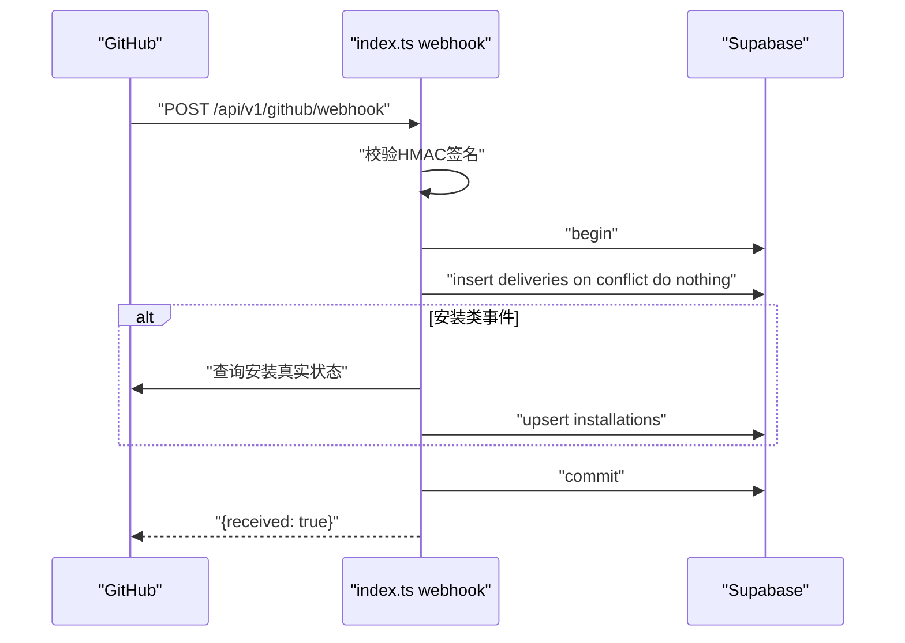
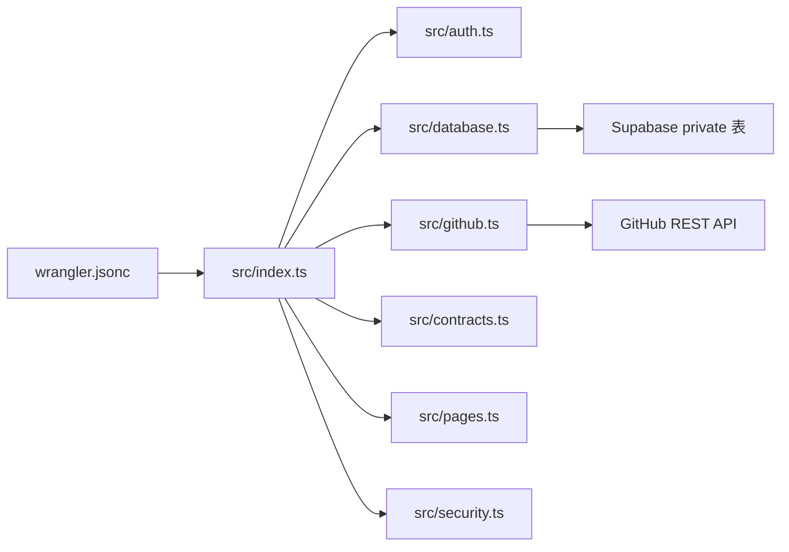

# GitHub Agent Worker

<cite>
**本文引用的文件**   
- [workers/github-agent/src/index.ts](file://workers/github-agent/src/index.ts)
- [workers/github-agent/src/auth.ts](file://workers/github-agent/src/auth.ts)
- [workers/github-agent/src/database.ts](file://workers/github-agent/src/database.ts)
- [workers/github-agent/src/github.ts](file://workers/github-agent/src/github.ts)
- [workers/github-agent/src/contracts.ts](file://workers/github-agent/src/contracts.ts)
- [workers/github-agent/src/pages.ts](file://workers/github-agent/src/pages.ts)
- [workers/github-agent/src/security.ts](file://workers/github-agent/src/security.ts)
- [workers/github-agent/wrangler.jsonc](file://workers/github-agent/wrangler.jsonc)
- [supabase/migrations/20261017120935_clauxen_github_agent.sql](file://supabase/migrations/20261017120935_clauxen_github_agent.sql)
- [docs/github-agent.md](file://docs/github-agent.md)
- [workers/github-agent/agent.test.ts](file://workers/github-agent/agent.test.ts)
</cite>

## 目录
1. [简介](#简介)
2. [项目结构](#项目结构)
3. [核心组件](#核心组件)
4. [架构总览](#架构总览)
5. [详细组件分析](#详细组件分析)
6. [依赖与集成关系](#依赖与集成关系)
7. [性能与可扩展性](#性能与可扩展性)
8. [安全与权限控制](#安全与权限控制)
9. [故障排查](#故障排查)
10. [结论](#结论)

## 简介
GitHub Agent Worker 是 Clauxen 的 GitHub 集成专用 Cloudflare Worker。它负责：
- 托管 GitHub App 注册、安装与用户连接流程；
- 使用用户级 OAuth 令牌枚举仓库、读取代码；
- 通过 GitHub App 安装令牌创建分支、提交和草稿 Pull Request；
- 接收并验证 GitHub Webhook，维护安装状态；
- 为主应用内部执行器提供 `repositories`、`read`、`create_change` 三个能力；
- 在 Supabase `private` 模式中持久化敏感状态，启用行级安全策略。

该 Worker 暴露 `www.clauxen.com/api/v1/github/*` 与 `/github*` 路由，并由主应用通过服务绑定和内部令牌调用。它与浏览器端和 Android 端共享同一 Supabase 用户标识和连接记录。

**章节来源**
- [docs/github-agent.md:1-108](file://docs/github-agent.md#L1-L108)
- [workers/github-agent/wrangler.jsonc:1-19](file://workers/github-agent/wrangler.jsonc#L1-L19)

## 项目结构
Worker 源码位于 `workers/github-agent/src`，采用按职责拆分的单进程入口模式：
- `index.ts`：请求路由、中间件、限流、Webhook、OAuth、内部工具接口；
- `auth.ts`：Supabase JWT 校验、桥接 Cookie、同源校验；
- `database.ts`：数据库连接池封装、加密状态存取、应用配置加载；
- `github.ts`：GitHub API 封装、用户连接刷新、仓库枚举、只读读取、变更创建；
- `contracts.ts`：Zod 输入校验、GitHub App Manifest；
- `pages.ts`：内嵌设置页与连接页面；
- `security.ts`：AES-GCM 加密封装、HMAC 校验、App JWT 签发、HTML 转义。



**图表来源**
- [workers/github-agent/src/index.ts:1-471](file://workers/github-agent/src/index.ts#L1-L471)
- [workers/github-agent/src/auth.ts:1-89](file://workers/github-agent/src/auth.ts#L1-L89)
- [workers/github-agent/src/database.ts:1-92](file://workers/github-agent/src/database.ts#L1-L92)
- [workers/github-agent/src/github.ts:1-428](file://workers/github-agent/src/github.ts#L1-L428)
- [workers/github-agent/src/contracts.ts:1-68](file://workers/github-agent/src/contracts.ts#L1-L68)
- [workers/github-agent/src/pages.ts:1-52](file://workers/github-agent/src/pages.ts#L1-L52)
- [workers/github-agent/src/security.ts:1-123](file://workers/github-agent/src/security.ts#L1-L123)

**章节来源**
- [workers/github-agent/src/index.ts:1-471](file://workers/github-agent/src/index.ts#L1-L471)
- [workers/github-agent/wrangler.jsonc:1-19](file://workers/github-agent/wrangler.jsonc#L1-L19)

## 核心组件
| 组件 | 职责 | 关键行为 |
|---|---|---|
| 路由与服务入口 | 处理健康检查、页面、API、Webhook、限流、错误格式化 | 统一 JSON 响应、禁止缓存、异常分类 |
| 认证模块 | 解析 Supabase Session、桥接 Cookie、拒绝跨站请求 | 支持 ES256/RS256、限定受众和发行者 |
| 数据库模块 | Hyperdrive PostgreSQL 连接、事务式状态存储 | 短超时、语句超时、加密状态读写 |
| GitHub 集成 | 封装 REST、OAuth 交换、安装令牌、仓库访问 | 路径白名单、超时、状态码映射、并发锁 |
| 契约校验 | 仓库名、文件路径、PR 字段、工作流保护 | 拒绝路径穿越、重复路径、危险路径 |
| 页面渲染 | 生成带 CSP 的非缓存 HTML | 仅允许内联脚本样式、禁用外部连接 |
| 安全工具 | AES-GCM、HMAC、App JWT、HTML 转义 | 上下文绑定解密、时序安全比较 |

**章节来源**
- [workers/github-agent/src/index.ts:1-471](file://workers/github-agent/src/index.ts#L1-L471)
- [workers/github-agent/src/auth.ts:1-89](file://workers/github-agent/src/auth.ts#L1-L89)
- [workers/github-agent/src/database.ts:1-92](file://workers/github-agent/src/database.ts#L1-L92)
- [workers/github-agent/src/github.ts:1-428](file://workers/github-agent/src/github.ts#L1-L428)
- [workers/github-agent/src/contracts.ts:1-68](file://workers/github-agent/src/contracts.ts#L1-L68)
- [workers/github-agent/src/pages.ts:1-52](file://workers/github-agent/src/pages.ts#L1-L52)
- [workers/github-agent/src/security.ts:1-123](file://workers/github-agent/src/security.ts#L1-L123)

## 架构总览
GitHub Agent Worker 处于浏览器/Android 客户端、主应用执行器与 GitHub 平台之间，承担身份桥接、权限收敛、操作审计和状态同步。



**图表来源**
- [workers/github-agent/src/index.ts:1-471](file://workers/github-agent/src/index.ts#L1-L471)
- [workers/github-agent/src/github.ts:1-428](file://workers/github-agent/src/github.ts#L1-L428)
- [supabase/migrations/20261017120935_clauxen_github_agent.sql:1-58](file://supabase/migrations/20261017120935_clauxen_github_agent.sql#L1-L58)

## 详细组件分析

### 路由与服务入口
入口函数根据路径分发到以下功能：
- 健康检查：返回服务名称和可用性；
- 设置与连接页面：用于引导 GitHub App 注册和用户授权；
- Manifest 注册：管理员凭据启动注册流程，返回审查链接和 Manifest；
- Manifest 回调：完成 GitHub App 创建，校验所有者为组织账号，加密保存私钥、客户端密钥和 Webhook 密钥；
- Webhook：校验 HMAC、去重 delivery ID、更新安装挂起或删除状态；
- OAuth 流程：生成 PKCE challenge、保存 verifier、回调交换 token 并写入用户连接；
- 内部执行接口：仅接受内部令牌，调用仓库枚举、读取和变更创建；
- 用户接口：状态查询、仓库列表、代码读取、创建变更、断开连接；
- 全局错误处理：将 Zod 校验失败、语法错误和未知异常映射为统一 JSON 错误。



**图表来源**
- [workers/github-agent/src/index.ts:1-471](file://workers/github-agent/src/index.ts#L1-L471)

**章节来源**
- [workers/github-agent/src/index.ts:1-471](file://workers/github-agent/src/index.ts#L1-L471)

### 认证与会话管理
认证支持三种来源：
1. Supabase Session Cookie：解析分块 Cookie，取出 access_token，使用远程 JWKS 校验发行者、受众、签名算法和用户角色；
2. 桥接 Cookie：由 Worker 使用 SEAL_KEY 签发的短期 HS256 JWT，用于浏览器临时过渡；
3. 内部接口：通过 `x-clauxen-internal-token` 与 `INTERNAL_TOKEN` 进行恒定时间比较。

同时强制同源校验，拒绝非预期 Origin 和跨站请求头。



**图表来源**
- [workers/github-agent/src/auth.ts:1-89](file://workers/github-agent/src/auth.ts#L1-L89)
- [workers/github-agent/src/security.ts:1-123](file://workers/github-agent/src/security.ts#L1-L123)

**章节来源**
- [workers/github-agent/src/auth.ts:1-89](file://workers/github-agent/src/auth.ts#L1-L89)
- [workers/github-agent/src/security.ts:1-123](file://workers/github-agent/src/security.ts#L1-L123)

### 数据库与状态模型
所有 GitHub Agent 数据位于 Supabase `private` schema，并启用行级安全，撤销公共、匿名和已认证角色的默认访问。

| 表 | 用途 | 关键字段 | 索引与约束 |
|---|---|---|---|
| `github_agent_app` | GitHub App 元数据与应用凭证 | `app_id`、`slug`、`client_id`、`credentials_sealed` | 单行主键、`app_id` 唯一 |
| `github_agent_states` | 注册、OAuth、launch 一次性状态 | `hash`、`purpose`、`user_id`、`data_sealed`、`expires_at` | `hash` 主键、过期索引、用户索引 |
| `github_agent_connections` | 用户与 GitHub 账户连接 | `user_id`、`github_user_id`、`login`、`tokens_sealed` | `user_id` 主键 |
| `github_agent_installations` | GitHub App 安装生命周期 | `installation_id`、`account_login`、`suspended`、`deleted` | `installation_id` 主键 |
| `github_agent_changes` | 变更任务幂等与结果 | `id`、`user_id`、`request_id`、`repository`、`branch`、`status`、`result` | `(user_id, request_id)` 唯一、用户创建索引 |
| `github_agent_deliveries` | Webhook 投递去重 | `delivery_id`、`event`、`received_at` | `delivery_id` 主键 |

```mermaid
erDiagram
  GITHUB_AGENT_STATES ||--o{ GITHUB_AGENT_CONNECTIONS : "user_id 外键"
  GITHUB_AGENT_CONNECTIONS ||--o{ GITHUB_AGENT_CHANGES : "user_id 外键"
  GITHUB_AGENT_INSTALLATIONS ||--o{ GITHUB_AGENT_DELIVERIES : "由安装事件关联"
  GITHUB_AGENT_APP ||..|| GITHUB_AGENT_CONNECTIONS : "应用配置支撑用户连接"

  GITHUB_AGENT_APP {
    boolean singleton
    bigint app_id
    text slug
    text client_id
    text credentials_sealed
    timestamptz created_at
  }

  GITHUB_AGENT_STATES {
    text hash PK
    text purpose
    uuid user_id FK
    text data_sealed
    timestamptz expires_at
  }

  GITHUB_AGENT_CONNECTIONS {
    uuid user_id PK FK
    bigint github_user_id
    text login
    text tokens_sealed
    timestamptz updated_at
  }

  GITHUB_AGENT_INSTALLATIONS {
    bigint installation_id PK
    text account_login
    boolean suspended
    boolean deleted
    timestamptz updated_at
  }

  GITHUB_AGENT_CHANGES {
    uuid id PK
    uuid user_id FK
    uuid request_id
    text repository
    text branch
    text status
    jsonb result
    timestamptz created_at
  }

  GITHUB_AGENT_DELIVERIES {
    uuid delivery_id PK
    text event
    timestamptz received_at
  }
```

**图表来源**
- [supabase/migrations/20261017120935_clauxen_github_agent.sql:1-58](file://supabase/migrations/20261017120935_clauxen_github_agent.sql#L1-L58)

**章节来源**
- [supabase/migrations/20261017120935_clauxen_github_agent.sql:1-58](file://supabase/migrations/20261017120935_clauxen_github_agent.sql#L1-L58)
- [workers/github-agent/schema.sql:1-58](file://workers/github-agent/schema.sql#L1-L58)
- [workers/github-agent/src/database.ts:1-92](file://workers/github-agent/src/database.ts#L1-L92)

### GitHub API 调用与权限管理
GitHub 集成采用双层权限模型：
- 用户连接：每个 Clauxen 用户拥有自己的 GitHub OAuth 令牌，用于枚举安装和仓库；
- 仓库操作：对写操作使用 GitHub App 安装令牌，并按仓库和权限范围动态申请。

`github()` 函数对所有外部请求添加版本头、限制重定向、设置超时，并将 GitHub 状态码映射为更友好的业务错误。



**图表来源**
- [workers/github-agent/src/github.ts:1-200](file://workers/github-agent/src/github.ts#L1-L200)
- [workers/github-agent/src/github.ts:201-428](file://workers/github-agent/src/github.ts#L201-L428)
- [workers/github-agent/src/security.ts:1-123](file://workers/github-agent/src/security.ts#L1-L123)

**章节来源**
- [workers/github-agent/src/github.ts:1-428](file://workers/github-agent/src/github.ts#L1-L428)
- [workers/github-agent/src/security.ts:1-123](file://workers/github-agent/src/security.ts#L1-L123)

### 仓库扫描与代码读取
仓库扫描通过当前用户的 GitHub App 安装令牌遍历安装项，再分页拉取仓库列表。读取接口支持：
- 返回仓库元数据和最新分支 SHA；
- 按 ref 或默认分支读取单个文件或目录；
- 拒绝过大或非 base64 文本文件；
- 严格校验路径，防止路径穿越。

这实现了“仓库扫描”和“代码分析前置读取”，但本 Worker 本身不包含静态分析或漏洞检测引擎。

**章节来源**
- [workers/github-agent/src/github.ts:1-200](file://workers/github-agent/src/github.ts#L1-L200)
- [workers/github-agent/src/github.ts:201-300](file://workers/github-agent/src/github.ts#L201-L300)
- [workers/github-agent/src/contracts.ts:1-68](file://workers/github-agent/src/contracts.ts#L1-L68)

### PR 审查与变更创建
变更创建流程是 Worker 的核心写路径：
1. 校验输入契约，拒绝危险路径和工作流编辑；
2. 以 `request_id` 实现幂等，避免重复提交；
3. 校验基础分支 HEAD SHA，防止陈旧分支修改；
4. 创建 blob、tree 和 commit；
5. 创建 `clauxen/<request_id>` 分支；
6. 创建草稿 PR，不直接合并或强制推送；
7. 记录成功、失败或分支已创建但未完成的状态。



**图表来源**
- [workers/github-agent/src/github.ts:300-428](file://workers/github-agent/src/github.ts#L300-L428)
- [workers/github-agent/src/contracts.ts:1-68](file://workers/github-agent/src/contracts.ts#L1-L68)

**章节来源**
- [workers/github-agent/src/github.ts:300-428](file://workers/github-agent/src/github.ts#L300-L428)
- [workers/github-agent/src/contracts.ts:1-68](file://workers/github-agent/src/contracts.ts#L1-L68)

### Issue 管理
当前仓库中没有 Issue 创建、查询或评论的实现。GitHub Agent Worker 主要覆盖仓库内容、Pull Request 和安装状态；Issue 相关功能不在本次集成范围内。

**章节来源**
- [workers/github-agent/src/index.ts:1-471](file://workers/github-agent/src/index.ts#L1-L471)
- [workers/github-agent/src/github.ts:1-428](file://workers/github-agent/src/github.ts#L1-L428)

### Webhook 处理
Webhook 入口要求：
- 使用 SHA-256 HMAC 验证原始请求体；
- 解析 `x-github-delivery` UUID 并进行插入去重；
- 对 `installation` 和 `installation_repositories` 事件查询真实安装状态；
- 将挂起或删除状态持久化到 `github_agent_installations`；
- 使用事务保证一致性，失败时回滚。



**图表来源**
- [workers/github-agent/src/index.ts:201-280](file://workers/github-agent/src/index.ts#L201-L280)
- [workers/github-agent/src/security.ts:1-123](file://workers/github-agent/src/security.ts#L1-L123)

**章节来源**
- [workers/github-agent/src/index.ts:201-280](file://workers/github-agent/src/index.ts#L201-L280)

### 安全隔离、加密与审计
- 所有凭证使用 AES-256-GCM 加密封装，附加上下文字符串防止跨记录误解密；
- 一次性状态哈希后存储，且只能被消费一次；
- Webhook 使用原始请求体进行 HMAC 校验；
- 所有敏感表位于 `private` schema，关闭公共访问；
- 变更表记录用户、仓库、分支、状态、结果指纹和错误摘要；
- 未捕获的内部错误输出结构化日志，便于观测；
- 页面使用 CSP、Referrer-Policy 和无缓存响应头；
- 测试覆盖加密封解、HMAC、路径防护、同源校验和匿名会话拒绝。

**章节来源**
- [workers/github-agent/src/security.ts:1-123](file://workers/github-agent/src/security.ts#L1-L123)
- [workers/github-agent/src/pages.ts:1-52](file://workers/github-agent/src/pages.ts#L1-L52)
- [workers/github-agent/agent.test.ts:1-200](file://workers/github-agent/agent.test.ts#L1-L200)
- [supabase/migrations/20261017120935_clauxen_github_agent.sql:1-58](file://supabase/migrations/20261017120935_clauxen_github_agent.sql#L1-L58)

### 代码安全扫描与依赖漏洞检测
当前 Worker 不提供内置的代码安全扫描或依赖漏洞检测。它的安全边界集中在：
- 输入契约校验；
- 路径穿越与工作流编辑拒绝；
- 最小权限的 GitHub App Manifest；
- 安装令牌按仓库和权限范围申请；
- 只读读取时对文件大小和编码做限制。

如果需要代码安全扫描或依赖漏洞检测，应在主应用或独立服务中实现，并通过内部接口协调结果展示。

**章节来源**
- [workers/github-agent/src/contracts.ts:1-68](file://workers/github-agent/src/contracts.ts#L1-L68)
- [workers/github-agent/src/github.ts:201-300](file://workers/github-agent/src/github.ts#L201-L300)
- [docs/github-agent.md:1-108](file://docs/github-agent.md#L1-L108)

### 与主应用的集成与状态同步
主应用通过 `GITHUB_AGENT_INTERNAL_TOKEN` 调用 `/api/v1/github/internal/execute`，传入 `user_id`、`operation` 和参数。Worker 不允许模型自行选择用户，而是使用 executor 提供的已认证用户标识。

状态同步包括：
- 应用注册状态：`github_agent_app`；
- 用户连接状态：`github_agent_connections`；
- 安装生命周期：`github_agent_installations`；
- 变更执行状态：`github_agent_changes`；
- Webhook 投递去重：`github_agent_deliveries`。

断连会清除本地连接和待处理状态，但不影响 GitHub 侧的安装或已发放的短期令牌。

**章节来源**
- [workers/github-agent/src/index.ts:300-471](file://workers/github-agent/src/index.ts#L300-L471)
- [docs/github-agent.md:1-108](file://docs/github-agent.md#L1-L108)

## 依赖与集成关系
Worker 部署配置包含：
- 固定域名路由；
- Hyperdrive 数据库绑定；
- Cloudflare 速率限制；
- 可观测性采样；
- Node.js 兼容标志。



**图表来源**
- [workers/github-agent/wrangler.jsonc:1-19](file://workers/github-agent/wrangler.jsonc#L1-L19)
- [workers/github-agent/src/index.ts:1-471](file://workers/github-agent/src/index.ts#L1-L471)

**章节来源**
- [workers/github-agent/wrangler.jsonc:1-19](file://workers/github-agent/wrangler.jsonc#L1-L19)

## 性能与可扩展性
- 数据库连接每次请求创建并立即释放，适合无状态 Worker，但高并发下可能产生连接开销；
- 语句超时为 15 秒，连接超时为 8 秒，有助于快速失败；
- 外部 GitHub 请求使用 20 秒超时，OAuth 交换使用 15 秒超时；
- Webhook 使用 `on conflict do nothing` 去重，避免重复处理；
- 用户连接刷新使用行级锁 `for update`，避免并行刷新导致令牌竞争；
- 变更操作使用 `(user_id, request_id)` 唯一约束保证幂等；
- 仓库枚举分页限制最多 100 页，限制前端拉取规模；
- 文件读取限制大小和编码类型，防止大体积响应；
- 可观测性开启查询字符串脱敏和头部采样率。

优化建议：
- 在高吞吐场景评估连接复用或连接池策略；
- 对长时间运行的变更流程考虑异步任务队列；
- 对频繁读取的仓库元数据增加短期缓存；
- 对 Webhook 高频事件考虑批处理和延迟落库；
- 监控 GitHub API 429 和 5xx 比例，调整重试与退避策略。

[本节为通用性能讨论，不直接分析特定代码片段]

## 故障排查
常见错误及定位方式：

| 现象 | 可能原因 | 排查步骤 |
|---|---|---|
| 401 无法连接 GitHub | 未登录 Clauxen、Session 无效、桥接 Cookie 过期 | 检查浏览器登录状态、重新发起 `/api/v1/github/launch` |
| 403 GitHub 权限不足 | 仓库无 push 权限、组织审批未通过 | 检查 GitHub 仓库成员权限和组织审批 |
| 409 变更冲突 | 基础分支 SHA 变化、重复请求 ID、变更进行中 | 重新读取最新 SHA，不要盲目重试新 UUID |
| 413 请求过大 | 文件过大、请求体超限 | 检查文件大小和编码，确认是否为 base64 文本 |
| 502 GitHub 操作失败 | GitHub API 错误或权限不足 | 查看 GitHub API 返回、分支名称和权限范围 |
| Webhook 未生效 | 签名无效、delivery 去重、安装被移除 | 检查 `x-hub-signature-256`、delivery ID、安装状态 |
| 连接显示未配置 | GitHub App 未完成注册 | 使用 SETUP_TOKEN 重新走 `/api/v1/github/manifest/start` |
| 连接显示未连接 | 用户未授权 GitHub 账户 | 打开 `/github` 完成 OAuth 授权 |

**章节来源**
- [workers/github-agent/src/index.ts:1-471](file://workers/github-agent/src/index.ts#L1-L471)
- [workers/github-agent/src/github.ts:1-428](file://workers/github-agent/src/github.ts#L1-L428)
- [workers/github-agent/agent.test.ts:1-200](file://workers/github-agent/agent.test.ts#L1-L200)

## 结论
GitHub Agent Worker 是一个面向 Clauxen 的轻量级 GitHub 集成 Worker，重点解决：
- 安全的 GitHub App 注册与凭证存储；
- 基于用户连接的仓库枚举与只读访问；
- 基于安装令牌的分支、提交和草稿 PR 创建；
- 幂等、可恢复的变更执行；
- 经过 HMAC 校验和 delivery 去重的 Webhook 处理；
- 与主应用通过内部接口和 Supabase 用户体系协同。

它目前不实现 Issue 管理、静态代码扫描或依赖漏洞检测。这些能力应作为上层功能集成到主应用或其他服务中，并通过该 Worker 提供的仓库访问和 PR 能力组合使用。生产部署时应重点关注密钥轮换、Webhook 可靠性、GitHub API 限流和变更恢复流程。

[本节为总结性内容，不直接分析特定文件]