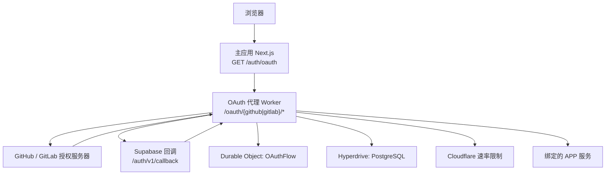
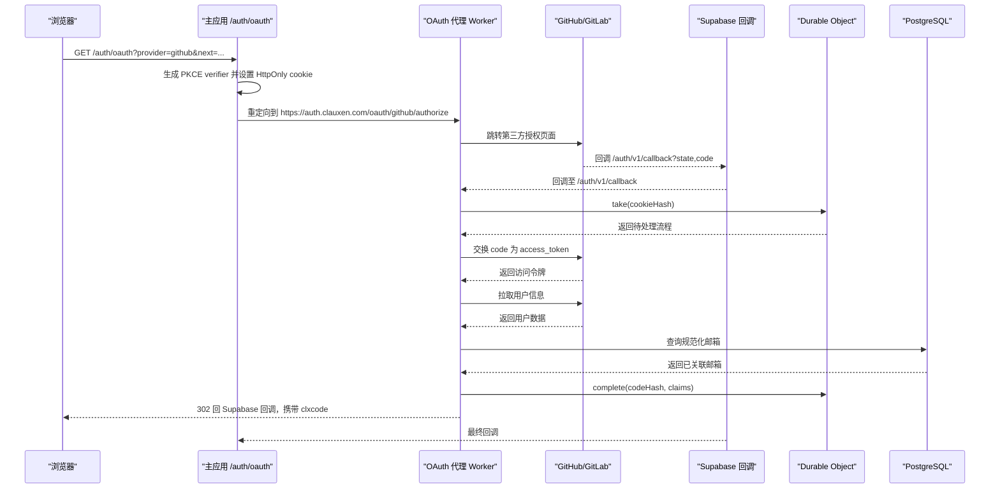
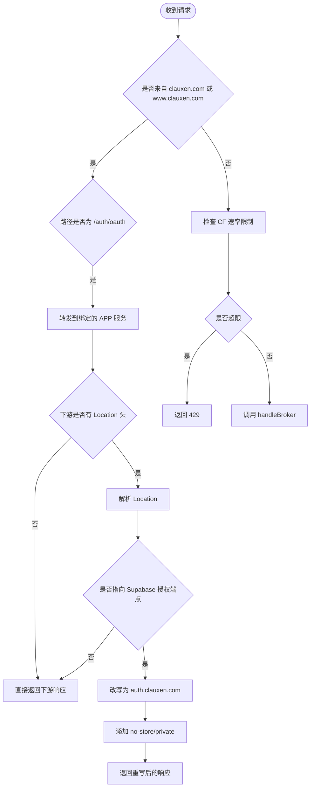
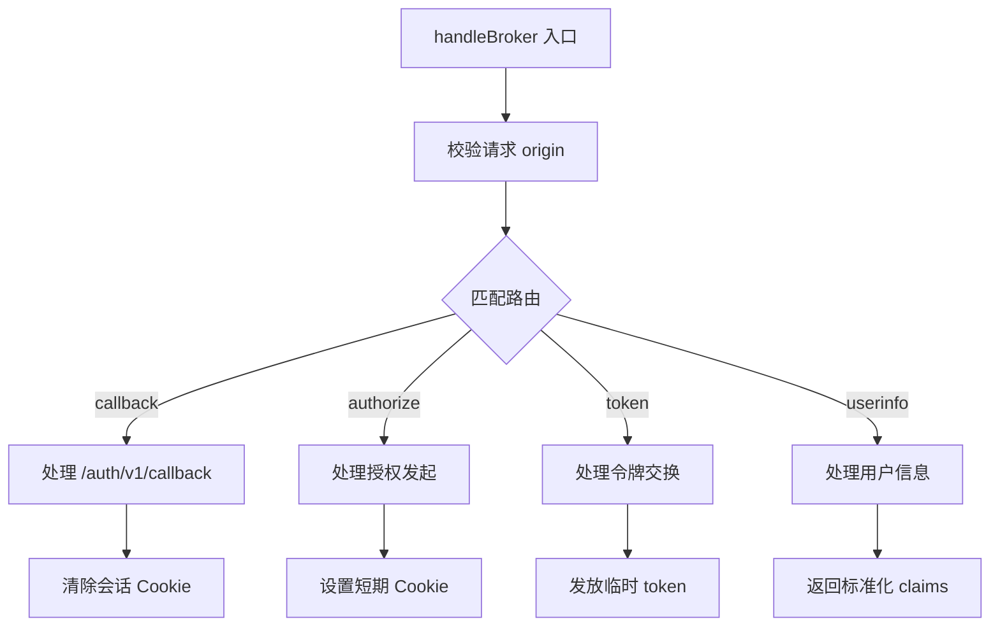
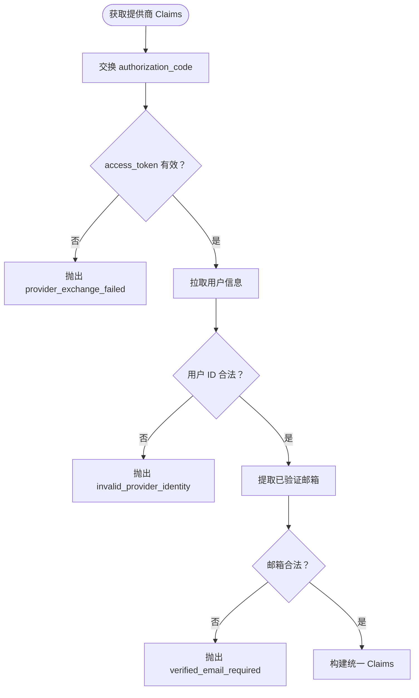
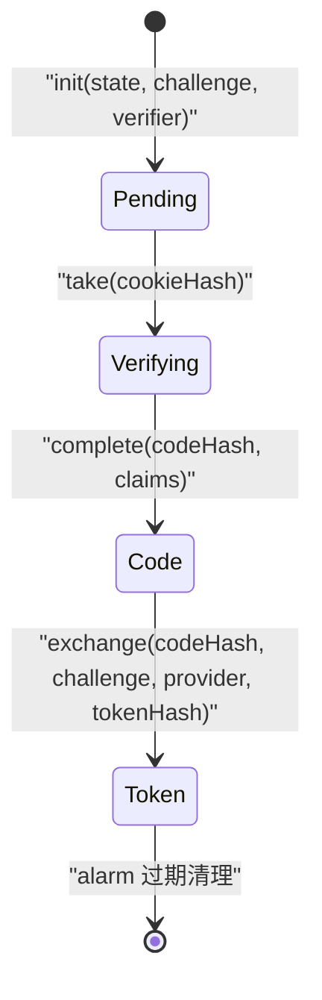
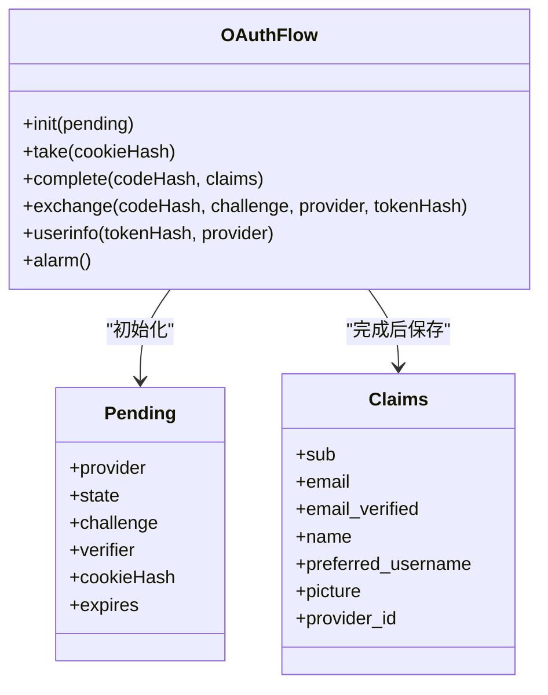
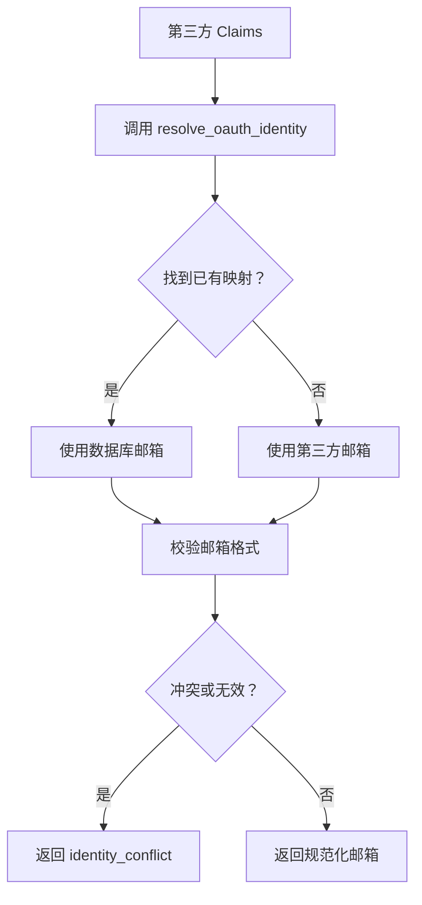
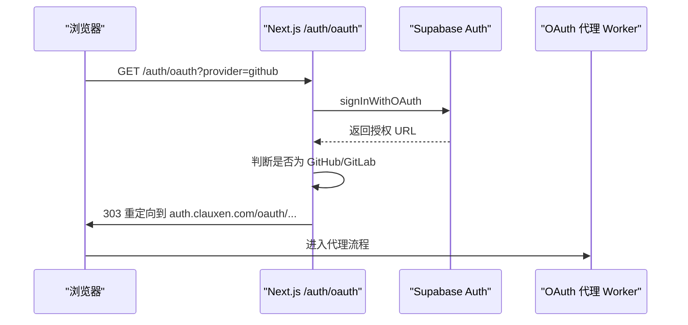
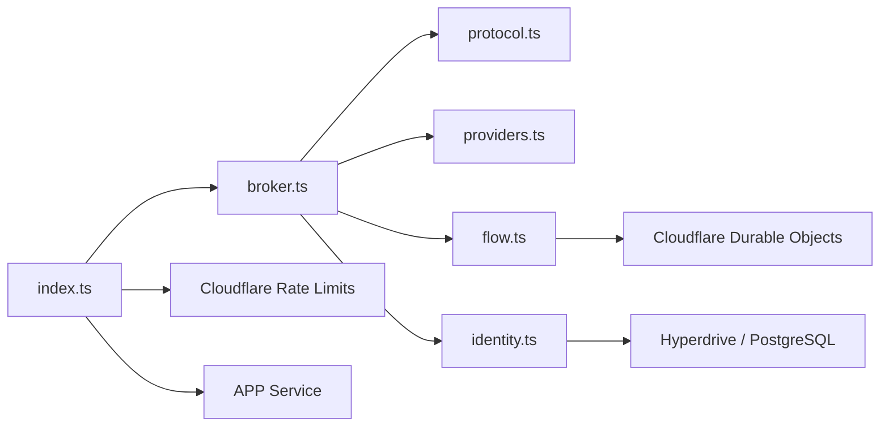

# OAuth 代理 Worker

<cite>
**本文引用的文件**   
- [workers/oauth-broker/src/index.ts](file://workers/oauth-broker/src/index.ts)
- [workers/oauth-broker/src/broker.ts](file://workers/oauth-broker/src/broker.ts)
- [workers/oauth-broker/src/protocol.ts](file://workers/oauth-broker/src/protocol.ts)
- [workers/oauth-broker/src/providers.ts](file://workers/oauth-broker/src/providers.ts)
- [workers/oauth-broker/src/flow.ts](file://workers/oauth-broker/src/flow.ts)
- [workers/oauth-broker/src/identity.ts](file://workers/oauth-broker/src/identity.ts)
- [workers/oauth-broker/wrangler.jsonc](file://workers/oauth-broker/wrangler.jsonc)
- [workers/oauth-broker/broker.test.ts](file://workers/oauth-broker/broker.test.ts)
- [workers/oauth-broker/providers.test.ts](file://workers/oauth-broker/providers.test.ts)
- [docs/auth/oauth-callbacks.md](file://docs/auth/oauth-callbacks.md)
- [supabase/migrations/20261017124626_clauxen_oauth_identity_lookup.sql](file://supabase/migrations/20261017124626_clauxen_oauth_identity_lookup.sql)
- [src/app/auth/oauth/route.ts](file://src/app/auth/oauth/route.ts)
- [src/server/plugins/oauth-providers.ts](file://src/server/plugins/oauth-providers.ts)
</cite>

## 目录
1. [引言](#引言)
2. [项目结构](#项目结构)
3. [核心组件](#核心组件)
4. [架构总览](#架构总览)
5. [详细组件分析](#详细组件分析)
6. [依赖关系分析](#依赖关系分析)
7. [性能与可靠性](#性能与可靠性)
8. [安全模型](#安全模型)
9. [故障排查指南](#故障排查指南)
10. [新提供商接入指南](#新提供商接入指南)
11. [测试与调试](#测试与调试)
12. [结论](#结论)

## 引言
本文件面向 OAuth 代理 Worker，也就是仓库中的 `workers/oauth-broker`。它承担的是“第三方社交登录的受控中转层”职责：把 Supabase 发起的 GitHub、GitLab 授权流程拦截到自有域名，完成 PKCE、状态机、令牌标准化和身份归一化，再把结果返回给主应用或上层 OAuth 客户端。

需要特别注意：该 Worker 当前仅实现 GitHub 和 GitLab 两个提供商；Google、Microsoft 等并未在该 Worker 中实现，而是由主应用的 Next.js 路由直接走 Supabase 原生流程，或由插件体系单独管理。文档会明确区分这些边界，避免误读。

## 项目结构
OAuth 代理 Worker 是一个 Cloudflare Workers 项目，入口为 `src/index.ts`，通过 Wrangler 绑定应用服务、速率限制、Hyperdrive、Durable Object 和环境变量。

**图示来源**
- [workers/oauth-broker/src/index.ts:7-33](file://workers/oauth-broker/src/index.ts#L7-L33)
- [workers/oauth-broker/wrangler.jsonc:1-22](file://workers/oauth-broker/wrangler.jsonc#L1-L22)
- [src/app/auth/oauth/route.ts:27-102](file://src/app/auth/oauth/route.ts#L27-L102)

**章节来源**
- [workers/oauth-broker/wrangler.jsonc:1-22](file://workers/oauth-broker/wrangler.jsonc#L1-L22)
- [workers/oauth-broker/src/index.ts:7-33](file://workers/oauth-broker/src/index.ts#L7-L33)

## 核心组件
- **请求入口与重定向代理**：根据主机名和路径决定是否把 Supabase 的 `/auth/v1/authorize` 请求重定向到 `https://auth.clauxen.com/auth/oauth`。
- **Broker 处理器**：实现三类端点：授权发起、令牌交换、用户信息读取，并处理 `/auth/v1/callback` 回调。
- **协议工具**：定义 Provider 类型、常量、随机值、哈希、限流 JSON 响应、URL 校验、统一 Claims 模型。
- **提供商适配器**：封装 GitHub、GitLab 的授权 URL、令牌交换、用户信息获取和邮箱策略。
- **状态机存储**：基于 Durable Object 的单行 SQL 表，维护从 pending 到 token 的状态转换。
- **身份归一化**：通过 Hyperdrive 调用 Supabase 函数，按 provider + subject 解析真实邮箱。
- **配置与安全常量**：Provider 白名单、客户端 ID、回调地址、Worker 源站、错误码。

**章节来源**
- [workers/oauth-broker/src/index.ts:7-33](file://workers/oauth-broker/src/index.ts#L7-L33)
- [workers/oauth-broker/src/broker.ts:1-113](file://workers/oauth-broker/src/broker.ts#L1-L113)
- [workers/oauth-broker/src/protocol.ts:1-65](file://workers/oauth-broker/src/protocol.ts#L1-L65)
- [workers/oauth-broker/src/providers.ts:1-37](file://workers/oauth-broker/src/providers.ts#L1-L37)
- [workers/oauth-broker/src/flow.ts:1-43](file://workers/oauth-broker/src/flow.ts#L1-L43)
- [workers/oauth-broker/src/identity.ts:1-18](file://workers/oauth-broker/src/identity.ts#L1-L18)

## 架构总览
OAuth 代理 Worker 不是完整的 OAuth 2.1 服务器，而是一个“受限代理”。其关键约束包括：
- 只接受 `github`、`gitlab` 两类提供商。
- 只允许 `code` 响应类型。
- 强制使用 PKCE，且必须为 S256。
- 不持久化第三方 access_token，只在内部状态机中保留 claims。
- 最终对外暴露统一的 `access_token`、`token_type`、`expires_in` 和 `/userinfo`。

**图示来源**
- [src/app/auth/oauth/route.ts:27-102](file://src/app/auth/oauth/route.ts#L27-L102)
- [workers/oauth-broker/src/index.ts:7-33](file://workers/oauth-broker/src/index.ts#L7-L33)
- [workers/oauth-broker/src/broker.ts:28-113](file://workers/oauth-broker/src/broker.ts#L28-L113)
- [workers/oauth-broker/src/providers.ts:15-37](file://workers/oauth-broker/src/providers.ts#L15-L37)
- [workers/oauth-broker/src/flow.ts:10-43](file://workers/oauth-broker/src/flow.ts#L10-L43)
- [workers/oauth-broker/src/identity.ts:6-18](file://workers/oauth-broker/src/identity.ts#L6-L18)

## 详细组件分析

### 请求入口与重定向代理
入口模块负责两件事：
1. 对来自 `www.clauxen.com` 或 `clauxen.com` 的 `/auth/oauth` 请求，如果下游返回的是 Supabase 授权地址且提供商在白名单内，则把 host 改写为 `auth.clauxen.com`。
2. 其他请求进入速率限制检查后，交给 `handleBroker`。

**图示来源**
- [workers/oauth-broker/src/index.ts:7-33](file://workers/oauth-broker/src/index.ts#L7-L33)

**章节来源**
- [workers/oauth-broker/src/index.ts:7-33](file://workers/oauth-broker/src/index.ts#L7-L33)
- [workers/oauth-broker/wrangler.jsonc:1-22](file://workers/oauth-broker/wrangler.jsonc#L1-L22)

### Broker 处理器
`handleBroker` 是核心路由分发器，支持以下路径：
- `GET /oauth/{github|gitlab}/authorize`：创建待处理流程，设置 Cookie，跳转到第三方授权。
- `POST /oauth/{github|gitlab}/token`：用 `clxcode` 换取 `clxtoken`。
- `GET /oauth/{github|gitlab}/userinfo`：凭 `Bearer clxtoken` 返回标准化 claims。
- `GET /auth/v1/callback`：接收 Supabase 回调，完成 provider exchange、身份查找、状态清理。

关键验证点：
- 所有请求必须来自 Worker 的受信任 origin。
- URL 参数必须唯一。
- authorize 必须带合法的 state、S256 challenge。
- token 端点要求 Basic 认证，client_id 必须匹配提供商前缀，secret 必须匹配 broker secret。
- userinfo 必须携带有效 Bearer token。
- callback 必须携带合法 state 和对应 Cookie，且只能消费一次。

**图示来源**
- [workers/oauth-broker/src/broker.ts:12-113](file://workers/oauth-broker/src/broker.ts#L12-L113)

**章节来源**
- [workers/oauth-broker/src/broker.ts:1-113](file://workers/oauth-broker/src/broker.ts#L1-L113)

### 协议与统一令牌模型
协议层定义了：
- Provider 枚举：当前只有 `github`、`gitlab`。
- ORIGIN：`https://auth.clauxen.com`。
- CALLBACK：Worker 接受的第三方回调地址。
- SUPABASE_CALLBACK：Supabase 原始回调地址。
- Claims：统一的用户标识模型，包含 sub、email、name、preferred_username、picture、provider_id、email_verified。
- FlowStore：抽象出 init、take、complete、exchange、userinfo 五个状态方法。

令牌格式：
- `clxcode.{id}.{secret}`：一次性授权码，供上层交换令牌。
- `clxtoken.{id}.{tokenSecret}`：短期访问令牌，用于 `/userinfo`。

这种设计让 Worker 成为“上游 OAuth 客户端”，而不是完整令牌发行者：真正的第三方 access_token 仅在交换阶段短暂存在。

**章节来源**
- [workers/oauth-broker/src/protocol.ts:1-65](file://workers/oauth-broker/src/protocol.ts#L1-L65)

### 提供商适配器
提供商适配器目前只实现 GitHub 和 GitLab：
- GitHub 请求 `user:email` 权限。
- GitLab 请求 `read_user` 权限。
- 两者都使用 S256 PKCE。
- 令牌交换失败时抛出 `provider_exchange_failed`。
- 用户 ID 必须是正整数。
- GitHub 从 `/user/emails` 中选择 primary 且 verified 的邮箱，否则退回到任意 verified 邮箱。
- GitLab 使用 `confirmed_at` 非空作为确认依据。
- 邮箱长度不超过 320，且必须包含 `@`。

**图示来源**
- [workers/oauth-broker/src/providers.ts:1-37](file://workers/oauth-broker/src/providers.ts#L1-L37)

**章节来源**
- [workers/oauth-broker/src/providers.ts:1-37](file://workers/oauth-broker/src/providers.ts#L1-L37)

### 状态机设计
每个登录尝试对应一个 Durable Object，状态如下：

约束：
- `pending` 阶段必须持有 provider、state、PKCE challenge、verifier 和 Cookie hash。
- `take` 是一次性操作，成功后进入 `verifying`。
- `complete` 只在 `verifying` 阶段写入 claims，并缩短过期时间。
- `exchange` 同时校验 codeHash、challenge、provider，防止跨提供商复用。
- `userinfo` 只允许在 `token` 阶段返回 claims，且 provider 必须匹配。
- alarm 会在过期时删除记录。

**图示来源**
- [workers/oauth-broker/src/flow.ts:1-43](file://workers/oauth-broker/src/flow.ts#L1-L43)
- [workers/oauth-broker/src/protocol.ts:49-65](file://workers/oauth-broker/src/protocol.ts#L49-L65)

**章节来源**
- [workers/oauth-broker/src/flow.ts:1-43](file://workers/oauth-broker/src/flow.ts#L1-L43)

### 身份归一化与 Supabase 集成
当第三方成功返回用户信息后，Broker 不会直接使用第三方邮箱作为最终账户邮箱，而是调用 `canonicalEmail`：
- 通过 Hyperdrive 连接 PostgreSQL。
- 以只读事务运行。
- 切换到 `clauxen_oauth_reader` 角色。
- 调用 `clauxen_auth.resolve_oauth_identity(provider, subject)`。
- 如果找到匹配记录，返回数据库中的邮箱；否则退回第三方提供的邮箱。
- 如果查询结果多于一条，返回 `identity_conflict`。
- 如果最终邮箱无效，返回 `identity_conflict`。

该函数只读 Supabase Auth 表，不修改任何用户、身份或会话。

**图示来源**
- [workers/oauth-broker/src/identity.ts:6-18](file://workers/oauth-broker/src/identity.ts#L6-L18)
- [supabase/migrations/20261017124626_clauxen_oauth_identity_lookup.sql:1-30](file://supabase/migrations/20261017124626_clauxen_oauth_identity_lookup.sql#L1-L30)

**章节来源**
- [workers/oauth-broker/src/identity.ts:1-18](file://workers/oauth-broker/src/identity.ts#L1-L18)
- [supabase/migrations/20261017124626_clauxen_oauth_identity_lookup.sql:1-30](file://supabase/migrations/20261017124626_clauxen_oauth_identity_lookup.sql#L1-L30)

### 与主应用和用户服务的集成
主应用在 `GET /auth/oauth` 中负责：
- 解析 provider 和 next 参数。
- 使用 Supabase 客户端启动 OAuth。
- 如果是 GitHub 或 GitLab，并且 Supabase 返回 `/auth/v1/authorize`，则把 host 替换为 `auth.clauxen.com`，交由 Broker 处理。
- 将 PKCE verifier 写入 HttpOnly Cookie，有效期约 10 分钟。
- 其他提供商仍走 Supabase 原生流程。

**图示来源**
- [src/app/auth/oauth/route.ts:27-102](file://src/app/auth/oauth/route.ts#L27-L102)

**章节来源**
- [src/app/auth/oauth/route.ts:1-102](file://src/app/auth/oauth/route.ts#L1-L102)

### 插件 OAuth 提供商与当前 Worker 的区别
插件体系的 `oauth-providers.ts` 定义了 Google、GitHub、Slack、Microsoft 四个提供商，但这是“插件原生 OAuth”配置，不是 `oauth-broker` 的职责。该模块提供：
- 授权端点和令牌端点。
- 客户端凭证读取。
- 账号标签抓取。
- 可选的供应商侧撤销。

因此，不要把插件 OAuth 提供商列表理解为 OAuth 代理 Worker 已支持的提供商列表。

**章节来源**
- [src/server/plugins/oauth-providers.ts:1-215](file://src/server/plugins/oauth-providers.ts#L1-L215)

## 依赖关系分析

**图示来源**
- [workers/oauth-broker/src/index.ts:1-33](file://workers/oauth-broker/src/index.ts#L1-L33)
- [workers/oauth-broker/src/broker.ts:1-113](file://workers/oauth-broker/src/broker.ts#L1-L113)
- [workers/oauth-broker/src/flow.ts:1-43](file://workers/oauth-broker/src/flow.ts#L1-L43)
- [workers/oauth-broker/src/identity.ts:1-18](file://workers/oauth-broker/src/identity.ts#L1-L18)

耦合性说明：
- `index.ts` 紧耦合 Wrangler 环境变量和路由规则。
- `broker.ts` 通过依赖注入解耦外部系统：credentials、flow store、canonicalEmail、fetcher。
- `providers.ts` 仅依赖协议和 fetcher，易于扩展。
- `flow.ts` 依赖 Durable Object SQL，状态不可跨实例共享。
- `identity.ts` 直接依赖 pg 客户端和 Supabase 函数，属于强依赖。

潜在循环依赖：无显式循环导入，但 `broker.ts`、`protocol.ts`、`providers.ts` 之间应继续保持单向依赖。

**章节来源**
- [workers/oauth-broker/src/index.ts:1-33](file://workers/oauth-broker/src/index.ts#L1-L33)
- [workers/oauth-broker/src/broker.ts:1-113](file://workers/oauth-broker/src/broker.ts#L1-L113)
- [workers/oauth-broker/src/protocol.ts:1-65](file://workers/oauth-broker/src/protocol.ts#L1-L65)

## 性能与可靠性
- **Durable Object 单行表**：每个登录尝试只有一个 flow 记录，读写开销低，适合短时状态。
- **Alarm 清理**：过期后自动删除记录，避免长期堆积。
- **超时控制**：第三方 HTTP 请求使用 15 秒超时，避免挂起。
- **载荷限制**：文本读取有字节上限，防止超大 body 消耗内存。
- **速率限制**：未命中可信域名的请求按 IP 限速，默认每分钟 120 次。
- **缓存策略**：所有敏感响应使用 `no-store, private`，避免中间节点缓存。

优化建议：
- 如果未来增加高频 `/userinfo` 查询，可考虑在 Broker 层对同一 token 做短期去重缓存，但必须保证幂等性和过期一致性。
- Hyperdrive 连接池和查询超时已在 identity 层设置，若出现连接抖动，可在 Wrangler 或 Hyperdrive 层面调整连接参数。
- 对于极高并发场景，可评估是否将 claims 短期缓存于 KV，但需权衡一致性和安全性。

[本节为通用性能讨论，不直接分析具体代码行]

## 安全模型

### CSRF 防护
- 授权流程使用 state 参数，并通过 Cookie 绑定浏览器秘密值。
- Cookie 使用 `__Host-` 前缀、`Secure`、`HttpOnly`、`SameSite=Lax`。
- callback 必须同时携带正确 state 和 Cookie，且只能取一次。
- 重复 callback 会触发 `expired_or_replayed_state`。

### XSS 防护
- 响应头设置 `X-Content-Type-Options: nosniff`。
- JSON 响应设置 `Referrer-Policy: no-referrer`。
- 重定向响应同样限制 Referrer。
- 浏览器侧 verifier 存储在 HttpOnly Cookie，JavaScript 不可直接访问。

### 令牌安全
- 第三方 access_token 不持久化。
- Broker 生成的 `clxcode` 和 `clxtoken` 均为一次性或短生命周期令牌。
- Secret 比较使用哈希和时序安全比较。
- Token 交换必须提供正确的 PKCE verifier。
- `/userinfo` 的 token 与 provider 绑定，不能跨提供商复用。

### 输入校验
- URL 参数唯一性检查。
- state、challenge、verifier、client_id、redirect_uri、grant_type 严格校验。
- email 长度和格式校验。
- 第三方响应体大小限制。
- 未识别路径返回 404。

### 错误处理
- 自定义 `OAuthError` 携带 HTTP 状态和 OAuth 错误码。
- 未分类异常返回 502 和 `server_error`。
- 回调失败会记录警告日志，并向主应用返回统一错误描述。

**章节来源**
- [workers/oauth-broker/src/broker.ts:12-113](file://workers/oauth-broker/src/broker.ts#L12-L113)
- [workers/oauth-broker/src/protocol.ts:20-65](file://workers/oauth-broker/src/protocol.ts#L20-L65)
- [workers/oauth-broker/src/providers.ts:15-37](file://workers/oauth-broker/src/providers.ts#L15-L37)
- [workers/oauth-broker/src/flow.ts:10-43](file://workers/oauth-broker/src/flow.ts#L10-L43)

## 故障排查指南

| 现象 | 可能原因 | 排查步骤 |
|---|---|---|
| 第三方授权后无法回调 | Cookie 缺失或 state 不匹配 | 检查浏览器是否发送 `__Host-clx-oauth-*` Cookie，确认 state 是否以 `clx.` 开头 |
| 回调返回 `invalid_state` | Cookie 被清理或重复提交 | 确认 Cookie 未被扩展或脚本删除，禁止重复点击回调链接 |
| 令牌交换失败 | PKCE verifier 不正确 | 核对主应用设置的 verifier 是否与 authorize 时生成的 challenge 匹配 |
| `/userinfo` 返回 `invalid_token` | token 过期或被复用 | 确认 token 未超过 60 秒，且未跨提供商调用 |
| 身份冲突 | Supabase 中存在多个或零个映射 | 检查 `clauxen_auth.resolve_oauth_identity` 返回行数，确认 provider 和 subject 是否正确 |
| 第三方接口不可用 | GitHub/GitLab 超时或返回错误 | 查看 `provider_unavailable`、`provider_exchange_failed`、`invalid_provider_identity` |
| 邮箱未验证 | 第三方未返回已验证邮箱 | 检查 GitHub `/user/emails` 或 GitLab `confirmed_at` |
| 请求被限速 | 非受信域名流量过大 | 检查请求是否来自 `auth.clauxen.com`，或调整速率限制策略 |

**章节来源**
- [workers/oauth-broker/src/broker.ts:28-113](file://workers/oauth-broker/src/broker.ts#L28-L113)
- [workers/oauth-broker/src/providers.ts:15-37](file://workers/oauth-broker/src/providers.ts#L15-L37)
- [workers/oauth-broker/src/identity.ts:6-18](file://workers/oauth-broker/src/identity.ts#L6-L18)

## 新提供商接入指南

### 前提条件
新增提供商前需明确：
- 是否需要加入 Broker，还是继续走主应用 Supabase 流程。
- 是否支持 PKCE。
- 是否支持授权码模式。
- 是否需要访问用户邮箱或基础资料。
- 是否需要把第三方身份映射到现有 Supabase 用户。

### 最小接入步骤
1. **扩展 Provider 类型**：在协议层增加新的 Provider 值。
2. **扩展提供商适配器**：
   - 新增授权 URL 构造逻辑。
   - 新增令牌交换逻辑。
   - 新增用户信息拉取逻辑。
   - 新增邮箱提取策略。
3. **更新启用白名单**：在 `wrangler.jsonc` 的 `BROKER_PROVIDERS` 中加入新提供商。
4. **更新入口 credentials 映射**：在 `index.ts` 的 `credentials` 函数中为新提供商返回 client_id 和 client_secret。
5. **更新回调处理**：确保 `/auth/v1/callback` 能处理新提供商的错误和成功分支。
6. **编写测试**：
   - 端到端流程测试。
   - 错误路径测试。
   - CSRF、PKCE、replay 攻击测试。
   - 邮箱未验证、重复 state、非法 redirect_uri 测试。
7. **验证身份映射**：
   - 已有 Supabase 用户映射。
   - 新用户创建。
   - 多映射冲突。
8. **部署与回归**：
   - 使用 Miniflare 本地测试。
   - 在生产环境验证 rate limit、observability、Hyperdrive 连接。

### 注意事项
- 不要假设所有提供商都返回相同字段，尤其是 email、name、avatar、username。
- 不要直接把第三方 access_token 暴露给前端。
- 不要跳过 PKCE。
- 不要忽略 provider 与 token 的绑定关系。
- 不要在状态机中持久化第三方 access_token。
- 如果新提供商不支持 `custom:clauxen-{provider}`，需要在 Supabase 回调配置中保持兼容。

**章节来源**
- [workers/oauth-broker/src/protocol.ts:1-25](file://workers/oauth-broker/src/protocol.ts#L1-L25)
- [workers/oauth-broker/src/providers.ts:1-37](file://workers/oauth-broker/src/providers.ts#L1-L37)
- [workers/oauth-broker/src/index.ts:14-33](file://workers/oauth-broker/src/index.ts#L14-L33)
- [workers/oauth-broker/wrangler.jsonc:1-22](file://workers/oauth-broker/wrangler.jsonc#L1-L22)

## 测试与调试

### 测试框架
Broker 使用 Node.js `node:test` 和 Miniflare：
- `broker.test.ts`：模拟 Miniflare Worker、Durable Object、第三方 fetcher，覆盖完整授权、令牌交换、userinfo、重放保护、取消授权、非法参数等场景。
- `providers.test.ts`：聚焦提供商适配器，验证未验证邮箱拒绝、provider exchange 错误不会到达身份查找。

测试要点：
- 使用固定 secret 和 fixture fetcher。
- 验证 PKCE verifier 必须与 challenge 匹配。
- 验证 `clxtoken` 不包含第三方 token。
- 验证 replay 请求被拒绝。
- 验证不同 provider 的 `/userinfo` 互斥。

### 调试建议
- 使用 Wrangler 的 observability 配置，注意 query string 已开启 redact。
- 检查 Cloudflare 速率限制命名空间是否匹配。
- 检查 Hyperdrive 连接字符串是否正确。
- 检查 Supabase 函数 `clauxen_auth.resolve_oauth_identity` 是否可用。
- 检查主应用 `/auth/oauth` 是否正确把 GitHub/GitLab 重定向到 `auth.clauxen.com`。
- 检查 Supabase 回调地址是否注册为 `https://ntplcfsbcyhiqklkbldk.supabase.co/auth/v1/callback`。

**章节来源**
- [workers/oauth-broker/broker.test.ts:1-107](file://workers/oauth-broker/broker.test.ts#L1-L107)
- [workers/oauth-broker/providers.test.ts:1-21](file://workers/oauth-broker/providers.test.ts#L1-L21)
- [workers/oauth-broker/wrangler.jsonc:1-22](file://workers/oauth-broker/wrangler.jsonc#L1-L22)
- [docs/auth/oauth-callbacks.md:1-71](file://docs/auth/oauth-callbacks.md#L1-L71)

## 结论
OAuth 代理 Worker 是一个轻量但严格的第三方授权中转层。它通过 PKCE、Durable Object 状态机、标准化 claims 和 Supabase 身份映射，把 GitHub 和 GitLab 的复杂交互收敛成安全的内部 API。当前版本没有实现 Google、Microsoft 的原生 Broker 流程，这两类提供商主要通过主应用和插件体系处理。

如果需要扩展，应优先补齐提供商适配器和测试用例，而不是绕过状态机或直接透传第三方令牌。安全方面，重点维护 Cookie、state、PKCE、token 绑定、速率限制和身份映射的正确性。生产部署时，务必关注 Hyperdrive、Supabase 回调、Wrangler 环境变量和 observability 的配置一致性。