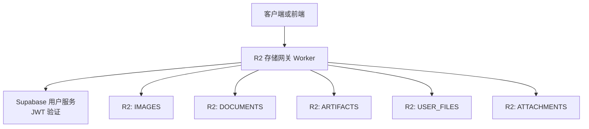
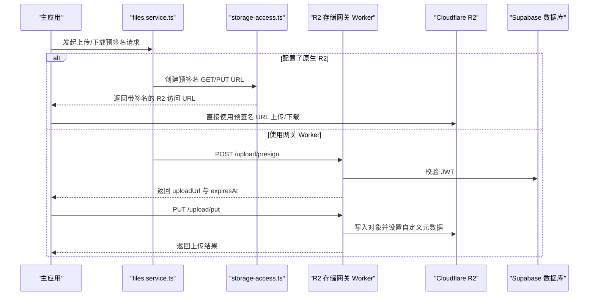
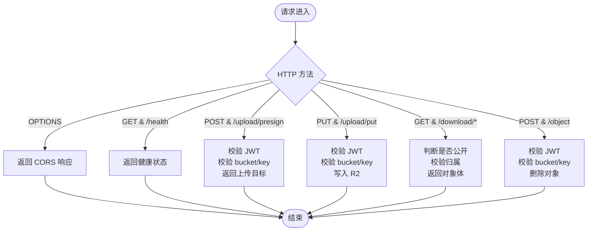
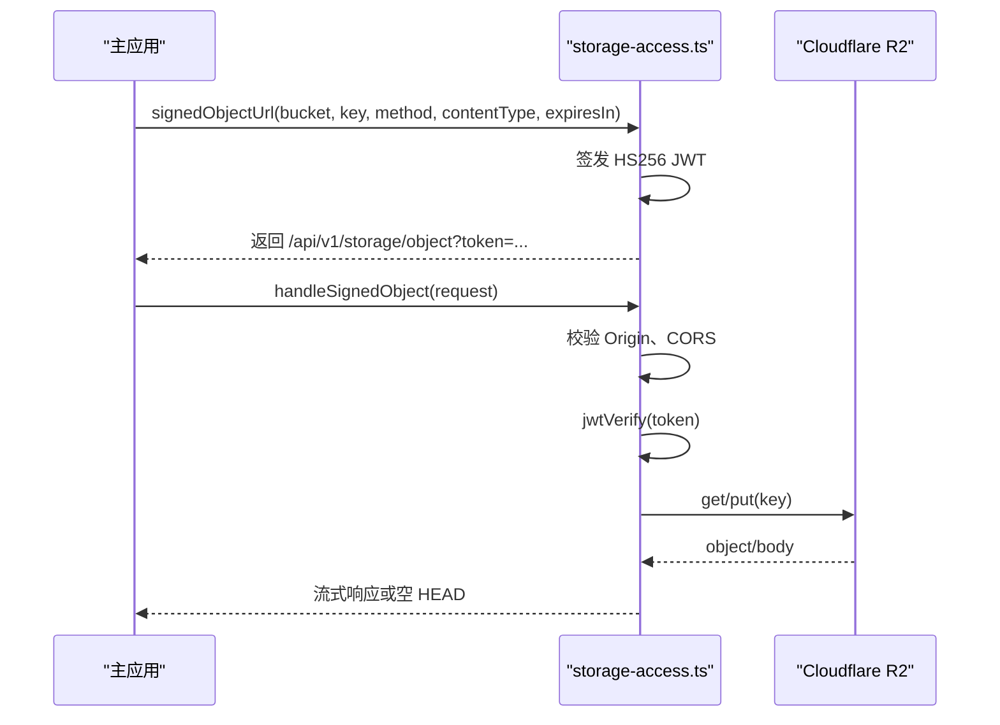
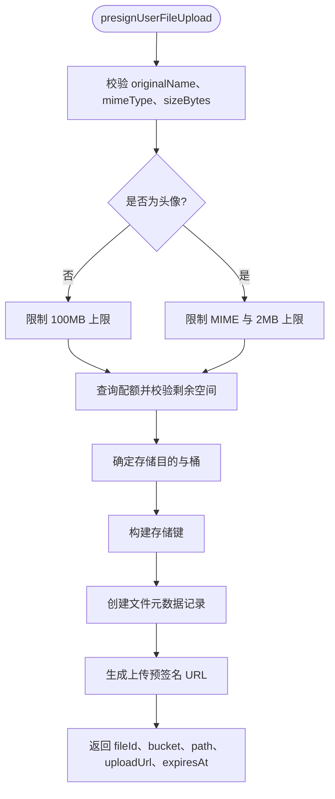
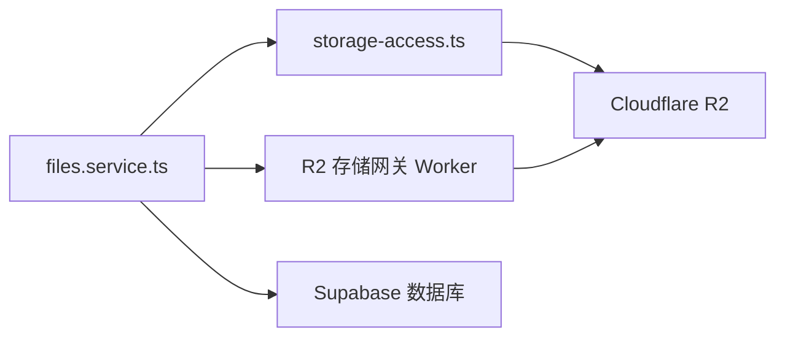

# R2 存储网关 Worker

<cite>
**本文引用的文件**   
- [workers/r2-gateway/src/index.ts](file://workers/r2-gateway/src/index.ts)
- [workers/r2-gateway/wrangler.toml](file://workers/r2-gateway/wrangler.toml)
- [src/server/cloudflare/storage-access.ts](file://src/server/cloudflare/storage-access.ts)
- [src/server/services/files.service.ts](file://src/server/services/files.service.ts)
</cite>

## 目录
1. [引言](#引言)
2. [项目结构](#项目结构)
3. [核心组件](#核心组件)
4. [架构总览](#架构总览)
5. [详细组件分析](#详细组件分析)
6. [依赖关系分析](#依赖关系分析)
7. [性能与缓存策略](#性能与缓存策略)
8. [安全与访问控制](#安全与访问控制)
9. [故障排查指南](#故障排查指南)
10. [结论](#结论)

## 引言
本文件面向 R2 存储网关 Worker 及与之协作的主应用后端，系统化说明对象存储的访问控制、预签名 URL 生成、上传路径、分片能力现状、文件类型校验、大小限制、租户隔离与配额控制、CDN 与下载优化，以及与主应用文件系统（数据库元数据、R2 原生 SDK）之间的集成方式。文档同时给出可操作的架构图、流程图和排障建议，帮助开发者快速理解并扩展该子系统。

## 项目结构
R2 存储网关以 Cloudflare Workers 形式部署，负责：
- 提供健康检查端点。
- 通过 JWT 验证用户身份。
- 校验对象键归属，防止越权访问。
- 为已认证用户提供“预签名上传”与“直接 PUT 上传”。
- 按权限返回对象内容，并对公开对象启用公共缓存。
- 删除受保护对象。

**图表来源**
- [workers/r2-gateway/wrangler.toml:1-33](file://workers/r2-gateway/wrangler.toml#L1-L33)
- [workers/r2-gateway/src/index.ts:1-213](file://workers/r2-gateway/src/index.ts#L1-L213)

**章节来源**
- [workers/r2-gateway/wrangler.toml:1-33](file://workers/r2-gateway/wrangler.toml#L1-L33)
- [workers/r2-gateway/package.json:1-12](file://workers/r2-gateway/package.json#L1-L12)

## 核心组件
- R2 桶绑定：网关暴露五个 R2 桶绑定，分别承载图片、文档、制品、用户文件与附件。
- 桶名称映射：将逻辑名映射到具体 R2 桶实例，支持别名。
- JWT 鉴权：从请求头解析 Bearer Token，调用 Supabase 用户接口校验有效性并获取用户 ID。
- 键归属校验：强制对象键以 `users/{userId}/` 或 `avatars/{userId}/` 前缀开头，避免跨用户访问。
- 公开读取白名单：允许匿名访问 `public/` 下的资源以及匹配 UUID 的用户头像目录。
- 上传流程：
  - `/upload/presign`：返回 PUT 目标地址与过期时间，供客户端发起直接上传。
  - `/upload/put`：接收浏览器直传，写入 R2，记录用户 ID 与时间戳等自定义元数据。
- 下载流程：
  - `/download/{key}?bucket=...`：根据是否公开对象决定缓存策略；私有对象禁止共享缓存。
- 删除接口：
  - `/object`：POST 携带 bucket 与 key，仅允许删除属于当前用户的对象。

**章节来源**
- [workers/r2-gateway/src/index.ts:1-213](file://workers/r2-gateway/src/index.ts#L1-L213)

## 架构总览
R2 网关是边缘层的安全代理与路由中枢。主应用通过存储服务抽象选择最优路径：优先使用 Cloudflare R2 原生预签名 URL；回退到网关 Worker；开发环境可使用本地桩实现。

**图表来源**
- [src/server/services/files.service.ts:1-424](file://src/server/services/files.service.ts#L1-L424)
- [src/server/cloudflare/storage-access.ts:1-178](file://src/server/cloudflare/storage-access.ts#L1-L178)
- [workers/r2-gateway/src/index.ts:1-213](file://workers/r2-gateway/src/index.ts#L1-L213)

## 详细组件分析

### R2 存储网关 Worker
#### 职责边界
- 只处理与对象读写相关的 HTTP 路由。
- 不执行病毒扫描、复杂类型转换或业务编排。
- 不管理计费与配额；这些由主应用侧完成。

#### 关键路由
| 方法 | 路径 | 用途 | 鉴权 | 行为摘要 |
|---|---|---|---|---|
| OPTIONS | 任意 | CORS 预检 | 无需 | 放行常见方法与头部 |
| GET | /health | 健康检查 | 无需 | 返回成功状态 |
| POST | /upload/presign | 生成上传目标 | 需要 JWT | 校验 bucket/key 归属后返回 PUT 地址与过期时间 |
| PUT | /upload/put | 直传对象 | 需要 JWT | 校验 bucket/key 归属后写入 R2，记录 userId 与 uploadedAt |
| GET | /download/{key} | 下载对象 | 公开对象无需 JWT，私有对象需要 JWT | 返回对象体与合适的缓存头 |
| POST | /object | 删除对象 | 需要 JWT | 校验 bucket/key 归属后删除对象 |

#### 鉴权与权限模型
- 所有写操作均要求有效的 Bearer Token。
- 对象键必须满足：
  - 不以 `..` 或 `/` 开头。
  - 必须以 `users/{userId}/` 或 `avatars/{userId}/` 开头。
- 公开读取仅限：
  - `public/` 前缀。
  - 符合 `avatars/{UUID}/` 模式的路径。

**图表来源**
- [workers/r2-gateway/src/index.ts:1-213](file://workers/r2-gateway/src/index.ts#L1-L213)

**章节来源**
- [workers/r2-gateway/src/index.ts:1-213](file://workers/r2-gateway/src/index.ts#L1-L213)

### 主应用侧 R2 原生访问与预签名 URL
主应用提供了更完善的原生 R2 访问封装，用于生产环境优先走 Cloudflare R2 原生预签名 URL。

- 桶映射：集中定义各业务桶的名称与绑定。
- 预签名 URL 生成：
  - 使用 HS256 签发 JWT，声明 bucket、key、method、contentType 与过期时间。
  - 生成指向 `/api/v1/storage/object?token=...` 的统一访问地址。
- 统一对象处理器：
  - 校验 Origin 与允许的域名。
  - 验证 JWT 载荷中的 bucket、key、method。
  - PUT 时校验 content-length 在 1–100 MiB。
  - GET/HEAD 流式返回对象，对 HTML/SVG/JS/XML 类内容强制以附件下载并附加沙箱 CSP。
  - 私有对象始终返回 `private, no-store`。

**图表来源**
- [src/server/cloudflare/storage-access.ts:1-178](file://src/server/cloudflare/storage-access.ts#L1-L178)

**章节来源**
- [src/server/cloudflare/storage-access.ts:1-178](file://src/server/cloudflare/storage-access.ts#L1-L178)

### 文件服务与业务规则
`files.service.ts` 是主应用内与对象存储交互的业务入口，负责：
- 计算目的与桶：
  - 图片 → images。
  - 视频 → attachments。
  - 其他 → documents。
- 构建存储键：
  - 头像：`avatars/{userId}/{uuid}.{ext}`。
  - 聊天附件/项目源码：用户附件路径。
  - 普通库文件：用户库路径。
- 上传预签名：
  - 优先使用原生 R2 预签名 PUT/GET。
  - 回退到网关 Worker 的 `/upload/put` 与 `/download/{key}`。
  - 非生产环境可使用桩实现。
- 文件大小限制：
  - 头像上限 2 MB。
  - 普通文件上限 100 MB。
- 配额控制：
  - 在上传前查询用户已用空间与配额，超限时拒绝。
- 文件状态完成：
  - 完成后根据 R2 head 信息回填 size 与哈希。
- 下载 URL：
  - 生成预签名下载链接，包含过期时间与原始文件名等信息。

**图表来源**
- [src/server/services/files.service.ts:1-424](file://src/server/services/files.service.ts#L1-L424)

**章节来源**
- [src/server/services/files.service.ts:1-424](file://src/server/services/files.service.ts#L1-L424)

## 依赖关系分析
- R2 网关 Worker 依赖：
  - Supabase 用户接口进行 JWT 校验。
  - 多个 R2 桶绑定用于不同业务域。
- 主应用依赖：
  - `storage-access.ts` 提供原生 R2 预签名 URL 与统一对象处理器。
  - `files.service.ts` 聚合业务规则、配额检查、元数据持久化与预签名生成。
  - Supabase 数据库用于用户文件元数据、文件夹、工作区、项目关联等。

**图表来源**
- [src/server/services/files.service.ts:1-424](file://src/server/services/files.service.ts#L1-L424)
- [src/server/cloudflare/storage-access.ts:1-178](file://src/server/cloudflare/storage-access.ts#L1-L178)
- [workers/r2-gateway/src/index.ts:1-213](file://workers/r2-gateway/src/index.ts#L1-L213)

**章节来源**
- [src/server/services/files.service.ts:1-424](file://src/server/services/files.service.ts#L1-L424)
- [src/server/cloudflare/storage-access.ts:1-178](file://src/server/cloudflare/storage-access.ts#L1-L178)
- [workers/r2-gateway/src/index.ts:1-213](file://workers/r2-gateway/src/index.ts#L1-L213)

## 性能与缓存策略
- 下载缓存策略：
  - 公开对象：返回 `public, max-age=86400`，适合 CDN 缓存。
  - 私有对象：返回 `private, no-store`，避免被边缘节点共享缓存。
  - 所有响应附带 ETag，便于条件请求与缓存失效。
  - 针对私有对象设置 `Vary: Authorization`，避免凭据污染缓存。
- 直传优化：
  - 网关 Worker 将请求体缓冲为 ArrayBuffer，保证长度确定性，避免流式未知长度的截断风险。
- 原生 R2 预签名：
  - 主应用优先使用原生预签名 URL，减少中间代理延迟。
  - 统一对象处理器采用 ReadableStream 流式传输，降低内存占用。
- CDN 加速：
  - 公开对象可通过 Cloudflare CDN 缓存，提高首字节速度与并发下载能力。
  - 私有对象不进入公共缓存，确保安全性。

[本节为通用性能说明，不直接分析具体代码片段]

## 安全与访问控制
- 身份验证：
  - 网关 Worker 通过 Supabase 用户接口校验 JWT，拒绝无效令牌。
  - 原生预签名 URL 通过 HS256 JWT 限定 bucket、key、method、contentType 与过期时间。
- 路径与命名空间隔离：
  - 对象键必须以用户 ID 前缀开头，严格区分 `users/` 与 `avatars/` 命名空间。
  - 公开路径白名单限制为 `public/` 与符合 UUID 模式的头像目录。
- 上传限制：
  - 原生预签名 PUT 要求 content-length 在 1–100 MiB。
  - 网关 Worker 的 PUT 也基于应用侧 100 MB 限制。
- 类型验证：
  - 头像仅允许 PNG、JPEG、WebP、GIF。
  - 非头像普通文件上限 100 MB。
  - 主应用根据 MIME 自动分配存储目的与桶。
- 敏感内容防护：
  - 原生对象处理器对 HTML/SVG/JavaScript/XML 类内容强制以附件下载，并附加沙箱 CSP，避免在应用源站执行。
- 租户隔离与配额：
  - 所有对象键绑定到用户 ID，杜绝横向越权。
  - 上传前检查用户已用空间与配额，超出则拒绝。
- 病毒扫描：
  - 当前仓库中未发现 R2 网关或主应用侧内置病毒扫描实现。若需引入，建议在上传完成后触发异步任务，对对象进行扫描并根据结果标记或删除。

**章节来源**
- [workers/r2-gateway/src/index.ts:1-213](file://workers/r2-gateway/src/index.ts#L1-L213)
- [src/server/cloudflare/storage-access.ts:1-178](file://src/server/cloudflare/storage-access.ts#L1-L178)
- [src/server/services/files.service.ts:1-424](file://src/server/services/files.service.ts#L1-L424)

## 故障排查指南
- 401 未授权：
  - 网关 Worker：检查 Authorization 头是否包含有效 Bearer Token。
  - 原生预签名 URL：检查 token 是否过期、issuer/audience/alg 是否正确。
- 403 禁止访问：
  - 对象键不属于当前用户或不符合公开白名单。
  - 原生预签名 URL 的 method 与实际请求不一致。
- 404 未找到：
  - 对象不存在或 bucket/key 参数错误。
  - 删除对象时 bucket/key 缺失或不合法。
- 413 上传过大：
  - 原生预签名 PUT 的 content-length 不在 1–100 MiB。
- 配额超限：
  - 上传前会检查用户存储空间是否超过配额。
- 类型不支持：
  - 头像 MIME 不在允许列表。
- 下载缓存异常：
  - 确认对象是否属于公开路径；私有对象应返回 `private, no-store`。
  - 检查 ETag 与 Vary 头是否随预期设置。

**章节来源**
- [workers/r2-gateway/src/index.ts:1-213](file://workers/r2-gateway/src/index.ts#L1-L213)
- [src/server/cloudflare/storage-access.ts:1-178](file://src/server/cloudflare/storage-access.ts#L1-L178)
- [src/server/services/files.service.ts:1-424](file://src/server/services/files.service.ts#L1-L424)

## 结论
R2 存储网关 Worker 作为边缘安全代理，实现了严格的对象键归属校验、JWT 鉴权与差异化缓存策略。主应用通过原生 R2 预签名 URL 与统一的对象处理器，进一步提升了安全性、可观测性与性能。文件服务集中处理类型校验、大小限制、配额控制与元数据持久化，形成清晰的职责分层。

当前实现未包含分片上传与病毒扫描。如需增强：
- 分片上传：可在主应用侧实现分片计划，结合原生 R2 分片 API 或网关 Worker 的分片协议。
- 病毒扫描：引入异步扫描任务，对上传对象进行扫描，并根据结果更新元数据或执行清理。
- 批量处理：在主应用侧实现批量上传、下载与删除编排，结合事件通知机制回调业务系统。

[本节为总结性内容，不直接分析具体代码片段]