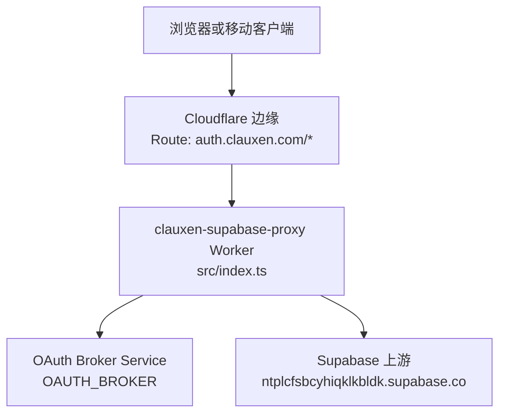
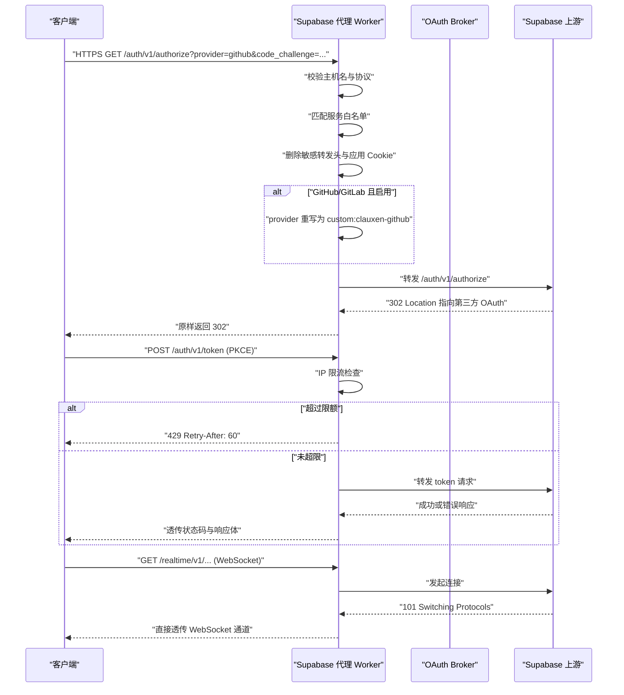
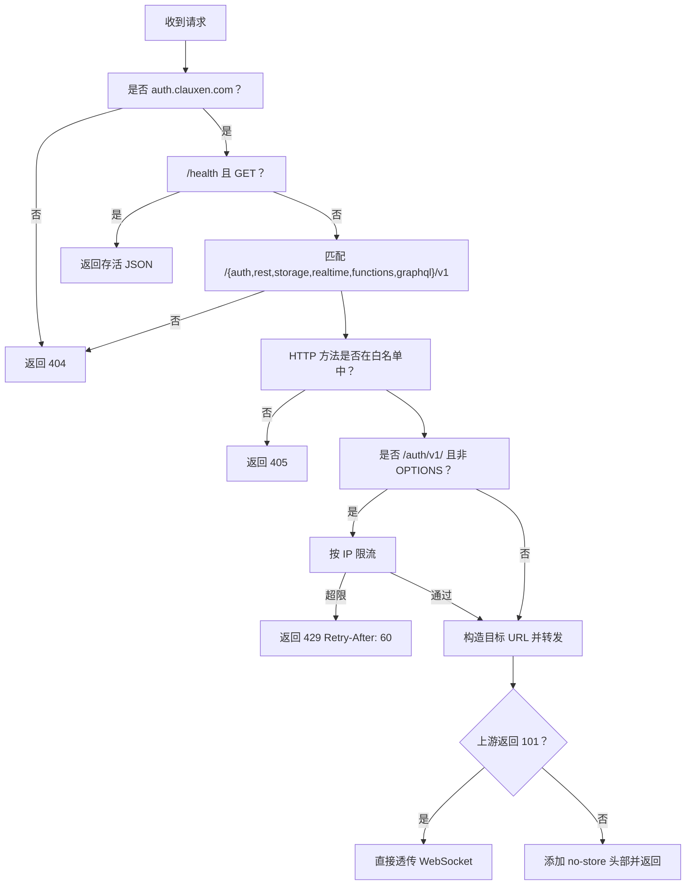
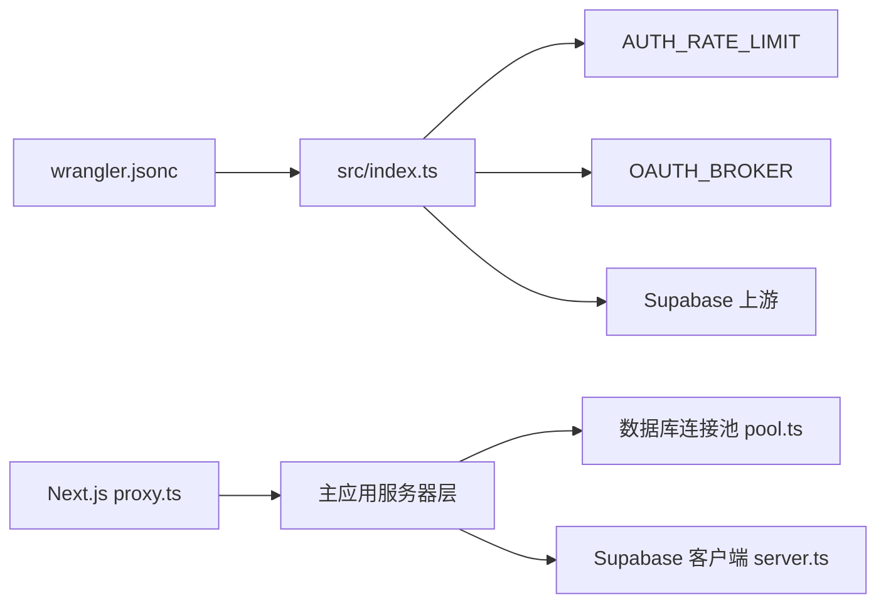
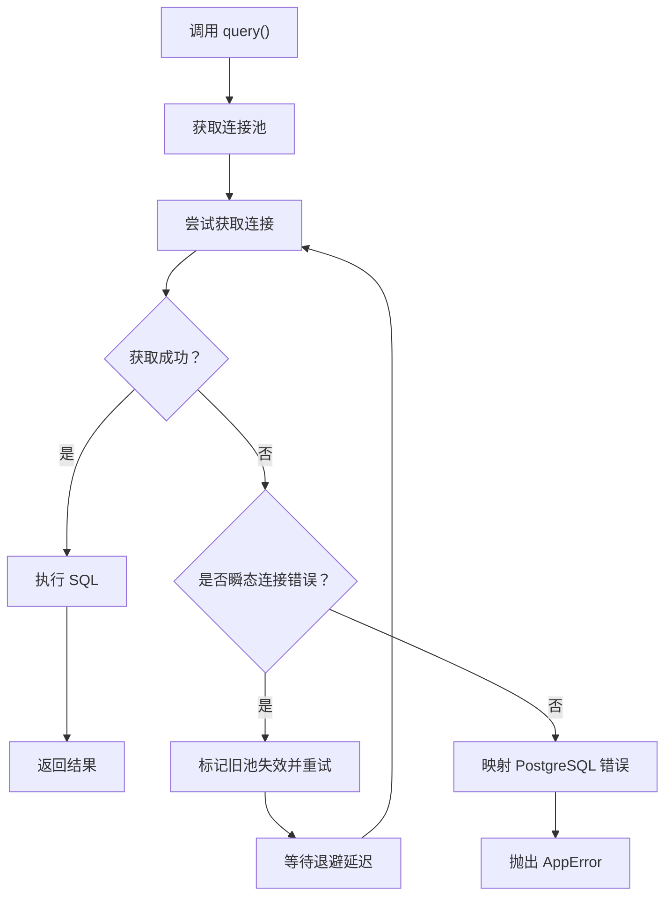
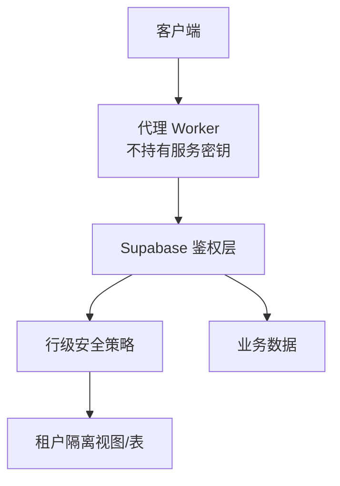
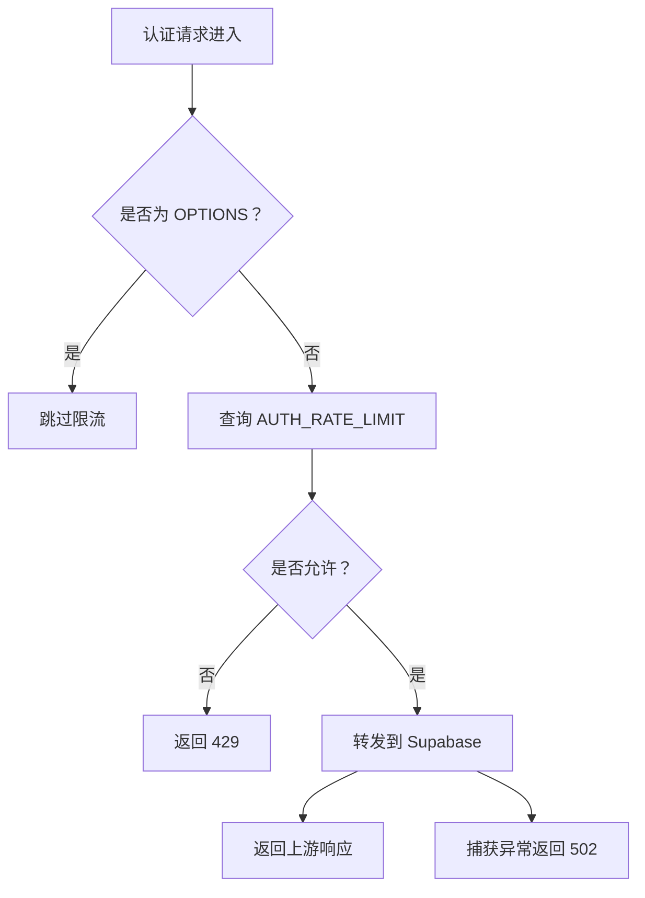
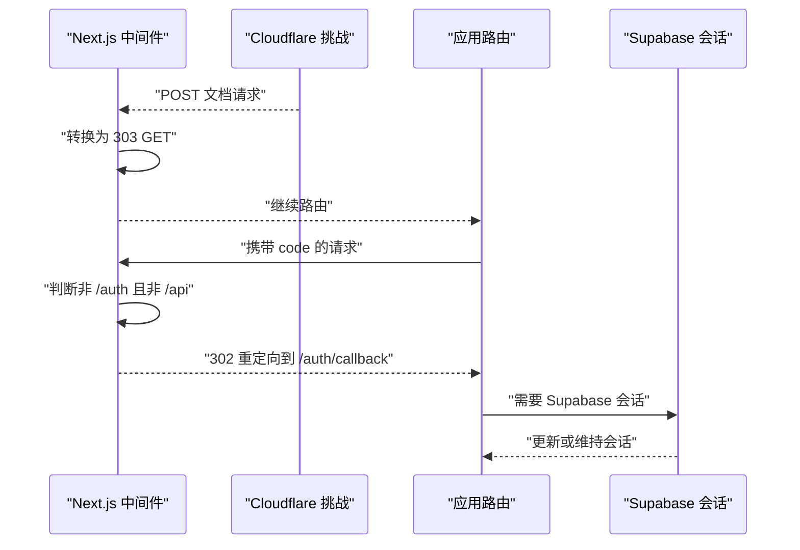
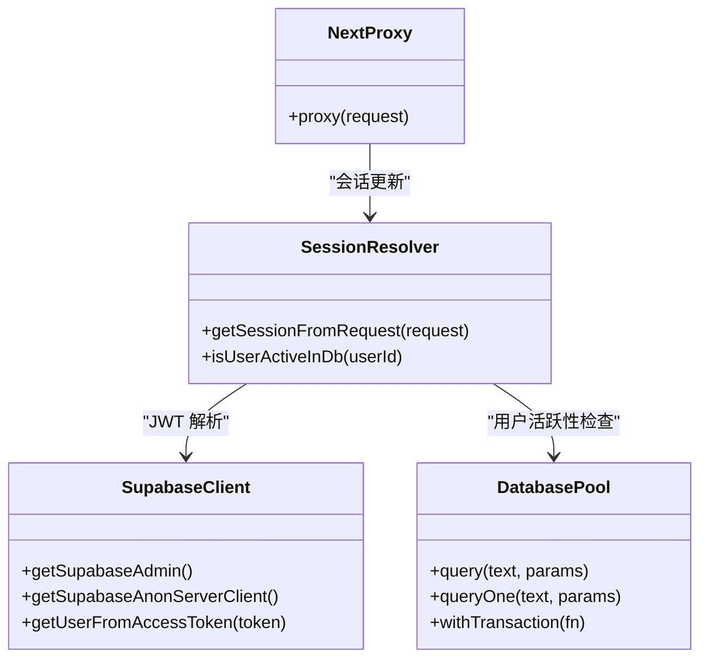

# Supabase 代理 Worker

<cite>
**本文引用的文件**   
- [workers/supabase-proxy/src/index.ts](file://workers/supabase-proxy/src/index.ts)
- [workers/supabase-proxy/README.md](file://workers/supabase-proxy/README.md)
- [workers/supabase-proxy/wrangler.jsonc](file://workers/supabase-proxy/wrangler.jsonc)
- [workers/supabase-proxy/proxy.test.ts](file://workers/supabase-proxy/proxy.test.ts)
- [src/proxy.ts](file://src/proxy.ts)
- [src/server/db/pool.ts](file://src/server/db/pool.ts)
- [src/server/infrastructure/supabase/server.ts](file://src/server/infrastructure/supabase/server.ts)
- [src/server/auth/session.ts](file://src/server/auth/session.ts)
</cite>

## 目录
1. [引言](#引言)
2. [项目结构](#项目结构)
3. [核心组件](#核心组件)
4. [架构总览](#架构总览)
5. [详细组件分析](#详细组件分析)
6. [依赖关系分析](#依赖关系分析)
7. [性能与连接池](#性能与连接池)
8. [鉴权、行级安全与租户隔离](#鉴权行级安全与租户隔离)
9. [查询安全与注入防护](#查询安全与注入防护)
10. [限流、错误处理与重试](#限流错误处理与重试)
11. [配置与监控](#配置与监控)
12. [主应用集成](#主应用集成)
13. [故障排查](#故障排查)
14. [结论](#结论)

## 引言
Supabase 代理 Worker 是一个部署在 Cloudflare Workers 上的 HTTP 代理，面向 `auth.clauxen.com`，将 `/auth/v1/`、`/rest/v1/`、`/storage/v1/`、`/realtime/v1/`、`/functions/v1/`、`/graphql/v1/` 请求转发到 Supabase 上游。它不是 Postgres 直连端点，而是以 HTTP 方式透传请求和响应，并在入口处做路径白名单、协议校验、头部清理、认证流量限流、OAuth 品牌化路由重写以及缓存禁用。

该 Worker 不持有服务角色密钥或部署凭证；客户端必须提供已有的可发布密钥和 Bearer Token，由 Supabase 继续负责身份签发、授权与行级安全策略。

**章节来源**
- [workers/supabase-proxy/README.md:1-22](file://workers/supabase-proxy/README.md#L1-L22)

## 项目结构
Supabase 代理位于独立 Worker 工程中：

**图表来源**
- [workers/supabase-proxy/src/index.ts:1-10](file://workers/supabase-proxy/src/index.ts#L1-L10)
- [workers/supabase-proxy/wrangler.jsonc:1-15](file://workers/supabase-proxy/wrangler.jsonc#L1-L15)

关键目录与文件：

| 路径 | 职责 |
|---|---|
| `workers/supabase-proxy/src/index.ts` | Worker 入口、请求路由、头部清理、限流、上游转发、WebSocket 透传、健康检查 |
| `workers/supabase-proxy/wrangler.jsonc` | Wrangler 配置、环境变量、服务绑定、路由、速率限制、遥测采样 |
| `workers/supabase-proxy/README.md` | 部署说明、验证步骤、OAuth 品牌化方案说明 |
| `workers/supabase-proxy/proxy.test.ts` | 传输层测试：Provider 重写、头部清理、CORS、流式响应、限流、上游失败 |
| `src/proxy.ts` | Next.js 中间件，负责 Cloudflare 挑战重定向、营销页面放行、Auth 回调回注与会话更新 |
| `src/server/db/pool.ts` | 主应用数据库连接池、查询封装、超时、重试与 Hyperdrive 适配 |
| `src/server/infrastructure/supabase/server.ts` | 服务端 Supabase 客户端单例、管理员与匿名客户端 |
| `src/server/auth/session.ts` | 主应用会话解析、JWT 校验、用户活跃性检查 |

**章节来源**
- [workers/supabase-proxy/wrangler.jsonc:1-15](file://workers/supabase-proxy/wrangler.jsonc#L1-L15)
- [src/proxy.ts:1-68](file://src/proxy.ts#L1-L68)

## 核心组件
- **固定上游传输器**：把受支持路径映射到固定 Supabase 主机，禁止调用方选择 Host、伪造转发头或使用应用 Cookie。
- **服务白名单与路径守卫**：仅允许 `auth/rest/storage/realtime/functions/graphql` 的 `/v1` 路径，拒绝 `/auth/v1/admin` 管理端点。
- **认证限流**：对非 OPTIONS 的 Auth 请求按客户端 IP 限速，默认每分钟 120 次。
- **OAuth 品牌化重写**：当 provider 为 GitHub 或 GitLab 且启用时，把 provider 重写为 `custom:clauxen-github` 或 `custom:clauxen-gitlab`，同时保留 PKCE 参数和原始回调地址。
- **WebSocket 透传**：状态码 101 直接返回上游响应，使 Cloudflare 保留 WebSocket 升级。
- **无缓存响应**：强制设置 `Cache-Control: no-store, private` 和 `Pragma: no-cache`。
- **健康检查**：`GET /health` 返回 Worker 存活信息。

**章节来源**
- [workers/supabase-proxy/src/index.ts:1-76](file://workers/supabase-proxy/src/index.ts#L1-L76)

## 架构总览

**图表来源**
- [workers/supabase-proxy/src/index.ts:18-76](file://workers/supabase-proxy/src/index.ts#L18-L76)
- [workers/supabase-proxy/proxy.test.ts:1-81](file://workers/supabase-proxy/proxy.test.ts#L1-L81)

## 详细组件分析

### 代理入口与路由守卫
Worker 默认导出一个 `fetch` 处理器：

- 若请求来自 `https://auth.clauxen.com`，并且路径是 `/oauth/` 或以 `clx.` 开头的 state 的 `/auth/v1/callback`，则转交给绑定的 `OAUTH_BROKER` 服务。
- 否则进入 `handleProxy`，执行主机名校验、协议转换、健康检查、路径白名单、方法白名单、限流、上游转发和响应包装。

**图表来源**
- [workers/supabase-proxy/src/index.ts:18-76](file://workers/supabase-proxy/src/index.ts#L18-L76)

**章节来源**
- [workers/supabase-proxy/src/index.ts:1-76](file://workers/supabase-proxy/src/index.ts#L1-L76)

### 头部清理与安全过滤
代理在转发前会遍历所有请求头并删除可能影响上游安全的名称：

| 被删除的头类别 | 原因 |
|---|---|
| `host` | 防止调用方覆盖目标主机 |
| `cookie` | 防止泄露应用会话 Cookie |
| `forwarded` | 防止伪造转发元数据 |
| `x-forwarded-*` | 防止伪造客户端 IP、协议等 |
| `x-real-ip` | 同上 |
| `sb-forwarded-for` | Supabase 相关转发头不可信 |
| `cf-*` | Cloudflare 内部头不应暴露给上游 |

测试确认：即使请求携带 `apikey`、`Authorization`、`Content-Type` 和应用 Cookie，只有应用 Cookie 和受信任转发头被移除，业务必需头仍会透传到上游。

**章节来源**
- [workers/supabase-proxy/src/index.ts:44-51](file://workers/supabase-proxy/src/index.ts#L44-L51)
- [workers/supabase-proxy/proxy.test.ts:15-32](file://workers/supabase-proxy/proxy.test.ts#L15-L32)

### OAuth 品牌化与 Broker 转发
当上游路径是 `/auth/v1/authorize`，且 query 中 provider 为 `github` 或 `gitlab`，同时 `BROKER_PROVIDERS` 包含该 provider 时，代理会把 provider 改写为 `custom:clauxen-github` 或 `custom:clauxen-gitlab`。

这样 Supabase 会使用自定义 OAuth provider，最终跳转到 `auth.clauxen.com` 上运行的 OAuth Broker。Broker 再完成 PKCE、令牌交换、身份解析和用户会话发放。

| 场景 | 行为 |
|---|---|
| GitHub/GitLab authorize | provider 重写为 `custom:clauxen-<provider>` |
| 其他 provider | 原样转发 |
| code_challenge、redirect_to、state | 原样保留 |
| Broker 回调 | 使用 `OAUTH_BROKER.fetch` 直接转发 |

**章节来源**
- [workers/supabase-proxy/src/index.ts:34-43](file://workers/supabase-proxy/src/index.ts#L34-L43)
- [workers/supabase-proxy/src/index.ts:68-76](file://workers/supabase-proxy/src/index.ts#L68-L76)
- [workers/supabase-proxy/README.md:12-34](file://workers/supabase-proxy/README.md#L12-L34)
- [workers/supabase-proxy/proxy.test.ts:1-14](file://workers/supabase-proxy/proxy.test.ts#L1-L14)

### REST、存储、GraphQL 与 Realtime 转发
REST、Storage、Functions、GraphQL 请求走相同转发流程：

- 保持原始方法、路径、查询字符串和请求体。
- 不缓存任何响应。
- 保留上游的 CORS 头。
- 对 Realtime 的 WebSocket 升级（101）直接透传，避免代理截断长连接。

测试覆盖了：
- OPTIONS 预检透传。
- 流式响应体透传。
- 上游 302 回调中的 Location 保持不变。

**章节来源**
- [workers/supabase-proxy/src/index.ts:52-66](file://workers/supabase-proxy/src/index.ts#L52-L66)
- [workers/supabase-proxy/proxy.test.ts:46-66](file://workers/supabase-proxy/proxy.test.ts#L46-L66)

### 健康检查
`GET /health` 返回结构化 JSON，标识服务名，便于云原生探针检测 Worker 存活。

**章节来源**
- [workers/supabase-proxy/src/index.ts:26-28](file://workers/supabase-proxy/src/index.ts#L26-L28)

## 依赖关系分析

**图表来源**
- [workers/supabase-proxy/wrangler.jsonc:1-15](file://workers/supabase-proxy/wrangler.jsonc#L1-L15)
- [workers/supabase-proxy/src/index.ts:1-10](file://workers/supabase-proxy/src/index.ts#L1-L10)
- [src/proxy.ts:1-10](file://src/proxy.ts#L1-L10)
- [src/server/db/pool.ts:1-15](file://src/server/db/pool.ts#L1-L15)
- [src/server/infrastructure/supabase/server.ts:1-10](file://src/server/infrastructure/supabase/server.ts#L1-L10)

### 组件耦合
- Worker 与 Wrangler 强耦合：服务绑定、限流命名空间、路由模式都集中在 `wrangler.jsonc`。
- Worker 与 OAuth Broker 松耦合：通过 `Fetcher` 接口调用，只约定 `fetch(request)`。
- Worker 与 Supabase 上游弱耦合：仅依赖 HTTP API 语义，不持有服务密钥。
- Next.js 中间件与 Worker 分离职责：中间件负责应用侧会话和路由跳转，Worker 负责边界代理和安全过滤。

**章节来源**
- [workers/supabase-proxy/wrangler.jsonc:1-15](file://workers/supabase-proxy/wrangler.jsonc#L1-L15)
- [workers/supabase-proxy/src/index.ts:68-76](file://workers/supabase-proxy/src/index.ts#L68-L76)
- [src/proxy.ts:1-68](file://src/proxy.ts#L1-L68)

## 性能与连接池

### Worker 层性能特性
- 零缓存：所有响应强制 `no-store`，避免缓存过期不一致。
- 低开销转发：直接透传请求体和响应体，不做序列化或业务逻辑转换。
- WebSocket 直通：101 响应不走代理缓冲区，降低延迟。
- 可选遥测：Wrangler 开启 `observability`，但关闭 Query String 日志，并对 Head Sampling 设置较低采样率。

### 主应用数据库连接池
虽然 Supabase 代理不直连 Postgres，但主应用的后端数据库层使用了成熟的连接池实现，这对理解整体数据访问性能很重要：

| 配置项 | 行为 |
|---|---|
| Vercel Fluid Compute | 每实例默认 5 个连接 |
| 普通 Node 环境 | 默认 10 个连接 |
| `DATABASE_POOL_MAX` | 上限 20 |
| 连接超时 | 5 秒 |
| 查询超时 | 30 秒 |
| idleTimeoutMillis | 5 秒，防止实例挂起后泄漏 |
| Hyperdrive | 每个请求最多 2 个连接，生命周期绑定请求 |
| 连接失败重试 | 对 `ETIMEDOUT`、`ECONNREFUSED` 等错误进行有限重试 |

**图表来源**
- [src/server/db/pool.ts:1-200](file://src/server/db/pool.ts#L1-L200)

**章节来源**
- [workers/supabase-proxy/wrangler.jsonc:13-14](file://workers/supabase-proxy/wrangler.jsonc#L13-L14)
- [workers/supabase-proxy/src/index.ts:52-66](file://workers/supabase-proxy/src/index.ts#L52-L66)
- [src/server/db/pool.ts:1-200](file://src/server/db/pool.ts#L1-L200)

## 鉴权、行级安全与租户隔离

### 鉴权模型
- 代理 Worker 不签发 Session，也不验证 JWT。
- 客户端必须携带 Supabase 可发布密钥和有效的 Bearer Token。
- Supabase 负责：
  - 验证 API Key。
  - 解析 JWT。
  - 执行行级安全策略。
  - 控制 REST、Storage、Realtime、GraphQL 访问。

因此，代理层的安全假设是：**“上游 Supabase 已正确配置 RLS 和 API Key 权限。”**

### 行级安全与租户隔离
代码库中没有在代理层实现租户 ID 注入或 SQL 拼接。租户隔离应通过以下机制实现：

1. **Supabase RLS**：根据当前 JWT 中的用户标识限制行访问。
2. **API Key 权限**：公开 Key 仅允许读取必要数据，服务角色 Key 仅在可信后端使用。
3. **主应用会话校验**：后端通过 `getSupabaseAdmin()` 或 JWT 校验用户身份后再执行敏感操作。
4. **数据库索引**：迁移文件中大量围绕 user、project、chat、plugin 等实体的索引，有助于基于租户键的快速过滤。

**图表来源**
- [workers/supabase-proxy/README.md:7-10](file://workers/supabase-proxy/README.md#L7-L10)
- [src/server/infrastructure/supabase/server.ts:1-90](file://src/server/infrastructure/supabase/server.ts#L1-L90)

**章节来源**
- [workers/supabase-proxy/README.md:7-10](file://workers/supabase-proxy/README.md#L7-L10)
- [src/server/infrastructure/supabase/server.ts:1-90](file://src/server/infrastructure/supabase/server.ts#L1-L90)

## 查询安全与注入防护

### 代理层防护
- 不允许未知路径到达上游。
- 不允许 `/auth/v1/admin` 管理端点。
- 不允许不受支持的 HTTP 方法。
- 删除 `host`、`cookie`、`x-forwarded-*`、`cf-*` 等危险头。
- 不记录请求体、凭据、授权码或响应体。
- 上游异常统一返回通用 502 消息，不泄露堆栈或敏感信息。

### 主应用 SQL 注入防护
主应用数据库层使用参数化查询：

- `query(text, params)` 和 `queryOne(text, params)` 传入参数数组。
- 示例查询使用 `$1` 占位符，例如按用户 ID 查询 profile。
- 这避免了字符串拼接 SQL 带来的注入风险。

注意：代理层并不解析 SQL，SQL 注入防护主要落在应用层和业务层。代理层更关注网络层安全：路径、方法、头部、速率、缓存和错误可见性。

**章节来源**
- [workers/supabase-proxy/src/index.ts:20-66](file://workers/supabase-proxy/src/index.ts#L20-L66)
- [workers/supabase-proxy/proxy.test.ts:68-81](file://workers/supabase-proxy/proxy.test.ts#L68-L81)
- [src/server/auth/session.ts:20-55](file://src/server/auth/session.ts#L20-L55)
- [src/server/db/pool.ts:140-200](file://src/server/db/pool.ts#L140-L200)

## 限流、错误处理与重试

### 认证限流
- 触发条件：路径以 `/auth/v1/` 开头且方法不是 `OPTIONS`。
- 限流维度：CF Connecting IP。
- 配额：默认 120 次/分钟。
- 超限响应：429，带 `Retry-After: 60`。
- 限流实现：通过 Wrangler `ratelimits` 命名空间 `AUTH_RATE_LIMIT`。

### 错误处理
| 场景 | 响应 |
|---|---|
| 主机名不匹配 | 404 |
| 非 HTTPS | 308 重定向到 HTTPS |
| 未知路径 | 404 |
| 管理端点 | 404 |
| 不支持的方法 | 405 |
| 认证限流 | 429 + `Retry-After: 60` |
| 上游异常 | 502，消息不包含上游错误细节 |
| 健康检查 | 200 JSON |

### 重试机制
- 代理层本身没有指数退避重试逻辑，因为 HTTP 转发应保持幂等语义；幂等方法可由客户端重试。
- 主应用数据库连接层对瞬态连接错误做了有限重试，退避延迟为 `[125, 350]` 毫秒。
- 连接失败时会废弃旧连接池，避免持续复用损坏连接。

**图表来源**
- [workers/supabase-proxy/src/index.ts:30-41](file://workers/supabase-proxy/src/index.ts#L30-L41)
- [src/server/db/pool.ts:1-30](file://src/server/db/pool.ts#L1-L30)

**章节来源**
- [workers/supabase-proxy/wrangler.jsonc:12-12](file://workers/supabase-proxy/wrangler.jsonc#L12-L12)
- [workers/supabase-proxy/src/index.ts:30-41](file://workers/supabase-proxy/src/index.ts#L30-L41)
- [workers/supabase-proxy/proxy.test.ts:68-81](file://workers/supabase-proxy/proxy.test.ts#L68-L81)
- [src/server/db/pool.ts:1-30](file://src/server/db/pool.ts#L1-L30)

## 配置与监控

### Wrangler 配置要点
| 配置项 | 值或含义 |
|---|---|
| `name` | `clauxen-supabase-proxy` |
| `main` | `src/index.ts` |
| `compatibility_date` | `2026-10-17` |
| `routes.pattern` | `auth.clauxen.com/*` |
| `vars.BROKER_PROVIDERS` | `github,gitlab` |
| `services.OAUTH_BROKER` | 绑定 `clauxen-oauth-broker` |
| `ratelimits.AUTH_RATE_LIMIT.limit` | 120 |
| `ratelimits.AUTH_RATE_LIMIT.period` | 60 |
| `observability.enabled` | true |
| `observability.redact_query_string` | true |
| `observability.head_sampling_rate` | 0.01 |

### 运行时环境变量
- `UPSTREAM`：硬编码为 Supabase 项目地址。
- `HOST`：代理域名 `auth.clauxen.com`。
- `BROKER_PROVIDERS`：控制哪些 provider 走 OAuth Broker。
- `AUTH_RATE_LIMIT`：Cloudflare 限流命名空间对象。
- `OAUTH_BROKER`：Cloudflare Service Binding Fetcher。

### 监控建议
- 使用 Cloudflare Observability 查看请求分布、错误率和上游延迟。
- 开启告警：
  - 代理 502 比例上升。
  - 认证 429 激增。
  - `/health` 探测失败。
  - OAuth Broker 转发失败。
- 不要依赖 Worker 日志中的 Query String，因为它已被配置为脱敏。

**章节来源**
- [workers/supabase-proxy/wrangler.jsonc:1-15](file://workers/supabase-proxy/wrangler.jsonc#L1-L15)
- [workers/supabase-proxy/src/index.ts:1-10](file://workers/supabase-proxy/src/index.ts#L1-L10)
- [workers/supabase-proxy/README.md:35-67](file://workers/supabase-proxy/README.md#L35-L67)

## 主应用集成

### Next.js 代理中间件
`src/proxy.ts` 不是 Supabase 数据代理，而是 Next.js 请求中间件，职责包括：

1. 将 Cloudflare Managed Challenge 后的文档 POST 转换为 303 GET。
2. 放行营销根路径，避免误触应用会话逻辑。
3. 将携带 `code` 的非 `/auth/`、非 `/api/` 页面重定向到 `/auth/callback`，帮助 OAuth 回调恢复。
4. 跳过 `/api/` 和 `/auth/` 的 Edge Session 更新，避免破坏 PKCE code verifier。
5. 如果存在 Supabase 公开配置，则调用 `updateSession` 维护应用会话。

**图表来源**
- [src/proxy.ts:1-68](file://src/proxy.ts#L1-L68)

### 主应用数据库与 Supabase 客户端
- `src/server/infrastructure/supabase/server.ts` 创建管理员和匿名 Supabase 客户端，要求配置 URL 和密钥。
- `src/server/auth/session.ts` 从请求中解析 Supabase JWT，校验用户是否存在于数据库中，并构建应用内 `SessionUser`。
- `src/server/db/pool.ts` 提供直接 Postgres 连接池，用于需要绕过 REST API 的直接数据库访问。

**图表来源**
- [src/proxy.ts:1-68](file://src/proxy.ts#L1-L68)
- [src/server/infrastructure/supabase/server.ts:1-90](file://src/server/infrastructure/supabase/server.ts#L1-L90)
- [src/server/auth/session.ts:1-200](file://src/server/auth/session.ts#L1-L200)
- [src/server/db/pool.ts:1-200](file://src/server/db/pool.ts#L1-L200)

**章节来源**
- [src/proxy.ts:1-68](file://src/proxy.ts#L1-L68)
- [src/server/infrastructure/supabase/server.ts:1-90](file://src/server/infrastructure/supabase/server.ts#L1-L90)
- [src/server/auth/session.ts:1-200](file://src/server/auth/session.ts#L1-L200)
- [src/server/db/pool.ts:1-200](file://src/server/db/pool.ts#L1-L200)

## 故障排查

| 现象 | 可能原因 | 排查建议 |
|---|---|---|
| `/health` 返回非 200 | Worker 未正确部署或路由未绑定 | 检查 Wrangler 部署和 `auth.clauxen.com` 路由 |
| 所有路径返回 404 | 主机名或协议不符合 | 确认请求来自 `https://auth.clauxen.com` |
| 管理端点无法访问 | 代理显式拒绝 `/auth/v1/admin` | 这是预期行为，改用受支持的 Supabase API |
| 认证请求频繁 429 | 同一 IP 超过 120 次/分钟 | 检查客户端重试策略和限流命名空间 |
| OAuth 登录后回调异常 | Provider 未启用或 Broker 未绑定 | 检查 `BROKER_PROVIDERS` 和 `OAUTH_BROKER` |
| 上游返回 502 | Supabase 不可用或网络异常 | 检查上游状态和网络，不要依赖 502 中的错误文本 |
| REST 数据未被缓存 | 代理强制 `no-store` | 这是预期设计，如需缓存应在业务层实现 |
| WebSocket 断开 | 上游断开或边缘网络问题 | 检查 Realtime 订阅和上游稳定性 |
| 主应用会话丢失 | Cloudflare Challenge 或 PKCE 流程中断 | 检查 `src/proxy.ts` 的重定向逻辑和 `/auth/callback` |

**章节来源**
- [workers/supabase-proxy/src/index.ts:20-76](file://workers/supabase-proxy/src/index.ts#L20-L76)
- [workers/supabase-proxy/proxy.test.ts:1-81](file://workers/supabase-proxy/proxy.test.ts#L1-L81)
- [src/proxy.ts:1-68](file://src/proxy.ts#L1-L68)

## 结论
Supabase 代理 Worker 的核心价值在于提供一个安全、可控、可观测的 Supabase HTTP 入口。它不替代 Supabase 的鉴权和行级安全，而是作为第一道边界：

- 限定合法路径和方法。
- 阻止危险头部和应用 Cookie。
- 限制认证流量。
- 重写 OAuth provider 以实现品牌化。
- 透传 WebSocket 和流式响应。
- 禁用缓存并隐藏上游错误。

结合主应用的数据库连接池、Supabase 客户端和会话解析，整个系统形成分层防御：Worker 负责网络与传输安全，Supabase 负责身份与数据访问控制，主应用负责业务逻辑、事务和直接数据库访问。