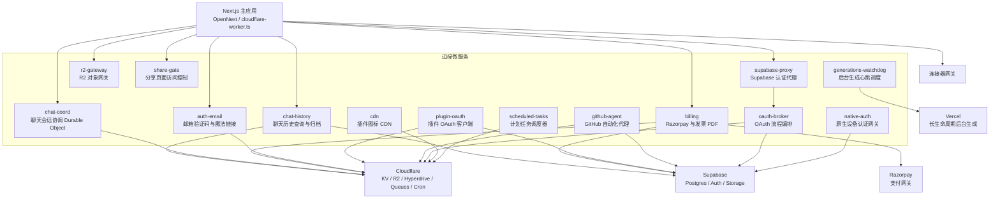
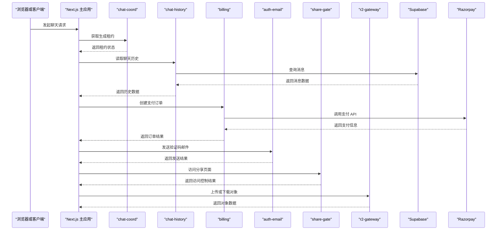
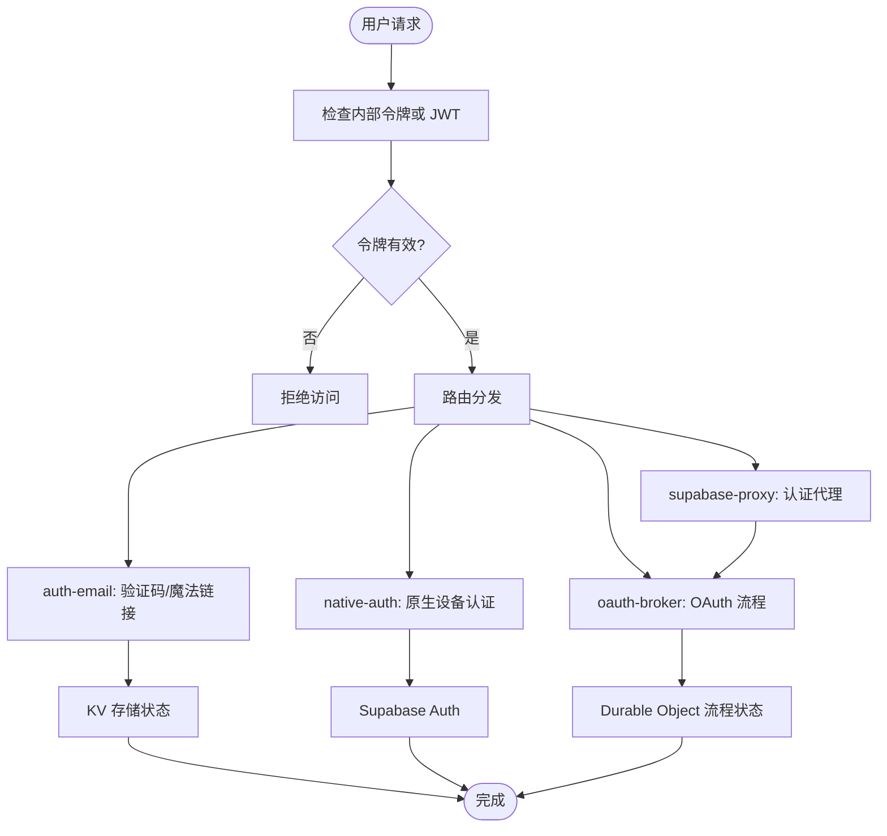
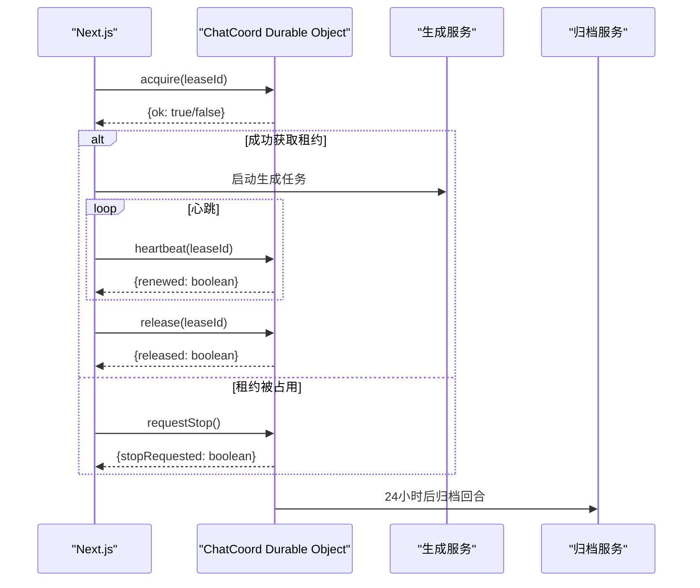
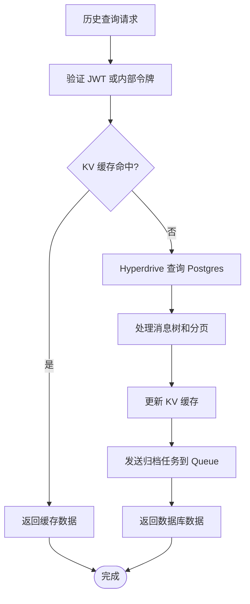
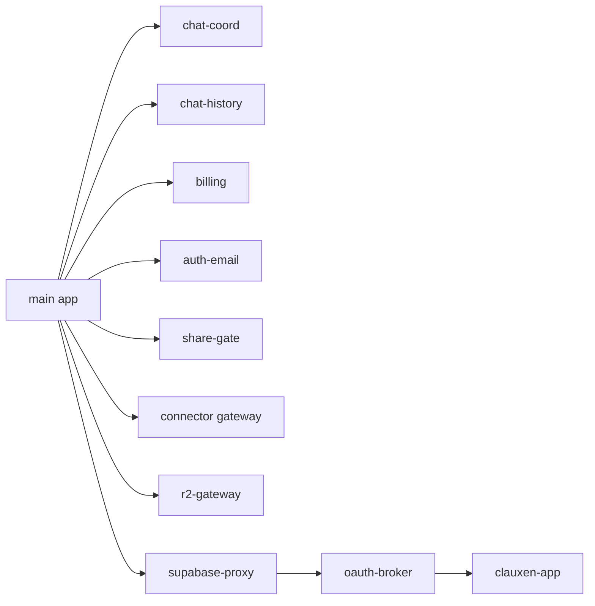

# Worker 架构概览

<cite>
**本文引用的文件**   
- [README.md](file://README.md)
- [cloudflare-worker.ts](file://cloudflare-worker.ts)
- [wrangler.jsonc](file://wrangler.jsonc)
- [workers/auth-email/wrangler.toml](file://workers/auth-email/wrangler.toml)
- [workers/auth-email/src/index.ts](file://workers/auth-email/src/index.ts)
- [workers/billing/wrangler.toml](file://workers/billing/wrangler.toml)
- [workers/billing/src/index.ts](file://workers/billing/src/index.ts)
- [workers/cdn/wrangler.toml](file://workers/cdn/wrangler.toml)
- [workers/cdn/src/index.ts](file://workers/cdn/src/index.ts)
- [workers/chat-coord/wrangler.toml](file://workers/chat-coord/wrangler.toml)
- [workers/chat-coord/src/index.ts](file://workers/chat-coord/src/index.ts)
- [workers/chat-history/wrangler.toml](file://workers/chat-history/wrangler.toml)
- [workers/chat-history/src/index.ts](file://workers/chat-history/src/index.ts)
- [workers/generations-watchdog/wrangler.toml](file://workers/generations-watchdog/wrangler.toml)
- [workers/generations-watchdog/src/index.ts](file://workers/generations-watchdog/src/index.ts)
- [workers/github-agent/wrangler.jsonc](file://workers/github-agent/wrangler.jsonc)
- [workers/native-auth/wrangler.jsonc](file://workers/native-auth/wrangler.jsonc)
- [workers/oauth-broker/wrangler.jsonc](file://workers/oauth-broker/wrangler.jsonc)
- [workers/plugin-oauth/wrangler.toml](file://workers/plugin-oauth/wrangler.toml)
- [workers/r2-gateway/wrangler.toml](file://workers/r2-gateway/wrangler.toml)
- [workers/scheduled-tasks/wrangler.toml](file://workers/scheduled-tasks/wrangler.toml)
- [workers/share-gate/wrangler.toml](file://workers/share-gate/wrangler.toml)
- [workers/supabase-proxy/wrangler.jsonc](file://workers/supabase-proxy/wrangler.jsonc)
</cite>

## 目录
1. [引言](#引言)
2. [项目结构](#项目结构)
3. [核心组件](#核心组件)
4. [架构总览](#架构总览)
5. [详细组件分析](#详细组件分析)
6. [依赖关系分析](#依赖关系分析)
7. [性能与可观测性](#性能与可观测性)
8. [故障恢复与排错指南](#故障恢复与排错指南)
9. [结论](#结论)

## 引言
本仓库采用“Next.js 主应用 + Cloudflare Workers 边缘微服务”的整体架构。主应用在 Vercel/Cloudflare App Hosting 上运行，同时通过一个共享的 Wrangler 入口 `cloudflare-worker.ts` 挂载 Next.js OpenNext 运行时、对象签名访问和生成任务队列消费者；所有业务微服务则独立部署为 Cloudflare Workers，负责认证、账单、聊天协调、历史读写、R2 存储、计划任务、分享网关、OAuth 代理等职责。

该设计把高并发、低延迟或需要边缘能力的工作（例如 R2 上传下载、聊天协调、聊天历史读取）迁移到边缘 Worker，而把复杂状态机、数据库连接、外部支付集成等放在各自 Worker 中，通过内部令牌、Hyperdrive、KV、Durable Objects、Queues、R2 和 Supabase 进行通信。

**章节来源**
- [README.md:1-89](file://README.md#L1-L89)

## 项目结构
Workers 目录按功能划分，每个子目录是一个独立的 Cloudflare Worker：

该图仅表示概念关系；实际代码级依赖见后文“依赖关系分析”。

**图表来源**
- [cloudflare-worker.ts:1-22](file://cloudflare-worker.ts#L1-L22)
- [wrangler.jsonc:1-117](file://wrangler.jsonc#L1-L117)

**章节来源**
- [README.md:1-89](file://README.md#L1-L89)
- [cloudflare-worker.ts:1-22](file://cloudflare-worker.ts#L1-L22)
- [wrangler.jsonc:1-117](file://wrangler.jsonc#L1-L117)

## 核心组件
本节对 13 个 Worker 逐一说明其职责、路由、环境变量、外部依赖和关键行为。

### auth-email：邮箱验证码与魔法链接
- 核心职责：发送 OTP 和魔法链接邮件；在 KV 中保存 OTP 哈希、签发并验证一次性注册票据；提供内部 API 供 Next.js 调用。
- 主要接口：
  - `POST /v1/otp/send`：生成六位验证码、存入 KV、发送邮件。
  - `POST /v1/otp/verify`：校验验证码并返回一次性注册票据。
  - `POST /v1/otp/consume-ticket`：标记票据已使用。
  - `POST /v1/magic/send`：发送有效期较短的魔法链接。
  - `POST /v1/magic/inspect`：查看魔法令牌而不消耗。
  - `POST /v1/magic/consume`：消耗魔法令牌并签发注册票据。
- 安全模型：要求 `Authorization: Bearer <AUTH_EMAIL_INTERNAL_TOKEN>` 或 `x-clauxen-internal` 头；使用常量时间比较；对邮箱进行规范化。
- 状态存储：
  - `OTP_STORE` KV：保存 OTP 哈希、尝试次数、冷却时间和魔法令牌记录。
- 关键环境变量与绑定：
  - 变量：`FROM_EMAIL`、`FROM_NAME`、`OTP_TTL_SECONDS`、`OTP_MAX_ATTEMPTS`、`OTP_RESEND_COOLDOWN_SECONDS`、`MAGIC_LINK_TTL_SECONDS`、`MAGIC_LINK_COOLDOWN_SECONDS`。
  - 绑定：`EMAIL`（Cloudflare Email Service）、`OTP_STORE` KV。
  - 密钥：`AUTH_EMAIL_INTERNAL_TOKEN`。
- 错误处理：缺少内部令牌直接拒绝；邮箱格式校验失败返回错误；重复发送受冷却时间限制。

**章节来源**
- [workers/auth-email/wrangler.toml:1-26](file://workers/auth-email/wrangler.toml#L1-L26)
- [workers/auth-email/src/index.ts:1-200](file://workers/auth-email/src/index.ts#L1-L200)

### billing：账单、支付与发票
- 核心职责：封装 Razorpay 支付流程、生成发票 PDF、上传至 R2 和 Razorpay Documents、发送账单通知邮件。
- 主要接口：
  - `/health`：健康检查。
  - `/v1/razorpay/*`：创建订单、UPI 二维码、查询支付、创建 token 扣款、OTP 流程、客户与 token 管理。
  - `/v1/invoices/generate`：生成发票 PDF。
  - `/v1/invoices/fulfill`：将 PDF 归档到 R2、Razorpay Documents 并通过邮件发送。
  - `/v1/email/send`：通用账单邮件发送。
  - `/v1/invoices/:paymentId/pdf`：用户凭 JWT 或内部令牌下载发票。
- 安全模型：
  - 内部调用：`Authorization: Bearer <BILLING_INTERNAL_TOKEN>` 或 `x-clauxen-billing`。
  - 用户下载：基于 Supabase JWT 验证用户拥有对应支付路径。
- 外部依赖：
  - Razorpay API：通过 Basic Auth 调用。
  - Supabase：用于解析用户身份。
  - Cloudflare Email Service：发送账单邮件。
  - R2：存档发票 PDF。
- 关键环境变量与绑定：
  - 变量：`INVOICE_ISSUER_NAME`、`INVOICE_ISSUER_LEGAL`、`INVOICE_ISSUER_ADDRESS`、`INVOICE_GSTIN`、`INVOICE_LUT_NUMBER`、`FROM_EMAIL`、`FROM_NAME`、`APP_ORIGIN`。
  - 绑定：`INVOICES` R2 Bucket、`EMAIL`。
  - 密钥：`BILLING_INTERNAL_TOKEN`、`RAZORPAY_KEY_ID`、`RAZORPAY_KEY_SECRET`、`SUPABASE_URL`、`SUPABASE_ANON_KEY`。
- 错误处理：未配置 Razorpay Key 时返回 503；HMAC 校验、JWT 解析失败均返回明确错误；PDF 生成和上传失败需由上层重试或告警。

**章节来源**
- [workers/billing/wrangler.toml:1-38](file://workers/billing/wrangler.toml#L1-L38)
- [workers/billing/src/index.ts:1-200](file://workers/billing/src/index.ts#L1-L200)

### cdn：插件图标静态资源
- 核心职责：从 R2 提供的 `plugin-icons-bundle.tar` 中解析并缓存插件图标，对外暴露静态资源访问。
- 主要接口：
  - `GET /health`：健康检查。
  - `GET /plugin-icons-bundle.tar`：返回原始 tar 包。
  - `GET /plugins/icons/<name>.png|svg|...`：从内存缓存返回图标。
- 数据流：首次请求 tar → 解析为文件名到字节映射 → 放入进程内 Map 缓存 → 后续 GET 直接返回。
- 外部依赖：R2 Bucket `CDN_BUCKET`。
- 关键环境变量与绑定：
  - 绑定：`CDN_BUCKET` R2 Bucket。
- 错误处理：tar 不存在返回 404；图标不在 bundle 中返回 404；OPTIONS 预检请求返回允许跨域响应。

**章节来源**
- [workers/cdn/wrangler.toml:1-13](file://workers/cdn/wrangler.toml#L1-L13)
- [workers/cdn/src/index.ts:1-114](file://workers/cdn/src/index.ts#L1-L114)

### chat-coord：聊天会话协调 Durable Object
- 核心职责：以 Durable Object 维护单个聊天会话的生成租约、心跳、停止信号和临时答案状态，避免多个 Worker 实例并发执行同一轮生成。
- 核心状态：
  - 租约：`leaseId`、开始时间、过期时间、是否请求停止。
  - 回合：`chatId`、`userId`、`assistantId`、状态、截断后的 answer、内容 JSON、更新时间、归档时间。
- 关键方法：
  - `acquire`：获取租约，若已有活跃租约且未超时则拒绝。
  - `heartbeat`：续租；若租约丢失或已请求停止则拒绝。
  - `release`：释放租约。
  - `requestStop`：标记停止。
  - `status`：查询当前活跃状态。
  - `putTurn`：写入回合状态，并在终止时设置 24 小时归档时间。
- 外部依赖：Cloudflare Durable Object 本地 SQLite 存储；可通过 alarm 自动清理过期租约和触发归档。
- 关键环境变量与绑定：
  - 变量：`CHAT_COORD_INTERNAL_TOKEN`、`APP_ORIGIN`。
  - 绑定：`CHAT_COORD` Durable Object。
- 错误处理：租约冲突返回原因；心跳丢失返回租赁丢失；状态查询会在租约过期后自动清理。

**章节来源**
- [workers/chat-coord/wrangler.toml:1-26](file://workers/chat-coord/wrangler.toml#L1-L26)
- [workers/chat-coord/src/index.ts:1-200](file://workers/chat-coord/src/index.ts#L1-L200)

### chat-history：聊天历史查询与归档
- 核心职责：提供聊天列表、消息分页、树形分支读取；使用 Hyperdrive 直连 Postgres；可选 KV 缓存最新页、游标页、聊天列表和 JWT 验证结果；异步将历史记录 warm 并归档到 R2。
- 主要接口：
  - 聊天列表与分页查询。
  - 消息历史读取，支持按深度、分支位置遍历。
  - 非阻塞归档任务：通过 Queues 生产者 `HISTORY_JOBS` 发送 `warm_and_archive` 任务。
- 安全模型：
  - 支持内部令牌认证。
  - 用户 JWT 通过 Supabase `/auth/v1/user` 验证，并缓存结果以减少重复鉴权开销。
- 外部依赖：
  - Supabase：Auth 用户信息。
  - Hyperdrive：低延迟 Postgres 连接。
  - KV：可选缓存。
  - R2：聊天归档。
  - Queues：异步归档任务。
- 关键环境变量与绑定：
  - 变量：`LATEST_PAGE_CACHE_TTL_SECONDS`、`CURSOR_PAGE_CACHE_TTL_SECONDS`、`CHAT_LIST_CACHE_TTL_SECONDS`、`JWT_CACHE_TTL_SECONDS`、`APP_ORIGIN`。
  - 绑定：`HYPERDRIVE`、可选 `HYPERDRIVE_FRESH`、`CHAT_HISTORY_CACHE` KV、`CHAT_ARCHIVES` R2、`HISTORY_JOBS` Queue。
  - 密钥：`SUPABASE_URL`、`SUPABASE_ANON_KEY`、`CHAT_HISTORY_INTERNAL_TOKEN`、可选 `DATABASE_URL`。
- 错误处理：未配置 Hyperdrive 或数据库 URL 抛错；CORS 根据 `APP_ORIGIN` 白名单匹配；JWT 无效返回空用户。

**章节来源**
- [workers/chat-history/wrangler.toml:1-58](file://workers/chat-history/wrangler.toml#L1-L58)
- [workers/chat-history/src/index.ts:1-200](file://workers/chat-history/src/index.ts#L1-L200)

### generations-watchdog：后台生成心跳监控
- 核心职责：每分钟 Cron 触发，向 Vercel 的后台生成 watchdog 发起探测，维持长时间运行的 assistant turn 存活；也暴露 `/v1/continue` 供系统主动续期。
- 主要接口：
  - `/health`：健康检查。
  - `/v1/continue`：接收 job ID，转发到上游 continuation 端点。
- 安全模型：要求 `GENERATIONS_INTERNAL_TOKEN`，并通过 SHA-256 常量时间比较；可选择附加 `x-vercel-protection-bypass` 跳过 Vercel 防护。
- 外部依赖：
  - Vercel 主应用或自定义 `CONTINUATION_ORIGIN`。
  - 可选私有服务绑定 `APP`。
- 关键环境变量与绑定：
  - 变量：`APP_ORIGIN`、`CONTINUATION_ORIGIN`。
  - 密钥：`GENERATIONS_INTERNAL_TOKEN`、`VERCEL_AUTOMATION_BYPASS_SECRET`。
- 错误处理：网络异常重试三次；非 5xx 和非 429 立即返回；日志记录事件名称、状态码和错误消息。

**章节来源**
- [workers/generations-watchdog/wrangler.toml:1-22](file://workers/generations-watchdog/wrangler.toml#L1-L22)
- [workers/generations-watchdog/src/index.ts:1-183](file://workers/generations-watchdog/src/index.ts#L1-L183)

### github-agent：GitHub 自动化代理
- 核心职责：提供 GitHub 相关 API，包括认证、数据库操作、GitHub API 交互、页面处理和安全性检查。
- 部署配置：
  - 域名路由：`www.clauxen.com/api/v1/github/*` 和 `www.clauxen.com/github*`。
  - 禁用 workers_dev 和 preview_urls。
  - 使用 Hyperdrive 连接数据库。
  - 启用速率限制和可观测性。
- 关键环境变量与绑定：
  - 变量：`APP_ORIGIN`。
  - 绑定：`HYPERDRIVE`。
- 外部依赖：GitHub API、Supabase Postgres。

**章节来源**
- [workers/github-agent/wrangler.jsonc:1-19](file://workers/github-agent/wrangler.jsonc#L1-L19)

### native-auth：原生设备认证网关
- 核心职责：为原生客户端提供统一认证入口，集中速率限制和可观测性。
- 部署配置：
  - 域名路由：`www.clauxen.com/api/v1/auth/native/*`。
  - 启用速率限制 `AUTH_RATE_LIMIT`。
- 关键环境变量与绑定：
  - 无额外 vars，主要依赖 Supabase 或内部认证服务。
- 外部依赖：Supabase Auth。

**章节来源**
- [workers/native-auth/wrangler.jsonc:1-18](file://workers/native-auth/wrangler.jsonc#L1-L18)

### oauth-broker：OAuth 流程编排
- 核心职责：统一管理 GitHub、GitLab 等 OAuth 提供商的授权流程，维护会话状态。
- 部署配置：
  - 域名路由：`www.clauxen.com/auth/oauth*` 和 `clauxen.com/auth/oauth*`。
  - 私有服务绑定到主应用 `APP`。
  - 使用 Hyperdrive 和 Durable Object `OAUTH_FLOWS` 维护流程状态。
  - 启用速率限制和可观测性。
- 关键环境变量与绑定：
  - 变量：`BROKER_PROVIDERS`。
  - 绑定：`APP` 服务、`HYPERDRIVE`、`OAUTH_FLOWS` Durable Object。
- 外部依赖：GitHub/GitLab OAuth、Supabase。

**章节来源**
- [workers/oauth-broker/wrangler.jsonc:1-22](file://workers/oauth-broker/wrangler.jsonc#L1-L22)

### plugin-oauth：插件 OAuth 客户端
- 核心职责：为插件提供 OAuth 登录回调、客户端管理和 Supabase 集成。
- 部署配置：
  - 启用 workers_dev。
  - 启用可观测性。
  - 使用两个 KV Namespace：`OAUTH_STATE` 和 `OAUTH_CLIENTS`。
- 关键环境变量与绑定：
  - 变量：`WORKER_ORIGIN`、`APP_ORIGIN`。
  - 绑定：`OAUTH_STATE`、`OAUTH_CLIENTS` KV。
  - 密钥：`SUPABASE_URL`、`SUPABASE_SERVICE_ROLE_KEY`、`INTERNAL_TOKEN`、`TOKEN_SEAL_KEY`。
- 外部依赖：Supabase、Cloudflare KV。

**章节来源**
- [workers/plugin-oauth/wrangler.toml:1-38](file://workers/plugin-oauth/wrangler.toml#L1-L38)

### r2-gateway：R2 对象网关
- 核心职责：作为 R2 存储的统一访问入口，集中权限校验、日志记录和带宽优化。
- 部署配置：
  - 启用可观测性。
  - 绑定多个 R2 Buckets：`IMAGES`、`DOCUMENTS`、`ARTIFACTS`、`USER_FILES`、`ATTACHMENTS`。
- 关键环境变量与绑定：
  - 密钥：`SUPABASE_URL`、`SUPABASE_ANON_KEY`。
  - 绑定：多个 R2 Buckets。
- 外部依赖：R2 存储、Supabase。

**章节来源**
- [workers/r2-gateway/wrangler.toml:1-33](file://workers/r2-gateway/wrangler.toml#L1-L33)

### scheduled-tasks：计划任务调度器
- 核心职责：每分钟 Cron 触发，从持久化队列中领取任务，批量入队并执行。
- 部署配置：
  - 启用可观测性。
  - Cron 表达式：`* * * * *`。
  - 使用 Queues：`AUTOMATION_QUEUE` 和生产者/消费者。
- 关键环境变量与绑定：
  - 密钥：`SCHEDULED_TASKS_INTERNAL_TOKEN`。
  - 变量：`APP_ORIGIN`。
  - 绑定：`AUTOMATION_QUEUE` Queue。
- 外部依赖：Cloudflare Queues、Supabase。

**章节来源**
- [workers/scheduled-tasks/wrangler.toml:1-32](file://workers/scheduled-tasks/wrangler.toml#L1-L32)

### share-gate：分享页面访问控制
- 核心职责：保护分享页面的访问，结合 Turnstile 人机验证和 KV 状态。
- 部署配置：
  - 启用 workers_dev。
  - 启用可观测性。
  - 使用 KV `SHARE_KV`。
- 关键环境变量与绑定：
  - 变量：`APP_ORIGIN`、`ALLOW_TEST_TURNSTILE`。
  - 绑定：`SHARE_KV` KV。
  - 密钥：`SHARE_WORKER_INTERNAL_TOKEN`、`TURNSTILE_SECRET_KEY`。
- 外部依赖：Turnstile、KV。

**章节来源**
- [workers/share-gate/wrangler.toml:1-21](file://workers/share-gate/wrangler.toml#L1-L21)

### supabase-proxy：Supabase 认证代理
- 核心职责：作为 auth.clauxen.com 的代理层，统一路由到 OAuth Broker，并提供速率限制。
- 部署配置：
  - 域名路由：`auth.clauxen.com/*`。
  - 私有服务绑定到 `OAUTH_BROKER`。
  - 启用速率限制和可观测性。
- 关键环境变量与绑定：
  - 变量：`BROKER_PROVIDERS`。
  - 绑定：`OAUTH_BROKER` 服务。
- 外部依赖：OAuth Broker、Supabase。

**章节来源**
- [workers/supabase-proxy/wrangler.jsonc:1-15](file://workers/supabase-proxy/wrangler.jsonc#L1-L15)

## 架构总览
整体数据流如下：

**图表来源**
- [cloudflare-worker.ts:1-22](file://cloudflare-worker.ts#L1-L22)
- [workers/chat-coord/src/index.ts:1-200](file://workers/chat-coord/src/index.ts#L1-L200)
- [workers/chat-history/src/index.ts:1-200](file://workers/chat-history/src/index.ts#L1-L200)
- [workers/billing/src/index.ts:1-200](file://workers/billing/src/index.ts#L1-L200)
- [workers/auth-email/src/index.ts:1-200](file://workers/auth-email/src/index.ts#L1-L200)

## 详细组件分析

### 认证与授权流程
认证体系由多个 Worker 协作完成：

**图表来源**
- [workers/auth-email/src/index.ts:1-200](file://workers/auth-email/src/index.ts#L1-L200)
- [workers/native-auth/wrangler.jsonc:1-18](file://workers/native-auth/wrangler.jsonc#L1-L18)
- [workers/oauth-broker/wrangler.jsonc:1-22](file://workers/oauth-broker/wrangler.jsonc#L1-L22)
- [workers/supabase-proxy/wrangler.jsonc:1-15](file://workers/supabase-proxy/wrangler.jsonc#L1-L15)

**章节来源**
- [workers/auth-email/src/index.ts:1-200](file://workers/auth-email/src/index.ts#L1-L200)
- [workers/native-auth/wrangler.jsonc:1-18](file://workers/native-auth/wrangler.jsonc#L1-L18)
- [workers/oauth-broker/wrangler.jsonc:1-22](file://workers/oauth-broker/wrangler.jsonc#L1-L22)
- [workers/supabase-proxy/wrangler.jsonc:1-15](file://workers/supabase-proxy/wrangler.jsonc#L1-L15)

### 聊天生成协调流程
聊天生成的协调流程确保只有一个 Worker 实例在处理特定聊天会话：

**图表来源**
- [workers/chat-coord/src/index.ts:1-200](file://workers/chat-coord/src/index.ts#L1-L200)

**章节来源**
- [workers/chat-coord/src/index.ts:1-200](file://workers/chat-coord/src/index.ts#L1-L200)

### 聊天历史读写流程
聊天历史的读写涉及多个存储层：

**图表来源**
- [workers/chat-history/src/index.ts:1-200](file://workers/chat-history/src/index.ts#L1-L200)
- [workers/chat-history/wrangler.toml:1-58](file://workers/chat-history/wrangler.toml#L1-L58)

**章节来源**
- [workers/chat-history/src/index.ts:1-200](file://workers/chat-history/src/index.ts#L1-L200)
- [workers/chat-history/wrangler.toml:1-58](file://workers/chat-history/wrangler.toml#L1-L58)

## 依赖关系分析
Worker 之间的依赖关系如下：

**图表来源**
- [wrangler.jsonc:1-117](file://wrangler.jsonc#L1-L117)

**章节来源**
- [wrangler.jsonc:1-117](file://wrangler.jsonc#L1-L117)

## 性能与可观测性
各 Worker 的可观测性配置和性能优化策略：

| Worker | 采样率 | 关键优化 | 监控重点 |
|--------|--------|----------|----------|
| auth-email | 默认 | KV 存储、Email Service | 发送成功率、OTP 重试率 |
| billing | 100% | Razorpay 调用、PDF 生成 | 支付成功率、PDF 生成耗时 |
| cdn | 默认 | 内存缓存 tar 包 | 404 比例、缓存命中率 |
| chat-coord | 10% | Durable Object 本地存储 | 租约冲突、心跳失败 |
| chat-history | 5% | Hyperdrive、KV 缓存、Queue | 数据库延迟、缓存命中率 |
| generations-watchdog | 100% | Cron 调度、HTTP 重试 | 心跳成功率、重试次数 |
| github-agent | 5% | Hyperdrive、速率限制 | API 调用失败、限流 |
| native-auth | 5% | 速率限制 | 认证失败率 |
| oauth-broker | 1% | Durable Object、Hyperdrive | OAuth 流程失败、状态同步 |
| plugin-oauth | 5% | KV 存储 | 状态丢失、回调失败 |
| r2-gateway | 10% | 多 Bucket 绑定 | 上传失败、带宽异常 |
| scheduled-tasks | 100% | Queue 批量消费 | 任务积压、重试次数 |
| share-gate | 5% | KV 存储、Turnstile | 人机验证失败、访问控制 |
| supabase-proxy | 1% | 速率限制 | 代理失败、上游超时 |

**章节来源**
- [workers/chat-coord/wrangler.toml:1-26](file://workers/chat-coord/wrangler.toml#L1-L26)
- [workers/chat-history/wrangler.toml:1-58](file://workers/chat-history/wrangler.toml#L1-L58)
- [workers/generations-watchdog/wrangler.toml:1-22](file://workers/generations-watchdog/wrangler.toml#L1-L22)
- [workers/github-agent/wrangler.jsonc:1-19](file://workers/github-agent/wrangler.jsonc#L1-L19)
- [workers/oauth-broker/wrangler.jsonc:1-22](file://workers/oauth-broker/wrangler.jsonc#L1-L22)
- [workers/r2-gateway/wrangler.toml:1-33](file://workers/r2-gateway/wrangler.toml#L1-L33)
- [workers/scheduled-tasks/wrangler.toml:1-32](file://workers/scheduled-tasks/wrangler.toml#L1-L32)
- [workers/share-gate/wrangler.toml:1-21](file://workers/share-gate/wrangler.toml#L1-L21)
- [workers/supabase-proxy/wrangler.jsonc:1-15](file://workers/supabase-proxy/wrangler.jsonc#L1-L15)

## 故障恢复与排错指南

### 常见故障模式
1. **内部令牌缺失或无效**：auth-email、billing、chat-coord 等 Worker 会拒绝未授权的请求。
   - 排查：检查 `AUTH_EMAIL_INTERNAL_TOKEN`、`BILLING_INTERNAL_TOKEN`、`CHAT_COORD_INTERNAL_TOKEN` 是否配置。
2. **数据库连接失败**：chat-history 依赖 Hyperdrive 或 `DATABASE_URL`。
   - 排查：确认 Hyperdrive 配置和数据库连接字符串。
3. **Razorpay 配置缺失**：billing Worker 在未配置密钥时返回 503。
   - 排查：检查 `RAZORPAY_KEY_ID` 和 `RAZORPAY_KEY_SECRET`。
4. **R2 对象不存在**：cdn、r2-gateway 在对象缺失时返回 404。
   - 排查：确认 R2 Bucket 中的对象是否存在。
5. **OAuth 流程中断**：oauth-broker 的 Durable Object 状态可能丢失。
   - 排查：检查 Durable Object 迁移和状态存储。

### 错误传播机制
- 内部服务间调用通过 HTTP 状态码和 JSON 错误体传递错误。
- 异步任务通过 Dead Letter Queue (DLQ) 捕获失败任务。
- 可观测性日志记录事件名称、状态码和错误详情。

### 恢复策略
- **重试机制**：generations-watchdog 对网络错误重试三次。
- **租约超时**：chat-coord 自动清理过期租约。
- **归档重试**：chat-history 的归档任务最多重试 3 次。
- **任务重试**：scheduled-tasks 的任务最多重试 5 次。

**章节来源**
- [workers/auth-email/wrangler.toml:1-26](file://workers/auth-email/wrangler.toml#L1-L26)
- [workers/billing/wrangler.toml:1-38](file://workers/billing/wrangler.toml#L1-L38)
- [workers/chat-history/wrangler.toml:1-58](file://workers/chat-history/wrangler.toml#L1-L58)
- [workers/generations-watchdog/src/index.ts:1-183](file://workers/generations-watchdog/src/index.ts#L1-L183)
- [workers/scheduled-tasks/wrangler.toml:1-32](file://workers/scheduled-tasks/wrangler.toml#L1-L32)

## 结论
该架构通过 Cloudflare Workers 实现了清晰的微服务分离：认证、账单、聊天协调、历史存储、R2 网关、计划任务和 OAuth 代理各司其职。主 Next.js 应用作为协调层，通过内部令牌和服务绑定与各 Worker 通信。数据流向清晰，错误传播机制完善，性能优化策略针对不同场景进行了针对性配置。

建议继续监控各 Worker 的错误率和延迟指标，定期审查内部令牌的安全性，并确保所有敏感配置都通过 wrangler secret 管理。对于高流量场景，考虑进一步细分 Worker 的职责边界，以实现更好的可扩展性和容错性。