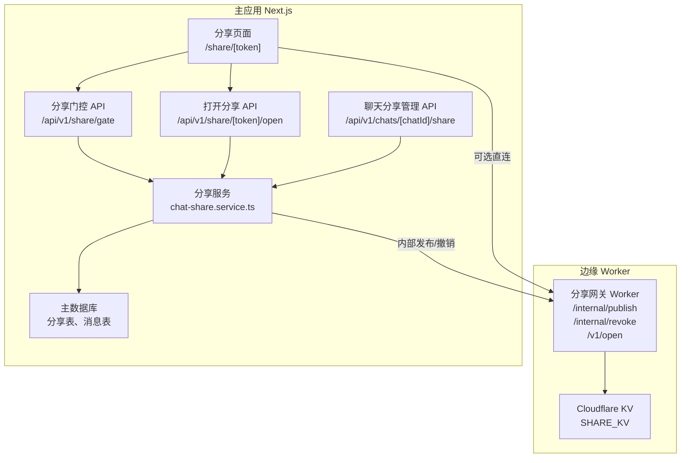
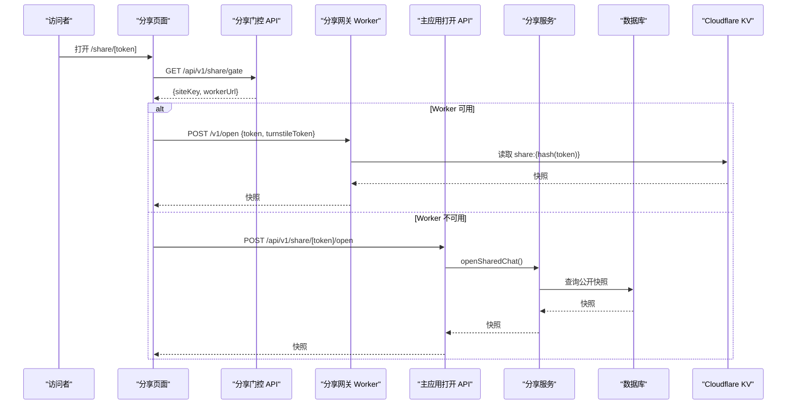
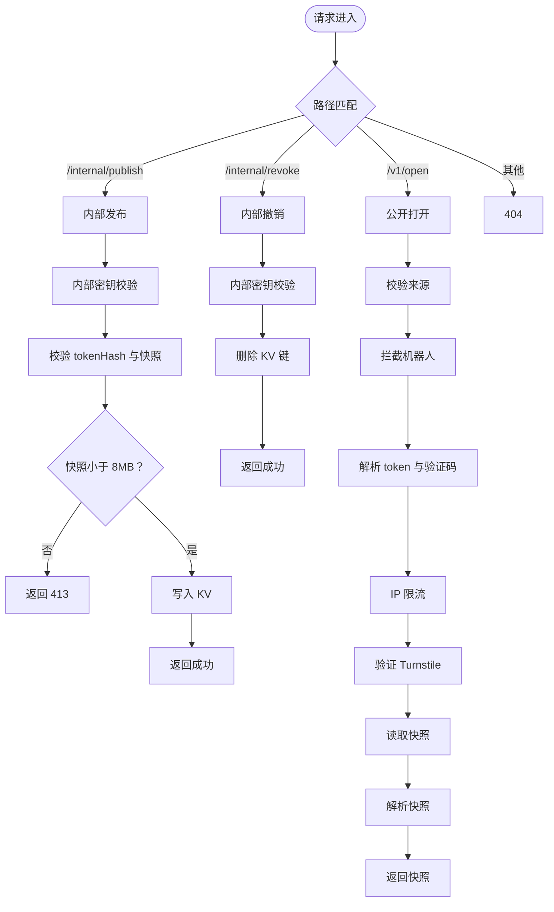
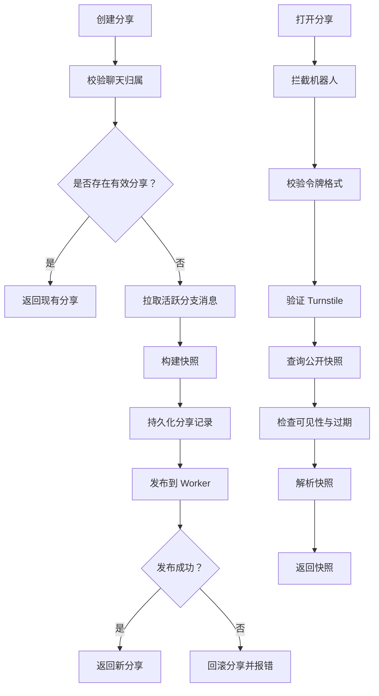
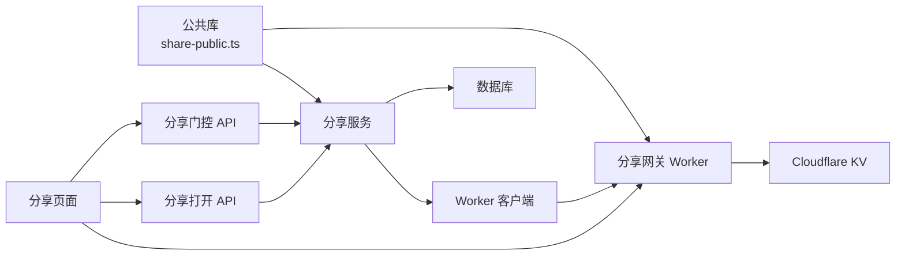

# 分享网关 Worker

<cite>
**本文引用的文件**
- [workers/share-gate/src/index.ts](file://workers/share-gate/src/index.ts)
- [workers/share-gate/package.json](file://workers/share-gate/package.json)
- [workers/share-gate/wrangler.toml](file://workers/share-gate/wrangler.toml)
- [src/shared/lib/share-public.ts](file://src/shared/lib/share-public.ts)
- [src/app/api/v1/share/gate/route.ts](file://src/app/api/v1/share/gate/route.ts)
- [src/app/api/v1/share/[token]/open/route.ts](file://src/app/api/v1/share/[token]/open/route.ts)
- [src/app/api/v1/share/[token]/route.ts](file://src/app/api/v1/share/[token]/route.ts)
- [src/app/api/v1/chats/[chatId]/share/route.ts](file://src/app/api/v1/chats/[chatId]/share/route.ts)
- [src/server/services/chat-share.service.ts](file://src/server/services/chat-share.service.ts)
- [src/app/share/[token]/page.tsx](file://src/app/share/[token]/page.tsx)
</cite>

## 目录
1. [简介](#简介)
2. [项目结构](#项目结构)
3. [核心组件](#核心组件)
4. [架构总览](#架构总览)
5. [详细组件分析](#详细组件分析)
6. [依赖关系分析](#依赖关系分析)
7. [性能与容量特性](#性能与容量特性)
8. [故障排查指南](#故障排查指南)
9. [结论](#结论)
10. [附录：接口与配置参考](#附录接口与配置参考)

## 简介
本文档系统化说明“分享网关 Worker”及其在主应用中的集成方式。它负责以下职责：
- 公开访问聊天分享的入口控制、人机验证和流量限制。
- 通过 Cloudflare KV 提供高并发、低延迟的分享快照读取。
- 由主应用创建、撤销分享链接，并同步快照到 Worker。
- 前端渲染分享页面、动态加载 Turnstile 人机验证控件、按需获取快照。
- 共享类型定义、机器人拦截、主机白名单等公共逻辑。

该方案将“写路径”（生成分享、持久化快照）放在主应用，把“读路径”（公开打开分享）下沉到边缘 Worker，从而降低主应用负载、缩短全球访问延迟。

## 项目结构
分享相关代码分布在三个层次：
- 边缘 Worker：`workers/share-gate`，处理 `/internal/*` 写入端点和 `/v1/open` 公开读取端点。
- 主应用 API：`src/app/api/v1/share` 下的路由，负责人机校验、权限检查、数据库查询。
- 业务服务层：`src/server/services/chat-share.service.ts`，封装分享生命周期、快照构建与 Worker 调用。
- 前端页面：`src/app/share/[token]/page.tsx`，渲染分享 UI 并协调人机验证与数据加载。
- 公共库：`src/shared/lib/share-public.ts`，定义分享类型、令牌校验、爬虫拦截和白名单。

**图表来源**
- [workers/share-gate/src/index.ts:1-288](file://workers/share-gate/src/index.ts#L1-L288)
- [src/app/api/v1/share/gate/route.ts:1-27](file://src/app/api/v1/share/gate/route.ts#L1-L27)
- [src/app/api/v1/share/[token]/open/route.ts:1-27](file://src/app/api/v1/share/[token]/open/route.ts#L1-L27)
- [src/app/api/v1/chats/[chatId]/share/route.ts:1-40](file://src/app/api/v1/chats/[chatId]/share/route.ts#L1-L40)
- [src/server/services/chat-share.service.ts:1-176](file://src/server/services/chat-share.service.ts#L1-L176)
- [src/app/share/[token]/page.tsx:1-215](file://src/app/share/[token]/page.tsx#L1-L215)

**章节来源**
- [workers/share-gate/src/index.ts:1-288](file://workers/share-gate/src/index.ts#L1-L288)
- [src/app/api/v1/share/gate/route.ts:1-27](file://src/app/api/v1/share/gate/route.ts#L1-L27)
- [src/app/api/v1/share/[token]/open/route.ts:1-27](file://src/app/api/v1/share/[token]/open/route.ts#L1-L27)
- [src/app/api/v1/chats/[chatId]/share/route.ts:1-40](file://src/app/api/v1/chats/[chatId]/share/route.ts#L1-L40)
- [src/server/services/chat-share.service.ts:1-176](file://src/server/services/chat-share.service.ts#L1-L176)
- [src/app/share/[token]/page.tsx:1-215](file://src/app/share/[token]/page.tsx#L1-L215)

## 核心组件
- 分享网关 Worker：实现发布、撤销、公开打开、CORS、隐私头、机器人检测、Turnstile 校验、IP 限流。
- 分享门控 API：返回 Turnstile siteKey 与 Worker 公网地址，供前端决定是否走边缘通道。
- 分享打开 API：作为后备路径，在 Worker 不可用时直接执行后端校验并返回快照。
- 聊天分享管理 API：登录后查询或创建/撤销分享状态，触发快照构建与 Worker 发布。
- 分享服务：统一封装分享生命周期、快照序列化、Worker 通信、错误映射。
- 分享页面：渲染标题与消息列表，管理 Turnstile 脚本、人机验证回调和错误提示。
- 公共库：定义 `SharedChatSnapshot`、令牌格式、爬虫 UA 黑名单、允许主机规则。

**章节来源**
- [workers/share-gate/src/index.ts:1-288](file://workers/share-gate/src/index.ts#L1-L288)
- [src/shared/lib/share-public.ts:1-123](file://src/shared/lib/share-public.ts#L1-L123)
- [src/server/services/chat-share.service.ts:1-176](file://src/server/services/chat-share.service.ts#L1-L176)

## 架构总览
分享流程分为两条主线：

1. **创建分享（写路径）**
   - 已登录用户调用聊天分享管理 API。
   - 服务层读取当前活跃分支的消息，构建快照。
   - 持久化分享记录，并调用 Worker 的内部发布接口，将快照写入 KV。
   - 若 Worker 发布失败，则回滚分享记录并返回错误。

2. **打开分享（读路径）**
   - 前端先请求门控 API，拿到 Turnstile siteKey 与 Worker 地址。
   - 若 Worker 可用，前端携带 token 和 Turnstile token 调用 Worker 的 `/v1/open`。
   - Worker 校验来源、机器人、Turnstile、IP 限流，然后从 KV 读取快照。
   - 若 Worker 不可用，前端降级到主应用的打开分享 API，由后端完成相同校验。

**图表来源**
- [src/app/share/[token]/page.tsx:1-215](file://src/app/share/[token]/page.tsx#L1-L215)
- [src/app/api/v1/share/gate/route.ts:1-27](file://src/app/api/v1/share/gate/route.ts#L1-L27)
- [workers/share-gate/src/index.ts:180-288](file://workers/share-gate/src/index.ts#L180-L288)
- [src/app/api/v1/share/[token]/open/route.ts:1-27](file://src/app/api/v1/share/[token]/open/route.ts#L1-L27)
- [src/server/services/chat-share.service.ts:136-176](file://src/server/services/chat-share.service.ts#L136-L176)

## 详细组件分析

### 分享网关 Worker
Worker 暴露三类端点：
- `/internal/publish`：内部发布分享快照到 KV。
- `/internal/revoke`：内部撤销分享快照。
- `/v1/open`：公开打开分享，需要人机验证和来源校验。

关键行为：
- 内部端点要求 `x-clauxen-internal` 头部与密钥进行时序安全比较。
- 快照大小上限为 8MB，超过返回 413。
- 公开端点强制 CORS 白名单，拒绝非预期来源。
- 自动拦截已知爬虫和自动化代理；也支持 Cloudflare `verifiedBot`。
- 使用 IP 哈希键做 10 分钟滑动窗口限流，默认最多 30 次尝试。
- 校验 Turnstile response，包括 action 匹配、主机名白名单、超时重复等错误码。
- 从 KV 读取 `share:{sha256(token)}` 对应的 JSON 快照，并进行严格解析。

**图表来源**
- [workers/share-gate/src/index.ts:1-288](file://workers/share-gate/src/index.ts#L1-L288)

**章节来源**
- [workers/share-gate/src/index.ts:1-288](file://workers/share-gate/src/index.ts#L1-L288)

### 分享门控 API
该 API 不鉴权，主要向分享页面提供：
- Turnstile siteKey。
- Worker 公网地址。

当后端检测到真实 Turnstile secret 且配置了 `shareWorkerPublicUrl` 时，才返回 Worker 地址；否则前端只拿到 siteKey，并选择主应用后备路径。

隐私头由统一的分享隐私函数附加，确保响应不被缓存、不包含敏感引用信息。

**章节来源**
- [src/app/api/v1/share/gate/route.ts:1-27](file://src/app/api/v1/share/gate/route.ts#L1-L27)

### 分享打开 API（后备路径）
当 Worker 不可用时，前端会调用主应用的 `/api/v1/share/[token]/open`。该路由：
- 调用 `openSharedChat`。
- 捕获数据库错误并转换为 503。
- 附加分享隐私头。

此外，还有一个仅用于“门检查”的 GET 端点，永远返回锁定状态，不返回消息内容。

**章节来源**
- [src/app/api/v1/share/[token]/open/route.ts:1-27](file://src/app/api/v1/share/[token]/open/route.ts#L1-L27)
- [src/app/api/v1/share/[token]/route.ts:1-14](file://src/app/api/v1/share/[token]/route.ts#L1-L14)

### 聊天分享管理 API
该 API 要求已登录会话：
- GET：读取当前聊天的分享状态，包括是否已有链接、可见性。
- POST：创建新分享或撤销分享。
  - 创建时，若已有有效分享则复用；
  - 若无有效分享，则重新构建快照并调用 Worker 内部发布；
  - 若 Worker 发布失败，则回滚分享记录并抛出错误。

该接口是主应用内“生成分享链接”的主要入口。

**章节来源**
- [src/app/api/v1/chats/[chatId]/share/route.ts:1-40](file://src/app/api/v1/chats/[chatId]/share/route.ts#L1-L40)

### 分享服务
分享服务集中了分享领域的业务逻辑：
- `readShareState`：根据用户和聊天 ID 查询现有分享，解析密封令牌并生成分享 URL。
- `publishShareLink`：
  - 校验聊天归属。
  - 复用现有分享，或清理无效旧分享。
  - 分页拉取活跃分支消息，去重后构建快照。
  - 持久化分享记录。
  - 调用 Worker 内部发布；失败则撤销记录并报错。
- `revokeShareLink`：撤销数据库记录并通知 Worker 删除 KV 条目。
- `openSharedChat`：
  - 拦截自动化客户端。
  - 校验分享令牌格式。
  - 调用 Turnstile 校验。
  - 查询公开快照，检查可见性和过期时间。
  - 解析快照并返回。

**图表来源**
- [src/server/services/chat-share.service.ts:1-176](file://src/server/services/chat-share.service.ts#L1-L176)

**章节来源**
- [src/server/services/chat-share.service.ts:1-176](file://src/server/services/chat-share.service.ts#L1-L176)

### 分享页面
分享页面负责：
- 加载门控配置。
- 动态注入 Turnstile 脚本。
- 渲染人机验证控件。
- 优先调用 Worker 的 `/v1/open`，失败时降级到主应用打开 API。
- 渲染标题、消息列表，并在无消息时给出提示。
- 处理加载、错误、验证码过期等状态。

隐私文案明确告知搜索引擎不会获得消息内容，配合响应头的 robots 标签共同保护隐私。

**章节来源**
- [src/app/share/[token]/page.tsx:1-215](file://src/app/share/[token]/page.tsx#L1-L215)

### 公共类型与工具
公共库定义了分享快照模型、令牌正则、爬虫 UA 黑名单、允许主机规则以及快照解析器：
- `SharedChatSnapshot`：包含标题、抓取时间戳、消息数组。
- `isShareToken`：校验 32 至 128 位 Base64URL 风格令牌。
- `isAutomatedShareAgent`：匹配搜索引擎、社交预览、AI 爬取、下载工具等。
- `isAllowedShareHostname`：允许生产域名、Vercel 预览域名、本地开发（可配置），以及额外主机。
- `parseShareSnapshot`：严格校验字段类型和枚举值，避免脏数据进入前端。

这些逻辑被 Worker、后端服务和前端共享，保证一致性。

**章节来源**
- [src/shared/lib/share-public.ts:1-123](file://src/shared/lib/share-public.ts#L1-L123)

## 依赖关系分析
分享系统的关键依赖如下：
- Worker 依赖 Cloudflare KV、Turnstile、CORS 配置、内部密钥。
- 前端依赖 Next.js 路由、Turnstile 脚本、主应用 API。
- 后端服务依赖数据库、分享仓库、消息仓库、快照构建函数、Worker 客户端。
- 公共库被 Worker 和服务层同时引用，形成单一事实源。

**图表来源**
- [src/shared/lib/share-public.ts:1-123](file://src/shared/lib/share-public.ts#L1-L123)
- [workers/share-gate/src/index.ts:1-288](file://workers/share-gate/src/index.ts#L1-L288)
- [src/server/services/chat-share.service.ts:1-176](file://src/server/services/chat-share.service.ts#L1-L176)
- [src/app/share/[token]/page.tsx:1-215](file://src/app/share/[token]/page.tsx#L1-L215)

**章节来源**
- [src/shared/lib/share-public.ts:1-123](file://src/shared/lib/share-public.ts#L1-L123)
- [workers/share-gate/src/index.ts:1-288](file://workers/share-gate/src/index.ts#L1-L288)
- [src/server/services/chat-share.service.ts:1-176](file://src/server/services/chat-share.service.ts#L1-L176)
- [src/app/share/[token]/page.tsx:1-215](file://src/app/share/[token]/page.tsx#L1-L215)

## 性能与容量特性
- 公开读取走边缘 KV，减少主应用数据库压力。
- 快照写入前进行 8MB 体积限制，防止单条 KV 过大。
- 公开打开接口对同一 IP 做 10 分钟内最多 30 次的限流。
- 前端在 Worker 不可用时自动降级到主应用打开 API，提高可用性。
- 快照分页构建消息，最多 10 次分页、每次 500 条，避免一次性加载过多历史。
- 隐私头禁止缓存和敏感引用泄露，适合对外公开页面。

[本节为通用性能讨论，未直接分析具体代码行]

## 故障排查指南
常见错误与定位建议：
- “分享链接不存在或已撤销”：可能因分享被撤销、过期、快照损坏，或 Worker/KV 中缺失对应键。
- “无法打开此聊天”：可能是 Turnstile 校验失败、来源被拒绝、机器人被拦截、后端数据库异常。
- “该链接不能被自动化客户端打开”：UA 命中黑名单或被 Cloudflare 标记为机器人。
- “尝试次数过多，请稍后再试”：IP 限流触发，等待 10 分钟窗口过期。
- “快照过大”：快照超过 8MB，需减少消息数量或调整快照策略。
- “内部发布失败”：Worker 内部密钥不匹配、网络不可达或 KV 写入失败，服务层会回滚分享记录。
- “人机验证加载失败”：Turnstile 脚本加载失败或 siteKey 未配置，前端会显示相应错误。

排查要点：
- 检查 Worker 环境变量：内部密钥、Turnstile secret、APP_ORIGIN、ALLOW_TEST_TURNSTILE。
- 检查分享页面的门控 API 返回值，确认 siteKey 与 workerUrl。
- 检查 KV 中是否存在 `share:{sha256(token)}` 键。
- 检查数据库分享记录的可见性、过期时间和快照完整性。
- 检查后端日志中的分享错误码，如 `share_unavailable`、`share_publish_failed`、`share_bot_blocked`。

**章节来源**
- [workers/share-gate/src/index.ts:1-288](file://workers/share-gate/src/index.ts#L1-L288)
- [src/app/api/v1/share/[token]/open/route.ts:1-27](file://src/app/api/v1/share/[token]/open/route.ts#L1-L27)
- [src/server/services/chat-share.service.ts:1-176](file://src/server/services/chat-share.service.ts#L1-L176)
- [src/app/share/[token]/page.tsx:1-215](file://src/app/share/[token]/page.tsx#L1-L215)

## 结论
分享网关 Worker 通过将公开读路径迁移到边缘 KV，显著降低了主应用负载并提升了全球访问体验。主应用仍承担分享创建、权限校验、快照构建和兜底打开能力，确保系统在 Worker 不可用时仍可运行。公共库统一了令牌、爬虫、主机白名单和快照解析逻辑，使前后端行为一致。

未来可考虑：
- 增加分享统计埋点，记录打开次数、错误分布、地域来源。
- 引入分享过期策略与定时清理任务。
- 支持更灵活的可见性模型，例如密码保护、时间段开放。
- 提供嵌入模式，便于第三方站点展示只读分享。
- 扩展 SEO 元数据与社交分享摘要，但保持消息内容不被索引。

[本节为总结性内容，未直接分析具体代码行]

## 附录：接口与配置参考

### Worker 接口
- `POST /internal/publish`
  - 用途：内部发布分享快照。
  - 鉴权：要求内部密钥。
  - 输入：`tokenHash`、`snapshot`。
  - 输出：成功或错误。
- `POST /internal/revoke`
  - 用途：内部撤销分享快照。
  - 鉴权：要求内部密钥。
  - 输入：`tokenHash`。
  - 输出：成功。
- `POST /v1/open`
  - 用途：公开打开分享。
  - 输入：`token`、`turnstileToken`。
  - 输出：`data.snapshot` 或错误。

**章节来源**
- [workers/share-gate/src/index.ts:1-288](file://workers/share-gate/src/index.ts#L1-L288)

### 主应用接口
- `GET /api/v1/share/gate`
  - 用途：返回 Turnstile siteKey 与 Worker 地址。
  - 鉴权：无需登录。
- `POST /api/v1/share/[token]/open`
  - 用途：后备打开分享。
  - 输入：`turnstileToken`。
  - 输出：快照。
- `GET /api/v1/share/[token]`
  - 用途：门检查，不返回消息。
  - 输出：锁定状态。
- `GET /api/v1/chats/[chatId]/share`
  - 用途：查询分享状态。
  - 鉴权：需要登录。
- `POST /api/v1/chats/[chatId]/share`
  - 用途：创建或撤销分享。
  - 鉴权：需要登录。

**章节来源**
- [src/app/api/v1/share/gate/route.ts:1-27](file://src/app/api/v1/share/gate/route.ts#L1-L27)
- [src/app/api/v1/share/[token]/open/route.ts:1-27](file://src/app/api/v1/share/[token]/open/route.ts#L1-L27)
- [src/app/api/v1/share/[token]/route.ts:1-14](file://src/app/api/v1/share/[token]/route.ts#L1-L14)
- [src/app/api/v1/chats/[chatId]/share/route.ts:1-40](file://src/app/api/v1/chats/[chatId]/share/route.ts#L1-L40)

### Worker 配置
- 名称：`clauxen-share-gate`。
- 入口：`src/index.ts`。
- 兼容性：Node.js 兼容。
- 可观测性：开启采样率。
- 变量：
  - `APP_ORIGIN`：允许的跨域来源。
  - `ALLOW_TEST_TURNSTILE`：本地测试开关。
- 密钥：
  - `SHARE_WORKER_INTERNAL_TOKEN`：内部接口密钥。
  - `TURNSTILE_SECRET_KEY`：Turnstile 密钥。
- KV：
  - 绑定名：`SHARE_KV`。
  - 命名空间 ID：固定值。

**章节来源**
- [workers/share-gate/wrangler.toml:1-21](file://workers/share-gate/wrangler.toml#L1-L21)
- [workers/share-gate/package.json:1-15](file://workers/share-gate/package.json#L1-L15)

### 数据模型
- `SharedChatMessage`：消息 ID、角色、内容、创建时间。
- `SharedChatSnapshot`：标题、抓取时间、消息列表。

**章节来源**
- [src/shared/lib/share-public.ts:1-123](file://src/shared/lib/share-public.ts#L1-L123)