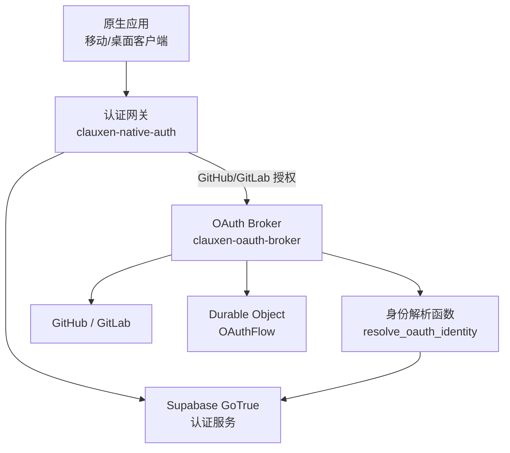
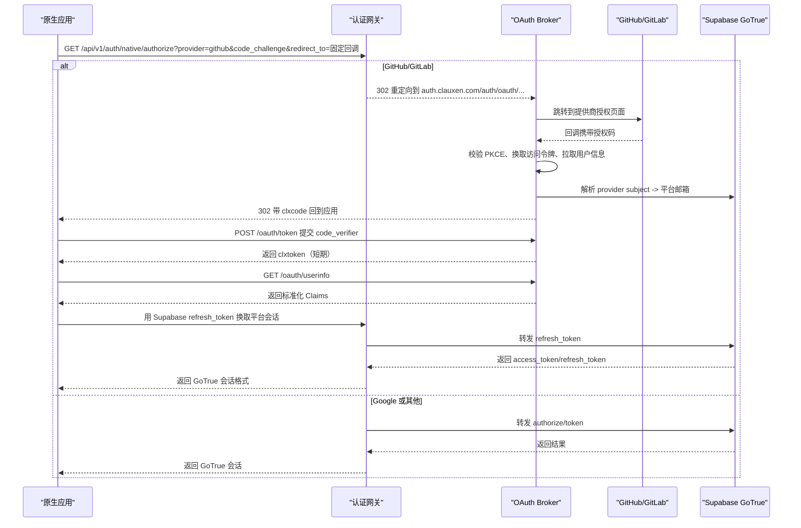
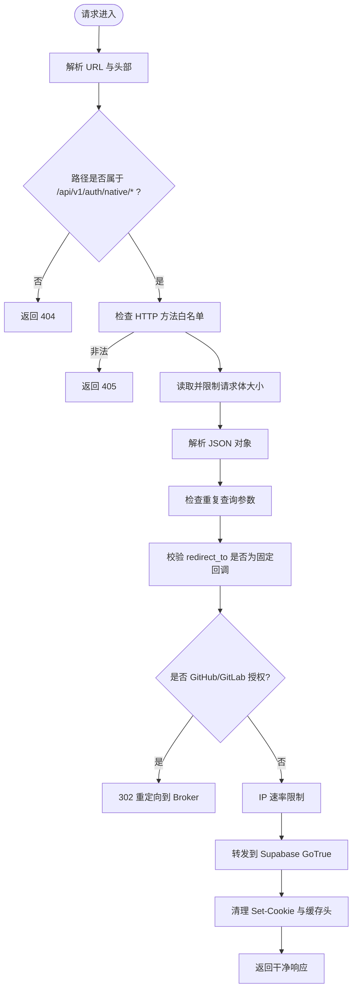
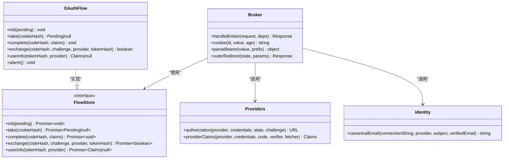
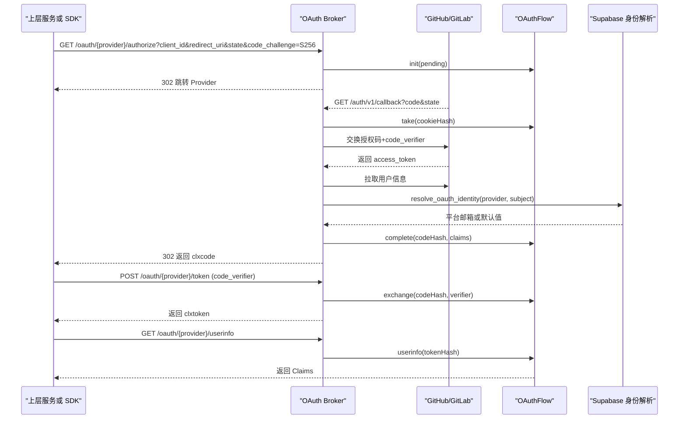
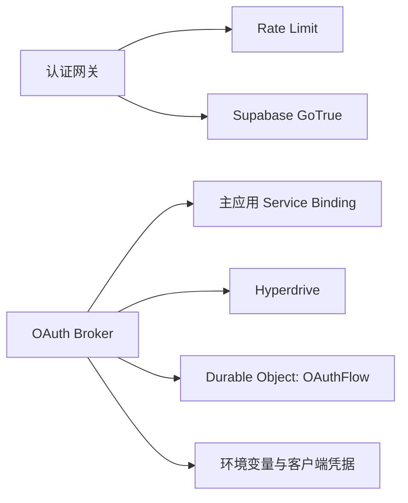

# 原生应用认证 Worker

<cite>
**本文引用的文件**   
- [workers/native-auth/src/index.ts](file://workers/native-auth/src/index.ts)
- [workers/native-auth/src/gateway.ts](file://workers/native-auth/src/gateway.ts)
- [workers/native-auth/gateway.test.ts](file://workers/native-auth/gateway.test.ts)
- [workers/native-auth/wrangler.jsonc](file://workers/native-auth/wrangler.jsonc)
- [workers/oauth-broker/src/index.ts](file://workers/oauth-broker/src/index.ts)
- [workers/oauth-broker/src/broker.ts](file://workers/oauth-broker/src/broker.ts)
- [workers/oauth-broker/src/flow.ts](file://workers/oauth-broker/src/flow.ts)
- [workers/oauth-broker/src/protocol.ts](file://workers/oauth-broker/src/protocol.ts)
- [workers/oauth-broker/src/providers.ts](file://workers/oauth-broker/src/providers.ts)
- [workers/oauth-broker/src/identity.ts](file://workers/oauth-broker/src/identity.ts)
- [workers/oauth-broker/wrangler.jsonc](file://workers/oauth-broker/wrangler.jsonc)
- [supabase/migrations/20261017124626_clauxen_oauth_identity_lookup.sql](file://supabase/migrations/20261017124626_clauxen_oauth_identity_lookup.sql)
</cite>

## 目录
1. [引言](#引言)
2. [项目结构](#项目结构)
3. [核心组件](#核心组件)
4. [架构总览](#架构总览)
5. [详细组件分析](#详细组件分析)
6. [依赖关系分析](#依赖关系分析)
7. [性能与容量特性](#性能与容量特性)
8. [安全加固与防篡改](#安全加固与防篡改)
9. [错误处理与重试策略](#错误处理与重试策略)
10. [集成指南](#集成指南)
11. [故障排查](#故障排查)
12. [结论](#结论)

## 引言
本文件面向移动端和桌面端“原生应用”的认证实现，说明以下能力：
- 原生应用的 OAuth 登录入口、PKCE 支持与设备回调约束。
- 认证网关的职责边界：请求校验、速率限制、上游 Supabase GoTrue 转发、响应脱敏。
- 令牌管理与会话验证：访问令牌刷新、用户信息获取、登出流程。
- 与主应用认证系统的对接：统一通过 Supabase 发布密钥发起认证；浏览器端 Google 回退仍走共享身份后端。
- 与 OAuth Broker 的协作：GitHub/GitLab 的第三方 OAuth 由 Broker 完成授权码交换、PKCE 校验、身份归一化并返回短期 Broker Token。
- 审计追踪、可观测性与安全加固策略。
- SDK 集成建议、错误分类、重试与降级路径。

## 项目结构
原生应用认证相关代码主要分布在两个 Cloudflare Workers：
- `workers/native-auth`：面向原生应用的认证网关。
- `workers/oauth-broker`：面向 GitHub/GitLab 的 OAuth Broker，负责授权码交换与临时凭证签发。

**图示来源**
- [workers/native-auth/src/gateway.ts:1-166](file://workers/native-auth/src/gateway.ts#L1-L166)
- [workers/oauth-broker/src/broker.ts:1-113](file://workers/oauth-broker/src/broker.ts#L1-L113)
- [workers/oauth-broker/src/flow.ts:1-43](file://workers/oauth-broker/src/flow.ts#L1-L43)
- [workers/oauth-broker/src/identity.ts:1-18](file://workers/oauth-broker/src/identity.ts#L1-L18)

**章节来源**
- [workers/native-auth/wrangler.jsonc:1-18](file://workers/native-auth/wrangler.jsonc#L1-L18)
- [workers/oauth-broker/wrangler.jsonc:1-22](file://workers/oauth-broker/wrangler.jsonc#L1-L22)

## 核心组件
- 认证网关
  - 暴露 `/api/v1/auth/native/*` 接口，是原生应用的唯一认证入口。
  - 支持 `token`、`authorize`、`otp`、`verify`、`recover`、`logout`、`user` 等子端点。
  - 对非 GitHub/GitLab 的 OAuth 请求直接转发到 Supabase GoTrue；对 GitHub/GitLab 的授权请求重定向至 Broker。
- OAuth Broker
  - 在 `https://auth.clauxen.com/auth/oauth` 下提供内部 OAuth 协议：`/authorize`、`/token`、`/userinfo`。
  - 使用 Durable Object 维护一次登录状态机，完成授权码交换、PKCE 校验与短期 Token 签发。
  - 调用 Supabase 函数将外部 provider subject 映射为平台内可信邮箱。
- 身份解析迁移
  - 数据库新增只读角色与函数，用于根据 provider 和 subject 查询已绑定的用户邮箱。

**章节来源**
- [workers/native-auth/src/gateway.ts:1-166](file://workers/native-auth/src/gateway.ts#L1-L166)
- [workers/oauth-broker/src/broker.ts:1-113](file://workers/oauth-broker/src/broker.ts#L1-L113)
- [workers/oauth-broker/src/flow.ts:1-43](file://workers/oauth-broker/src/flow.ts#L1-L43)
- [supabase/migrations/20261017124626_clauxen_oauth_identity_lookup.sql:1-30](file://supabase/migrations/20261017124626_clauxen_oauth_identity_lookup.sql#L1-L30)

## 架构总览
原生应用认证涉及三层职责：
1. 原生应用侧：生成 PKCE challenge，构造授权或令牌请求，保存本地会话。
2. 认证网关：统一入口、严格参数校验、速率限制、敏感头过滤，并代理到 Supabase。
3. OAuth Broker：对 GitHub/GitLab 执行标准 OAuth 2.0 + PKCE 流程，产出短期 Broker Token，供上层系统调用 userinfo 获取标准化身份。

**图示来源**
- [workers/native-auth/src/gateway.ts:1-166](file://workers/native-auth/src/gateway.ts#L1-L166)
- [workers/oauth-broker/src/broker.ts:1-113](file://workers/oauth-broker/src/broker.ts#L1-L113)
- [workers/oauth-broker/src/providers.ts:1-37](file://workers/oauth-broker/src/providers.ts#L1-L37)

## 详细组件分析

### 认证网关：原生应用认证入口
网关负责：
- 路径白名单与方法白名单控制。
- JSON 载荷上限、响应体上限、重复查询参数限制。
- 固定回调地址与 PKCE S256 校验。
- 按 IP 进行粗粒度速率限制。
- 仅允许 HTTPS 且特定 Origin 的请求。
- 对 GitHub/GitLab 授权请求重定向到 Broker，其余请求转发到 Supabase。
- 透传可选的 `X-Supabase-Api-Version`，但不转发 Cookie 和缓存头。
- 对用户信息查询与登出要求 Bearer 令牌。

**图示来源**
- [workers/native-auth/src/gateway.ts:1-166](file://workers/native-auth/src/gateway.ts#L1-L166)

关键行为要点：
- 固定回调：`com.clauxen.mobile://auth-callback`。
- 支持的 grant_type：`id_token`、`password`、`refresh_token`、`pkce`。
- Google ID token 交换需要有效 nonce，长度至少 32 字节。
- 非 GitHub/GitLab 的 OAuth 请求直接走 Supabase，避免绕过平台统一认证。
- 健康检查端点 `/health` 不经过完整鉴权链。

**章节来源**
- [workers/native-auth/src/gateway.ts:1-166](file://workers/native-auth/src/gateway.ts#L1-L166)
- [workers/native-auth/gateway.test.ts:1-150](file://workers/native-auth/gateway.test.ts#L1-L150)

### OAuth Broker：GitHub/GitLab 协作层
Broker 暴露内部路由：
- `/oauth/{github|gitlab}/authorize`：初始化登录状态，记录 challenge 与 verifier，设置浏览器 cookie。
- `/oauth/{github|gitlab}/token`：接收授权码与 code_verifier，校验 PKCE，向提供商换取访问令牌，再拉取用户信息。
- `/oauth/{github|gitlab}/userinfo`：使用 Broker Token 获取标准化身份声明。

Broker 还拦截主应用返回的 Supabase 授权跳转，当目标为 Supabase 的 `/auth/v1/authorize` 且 provider 为 GitHub/GitLab 时，将跳转目标改写为 Broker。

**图示来源**
- [workers/oauth-broker/src/broker.ts:1-113](file://workers/oauth-broker/src/broker.ts#L1-L113)
- [workers/oauth-broker/src/flow.ts:1-43](file://workers/oauth-broker/src/flow.ts#L1-L43)
- [workers/oauth-broker/src/providers.ts:1-37](file://workers/oauth-broker/src/providers.ts#L1-L37)
- [workers/oauth-broker/src/identity.ts:1-18](file://workers/oauth-broker/src/identity.ts#L1-L18)

#### Broker 授权流程

**图示来源**
- [workers/oauth-broker/src/broker.ts:1-113](file://workers/oauth-broker/src/broker.ts#L1-L113)
- [workers/oauth-broker/src/flow.ts:1-43](file://workers/oauth-broker/src/flow.ts#L1-L43)
- [workers/oauth-broker/src/providers.ts:1-37](file://workers/oauth-broker/src/providers.ts#L1-L37)
- [workers/oauth-broker/src/identity.ts:1-18](file://workers/oauth-broker/src/identity.ts#L1-L18)

**章节来源**
- [workers/oauth-broker/src/index.ts:1-34](file://workers/oauth-broker/src/index.ts#L1-L34)
- [workers/oauth-broker/src/broker.ts:1-113](file://workers/oauth-broker/src/broker.ts#L1-L113)
- [workers/oauth-broker/src/flow.ts:1-43](file://workers/oauth-broker/src/flow.ts#L1-L43)
- [workers/oauth-broker/src/protocol.ts:1-65](file://workers/oauth-broker/src/protocol.ts#L1-L65)
- [workers/oauth-broker/src/providers.ts:1-37](file://workers/oauth-broker/src/providers.ts#L1-L37)
- [workers/oauth-broker/src/identity.ts:1-18](file://workers/oauth-broker/src/identity.ts#L1-L18)

### 令牌管理与会话验证
- 原生应用使用网关提供的 `/api/v1/auth/native/token` 与 Supabase 交互。
- `grant_type=id_token` 用于交换 Google ID token；网关会校验 provider 与 nonce。
- `grant_type=refresh_token` 用于刷新平台会话；网关原样转发 refresh_token，不创建新身份。
- `Authorization: Bearer <platform-session>` 用于 `/user` 与 `/logout`，网关透传到 Supabase。
- 网关不会把 Supabase 返回的 Cookie 或缓存头暴露给原生应用；原生应用应自行管理本地会话。

**章节来源**
- [workers/native-auth/src/gateway.ts:1-166](file://workers/native-auth/src/gateway.ts#L1-L166)
- [workers/native-auth/gateway.test.ts:1-150](file://workers/native-auth/gateway.test.ts#L1-L150)

### 用户身份同步与权限映射
- OAuth Broker 在成功交换授权码后，调用 `clauxen_auth.resolve_oauth_identity(provider, subject)` 查询平台中该 provider subject 对应的邮箱。
- 若存在绑定记录，则使用该邮箱作为 Canonical Email；否则回退到提供商返回的已验证邮箱。
- 该函数通过 SECURITY DEFINER 和受限角色访问 `auth.identities` 与 `auth.users`，不修改任何用户数据，也不暴露底层表结构。
- 权限映射不在 Broker 中硬编码；上层业务可根据标准化 Claims 与平台用户邮箱进行角色分配。

**章节来源**
- [workers/oauth-broker/src/identity.ts:1-18](file://workers/oauth-broker/src/identity.ts#L1-L18)
- [supabase/migrations/20261017124626_clauxen_oauth_identity_lookup.sql:1-30](file://supabase/migrations/20261017124626_clauxen_oauth_identity_lookup.sql#L1-L30)

## 依赖关系分析
- 认证网关依赖：
  - Cloudflare Rate Limit：`AUTH_RATE_LIMIT`。
  - Supabase：`SUPABASE_URL`、`SUPABASE_PUBLISHABLE_KEY`。
  - 上游响应可能携带 `Retry-After`，网关会保留。
- OAuth Broker 依赖：
  - Wrangler service binding `APP`：用于重写主应用返回的 Supabase 授权跳转。
  - Hyperdrive：连接 Supabase，执行身份解析查询。
  - Durable Object `OAUTH_FLOWS`：持久化一次登录的状态机。
  - 环境变量：`BROKER_PROVIDERS`、`BROKER_CLIENT_SECRET`、GitHub/GitLab 客户端凭据。

**图示来源**
- [workers/native-auth/wrangler.jsonc:1-18](file://workers/native-auth/wrangler.jsonc#L1-L18)
- [workers/oauth-broker/wrangler.jsonc:1-22](file://workers/oauth-broker/wrangler.jsonc#L1-L22)

**章节来源**
- [workers/native-auth/wrangler.jsonc:1-18](file://workers/native-auth/wrangler.jsonc#L1-L18)
- [workers/oauth-broker/wrangler.jsonc:1-22](file://workers/oauth-broker/wrangler.jsonc#L1-L22)

## 性能与容量特性
- 请求体限制：
  - 网关请求体最大 64 KiB，响应体最大 128 KiB。
  - Broker 请求体最大 16 KiB，通用文本读取限制 32 KiB，提供商响应读取限制 64 KiB。
- 超时：
  - 网关对上游 Supabase 请求设置 20 秒超时。
  - Broker 对提供商网络请求设置 15 秒超时。
- 并发与状态：
  - Broker 使用 Durable Object 保证每次登录状态原子更新。
  - 登录过期通过 alarm 清理存储。
- 限流：
  - 两个 Worker 都启用 60 秒窗口内的速率限制，默认限制约 120 次。

**章节来源**
- [workers/native-auth/src/gateway.ts:1-166](file://workers/native-auth/src/gateway.ts#L1-L166)
- [workers/oauth-broker/src/broker.ts:1-113](file://workers/oauth-broker/src/broker.ts#L1-L113)
- [workers/oauth-broker/src/protocol.ts:1-65](file://workers/oauth-broker/src/protocol.ts#L1-L65)
- [workers/oauth-broker/src/flow.ts:1-43](file://workers/oauth-broker/src/flow.ts#L1-L43)

## 安全加固与防篡改
- 输入校验：
  - 路径与方法白名单。
  - JSON 类型与结构校验，拒绝数组或空对象。
  - 禁止重复查询参数。
  - 强制 PKCE S256，challenge 长度与字符集校验。
- 回调保护：
  - 原生应用只允许固定回调地址。
  - Broker 的回调 state 必须包含可验证的随机前缀与 secret。
- 凭据保护：
  - 不转发 Cookie。
  - 不转发上游缓存头。
  - 不暴露异常消息、刷新令牌或上游配置。
  - Broker Token 与 Code 使用哈希比较，避免明文比对。
- 网络与来源：
  - 网关限制 Origin 为受信任域名。
  - 网关要求 Supabase URL 为 HTTPS 且无多余路径或凭据。
  - Broker 校验自身 ORIGIN，防止跨域滥用。
- 数据库访问最小权限：
  - 只读角色 `clauxen_oauth_reader`。
  - 通过 SECURITY DEFINER 函数访问身份表，不暴露 RLS 表给普通用户。

**章节来源**
- [workers/native-auth/src/gateway.ts:1-166](file://workers/native-auth/src/gateway.ts#L1-L166)
- [workers/oauth-broker/src/broker.ts:1-113](file://workers/oauth-broker/src/broker.ts#L1-L113)
- [workers/oauth-broker/src/protocol.ts:1-65](file://workers/oauth-broker/src/protocol.ts#L1-L65)
- [supabase/migrations/20261017124626_clauxen_oauth_identity_lookup.sql:1-30](file://supabase/migrations/20261017124626_clauxen_oauth_identity_lookup.sql#L1-L30)

## 错误处理与重试策略
- 网关错误分类：
  - 400：无效查询、无效回调、无效 provider、无效 JSON、不支持的 grant_type。
  - 401：缺少 Authorization。
  - 403：Origin 不允许。
  - 404：未知路径。
  - 405：不支持的方法。
  - 413：请求体过大。
  - 415：非 JSON 内容类型。
  - 429：超过速率限制，返回 Retry-After。
  - 502：上游不可用或上游返回非 JSON。
  - 503：服务器配置缺失。
- Broker 错误分类：
  - 400：无效 state、无效 code_verifier、无效 client。
  - 401：未认证或无效 token。
  - 403：身份冲突或缺少已验证邮箱。
  - 404：非预期路径。
  - 413：负载过大。
  - 502：提供商不可用或响应无效。
- 重试建议：
  - 客户端收到 429 时应遵循 Retry-After 或指数退避。
  - 对于 5xx 临时错误，建议使用有限次数重试，避免风暴。
  - 不应重试明确失败的参数错误，如 invalid_provider、invalid_pkce、invalid_grant。

**章节来源**
- [workers/native-auth/src/gateway.ts:1-166](file://workers/native-auth/src/gateway.ts#L1-L166)
- [workers/oauth-broker/src/broker.ts:1-113](file://workers/oauth-broker/src/broker.ts#L1-L113)
- [workers/oauth-broker/src/protocol.ts:1-65](file://workers/oauth-broker/src/protocol.ts#L1-L65)

## 集成指南

### 原生应用集成步骤
1. 准备 PKCE：
   - 生成 code_verifier。
   - 计算 code_challenge（S256）。
2. 发起授权：
   - 调用 `GET /api/v1/auth/native/authorize`，携带 provider、code_challenge、code_challenge_method=s256、redirect_to=固定回调。
   - GitHub/GitLab 将被重定向到 Broker；Google 等其他提供商将由网关转发到 Supabase。
3. 处理回调：
   - 原生应用捕获固定回调中的授权码或错误。
   - 如果是 GitHub/GitLab，先向 Broker 的 `/oauth/{provider}/token` 提交 code_verifier，获取短期 Broker Token。
   - 如需平台用户信息，调用 Broker `/oauth/{provider}/userinfo`。
   - 最后使用 Supabase refresh_token 调用网关 `/api/v1/auth/native/token?grant_type=refresh_token` 获得平台会话。
4. 使用会话：
   - 后续调用其他需要认证的网关接口时，带上 `Authorization: Bearer <platform-session>`。
5. 登出：
   - 调用 `POST /api/v1/auth/native/logout`，带上当前 platform session。

### 关键注意事项
- 不要伪造或替换 redirect_to。
- 不要在原生应用中保存 Supabase Cookie；网关不会返回 Cookie。
- 不要在客户端暴露 Broker Secret。
- 只在受信任的 Origin 调用网关。
- 使用官方 SDK 或遵循相同协议的实现，确保 PKCE、nonce、grant_type 正确。

**章节来源**
- [workers/native-auth/src/gateway.ts:1-166](file://workers/native-auth/src/gateway.ts#L1-L166)
- [workers/oauth-broker/src/broker.ts:1-113](file://workers/oauth-broker/src/broker.ts#L1-L113)

## 故障排查
常见问题与定位方式：
- 收到 400 invalid_pkce：检查是否使用 S256，challenge 是否符合长度与字符集。
- 收到 400 invalid_redirect：检查 redirect_to 是否为固定回调。
- 收到 400 invalid_provider：只有 google、github、gitlab 被接受。
- 收到 400 unsupported_grant_type：确认 grant_type 为 id_token、password、refresh_token 或 pkce。
- 收到 401 no_authorization：访问 user 或 logout 时需要 Bearer 令牌。
- 收到 403 origin_not_allowed：检查请求 Origin 是否匹配受信任域名。
- 收到 429 over_request_rate_limit：等待 Retry-After 后重试。
- 收到 502 upstream_unavailable：上游不可用或返回非 JSON；检查网络与 Supabase 状态。
- 收到 503 auth_unavailable：检查 SUPABASE_URL 与 SUPABASE_PUBLISHABLE_KEY 是否配置。
- Broker 回调失败：检查 state 是否来自同一登录流程，cookie 是否有效，code_verifier 是否与初始 challenge 匹配。

测试覆盖包括：
- Google ID token 交换、refresh_token 刷新。
- 无效 provider、缺失 nonce、短 nonce。
- 路径注入、方法错误、内容类型错误、超大请求体。
- OAuth 保留 PKCE、固定回调、禁止外部回调。
- 会话 Bearer 透传、未认证查询被拒。
- 上游错误状态与消息保留，但不泄露敏感信息。
- 速率限制与外站 Origin 拦截。
- 健康检查与 Google 浏览器回退场景。

**章节来源**
- [workers/native-auth/gateway.test.ts:1-150](file://workers/native-auth/gateway.test.ts#L1-L150)

## 结论
原生应用认证 Worker 通过认证网关与 OAuth Broker 形成清晰分工：网关负责统一入口与安全边界，Broker 负责第三方 OAuth 的安全交换与身份归一化。整个流程以 PKCE 为核心，结合固定回调、速率限制、输入校验、最小权限数据库访问与响应脱敏，降低原生日常攻击面。上层应用无需持有第三方客户端密钥，也不需要直接操作 Supabase Cookie，从而更安全地获得平台会话与用户身份。