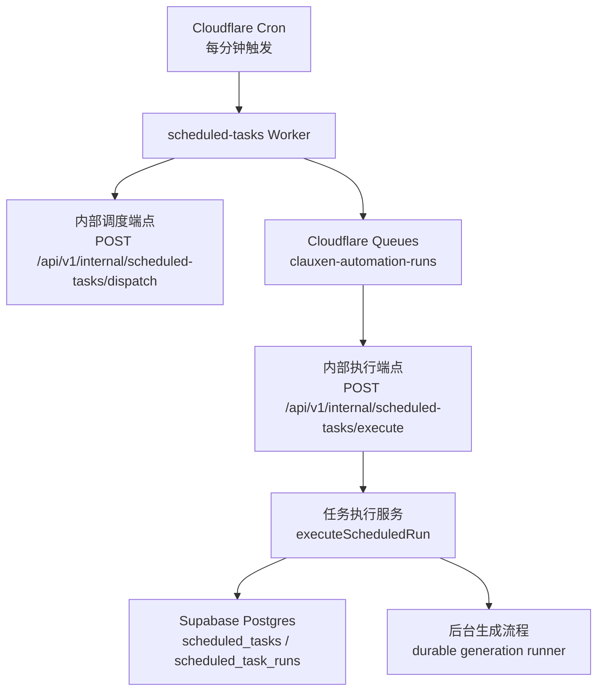
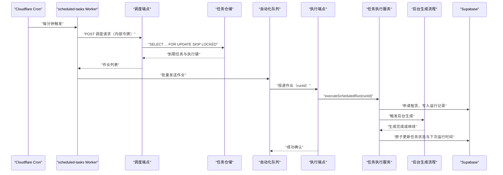
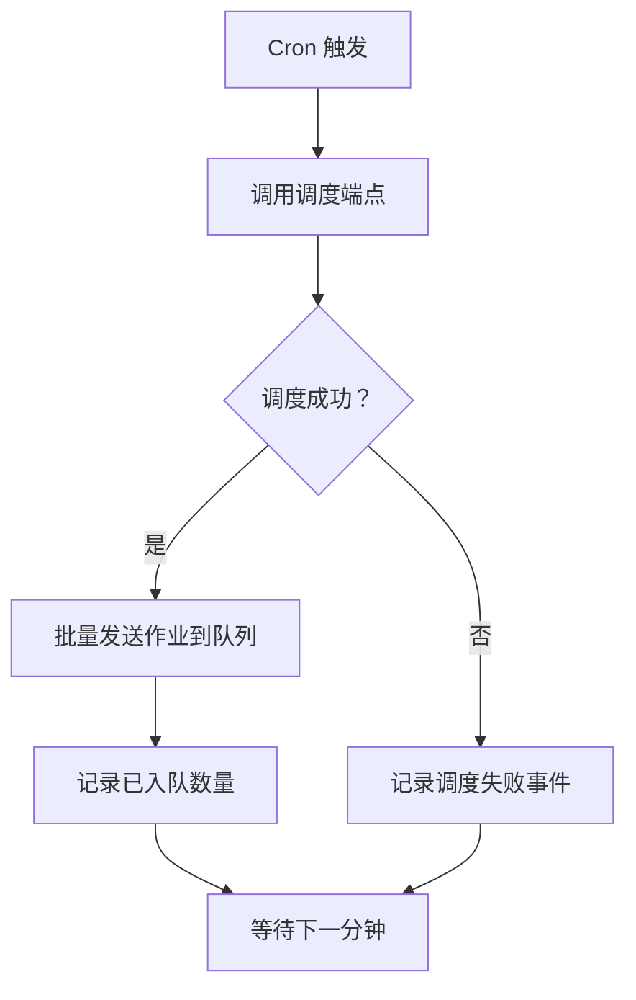
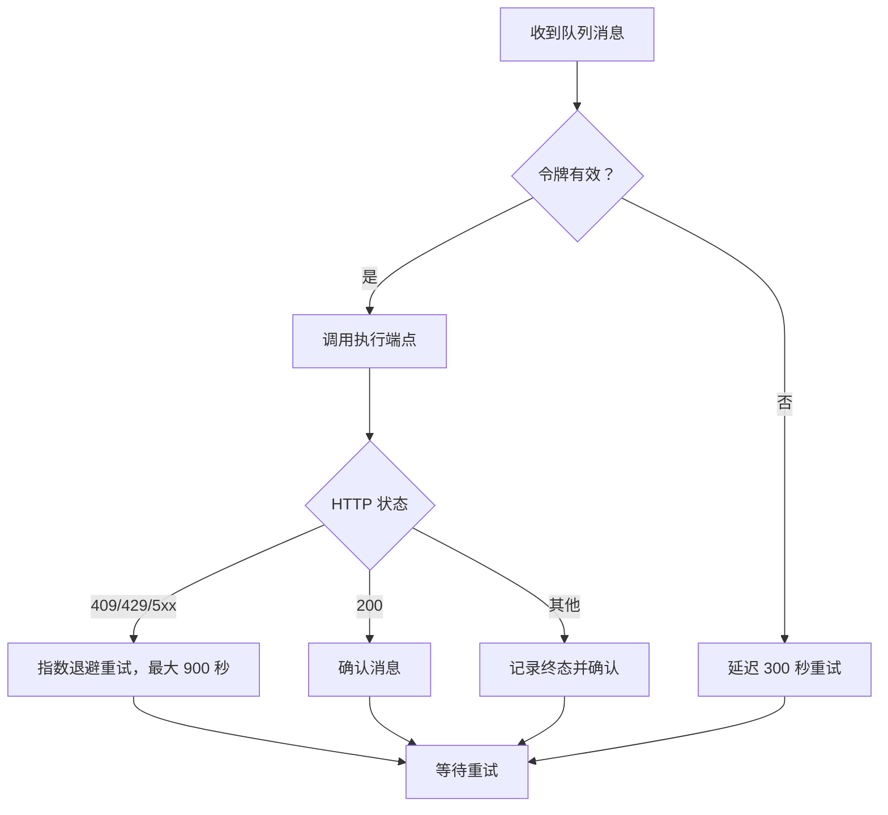
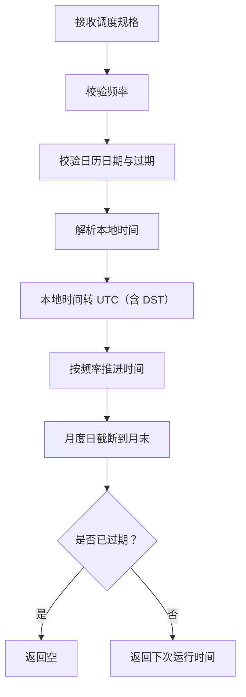
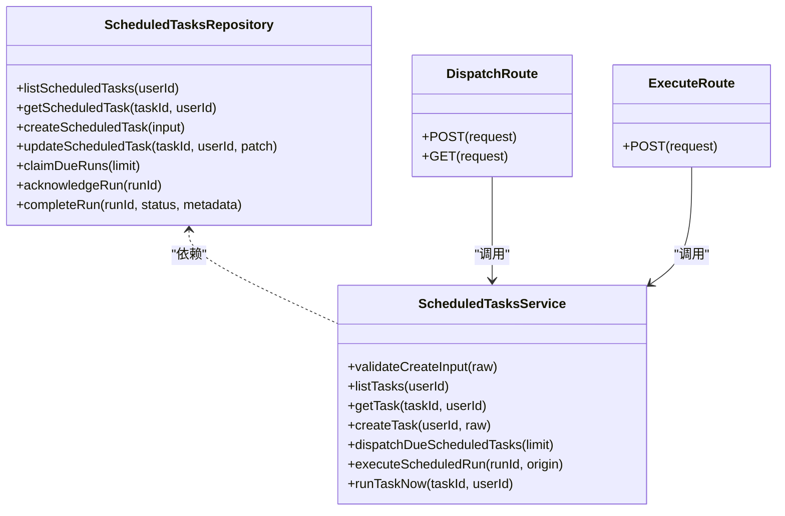
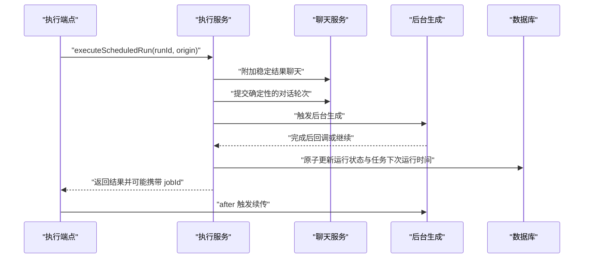
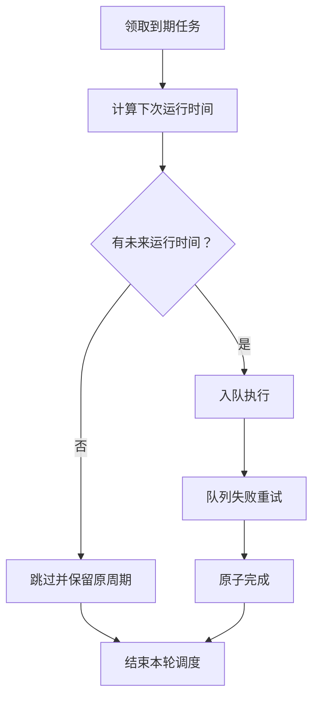
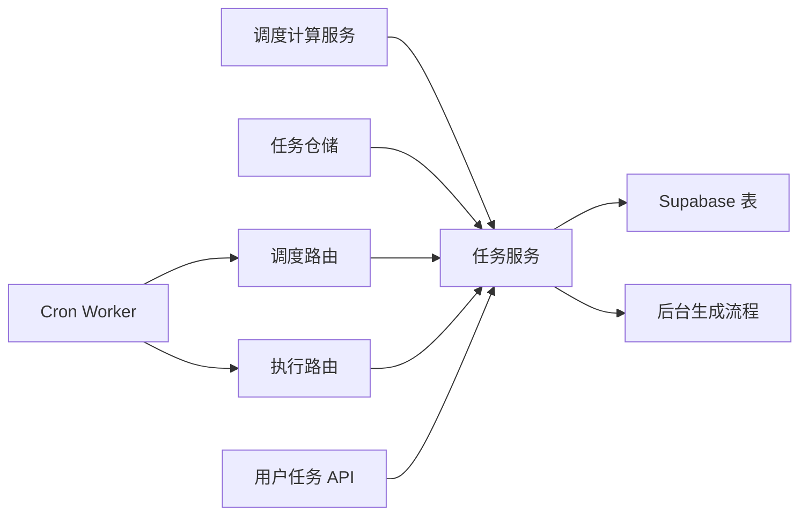

# 定时任务 Worker

<cite>
**本文引用的文件**   
- [workers/scheduled-tasks/src/index.ts](file://workers/scheduled-tasks/src/index.ts)
- [src/app/api/v1/internal/scheduled-tasks/dispatch/route.ts](file://src/app/api/v1/internal/scheduled-tasks/dispatch/route.ts)
- [src/app/api/v1/internal/scheduled-tasks/execute/route.ts](file://src/app/api/v1/internal/scheduled-tasks/execute/route.ts)
- [src/app/api/v1/scheduled-tasks/route.ts](file://src/app/api/v1/scheduled-tasks/route.ts)
- [src/app/api/v1/scheduled-tasks/[taskId]/run/route.ts](file://src/app/api/v1/scheduled-tasks/[taskId]/run/route.ts)
- [src/server/services/scheduled-tasks-schedule.ts](file://src/server/services/scheduled-tasks-schedule.ts)
- [src/server/services/scheduled-tasks.service.ts](file://src/server/services/scheduled-tasks.service.ts)
- [src/server/repositories/scheduled-tasks.repository.ts](file://src/server/repositories/scheduled-tasks.repository.ts)
- [supabase/migrations/20260725083000_scheduled_tasks.sql](file://supabase/migrations/20260725083000_scheduled_tasks.sql)
- [supabase/migrations/20261010032958_scheduled_task_reconciliation_indexes.sql](file://supabase/migrations/20261010032958_scheduled_task_reconciliation_indexes.sql)
- [docs/scheduled-tasks.md](file://docs/scheduled-tasks.md)
- [src/prompts/scheduled-tasks.md](file://src/prompts/scheduled-tasks.md)
- [tests/scheduled-tasks.test.ts](file://tests/scheduled-tasks.test.ts)
- [tests/scheduled-tasks.production-smoke.ts](file://tests/scheduled-tasks.production-smoke.ts)
</cite>

## 目录
1. [引言](#引言)
2. [项目结构](#项目结构)
3. [核心组件](#核心组件)
4. [架构总览](#架构总览)
5. [详细组件分析](#详细组件分析)
6. [依赖关系分析](#依赖关系分析)
7. [性能与并发特性](#性能与并发特性)
8. [监控、告警与日志](#监控告警与日志)
9. [故障排查](#故障排查)
10. [新增任务与调度策略指南](#新增任务与调度策略指南)
11. [结论](#结论)

## 引言
本仓库实现了一套基于 Cloudflare Cron 触发器与队列的定时任务系统。它通过受保护的 Next.js API 将“用户可配置的定时提示”持久化到 Supabase，由独立的 `clauxen-scheduled-tasks` Worker 每分钟轮询到期任务，将其放入自动化队列；队列消费者再调用执行端点，创建稳定结果聊天、触发后台生成流程，并原子更新任务状态与下一次运行时间。文档重点解释 Cron 调度器、任务队列、并发控制、优先级、失败重试、延迟执行、监控告警、执行日志、性能统计，以及与主应用后台任务的协作和状态同步。

## 项目结构
定时任务相关代码分布在以下位置：
- Cloudflare Worker：Cron 触发、内部接口校验、队列发送与消费。
- Next.js API：用户侧任务管理、内部调度与执行端点。
- 服务端服务层：输入校验、调度计算、任务派发、执行编排。
- 数据访问层：任务与运行记录的数据库操作。
- 数据库迁移：任务表、运行记录表、索引与安全策略。
- 文档与测试：架构说明、助手提示、单元测试与生产冒烟测试。

**图表来源**
- [workers/scheduled-tasks/src/index.ts:1-245](file://workers/scheduled-tasks/src/index.ts#L1-L245)
- [src/app/api/v1/internal/scheduled-tasks/dispatch/route.ts:1-33](file://src/app/api/v1/internal/scheduled-tasks/dispatch/route.ts#L1-L33)
- [src/app/api/v1/internal/scheduled-tasks/execute/route.ts:1-51](file://src/app/api/v1/internal/scheduled-tasks/execute/route.ts#L1-L51)
- [src/server/services/scheduled-tasks.service.ts:1-516](file://src/server/services/scheduled-tasks.service.ts#L1-L516)
- [supabase/migrations/20260725083000_scheduled_tasks.sql:1-115](file://supabase/migrations/20260725083000_scheduled_tasks.sql#L1-L115)

**章节来源**
- [docs/scheduled-tasks.md:1-69](file://docs/scheduled-tasks.md#L1-L69)

## 核心组件
- **Cron Worker**：每分钟调用调度端点，把因到的任务封装成作业发送到队列；对网络错误和服务器错误进行指数退避重试。
- **调度端点**：使用数据库锁机制挑选到期任务，生成执行键和运行 ID，返回待入队的作业列表。
- **执行端点**：接收队列消息，执行任务，附加稳定聊天、触发后台生成，并在响应后异步触发续传。
- **调度计算服务**：纯函数计算下次运行时间，处理一次性、每日、每周、每月、过期、时区与夏令时。
- **任务服务**：校验用户输入、限制活跃任务数、派发任务、手动立即运行、列出任务、查询详情。
- **仓储层**：负责事务、行级锁、租赁、运行历史、通知标志等数据库交互。
- **数据库模型**：任务表定义频率、时间、过期、状态、计数、租赁字段；运行记录表记录运行状态、执行键、尝试次数。

**章节来源**
- [workers/scheduled-tasks/src/index.ts:1-245](file://workers/scheduled-tasks/src/index.ts#L1-L245)
- [src/app/api/v1/internal/scheduled-tasks/dispatch/route.ts:1-33](file://src/app/api/v1/internal/scheduled-tasks/dispatch/route.ts#L1-L33)
- [src/app/api/v1/internal/scheduled-tasks/execute/route.ts:1-51](file://src/app/api/v1/internal/scheduled-tasks/execute/route.ts#L1-L51)
- [src/server/services/scheduled-tasks-schedule.ts:1-316](file://src/server/services/scheduled-tasks-schedule.ts#L1-L316)
- [src/server/services/scheduled-tasks.service.ts:1-516](file://src/server/services/scheduled-tasks.service.ts#L1-L516)
- [src/server/repositories/scheduled-tasks.repository.ts:1-640](file://src/server/repositories/scheduled-tasks.repository.ts#L1-L640)
- [supabase/migrations/20260725083000_scheduled_tasks.sql:1-115](file://supabase/migrations/20260725083000_scheduled_tasks.sql#L1-L115)

## 架构总览
系统采用“外部调度 + 内部受保护接口 + 队列解耦 + 持久化状态”的模式：

**图表来源**
- [workers/scheduled-tasks/src/index.ts:1-245](file://workers/scheduled-tasks/src/index.ts#L1-L245)
- [src/app/api/v1/internal/scheduled-tasks/dispatch/route.ts:1-33](file://src/app/api/v1/internal/scheduled-tasks/dispatch/route.ts#L1-L33)
- [src/app/api/v1/internal/scheduled-tasks/execute/route.ts:1-51](file://src/app/api/v1/internal/scheduled-tasks/execute/route.ts#L1-L51)
- [src/server/services/scheduled-tasks.service.ts:1-516](file://src/server/services/scheduled-tasks.service.ts#L1-L516)
- [src/server/repositories/scheduled-tasks.repository.ts:1-640](file://src/server/repositories/scheduled-tasks.repository.ts#L1-L640)

## 详细组件分析

### Cron 调度器与 Worker
- 每分钟触发 `scheduled` 钩子，调用内部调度端点，最多取回 20 个作业，上限被限制在 100。
- 内部请求必须携带共享令牌；Worker 同时支持 Authorization Bearer 与专用头。
- 调度失败会记录事件日志，不中断后续循环。
- 队列消费时对 409、429、5xx 和网络异常进行指数退避重试，最大延迟 900 秒；其他非成功状态直接确认以避免死循环。

**图表来源**
- [workers/scheduled-tasks/src/index.ts:1-245](file://workers/scheduled-tasks/src/index.ts#L1-L245)

**章节来源**
- [workers/scheduled-tasks/src/index.ts:1-245](file://workers/scheduled-tasks/src/index.ts#L1-L245)
- [docs/scheduled-tasks.md:1-69](file://docs/scheduled-tasks.md#L1-L69)

### 任务队列管理与失败重试
- 作业包含运行 ID、任务 ID、执行键、计划时间。
- 队列提供至少一次投递保证，因此执行键与运行租赁用于幂等。
- 消费者在成功时确认消息；失败时根据尝试次数计算延迟并重试；最终不可恢复状态也会确认，避免无限重试。
- 配置中包含队列名、死信队列、批大小与重试次数，这些在项目文档中明确记录。

**图表来源**
- [workers/scheduled-tasks/src/index.ts:201-245](file://workers/scheduled-tasks/src/index.ts#L201-L245)
- [docs/scheduled-tasks.md:1-69](file://docs/scheduled-tasks.md#L1-L69)

**章节来源**
- [workers/scheduled-tasks/src/index.ts:201-245](file://workers/scheduled-tasks/src/index.ts#L201-L245)
- [docs/scheduled-tasks.md:1-69](file://docs/scheduled-tasks.md#L1-L69)

### 调度计算与时区处理
调度计算是纯函数，不涉及数据库，负责：
- 解析 24 小时本地时间。
- 将本地时间转换为 UTC，处理夏令时光隙与前移、重复时间选择首次出现。
- 计算一次性、每日、每周、每月的下次运行时间。
- 处理月份天数截断、闰年、过期日期比较。
- 拒绝无效日历日期、非法工作日、非法频率。

**图表来源**
- [src/server/services/scheduled-tasks-schedule.ts:1-316](file://src/server/services/scheduled-tasks-schedule.ts#L1-L316)

**章节来源**
- [src/server/services/scheduled-tasks-schedule.ts:1-316](file://src/server/services/scheduled-tasks-schedule.ts#L1-L316)
- [tests/scheduled-tasks.test.ts:1-34](file://tests/scheduled-tasks.test.ts#L1-L34)

### 任务派发与并发控制
调度端点由内部认证保护，接受 limit 参数并限制在 1–20。实际并发控制来自数据库：
- 使用 `FOR UPDATE SKIP LOCKED` 选取到期且未租用的任务，避免多个 Worker 实例重复领取。
- 仓储层维护租赁字段，防止同一任务在同一时刻被多次执行。
- 执行端点只接受合法的 runId，并通过执行服务完成事务性步骤。

**图表来源**
- [src/server/repositories/scheduled-tasks.repository.ts:1-640](file://src/server/repositories/scheduled-tasks.repository.ts#L1-L640)
- [src/server/services/scheduled-tasks.service.ts:1-516](file://src/server/services/scheduled-tasks.service.ts#L1-L516)
- [src/app/api/v1/internal/scheduled-tasks/dispatch/route.ts:1-33](file://src/app/api/v1/internal/scheduled-tasks/dispatch/route.ts#L1-L33)
- [src/app/api/v1/internal/scheduled-tasks/execute/route.ts:1-51](file://src/app/api/v1/internal/scheduled-tasks/execute/route.ts#L1-L51)

**章节来源**
- [src/app/api/v1/internal/scheduled-tasks/dispatch/route.ts:1-33](file://src/app/api/v1/internal/scheduled-tasks/dispatch/route.ts#L1-L33)
- [src/server/repositories/scheduled-tasks.repository.ts:1-640](file://src/server/repositories/scheduled-tasks.repository.ts#L1-L640)

### 执行逻辑：数据清理、报告生成、缓存刷新、健康检查
当前仓库中的定时任务以“用户定义的提示”为核心，而不是内置的数据清理、报告生成、缓存刷新或健康检查四类固定任务。其通用执行逻辑如下：
- 为每次运行创建稳定的结果聊天。
- 以确定性客户端 ID 提交对话轮次。
- 触发后台生成运行器，由 watchdog 恢复中断片段。
- 原子完成运行，更新任务状态、下次运行时间与计数。
- 生成应用内通知，必要时发送邮件。

若未来需要新增“数据清理、报告生成、缓存刷新、健康检查”类任务，应复用此执行管线，并通过任务元数据区分任务类型；但现有代码没有硬编码这些类别。

**图表来源**
- [src/app/api/v1/internal/scheduled-tasks/execute/route.ts:1-51](file://src/app/api/v1/internal/scheduled-tasks/execute/route.ts#L1-L51)
- [src/server/services/scheduled-tasks.service.ts:1-516](file://src/server/services/scheduled-tasks.service.ts#L1-L516)
- [docs/scheduled-tasks.md:1-69](file://docs/scheduled-tasks.md#L1-L69)

**章节来源**
- [docs/scheduled-tasks.md:1-69](file://docs/scheduled-tasks.md#L1-L69)
- [src/app/api/v1/internal/scheduled-tasks/execute/route.ts:1-51](file://src/app/api/v1/internal/scheduled-tasks/execute/route.ts#L1-L51)

### 任务优先级、失败重试与延迟执行
- **优先级**：当前没有显式优先级队列。任务按 `next_run_at` 升序、用户可见列表按活跃优先排序。若要引入优先级，可在运行记录中加入优先级字段，并在仓储层扩展选择条件。
- **失败重试**：Worker 队列消费者实现指数退避重试，上限 900 秒；409、429、5xx 及网络错误均重试；非预期状态确认后不再重试。
- **延迟执行**：调度精度为分钟级；`computeNextRunAt` 确保严格晚于当前时间；一次性任务若已过则返回空；手动立即运行会进入正常队列流程，但不改变原有周期。

**图表来源**
- [src/server/services/scheduled-tasks-schedule.ts:1-316](file://src/server/services/scheduled-tasks-schedule.ts#L1-L316)
- [workers/scheduled-tasks/src/index.ts:201-245](file://workers/scheduled-tasks/src/index.ts#L201-L245)

**章节来源**
- [src/server/services/scheduled-tasks-schedule.ts:1-316](file://src/server/services/scheduled-tasks-schedule.ts#L1-L316)
- [workers/scheduled-tasks/src/index.ts:201-245](file://workers/scheduled-tasks/src/index.ts#L201-L245)

### 与主应用后台任务的协作和状态同步
- 执行端点在成功后异步触发后台生成续传，避免请求超时。
- 后台生成由独立 watchdog 协调，可恢复中断片段。
- 运行完成后，任务状态、计数、最后聊天 ID、下次运行时间原子更新。
- 通知包括应用内通知与邮件；应用内通知以运行 ID 去重，邮件投递至少一次。
- 生产冒烟测试验证了完整链路：Cron → 队列 → 后台生成 → 结果聊天 → 原子完成 → 应用通知。

**章节来源**
- [src/app/api/v1/internal/scheduled-tasks/execute/route.ts:1-51](file://src/app/api/v1/internal/scheduled-tasks/execute/route.ts#L1-L51)
- [tests/scheduled-tasks.production-smoke.ts:1-117](file://tests/scheduled-tasks.production-smoke.ts#L1-L117)
- [docs/scheduled-tasks.md:1-69](file://docs/scheduled-tasks.md#L1-L69)

## 依赖关系分析

**图表来源**
- [src/server/services/scheduled-tasks-schedule.ts:1-316](file://src/server/services/scheduled-tasks-schedule.ts#L1-L316)
- [src/server/services/scheduled-tasks.service.ts:1-516](file://src/server/services/scheduled-tasks.service.ts#L1-L516)
- [src/server/repositories/scheduled-tasks.repository.ts:1-640](file://src/server/repositories/scheduled-tasks.repository.ts#L1-L640)
- [src/app/api/v1/internal/scheduled-tasks/dispatch/route.ts:1-33](file://src/app/api/v1/internal/scheduled-tasks/dispatch/route.ts#L1-L33)
- [src/app/api/v1/internal/scheduled-tasks/execute/route.ts:1-51](file://src/app/api/v1/internal/scheduled-tasks/execute/route.ts#L1-L51)
- [src/app/api/v1/scheduled-tasks/route.ts:1-98](file://src/app/api/v1/scheduled-tasks/route.ts#L1-L98)
- [workers/scheduled-tasks/src/index.ts:1-245](file://workers/scheduled-tasks/src/index.ts#L1-L245)

**章节来源**
- [src/app/api/v1/scheduled-tasks/route.ts:1-98](file://src/app/api/v1/scheduled-tasks/route.ts#L1-L98)
- [src/app/api/v1/scheduled-tasks/[taskId]/run/route.ts:1-13](file://src/app/api/v1/scheduled-tasks/[taskId]/run/route.ts#L1-L13)

## 性能与并发特性
- **调度粒度**：分钟级，不是精确秒级。
- **并发安全**：数据库行锁与 `SKIP LOCKED` 避免重复领取；运行租赁字段避免并发执行同一任务。
- **队列吞吐**：Worker 批量发送作业，队列批大小和重试次数由部署配置决定。
- **查询性能**：任务表对到期任务建立部分索引；运行记录表对活动任务和待通知运行建立部分索引，减少扫描范围。
- **内存与连接**：仓储层使用事务封装查询；服务层对输入做严格校验，减少无效数据库写入。
- **后台生成**：使用 after 钩子触发续传，避免长请求阻塞；watchdog 负责中断恢复。

**章节来源**
- [supabase/migrations/20260725083000_scheduled_tasks.sql:1-115](file://supabase/migrations/20260725083000_scheduled_tasks.sql#L1-L115)
- [supabase/migrations/20261010032958_scheduled_task_reconciliation_indexes.sql:1-9](file://supabase/migrations/20261010032958_scheduled_task_reconciliation_indexes.sql#L1-L9)
- [src/app/api/v1/internal/scheduled-tasks/dispatch/route.ts:1-33](file://src/app/api/v1/internal/scheduled-tasks/dispatch/route.ts#L1-L33)
- [src/app/api/v1/internal/scheduled-tasks/execute/route.ts:1-51](file://src/app/api/v1/internal/scheduled-tasks/execute/route.ts#L1-L51)
- [docs/scheduled-tasks.md:1-69](file://docs/scheduled-tasks.md#L1-L69)

## 监控、告警与日志
- Worker 调度失败、已入队数量、执行重试、网络错误、终态错误均有结构化日志。
- 健康检查端点返回 Worker 标识。
- 生产冒烟测试输出关键阶段，便于人工核对。
- 建议结合 Cloudflare 观测平台、队列指标与 Supabase 监控设置告警：
  - 调度失败率上升。
  - 队列积压。
  - 执行重试次数异常。
  - 运行记录长期处于 running 状态。
  - 通知未完成比例升高。

**章节来源**
- [workers/scheduled-tasks/src/index.ts:1-245](file://workers/scheduled-tasks/src/index.ts#L1-L245)
- [tests/scheduled-tasks.production-smoke.ts:1-117](file://tests/scheduled-tasks.production-smoke.ts#L1-L117)
- [docs/scheduled-tasks.md:1-69](file://docs/scheduled-tasks.md#L1-L69)

## 故障排查
常见问题和定位建议：
- **调度端点 401**：检查内部令牌、Authorization 或专用头是否正确。
- **调度端点 404**：确认路径 `/api/v1/internal/scheduled-tasks/dispatch` 与内部认证中间件可用。
- **执行端点 400**：检查 runId 是否为合法 UUID。
- **队列一直重试**：查看 Worker 日志中的重试事件与 HTTP 状态；确认后端返回 409、429、5xx 以外的稳定状态。
- **任务未执行**：检查任务状态、下次运行时间、过期日期、时区和本地时间。
- **重复执行**：检查执行键、运行租赁、队列投递是否至少一次导致重复；确认运行记录幂等。
- **通知未送达**：检查通知标志、应用内通知唯一性、邮件重试策略。
- **后台生成未完成**：检查 watchdog 续传、运行状态、聊天消息状态。

**章节来源**
- [src/app/api/v1/internal/scheduled-tasks/dispatch/route.ts:1-33](file://src/app/api/v1/internal/scheduled-tasks/dispatch/route.ts#L1-L33)
- [src/app/api/v1/internal/scheduled-tasks/execute/route.ts:1-51](file://src/app/api/v1/internal/scheduled-tasks/execute/route.ts#L1-L51)
- [workers/scheduled-tasks/src/index.ts:1-245](file://workers/scheduled-tasks/src/index.ts#L1-L245)
- [docs/scheduled-tasks.md:1-69](file://docs/scheduled-tasks.md#L1-L69)

## 新增任务与调度策略指南
当前系统以“用户提示”作为任务内容，不内置固定任务类型。若需要新增数据清理、报告生成、缓存刷新、健康检查等任务，推荐方式：

1. **定义任务类型**
   - 在任务或服务层增加任务类型字段，例如 `data_cleanup`、`report_generation`、`cache_refresh`、`health_check`。
   - 在调度计算层保持通用下次运行时间逻辑；对特定任务类型添加额外约束。

2. **扩展输入校验**
   - 在服务层校验新字段，例如清理范围、报告模板、缓存键集合、健康检查端点。
   - 保持名称长度、提示长度、频率、时区、过期日期等通用约束不变。

3. **扩展执行分支**
   - 在执行服务中根据任务类型分发到不同处理器。
   - 每个处理器遵循统一契约：写入运行记录、触发后台任务、原子完成、更新任务状态与下次运行时间。

4. **数据库变更**
   - 如需存储任务类型、处理器参数或统计信息，新增列并加迁移。
   - 为高频查询字段添加索引，例如任务类型、状态、下次运行时间。

5. **监控与告警**
   - 为每种任务类型增加分类日志与指标。
   - 对健康检查失败、缓存刷新失败、报告生成失败分别设置告警。

6. **调度策略配置**
   - 继续使用 Cron 每分钟轮询，或通过新的调度源调用调度端点。
   - 如需更高优先级，可在仓储层扩展选择条件；注意不要破坏幂等与租赁语义。

7. **故障恢复**
   - 利用现有运行租赁、执行键、队列重试机制。
   - 对长时间运行的任务，依赖后台生成 watchdog 恢复。

8. **与主应用协作**
   - 复用内部调度与执行端点，保持身份认证一致。
   - 使用 stable chat 和 deterministic client IDs 保证结果可追踪。
   - 通过通知系统反馈任务结果。

**章节来源**
- [src/server/services/scheduled-tasks.service.ts:1-516](file://src/server/services/scheduled-tasks.service.ts#L1-L516)
- [src/server/services/scheduled-tasks-schedule.ts:1-316](file://src/server/services/scheduled-tasks-schedule.ts#L1-L316)
- [src/server/repositories/scheduled-tasks.repository.ts:1-640](file://src/server/repositories/scheduled-tasks.repository.ts#L1-L640)
- [docs/scheduled-tasks.md:1-69](file://docs/scheduled-tasks.md#L1-L69)

## 结论
该定时任务系统以 Cloudflare Cron 和队列为核心，通过受保护的内部接口与数据库行锁实现可靠的任务派发和执行。调度计算专注时区与日历逻辑；任务服务负责校验、派发与执行编排；仓储层保障事务与幂等；数据库迁移提供必要的表结构与索引。现有实现以用户提示为中心，尚未内置数据清理、报告生成、缓存刷新、健康检查四类固定任务，但执行管线足够通用，可在此基础上扩展。新增任务时应复用调度、队列、租赁、后台生成与通知机制，并补充分类监控与告警，以保证系统在高并发和失败场景下仍可恢复。