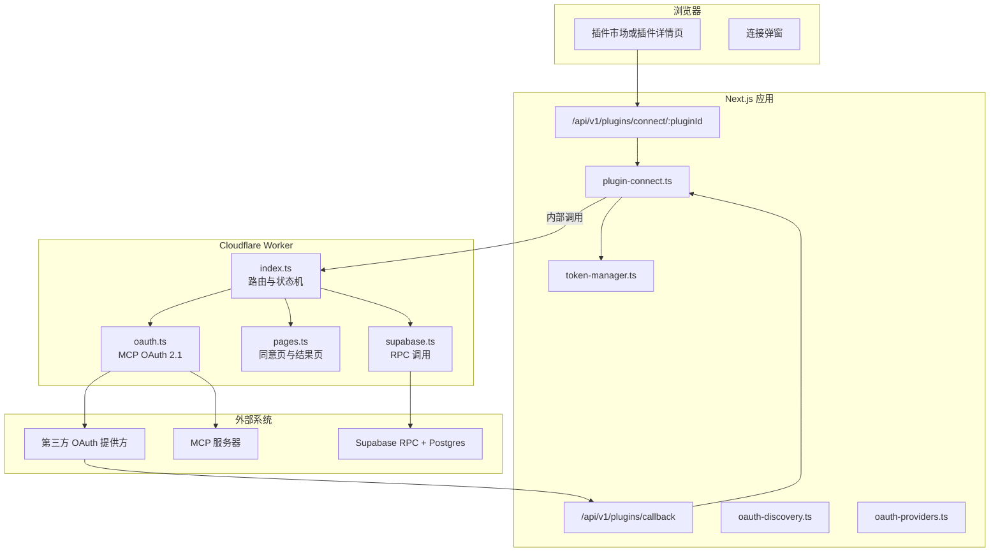
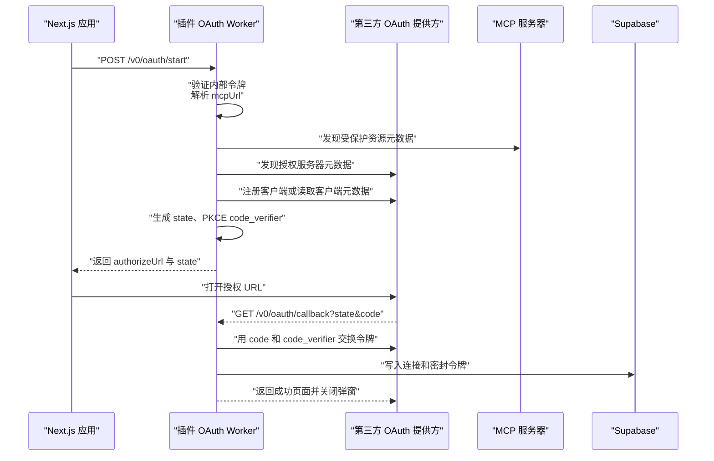
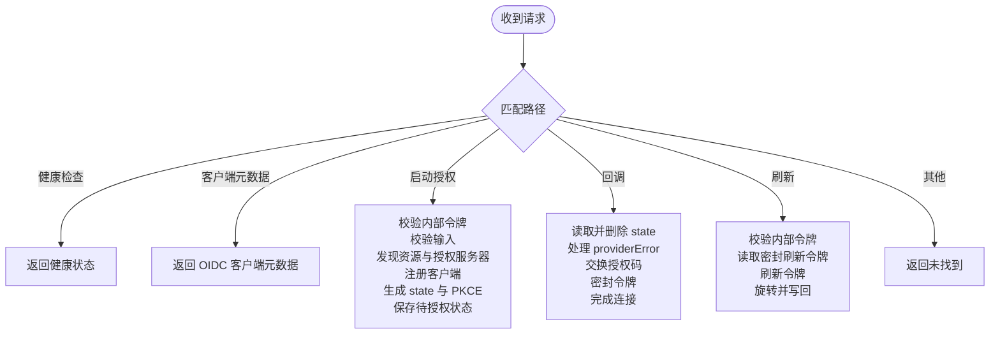
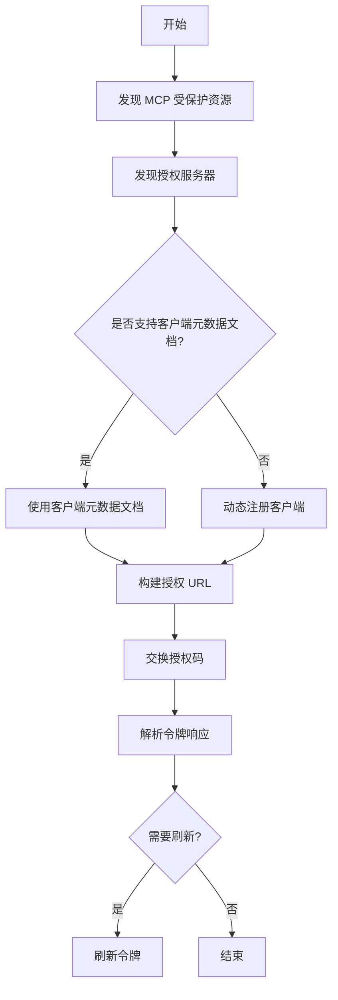
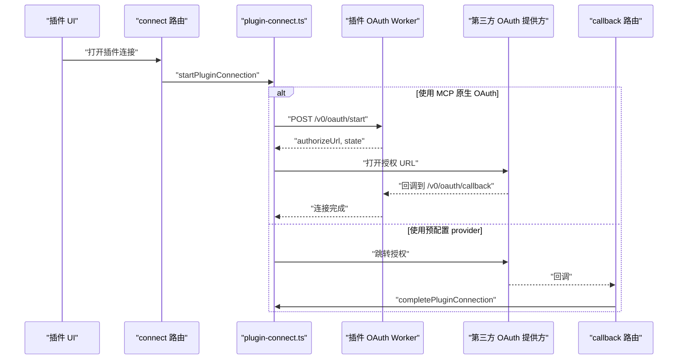
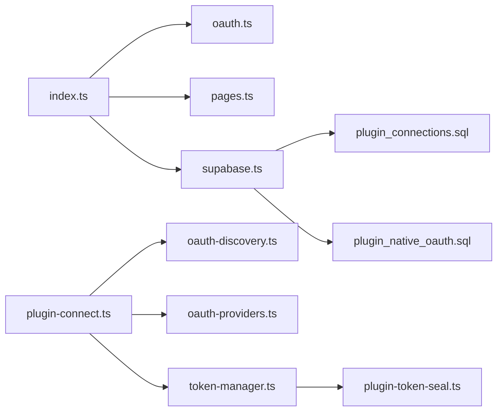

# 插件 OAuth Worker

<cite>
**本文引用的文件**   
- [workers/plugin-oauth/src/index.ts](file://workers/plugin-oauth/src/index.ts)
- [workers/plugin-oauth/src/oauth.ts](file://workers/plugin-oauth/src/oauth.ts)
- [workers/plugin-oauth/src/pages.ts](file://workers/plugin-oauth/src/pages.ts)
- [workers/plugin-oauth/src/supabase.ts](file://workers/plugin-oauth/src/supabase.ts)
- [src/server/plugins/plugin-connect.ts](file://src/server/plugins/plugin-connect.ts)
- [src/app/api/v1/plugins/callback/route.ts](file://src/app/api/v1/plugins/callback/route.ts)
- [src/app/api/v1/plugins/connect/[pluginId]/route.ts](file://src/app/api/v1/plugins/connect/[pluginId]/route.ts)
- [src/server/plugins/oauth-discovery.ts](file://src/server/plugins/oauth-discovery.ts)
- [src/server/plugins/oauth-providers.ts](file://src/server/plugins/oauth-providers.ts)
- [src/server/plugins/token-manager.ts](file://src/server/plugins/token-manager.ts)
- [src/shared/lib/plugin-token-seal.ts](file://src/shared/lib/plugin-token-seal.ts)
- [supabase/migrations/20261002173000_plugin_connections.sql](file://supabase/migrations/20261002173000_plugin_connections.sql)
- [supabase/migrations/20261026120000_plugin_native_oauth.sql](file://supabase/migrations/20261026120000_plugin_native_oauth.sql)
</cite>

## 目录
1. [简介](#简介)
2. [项目结构](#项目结构)
3. [核心组件](#核心组件)
4. [架构总览](#架构总览)
5. [详细组件分析](#详细组件分析)
6. [依赖关系分析](#依赖关系分析)
7. [性能与一致性](#性能与一致性)
8. [安全与审计](#安全与审计)
9. [插件开发者指南](#插件开发者指南)
10. [调试方法](#调试方法)
11. [故障排查](#故障排查)
12. [结论](#结论)

## 简介
本文件系统性文档化 Clauxen 的“插件 OAuth Worker”及其在插件生态中的 OAuth 授权流程。该 Worker 负责为支持 Model Context Protocol 的远程 MCP 服务器执行原生 OAuth 2.1 授权：自动发现授权服务器、注册客户端、生成 PKCE 参数、处理用户同意回调、交换令牌、密封并持久化令牌，以及刷新过期令牌。它还与 Next.js 主应用、Supabase 数据库和预配置提供商（Google、GitHub、Slack、Microsoft）协同工作，确保权限最小化、数据保护、访问控制和可审计性。

## 项目结构
插件 OAuth Worker 是一个独立的 Cloudflare Worker，包含路由入口、OAuth 协议实现、页面渲染和数据持久化四个主要部分；同时与 Next.js 插件连接 API、服务端 OAuth 发现逻辑、令牌管理器和 Supabase 迁移共同构成完整链路。



**图表来源**
- [workers/plugin-oauth/src/index.ts:1-450](file://workers/plugin-oauth/src/index.ts#L1-L450)
- [workers/plugin-oauth/src/oauth.ts:1-501](file://workers/plugin-oauth/src/oauth.ts#L1-L501)
- [workers/plugin-oauth/src/pages.ts:1-84](file://workers/plugin-oauth/src/pages.ts#L1-L84)
- [workers/plugin-oauth/src/supabase.ts:1-157](file://workers/plugin-oauth/src/supabase.ts#L1-L157)
- [src/server/plugins/plugin-connect.ts:1-200](file://src/server/plugins/plugin-connect.ts#L1-L200)
- [src/server/plugins/oauth-discovery.ts:1-200](file://src/server/plugins/oauth-discovery.ts#L1-L200)
- [src/server/plugins/oauth-providers.ts:1-200](file://src/server/plugins/oauth-providers.ts#L1-L200)
- [src/server/plugins/token-manager.ts:1-200](file://src/server/plugins/token-manager.ts#L1-L200)

**章节来源**
- [workers/plugin-oauth/src/index.ts:1-450](file://workers/plugin-oauth/src/index.ts#L1-L450)
- [src/server/plugins/plugin-connect.ts:1-200](file://src/server/plugins/plugin-connect.ts#L1-L200)

## 核心组件
- **Worker 入口与路由**：暴露健康检查、OIDC 客户端元数据、启动授权、回调处理和令牌刷新接口，并通过内部令牌头限制非浏览器访问。
- **OAuth 协议层**：实现 RFC 9728、RFC 8414、RFC 7591、RFC 8707 和 PKCE S256，负责发现、注册、构建授权 URL、交换令牌和刷新令牌。
- **页面渲染**：提供无样式干扰的用户同意完成页、错误页和通过 `postMessage` 通知父窗口的脚本。
- **Supabase 集成**：使用 service-role 密钥调用安全定义的 RPC，仅写入密封后的令牌和连接元信息，不返回任何明文令牌。
- **Next.js 插件连接层**：作为传统 provider 连接入口，负责会话校验、开始连接、回调处理和与 Worker 及令牌管理器的协作。
- **服务端 OAuth 发现与提供商映射**：对 MCP 资源元数据和授权服务器进行公网 HTTPS 校验与探测，并将发行方主机映射到预配置提供商。
- **令牌管理器**：在工具调用时按需刷新即将过期的访问令牌，并对密封令牌加锁轮换。
- **令牌密封库**：跨 Node 和 Worker 共享的 AES-256-GCM 加解密实现，保证两端对密文格式一致。

**章节来源**
- [workers/plugin-oauth/src/index.ts:1-450](file://workers/plugin-oauth/src/index.ts#L1-L450)
- [workers/plugin-oauth/src/oauth.ts:1-501](file://workers/plugin-oauth/src/oauth.ts#L1-L501)
- [workers/plugin-oauth/src/pages.ts:1-84](file://workers/plugin-oauth/src/pages.ts#L1-L84)
- [workers/plugin-oauth/src/supabase.ts:1-157](file://workers/plugin-oauth/src/supabase.ts#L1-L157)
- [src/server/plugins/plugin-connect.ts:1-200](file://src/server/plugins/plugin-connect.ts#L1-L200)
- [src/server/plugins/oauth-discovery.ts:1-200](file://src/server/plugins/oauth-discovery.ts#L1-L200)
- [src/server/plugins/oauth-providers.ts:1-200](file://src/server/plugins/oauth-providers.ts#L1-L200)
- [src/server/plugins/token-manager.ts:1-200](file://src/server/plugins/token-manager.ts#L1-L200)
- [src/shared/lib/plugin-token-seal.ts:1-119](file://src/shared/lib/plugin-token-seal.ts#L1-L119)

## 架构总览
插件 OAuth Worker 不是简单的代理，而是以平台身份与远端 MCP 授权服务器交互的受控执行体。其关键设计是：
- 所有敏感操作必须携带内部令牌头，由主应用发起。
- 授权状态短期存储于 KV，避免跨隔离进程丢失。
- 令牌交换完成后立即密封并写入 Supabase，不在响应中泄露。
- 刷新流程同样走内部接口，读取密封刷新令牌，旋转后写回。



**图表来源**
- [workers/plugin-oauth/src/index.ts:100-450](file://workers/plugin-oauth/src/index.ts#L100-L450)
- [workers/plugin-oauth/src/oauth.ts:200-501](file://workers/plugin-oauth/src/oauth.ts#L200-L501)
- [workers/plugin-oauth/src/supabase.ts:60-157](file://workers/plugin-oauth/src/supabase.ts#L60-L157)

## 详细组件分析

### Worker 入口与路由
Worker 暴露以下路径：
- `GET /.well-known/oauth-client`：返回 OIDC 客户端元数据，声明重定向地址、授权码模式、无客户端密钥等。
- `POST /v0/oauth/start`：仅接受内部请求，接收用户 ID、插件 ID、MCP URL 和可选返回地址，启动授权。
- `GET /v0/oauth/callback`：处理第三方授权回调，校验 state、交换令牌、保存连接。
- `POST /v0/oauth/refresh`：仅接受内部请求，根据连接 ID 刷新令牌。
- `GET /v0/health`：轻量健康检查。

安全措施包括：
- 内部令牌头校验。
- 返回地址白名单校验。
- MCP URL 协议校验。
- 授权状态一次性读取并删除。
- 错误消息脱敏，避免泄露内部细节。



**图表来源**
- [workers/plugin-oauth/src/index.ts:1-450](file://workers/plugin-oauth/src/index.ts#L1-L450)

**章节来源**
- [workers/plugin-oauth/src/index.ts:1-450](file://workers/plugin-oauth/src/index.ts#L1-L450)

### OAuth 协议实现
OAuth 层按 MCP 授权规范实现以下顺序：
1. 从 MCP URL 发现受保护资源元数据。
2. 从授权服务器发现 endpoints。
3. 优先使用客户端 ID 元数据文档，否则使用动态注册。
4. 构造带 PKCE 和 RFC 8707 resource 参数的授权 URL。
5. 用授权码交换访问令牌和可选刷新令牌。
6. 刷新已过期令牌并保留旧刷新令牌以防提供方不返回新值。

复杂度特征：
- 每次授权至少两次外部网络请求：受保护资源元数据和授权服务器元数据。
- 客户端注册最多一次，并使用 KV 缓存一天。
- 令牌交换失败会抛出结构化错误类型，便于上层区分 discovery、registration、exchange 三类失败。



**图表来源**
- [workers/plugin-oauth/src/oauth.ts:1-501](file://workers/plugin-oauth/src/oauth.ts#L1-L501)

**章节来源**
- [workers/plugin-oauth/src/oauth.ts:1-501](file://workers/plugin-oauth/src/oauth.ts#L1-L501)

### 用户同意页面与弹窗通信
Worker 渲染的最小化 HTML 页面用于向用户展示连接成功或错误状态，并在成功时向 opener 窗口发送 `clauxen:plugin-connected` 消息，随后自动关闭弹窗。页面文本经过转义，避免 XSS。

关键点：
- 页面不包含敏感数据。
- 弹窗脚本仅通知插件 ID，不传递令牌。
- 错误页面统一呈现连接失败原因。

**章节来源**
- [workers/plugin-oauth/src/pages.ts:1-84](file://workers/plugin-oauth/src/pages.ts#L1-L84)

### Supabase 集成与数据模型
Worker 通过 service-role 密钥调用三个安全定义函数：
- `plugin_oauth_complete`：创建或更新连接，并插入密封令牌。
- `plugin_oauth_read_refresh`：只返回刷新所需的密封刷新令牌和连接元数据。
- `plugin_oauth_rotate`：原子替换访问令牌和刷新令牌。

数据库层面：
- 公开表 `public.plugin_connections` 仅存储连接元信息。
- 私有表 `private.plugin_oauth_tokens` 仅允许 service_role 访问。
- 新增的 `private.plugin_oauth_states` 和 `private.plugin_oauth_clients` 为原生 OAuth 流程提供持久化状态与客户端记录。
- RLS 策略限制普通用户只能读自己的连接，写操作通过服务角色或 API 层完成。

```mermaid
erDiagram
  PLUGIN_CONNECTIONS {
    uuid id PK
    uuid user_id FK
    text plugin_id
    text plugin_name
    text plugin_icon_url
    text mcp_url
    text auth_type
    text status
    text authorization_server
    text[] granted_scopes
    timestamp connected_at
    timestamp last_used_at
    timestamp created_at
    timestamp updated_at
  }

  PLUGIN_OAUTH_TOKENS {
    uuid connection_id PK FK
    text access_token_sealed
    text refresh_token_sealed
    text token_type
    timestamp expires_at
    text[] scopes
    jsonb raw_extras
    timestamp created_at
    timestamp updated_at
  }

  PLUGIN_OAUTH_STATES {
    text state_hash PK
    uuid user_id FK
    text plugin_id
    text payload_sealed
    timestamp expires_at
    timestamp created_at
  }

  PLUGIN_OAUTH_CLIENTS {
    text issuer PK
    text redirect_uri PK
    text client_id
    text client_secret_sealed
    text token_endpoint_auth_method
    timestamp created_at
  }

  PLUGIN_OAUTH_TOKENS ||--o| PLUGIN_CONNECTIONS : "connection_id"
```

**图表来源**
- [supabase/migrations/20261002173000_plugin_connections.sql:1-220](file://supabase/migrations/20261002173000_plugin_connections.sql#L1-L220)
- [supabase/migrations/20261026120000_plugin_native_oauth.sql:1-206](file://supabase/migrations/20261026120000_plugin_native_oauth.sql#L1-L206)

**章节来源**
- [workers/plugin-oauth/src/supabase.ts:1-157](file://workers/plugin-oauth/src/supabase.ts#L1-L157)
- [supabase/migrations/20261002173000_plugin_connections.sql:1-220](file://supabase/migrations/20261002173000_plugin_connections.sql#L1-L220)
- [supabase/migrations/20261026120000_plugin_native_oauth.sql:1-206](file://supabase/migrations/20261026120000_plugin_native_oauth.sql#L1-L206)

### 与主应用插件系统的对接
Next.js 侧提供两个入口：
- `/api/v1/plugins/connect/[pluginId]`：打开连接弹窗，校验登录态，必要时直接重定向到提供商或返回已连接结果。
- `/api/v1/plugins/callback`：处理传统 provider 回调，将授权码交给 `completePluginConnection`。

对于 MCP 原生 OAuth，主应用通常调用 Worker 的 `/v0/oauth/start`，然后在新窗口打开返回的授权 URL；回调由 Worker 自行处理并完成连接。



**图表来源**
- [src/app/api/v1/plugins/connect/[pluginId]/route.ts:1-77](file://src/app/api/v1/plugins/connect/[pluginId]/route.ts#L1-L77)
- [src/app/api/v1/plugins/callback/route.ts:1-70](file://src/app/api/v1/plugins/callback/route.ts#L1-L70)
- [src/server/plugins/plugin-connect.ts:1-200](file://src/server/plugins/plugin-connect.ts#L1-L200)
- [workers/plugin-oauth/src/index.ts:100-450](file://workers/plugin-oauth/src/index.ts#L100-L450)

**章节来源**
- [src/app/api/v1/plugins/connect/[pluginId]/route.ts:1-77](file://src/app/api/v1/plugins/connect/[pluginId]/route.ts#L1-L77)
- [src/app/api/v1/plugins/callback/route.ts:1-70](file://src/app/api/v1/plugins/callback/route.ts#L1-L70)
- [src/server/plugins/plugin-connect.ts:1-200](file://src/server/plugins/plugin-connect.ts#L1-L200)

### 权限管理与访问控制
权限模型分为三层：
- **连接级权限**：每个用户每个插件仅一个连接，状态包括 pending、active、reauthorization_required、revoked、error。
- **工具级权限**：MCP 工具具有风险等级 read、write、destructive，并可启用禁用。
- **能力级权限**：MCP 暴露的资源与提示词按连接维度记录，RLS 限制用户只能查看自己连接的可见能力。

访问控制要点：
- 普通用户不能直接插入、更新或删除连接和工具列表。
- 只有 service_role 能读写私有表和触发敏感 RPC。
- 连接撤销后会标记状态并清理相关秘密与缓存能力。

**章节来源**
- [supabase/migrations/20261002173000_plugin_connections.sql:1-220](file://supabase/migrations/20261002173000_plugin_connections.sql#L1-L220)
- [supabase/migrations/20261026120000_plugin_native_oauth.sql:1-206](file://supabase/migrations/20261026120000_plugin_native_oauth.sql#L1-L206)
- [src/server/repositories/plugin-connections.repository.ts:1-250](file://src/server/repositories/plugin-connections.repository.ts#L1-L250)

### 令牌存储与安全隔离
令牌采用统一的密封格式：
- 前缀 `v1`。
- base64url 编码的 IV、认证标签和密文。
- 密钥通过域标识和部署密钥派生，Worker 与 Next.js 共享同一算法。
- 密文被写入 `private.plugin_oauth_tokens`，普通客户端无法读取。

安全性：
- Worker 使用 service-role 密钥，但只调用安全定义函数，不直接操作私有表。
- 刷新流程先读取密封刷新令牌，再调用授权服务器刷新，最后旋转写回。
- 主应用运行时在工具调用时才解封访问令牌，不将其暴露给前端。

**章节来源**
- [src/shared/lib/plugin-token-seal.ts:1-119](file://src/shared/lib/plugin-token-seal.ts#L1-L119)
- [workers/plugin-oauth/src/supabase.ts:1-157](file://workers/plugin-oauth/src/supabase.ts#L1-L157)
- [src/server/plugins/token-manager.ts:1-200](file://src/server/plugins/token-manager.ts#L1-L200)

## 依赖关系分析
- Worker 依赖外部 MCP 服务器的 RFC 9728 受保护资源元数据和 RFC 8414 授权服务器元数据。
- Worker 依赖第三方 OAuth 提供方的授权端点和令牌端点。
- Worker 依赖 Supabase REST RPC，且强依赖 service-role 密钥和函数权限。
- Next.js 插件连接层依赖服务端发现逻辑、提供商配置和令牌管理器。
- 令牌管理器依赖数据库池、仓库层和加密库。



**图表来源**
- [workers/plugin-oauth/src/index.ts:1-450](file://workers/plugin-oauth/src/index.ts#L1-L450)
- [workers/plugin-oauth/src/oauth.ts:1-501](file://workers/plugin-oauth/src/oauth.ts#L1-L501)
- [workers/plugin-oauth/src/pages.ts:1-84](file://workers/plugin-oauth/src/pages.ts#L1-L84)
- [workers/plugin-oauth/src/supabase.ts:1-157](file://workers/plugin-oauth/src/supabase.ts#L1-L157)
- [src/server/plugins/plugin-connect.ts:1-200](file://src/server/plugins/plugin-connect.ts#L1-L200)
- [src/server/plugins/oauth-discovery.ts:1-200](file://src/server/plugins/oauth-discovery.ts#L1-L200)
- [src/server/plugins/oauth-providers.ts:1-200](file://src/server/plugins/oauth-providers.ts#L1-L200)
- [src/server/plugins/token-manager.ts:1-200](file://src/server/plugins/token-manager.ts#L1-L200)
- [src/shared/lib/plugin-token-seal.ts:1-119](file://src/shared/lib/plugin-token-seal.ts#L1-L119)
- [supabase/migrations/20261002173000_plugin_connections.sql:1-220](file://supabase/migrations/20261002173000_plugin_connections.sql#L1-L220)
- [supabase/migrations/20261026120000_plugin_native_oauth.sql:1-206](file://supabase/migrations/20261026120000_plugin_native_oauth.sql#L1-L206)

**章节来源**
- [workers/plugin-oauth/src/index.ts:1-450](file://workers/plugin-oauth/src/index.ts#L1-L450)
- [src/server/plugins/plugin-connect.ts:1-200](file://src/server/plugins/plugin-connect.ts#L1-L200)

## 性能与一致性
- **发现超时**：MCP 和授权服务器发现默认 8 秒超时，避免阻塞整个授权流程。
- **令牌刷新超时**：RPC 调用默认 15 秒超时，防止长时间挂起。
- **客户端缓存**：动态注册的客户端在 KV 中缓存 24 小时，减少重复注册开销。
- **状态 TTL**：授权状态在 Worker KV 中设置较短有效期，防止重用。
- **幂等性**：连接使用 upsert 语义，同一用户同一插件多次回调不会重复创建连接。
- **一致性**：令牌刷新在主应用运行时通过事务和行级锁保证并发安全；Worker 侧刷新则依赖 Supabase RPC 的原子更新。

[本节为通用性能讨论，不直接分析具体代码片段]

## 安全与审计

### 安全隔离
- 内部接口强制校验 `x-clauxen-internal-token`，浏览器不可直接调用 `/v0/oauth/start` 和 `/v0/oauth/refresh`。
- 回调页面仅显示脱敏信息，不输出令牌。
- 所有令牌在进入数据库前均使用 AES-256-GCM 密封。
- 私有表禁止匿名和已认证用户访问，仅 service_role 可读写。
- MCP 元数据 URL 和授权服务器 URL 必须为公网 HTTPS，拒绝内网、本地、链接嵌入凭据等危险值。

**章节来源**
- [workers/plugin-oauth/src/index.ts:1-450](file://workers/plugin-oauth/src/index.ts#L1-L450)
- [src/server/plugins/oauth-discovery.ts:1-200](file://src/server/plugins/oauth-discovery.ts#L1-L200)
- [src/shared/lib/plugin-token-seal.ts:1-119](file://src/shared/lib/plugin-token-seal.ts#L1-L119)
- [supabase/migrations/20261002173000_plugin_connections.sql:164-220](file://supabase/migrations/20261002173000_plugin_connections.sql#L164-L220)

### 数据保护
- 访问令牌和刷新令牌以密封字符串形式存储。
- 刷新令牌缺失或解密失败时，要求用户重新授权，而不是静默降级。
- 客户端密钥也支持密封存储，供预配置 provider 或动态注册场景使用。
- 连接元数据不包含令牌，仅提供授权服务器、授予范围、账号标签等低风险字段。

**章节来源**
- [workers/plugin-oauth/src/supabase.ts:1-157](file://workers/plugin-oauth/src/supabase.ts#L1-L157)
- [src/server/plugins/token-manager.ts:1-200](file://src/server/plugins/token-manager.ts#L1-L200)
- [supabase/migrations/20261026120000_plugin_native_oauth.sql:1-206](file://supabase/migrations/20261026120000_plugin_native_oauth.sql#L1-L206)

### 审计日志
数据库为工具调用和连接能力提供了审计基础：
- `plugin_tool_calls` 记录工具名称、风险等级、状态、耗时和简要详情，但不存储调用参数和结果。
- `plugin_connection_capabilities` 记录连接暴露的资源与提示词，便于追踪插件功能变化。
- 连接表维护创建时间、最后使用时间、最后错误码和时间戳，可用于运维审计。

**章节来源**
- [supabase/migrations/20261026120000_plugin_native_oauth.sql:120-206](file://supabase/migrations/20261026120000_plugin_native_oauth.sql#L120-L206)
- [supabase/migrations/20261002173000_plugin_connections.sql:1-163](file://supabase/migrations/20261002173000_plugin_connections.sql#L1-L163)

## 插件开发者指南

### 支持原生 MCP OAuth 的供应商
如果你的 MCP 服务器遵循 MCP 授权规范，应满足：
- 在 `/.well-known/oauth-protected-resource{路径}` 或根路径下提供受保护资源元数据。
- 在元数据中列出 `authorization_servers`。
- 授权服务器遵循 RFC 8414，提供 `.well-known/oauth-authorization-server` 或 `.well-known/openid-configuration`。
- 支持 RFC 7591 动态客户端注册，或支持客户端 ID 元数据文档。
- 支持 PKCE S256。
- 支持 RFC 8707 resource 指示符。

### 预配置提供商集成
对于 Google、GitHub、Slack、Microsoft：
- 在环境变量中配置对应的 `PLUGIN_OAUTH_<PROVIDER>_CLIENT_ID` 和 `CLIENT_SECRET`。
- 将回调地址注册为 `<NEXT_PUBLIC_APP_URL>/api/v1/plugins/callback`。
- 提供商通过发行方主机名自动匹配，无需额外路由配置。

### SDK 使用建议
- 不要直接从浏览器调用 Worker 的内部接口。
- 始终通过主应用后端发起 `/v0/oauth/start`。
- 在弹窗中打开返回的 `authorizeUrl`。
- 监听 `clauxen:plugin-connected` 消息确认连接成功。
- 如果回调出现 `error`，展示友好错误页面并引导重试。
- 刷新失败时提示用户重新连接，不要复用失效刷新令牌。

**章节来源**
- [src/server/plugins/oauth-providers.ts:1-200](file://src/server/plugins/oauth-providers.ts#L1-L200)
- [workers/plugin-oauth/src/pages.ts:1-84](file://workers/plugin-oauth/src/pages.ts#L1-L84)
- [workers/plugin-oauth/src/index.ts:100-450](file://workers/plugin-oauth/src/index.ts#L100-L450)

## 调试方法
- 健康检查：调用 `/v0/health` 确认 Worker 可用。
- 客户端元数据：访问 `/.well-known/oauth-client` 确认重定向地址和授权模式。
- 启动授权失败：检查内部令牌、MCP URL、资源元数据和授权服务器元数据是否可达。
- 回调失败：检查 state 是否存在且未被消费，确认回调参数包含 `code` 而非 `error`。
- 刷新失败：检查连接是否保存了刷新令牌，授权服务器是否仍可发现，客户端注册是否有效。
- Supabase 问题：检查 service-role 密钥、RPC 函数权限和私有表访问策略。

**章节来源**
- [workers/plugin-oauth/src/index.ts:1-450](file://workers/plugin-oauth/src/index.ts#L1-L450)
- [workers/plugin-oauth/src/supabase.ts:1-157](file://workers/plugin-oauth/src/supabase.ts#L1-L157)

## 故障排查
常见错误及处理建议：
- “未授权”：内部令牌缺失或不匹配，检查主应用是否正确设置请求头。
- “无效请求”：缺少 userId、pluginId 或 mcpUrl，检查上游参数。
- “不支持的服务器”：MCP 服务器未声明授权服务器，或既不支持客户端元数据文档也不支持动态注册。
- “发现失败”：MCP 或授权服务器元数据不可达、格式错误或返回非 HTTPS 地址。
- “注册失败”：动态客户端注册被拒绝，检查授权服务器是否允许注册。
- “令牌交换失败”：授权码无效、redirect_uri 不匹配、PKCE verifier 不匹配或提供方返回错误。
- “刷新失败”：刷新令牌缺失、密钥不可解密或授权服务器拒绝刷新。
- “连接未找到”：刷新请求的连接 ID 不存在。

**章节来源**
- [workers/plugin-oauth/src/index.ts:100-450](file://workers/plugin-oauth/src/index.ts#L100-L450)
- [workers/plugin-oauth/src/oauth.ts:1-501](file://workers/plugin-oauth/src/oauth.ts#L1-L501)

## 结论
插件 OAuth Worker 将插件生态中的 OAuth 授权从浏览器和业务逻辑中剥离出来，形成一个专注、可审计、可伸缩的边缘服务。它通过 MCP 标准发现机制与第三方授权服务器交互，结合 Next.js 插件系统、Supabase 私有表和密封令牌库，实现了安全的令牌生命周期管理。对于插件供应商而言，支持原生 MCP OAuth 即可接入平台；对于平台运营者而言，RLS、service-role RPC、内部令牌和公网 HTTPS 校验构成了纵深防御体系。未来若扩展更多提供商或新的 MCP 特性，应继续遵循现有模式：最小权限、外置授权、密封存储、可审计调用。