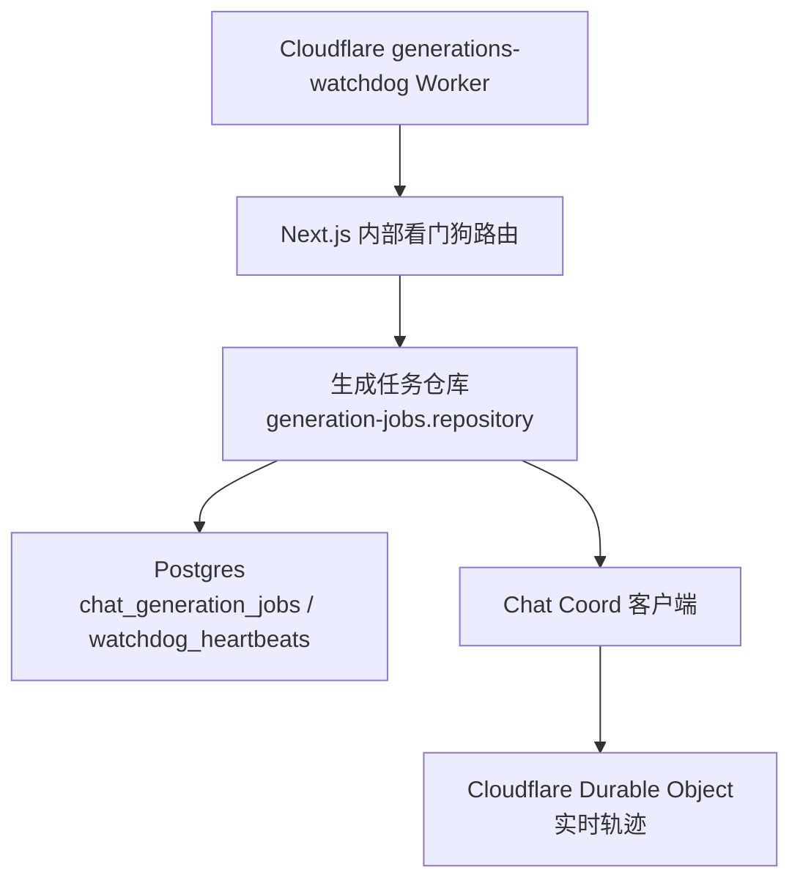
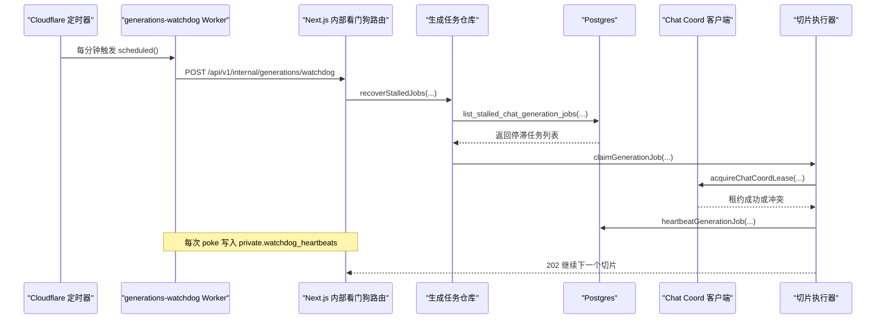
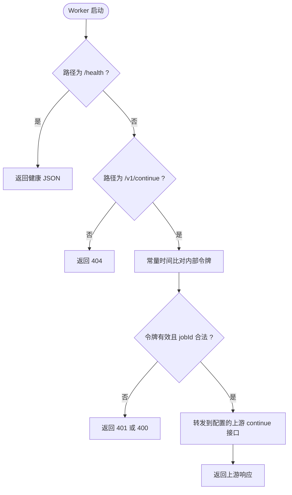
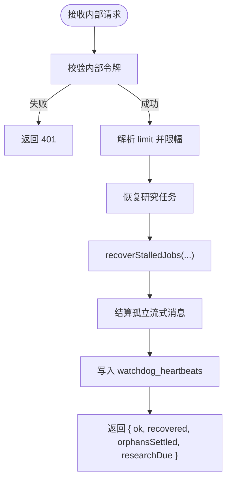
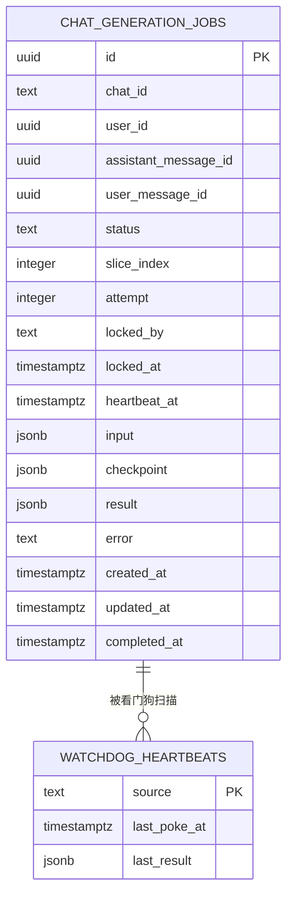
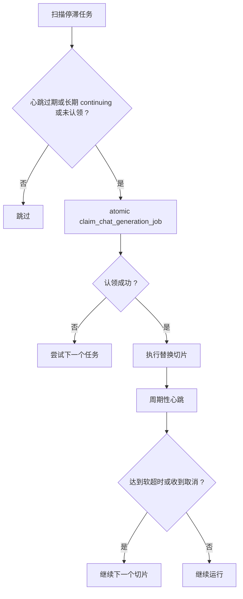
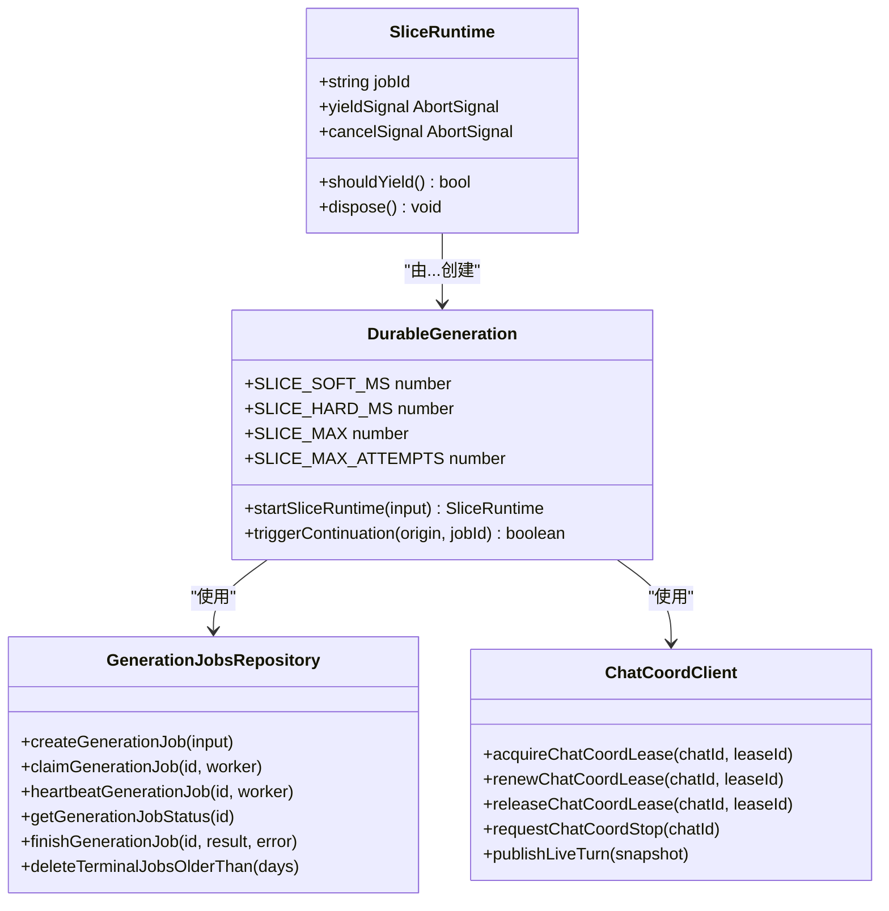
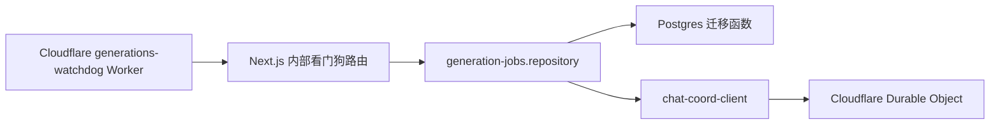

# 生成看门狗 Worker

<cite>
**本文引用的文件**   
- [workers/generations-watchdog/src/index.ts](file://workers/generations-watchdog/src/index.ts)
- [src/app/api/v1/internal/generations/watchdog/route.ts](file://src/app/api/v1/internal/generations/watchdog/route.ts)
- [src/server/chat/durable-generation.ts](file://src/server/chat/durable-generation.ts)
- [src/server/repositories/generation-jobs.repository.ts](file://src/server/repositories/generation-jobs.repository.ts)
- [src/server/chat/chat-coord-client.ts](file://src/server/chat/chat-coord-client.ts)
- [supabase/migrations/20260929120000_chat_generation_jobs.sql](file://supabase/migrations/20260929120000_chat_generation_jobs.sql)
- [supabase/migrations/20260929140000_watchdog_heartbeats.sql](file://supabase/migrations/20260929140000_watchdog_heartbeats.sql)
- [docs/background-generations.md](file://docs/background-generations.md)
</cite>

## 目录
1. [引言](#引言)
2. [项目结构](#项目结构)
3. [核心组件](#核心组件)
4. [架构总览](#架构总览)
5. [详细组件分析](#详细组件分析)
6. [依赖关系分析](#依赖关系分析)
7. [性能与可靠性特征](#性能与可靠性特征)
8. [故障排查指南](#故障排查指南)
9. [结论](#结论)

## 引言
本文围绕“生成看门狗 Worker”构建完整技术文档，解释长时后台任务（聊天轮次）的监控、超时检测、自动恢复机制，并说明任务状态跟踪、进度汇报、异常处理、资源与心跳健康、告警日志聚合、以及对外接口。同时描述其与主应用生成系统、Cloudflare Worker、Postgres 持久层和协调器的集成方式，给出可操作的任务提交、状态查询、手动干预路径。

该方案的核心思想是：将一次聊天轮次拆分为多个“切片”，每个切片受服务器less 函数预算限制；通过数据库检查点、租约与心跳实现跨进程、跨实例恢复；由 Cloudflare 上的“generations-watchdog”Worker 每分钟触发主应用内部看门狗，发现心跳停滞或悬挂任务后，原子性地抢占并拉起替换切片，从而保证长时间任务不丢失。

## 项目结构
与生成看门狗相关的代码分布在三个层次：

- Cloudflare Worker 层：`workers/generations-watchdog`，负责按分钟调度、调用主应用内部接口、提供健康检查与直接续接入口。
- Next.js 主应用层：`src/app/api/v1/internal/generations/watchdog` 路由，鉴权、扫描停滞任务、清理孤立消息、写心跳探针表。
- 业务与数据层：`src/server/chat/durable-generation.ts`、`src/server/repositories/generation-jobs.repository.ts`、`src/server/chat/chat-coord-client.ts`，以及 Postgres 迁移中的 `chat_generation_jobs` 表和辅助函数。

**图示来源**
- [workers/generations-watchdog/src/index.ts:1-183](file://workers/generations-watchdog/src/index.ts#L1-L183)
- [src/app/api/v1/internal/generations/watchdog/route.ts:1-69](file://src/app/api/v1/internal/generations/watchdog/route.ts#L1-L69)
- [src/server/chat/durable-generation.ts:1-200](file://src/server/chat/durable-generation.ts#L1-L200)
- [src/server/repositories/generation-jobs.repository.ts:1-200](file://src/server/repositories/generation-jobs.repository.ts#L1-L200)
- [supabase/migrations/20260929120000_chat_generation_jobs.sql:1-182](file://supabase/migrations/20260929120000_chat_generation_jobs.sql#L1-L182)
- [supabase/migrations/20260929140000_watchdog_heartbeats.sql:1-17](file://supabase/migrations/20260929140000_watchdog_heartbeats.sql#L1-L17)

**章节来源**
- [docs/background-generations.md:1-115](file://docs/background-generations.md#L1-L115)

## 核心组件
- **Cloudflare 看门狗 Worker**：定时每分调用主应用 `/api/v1/internal/generations/watchdog`；也暴露 `/health` 和可选的 `/v1/continue` 转发入口。
- **Next.js 内部看门狗路由**：校验内部令牌、查询停滞任务、恢复研究任务、结算孤立流式消息、写入 `watchdog_heartbeats`。
- **持久化生成任务模型**：`chat_generation_jobs` 表定义任务生命周期、切片索引、尝试次数、心跳、输入、检查点、结果和错误信息。
- **任务仓库**：封装创建、认领、心跳、状态查询、列表停滞任务、完成、删除陈旧行等能力。
- **切片运行时**：管理软超时、硬超时、心跳、取消信号、协调器租约续约、用户停止轮询。
- **协调器客户端**：提供 Chat Coord 的租约获取、续约、释放、停止请求与实时轨迹发布。

**章节来源**
- [workers/generations-watchdog/src/index.ts:1-183](file://workers/generations-watchdog/src/index.ts#L1-L183)
- [src/app/api/v1/internal/generations/watchdog/route.ts:1-69](file://src/app/api/v1/internal/generations/watchdog/route.ts#L1-L69)
- [supabase/migrations/20260929120000_chat_generation_jobs.sql:1-182](file://supabase/migrations/20260929120000_chat_generation_jobs.sql#L1-L182)
- [src/server/repositories/generation-jobs.repository.ts:1-200](file://src/server/repositories/generation-jobs.repository.ts#L1-L200)
- [src/server/chat/durable-generation.ts:1-200](file://src/server/chat/durable-generation.ts#L1-L200)
- [src/server/chat/chat-coord-client.ts:1-175](file://src/server/chat/chat-coord-client.ts#L1-L175)

## 架构总览
生成看门狗的端到端流程如下：

**图示来源**
- [workers/generations-watchdog/src/index.ts:1-183](file://workers/generations-watchdog/src/index.ts#L1-L183)
- [src/app/api/v1/internal/generations/watchdog/route.ts:1-69](file://src/app/api/v1/internal/generations/watchdog/route.ts#L1-L69)
- [src/server/chat/durable-generation.ts:1-200](file://src/server/chat/durable-generation.ts#L1-L200)
- [src/server/repositories/generation-jobs.repository.ts:1-200](file://src/server/repositories/generation-jobs.repository.ts#L1-L200)
- [supabase/migrations/20260929120000_chat_generation_jobs.sql:1-182](file://supabase/migrations/20260929120000_chat_generation_jobs.sql#L1-L182)

## 详细组件分析

### Cloudflare 看门狗 Worker
职责：
- 每分调用主应用内部看门狗接口，携带内部令牌与固定 UA。
- 对调用失败进行有限重试与退避，记录网络错误和响应状态。
- 提供 `/health` 健康检查。
- 可选地提供 `/v1/continue` 转发，用于从 Cloudflare 侧直接续接某个 jobId，但上游目标必须来自配置而非请求体。

关键行为：
- 若缺少 `GENERATIONS_INTERNAL_TOKEN`，直接记录配置缺失事件并返回失败。
- 最多三次尝试，间隔递增，使用 `AbortSignal.timeout(15_000)` 控制请求超时。
- `/v1/continue` 对 token 做 SHA-256 常量时间比较，防止时序攻击；对 jobId 做 UUID 正则校验。
- 转发请求到配置的 `CONTINUATION_ORIGIN`，否则回退到 `APP_ORIGIN`。

**图示来源**
- [workers/generations-watchdog/src/index.ts:1-183](file://workers/generations-watchdog/src/index.ts#L1-L183)

**章节来源**
- [workers/generations-watchdog/src/index.ts:1-183](file://workers/generations-watchdog/src/index.ts#L1-L183)

### Next.js 内部看门狗路由
职责：
- 仅接受内部请求，拒绝外部访问。
- 支持 GET 与 POST，统一进入 `run` 逻辑。
- 根据 `limit` 参数限制扫描任务数量，默认 10，上限 25。
- 恢复停滞生成任务与研究任务。
- 结算孤立的流式消息。
- 将本次探测结果写入 `private.watchdog_heartbeats`，便于运维确认驱动是否存活。

关键约束：
- 路由设置 Node.js runtime、动态渲染、最大时长 60 秒，确保单次看门狗扫描不会超预算。
- 写入心跳表的失败被忽略，避免阻塞主要恢复逻辑。

**图示来源**
- [src/app/api/v1/internal/generations/watchdog/route.ts:1-69](file://src/app/api/v1/internal/generations/watchdog/route.ts#L1-L69)
- [supabase/migrations/20260929140000_watchdog_heartbeats.sql:1-17](file://supabase/migrations/20260929140000_watchdog_heartbeats.sql#L1-L17)

**章节来源**
- [src/app/api/v1/internal/generations/watchdog/route.ts:1-69](file://src/app/api/v1/internal/generations/watchdog/route.ts#L1-L69)
- [supabase/migrations/20260929140000_watchdog_heartbeats.sql:1-17](file://supabase/migrations/20260929140000_watchdog_heartbeats.sql#L1-L17)

### 任务状态与持久化模型
`chat_generation_jobs` 是任务的权威状态源，字段包括：
- `id`、`chat_id`、`user_id`、`assistant_message_id`、`user_message_id`
- `status`：`queued`、`running`、`continuing`、`paused_for_user`、`complete`、`failed`、`cancelled`
- `slice_index`：当前切片编号
- `attempt`：同一切片的崩溃重试计数
- `locked_by`、`locked_at`：当前持有者
- `heartbeat_at`：心跳时间
- `input`：恢复所需的原始输入
- `checkpoint`：模型对话、工具调用、片段、标题等检查点
- `result`、`error`、`created_at`、`updated_at`、`completed_at`

重要约束：
- 每个聊天在活跃状态中只有一个任务，通过部分唯一索引保障。
- 索引 `chat_generation_jobs_watchdog_idx` 按心跳升序过滤活跃状态，方便看门狗快速定位最久未心跳的任务。
- 行级安全关闭公共读取权限，只允许服务角色访问。

**图示来源**
- [supabase/migrations/20260929120000_chat_generation_jobs.sql:1-182](file://supabase/migrations/20260929120000_chat_generation_jobs.sql#L1-L182)
- [supabase/migrations/20260929140000_watchdog_heartbeats.sql:1-17](file://supabase/migrations/20260929140000_watchdog_heartbeats.sql#L1-L17)

**章节来源**
- [supabase/migrations/20260929120000_chat_generation_jobs.sql:1-182](file://supabase/migrations/20260929120000_chat_generation_jobs.sql#L1-L182)
- [supabase/migrations/20260929140000_watchdog_heartbeats.sql:1-17](file://supabase/migrations/20260929140000_watchdog_heartbeats.sql#L1-L17)

### 任务认领与停滞检测
数据库提供两个关键函数：

- `claim_chat_generation_job(job_id, worker, running_stale_after)`：原子性认领任务。允许认领 `queued`、`continuing`，或心跳过旧的 `running`；认领后更新状态为 `running`、设置锁、刷新心跳、增加尝试次数。
- `list_stalled_chat_generation_jobs(running_stale_after, limit)`：返回心跳过期、长期处于 `continuing` 无心跳、或长时间未认领的 `queued` 任务。

认领规则要点：
- 同一聊天只允许一个活跃任务。
- 如果任务处于 `running` 且心跳未过期，则拒绝认领，避免抢占健康任务。
- 如果任务处于 `running` 且心跳过期，则视为切片死亡，允许其他 worker 接管并增加 `attempt`。
- 终端状态不可认领。

**图示来源**
- [supabase/migrations/20260929120000_chat_generation_jobs.sql:91-179](file://supabase/migrations/20260929120000_chat_generation_jobs.sql#L91-L179)

**章节来源**
- [supabase/migrations/20260929120000_chat_generation_jobs.sql:91-179](file://supabase/migrations/20260929120000_chat_generation_jobs.sql#L91-L179)

### 切片运行时、超时与恢复
切片运行时负责：
- 软超时：约 240 秒，到达后触发 yield，保存检查点并链式继续。
- 硬超时：约 270 秒，强制中止当前模型流。
- 切片数量上限：48，防止无限循环。
- 切片崩溃重试上限：5 次，超过后任务失败。
- 心跳间隔：约 15 秒，刷新任务心跳并标记聊天正在生成。
- 取消轮询：约 2 秒，检查任务状态和协调器 stop 标志。
- 协调器租约续约：定期向 Chat Coord 续约，失败时 fail-open 以避免误杀健康任务。

**图示来源**
- [src/server/chat/durable-generation.ts:1-200](file://src/server/chat/durable-generation.ts#L1-L200)
- [src/server/repositories/generation-jobs.repository.ts:1-200](file://src/server/repositories/generation-jobs.repository.ts#L1-L200)
- [src/server/chat/chat-coord-client.ts:1-175](file://src/server/chat/chat-coord-client.ts#L1-L175)

**章节来源**
- [src/server/chat/durable-generation.ts:1-200](file://src/server/chat/durable-generation.ts#L1-L200)
- [src/server/repositories/generation-jobs.repository.ts:1-200](file://src/server/repositories/generation-jobs.repository.ts#L1-L200)
- [src/server/chat/chat-coord-client.ts:1-175](file://src/server/chat/chat-coord-client.ts#L1-L175)

### 任务提交、状态查询与手动干预
根据设计文档，对外接口包括：

| 接口 | 认证 | 用途 |
|---|---|---|
| `POST /api/v1/chats/:id/generate` | 用户 | 创建任务，运行 live 切片 |
| `GET /api/v1/chats/:id/generate/status` | 用户 | 查询 `{ active, stopRequested, backgrounded, jobStatus }` |
| `POST /api/v1/chats/:id/generate/stop` | 用户 | 取消任务并释放协调器租约 |
| `GET /api/v1/chats/:id/live` | 用户 | 实时轨迹，优先 Durable Object，回退到任务检查点 |
| `POST /api/v1/internal/generations/continue` | 内部令牌 | 认领任务并立即返回 202，后台执行一个 headless 切片 |
| `GET/POST /api/v1/internal/generations/watchdog` | 内部令牌 | 回收停滞任务，清理旧行，写入心跳 |

内部令牌支持多种来源，Cloudflare Worker 发送专用令牌，每次 poke 都会记录 `private.watchdog_heartbeats`。

**章节来源**
- [docs/background-generations.md:1-115](file://docs/background-generations.md#L1-L115)

## 依赖关系分析
看门狗相关依赖呈现分层耦合：

- Cloudflare Worker 与 Next.js 之间通过 HTTP 内部接口通信，依赖内部令牌鉴权。
- Next.js 路由依赖仓库进行任务恢复和消息清理。
- 仓库依赖数据库函数实现原子认领与停滞任务扫描。
- 仓库和切片运行时依赖协调器客户端维护全局租约和实时轨迹。

**图示来源**
- [workers/generations-watchdog/src/index.ts:1-183](file://workers/generations-watchdog/src/index.ts#L1-L183)
- [src/app/api/v1/internal/generations/watchdog/route.ts:1-69](file://src/app/api/v1/internal/generations/watchdog/route.ts#L1-L69)
- [src/server/repositories/generation-jobs.repository.ts:1-200](file://src/server/repositories/generation-jobs.repository.ts#L1-L200)
- [src/server/chat/chat-coord-client.ts:1-175](file://src/server/chat/chat-coord-client.ts#L1-L175)

**章节来源**
- [workers/generations-watchdog/src/index.ts:1-183](file://workers/generations-watchdog/src/index.ts#L1-L183)
- [src/app/api/v1/internal/generations/watchdog/route.ts:1-69](file://src/app/api/v1/internal/generations/watchdog/route.ts#L1-L69)
- [src/server/repositories/generation-jobs.repository.ts:1-200](file://src/server/repositories/generation-jobs.repository.ts#L1-L200)
- [src/server/chat/chat-coord-client.ts:1-175](file://src/server/chat/chat-coord-client.ts#L1-L175)

## 性能与可靠性特征
- 长时任务不被单 HTTP 请求承载，而是切片化运行，突破服务器less 函数预算限制。
- 心跳周期较短，有助于快速发现死切片；软超时与硬超时分离，减少意外中断。
- 数据库层面使用部分唯一索引和 `FOR UPDATE SKIP LOCKED` 语义，保证每个聊天只有一个活跃任务。
- 看门狗扫描有上限，避免单次处理过多任务导致超时。
- 协调器租约续约失败采用 fail-open，避免因协调器短暂不可用而误杀健康推理。
- 看门狗自身调用具有有限重试与退避，降低瞬时网络抖动影响。
- 心跳探针表以极低成本记录每次 poke 的结果，便于自动化观察驱动健康。

需要注意：
- 当前仓库证据未包含内存泄漏检测、资源监控指标、性能剖析或告警通知的具体实现；这些通常属于平台观测层，不在当前文件范围内。
- 优雅降级主要体现在：协调器不可用时仍允许生成继续、看门狗 poke 失败不影响下次调度、心跳写入失败不阻塞恢复逻辑。

[本节为通用性能讨论，不直接分析具体文件]

## 故障排查指南
常见问题与定位建议：

1. **看门狗未触发**
   - 检查 Cloudflare Worker 是否部署并启用定时任务。
   - 查看 `private.watchdog_heartbeats` 中对应 source 的最新 `last_poke_at`。
   - 确认 `GENERATIONS_INTERNAL_TOKEN` 已配置。

2. **任务长期停滞**
   - 检查 `chat_generation_jobs` 中对应任务的 `status`、`heartbeat_at`、`locked_by`、`attempt`。
   - 若心跳长期过期且仍为 `running`，看门狗应认领并重启切片。
   - 若任务长时间 `continuing` 且心跳过期，同样会被重新认领。

3. **重复执行或竞争**
   - 通过部分唯一索引保障同一聊天只有一个活跃任务。
   - 如果存在并发认领，只有第一个成功；其他会收到空结果。

4. **内部接口鉴权失败**
   - Cloudflare Worker 必须传递正确的 `x-clauxen-internal` 令牌。
   - Next.js 路由要求内部请求，非内部来源会被拒绝。

5. **手动干预**
   - 可通过内部看门狗 GET/POST 触发一次恢复。
   - 如需直接续接某个 jobId，可使用 Cloudflare Worker 的 `/v1/continue`（需正确配置上游）。
   - 用户侧可通过 `POST /api/v1/chats/:id/generate/stop` 显式取消任务。

**章节来源**
- [workers/generations-watchdog/src/index.ts:1-183](file://workers/generations-watchdog/src/index.ts#L1-L183)
- [src/app/api/v1/internal/generations/watchdog/route.ts:1-69](file://src/app/api/v1/internal/generations/watchdog/route.ts#L1-L69)
- [supabase/migrations/20260929120000_chat_generation_jobs.sql:1-182](file://supabase/migrations/20260929120000_chat_generation_jobs.sql#L1-L182)
- [supabase/migrations/20260929140000_watchdog_heartbeats.sql:1-17](file://supabase/migrations/20260929140000_watchdog_heartbeats.sql#L1-L17)
- [docs/background-generations.md:1-115](file://docs/background-generations.md#L1-L115)

## 结论
生成看门狗 Worker 是一个轻量但关键的可靠性组件：它不直接执行模型推理，而是每分钟探测主应用内部看门狗，后者基于 Postgres 心跳与原子认领函数发现并接管停滞任务，确保长时生成任务能在切片边界安全恢复。结合检查点、租约、心跳、切片预算、终止状态与用户停止信号，系统实现了跨实例、跨断连、跨调度的可靠生成。

对于运维与产品而言，建议持续关注：
- `private.watchdog_heartbeats` 的 driver 存活情况。
- `chat_generation_jobs` 中停滞任务数量、心跳延迟、尝试次数。
- 内部接口鉴权配置是否正确。
- 是否需要扩展观测层以实现更细粒度的资源监控、告警通知与性能分析。

[本节为总结性内容，不直接分析具体文件]