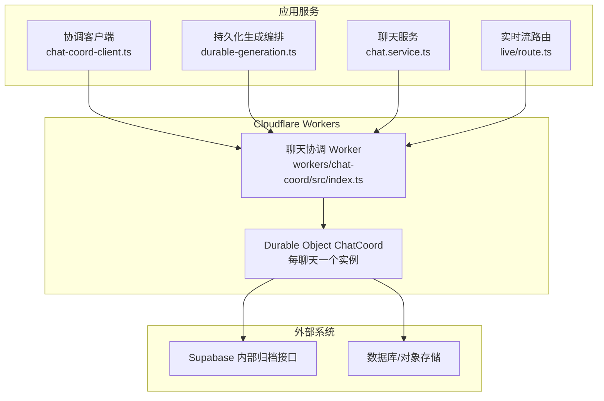
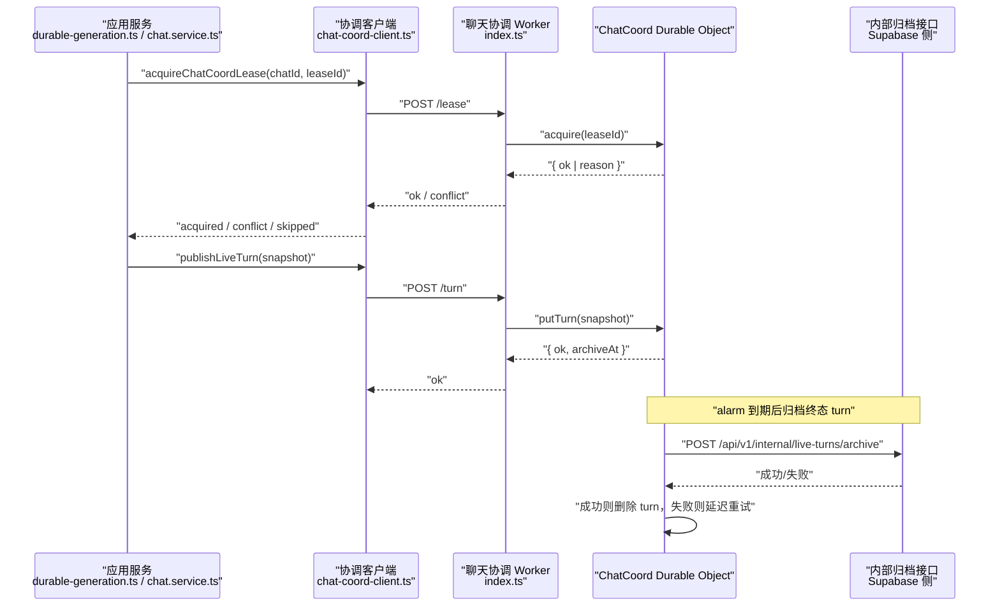
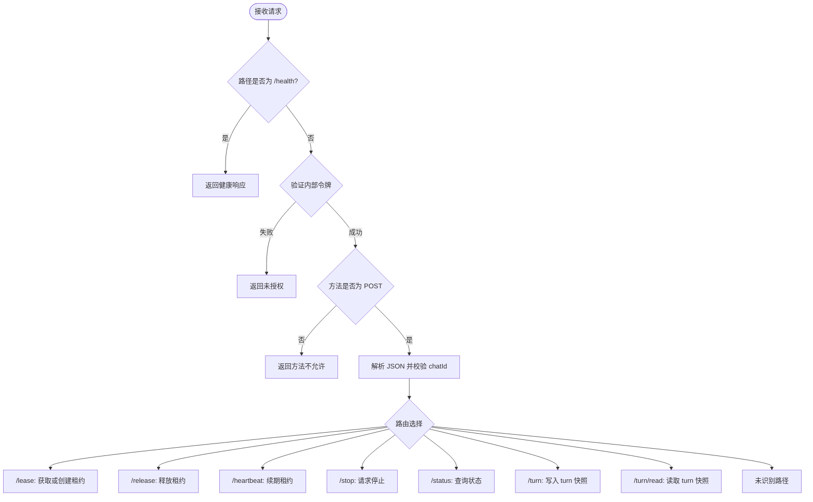
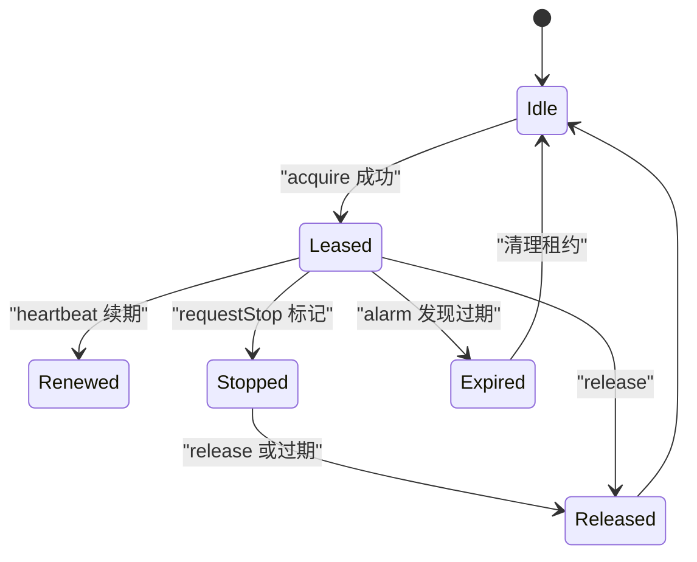
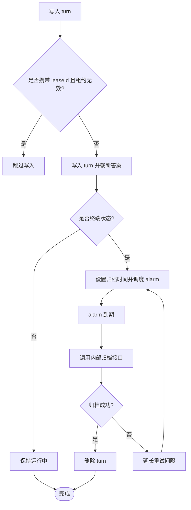
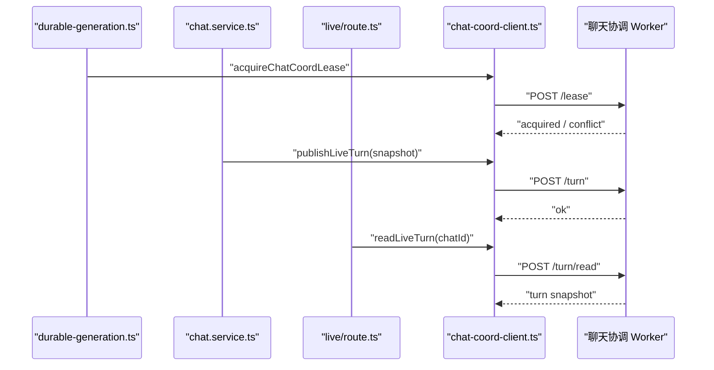
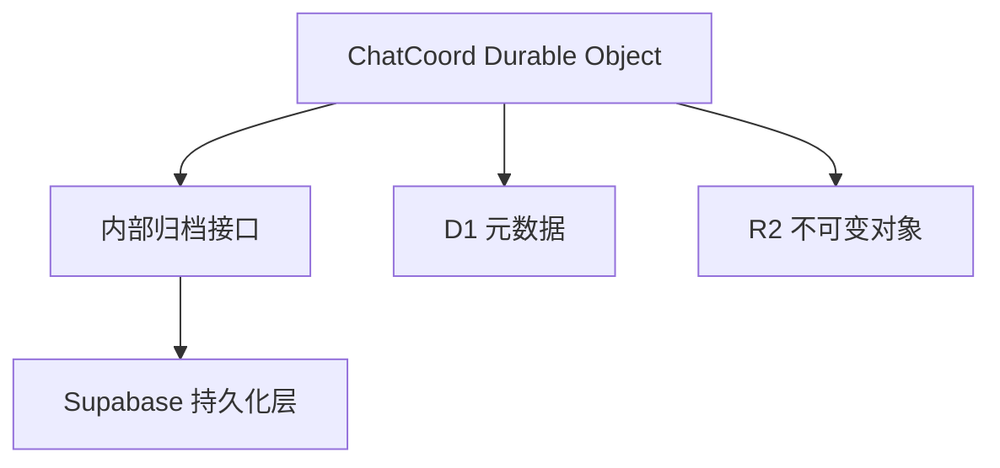
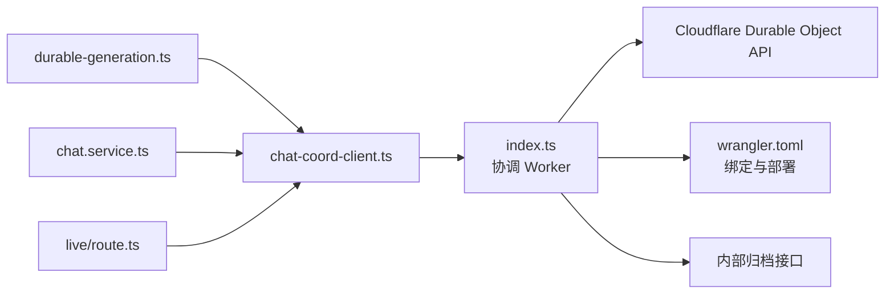

# 聊天协调 Worker

<cite>
**本文引用的文件**   
- [workers/chat-coord/src/index.ts](file://workers/chat-coord/src/index.ts)
- [workers/chat-coord/wrangler.toml](file://workers/chat-coord/wrangler.toml)
- [workers/chat-coord/package.json](file://workers/chat-coord/package.json)
- [src/server/chat/chat-coord-client.ts](file://src/server/chat/chat-coord-client.ts)
- [src/server/chat/durable-generation.ts](file://src/server/chat/durable-generation.ts)
- [src/server/services/chat.service.ts](file://src/server/services/chat.service.ts)
- [src/app/api/v1/chats/[chatId]/live/route.ts](file://src/app/api/v1/chats/[chatId]/live/route.ts)
- [docs/cloudflare-chat-storage-architecture.md](file://docs/cloudflare-chat-storage-architecture.md)
</cite>

## 目录
1. [引言](#引言)
2. [项目结构](#项目结构)
3. [核心组件](#核心组件)
4. [架构总览](#架构总览)
5. [详细组件分析](#详细组件分析)
6. [依赖关系分析](#依赖关系分析)
7. [性能与扩展性](#性能与扩展性)
8. [故障排查指南](#故障排查指南)
9. [结论](#结论)

## 引言
本文件面向“聊天协调 Worker”，系统性说明其在聊天会话中的协调机制、分布式锁、消息路由、会话状态管理、心跳检测与健康检查，以及与多个聊天实例、Supabase 实时数据持久化之间的集成方式。该 Worker 基于 Cloudflare Workers Durable Object 实现，每个聊天会话对应一个稳定的协调实例，负责：
- 为同一聊天生成任务提供全局排他锁（fencing/lease）。
- 维护当前活跃 turn 的轻量级运行态快照。
- 在 turn 完成后触发归档到后端内部接口。
- 暴露健康检查和内部 API，供其他服务端模块调用。

该设计将“实时流式中间状态”与“最终一致性持久化”解耦：Durable Object 保存热路径上的短时状态，数据库和对象存储承担长期一致性与可查询性。

## 项目结构
聊天协调 Worker 是一个独立的 Cloudflare Worker 包，部署为 `clauxen-chat-coord`，并绑定一个名为 `CHAT_COORD` 的 Durable Object 类 `ChatCoord`。其关键产物如下：
- `workers/chat-coord/package.json`：Worker 包定义与脚本。
- `workers/chat-coord/wrangler.toml`：部署配置、Durable Object 绑定、可观测性采样、区域放置和变量。
- `workers/chat-coord/src/index.ts`：HTTP 入口、认证、路由分发以及 `ChatCoord` Durable Object 实现。
- `src/server/chat/chat-coord-client.ts`：服务端客户端封装，负责与协调 Worker 通信。
- 上层服务通过 `durable-generation.ts`、`chat.service.ts`、`live/route.ts` 等模块使用协调能力。

**图表来源**
- [workers/chat-coord/src/index.ts:1-394](file://workers/chat-coord/src/index.ts#L1-L394)
- [src/server/chat/chat-coord-client.ts:1-175](file://src/server/chat/chat-coord-client.ts#L1-L175)
- [docs/cloudflare-chat-storage-architecture.md:1-109](file://docs/cloudflare-chat-storage-architecture.md#L1-L109)

**章节来源**
- [workers/chat-coord/package.json:1-13](file://workers/chat-coord/package.json#L1-L13)
- [workers/chat-coord/wrangler.toml:1-26](file://workers/chat-coord/wrangler.toml#L1-L26)
- [workers/chat-coord/src/index.ts:1-394](file://workers/chat-coord/src/index.ts#L1-L394)

## 核心组件
聊天协调 Worker 的核心由两部分组成：
1. **协调 Worker HTTP 层**：负责请求鉴权、参数校验、按 chatId 路由到具体 Durable Object 实例，并提供 `/health`、`/lease`、`/release`、`/heartbeat`、`/stop`、`/status`、`/turn`、`/turn/read` 等接口。
2. **ChatCoord Durable Object**：为每个聊天会话维护两个键值状态：
   - `lease`：分布式锁状态，包含 leaseId、启动时间、过期时间、是否请求停止。
   - `turn`：当前活跃 turn 的运行快照，包括用户、助手、状态、答案文本、结构化内容、更新时间与归档截止时间。

此外，协调 Worker 还通过定时器 alarm 实现：
- 租约自动释放：当持有者崩溃或超时，自动清理过期租约。
- 终态 turn 归档：对已完成但尚未归档的 turn 定时尝试归档到内部接口；失败则延迟重试。

**章节来源**
- [workers/chat-coord/src/index.ts:1-394](file://workers/chat-coord/src/index.ts#L1-L394)

## 架构总览
聊天协调 Worker 是“事件驱动 + 状态协调”的中心节点。它不直接处理完整推理逻辑，而是为多个聊天实例提供一致的并发控制、状态镜像和生命周期钩子。整体流程如下：

**图表来源**
- [src/server/chat/chat-coord-client.ts:1-175](file://src/server/chat/chat-coord-client.ts#L1-L175)
- [workers/chat-coord/src/index.ts:1-394](file://workers/chat-coord/src/index.ts#L1-L394)
- [docs/cloudflare-chat-storage-architecture.md:1-109](file://docs/cloudflare-chat-storage-architecture.md#L1-L109)

## 详细组件分析

### 聊天协调 Worker HTTP 层
协调 Worker 的 HTTP 层承担以下职责：
- 健康检查：`/health` 返回服务可用标识。
- 内部鉴权：所有业务接口要求携带内部令牌头，未配置或未匹配时返回未授权。
- 参数校验：对 `chatId`、`leaseId`、`assistantId`、`userId`、`status`、`answer` 等进行基础校验。
- 路由分发：根据路径选择获取/设置租约、心跳、停止、状态查询或 turn 写入读取。
- Durable Object 定位：使用 `idFromName(chatId)` 确保同一个聊天始终路由到同一个协调实例。

关键行为说明：
- `/lease`：申请全局排他锁。若存在非目标 leaseId 且未过期，返回冲突；否则写入新租约并安排 alarm。
- `/release`：释放租约，仅原持有者有效。
- `/heartbeat`：续期租约；若租约丢失或已标记停止，返回失败。
- `/stop`：向当前持有者发出停止信号，不立即中断，而是标记 `stopRequested`。
- `/status`：返回是否活跃、是否请求停止、持有者及启动时间。
- `/turn`：写入 turn 快照；带 leaseId 时会校验当前活跃租约，防止被抢占或停止后继续发布。
- `/turn/read`：公开读取当前 turn 快照，供下游服务补充或降级展示。

**图表来源**
- [workers/chat-coord/src/index.ts:201-394](file://workers/chat-coord/src/index.ts#L201-L394)

**章节来源**
- [workers/chat-coord/src/index.ts:201-394](file://workers/chat-coord/src/index.ts#L201-L394)

### ChatCoord Durable Object
`ChatCoord` 是单聊天的协调核心，主要状态字段和行为如下：

| 类别 | 名称 | 含义 | 复杂度说明 |
| --- | --- | --- | --- |
| 状态键 | `lease` | 分布式锁记录 | O(1) 读写 |
| 状态键 | `turn` | 当前活跃 turn 快照 | O(1) 读写 |
| 定时器 | alarm | 统一调度租约过期与 turn 归档 | 每次最多设置一次最小时间戳 |
| 方法 | acquire | 申请租约 | 先读后写，避免重复占用 |
| 方法 | heartbeat | 续期租约 | 更新过期时间并重新调度 alarm |
| 方法 | release | 释放租约 | 仅允许原持有者释放 |
| 方法 | requestStop | 请求停止 | 标记停止位，不阻塞调用方 |
| 方法 | status | 查询活跃状态 | 计算当前是否仍有效 |
| 方法 | putTurn | 写入 turn | 截断超长答案、限制终端状态、触发归档计时 |
| 方法 | readTurnPublic | 读取 turn | 用于下游同步或降级展示 |
| 方法 | scheduleAlarm | 调度下一次 alarm | 取 lease 过期时间与 turn 归档时间的最小值 |
| 方法 | archiveTurn | 归档 turn | 调用内部接口，失败则延迟重试 |

#### 分布式锁与故障转移
- 租约 TTL 为固定时长；若持有者未续期，alarm 会清理过期租约。
- 若已有不同持有者且未过期，新请求会被拒绝，从而保证同一聊天在同一时刻只有一个生成任务主导。
- 支持“停止请求”：调用方可主动请求停止，随后心跳会拒绝续期，持有者应据此终止推理。

**图表来源**
- [workers/chat-coord/src/index.ts:1-200](file://workers/chat-coord/src/index.ts#L1-L200)

#### Turn 状态管理与归档
- turn 快照包含用户、助手、状态、答案、结构化内容和时间戳。
- 答案长度被截断，防止单个 turn 过大影响协调状态。
- 非 running 状态的 turn 会在一定时间后触发归档；归档成功后清除 turn，失败则延迟重试。
- 归档目标是应用内部的 Supabase 相关接口，通过内部令牌保护。

**图表来源**
- [workers/chat-coord/src/index.ts:1-200](file://workers/chat-coord/src/index.ts#L1-L200)

**章节来源**
- [workers/chat-coord/src/index.ts:1-200](file://workers/chat-coord/src/index.ts#L1-L200)

### 协调客户端与服务端集成
协调客户端位于应用服务端，负责：
- 判断是否启用协调 Worker。
- 使用内部令牌和稳定 User-Agent 调用协调 Worker。
- 提供获取租约、释放租约、心跳续期、请求停止、查询状态、发布 live turn、读取 live turn 等函数。
- 在协调不可用时采用 fail-open 策略，避免整个聊天因协调 Worker 不可用而完全失败。

典型调用点：
- `durable-generation.ts`：在生成任务切片执行前申请租约，周期性续期，并在失败时发布终态 turn。
- `chat.service.ts`：在流式生成过程中持续发布 live turn，以便实时界面展示。
- `live/route.ts`：从协调 Worker 读取当前活跃 turn，并结合数据库中的最终状态做优先级合并。

**图表来源**
- [src/server/chat/chat-coord-client.ts:1-175](file://src/server/chat/chat-coord-client.ts#L1-L175)
- [src/server/chat/durable-generation.ts:1-470](file://src/server/chat/durable-generation.ts#L1-L470)
- [src/server/services/chat.service.ts:1-1600](file://src/server/services/chat.service.ts#L1-L1600)
- [src/app/api/v1/chats/[chatId]/live/route.ts:1-200](file://src/app/api/v1/chats/[chatId]/live/route.ts#L1-L200)

**章节来源**
- [src/server/chat/chat-coord-client.ts:1-175](file://src/server/chat/chat-coord-client.ts#L1-L175)
- [src/server/chat/durable-generation.ts:30-470](file://src/server/chat/durable-generation.ts#L30-L470)
- [src/server/services/chat.service.ts:30-160](file://src/server/services/chat.service.ts#L30-L160)
- [src/server/services/chat.service.ts:1180-1600](file://src/server/services/chat.service.ts#L1180-L1600)
- [src/app/api/v1/chats/[chatId]/live/route.ts:1-200](file://src/app/api/v1/chats/[chatId]/live/route.ts#L1-L200)

### 与 Supabase 实时数据库的集成
根据仓库中的架构文档，聊天存储已经向 Cloudflare Workers、D1、R2 和 Durable Object 收敛。协调 Worker 并不直接充当 Supabase Realtime 代理，而是在 turn 达到终态后，通过内部接口把历史数据归档到 Supabase 侧的持久化链路中。整体关系如下：
- Durable Object 保存短时热状态。
- R2 保存不可变 transcript 片段和清单。
- D1 保存可查询元数据。
- 协调 Worker 在 alarm 触发时对终态 turn 进行归档，以补齐 Supabase 侧的数据一致性。

**图表来源**
- [docs/cloudflare-chat-storage-architecture.md:1-109](file://docs/cloudflare-chat-storage-architecture.md#L1-L109)
- [workers/chat-coord/src/index.ts:201-394](file://workers/chat-coord/src/index.ts#L201-L394)

**章节来源**
- [docs/cloudflare-chat-storage-architecture.md:1-109](file://docs/cloudflare-chat-storage-architecture.md#L1-L109)
- [workers/chat-coord/src/index.ts:201-394](file://workers/chat-coord/src/index.ts#L201-L394)

## 依赖关系分析
聊天协调 Worker 的依赖可分为三层：

1. **运行时依赖**
   - Cloudflare Workers Durable Object API。
   - Wrangler 部署配置，包括 DO 绑定、可观测性采样、区域放置、环境变量。

2. **应用服务依赖**
   - 协调客户端封装。
   - 生成编排、聊天服务和实时路由模块。

3. **外部系统依赖**
   - 内部归档接口，用于将终态 turn 写入 Supabase 侧持久化。

**图表来源**
- [workers/chat-coord/src/index.ts:1-394](file://workers/chat-coord/src/index.ts#L1-L394)
- [workers/chat-coord/wrangler.toml:1-26](file://workers/chat-coord/wrangler.toml#L1-L26)
- [src/server/chat/chat-coord-client.ts:1-175](file://src/server/chat/chat-coord-client.ts#L1-L175)
- [src/server/chat/durable-generation.ts:30-470](file://src/server/chat/durable-generation.ts#L30-L470)
- [src/server/services/chat.service.ts:1180-1600](file://src/server/services/chat.service.ts#L1180-L1600)
- [src/app/api/v1/chats/[chatId]/live/route.ts:1-200](file://src/app/api/v1/chats/[chatId]/live/route.ts#L1-L200)

**章节来源**
- [workers/chat-coord/wrangler.toml:1-26](file://workers/chat-coord/wrangler.toml#L1-L26)
- [workers/chat-coord/package.json:1-13](file://workers/chat-coord/package.json#L1-L13)
- [src/server/chat/chat-coord-client.ts:1-175](file://src/server/chat/chat-coord-client.ts#L1-L175)

## 性能与扩展性

### 负载均衡
协调 Worker 本身不是传统意义上的负载均衡器。它通过 Durable Object 的“按 chatId 稳定定位”特性，天然实现按会话维度的负载隔离：
- 不同聊天会话分布在不同的 Durable Object 实例上。
- 同一聊天会话的所有操作集中在同一个协调实例，避免跨实例竞争。
- 对于高流量场景，Cloudflare 会根据地理和负载分配 DO 实例，但同一 chatId 的语义稳定性由 `idFromName` 保障。

### 水平扩容策略
- 增加 Worker 副本不会改变 chatId → DO 的映射语义。
- 扩容主要体现在网络吞吐、请求并行度和 DO 实例分布上。
- 由于 DO 存储是会话内序列化访问，热点聊天仍受限于单 DO 的处理能力；如需进一步拆分，应考虑按用户、项目或分支维度引入更细粒度的协调实体，但这需要谨慎评估状态迁移成本。

### 监控与可观测性
- Worker 开启可观测性，并对高频 DO 协调采样率设置为较低比例，以平衡延迟敏感性和采样开销。
- 建议监控指标包括：
  - 协调 Worker 健康检查成功率。
  - 租约获取冲突率。
  - 心跳续期失败率。
  - turn 归档成功率与重试次数。
  - 各接口平均延迟和错误码分布。

### 与 Supabase 实时数据的交互
- 协调 Worker 不直接订阅 Supabase Realtime 事件，而是在 turn 终态时通过内部接口归档数据。
- 最终一致性由 Supabase 侧持久化链路与 D1/R2 共同保障；协调 Worker 只负责短期运行态和归档触发。
- 实时展示优先使用协调 Worker 中的 turn 快照，但最终结果以数据库为准。

[本节为通用性能与扩展性说明，不直接分析特定代码行]

## 故障排查指南

### 常见问题与定位思路
| 问题现象 | 可能原因 | 排查步骤 | 建议处理方式 |
| --- | --- | --- | --- |
| 协调接口返回未授权 | 缺少或错误配置内部令牌 | 检查 `x-clauxen-internal` 头和 Worker 环境变量 | 确认 `CHAT_COORD_INTERNAL_TOKEN` 已配置 |
| 租约获取失败 | 已有活跃租约且未过期 | 查看 `/status` 返回的活跃信息 | 等待现有生成结束或使用冲突重试策略 |
| 心跳续期失败 | 租约丢失或被请求停止 | 检查心跳调用频率和停止标志 | 让调用方降级为继续运行，并观察最终状态 |
| turn 未归档 | 内部归档接口失败 | 查看 alarm 重试逻辑和归档响应 | 检查内部接口可用性，避免频繁重试导致压力 |
| 协调 Worker 不可用 | 网络或服务异常 | 客户端返回 `chat_coord_unreachable` | 使用 fail-open 策略，确保聊天仍可继续 |
| 长时间无响应 | 生成任务卡住 | 检查租约是否过期、alarm 是否触发 | 人工干预或重启相关生成流程 |

### 关键错误语义
- `generation_in_progress`：同一聊天已有活跃生成任务。
- `generation_lease_lost`：心跳时发现租约不再属于调用方。
- `generation_stop_requested`：租约已被标记停止。
- `unauthorized`：内部令牌校验失败。
- `invalid_chat_id`、`invalid_lease_id`、`invalid_turn`：参数校验失败。
- `method_not_allowed`：非 POST 请求。
- `not_found`：未知路由。

**章节来源**
- [workers/chat-coord/src/index.ts:201-394](file://workers/chat-coord/src/index.ts#L201-L394)
- [src/server/chat/chat-coord-client.ts:1-175](file://src/server/chat/chat-coord-client.ts#L1-L175)

## 结论
聊天协调 Worker 通过 Cloudflare Durable Object 为每个聊天会话提供了轻量但可靠的协调中心。它以分布式锁保证生成任务的互斥执行，以心跳机制实现故障恢复，以 alarm 实现自动归档，并以 fail-open 策略提升整体韧性。同时，它与上层生成编排、聊天服务和实时路由紧密协作，并与 Supabase 持久化链路形成短期热状态与长期冷数据分离的架构。

在实际运维中，建议重点关注：
- 内部令牌和路由鉴权配置。
- 租约冲突率和心跳失败率。
- turn 归档成功率与重试延迟。
- 协调 Worker 的可观测性采样和延迟指标。
- 与数据库、对象存储在最终一致性方面的端到端测试。