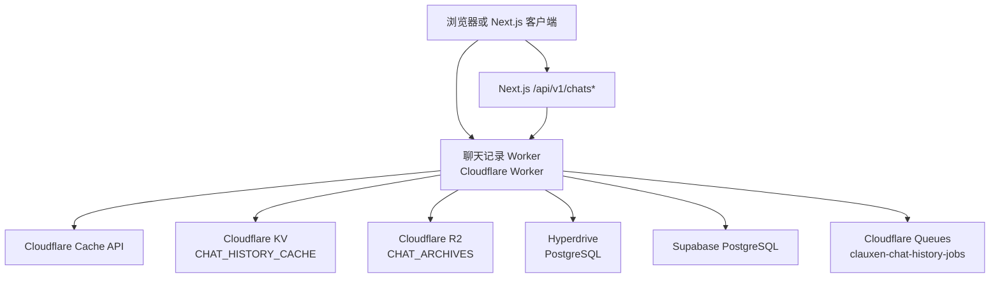
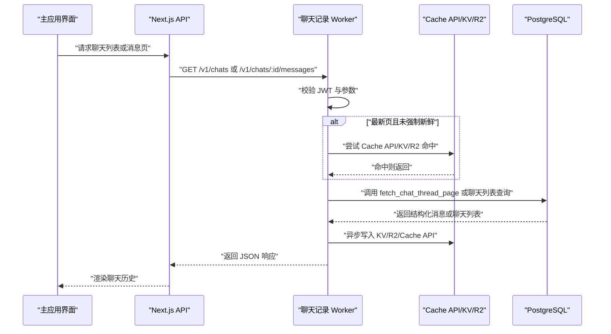
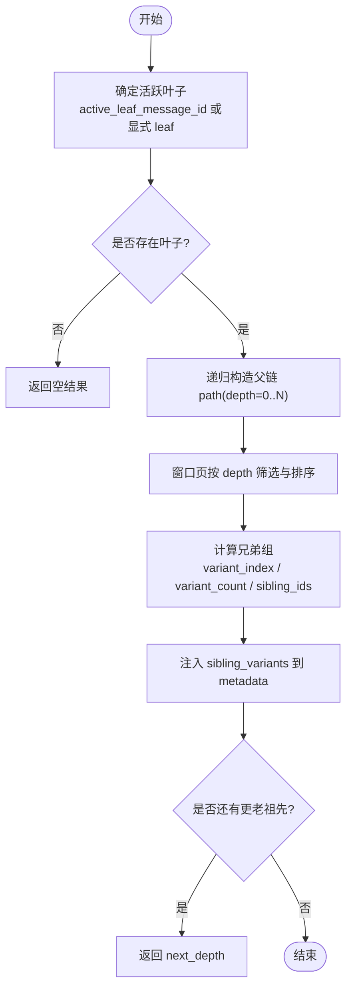
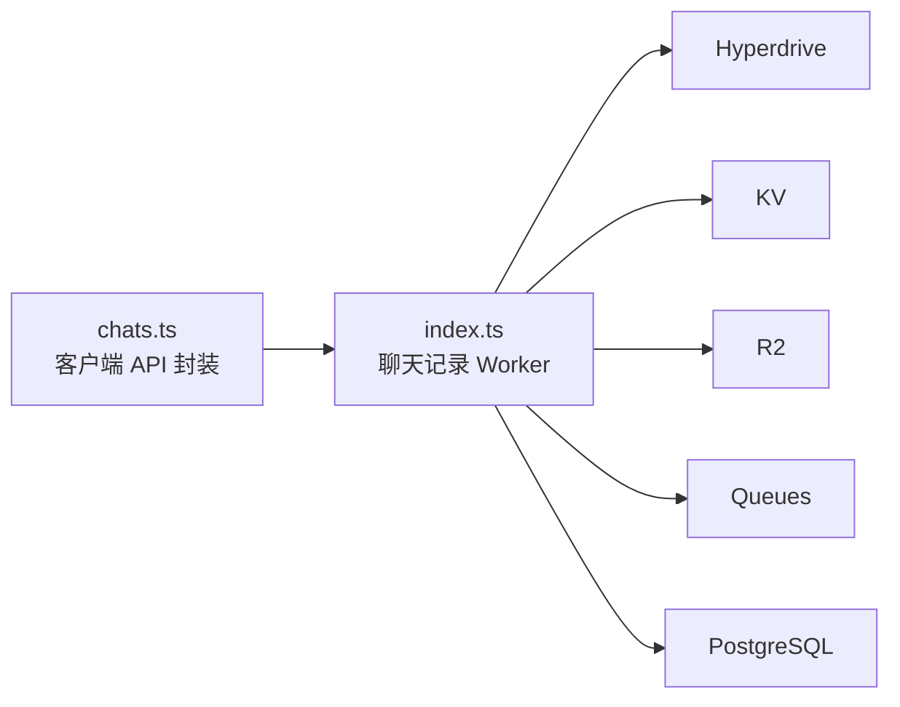
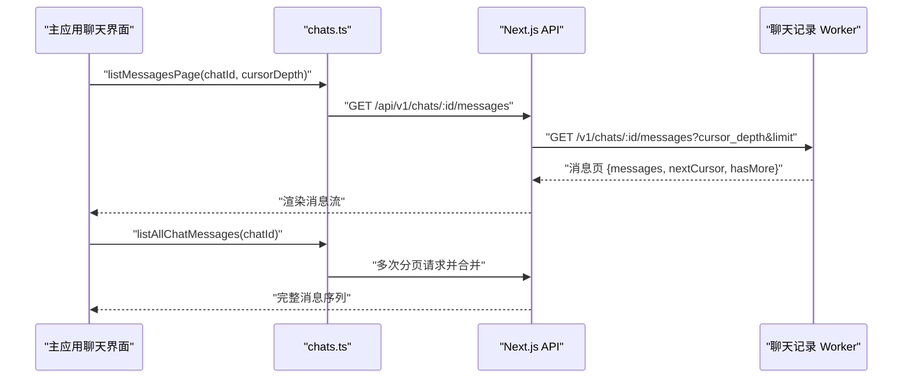

# 聊天记录 Worker

<cite>
**本文引用的文件**   
- [index.ts](file://workers/chat-history/src/index.ts)
- [wrangler.toml](file://workers/chat-history/wrangler.toml)
- [package.json](file://workers/chat-history/package.json)
- [chats.ts](file://src/shared/lib/api/chats.ts)
- [chat-transcript-jsonl.sql](file://supabase/migrations/20260712153000_chat_transcript_jsonl.sql)
- [chat-messages-keyset-pagination.sql](file://supabase/migrations/20260712180000_chat_messages_keyset_pagination.sql)
- [chat-message-tree-branching.sql](file://supabase/migrations/20260930220000_chat_message_tree_branching.sql)
- [chat-branch-persistence-and-perspective.sql](file://supabase/migrations/20261004221000_chat_branch_persistence_and_perspective.sql)
</cite>

## 目录
1. [引言](#引言)
2. [项目结构](#项目结构)
3. [核心组件](#核心组件)
4. [架构总览](#架构总览)
5. [详细组件分析](#详细组件分析)
6. [依赖关系分析](#依赖关系分析)
7. [性能与索引策略](#性能与索引策略)
8. [数据归档、清理与备份恢复](#数据归档清理与备份恢复)
9. [查询接口与批量操作](#查询接口与批量操作)
10. [实时同步与一致性保证](#实时同步与一致性保证)
11. [与主应用聊天界面的集成](#与主应用聊天界面的集成)
12. [故障排查指南](#故障排查指南)
13. [结论](#结论)

## 引言
本文件围绕 Cloudflare Workers 中的“聊天记录 Worker”展开，说明其如何承载聊天历史数据的持久化、查询优化、分页加载、消息树与分支、版本控制、大数据量下的性能策略、缓存层设计、数据归档与清理、备份恢复、查询接口与批量操作、实时同步，以及与主应用聊天界面的集成和数据一致性保证。该 Worker 是聊天系统的高吞吐读取侧：它通过 Hyperdrive 直连 Supabase Postgres，并通过 KV、Cache API 和 R2 构建多层缓存，同时使用 Cloudflare Queues 异步预热与归档，确保高并发下既低延迟又最终一致。

## 项目结构
聊天记录 Worker 是一个独立的 Cloudflare Worker 工程，位于 `workers/chat-history`：
- 入口为 `workers/chat-history/src/index.ts`，负责 HTTP 路由、认证校验、缓存读写、数据库访问、队列消费。
- 运行时配置在 `workers/chat-history/wrangler.toml`，声明了部署区域、可观测性采样率、环境变量、Hyperdrive、KV、R2 桶、Queues Producer/Consumer。
- 依赖由 `workers/chat-history/package.json` 管理，主要依赖 `postgres` 驱动以直连数据库。

**图示来源**
- [index.ts:201-246](file://workers/chat-history/src/index.ts#L201-L246)
- [wrangler.toml:1-58](file://workers/chat-history/wrangler.toml#L1-L58)

**章节来源**
- [index.ts:1-40](file://workers/chat-history/src/index.ts#L1-L40)
- [wrangler.toml:1-58](file://workers/chat-history/wrangler.toml#L1-L58)
- [package.json:1-18](file://workers/chat-history/package.json#L1-L18)

## 核心组件
聊天记录 Worker 的核心职责可拆分为以下组件：
- HTTP 请求处理器：处理 `/health`、`/internal/*`、`/v1/chats`、`/v1/chats/:id/messages` 等路由。
- JWT 验证器：通过 Supabase Auth 用户端点校验 Bearer Token，并在本地 Cache API 中短周期缓存子标识，降低重复认证开销。
- 数据库客户端封装：基于 Hyperdrive 连接字符串创建 `postgres` 客户端，支持“新鲜读”路径（禁用缓存）与普通路径。
- 线程页获取器：调用 SQL RPC `fetch_chat_thread_page` 按深度分页获取活跃分支上的消息。
- 最近消息预取器：提供 Cache API → KV → R2 → Hyperdrive 的多层缓存读取，用于生成阶段的消息上下文。
- 聊天列表获取器：返回用户的聊天列表，支持按项目过滤，并带有列表级缓存。
- 缓存写入与失效：统一写入 KV、R2、Cache API，并在写入后异步刷新相关缓存键。
- 后台任务生产者与消费者：通过 Queues 触发非阻塞的“预热+归档”，失败重试并落 DLQ。

**章节来源**
- [index.ts:201-500](file://workers/chat-history/src/index.ts#L201-L500)
- [index.ts:501-850](file://workers/chat-history/src/index.ts#L501-L850)
- [index.ts:851-1126](file://workers/chat-history/src/index.ts#L851-L1126)

## 架构总览
聊天记录 Worker 的端到端架构如下：
- 客户端通过 Next.js API 或直接调用 Worker 的 `/v1/chats` 与 `/v1/chats/:id/messages` 接口。
- Worker 对写路径后的读进行“新鲜读”优先，必要时走无缓存的 Hyperdrive 绑定，保证强一致。
- 最新页缓存命中时直接返回；否则依次尝试 KV、R2 归档，最后回源到数据库。
- 写完成后，可通过内部接口或队列异步预热多个 limit 的页面，并将结果写入 KV/R2/Cache API。
- 所有外部响应附带 CORS 头，JWT 验证结果会被短期缓存以减少重复鉴权。

**图示来源**
- [index.ts:851-1126](file://workers/chat-history/src/index.ts#L851-L1126)
- [index.ts:201-500](file://workers/chat-history/src/index.ts#L201-L500)

## 详细组件分析

### 认证与会话校验
Worker 不自行解析 JWT，而是复用 Supabase Auth 的用户端点，将 Bearer Token 转换为 `sub`，并在本地 Cache API 中以摘要键缓存短生命周期结果。这显著减少同一 colo 内并行请求对 Auth 的重复调用。CORS 允许来自配置域名的跨站访问，并对内部接口要求专用 token。

**章节来源**
- [index.ts:80-140](file://workers/chat-history/src/index.ts#L80-L140)
- [index.ts:851-900](file://workers/chat-history/src/index.ts#L851-L900)

### 数据库客户端与新鲜读
`sqlClient(env, fresh)` 根据是否启用“新鲜读”选择连接串：若传入 `fresh=true`，优先使用 `HYPERDRIVE_FRESH`，否则使用默认 Hyperdrive 或 `DATABASE_URL`。客户端池大小限制为 1，避免连接泄漏；每次调用结束后显式关闭连接。

**章节来源**
- [index.ts:140-200](file://workers/chat-history/src/index.ts#L140-L200)

### 消息树与分支聊天
数据库层通过迁移将每条消息作为树节点，新增 `parent_message_id`、`depth`、`variant_index`、`variant_count` 字段。每个聊天的可见线程锚定在 `active_leaf_message_id`，通过递归 CTE 从叶子向上回溯祖先，形成一条线性可见路径。分支通过插入兄弟节点实现，而非原地修改，从而保留完整编辑与重生成历史。

SQL RPC `fetch_chat_thread_page` 返回：
- 当前活跃路径上按深度分页的消息。
- 每个节点的变体序号与总数。
- `has_more` 与 `next_depth`，供客户端继续加载更多祖先。
- 兄弟节点 ID 与变体元数据，便于客户端即时切换分支而无需额外请求。

**图示来源**
- [chat-message-tree-branching.sql:1-200](file://supabase/migrations/20260930220000_chat_message_tree_branching.sql#L1-L200)
- [chat-branch-persistence-and-perspective.sql:1-200](file://supabase/migrations/20261004221000_chat_branch_persistence_and_perspective.sql#L1-L200)

**章节来源**
- [chat-message-tree-branching.sql:1-200](file://supabase/migrations/20260930220000_chat_message_tree_branching.sql#L1-L200)
- [chat-branch-persistence-and-perspective.sql:1-200](file://supabase/migrations/20261004221000_chat_branch_persistence_and_perspective.sql#L1-L200)

### 分页加载与游标
消息历史有两种分页模式：
- 最新 N 条：按深度递增从活跃叶子向外加载，适合渲染当前对话视图。
- 旧消息滚动：采用复合游标 `(created_at, id)` 的键集分页，适用于长线程的无限滚动。

客户端侧还实现了自动合并多页的全量加载函数，对超长线程在首次绘制前尽可能补齐，同时防御游标停滞导致的循环。

**章节来源**
- [chat-messages-keyset-pagination.sql:1-117](file://supabase/migrations/20260712180000_chat_messages_keyset_pagination.sql#L1-L117)
- [chats.ts:1-200](file://src/shared/lib/api/chats.ts#L1-L200)

### 最近消息预取与生成路径
生成流程需要模型提示上下文，因此 Worker 提供内部接口 `/internal/recent`，按用户与聊天维度读取最近的活跃路径消息。其缓存阶梯为：
1. Cache API
2. KV
3. R2 归档
4. Hyperdrive + SQL RPC

这种分层显著降低生成时的数据库压力，尤其在高频并发场景下。

**章节来源**
- [index.ts:246-350](file://workers/chat-history/src/index.ts#L246-L350)
- [index.ts:851-920](file://workers/chat-history/src/index.ts#L851-L920)

### 聊天列表与项目过滤
聊天列表接口支持按项目过滤，并返回是否置顶状态。列表缓存 TTL 较短，且可在强制新鲜模式下绕过缓存，保证新创建的聊天能尽快出现在侧边栏。

**章节来源**
- [index.ts:350-500](file://workers/chat-history/src/index.ts#L350-L500)
- [index.ts:920-1000](file://workers/chat-history/src/index.ts#L920-L1000)

### 缓存写入与失效
Worker 提供统一的缓存写入逻辑：
- KV：按 `latest:<schemaVersion>:userId:chatId:limit` 存储页面负载。
- R2：按 `archives/<schemaVersion>/<userId>/<chatId>/latest-<limit>.json` 存储归档对象。
- Cache API：以内部 URL 形式缓存响应体，便于同 colo 快速命中。

失效逻辑会在写入后删除相关键，包括聊天页缓存与列表缓存，避免脏读。

**章节来源**
- [index.ts:501-650](file://workers/chat-history/src/index.ts#L501-L650)

### 后台预热与归档
内部接口 `/internal/enqueue` 和 `/internal/warm` 支持非阻塞预热。生产者发送 `warm_and_archive` 消息，消费者批量执行预热，遍历多个 limit，调用数据库获取活跃路径消息，然后写入 KV/R2/Cache API，并刷新聊天列表缓存。失败会重试，最终进入死信队列。

**章节来源**
- [index.ts:650-850](file://workers/chat-history/src/index.ts#L650-L850)
- [index.ts:1000-1126](file://workers/chat-history/src/index.ts#L1000-L1126)
- [wrangler.toml:40-58](file://workers/chat-history/wrangler.toml#L40-L58)

## 依赖关系分析
聊天记录 Worker 的外部依赖包括：
- Supabase PostgreSQL：通过 Hyperdrive 加速，并提供聊天消息、聊天列表、转录行等表及 RPC。
- Cloudflare KV：缓存最新页与列表页。
- Cloudflare R2：归档聊天历史页面，支持离线读取与冷路径恢复。
- Cloudflare Queues：异步执行预热与归档任务。
- Cloudflare Cache API：就近缓存响应体与 JWT 验证结果。
- Next.js API：作为主应用前端的主要入口，间接调用 Worker。

**图示来源**
- [chats.ts:1-200](file://src/shared/lib/api/chats.ts#L1-L200)
- [index.ts:201-500](file://workers/chat-history/src/index.ts#L201-L500)

**章节来源**
- [wrangler.toml:1-58](file://workers/chat-history/wrangler.toml#L1-L58)
- [index.ts:201-500](file://workers/chat-history/src/index.ts#L201-L500)

## 性能与索引策略
聊天记录 Worker 的性能优化贯穿三层：

### 数据库层
- 消息键集分页索引：针对 `chat_messages(chat_id, created_at desc, id desc)` 建立复合索引，过滤已取消消息，提升滚动加载性能。
- 消息树索引：针对 `chat_messages(chat_id, parent_message_id, created_at, id)` 建立索引，加速兄弟查找与变体计数。
- 活跃叶子索引：`chats(active_leaf_message_id)` 带条件索引，提高活跃路径起点定位效率。
- 转录行索引：`chat_transcript_lines(chat_id, seq)`、`(user_id, created_at desc)`、`(training_eligible, created_at desc)` 等索引，支撑训练导出与审计。

### 缓存层
- Cache API：近内存缓存，TTL 由环境变量控制，适合高频热键。
- KV：持久化缓存，TTL 较短，避免长期脏数据。
- R2：大对象归档，适合冷读与灾备恢复。
- JWT 缓存：本地 Cache API 缓存用户子标识，减少重复鉴权。

### 查询层
- 深度分页：活跃路径按 depth 分页，避免一次性拉取整棵树。
- 最近消息阶梯读取：优先命中缓存，再降级到数据库。
- 最大限制保护：所有 limit 被钳制在安全范围内，防止超大查询。

**章节来源**
- [chat-messages-keyset-pagination.sql:1-117](file://supabase/migrations/20260712180000_chat_messages_keyset_pagination.sql#L1-L117)
- [chat-message-tree-branching.sql:1-200](file://supabase/migrations/20260930220000_chat_message_tree_branching.sql#L1-L200)
- [chat-transcript-jsonl.sql:1-168](file://supabase/migrations/20260712153000_chat_transcript_jsonl.sql#L1-L168)
- [index.ts:246-500](file://workers/chat-history/src/index.ts#L246-L500)

## 数据归档、清理与备份恢复
### 归档
Worker 将最新 N 条消息的页面负载序列化后写入 R2，键包含 schema 版本、用户、聊天与 limit。归档由后台队列触发，也可在写入缓存时同步落盘，确保冷路径可用。

### 清理
- 缓存失效：写入后立即删除相关 KV、R2、Cache API 键，避免脏读。
- 列表缓存：在消息或标题变更后失效，保证侧边栏更新。
- Schema 版本：缓存键包含 `CACHE_SCHEMA_VERSION`，升级时可自然失效旧格式。

### 备份恢复
- 转录行：提供 `chat_transcripts_jsonl` 视图与 `append_chat_transcript_line`、`replace_chat_transcript_lines` 函数，支持按聊天导出 JSONL，便于训练与审计。
- R2 归档：可作为聊天历史的轻量备份，结合用户与聊天维度检索。
- 数据库迁移：所有结构变更通过迁移脚本管理，具备可回滚与重建能力。

**章节来源**
- [index.ts:501-750](file://workers/chat-history/src/index.ts#L501-L750)
- [chat-transcript-jsonl.sql:1-168](file://supabase/migrations/20260712153000_chat_transcript_jsonl.sql#L1-L168)

## 查询接口与批量操作
### 公开接口
- `GET /v1/chats`：返回用户聊天列表，支持 `projectId`、`limit`、`fresh` 参数。
- `GET /v1/chats/:id/messages`：返回活跃路径消息页，支持 `limit`、`cursor_depth`、`fresh` 参数。

### 内部接口
- `POST /internal/enqueue`：向队列发送预热任务。
- `POST /internal/warm`：同步执行预热与归档。
- `POST /internal/invalidate`：主动失效缓存。
- `POST /internal/recent`：读取最近消息，供生成路径使用。
- `GET /health`：健康检查，暴露后端绑定状态。

### 批量操作
- 预热批处理：队列消费者批量处理消息，最多 8 条、超时 2 秒、重试 3 次。
- 列表刷新：预热成功后刷新用户级聊天列表缓存。

**章节来源**
- [index.ts:851-1126](file://workers/chat-history/src/index.ts#L851-L1126)

## 实时同步与一致性保证
### 一致性
- 写后读强一致：关键查询使用“新鲜读”路径，跳过 Hyperdrive 缓存，确保最新数据。
- 缓存标签：响应携带缓存标签，便于边缘层精准失效。
- Schema 版本：缓存键包含版本，避免不同结构污染。

### 实时同步
- 数据库层开启 `replica identity full`，配合 Supabase Realtime 推送 UPDATE 载荷。
- 客户端通过 Next.js API 订阅实时事件，并结合 Worker 提供的消息树结构即时切换分支。

**章节来源**
- [chat-messages-keyset-pagination.sql:1-117](file://supabase/migrations/20260712180000_chat_messages_keyset_pagination.sql#L1-L117)
- [index.ts:201-246](file://workers/chat-history/src/index.ts#L201-L246)

## 与主应用聊天界面的集成
主应用通过 `src/shared/lib/api/chats.ts` 提供客户端 API：
- `listChats`：获取聊天列表。
- `listMessagesPage`：按深度游标分页加载消息。
- `listAllChatMessages`：自动拼接多页，去重并按时间顺序合并。
- `appendMessage`：追加用户消息。
- `getLiveTurn`：获取正在生成的实时轮次。

这些方法将请求转发到 Next.js API，再由服务端协调 Worker 或数据库，保证主应用与 Worker 的数据一致性。

**图示来源**
- [chats.ts:1-200](file://src/shared/lib/api/chats.ts#L1-L200)
- [index.ts:851-1126](file://workers/chat-history/src/index.ts#L851-L1126)

**章节来源**
- [chats.ts:1-200](file://src/shared/lib/api/chats.ts#L1-L200)
- [index.ts:851-1126](file://workers/chat-history/src/index.ts#L851-L1126)

## 故障排查指南
常见问题与定位建议：
- 401 未授权：检查 Authorization 头是否包含有效 Bearer Token，确认 Supabase URL 与匿名密钥配置正确。
- 404 聊天不存在：确认聊天属于当前用户且未被删除，检查 `fetch_chat_thread_page` 的权限守卫。
- 500 内部错误：查看 Worker 日志与错误消息，区分数据库错误、缓存写入失败、R2 读取异常。
- 缓存不一致：使用 `/internal/invalidate` 清除相关缓存键，或设置 `fresh=0` 强制新鲜读。
- 队列失败：检查 Dead Letter Queue，确认重试次数与批处理上限，排查预热任务参数。

**章节来源**
- [index.ts:851-1126](file://workers/chat-history/src/index.ts#L851-L1126)

## 结论
聊天记录 Worker 通过数据库树结构、深度分页、多层缓存与后台预热，构建了高吞吐、低延迟、可扩展的聊天历史服务。它与主应用通过标准化 API 集成，保障数据一致性与实时同步。未来可根据业务增长进一步扩展缓存层级、优化索引策略、增强归档与恢复机制，以满足更大规模与更高可靠性的需求。